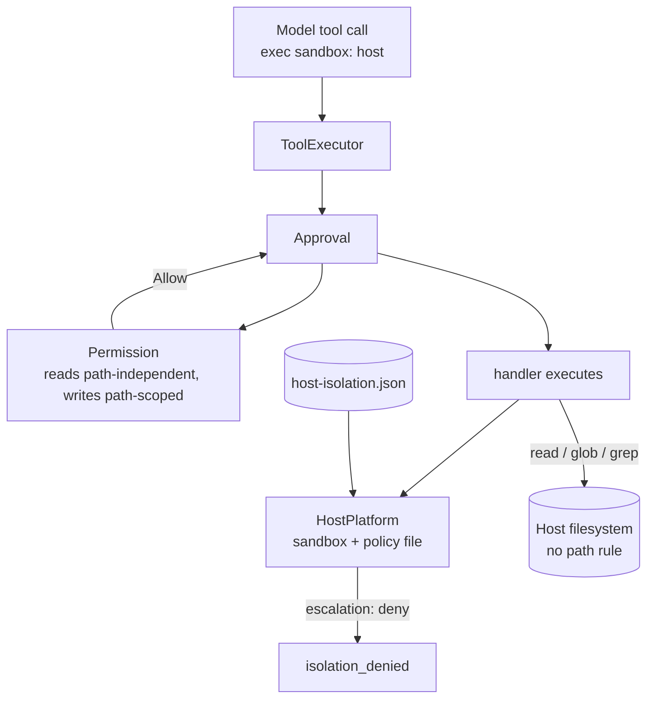
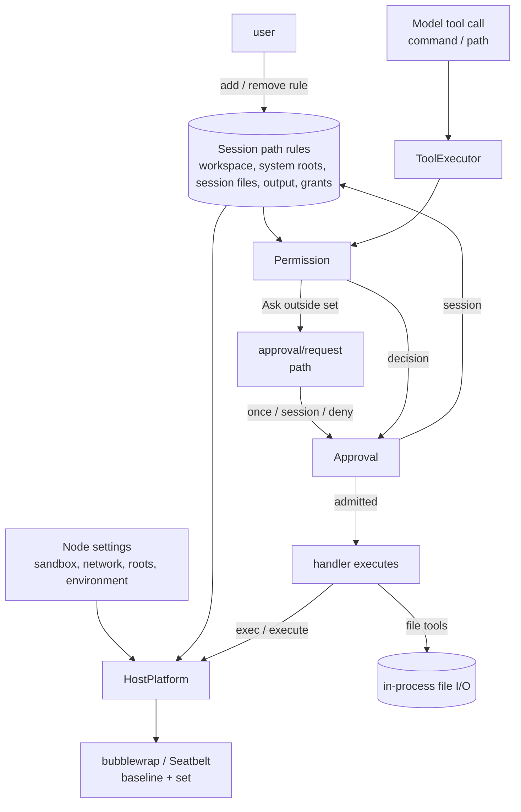

# 009: Sandbox configuration and path-based access

Decision status: Proposed.

Supersedes only the permission-preset clause of the second sentence of
[ADR 003](003-approval-scope.md) D5 — “permission presets confer nothing beyond what they confer
today”. File-root authorization in the same sentence is unchanged. It also replaces the
tier-and-escalation policy introduced for
[#503](https://github.com/arcships/dim/pull/503) in the
[F5 isolation design](../design/host-platform-isolation.md). ADR 003 and that design are not
edited; this ADR is the new decision.

## Context

The current mechanism has three separate problems:

- The model chooses an execution environment with `exec`'s `sandbox` argument.
- `Permission` admits the call, but `HostPlatform` reads `host-isolation.json` after admission and
  refuses a wider environment. It can veto an admitted call; it cannot override a `Permission`
  denial.
- Reads have no path rule while writes do. `read` reaches the host under every preset;
  `write` asks outside the workspace. Attachments and command output live outside the workspace
  and are read without asking because the Session owns them.

The requirements:

1. The sandbox is the environment where `exec` runs. It is node configuration, not a call
   parameter.
2. Read and write follow one path rule.
3. A Session-owned file is readable without asking. The path carries the Session, so a prefix
   matches it; no ownership query and no additional resource source is introduced.
4. The model cannot widen the sandbox. Only the user grants paths.
5. `full-access` does not widen the sandbox.



## Decision

### D1. The sandbox is node configuration

The execution node owns three settings: sandbox on/off, network on/off, and the resource lists
(read-only roots, writable roots, environment names). They are read when a process starts; a
running process keeps its environment.

- Sandbox on: `exec` and the persistent shell run in the workspace baseline plus the node's
  roots. Network follows the network setting.
- Sandbox off: they run on the host with the daemon user's ordinary access.

`exec` loses its `sandbox` argument. The model never selects a tier. `Permission` does not produce
a sandbox. `HostPlatform` applies the settings and does not decide whether a call may run.

The settings live in HostPlatform's `host-platform.json`, alongside its exec shell
configuration. They replace `host-isolation.json`; `escalation` and the tier field are removed.
This is a new configuration with no legacy reader. The CLI `/settings` switch writes it. The existing platform defaults
remain, including the persistent shell output directory and, on macOS, each process tree's
temporary directory and git's global configuration.

### D2. One path rule for reads and writes

The Session owns a path set. Each entry is a match rule:

```text
match   exact(path) | prefix(path)
mode    read | write
```

The set contains:

- `prefix(workspace)` (write);
- `prefix(system root)` for each platform root (read);
- `prefix(<db>.session-files/<sessionId>/)` (read);
- `prefix(output directory)` for command output (read);
- `exact(path)` or `prefix(directory)` for each path the user granted (read or write).

A path is covered when a rule matches it. A write rule also permits reads; a read rule never
permits writes.

Session files are stored under the Session's own directory:
`<db>.session-files/<sessionId>/<fileId>/<name>`. The path carries the owner, so one prefix
covers every file of the Session and never covers another Session's files. A fork hard-links the
files it owns into its own Session directory, forming a point-in-time snapshot; a file the source
adds later is not in the fork. Deletion removes the link; the filesystem keeps the inode while
another Session still links it.

The path set is Session configuration, owned by a Session part. It is built from the Session id,
the workspace, the platform roots, the output directory and the user's grants. No part writes a
rule per file, no ownership query runs at decision time, and no other resource source is
introduced.

### D3. Read and write use the same rule

| Mode | Inside the set | Outside the set |
| --- | --- | --- |
| `read-only` | reads allowed | reads ask; writes, processes and network denied |
| `workspace-write` | reads and writes allowed | reads and writes ask |
| `full-access` | allowed | reads and writes allowed without a prompt |

- A path operation is allowed when a rule matches it with the needed mode.
- Outside the set, `Approval` asks once or for the Session. “This session” adds an exact rule for
  the approved path. There is no cross-Session rule.
- `full-access` admits an outside operation without adding it to the set. The file tools run in
  process; the process sandbox is unchanged.
- Command rules remain user-scoped and govern `exec` commands. There are no path deny rules.

### D4. `exec` cannot widen the sandbox

`exec` has no `sandbox`, `paths` or `network` input. It runs with the node settings and the
Session path set:

- the workspace and platform roots are mounted as the baseline;
- the user-granted paths are mounted with their mode;
- the Session's own files and command output are mounted read-only.

The model cannot add a path or enable network by calling a tool. A command that hits a missing
path fails as an ordinary command error; the user grants the path or turns the sandbox off, then
the model may retry.

### D5. Approval only answers the call

`Approval` asks for a file operation outside the set. The options are allow once, allow for this
Session and deny. The existing `ApprovalDecision` stays `Allow | Deny`; the client writes the
Session rule through the path set's Session method and then answers allow, as it already does for
a command rule. No new approval event or wire field is introduced.

### D6. `full-access` is not a sandbox setting

`full-access` means “no tool prompts”. It does not turn the sandbox off, does not add paths and
does not change the network setting. A file operation outside the set runs because the file
tools are in process; `exec` still runs in the sandbox. To give all model-started processes host
access, the user turns the sandbox off in the node settings.

### D7. Execution and enforcement

The handler executes with the node settings and the Session path set. `HostPlatform` mounts the
baseline and the granted or handed paths and applies the network setting. It makes no admission
decision.



## Consequences

- Read and write share one path rule. Attachments and command output are readable because their
  Session directory prefix is in the set; another Session's path is a different prefix.
- Session files move under `<db>.session-files/<sessionId>/<fileId>/<name>`. No migration is
  kept; this is a new layout. A fork hard-links the files it owns into its own directory.
- A new Session part owns the path rules. The client adds and removes user rules; `Permission`
  and the tool owners read them. No per-file rule and no ownership query are introduced.
- The node settings are a new HostPlatform configuration with no legacy reader. `escalation` and
  the tier request disappear; running processes keep their environment.
- `exec` loses `sandbox` and gains no resource argument. A call that still sends `sandbox` is
  rejected as `exec_invalid_request`, not silently ignored. The model cannot widen the sandbox.
- `full-access` no longer widens the sandbox; a node setting does.
- Documents that state the old rule are updated under their owners after acceptance: the F5
  design is folded into the HostPlatform page; `Permission.md`'s read statement becomes the path
  rule; `session-files.md` §11.1/§11.2 and the Attachments design describe the Session-directory
  layout; the CLI permission and isolation tables are updated. ADR 003 is not edited.
- The path set is Session configuration, not a Timeline fact; a restored Session rebuilds its
  prefixes from its id and starts without user grants.
- This supersedes §11.2's per-Session ownership query: the Session directory is the ownership
  fact. A file the Session owns is under its prefix; another Session's file is a different prefix.
  A fork hard-links the files it owns, so its prefix is a point-in-time snapshot.

## Non-goals

- Path globs or a pattern engine. The first version has exact and prefix matching only.
- An ownership query or an additional resource source for Session files.
- Cross-Session or user-scoped path rules.
- Agent-initiated resource requests or per-call sandbox/network expansion.
- Migration from the old session-file layout or the old isolation file. The new formats replace
  them.
- A remote node's policy ceiling.

## Supersession

Supersedes only the permission-preset clause of [ADR 003](003-approval-scope.md) D5's second
sentence and the tier-and-escalation policy in the
[F5 isolation design](../design/host-platform-isolation.md). ADR 003 remains as written; the
relation is recorded in [`docs/adr/README.md`](README.md).

## Rule check

| Rule | Application |
| --- | --- |
| §1, ADR 002 D1 | `Permission` and `Approval` remain branch Capabilities; the path rules are Session configuration owned by a Session part; `ToolExecutor` and `ToolBinding` remain branch parts; tool owners keep execution; `HostPlatform` remains a process part. |
| §4 rule 1 | The path rules are configuration, not another Capability's fact; the owner exposes typed add/remove operations. No command event is introduced. |
| §4 rule 2 | The admitted call is handed to execution once; a rule applies to the next call. |
| §4 rule 3 | No `before` callback is added; write resolution keeps its existing pre-admission, metadata-only contract. |
| §4 rule 4 | No core mechanism changes. Node settings and the path rules are configuration sources. |
| §4 rule 5 | No new Timeline batch or ordering. |
| §4 rule 6 | No context-input path changes. |
| §4 rule 7 | Parts interact through the existing public services and the call input. |
| §4 rule 8 | No infrastructure change; no requirement is raised to the runtime. |
| §4 rule 9 | No new Timeline fact. The permission mode remains `permission/changed`; the path rules stay outside the Timeline. |
| ADR 002 D2 | No wiring plugin or adapter is added. |
| ADR 002 D3 | The path rules are Session-scoped; `Permission` and the tool owners depend on them; `HostPlatform` receives their process portion from the caller. |
| ADR 002 D4 | Node settings and path rules are business configuration, read at use time. |
| ADR 002 D5 | The path rules' Session method for adding or removing a rule is a new language-neutral contract; it carries match rules and no event field. |
