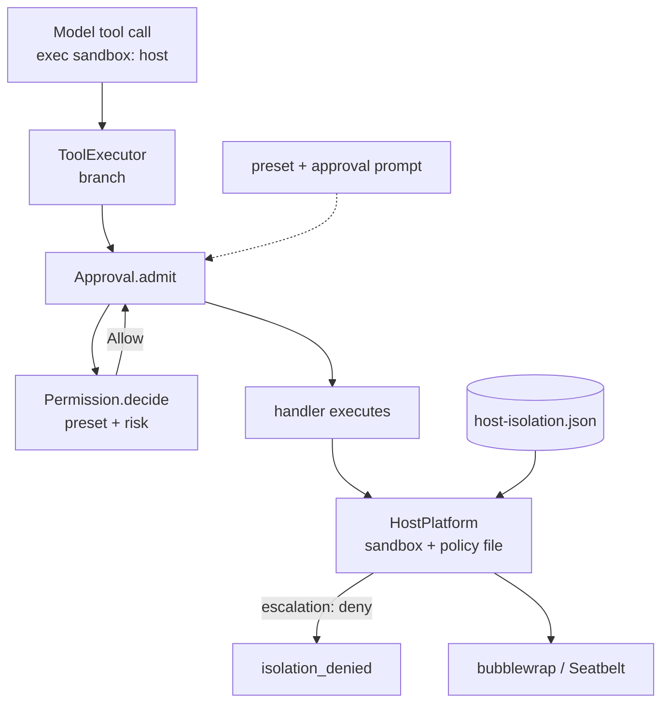
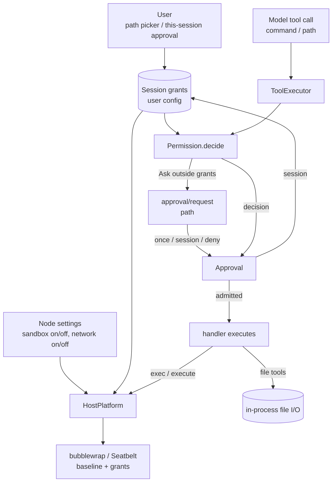
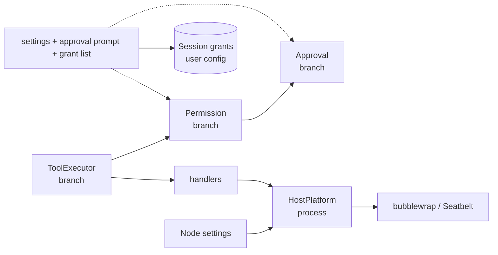

# 009: Sandbox configuration and user-granted paths

Decision status: Proposed.

Supersedes the second sentence of [ADR 003](003-approval-scope.md) D5 — “permission presets
confer nothing beyond what they confer today” — for what a sandboxed process may reach. It keeps
D5's first sentence: host safety settings never enter the Timeline, and replay, restore or fork
never restores or widens authority. It also replaces the tier-and-escalation policy introduced
for [#503](https://github.com/arcships/dim/pull/503) in the
[F5 isolation design](../design/host-platform-isolation.md). ADR 003 and that design are not
edited; this ADR is the new decision.

## Context

The current mechanism mixes three different things:

- The model chooses an execution environment with `exec`'s `sandbox` argument
  (`workspace`, `network`, `host`).
- `Permission` admits the call, but does not decide that environment.
- `HostPlatform`, after admission, reads `host-isolation.json` and refuses a wider environment
  unless the file says `escalation: "ask"`. A second decision overrides the first.
- The only way to cross the workspace boundary is to know and edit that file.

The requirements are different:

1. The sandbox is the environment where `exec` actually runs. It is not a request the model
   makes.
2. Whether a process runs in a sandbox, and whether it has network, is application/user
   configuration.
3. The model cannot widen the sandbox. Only the user grants paths; the model may describe what it
   needs, but that description is not authority.
4. The model does not manage resources while working. It runs a command or operates on a path; it
   will not declare a path list or a network request, and the design must not depend on it doing
   so.
5. A file operation outside the granted paths is a user decision: once or for the Session.



## Decision

### D1. The sandbox is node configuration; the call does not choose it

The execution node has two settings: whether model-started processes run in a sandbox, and
whether that sandbox has network access. They are read when a process starts; a running process
keeps the environment it started with.

- Sandbox on: `exec` and the persistent shell run in the workspace baseline — the Session
  workspace and the platform's system roots. Network is off unless the setting enables it.
- Sandbox off: they run on the host with the daemon user's ordinary access, including its
  network.

`exec` loses its `sandbox` argument. The model never selects `workspace`, `network` or `host`.
`Permission` does not produce a sandbox. `HostPlatform` applies the settings and the platform
defaults; it does not decide whether a call may run.

There is no `host-isolation.json`, no `escalation` and no `isolation_denied`. The platform's
system roots and environment list are code defaults, not user configuration.

### D2. The call declares no resources

The tool input is the operation, not a grant:

| Tool | Input |
| --- | --- |
| `read`, `glob`, `grep` | the `path` it reads |
| `write`, `edit` | the `path` it writes |
| `exec` | `command`, `cwd`, `runInBackground`, `timeoutMs` |

`exec` has no `paths`, no `network` and no sandbox tier. The persistent shell uses the baseline
and the Session grants; its environment is created once, so a new grant applies to a new shell.
The model is not asked to predict which paths a command will touch. A command that hits the
sandbox boundary fails as an ordinary command error; the model may report it, and the user
decides whether to grant a path or turn the sandbox off.

### D3. Permission decides the operation; the user controls the sandbox

`Permission` uses the session permission mode, the user's file-operation rules and the Session
path grants:

| Mode | File operation inside the grants | File operation outside the grants | `exec` |
| --- | --- | --- | --- |
| `read-only` | reads allowed | reads allowed; writes denied | denied |
| `workspace-write` | allowed | reads and writes ask | allowed inside the sandbox; asks as a command |
| `full-access` | allowed | allowed | allowed inside the sandbox |

- The grants are the Session workspace, the platform's read-only system roots, and the paths the
  user granted to this Session.
- A deny rule wins under every mode. A Session allow rule turns an `Ask` into `Allow` for its
  path.
- `Approval` asks only for a file operation outside the grants. The options are allow once,
  allow for this session and deny. “This session” adds the path to the Session grants.
- `exec` never widens the sandbox. It runs with the node settings and the Session grants. The
  model cannot add a path or enable network by calling the tool.

### D4. Session grants are user configuration

A Session path grant is:

```text
session   Session id
key       path (read | write)
decision  allow
```

- The user creates a grant by choosing a path in the client, or by answering “this session” to a
  file operation outside the grants. The model cannot create one.
- Grants are stored in the user configuration, keyed by the Session id, and read at use time.
  They are not Timeline facts: replay and fork do not restore them, and a new Session has a new
  id and starts without them.
- A grant applies to `exec` mounts and to file operations. Removing it applies to the next
  process or call.
- Entries for an ended Session are inert and may be pruned.
- Command rules remain user-scoped and separate. This decision adds path grants; it does not
  turn them into cross-Session rules.

### D5. `full-access` does not widen the sandbox

`full-access` means “no tool prompts”. It does not turn the sandbox off and does not add paths:

- A file operation outside the grants runs without a prompt because the preset allows it. The
  file tools are in-process; they are not the sandbox.
- `exec` still runs in the sandbox with the node settings and the Session grants. A command that
  needs more fails; the user grants a path or turns the sandbox off.
- To give all model-started processes host access, the user turns the sandbox off. That is a node
  setting, not a permission preset.

### D6. Execution and enforcement

The handler executes with the node sandbox settings and the Session grants. `HostPlatform`
mounts the baseline and the granted paths and applies the network setting. It makes no admission
decision.





## Consequences

- The model no longer chooses `workspace`, `network` or `host`, and no longer declares paths or
  network. It runs the operation and reports a failure.
- The sandbox becomes a boundary the model cannot widen. Only the user changes node settings or
  grants a path to the Session.
- `full-access` no longer widens the sandbox. File operations may run outside the grants because
  they are in-process; `exec` stays sandboxed. A user who wants host processes turns the sandbox
  off.
- `Permission` returns only `Allow`, `Ask` or `Deny`. It does not resolve or return a sandbox.
- `HostPlatform` keeps the sandbox mechanism and platform defaults; it loses the policy file,
  `escalation`, `isolation_denied` and its admission role.
- `exec` loses `sandbox` and gains nothing. The approval prompt shows a path only for a file
  operation outside the grants.
- The user configuration gains Session-keyed path grants and an explicit new version. No new
  part, Timeline event or wire event is added.
- Documents that state the old rule are updated under their owners after this ADR is accepted:
  the F5 isolation design is folded into the HostPlatform page, and the CLI permission,
  isolation and approval tables are updated. ADR 003 is not edited.
- Running processes keep the environment they started with; a setting or grant change applies to
  the next process or call.

## Non-goals

- Agent-initiated resource requests, per-call sandbox expansion or per-call network requests.
- Persistent path grants. Grants are Session-scoped; a new Session starts without them.
- Workspace- or user-scoped path rules.
- A remote node's policy ceiling.
- Changing which commands are agent decisions (ADR 003 D1–D3).
- A new settings page beyond the application's existing settings for the node sandbox.

## Supersession

Supersedes the second sentence of [ADR 003](003-approval-scope.md) D5 and the tier-and-escalation
policy in the [F5 isolation design](../design/host-platform-isolation.md). ADR 003 remains as
written; the relation is recorded in [`docs/adr/README.md`](README.md).

## Rule check

| Rule | Application |
| --- | --- |
| §1, ADR 002 D1 | `Permission` and `Approval` remain branch Capabilities; `ToolExecutor` and `ToolBinding` remain branch parts; tool owners keep execution; `HostPlatform` remains a process part. No part is added or moves scope. |
| §4 rule 1 | `approval/request` and `approval/respond` keep instructing the owner of admission; Session grants are user configuration, not Timeline state. |
| §4 rule 2 | The admitted call is handed to execution once; nothing is withdrawn after the start. |
| §4 rule 3 | No `before` callback is added; write resolution keeps its existing pre-admission, metadata-only contract. |
| §4 rule 4 | No core mechanism changes. Node settings and Session grants are existing configuration sources. |
| §4 rule 5 | No new Timeline batch or ordering. |
| §4 rule 6 | No context-input path changes. |
| §4 rule 7 | Parts interact through existing public services and events; the tool input remains the operation. |
| §4 rule 8 | No infrastructure change; no requirement is raised to the runtime. |
| §4 rule 9 | No new Timeline fact. The permission mode remains `permission/changed`; grants stay outside the Timeline. |
| ADR 002 D2 | No wiring plugin or adapter is added. |
| ADR 002 D3 | Dependencies are unchanged; `Permission` does not depend on `HostPlatform`. |
| ADR 002 D4 | Node sandbox settings and Session grants are business configuration, read at use time. |
| ADR 002 D5 | No new public contract; the existing file `path` and the approval request carry the operation. |
