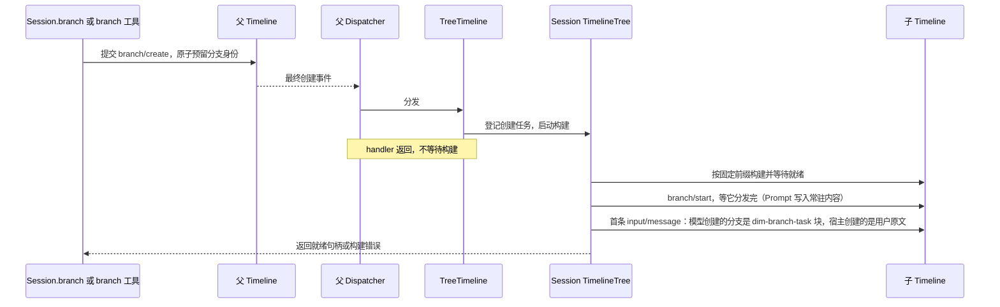

# Rust 关键业务的事件驱动约定

| 项目 | 约定 |
| --- | --- |
| 状态 | 已实现：工具审批（分支级 [Approval](plugins/Approval.md)）、脱离工作的停止与自动唤醒、分支创建、压缩结果采用、Session 广播与 `approval/cancelled`；`input/consumed` 由 Loop 写入，InputQueue 与 Loop 消费 |
| 日期 | 2026-09-23 |
| 范围 | 工具审批、脱离工作的停止与自动唤醒、分支创建、压缩结果采用、Session 广播 |
| 设计标准 | 以[时间总线总纲](time-bus.md)为准；本文各流程按总纲推导 |
| 生效范围 | 本文约定替换其他文档中对应流程；其余[中断](interrupt.md)、[生命周期](lifecycle.md)和 App Server 协议约定不变 |

## 1. 事件和负责人

| 事件 | 变化 | 写入方 | 消费方与影响 |
| --- | --- | --- | --- |
| `approval/request` | 新增，内部事件 | Approval（分支） | Approval 登记未决请求 |
| `approval/respond` | 新增，内部事件 | Approval（经 `approval.respond` 入口） | Approval 按顺序接受首个有效决定，允许或拒绝工具 |
| `approval/cancelled` | 新增，内部事件 | Approval | 结束被取消的已提交审批，包括同意后工具启动前被停止的审批 |
| `input/consumed` | 新增，内部事件 | Loop | InputQueue 移出该输入；Loop 移出待消费集合（重建时同样回放）；模型历史按此位置放置输入 |
| `branch/create` | 内部载荷补充继承位置 | 分支创建入口 | TreeTimeline 启动创建，使用最终提交的参数 |
| `context/compaction` | 复用 | ContextPreparation（ContextPolicy） | 当前准备操作采用最终提交结果；后续准备按最新 completed 事实投影，可选恢复快照只作加速 |
| `session/forked` | 新增，内部事件（客户端不可见，v1 排除） | SessionStore 的分叉事务，写在复制来的事实之后（`at + 1`，在 `0` 处分叉不写） | 按分支自身历史折叠的能力（Goal）从它之后开始折叠，之前的复制事实不算本分支的业务状态；其他能力不必消费，复制来的事实按各自重载规则就是 F 的历史（[分叉 §6.5](../../design/appserver/session-deletion-and-fork.md#65-opening-the-fork)） |

只新增三类审批事件与 `input/consumed`；原 `task/stop`、`task/started`、`task/ended` 已删除，不再产生，脱离工作不设共享起止事件（见 §3）。分支结果沿用 `branch/start` 与调用方的返回结果；压缩不增加准备、采用等阶段事件。

### 1.1 共同约定

| 项目 | 约定 |
| --- | --- |
| 所属 Timeline | 审批属于工具所在分支；脱离工作的结果与唤醒属于发起它的分支；分支创建属于父分支；压缩属于请求所在分支 |
| 顺序 | 控制是否生效，以所属 Dispatcher 的消费顺序为准；事件已写入不等于操作已完成 |
| 身份 | `before` 是宿主注入的可信变形钩子，可修改包括关联身份在内的任意字段；产生方不做变形后校验，消费方按最终提交的事件归账 |
| 最终数据 | 实际执行和对外通知使用 `before` 后提交的事件；不能继续使用提交前的候选值 |
| 写入检查 | 产生方经 `append_registered` 在提交锁内登记自身状态（关闭、关联登记），登记失败不提交；登记回调不做变形后校验。已提交的 completed 压缩是持久事实：其 cursor 无法投影到固定历史时，投影明确失败，不跳过该事实、不另行生成摘要；可信 `before` 钩子须保持 cursor 有效 |
| 控制容量 | 控制事件与其他事件走同一写入路径；历史不设容量上限，不增加新的限额 |
| 异步工作 | 能力在 handler 返回前登记自己的任务；handler 不等待工具、构建、清理或后续事件 |
| 调用结果 | 能力内部的等待句柄只返回处理结果；不代替事件驱动状态变化；连接断开不撤销已接纳命令 |
| 关闭 | 正常关闭先处理控制事件和能力收尾，再关闭 Dispatcher；Dispatcher 故障时沿用能力 finalizer 的直接清理兜底 |
| 历史 | 新增控制事件不生成模型消息；继承前缀只读，不重新分发其中的副作用 |

`before` 只变形当前草稿，不改写已提交历史。宿主负责变形后的因果关联；产生方按最终事件登记自身操作和等待关系，不建立通用身份别名或在消费方恢复旧值。登记不是执行：审批决定和分支创建仍由所属 Dispatcher 消费后生效。关闭和资源占用检查属于准入，不是禁止变形的二次校验；实际模型与工具执行仍须遵守宿主权限和 sandbox。

## 2. 工具审批

审批是分支级能力：ToolExecutor 在每个调用执行前经 [Approval](plugins/Approval.md) 准入，Approval 问 [Permission](plugins/Permission.md) 裁决，需要询问时写 `approval/request` 并等本分支分发的 `approval/respond`。事件字段、请求状态机、取消与重载结算、attach 回放的顺序保证都以 Approval 文档为准。

审批响应的成功表示决定已被接受，不表示工具已经开始或执行成功。

## 3. 后台任务停止与自动唤醒

本节是脱离工作的合同。脱离工作指能力发起、可越过发起它的 turn 继续运行、结束时可能唤醒分支的异步工作。执行状态归发起工作的能力，不设统一后台任务层（BackgroundTasks、BackgroundTimeline、`task` 工具已删除），也不设共享的起止事件（`task/started`、`task/ended`、`task/stop` 已删除）；执行、取消、结果、重启恢复与自动唤醒归发起它的能力（下称所有者），结果以所有者自己的事件表达，如 Collaboration 的 `collaboration/result`、[BackgroundExec](plugins/BackgroundExec.md) 的 `exec/started`/`exec/ended`。

| 项目 | 约定 |
| --- | --- |
| 所有者 | 持有任务、取消句柄与结果，用 rutis effect 登记清理；不交给共享服务代管，不建立第二份任务状态。查询、等待与停止由所有者的工具提供，模型后续需要的身份写入 `ToolResult.content` |
| 所有者的显式停止 | 只影响指定工作，不中断分支、不停止其他工具或 Loop；不产生自动唤醒 |
| turn 范围 `stop/interrupt` | 不取消该 turn 启动的脱离工作；工作继续，结束后照常由所有者决定唤醒 |
| branch 范围 `stop/interrupt` | 所有者取消本分支的脱离工作，资源释放后写入自己的终态；不产生自动输入 |
| 自动唤醒 | 所有者在结果事件的 Dispatcher 消费位置决定是否唤醒，并提交一个 `mode=steer` 的 `input/message`。唤醒输入与其他输入一样处理：写在 `stop/interrupt` 之后的照常开始 turn，见[中断](interrupt.md#2-事件契约) |
| 卸载与关闭 | 所有者登记的 rutis effect 取消并等待仍在运行的工作；卸载前置条件见[生命周期](lifecycle.md#5-stop-与-close) |
| 在途工作识别 | 所有者为每项已接纳的脱离工作取得 Session 活动持有（`SessionLifecycle::hold()`），最后一个事实提交后释放；有持有时空闲卸载拒绝，关闭不理会持有，见[生命周期 §5](lifecycle.md#5-stop-与-close)。持有不报告也不取消工作；`Session::idle`、`session.idle` 仍只看 Loop idle，不包含脱离工作 |

## 4. 分支创建

### 4.1 事件与继承位置

复用 `branch/create`。当前数据为 `at`、互斥的 `source`、`branch`、`prompt`：工具来源 `source={kind:"tool",turn_id,request_id,call_id}` 保留真实模型调用身份；宿主来源 `source={kind:"host",operation_id}`，不得伪造 turn/request/call。

| `at` | 继承范围 |
| --- | --- |
| `{kind: "sequence", sequence: N}` | 父 Timeline 截至本地序号 N 的固定历史，含其祖先链 |
| `{kind: "create"}` | 截至本次 `branch/create` 的固定历史；保留现有尾部分支语义 |

显式位置小于入口读取的父尾部时使用 `sequence`，等于尾部时使用 `create`；越界或非法因果截点拒绝，不静默移动。默认模型分支截点固定在本次 request 的 `model-start` 之前，确保不会切开未完成模型输出或多工具批次，也不留下孤立模型片段；真实 turn/request/call 仍写入工具来源。`before` 可修改 `prompt`、`at` 和来源，宿主负责变形后的因果一致性，最终截点仍须能构造合法的固定历史。

`branch_point` 从最终事件的 `at` 计算；`create_anchor` 和子分支 `branch/start.createEvent` 始终指向父分支的 `branch/create.sequence`。延迟消费不能把继承范围扩展到消费时的尾部。

### 4.2 创建与生命周期

| 项目 | 约定 |
| --- | --- |
| TreeTimeline | 新增独立 Timeline 级 rutis 插件，订阅本分支 `branch/create`；依赖 Dispatcher、TimelineTree/TreeCommands |
| TimelineTree | 拥有所有分支实例、分支身份预留、构建任务、就绪结果和关闭；不限制分支数量 |
| 首条输入 | `branch` 工具创建的子分支，首条输入是 raw 块 `<dim-branch-task parent>`，写明它是从哪个分支派生、由该分支委派的任务；宿主（RPC）创建的分支，首条输入是操作者原文。上下文经输入注入，不另设注入通道 |
| 创建准入 | 模型的 `branch` 工具与其他工具一样由 ToolExecutor 经 [Approval](plugins/Approval.md) 准入（risk `session`）；宿主 RPC `session.branch_create` 属于外部控制，不经准入 |
| 提交 | before 不持树锁；按最终事件登记继承位置和分支身份，检查关闭状态与身份占用，原子提交事件并预留该分支身份；失败不留创建锚点，不要求最终身份等于原草稿 |
| 构建 | 只采用最终事件的分支 id、prompt、at 和关联信息；从事件位置取得固定前缀；登记后转入树拥有的异步任务 |
| 成功 | 子分支就绪、`branch/start` 和初始输入提交完成后才公开并返回；列表与公共操作只接受已发布分支。初始化内部句柄不等于公开发布，调用方不重复提交初始输入；发布和关闭在树锁内裁决 |
| 失败 | 子分支已写下 `branch/start` 与首输入时，创建按其事实已完成，之后的关闭不再算创建失败。否则完整回滚已取得资源后，向父 Timeline 写一次 `branch/create-failed`，关联 createEvent 并只含安全的 cancelled/failed 文本；失败候选不进入分支列表，也不接受公共操作；其构建期间已分发的事件照常广播。失败事件写入失败作为生命周期清理错误上报；已提交创建锚点保留，已公开分支后续执行失败不改写成创建失败 |
| 调用方停止或断线 | 创建事实提交后归 Session，等待方离开不撤销；提交前的宿主准入可由父分支 stop 取消。准入令牌在提交后取消时，调用方立即以取消返回，构建由 TimelineTree 继续完成：`branch` 工具调用随 turn 中断以取消结算，stop 不等构建。普通 turn 中断不关闭已有子分支 |
| 父分支上的成功事实 | 不写。父分支上只有调用方自己等待本次结果（`branch` 工具写入工具结果），不影响之后的任何决定；重启恢复依据子分支自己的 `branch/start` 与其后的输入。失败才写 `branch/create-failed`，因为失败要释放预留并让恢复看到结论 |
| Session 关闭 | 停止准入，取消在建任务并等待回滚；已提交但尚未消费的创建也必须释放预留并结束等待，不能等待已停止的 Dispatcher |
| 重启恢复 | 子分支有 `branch/start` 且其后有首条输入（Queue），才算创建完成；Prompt 在 `branch/start` 分发时写入的常驻内容是 Append，不算。未完成的创建写 `branch/create-failed` |
| 引导 | main 仍直接构建；其创建之前没有可消费的 Timeline |

## 5. 压缩结果采用

`context/prepare` 已由 Dispatcher 驱动。ContextPreparation 内部继续执行压缩并提交 `context/compaction`，随后直接使用返回的已提交事件，不增加 Dispatcher 往返。

| 阶段 | 约定 |
| --- | --- |
| 准备 | 固定 `through`、原始请求和历史前缀（有有效恢复快照时从其 `resume` 起读取）；保留应用最新 completed 压缩后的请求作为本次基准 |
| 生成 | 压缩宿主产生候选，沿用现有可用性判定；候选不可用时产生既有 Failed 结果 |
| 提交 | `before` 可修改结果与关联字段；宿主负责固定来源和 cursor 的一致性，产生方不在变形后重复校验 |
| Completed | 使用最终 `cursor`、`summary` 从固定历史构造本次请求；事实不含快照。最终 `through` 与来源一致时，事实发布后另行写入可丢弃的恢复快照（`timeline_snapshots`），构建或保存失败只告警并回退事实重放，不丢弃已完成的摘要（见 [Timeline 存储](timeline-storage.md#压缩检查点)、[ADR 001](../../adr/001-harness-foundation.md)） |
| Failed / Skipped | 普通准备保留本次基准；recovery 返回对应失败。判断使用最终事件的状态与原因 |
| 写入失败 | 当前准备按既有失败流程结算，不静默采用修改前的候选。已提交但 cursor 无法投影的 completed 事实使当前及后续准备失败，不被跳过或重新摘要；缺失或无效的恢复快照只回退事实重放 |
| 取消 | 沿用 ContextPreparation 的取消与终态结算；不因已经生成候选而继续请求模型 |

候选检查使用准备阶段的固定数据，不在持 Timeline 写锁时重新读取 Timeline；最终提交后不重新计算并覆盖可信变形。普通 before 报错仍按既有整链回退规则处理。

默认 App Server 尚未配置压缩宿主；实现验收通过已有可注入 ContextModel 的上下文流程覆盖此路径，不把它描述为默认已启用功能。

## 6. Session 广播

`session_channel(session_id)` 返回 `EventKey<SessionBroadcastEvent>`，广播、监听和输出屏障统一遵守[单树事件合同](single-tree.md#事件)。内部 `emit` 接纳与 wire 交付分别判定。

| 对象 | 约定 |
| --- | --- |
| SessionBroadcast | `dim-agent-capabilities` 的 Timeline 级 rutis 插件，每分支一个；以 `Dispatcher::subscribe_all` 订阅本分支全部事件，不过滤；调用 `emit(ctx, &session_channel(session_id), Arc::new(event))`，核对接纳结果后返回 |
| SessionBroadcastEnd | 同模块的 Session 级插件；卸载时在通道上发出 `SessionBroadcastEvent::Closed`。Session 能力在全部分支关闭后才卸载，因此结束后没有 `Event` 记录；宿主观察屏障和与关闭竞争的通知可晚于结束记录 |
| 广播事件 | `SessionBroadcastEvent::Event { branch_id, event: Arc<AgentEvent> }`、通知 `Notice(Arc<SessionNotice>)`、结束记录 `Closed`、宿主观察记录 `Fence { recipient, token }`，与 SessionBroadcast 同在 `dim-agent-capabilities`，实现 rutis `Event`；不复制事件或通知正文。Fence 不进入 Timeline，不携带 RPC 对象或执行语义 |
| 通知 | `SessionNotice { source, kind, data }`：进程级状态的所有者在变更提交后调用同模块的 `notify(ctx, session_id, notice)` 发出，不经 SessionBroadcast 插件，不需要依赖；字段含义归所有者，广播不解释。没有序号，不排队，不重放：发出时没有监听方（Session 未加载或无人观察）即丢弃。合同与 Rpc 转发见 [Session 广播通知](../../design/appserver/session-notices.md) |
| 通道 | rutis 命名通道，名字为 `session/{sessionId}`，由 SessionBroadcast 所在模块导出的 `session_channel(session_id)` 生成，发送方与监听方共用；每个 Session 一条通道 |
| 顺序 | 同一 Session 的广播在其通道上按发出顺序派发，同一分支与 Dispatcher 分发顺序一致；跨分支按发出先后；不同 Session 互不影响 |
| 范围 | 广播已由本分支 Dispatcher 分发的事件，包括构建中候选分支的事件，以及所有者发出的通知；不保存历史，不分配整树位置 |
| 接收方 | 广播不维护接收方；以 `on(ctx, &session_channel(session_id), listener)` 监听所需 Session，调用 Disposer 的 `dispose` 即退订，注册所用 ctx 卸载时自动移除。需要收到结束记录的消费方须在比 Session 更晚卸载的 ctx 上注册。监听器不得等待慢操作：同一 Session 的记录串行派发，需要写 Timeline、I/O 或等待的消费方只入队或自行启动任务。App Server 的连接订阅由其 RPC 协议约定 |

广播不提供历史、断点续读、整树位置或订阅管理；这些需求由宿主与客户端负责。

宿主在执行屏障完成后发出 Fence，接收方只确认属于自己的令牌。连接持有订阅代次和单调确认水位，同一订阅的令牌分配与发出串行化，不保存逐请求回执表。收到 Closed 可确认此前全部广播，但不替代执行结果或 Session 清理结果；结束状态保留供已取得该订阅的等待者使用。detach/换代使尚未确认的等待失效，旧代监听不能确认新代。出站失败取消连接，不能继续确认交付成功。RPC 卸载终止交付等待并返回 `service_reloading`，不撤销已接纳的 stop 执行。未订阅和 v1 请求只使用执行屏障。

## 7. v1 兼容与装配

| 范围 | 约定 |
| --- | --- |
| 新增内部事件 | v1 `session.event` 过滤 `approval/request`、`approval/respond`、`approval/cancelled`、`input/consumed`，与现有 stop 控制事件一致；`task/*` 不再产生 |
| 分支字段 | 内部 `branch/create.at` 保留在 Timeline；仅在 v1 出站编码边界移除，原 22 类事件 JSON 样本保持不变 |
| 类型边界 | 内部创建数据的 `at` 必填；旧 v1 `BranchCreateData` 独立保留原字段。v1 样本按 wire 类型验证，不为缺少 `at` 的旧事件补默认值并重新执行业务 |
| 序号与时间 | 所有内部事件占用真实 sequence；v1 不重编号，沿用实际截止游标；`create_at` 仍为 Unix 毫秒 |
| RPC 和通知 | 不增加方法或协议版本；审批请求、取消与应答通知由广播的 `approval/request`、`approval/cancelled`、`approval/respond` 在出站编码时生成（应答通知 `approval.resolved` 仅 v3，v1、v2 通知集合已冻结，[#278](https://github.com/arcships/dim/issues/278)），这些控制事件不进入 `session.event`，其余控制事件不发送到客户端 |
| 模型历史 | 新增控制事件不渲染成消息；自动唤醒仍通过已有 input 进入上下文；压缩结果仍由既有历史规则采用 |
| 包边界 | 事件类型由 `dim-agent-types` 定义；审批插件留在 `dim-app-server`，树插件留在 `dim-agent-capabilities`，脱离工作留在各所有者的包内；runtime 不反向依赖它们 |
| 就绪与图 | 两个新增 Timeline 插件按现有工厂注册，订阅就绪后才启动 Dispatcher；实现时更新 Rust 装配图并运行边界检查 |

v1 出站转换只在实时通知一处执行。内部 Timeline 仍只有一份事件事实，不建立另一份 v1 历史。

## 8. 实现验收

| 项目 | 必须覆盖的流程 |
| --- | --- |
| 审批 | 真实 IPC/WS 的请求、allow/deny、双客户端争抢、断线和 attach；stop 在请求前、响应前、同意后启动前的竞争；每次工具只结算一次；每个已提交请求都有结束事件 |
| Session 广播 | 各分支事件按分发顺序到达已订阅连接；订阅前事件不补发；attach 补发未决审批；Dispatcher 故障后不再广播该分支事件；所有者通知按发出顺序原样到达已订阅的 v3 连接，未订阅或 Session 未加载时丢弃且不补发 |
| 脱离工作停止 | 所有者显式停止只影响指定工作；turn 范围中断不取消、branch 范围中断取消；资源释放先于所有者的终态事件 |
| 自动唤醒 | stop 之后的唤醒照常开始 turn；分支关闭；before 修改结果后的实际输入；Collaboration 成员结果的唤醒 |
| 分支创建 | before 修改 prompt/at；历史位置与尾部位置；默认工具截点；消费延迟不扩大继承；构建失败、关闭和祖先前缀不重放 |
| 压缩 | before 修改 summary/cursor 和 Completed/Failed/Skipped；普通准备与 recovery；最终事实和当前 model/call 一致；不可投影的 completed 事实明确失败且不重新摘要；快照缺失或损坏回退事实重放并保留 summary |
| 兼容 | 原 22 类事件样本；新增控制事件及 at 的内部保留、v1 过滤；序号跳号与分支锚点不变 |

脱离工作的停止与唤醒共用一组集成场景，其余流程可分别实现；合入前统一验证事件类型、装配和 v1 适配。优先扩充已有 `flows`、`interrupt_flow`、`context_flow`、`transport_flow` 和事件兼容测试，不新增只断言私有调用顺序的测试。
