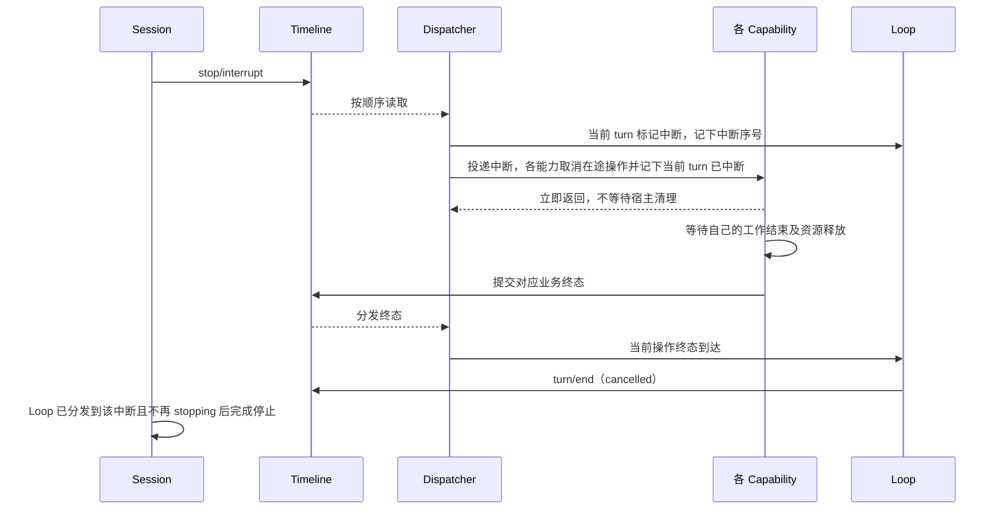

# 事件驱动的中断

状态：已实现。本文件约定停止、能力资源归属与输入入口；不设集中的 Execution 方案，分支没有暂停状态。

设计依据：[时间总线总纲](time-bus.md)。`stop/interrupt` 影响各能力的执行，由 Timeline 记录并经 Dispatcher 分发，各能力消费后自行处理中断。它是信号，只作用于分发时仍在途的工作；已写入 Timeline 的事件是事实，不因中断撤销。分支没有暂停状态，是否继续运行只由之后的输入决定。

## 1. 流程与归属

| 对象 | 职责 |
| --- | --- |
| Session / Branch | 校验并写入输入、写入控制事件，等待 Loop 状态；不读 Loop 状态决定是否开始 turn；正常停止不直接调用能力取消接口，不拼装其他能力的状态 |
| InputQueue | 纯消费者，不拦截写入：按模式决定何时写 input/applied（带模式）；订阅 `stop/interrupt` 只为解除“turn 正要开始”的等待，被压住的 Queue 在 turn 结束后照常采用；不维护 running |
| Loop | 执行状态的拥有者：把当前 turn（含已建立、`turn/start` 尚未分发的 turn）标记为中断，不再发出步骤请求；当前操作真实终态到达后写 `turn/end`（cancelled）；记下最后一次中断的序号，决定输入消费并写 input/consumed |
| ContextPreparation / ModelProvider / ToolExecutor | 各自拥有任务及取消信号，订阅中断与 `turn/start`、`turn/end`：收到中断时取消正在执行的操作，并记下“当前 turn 已中断”；资源释放后写原有终态。之后收到的请求仍属于被中断的 turn（Loop 尚未处理到中断时写出），直接写取消终态，不执行。被中断 turn 的 `turn/end` 或下一个 `turn/start` 到达时清除该记录；记录由消费的事件算出，重建时回放恢复。ContextPreparation 与 ModelProvider 另订阅 `step/model-start`、`input/applied`，持有的请求被 Steer 取代时以 `Cancelled` 结束，见下文 |
| 拥有脱离工作的能力 | turn 范围中断不取消已启动的脱离工作；branch 范围中断取消本分支全部脱离工作，资源释放后由该能力写入自己的终态，见[脱离工作](event-driven-flows.md#3-后台任务停止与自动唤醒) |
| Approval | 不订阅中断：等待审批的调用经 ToolExecutor 的批次令牌取消，Approval 写 `approval/cancelled` 并解除等待；工具资源仍由 ToolExecutor 收尾 |
| rutis | 装配与最终资源释放；Dispatcher 故障时仍通过各能力 finalizer 取消并等待，不伪造成功停止 |

不设 ExecutionPlugin、共享 Execution 服务、ExecutionControl、统一 TaskScope 或 Activity。各能力直接持有所需任务和取消原语，在 rutis 登记自己的清理；不规定统一内部任务接口。InputQueue、Loop 不依赖任务执行器。默认能力之外的扩展同样订阅中断；取消路径必须先释放资源再写终态，stop 不以在途计数兜底，否则会早于收尾返回。

### 1.1 执行状态

执行状态归 Loop，是其已分发事件的纯函数；Loop 以 StateCell 只读发布 `LoopSnapshot {phase, turn_id}`，远程消费方按同一规则从事件复现。

| 状态 | 定义 |
| --- | --- |
| running | 有未闭合的 turn：`turn/start` 已分发、`turn/end` 未分发。`input/applied` 不代表 turn 已经或即将开始 |
| idle | 没有未闭合的 turn |
| stopping | 本 turn 已被中断、`turn/end` 尚未分发；包括已建立、`turn/start` 尚未分发的 turn。是属性，不是独立状态 |

分支没有 paused 状态：stop 完成后，分支是 idle 还是 running 只取决于之后写入的输入。

能力在资源释放后写取消终态，Loop 在当前操作终态到达后写 `turn/end`，因此 turn 闭合隐含本轮工作已收尾。脱离工作是否结束不属于 Loop 状态。

## 2. 事件契约

| 事件 | 数据与含义 |
| --- | --- |
| stop/interrupt | `{reason: string, scope: "turn" | "branch"}`；作用于分发时本分支的在途工作。目标分支由所属 Timeline 确定。turn 按 Dispatcher 消费该事件时的当前轮定位，不取消该 turn 启动的脱离工作；branch 用于该分支关闭，同时取消本分支脱离工作 |

控制事件与业务事件共用 Timeline、序号、时间字段和 Dispatcher；没有第二条控制总线。模型历史转换忽略控制事件。

外部输入经门面 `Branch::input` 写入：门面在边界校验（`InputMessageData::validate`，只拒绝没有内容的输入，失败不落事实），然后追加 input/message，不读 Loop 状态。能力产生的自动输入直接追加到本分支 Timeline，由产生方保证合法。InputQueue 只消费，不拦截写入。

中断前后的输入按 Timeline 顺序处理，提交与 stop 之间不需要锁：

| 输入 | 处理 |
| --- | --- |
| 已被中断的 turn 消费 | 随该 turn 取消 |
| `input/applied` 序号小于最后一次 `stop/interrupt`、尚未消费 | 留在待消费集合，不开始 turn；下一个 turn 一并消费 |
| 被 InputQueue 压住的 Queue | 被中断的 turn 结束后照常采用，开下一个 turn：stop 只结束当前 turn |
| 中断之后写入 | 按正常流程：InputQueue 按模式写 input/applied，Steer、Queue 开始 turn，与 idle 时相同；包括 Notification、AgentReport 等自动唤醒 |

输入采用归 InputQueue（写 `input/applied`），消费归 Loop（写 `input/consumed`）。

被 Steer 取代的请求与 `stop/interrupt` 无关：Steer 被消费时持有请求的状态机（Loop 读上下文时、ContextPreparation、尚未收到任何模型输出的 ModelProvider）取消它并写 `Cancelled`（`replaced by steer`），turn 不标记为中断；已收到输出的请求不被取代，Steer 等该输出结束。Loop 消费到这个终态、turn 未被中断时，在同一 turn 消费 Steer 发新请求；同一 turn 的新 `step/model-start` 总在上一个请求的终态之后（Loop 的事件与生命周期见 [Loop](plugins/Loop.md#events-and-lifetime)）。

被打断的输出保留已写出的事实：stop、失败或重载结算时，已攒的文字先写出，进行中的思考块与未完整的参数丢弃。每个已开始的工具调用恰有一个闭合事实：

| 中断位置 | 闭合 |
| --- | --- |
| 输出进行中 | ModelProvider 在 `step/model-output-end` 的同一原子批次、排在其前写不带 `call_event_id` 的 `step/tool-result`，覆盖本请求所有已开始的调用 |
| 输出已完成、调用未分发 | Loop 在 `turn/end` 的同一原子批次、排在其前写不带 `call_event_id` 的 `step/tool-result`，结果为 `Tool was not executed: <turn 结束原因>` |
| 调用已分发 | ToolExecutor 按原规则写带 `call_event_id` 的结果 |

被中断的 turn 不再发出新的步骤请求：模型返回工具调用时，Loop 不写 `step/tool-call`，以 cancelled 结束该 turn，并在同一批次闭合这些调用。

## 3. 完成与并发

- 中断以日志顺序确定生效位置。相关能力按已消费的中断与 turn 边界判断：属于被中断 turn 的迟到请求直接提交取消终态，不能启动宿主，即使它写在中断之后。下一个 turn 的请求照常执行；已经真实完成的结果保留。
- Dispatcher handler 不等待宿主 join，不等待自己将来分发的事件。任务与清理责任先登记，再返回。
- 已取消的迟到调用在 handler 中直接提交取消终态，不新增异步任务。
- stop 是门面操作：写 turn 范围 stop/interrupt，等 Loop 已分发到该中断且不再处于 stopping。Loop 在处理器内更新状态，早于本事件分发完成；重载时还可能从已提交、尚未发布的终态重建出已结算状态。门面在观察到结算时固定一次 Timeline 已提交水位，并等待 Dispatcher 覆盖该位置后返回已分发序号，保证包含 turn/end。该水位不随新输入增长；不等待 Loop 空闲，之后的输入可能已开始新 turn。Loop 重载期间等新一代接手（重载即重启），分支关闭后 Loop 不在时返回 `Closed`。idle 不写事件，等 Loop 已分发到 Timeline 尾部且没有未闭合的 turn。两者都不等待脱离工作；放弃等待仍复用受管关闭协调。重复 stop 只在上一次仍覆盖当前 turn 时合并（其中断尚未分发，或 Loop 仍不在 running）；上一次的中断已分发、新 turn 已在运行时，新的 stop 等上一次结束后写自己的中断。
- Timeline close 写 branch 范围中断并等待，再停止 Dispatcher、关闭 rutis root。Session close 对各分支执行同样流程；各能力的资源由其登记的 rutis effect 释放。
- Dispatcher 失败或终态追加失败时，向调用者保留错误，进入各能力作用域的资源清理；不能等待永远无法推进的分发游标。

## 4. v1 兼容

原 22 类事件字段不变。本文的停止控制事件、Loop 写入的 `input/consumed` 与[审批控制事件](event-driven-flows.md#7-v1-兼容与装配)均保留在 Rust Timeline；v1 App Server 的 session.event 过滤这些事件，保留原 Timeline sequence，不重编号；过滤后可跳号。JSON-RPC 方法、hello 版本和时间格式不变。已有样本兼容与新增过滤/续读分别验收，不声称新增控制事件属于冻结的 v1 事件集合。

## 5. 验收

模型、准备、工具和外部能力均从真实 stop/interrupt 收到取消；延迟清理不能阻塞其他能力收到中断，也不能让 stop 提前完成。覆盖空闲停止、停止前已采用的输入不自动运行而由下一条驱动输入一并消费、停止后新的驱动输入开始 turn、stop 后被压住的 Queue 照常运行、信号到达时已提交的 `step/tool-call` 不执行、被中断的 turn 不再发出 `step/tool-call`、待分发输入、准备到模型交接、工具到下一请求交接、脱离工作在 turn 范围不受影响而 branch 范围取消、分支隔离、重复 stop、等待者放弃、停止后继续输入和 Dispatcher 故障；v1 双传输覆盖控制事件过滤与游标续读。
