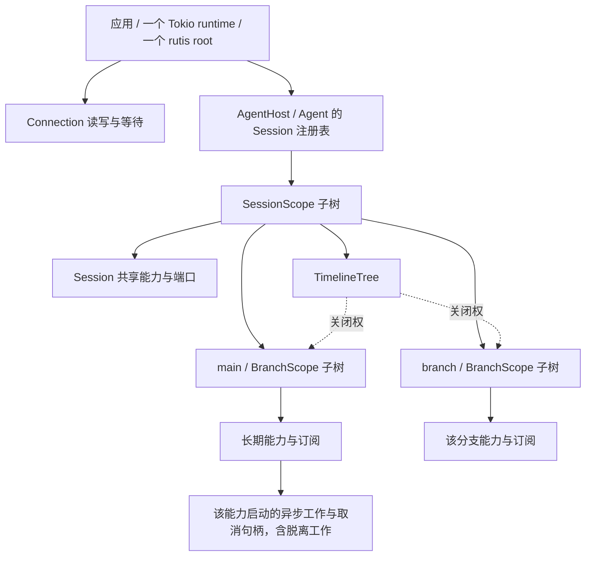
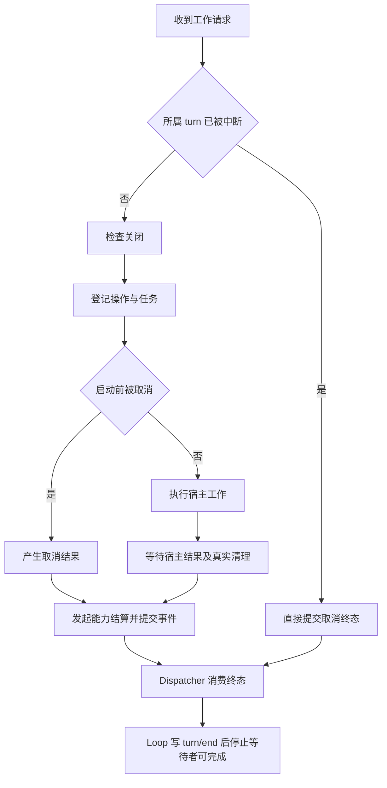
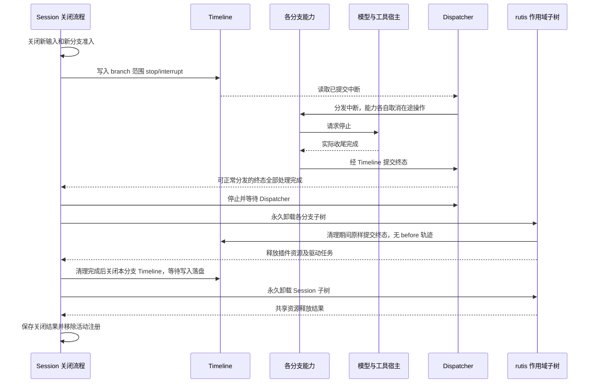

# 生命周期

状态：已实现（事件驱动中断与单树装配）。执行状态归各能力自己持有，不设统一后台任务层。对象与能力分工见[架构](../README.md)，框架接口依据见[单树装配](single-tree.md#rutis)。

## 1. 作用域与拥有关系

作用域是 rutis 同一棵树上的 Plugin 子树，不是新 Tokio runtime 或线程池。Session 注册表、TimelineTree 持有子树的关闭权；它们已有的业务注册表同时记录实例存活，不再维护第二棵容器树。装配细节见[单树装配](single-tree.md)。

| 对象 | 建立与释放 |
| --- | --- |
| Session 子树 | 创建 Session 时载入 SessionScope；所属分支全部关闭后永久卸载 |
| 分支子树 | 创建分支时载入 BranchScope；执行结束并释放能力后永久卸载 |
| 部件 | 实例的挂载器为每个已登记的部件挂载一份；随子树卸载，登记它的插件卸载时撤下；不随 turn 重建 |
| 前台操作集合 | 各能力自己拥有；stop/interrupt 取消分发时在途的操作，分支没有暂停状态；工作结束后移除任务 |
| 脱离工作 | 发起它的能力自己拥有；不随普通 turn 结束，branch 范围中断或所有者显式停止时结束，见[脱离工作](event-driven-flows.md#3-后台任务停止与自动唤醒) |
| 连接任务 | App Server 管理；不拥有 Session |
| Session 服务 | 分支部件按名字依赖，键为所在 Session 实例的键；子树卸载时由提供者按依赖顺序释放 |

所有受管任务都必须有可等待的结束结果。`CancellationToken` 只发出停止请求，`Drop` 不表示异步清理完成。

## 2. rutis 能力

生命周期按 crates.io rutis 0.19.3 设计；接口见[单树装配](single-tree.md#rutis)。

| 项目 | 使用方式 |
| --- | --- |
| 初始化 | injects 门控、apply；各作用域插件 `FiberView::watch` 全部 Active 后发布实例；Pending 不视为成功 |
| 资源登记 | `ctx.effect`、同步/异步 disposer、逆序清理；每取得资源立即登记 |
| 幂等清理 | dispose/shutdown 并发调用共享结果；等待方放弃后清理继续 |
| 子树永久卸载 | `FiberView::shutdown()`：卸载准入同步关闭，子树内消费者先于提供者释放，回收父级、依赖索引与总线记录；root 仍用 `Ctx::shutdown()` |
| 初始化回滚错误 | 失败插件的错误为 apply 原因在前、回滚错误在后；runtime 据此区分构建原因与清理失败，见[单树关闭](single-tree.md#关闭) |
| 实例隔离 | 实例键按作用域子树校验；总线按名字投递，分支通道见[单树事件](single-tree.md#事件) |
| 严格读取 | 插件必需外部服务用 `require` / `require_as`；普通及命名作用域服务都检查声明，release 同样执行，失败保留 `ServiceReadError` |
| 监听调用 | 卸载、重启、关闭和装载回滚等待插件正在运行的监听调用退出，至多到 rutis 关闭期限（`RUTIS_SHUTDOWN_TIMEOUT`）；不包含调用返回后的业务提交，不能代替 Timeline 与 Loop 状态的结算屏障 |
| 诊断 | `Ctx::diagnostics()` 只读快照；`Agent::check_assembly()` 在快照上报告直接 `get_as` 绕过严格读取的未声明访问、读取代次与无实例键提供，以及必需行及其子树的 Active 状态；创建不运行该检查，测试在创建后调用一次 |

插件调用的 panic 由 rutis 在注册元数据、apply 构造与 poll 边界捕获并转为失败；平台捕获自身工厂构造。业务 Dispatcher 和受管操作回调的构造/poll 由对应组件的故障边界处理。

同步 before 的执行、失败与重入约定见[单树事件合同](single-tree.md#同步-before)。`TimelineContext::close` 先完成作用域清理，再关闭 Timeline，保留清理任务提交终态的窗口。

## 3. 初始化与失败回滚

| 阶段 | 规则 |
| --- | --- |
| 受理 | Agent 或 TimelineTree 先登记构建操作；RPC 断开只停止等待，不能丢弃构建拥有权 |
| 绑定 | 在父节点下载入 Session/分支作用域 Plugin；Session 服务按实例键注入 |
| 装配 | 挂载器用已登记的生成器为本实例建立部件；rutis 按依赖状态调用 apply |
| 取得资源 | 在下一次可取消 await 前登记清理；部分初始化失败同样释放 |
| 等待 | 观察插件状态、取消和本次打开范围内的无进展期限；一行的首次 Active、打开派发序号前进或回执完成会重置间隔；不以 settle 代替 Active。部件在 `apply` 中挂载的子插件也一样：用 `mount_active` 等到 `Active`——创建期间整次打开受上述无进展期限约束，到期时报告子插件的名字和它缺的依赖；创建之后该部件与任何缺依赖的行一样保持 `Loading`，直到子插件 `Active` 或本代被取消 |
| 发布 | 全部 Active、订阅齐全、Loop 状态端口可解析后由 `TimelineContext::start` 启动 Dispatcher；子分支还须完成 branch/start 和首输入接纳，才出现在公共分支列表与操作入口。发布时 TimelineTree 调用 `TimelineContext::activate`，分支生命周期 `BranchLifecycle` 进入 Active；能力在 apply 中派生的后台业务等它才开始，分支装配失败时它直接进入 Closed，后台业务从不开始。分支进入 Closing 时 `BranchLifecycle::closing()` 返回，后台业务随即结束，不等所属能力卸载。Session 同理：`Agent` 在 entries 锁内裁决发布与关闭准入，登记为可用时 `SessionLifecycle` 进入 Active；Session 能力在 apply 中派生的后台业务（替换 Session 自有实例、联系外部服务）等它才开始，装配失败时它直接进入 Closed，后台业务从不开始，Session 就绪检查也就不会看到装配期间被替换或关闭的实例。装配本身需要的初始实例（如 Skills 的初始内容）在 apply 内同步创建，属于装配而非后台业务。Session 的关闭 token 一被取消（`Session::close`、`Agent::close` 或装配期间），`SessionLifecycle` 即为 Closing，`closing()` 返回，后台业务随即结束；`Agent::close` 依次关闭各 Session，但它们都在关闭开始时同时看到 Closing。初始化内部可持有句柄，不等于公开发布；发布与关闭准入在树锁内裁决，不持锁运行 before 或异步构建 |
| 回滚 | 禁止继续装配，取消初始化，等待已开始的 apply 和所有清理；永久卸载该作用域子树 |
| 返回错误 | 包含初始化原因、未就绪插件/服务与清理错误；不发布半成品句柄 |

构建结果与清理结果分别保存：初始化拒绝或取消但回滚成功，不使 Session close 失败；普通候选失败不关闭仍可用的 Session。真实回滚失败必须进入最终关闭结果，不能按 `InactiveEffect` 等错误名称过滤。rutis 以 apply 原因在前、回滚错误在后的结构保留失败插件的装载结果，子树 shutdown 会再次报告它；runtime 只从 shutdown 结果中去掉关闭前已 Failed、且整个结果已作为构建原因报告过的插件。关闭取消的构造不算构建失败（rutis 只报告与取消协作无关的清理错误），它的清理错误保留在关闭结果里；构建入口合并构建原因与清理错误向创建调用方报告。

同一缓存清理结果可能经创建返回值、树关闭及子树卸载被多次观察。runtime 在既有错误聚合入口展开聚合与框架回传包装，按共享错误对象的身份只保留一次；不同对象即使类型和文案相同也全部保留。不改变 rutis 原有诊断、清理执行次数或并发关闭的缓存结果。

初始化期限到达后进入回滚；期限不会让不合作的初始化自动终止。若第三方初始化不响应取消，返回的状态必须保留“仍在关闭”，应用继续持有资源；禁止把等待超时记录成回滚完成。

## 4. 受管执行

各能力直接持有实际工作所需的任务、取消句柄与状态，并在 rutis 登记自己的清理。上下文准备管理准备操作，模型能力管理请求与流，工具能力管理批次及各调用，发起脱离工作的能力管理自己的脱离工作；不建立统一任务对象或在途计数，也不设跨能力共享的执行许可。Session 活动持有（§5）只否决空闲释放，不报告也不取消执行，不是这里的在途计数。正常停止由 stop/interrupt 经 Dispatcher 分发，详见[中断设计](interrupt.md)。

| 规则 | 内容 |
| --- | --- |
| 准入 | 关闭检查和操作登记在同一临界步骤完成；登记之后才能 spawn |
| 任务集合 | 能力自有 TaskTracker 跟踪任务至真正退出，脱离工作同样由发起能力跟踪 |
| 取消 | 向目标操作发信号，继续等待；不能通过丢弃 JoinHandle 或 abort 代替正常停止。在途任务同时观察 rutis 代 token（`ctx.cancelled()`）：插件卸载、驱逐或重载在清理前由 rutis 预取消，Disposer 只负责等待退出与结算 |
| 结算 | 不受普通 stop 取消；模型与工具能力提交自身的终态。取消路径先释放资源再写终态，turn 闭合即隐含本轮工作已收尾 |
| 启动前取消 | 已接纳操作仍有结算责任；不调用宿主，也不能直接丢弃整个执行 Future |
| 成功与取消竞争 | 保留真实已完成的成功结果；不因稍晚观察到 token 改写为取消 |
| 工具批次 | 单个调用独立收尾；全部收齐后按原 calls 顺序提交结果 |
| 失败监督 | 观察 Result 和 JoinError；未处理 panic/异常退出进入故障路径，不伪装正常取消 |
| 长期任务 | 能力自己拥有的监测任务也要登记取消与 join；裸 `ctx.handle().spawn` 不提供这项保证 |
| 释放次序 | 等真实任务结束后释放其资源；能力关闭时才移除长期订阅 |

各能力通过 rutis Effect 登记自己的取消与等待逻辑；单个操作不增加长期 EffectRecord。收到中断时先发出取消并返回，异步工作完成后提交终态；Dispatcher 不等待宿主 join。卸载整个作用域子树前先等待正常业务结算，故障路径仍由能力 finalizer 取消并等待。

## 5. stop 与 close

| 操作 | 结束范围 | 保留范围 |
| --- | --- | --- |
| 连接断开 | 连接读写、游标和等待者 | Session、模型/工具、审批 |
| 普通 turn 结束 | 本轮前台任务与资源 | 能力、订阅、历史、脱离工作 |
| stop(branch) | 目标分支在途的前台操作与当前 turn | 脱离工作、兄弟分支、历史、读者和长期能力 |
| Timeline close | 本分支执行、脱离工作、Dispatcher、能力与分支子树 | 其他分支和 Session 共享服务 |
| Session close | 全部分支、脱离工作、审批与 Session 子树 | 其他 Session |
| Agent close | 所属 Session | 其他 Agent |
| App Server shutdown | 所有 Session、共享设施、连接和监听器 | 关闭协调任务最后结束 |

业务关闭由 Session/TimelineTree 写入中断事件并等待；门面不直接调用能力的业务取消接口。不能直接调用 rutis dispose 跳过中断分发和终态等待。正常业务结算阶段，宿主端口、Timeline 和订阅必须保持可用；随后停止 Dispatcher、卸载作用域，存储正常时，清理回调仍可写入 Timeline，事件仅持久化，不再分发。全部清理完成后关闭 Timeline，等待所有已接纳写入提交并发布，再完成 Session 关闭；读者在发布完成后收到分支 EOF。空闲卸载同样保留此写入窗口。

App Server 有原生存储时，Agents 每隔宽限期 `idle_unload_after`（默认 60 s）检查一轮，对至少一个宽限期内没有租约（`SessionUse`）持有的已载入 Session 调用 `Session::unload_if_idle()`，下一次 `acquire` 从存储恢复它（[空闲卸载](../../design/appserver/idle-unload.md)）；内存存储无法恢复，因此不卸载。空闲卸载的前置条件为各未关闭分支 Loop idle 且没有 Session 活动持有。`Session::unload_if_idle()` 有持有时直接拒绝、不取锁；否则跳过关闭已完成的分支（其 Timeline 已关闭，不再提交），按分支 id 顺序持有其余各分支提交锁，在锁内逐一检查未在关闭、Loop idle、无待发布事件、分发已追到尾部，全部通过后在同一锁内确认仍无持有并拒绝此后的持有，才把各分支冻结在该尾部；任一不通过则释放锁并放弃，检查期间的并发写入只会短暂等锁，不会被拒绝。在途脱离工作由其所有者声明：每项已接纳的工作以 `SessionLifecycle::take_hold()` 取得一个持有，最后一个事实提交后释放；Session 正在关闭或已决定释放时 `hold()` 返回 `None`，关闭不理会持有。各所有者的采用见[空闲卸载 §11.2](../../design/appserver/idle-unload.md#112-r2-to-r4-owners-take-holds)。冻结持续到该分支分发停止，随后解冻供能力 finalizer 写入终态。卸载与关闭时的资源释放由各能力登记的 rutis effect 保证。存储提交失败的 Session 丢弃未发布尾部并拒绝清理写入，未完成操作留待恢复结算。

| 并发或故障情形 | 约定 |
| --- | --- |
| 多次 close | 共享同一关闭流程和结果；上层关闭已关闭分支时加入其缓存结果 |
| 调用者放弃等待 | 已受理的 stop、close 与构建继续由实例拥有；等待者退出不取消收尾 |
| 关闭等待超时 | 保持 Closing，报告未结束的工作；不声称 Closed |
| Closing 后新增 | 拒绝输入、分支、任务和新能力注册 |
| Dispatcher 已故障 | 不等待不可能推进的消费游标；记录未分发范围，取消工作，直接进入资源清理 |
| 释放失败 | 继续释放其他资源，返回汇总错误 |
| 外部跟随读取 | Timeline 关闭唤醒读者并结束该分支跟随；Session.closed 等待全部清理结果及活动注册移除，不能以 main EOF 代替。连接通知排在该订阅的事件之后；慢连接和断线不拥有或阻塞清理 |
| 关闭后历史 | 已读取的事件由调用方持有；持久历史经 TimelineStore 读取，不保留活动子树；默认内存 Session 关闭后释放历史，显式共享存储由所有者决定保留期限 |
| 存储提交失败 | 未发布事件丢弃，该 Session 拒绝后续写入并清理；不再写清理终态，恢复时结算孤儿操作；其他 Session 保持可用 |
| 强制退出 | 单独报告强制结果；不归入正常释放保证 |

## 6. 错误归属

| 错误 | 产生方 | 首版处理 |
| --- | --- | --- |
| 参数/状态拒绝 | 外部边界、Session 准入 | 返回调用错误；未接纳操作不产生假终态 |
| 控制事件无法提交 | Session / Branch（stop） | 保留原始错误和已提交输入；报告 Dispatcher 故障，进入 Session 资源清理 |
| 模型失败、工具失败、业务取消 | 对应能力 | 转换为兼容业务结果与事件 |
| 缺依赖、插件初始化失败 | rutis + 实例构建入口 | 构建失败并回滚；不发布实例 |
| Dispatcher handler 缺陷、关键能力异常退出 | 对应组件 + 监督入口 | 通知宿主，关闭故障 Session；保留原始错误和日志 |
| 脱离工作的预期失败 | 拥有该工作的能力 | 以该能力自己的结果事件记录失败；不自动关闭全部 Session |
| 资源释放失败 | rutis 与宿主关闭接口 | 汇总到 CloseError，仍继续清理 |

“关键运行缺陷关闭 Session”是 Rust 首版策略，用于保持 v1 的故障通知与生命周期可解释；不是宣称原设计 D2/D3 已经最终定案。业务错误保留类型化枚举；跨包基础设施错误携带组件、实例、操作身份和原始错误，不解析错误字符串决定行为。

rutis error sink 进入诊断与监督，不能代替业务终态，也不能作为唯一的关闭成功判断。App Server 的根把它接到 `tracing`；`dimcode` 的根用一个什么都不写的 sink，所以 rutis 的输出不会进入 TUI 的终端。

## 7. 禁止形成的等待环

| 场景 | 约定 |
| --- | --- |
| 任务等待包含自己的集合 | 任务只请求停止；集合拥有者负责 join |
| Dispatcher handler 等待终态被自己消费 | handler 返回后由外部停止流程等待游标 |
| 持锁等待子任务 | join 前释放所有子任务收尾需要的锁 |
| 依赖先被卸载 | 先结算业务，再停止 Dispatcher，最后关闭依赖资源 |
| 共享服务引用循环 | Timeline 只持弱化或无拥有权的树命令句柄；不让 Timeline 与持有它的树相互强持有 |

## 8. 验收

验证跨 crate 能力依赖与异步回滚；初始化开始前和执行中取消；宿主清理屏障；stop 后再提交；脱离工作跨 turn；关闭调用者放弃等待；并发 close；工厂、元数据和 Future 构造/poll panic；子插件清理失败；反复创建/关闭后 driver 和插件回收。公开流程测试见 `crates/*/tests`（如 `crates/dim-agent-runtime/tests/lifecycle_review.rs`）与 `tests/integration`。
