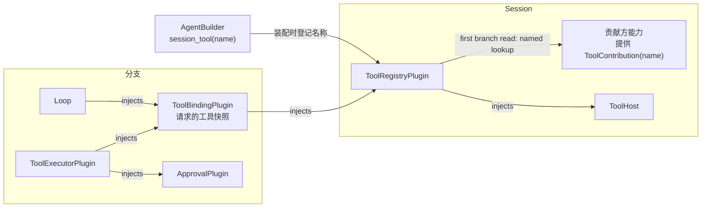

# Session 工具贡献

状态：Implemented；`branch`、`agent` 以贡献提供；没有通用的 `task` 工具，脱离工作的查询、等待与停止由所属能力各自的工具提供。基线为[单树装配](single-tree.md)与[能力重载协议](single-tree.md#能力重载协议)。

## 贡献工具与分支初始化

固定表只含配置的宿主工具，在 ToolRegistry `apply` 时确定。每个配置的贡献工具（`branch`、`agent`、`wait` 与 C4 TypeScript 行等）是注册表自有的带版本集合，键为 `contributed:<tool>`，与其他动态来源走同一刷新、校验、采用与请求快照路径（#241）。

```text
Session services Active
    -> ToolBinding reads ToolRegistry (first snapshot: contributors read)
    -> existing Prompt adoption and BranchOpening finish
    -> Session publication and first input
provider enters/leaves Active, or a service binding changes
    -> registry task rereads contributors -> tools.changed
    -> ToolBinding adopts (configuration with a tool part)
       or the next request declares it (no tool part, bind_current)
```

注册表在自身 `apply` 期间不能读取未声明的服务，因此贡献方由 ToolBinding 的首次快照读取，之后由注册表自己的任务在任一插件进入或离开 Active、或服务绑定变化时重读；监听器只唤醒该任务。贡献方对象不变时版本不变；新代以从不复用的新版本替换；提供方缺失或其代次正在卸载时撤下该集合。尚未 Active 的贡献方记 `tool.attach` 诊断，Active 后的下一个请求起提供，不需要重载 Session。装配等待规则保持不变，可选提供方不阻塞 Session 就绪（#132）。

配置不含工具部分的分支每个请求经 PrepareModelHost / `bind_current` 声明注册表当前的宿主与贡献工具，贡献工具的变化不写采用事实；只有其他来源的工具需要采用。带工具部分的配置把贡献集合记入 `tool_sources`，与其他来源相同。

已安装插件的必需依赖若使装配保持 Pending，Session 仍按既有规则等待或超时。C3 移除的是 ToolRegistry 对可选贡献的硬依赖，不跳过装配中的 Pending 插件。

影响面限于 ToolRegistry 与 ToolBinding；不增加 core 阶段、门面等待、公开服务或事件，复用 rutis 的 `FiberStatusChanged`/`ServiceChanged` 与已有 `tools.changed`、`context/configured`。

## 1. 范围

Session 能力向本 Session 的 `ToolRegistry` 贡献模型可调用的工具。宿主工具仍经 `ToolHost` 提供，不在本文范围。

| 工具来源 | 提供方式 |
| --- | --- |
| 宿主工具 | `ToolHost`（产品根由 `WorkspaceToolsPlugin` 提供；审批在执行时由分支 ToolExecutor 经 Approval 准入，不包装 ToolHost） |
| Session 能力工具 | 本文的 `ToolContribution`；`branch`、`agent` 分别由 `TimelineTreePlugin`、`CollaborationCapabilityPlugin` 以同一方式提供 |

## 2. 结构



分支能力不直接读注册表：Loop 构造请求时由 ToolBinding 固定该请求的工具快照，ToolExecutor 从快照取得处理器，经 Approval 准入后执行。注入关系以各插件文档的生成表为准（[ToolBinding](plugins/ToolBinding.md)、[ToolExecutor](plugins/ToolExecutor.md)、[ToolRegistry](plugins/ToolRegistry.md)）。

```rust
pub struct ToolContribution {
    pub definition: ToolDefinition,
    pub handler: Arc<dyn ToolHandler>,
}
impl SessionService for ToolContribution {}
```

| 项 | 规定 |
| --- | --- |
| 键 | `TypeKey::keyed_dynamic::<ToolContribution>(name).with_instance(session)`（`SessionScope::named_key`）：按工具名限定、按 Session 实例隔离 |
| 登记 | `AgentBuilder::session_tool(name)` 在装配时登记贡献名称；同一名称只登记一次 |
| 提供 | 贡献方能力在自身状态就绪后，于 `apply` 中以上述键提供；`definition` 可按本 Session 配置生成，`definition.name` 等于登记名称 |
| 宿主工具名 | 宿主工具名经 `AgentBuilder::host_tools` 登记：产品根由 `workspace_tools::install` 登记，测试与开发宿主由 `defaults::tool_host` 登记；其他提供 `ToolHost` 的装配须自行登记，否则显式 profile 不能列出这些工具 |
| 收集 | `ToolRegistryPlugin` 经 `AgentBuilder::session_tool_registry` 装配，工厂取得全部登记名称；`apply` 校验配置（含已登记来源名须满足工具名语法）；分支 ToolBinding 首次读取时按名称读取本 Session 已 Active 的贡献，之后由注册表在 Session 发布后的自有任务中随贡献方的激活与退役重读，不建立对可选贡献方的硬依赖 |
| 启用 | 只有 `SessionConfig.tools` 列出的工具进入注册表；未列出的贡献不读取。已登记但未就绪的贡献省略，并记录 `tool.attach` 进程日志 span；稍后才 Active 的贡献从其 Active 后的下一个请求起提供 |

固定表只含配置的宿主工具，在 `apply` 时构建。每个配置的贡献工具是注册表自有的带版本集合，键为 `#contributed:<tool>`；已登记来源名满足 `[A-Za-z0-9_-]{1,64}`，不含 `#`，所以二者的键不会相同。声明按 `SessionConfig.tools` 顺序列出宿主与贡献工具，其后是其他来源的工具。

## 3. 依赖方向

| 方向 | 规定 |
| --- | --- |
| `ToolRegistry` → 贡献方 | 按登记名读取当前 Active 的贡献方并跟随其换代，不注入贡献方；保留 `ToolHost`、`SessionConfig`、`SessionIdentity`、`SessionLifecycle` 和既有动态来源的真实依赖 |
| 贡献方 → `ToolRegistry` | 不注入；贡献方不读取、不修改注册表 |
| 贡献方状态 | 不因 `ToolRegistry` 或其上游重载而卸载 |

## 4. 重载

| 情况 | 结果 |
| --- | --- |
| 贡献方重载或退出 | 不重载 ToolRegistry；旧集合撤下，旧 handler 的停止与在途工作归贡献方结算。新一代 Active 后以新版本提供，不把已绑定请求改绑到新 handler |
| `ToolHost` 重载 | `ToolRegistry` 重载并重新收集全部贡献；贡献方不受影响 |
| 旧代处理器 | 被继续持有时调用返回明确的停止错误 |

`agent` 处理器持有贡献方当前代的取消令牌；贡献方卸载后，经旧处理器的调用（包括 `list`）返回 `capability reloading`，不再读取旧代状态。`Agents` 重载后，新一代 Collaboration 的 `agent` 从下一个请求起提供，不需要重载 Session。

## 5. 错误

| 情况 | 结果 |
| --- | --- |
| 已登记的可选贡献无 Active 提供方 | 该工具不进入声明，提供方 Active 后再提供；记录进程日志 span，ToolRegistry 与 Loop 正常工作 |
| 已登记来源名不满足工具名语法 | Session 构建失败：`tool source name <name> must match [A-Za-z0-9_-]{1,64}` |
| 贡献名称与宿主工具重名 | 注册时重复，Session 构建失败 |
| `SessionConfig.tools` 含未登记且宿主未提供的名称 | 沿用现有错误：`tool <name> is not provided by the host` |

## 6. 验收

1. 贡献方提供的工具出现在模型工具声明中，调用经 `ToolExecutor` 到达其处理器。
2. `branch`、`agent` 以贡献提供，分支与协作流程测试经贡献路径通过。
3. `ToolHost` 重载后贡献方状态保持，工具表恢复一致。
4. 可选贡献方 Pending、缺失或退出时不传播硬依赖失效；来源所有者仍负责旧 handler 的停止，新一代 Active 后的下一个请求起提供；没有工具部分的配置不为旧版本保留引用。
5. 未启用的贡献不出现在工具声明中。
6. 首个请求声明并绑定当时已 Active 的宿主与贡献工具；之后才 Active 的提供方从其后的请求起提供。恢复流程在首个请求前采用本次装载时的工具，已绑定请求保持原工具快照。

## 7. 动态工具来源

状态：Implemented。本节是 Tools 能力（Session 级 `ToolRegistry` 与分支级 `ToolBinding`）的当前合同；注入关系以 Plugin 文档 [ToolRegistry](plugins/ToolRegistry.md)、[ToolBinding](plugins/ToolBinding.md)、[Loop](plugins/Loop.md)、[ToolExecutor](plugins/ToolExecutor.md) 的生成表为准。

### 7.1 职责

MCP connections belong to the Session loader subtree, not to the process or
workspace. Session closure drains its instances even while stale tool bindings
remain. Replacements retain old connections for existing bindings; disabling or
removing an entry closes its instances across Sessions, even with bindings.
New bindings automatically adopt the replacement through the existing flow below.

- **收集来源**：宿主工具（`S:ToolHost`）、固定贡献（`S:ToolContribution[name]`，如 `skill`、`branch`、`wait`）、动态来源（`S:SessionToolSource[name]`；当前只有 App Server 的 McpSession：登记名 `mcp`，键 `mcp:<serverId>`，版本随连接代次与工具列表变化且不复用，工具名带 server 前缀避免跨来源重名，连接失败时撤销该键）。`SessionConfig.tools` 只列固定工具；动态来源的可见性由来源方自己的配置决定。
- **MCP 启用**：已配置的服务器启用即运行，没有宿主本地批准（[ADR 003](../../adr/003-approval-scope.md)）；项目 `.mcp.json` 的条目默认禁用，只由用户的本地记录启用。已禁用或删除的服务器不发现、不连接，McpSession 不提供其集合（状态 `Disabled`）；配置或启用变化时立即撤销旧集合（仅刷新时保留旧集合至替换就绪）。配置替换时，已绑定请求所持的旧版本 handler 保留其代次直到释放；停用、删除或显式断开会在所有 Session 中关闭它，包括已绑定的请求；停用在来源文件不可读时也生效，被撤回的条目报告为 `Disabled` 而非连接失败。协调者的应用状态变化时各 McpSession 重读选择，外部编辑经目录读取或连接操作被发现后到达每个 Session；Session 开始关闭后不再发现或创建连接。文件根授权、工具权限预设与 Session 回放都不启用条目。
- **维护变化**：动态来源按整组校验、原子替换；分支采用新的工具集合，作为 `context/configured` 的工具部分写入 Timeline（工具声明属于模型上下文）。
- **请求一致**：在 Loop 构造请求时固定本请求的声明与实现（同一版本），供 ToolExecutor 按名取实现；本请求结算后释放。Loop 在 `turn/end` 统一 `retain_only(None)`，不在每种结束路径各自释放。

不负责：审批与权限、Skill、沙箱与路径、提示词来源、工具执行流程（归 ToolExecutor）。

### 7.2 作用域与依赖

| 组件 | 作用域 | 注入 | 提供 | 被谁注入 |
| --- | --- | --- | --- | --- |
| `ToolRegistryPlugin` | Session | `S:ToolHost`、`S:SessionConfig`、`S:ToolContribution[name]`、`S:SessionToolSource[name]` | `S:ToolRegistry`、`StateCell<ToolSourcesState>` | ToolBinding；`PrepareModel` 实现（开发路径） |
| `ToolBindingPlugin` | 分支 | `S:ToolRegistry`、`B:Prompt`（采用入口）、`B:Timeline`、`B:BranchLifecycle`、`B:Dispatcher`、`B:BranchOpening` | `B:ToolBinding` | Loop、ToolExecutor |

- 来源方只提供服务，不注入 ToolRegistry 或 ToolBinding（沿用第 3 节）。
- 审批由 ToolExecutor 注入 `B:Approval` 调用，Tools 不涉及。
- 类型位置：`ToolProvider`、`SessionToolSource`、`ToolSourceSet`、`ToolSourcesState` 在 `dim-agent-capabilities/src/tool_registry.rs`；`ToolBinding` 在 `tool_binding.rs`。`Prompt::adopt_tools` 是 crate 内部入口，因此 ToolBinding 与 Prompt 同在该 crate。持久化类型 `ToolSourceVersion` 在 `dim-agent-types`。
- 登记：`AgentBuilder::session_tool_source(name)` 在装配时登记来源名，注册表工厂把这些名称作为 `Contributions<SessionToolSource>` 的键。登记名无提供方时 Session 构建失败（同第 5 节）。App Server 的产品 profile 登记 `mcp`。
- `ToolSourcesState` 经只读的 `S:ToolSourcesView`（`PublicService`）对外提供；ToolRegistry 能交出处理器，不公开。

动态来源端口：

```rust
pub struct SessionToolSource(pub Arc<dyn ToolProvider>);
impl SessionService for SessionToolSource {}

pub trait ToolProvider: Send + Sync + 'static {
    /// Every complete set this provider currently offers, one per key.
    fn sets(&self) -> Vec<Arc<ToolSourceSet>>;
}

pub struct ToolSourceSet {
    pub key: String,     // "<registered name>" or "<registered name>:<instance>", e.g. "mcp:<serverId>"
    pub version: String, // never reused for this key, across provider generations
    pub tools: Vec<Arc<ToolContribution>>, // handlers bound to this version's resources
}
```

来源方保证：定义已在其外部边界解析完成；`sets()` 中去掉某个键即撤销该键；替换集合后用自身上下文向 `EventKey::<ToolProviderChanged>::of().instance(session_scope.instance)` 发出通知，消费方每次读完整的当前集合。trait 不叫 `ToolSource`，以免遮蔽 `dim_agent_types::ToolSource`（`ToolDefinition.source` 的展示分类）。

### 7.3 状态

| 状态 | 所有者 | 内容 |
| --- | --- | --- |
| 固定表 | ToolRegistry | 按 `SessionConfig.tools` 构建（第 2 节规则），本代注册表内不变；宿主工具包装为 `HostTool` 条目 |
| 当前来源集合 | ToolRegistry | 每个键一个 `Arc<ToolSourceSet>`（强引用）；旧版本只登记弱引用；已持有过的版本集合（用于拒绝复用） |
| `ToolSourcesState` | ToolRegistry（`StateCell`，外部经 `S:ToolSourcesView` 读，供 MCP 管理界面） | `BTreeMap<key, ToolSourceStatus { adopted: Option<version>, rejected: Option<ToolSourceRejection { version, reason }> }>` |
| pin 列表 | ToolBinding | `[(sequence, Vec<Arc<ToolSourceSet>>)]`：本分支已采用、可能仍被请求前缀引用的集合；外加在途采用持有的待采用集合 |
| 请求快照 | ToolBinding | `request_id → { 名称 → Arc<ToolContribution> }`，并强持所引用的集合 |
| 工具集合的采用事实 | Timeline（经 Prompt 写入） | `context/configured.settings` 的 `tools` 与 `tool_sources` |

旧版本保留靠 `Arc` 所有权：pin、在途采用与快照任一仍引用时，旧集合可经 ToolRegistry 按 `(key, version)` 取得；全部释放后集合与 handler（如 MCP 旧连接代次的路由）一并释放。

### 7.4 事件

不引入新的 Timeline 事件。来源与注册表的内存变更通知使用现有 rutis 总线（[#122](https://github.com/arcships/dim/issues/122)）。

| 事件 | 写入方 | 规定 |
| --- | --- | --- |
| `context/configured` | Prompt，由 ToolBinding 经 `adopt_tools` 发起 | `ModelConfiguration` 增加 `tool_sources: Vec<ToolSourceVersion { key, version }>`，为空时不序列化；`tools` 为完整声明：固定工具在前（按 `SessionConfig.tools` 顺序），来源工具按键排序、键内按集合顺序。`tool_sources` 为空表示全部是固定工具 |

模型选择与工具集合是同一配置的两部分，分别更新：公开的 `ConfigureUpdate.model: Option<ModelSelection { provider_id, model_id, config, metadata }>` 不含工具，外部调用方无法给出 handler。`SessionConfig.model` 使用同一类型，创建时固定完整模型参数；`AgentConfig` 与 Agent profile 的默认身份仍为 `ModelId`。旧 Session 中只含模型身份的记录可读取，缺失参数表示没有显式参数，不沿用另一模型的默认值。Prompt 在其串行采用队列中以前缀里最后一个已采用配置为基础合成：模型更新只替换模型字段，工具采用只替换 `tools/tool_sources`，二者互不淘汰。前缀尚无模型部分时工具采用返回 `InvalidInput("tool set adoption requires a model configuration")`，该分支走 `PrepareModelHost` 路径。只更新模型或工具部分时，`context/configured.system` 沿用上一次已采用的值。

ToolRegistry 的来源变化是 Session 内状态，不写 Timeline。以下 rutis 通知均以 Session 的实例键隔离，不携带工具集合；消费者读取所有者的现态。

| 通知 | 生产者 → 消费者 | 内容与顺序 |
| --- | --- | --- |
| `tools.provider_changed` | 来源方 → ToolRegistry | 空通知；来源方完成状态替换后发出，注册表只读取本 Session 已登记的来源 |
| `tools.changed` | ToolRegistry → 各分支 ToolBinding | 空通知；注册表完成集合替换/撤销及状态更新后发出 |

注册表先订阅再初读来源；来源通知变化时重读全部已登记来源，因此另一来源让出工具名后，被拒来源能自动恢复。
注册表用自身上下文发出 `tools.changed`，不借用来源通知携带的发送方上下文；来源方与注册表均记录发送失败。
ToolBinding 先订阅再初读注册表，通知只唤醒它自己的采用任务；发布前的唤醒保留到原有 BranchLifecycle 激活后处理，关闭时退出。
每个分支继续通过 Prompt 串行采用工具集合，只有该采用事实影响后续请求；现有请求的 handler 快照不变。
`ToolSourcesView::subscribe` 仍提供只读状态，不用作部件间的空变更信号。

### 7.5 服务接口

**`ToolRegistry`（Session）**

| 方法 | 输入 → 输出 | 错误 |
| --- | --- | --- |
| `definitions()` | → 固定表与当前集合的全部声明（顺序同 7.4） | — |
| `snapshot()` | → 同一锁内读出的声明与其所来自的当前集合；ToolBinding 以此构造采用内容 | — |
| `sources()` | → 当前集合，按键排序 | — |
| `source(key, version)` | → `Option<Arc<ToolSourceSet>>`，当前或仍被引用的旧版本 | — |
| `fixed(name)` | → 宿主工具 `Option<Arc<ToolContribution>>` | — |
| `contributed(name)` | → 贡献工具当前版本 `Option<Arc<ToolContribution>>` | — |

内部替换 `replace_source(key, expected, set: Option<Arc<ToolSourceSet>>)` 不对外开放。注册表在 `apply` 读全部来源，之后每次来源通知重读，对版本与已持有不同的键执行：

| 步骤 | 规定 |
| --- | --- |
| 校验 | 已持有版本仍为 `expected`；`key` 属于提供它的登记名；`version` 未被本注册表持有过；工具名满足 `[A-Za-z0-9_-]{1,64}`、集合内唯一，且不与固定工具名（宿主工具定义名与全部已登记贡献名，贡献名只能由其自身的 `contributed:` 集合提供）或其他键当前集合重名 |
| 失败 | 整组拒绝，保留旧集合，记 `rejected` 与诊断。被拒版本不算已持有，任一来源下次变化时重新校验；先占名的来源撤销后被拒来源自动恢复 |
| 成功 | 原子替换，旧版本转弱引用，更新 `ToolSourcesState`，通知 |
| 撤销 | 移除该键，不会失败 |

**`ToolBinding`（分支）**

| 方法 | 调用方 | 输入 → 输出 | 错误 |
| --- | --- | --- | --- |
| `bind(request_id, through, tools, tool_sources)` | Loop | 前缀（至 `through`）中已采用配置的声明与来源版本 → 登记快照；成功后按 7.6 释放旧 pin | `tool source <key>@<version> is unavailable`；`tool <name> has no handler`（声明名在所绑集合与固定表中都不存在）；`request_id` 已登记 |
| `bind_current(request_id, declared: Option<_>)` | Loop | `None`：配置没有工具部分，声明注册表当前的固定工具；`Some`：核对 `PrepareModelHost` 给出的声明 → 按注册表当前状态登记快照 | 声明名不存在或与当前定义不等 |
| `handler(request_id, name)` | ToolExecutor | → 快照中的 `Arc<ToolContribution>`（`handler` 用于执行，`definition.risk` 供审批） | `request <id> has no active tool binding`；`Unknown tool: <name>`。ToolExecutor 写成工具错误结果 |
| `transfer(from, to)` | Loop（预算恢复） | 原请求快照改登记到新 `request_id` | `from` 无快照 |
| `release(request_id)` | Loop | 释放快照；不存在时无操作 | — |
| `retain_only(request_id: Option<_>)` | Loop（重建后） | 释放其余快照 | — |

`handler` 只读快照，不读注册表当前表：来源在调用途中被替换或撤销，不影响本请求。

**`Prompt::adopt_tools`（crate 内部，归 Prompt）**：`adopt_tools(ToolSetAdoption { tools, tool_sources }, cancel) -> Result<ToolAdoptOutcome>`，`ToolAdoptOutcome` 为 `Adopted { sequence }`、`Unchanged`、`Superseded`。排入 Prompt 现有串行采用队列，不调用 `LoadPrompt`，不写 `prompt/configure-*`；合成并提交 `context/configured` 后返回（不等分发：ToolBinding 在分支 `apply` 中调用，Dispatcher 此时尚未启动）；发布前 `cancel` 已取消返回 `Superseded`。

### 7.6 关键流程

**采用**（ToolBinding 单任务串行）：

```text
apply:
  前缀无已采用模型 ──> 提供 ToolBinding；请求经 PrepareModelHost + bind_current
  配置无工具部分且注册表无动态来源 ──> 视为一致，不采用；请求经 bind_current(None)
  读前缀最后一个已采用配置的 tools / tool_sources
  声明与来源版本都等于注册表当前 ──> 直接 pin，序号记 0
  否则（已有模型、不一致、版本不可取得） ──> adopt_tools(当前) ──> pin(Adopted.sequence)
  完成后才提供 B:ToolBinding（已有模型时，Loop 因此在采用落入 Timeline 后才开始请求）

branch/start、branch/resume 分发时（Prompt 已在同一事件写入模型配置，ToolBinding 依赖 Prompt，分发在其后）:
  登记为 BranchOpening 工作：等 Prompt 初始采用完成，按 apply 的同一规则比较 ──> 一致则 pin，否则 adopt_tools ──> pin
  开启工作完成后分支才接受输入，首个请求已有对齐的工具部分

ToolRegistry.changed()（分支 activated() 之后才处理；之前的变化保留在 watch 中）:
  当前集合 != 本分支最新采用 ──> adopt_tools ──> 追加 pin(Y)，旧 pin 保留
  失败 ──> 保留 pin 与前缀，记诊断，下次通知重试
卸载: 取消在途采用，等待任务结束，释放 pin 与全部快照
```

**绑定与释放**：

```text
Loop.start_preparation(through)
  读前缀、确定配置、渲染历史、得到 ModelSettings
  有已采用配置 ──> bind(request_id, through, settings.tools, settings.tool_sources)
  无工具部分     ──> bind_current(request_id, None)
  无             ──> PrepareModelHost ──> bind_current(request_id, Some(settings.tools))
  失败 ──> step/model-output-end(Failed)，turn Failed
ToolExecutor ──> handler(request_id, name) ──> 执行（流程见入口文档）
Loop 释放:
  Completed 无工具调用 / step/tool-result（全部调用已结算） / Failed 不恢复 / Cancelled / 准备失败 ──> release
  Failed 且预算恢复 ──> transfer(原, 新)，不重新选择来源
  Loop 重建 ──> retain_only(当前请求)
```

释放由 Loop 调用，因为只有 Loop 知道预算恢复的决定；“本请求的调用全部结算”即 Loop 分发到 `step/tool-result`。

**pin 释放**：pin 序号是本分支本地序号（`apply` 时直接 pin 记 0，继承或压缩基线中的配置可能不在本分支序号内）。pin 不在 `adopt_tools` 返回时替换，因为已在 `step/model-start` 确定 `through`、尚未 `bind` 的请求仍引用旧版本。`bind(…, through, …)` 成功后，令 Y* 为序号不大于 `through` 的最大 pin，释放序号小于 Y* 的 pin。依据：同一分支同时只有一个请求在准备或执行，且 `through` 单调递增，之后的请求前缀都含 Y*。`bind` 失败、`bind_current`、`transfer` 不释放 pin；长期不发请求的分支最多多留几个旧集合，直到下一次绑定成功或卸载。

**子分支**：继承父分支前缀中的配置，其 ToolBinding 在 `apply` 及 `branch/start` 分发时按同一规则 pin 或重新采用；不继承父分支的快照与 pin。

**重载与恢复**（沿用[能力重载协议](single-tree.md#能力重载协议)，注入链：来源方、`ToolHost` → ToolRegistry → ToolBinding → Loop、ToolExecutor；Prompt → ToolBinding）：

| 情况 | 结果 |
| --- | --- |
| 来源版本变化 | 不是重载：替换、采用；在途调用按旧快照结算 |
| 动态来源方、`ToolHost` 或 ToolRegistry 重载 | 下游重载，ToolExecutor 以重载结算在途批次；新注册表只含当前版本，前缀版本不可取得的分支在 `apply` 重新采用，一致的直接 pin、不写新事实。固定贡献按第 4 节处理 |
| Prompt 重载 | ToolBinding 及下游重载，快照随旧 ToolBinding 释放 |
| Loop 单独重载 | ToolBinding 与快照保留；新 Loop 重建后 `retain_only` |
| ToolBinding 重载后预算恢复 | `transfer` 因无快照失败，turn Failed |
| 进程恢复 | 旧句柄不恢复；动态来源生成新版本，各分支 ToolBinding 在 `apply` 及 `branch/resume` 分发时重新采用。来源尚未就绪（MCP 仍在连接，或项目条目尚未由用户启用）时采用不含其工具，就绪后按正常替换再采用；回放历史不启用任何 MCP 条目 |

`bind` 时不做“同名改绑当前 handler”：前缀版本不可取得即明确失败，版本变化一律留下采用事实。

### 7.7 验收

在 `tests/integration`（`tool_binding`、`prompt_lifecycle`）以测试用 `ToolProvider`（可控版本、handler 记录调用、`Drop` 可观测）与脚本模型驱动：

1. 原子替换与冲突拒绝：集合内重名或与固定工具、其他来源重名时整组拒绝，下一请求声明不变，`ToolSourcesState` 显示 `rejected`；占名来源撤销后被拒来源在下次变化时被采用。
2. 刷新中请求：请求的 `step/model-start` 已写入、`bind` 未发生时（门控暂停准备），来源由 V1 换为 V2 且采用已返回；放行后该请求以 V1 绑定并正常结束，V1 未释放；下一请求以 V2 绑定后 V1 被释放（`Drop`）。
3. 声明与实现同版本：`context/prepare.request.tools` 与 `settings.tool_sources` 为 V2 的请求，调用到达 V2 的 handler。
4. 在途调用：执行中来源换为 V2，该调用由 V1 handler 完成。
5. 撤销：来源撤销后新请求不声明其工具；调用旧名得到 `Unknown tool`，handler 未调用。
6. 子分支：继承配置可绑定；父分支换代并释放旧版本后创建的子分支，首个请求前有一次工具采用；继承 pin 记 0 时后续采用与释放不泄漏、不误释放。
7. 重载与恢复：`ToolHost` 重载时在途批次带重载结算、来源未变时不写新 `context/configured`；进程重启（SQLite profile）后每个活分支在首个请求前有一次工具采用，首个请求绑定成功。
8. 并发更新：`ConfigureUpdate.model` 与工具采用同时提交，二者都 `Adopted`，最终 `context/configured.settings` 同时含新模型与新工具。
9. 开发路径：无采用配置时经 `bind_current` 绑定，现有 `prompt_lifecycle`、`interrupt` 流程通过。

未覆盖：第 2 项的「`step/model-start` 已写、`bind` 未发生时换代」（没有门控准备的测试钩子）；第 7 项的 `ToolHost` 重载与 SQLite profile 重启（以内存存储的重启覆盖）。

### 7.8 取舍

模型与工具分两部分更新、在 Prompt 串行队列中合成，而不是另设工具采用事件或让模型更新携带工具（前者多一套投影，后者让模型更新方读取工具状态且两者互相淘汰）。快照与 pin 归分支级 ToolBinding，随分支卸载自动释放。旧 pin 在新版本首次绑定成功后释放，而不是采用返回即释放（会与 `step/model-start` 之后的异步绑定竞争）。

结构上只有一个分支插件（采用、pin、快照三者生命周期相同）和一个 Session 级来源端口；来源条目、快照条目与 `handler` 返回值都复用 `Arc<ToolContribution>`，旧版本保留复用 `Arc` 所有权，采用复用 Prompt 的串行队列与 `context/configured`，没有新增事件类型、引用计数表或租约。`ToolSourcesState` 是来源被拒时唯一可见的结果，保留。
