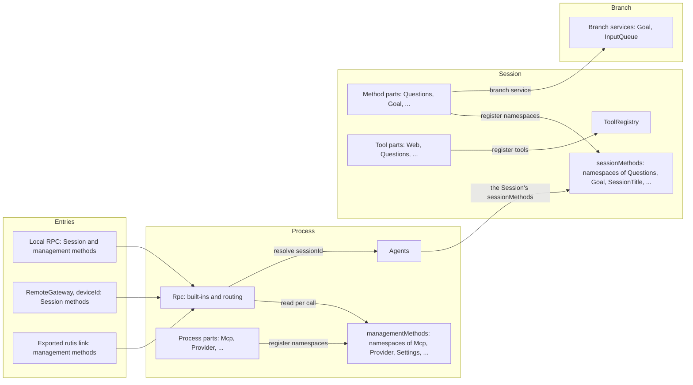
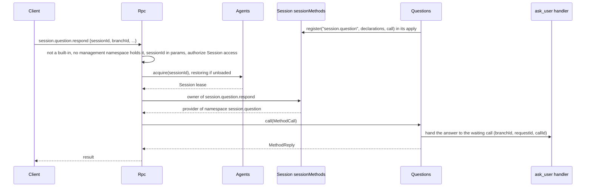
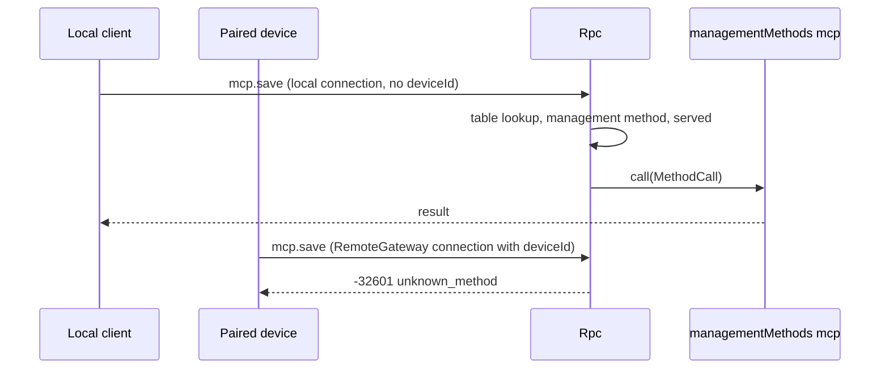

# Methods and tool contributions

Status: Draft. Overall design: [overview §3 integration](../overview.md#3-integration-by-existing-mechanisms), [Appendix B Rpc and ToolRegistry](../overview.md#appendix-b-supplements-to-existing-plugins); rules: [ADR 002](../../adr/002-plugin-scope.md) D2, D3, D5. Phase: P0. Language: neutral contracts; Rust binding in [Appendix F](#appendix-f-rust-binding). The [C4 binding](../session-typescript.md) implements a non-Rust Session tool/method subset; Session broadcast uses the separate C4 leaf observation contract.

This contract defines three registration services in the language-neutral form of ADR 002 D5: the Session's `sessionMethods` and `toolRegistry`, and the process's `managementMethods`. Each is identified by a service name and a scope; its methods take and return serializable data; errors are data; cancellation is a protocol action. A part of any language depends on the service of its scope and registers from its own `apply`: a method namespace with `sessionMethods` or `managementMethods`, a tool with `toolRegistry`. A registration belongs to the part that made it and is withdrawn when that part unloads. Rpc reads the two method tables on each call and depends on no provider. They are built on mechanisms the runtime already has: named services per scope, Rpc's existing dispatch through the Session, as `approval.respond` does today, and registrations that are effects of their caller. Implementation status: method namespaces (#14, C1, #382) and tools (#382) register through the Rust bindings in Appendix F, and parts of other languages register through the same services ([C4](../session-typescript.md), [process rows](../process-typescript.md)); of `callChannel`, only per-call `progress` (C1) is implemented. The rest of `callChannel` and general plugin installation are not implemented, nor are `ConnectionEntry {name, deviceId}`, routing by `deviceId` and exported rutis links (proposed for P3, with RemoteGateway).

| Service | Scope | Registers | Registered by | Read by |
| --- | --- | --- | --- | --- |
| `sessionMethods` | Session | method namespaces | Session parts (Questions, Goal, SessionTitle, Attachments, ShellInput, SessionGrants, InputQueue's `session.input`, ...) | Rpc, through the Session, per call |
| `managementMethods` | Process | method namespaces | Process parts only (Mcp, Provider, SkillsCatalog, Settings, ...) | Rpc, per call |
| `toolRegistry` | Session | tools | Session parts (Questions, Goal, Web, Scheduler, Workflow), each registering its own tools | ToolRegistry, which owns `toolRegistry` (supplement: tool registration) |

**Management methods** are client RPC methods about the host rather than a Session: `account.*`, `provider.*`, `mcp.*`, `skills.*`, `settings.*` and `permission.*`, plus the methods of new process plugins. `daemon.shutdown` stays an Rpc built-in and is likewise never served to paired devices. Rpc looks management methods up in `managementMethods` on each call and names no owning service (A.4). Only process parts register them, and they are never served to paired remote devices. Session methods have no level; the only split is `sessionMethods` (dispatched through a Session) versus `managementMethods`.

Proposed (P3, with RemoteGateway; not implemented): Rpc decides what a connection is served from its `ConnectionEntry {name, deviceId}`: a local connection gets Session and management methods, a connection with a `deviceId` (a paired device through RemoteGateway) never gets management methods, and an exported rutis link gets management methods only when exported. Today Rpc serves every connection by the existing transport profile rules (A.3). There is no port and no Management plugin. Providers are optional plugins installed only when enabled. Rpc reads `managementMethods` on each call and depends on no provider, so a provider that is disabled, Pending, Failed or reloading affects only its own namespace (§3.2). The method tables and ToolRegistry do not depend on the parts that register with them; those parts depend on them. A tool registered later is offered from the next request, and a withdrawn one is no longer offered, without a Session reload (A.5).

Acting on a tool call or an input before it is committed is not a service of this contract. Approval and the Session input path are unchanged; InputQueue's withdrawal is its owner's change ([overview Appendix B](../overview.md#appendix-b-supplements-to-existing-plugins)).

## 1. Structure



| Service | Absent |
| --- | --- |
| `sessionMethods` | `unknown_method` when no namespace of the Session ever held the name; when the namespace that holds it is withdrawn, `service_reloading` while the part that registered it starts or reloads and `service_unavailable` once it failed or cannot run (A.1) |
| `managementMethods` | `unknown_method` when no namespace ever held the name, or the row that registered it is disabled or absent; a withdrawn namespace otherwise answers from that row's status (§3.2) |
| Tool registration | A tool the Session's mount list names that no part has registered is not declared and is reported in diagnostics; it is declared from the next request once a part registers it (A.5) |

Contracts defined here: the two method tables and their registration, tool registration, `MethodDecl`, `MethodCall`, `MethodReply`, `MethodError`, the `session.methods` listing method, the `callChannel` companion service (only `progress` implemented), `ToolDeclaration`, `ToolCall`, `ToolResult`, its effect declaration, what each entry is served, naming, reserved names, the migration of existing management methods and the compatibility table. Contracts used: `SessionConfig` ([session-access](session-access.md#a3-sessionconfig-fields)), source input conventions ([session-access A.2](session-access.md#a2-source-input-conventions)), the Rpc command envelope and `appError` codes.

## 2. Data and state

No service owns a Timeline event or persisted state. Each method table is runtime state of its owner: a Session's `sessionMethods` starts empty when the Session loads and the process's `managementMethods` when App Server starts, and each fills as parts register. For each namespace registered once and withdrawn since, a table keeps the row that registered it, so a call into it answers from that row's status (A.1, §3.2). Assembly records no namespace. Proposed (P3, not implemented): each connection records `ConnectionEntry {name, deviceId}` when it is accepted; what it is served follows from that record (§3.2), never from a user identity. A link's management export is host-local structural configuration.

## 3. Flows

### 3.1 Session method



The name belongs to the longest namespace registered in that Session that holds it (A.1). If no namespace of the Session ever held the name, for example because its plugin is not enabled for the Session, the result is `unknown_method`; if the namespace that holds it is withdrawn, the result is `service_reloading` while the part that registered it starts or reloads, and `service_unavailable` once that part failed or cannot run (A.1). Session methods carry no level: every connection that is served Session methods is served all of them, including `shell.*`.

### 3.2 Management method



The connection's entry record is the only check. Being served management methods grants host administrator rights.

Each process part that serves management methods depends on `managementMethods` and registers its namespaces from its own `apply` ([methods.rs](../../../crates/dim-app-server/src/methods.rs)). The table checks a namespace when it is registered (A.1 Reserved names) and refuses a namespace registered already; a refused registration fails the registering part. A name belongs to the longest namespace that prefixes or equals it. A withdrawn namespace keeps holding its names: the table remembers the row that registered it, and the parent namespace never answers them. Rpc depends on the table, not on any provider, and reads it on each call ([connection.rs](../../../crates/dim-app-server/src/connection.rs)). A name whose namespace is withdrawn answers from the status of the row that registered it, read with `loader.get(row)`: a row that is not running and has not failed (not started yet, Pending, Loading, or between generations) returns the retryable `service_reloading`; a row that cannot run again until it is fixed or restarted (Failed, Unresolved, Stopped, or Disposed: removed and unable to restart) returns the non-retryable `service_unavailable`; a disabled or absent row, or an Active row that has not registered the namespace again, returns `unknown_method`. A name no namespace ever held returns `unknown_method`, so the names of a provider that is still Pending, or that failed before it registered, are `unknown_method`. Rpc, open connections and the other namespaces are unaffected. A call admitted before its provider unloads belongs to the provider, which replies to it according to the method's `interruption` (A.1): a `report` call ends with `operation_interrupted`, a `drain` call replies with its own result, and the provider's unload waits for every call it accepted.

## 4. Timing and conflicts

| Scenario | Order | Outcome | Owner |
| --- | --- | --- | --- |
| Session-scoped provider reloads mid-call | call < reload | `report`: `operation_interrupted`; `drain`: the call's own result; the provider's unload waits for every admitted call (AGENTS.md rule 8) | Provider |
| Session method while the Session's capabilities reload | — | `service_reloading` | Rpc |
| Session method whose namespace is withdrawn and whose registering part failed or cannot run | — | `service_unavailable` until the part is fixed (A.1) | Rpc |
| Session method that no namespace of the Session ever held | — | `unknown_method` | Rpc |
| Management owner reloads | — | Calls into its withdrawn namespace return `service_reloading` until the new generation registers it again; a Failed, Unresolved, Stopped or Disposed owner returns `service_unavailable` (§3.2); admitted calls belong to the provider and follow their `interruption`; Rpc does not reload and connections stay open | Rpc |
| Management method or `daemon.shutdown` on a connection with a `deviceId` | — | `unknown_method` | Rpc |
| Two parts register one namespace in one table | registration | The second registration is refused (`<ns> is registered already`) and the part that made it fails | Method table |
| A part registers an invalid namespace (grammar, reserved root or built-in, A.1) | registration | Its registration is refused and the part fails | Method table |
| A part registers a tool name that is registered already or is a host tool's | registration | The registration is refused | ToolRegistry |
| A Session namespace equals, contains or lies inside a management namespace | routing | It registers, but the names a management namespace holds, registered or withdrawn, route to management and never reach the Session (A.1) | Rpc |
| A part that registered tools reloads during a turn | call < reload | Its registrations are withdrawn when it unloads. A foreign call in flight ends with an error warning that it may already have taken effect, and a later call through a retained handler is not made; a native tool settles by its own reload rule. The part's next generation registers again, and its tools are offered, as a new version, from the next request; ToolRegistry and Loop keep running (D3) | ToolRegistry |
| ToolRegistry reloads | — | The parts registered with it reload and register again | ToolRegistry |

Full table: [Appendix B](#appendix-b-full-conflict-table).

## 5. Context mapping

Methods have no model-visible effect. A method that changes model context does so through its owner's input or Timeline facts, and those owners' mappings apply. A registered tool reaches the model only through its declaration and its `ToolResult`, as any tool does. A tool's effect declarations have no model-visible effect of their own: they are carried in its result, and the compaction digest is the only part that projects them into context ([ContextCompaction §5.10](../plugins/ContextCompaction.md#510-class-3a-the-digest)).

## 6. Interfaces (summary)

| Service and method | Mode | Purpose |
| --- | --- | --- |
| `sessionMethods.register(namespace, MethodDecl[], call)` | async | Register a Session method namespace until the calling part unloads |
| `managementMethods.register(namespace, MethodDecl[], call)` | async | Register a management namespace until the calling part unloads |
| `call(MethodCall, cancelled, progress) -> MethodReply` (the registering part's function) | async | Execute a method of the namespace |
| `session.methods {sessionId}` (wire, Rpc built-in) | async | List a Session's methods (protocol v3) |
| `callChannel.progress / notify / closed` (Rpc) | sync / async | Per-call progress (implemented, Appendix F) and connection-bound notifications (not implemented) |
| `toolRegistry.register(ToolDeclaration, execute)` | async | Register a tool until the calling part unloads |
| `execute(ToolCall, cancelled) -> ToolResult` (the registering part's function) | async | Tool execution |

## 7. Security

Proposed (P3, with RemoteGateway; not implemented): the connection's `ConnectionEntry {name, deviceId}` is the only authority for what it is served: local RPC gets Session and management methods, a connection with a `deviceId` (RemoteGateway) gets Session methods only (paired devices may call every Session method, including `shell.*`, decision E3), and a rutis link serves management methods only when they are explicitly exported in host-local link configuration. Rpc validates only at the external boundary: param shape and `sessionId` authorization for every Session-scoped method, exactly as for its built-ins. Feature checks (content sniffing, size limits, model capability) belong to the method's owner. A registered tool is admitted by Approval and Permission like every tool, under its declared risk. There is no host-local approval: Approval and Permission govern only actions an agent decides, and commands that user or project configuration runs are that configuration's responsibility and run when enabled ([overview §6.4](../overview.md#64-conventions)). The former `mcp.approve`/`mcp.revoke` are removed (A.4).

## 8. Rule check

| Rule | How this document complies |
| --- | --- |
| §4 rule 1 (command events) | Not applicable: the services write no Timeline event themselves; a method that changes branch state calls its owner, which writes (for example InputQueue's `input/deleted` for `session.input.withdraw`). |
| §4 rule 2 (handover) | Not applicable: methods and tool contributions hand nothing over; a tool call is handed to ToolExecutor by the existing `step/tool-call` contract. |
| §4 rule 3 (before callbacks only) | Rpc validates only param shape and `sessionId` authorization; feature checks belong to the method's owner, and acting before a commit is left to Timeline before callbacks. |
| §4 rule 4 (no business meaning in core) | The method tables and ToolRegistry keep what parts register, and Rpc reads the tables; none names a provider or interprets a method. The effect declaration is carried on the result unchanged, and no part of the core names one of its kinds (A.6). |
| §4 rule 5 (batch) | Not applicable: no decision here is taken on a Timeline event; owners decide from their own facts. |
| §4 rule 6 (model context) | Methods have no model-visible effect, and a registered tool reaches the model only through its declaration and `ToolResult` (§5). |
| §4 rule 7 (public events and services) | Providers reach branches only through the branch's public services, and Rpc dispatches only through the Session's `sessionMethods`. |
| §4 rule 8 (requirements) | The Session's scope on its facade is raised in §9.4; a keyed read by name, drain on unload and listing active providers are withdrawn (§9.1 to §9.3). |
| §4 rule 9 (only decision facts in the Timeline) | Method tables and served entries are runtime state, never Timeline facts (§2). The effect declaration adds no fact either: it is an optional field of the result the executor writes on `step/tool-result`, and the compaction digest is its only consumer (A.6). |
| §1 (Capability and App Server boundary) | Rpc only routes and dispatches; the business code of every method lives in its provider's plugin. |
| ADR 002 D1 | `sessionMethods` and tool registrations are Session-scoped, `managementMethods` process-scoped, matching their owners. |
| ADR 002 D2 | No port or Management plugin; method namespaces register with the method table of their scope and tools with ToolRegistry, which owns the Session's tools. |
| ADR 002 D3 | Providers depend on their own or an enclosing scope, including the method table they register with. The method tables and ToolRegistry follow registration and withdrawal and do not depend on the parts that register (A.1, A.5); Rpc depends neither on management providers (§3.2) nor on Session method providers (A.1), so their reloads stay within their namespace. |
| ADR 002 D4 | A link's management export is structural host-local configuration; no business configuration is defined here. |
| ADR 002 D5 | Every service is named with scope and data-only methods, and a part of any language registers a method namespace or a tool with the same data and its own function (`call`, `execute`); Rust types appear only in Appendix F. The implemented binding is a subset of these shapes (A.1, Appendix F). |

## 9. Requirements raised to mechanism owners

### 9.1 Lookup of a keyed Session service by name

Withdrawn: a Session has one method table, the Session service `sessionMethods`, and a namespace is an entry its part registers there, not a keyed service. Rpc reads the table with the facade's existing typed read, `Session::session_service`, and the table itself tells a name no namespace ever held from one whose namespace is withdrawn (A.1).

### 9.2 Unload waits for `drain` calls

Withdrawn: rutis is an external dependency, so no requirement is raised to it. Rpc already waits for the commands it admitted before it unloads.

### 9.3 Listing the active providers of a process-scoped service

Withdrawn: rutis is an external dependency, so no requirement is raised to it. Rpc dispatches management methods with the `managementMethods` table its parts register with and `loader.get(row)` (§3.2); how `hello.features` reports them is Rpc's own design.

### 9.4 The Session's scope on its facade

| Item | Content |
| --- | --- |
| Blocked by | Rpc answers a withdrawn Session namespace from the copy, in that Session's instance, of the row that registered it (A.1). Rpc holds the `Session` handle, which does not say which instance its rows run in. |
| Existing mechanisms considered | `Session::diagnostics` walks the Session's plugin tree on every such call. A Session part that provides its own scope as a public service adds a part to every Session only to republish what the facade already holds. |
| Generic capability | `Session::instance()`, the Session's `InstanceId`, the instance its parts' names resolve in (`Names::instance`). Keys under it stay readable only from inside the Session (rutis refuses an instance key outside its instance), so it opens no service beyond `PublicService`. |
| Effect on sequence, batch, interrupt, reload | None. The Session scope plugin refuses to reload, so the instance does not change while the Session is loaded; on a closed Session the read fails with `Closed`, as the other facade reads do. |
| Owner and issue | Runtime (Session facade); implemented for [#207](https://github.com/arcships/dim/issues/207). |

The implemented foreign Session subset is [C4](../session-typescript.md); general plugin installation remains separate work.

## Appendix A. Interface details

Shapes are JSON with camelCase fields; a `?` after a field name marks it optional and `|` separates alternatives. These shapes are canonical: plugin documents use these field names (Rust bindings map them to snake_case). Every error is `MethodError` data.

### A.1 Method contributions

`sessionMethods` (Session) and `managementMethods` (process) are method tables with the same method, `register`. A part registers each namespace it serves with the table of its scope, and the table calls back the part's own `call`. Parts of other languages register through the same services ([C4](../session-typescript.md), [process rows](../process-typescript.md)) and reach the native call admission of Appendix F.

| Method | Mode | Request | Reply |
| --- | --- | --- | --- |
| `register` (the table's) | async | `namespace`, `MethodDecl[]`, `call` | Nothing once registered; an error when refused |
| `call` (the registering part's function) | async | `MethodCall`, `cancelled`, `progress` | `MethodReply`, or `MethodError` |

```text
// MethodDecl
{ "name": "session.goal.set",          // full wire name inside the namespace
  "mutating": true,
  "interruption": "report" | "drain",  // the provider replies on unload: report → operation_interrupted; drain → the call's own result
  "progress": false,
  "notifications": ["session.goal.changed"], // inside the namespace
  "reply": "direct" | "handoff" }      // handoff: daemon.shutdown
// MethodCall
{ "callId": "string", "method": "session.goal.set",
  "params": {},                        // as sent; Session methods keep sessionId (and branchId) here
  "origin": { "entry?": { "name": "string", "deviceId?": "string" }, // the connection's ConnectionEntry
              "connectionId?": "string", "peer?": "string" } } // peer: rutis link; diagnostics only
// MethodReply
{ "kind": "value", "value": {} } | { "kind": "handedOff" }
// MethodError
{ "code": -32000, "appError": "string", "message": "string" }
```

Implemented today (Appendix F): `MethodDecl.name`, `MethodDecl.mutating`, `interruption` and `progress`; the foreign `register` decodes these fields from a foreign part's declarations and supplies a fresh `callId` to each call. `notifications`, `reply`, `origin` and `handedOff` are not implemented.

Cancellation and interruption: the provider replies to its own calls, not Rpc. Two events interrupt an admitted call: the unload of the provider's generation and the unload of the Rpc load that admitted it. On either, the handler's cancellation token fires, for `drain` calls too. A `report` call then replies `operation_interrupted` at once (the operation may already have committed) and settles afterwards; a `drain` call replies with its own result. The provider's unload waits for every call it accepted, `report` calls included. A caller's disconnect cancels nothing.

| Rule | Content |
| --- | --- |
| Namespace | `<segment>(.<segment>)*`, segments `[a-z][a-z0-9_]*`, at most 128 bytes, owned by the part that registers it; a namespace may itself be a method (`session.rename`). A namespace outside this grammar is refused when it registers, and a called name outside it is `unknown_method` without any lookup |
| Registration | A part registers a namespace with the table of its scope from its `apply`, with its declarations (at least one method, each unique and inside the namespace) and its `call`. In Rust the part passes its ctx; from another language the bridge ties the registration to the calling row, and `call` is that row's function, called back through the bridge. The registration belongs to that part and is withdrawn when it unloads. A second registration of the same namespace in one table fails (`<ns> is registered already`). The table checks the namespace and declarations when they are registered (Reserved names below); a refused registration fails the registering part |
| Ownership | A name belongs to the longest namespace registered in that table that prefixes or equals it. A withdrawn namespace keeps holding its names: the table remembers the row that registered it, and a call answers from that row's status (§3.2; Session-scoped call below). A name no namespace of the table ever held has no owner |
| Reserved names | Checked when a namespace registers. Exact built-ins are the names `is_builtin_method` accepts ([protocol.rs](../../../crates/dim-app-server/src/protocol.rs)). Management: the namespace follows the grammar, does not lie in a reserved root (`hello`, `daemon`, `agent`, `approval`, `session`), has no prefix equal to an exact built-in, and declares no method equal to one ("Invalid management namespace", "Invalid management contribution"); no exact built-in lies inside a management namespace, because every exact built-in lies under a reserved root. Session: App Server provides the process value `ReservedMethods`, which each Session's table consults; a namespace outside the grammar, in the roots `hello`, `daemon`, `agent` or `approval`, or that equals, contains or lies inside an exact built-in is refused ("invalid Session namespace <ns>"). For example `session.mcp` is an exact built-in, so `session.mcp`, `session.mcp.extra` and the bare `session` root, which contains it, are refused. A Session namespace may lie under `session` (`session.goal`, `session.input`). `session.input` is not reserved: InputQueue registers it with `sessionMethods`, so Rpc names no owning service |
| Precedence and routing | A built-in method; else a name a management namespace holds, registered or withdrawn, goes to management (§3.2); else, for protocol v3+, a name in the grammar whose params object has a `sessionId` field is a Session method candidate (Session-scoped call below); else management, where a name no namespace holds is `unknown_method`. One wire name space. A name whose params have no `sessionId` is never a Session method candidate: Rpc cannot know a Session's namespaces without the Session, so a name only a Session namespace holds is `unknown_method` without one |
| Namespace collisions | No assembly check: routing precedence decides. A Session namespace that equals, contains or lies inside a management namespace registers, but the names a management namespace holds route to management and never reach the Session |
| Session-scoped call | Rpc reads `sessionId` from a candidate's raw params; one that is not a non-empty string is `-32602` (an empty one is `invalid_params`, "sessionId must not be empty"). Rpc authorizes it and acquires the Session through `index.acquire`, which restores an unloaded Session (unlike `approval.respond`, which returns `session_closed` for a Session that is not loaded); a non-empty Session id that names no Session is `session_closed`. Rpc then reads the name's owner in that Session's `sessionMethods`: a registered namespace → its provider; a withdrawn namespace → the status of the registering row's copy in this Session (§9.4), read with the management table (§3.2): `service_reloading` while that copy is not started, Pending, Loading or between generations, `service_unavailable` while it is Failed, Unresolved, Disposed or Stopped, and `service_reloading` when the copy is Active (a child plugin of the row reloads) or there is no copy (a part between generations); a name no namespace of this Session ever held → `unknown_method`. Rpc holds the Session use until the call's operation settles. `sessionId` and `branchId` stay inside `params`; Rpc reads `sessionId` only to authorize and resolve. The provider reaches a branch through that branch's services. A name a management namespace holds, or whose params have no `sessionId`, never restores a Session |
| Call ownership | The Session-scoped provider generation owns the calls it admitted, as a management provider does: it replies to them, its unload interrupts them per `interruption` and waits for them (Cancellation above) |
| Shared types | `MethodDecl`, `Interruption`, `Handler`, `Progress`, `RpcError` and `MethodTable`, with the call admission both tables share, live in a `methods` module of dim-agent-capabilities, because Session capabilities there cannot depend on dim-app-server. They sit beside the Session table `SessionMethods` (Appendix F), as `ToolContribution` and `ToolHandler`, which also takes a `CancellationToken`, live beside ToolRegistry. Not dim-agent-types: it admits only serde and serde_json (`xtask check`; [architecture](../../architecture/README.md): no Tokio or rutis), while `Handler` takes tokio-util's `CancellationToken` and returns a rutis `BoxFuture`; and with `RpcError` there, `From<AgentError> for RpcError` could be implemented only in dim-agent-runtime (orphan rule). In dim-agent-capabilities that conversion lives with `RpcError`, so Rpc and Session providers keep `?` on runtime errors |
| Not dispatched | No namespace of the table ever held the name, the row that registered its withdrawn namespace is disabled or absent (or, for management, Active without registering it again), the provider does not declare the name, a name only a Session namespace holds called without `sessionId` in its params, a management method on a connection with a `deviceId`, an unexported link or the bare WebSocket, or v1/v2 → `-32601 unknown_method`. Session reloading, or a withdrawn namespace whose registering row (for a Session namespace, that row's copy in the Session) is not started, Pending, Loading or between generations, or a withdrawn Session namespace whose copy is Active or absent → `-32000 service_reloading` (retryable). A withdrawn namespace whose registering row, or that row's copy in the Session, is Failed, Unresolved, Disposed or Stopped → `-32000 service_unavailable` (not retryable). A Session id that names no Session → `session_closed`. A started `report` call interrupted → `operation_interrupted` |
| `hello.features` (v3) | Built-ins, plus, when the connection is served management methods (local v3), the methods of the management namespaces registered at that call, each listed only under the namespace that owns it. Session-scoped methods are not listed here; `session.methods` lists them per Session |
| `session.methods` | Public surface, an Rpc built-in for protocol v3, like the methods it lists: `session.methods {sessionId}` → `{ "methods": [ { "name": "string", "mutating": true } ] }`, the declared methods of the namespaces registered in that Session now, except the names a management namespace holds, which routing sends to management even when the call names a Session. It is authorized and resolved like other Session-scoped built-ins (restoring an unloaded Session), lists each method under the namespace that owns it, sorted by name, and adds one exact built-in name. v3 `hello.features` lists it where Session operations are served |
| Ready latch | The native binding waits for its required process providers before the first `hello`. The [TS process binding](../process-typescript.md#21-startup-and-availability) excludes optional extension rows from host startup/restart readiness; `hello.features` lists only the namespaces registered at that call, with later ones visible at the next `hello`. |

How Rpc routes a call once the connection's entry admits it:

```text
call
  |
  built-in? ------------------------------------- yes --> built-in handler
  | no
  a management namespace, registered or
  withdrawn, holds it? -------------------------- yes --> managementMethods (§3.2)
  | no
  v3+, in the grammar, and params has a
  sessionId field? ------------------------------ no ---> managementMethods (§3.2): no
  | yes                                                   namespace holds it, so
  |                                                       -32601 unknown_method
  sessionId a non-empty string? ----------------- no ---> -32602
  | yes
  authorize; index.acquire (restores an unloaded Session;
  |                         an unknown id -> session_closed)
  |
  owner in the Session's sessionMethods? -------- none ------> -32601 unknown_method
  |                                               withdrawn -> the registering row's copy
  |                                                 in this Session (§9.4, §3.2):
  |                                                 starting or reloading, Active or no copy
  |                                                   -> -32000 service_reloading
  |                                                 Failed, Unresolved, Disposed or Stopped
  |                                                   -> -32000 service_unavailable
  | registered
  provider call --> reply (an undeclared name: -32601 unknown_method)
```

Session namespaces registered today: `session.question` (Questions), `session.goal` (Goal), `session.rename` (SessionTitle), `session.input` (InputQueue), `session.context` (ContextCompaction), `session.exec.output` (WorkspaceTools, [background task output](../background-task-output.md)), `session.agent` ([model configuration](../model-configuration.md)), `attachment` (Attachments), `shell` (ShellInput). Hooks registers no Session namespace: its `hooks.*` methods are management methods ([Hooks A.7](../plugins/Hooks.md#a7-management-methods)). Each plugin document is authoritative for its methods.

### A.2 Call channel

Only `progress` is implemented (C1); `notify`, `closed` and `takeFinalReply` are not. Rpc provides the process service `callChannel` to method providers; the Rust binding of `progress` is the handler's per-call `Progress` (Appendix F).

| Method | Mode | Request | Reply |
| --- | --- | --- | --- |
| `progress` | sync | `{callId, data}` | — (dropped unless the method declared `progress`) |
| `notify` | async | `{connectionId, method, params}` | `{}`, or error `unsupported` (link), `undeclared`, `gone` |
| `closed` | async | `{connectionId}` | Resolves when the connection closes |
| `takeFinalReply` | async | `{callId}` | `{}` after the final reply is written; `handoff` methods only |

Progress is sent as the notification `management.progress {id, method, data}` for Session and management methods, ordered before the response, best effort (below) and dropped after disconnect. Notification names must be declared and lie inside the namespace. A `connectionId` stays valid for `notify` until the connection closes.

How progress of one call reaches its caller:

```text
Client A               Rpc                        call admission              provider handler
  | x.run {..} id 7 -->|                              |                            |
  |                    |-- accept(.., sink of A) ---->|-- handler(.., progress) -->|
  |                    |                              |    (sink only if declared) |
  |<-- management.progress {id: 7, method: "x.run", data} ------- progress.send -->|
  |                    |                              |<-- result -----------------|
  |                    |                              | close progress, then reply |
  |<-- result id 7 ----|<-- reply --------------------|                            |
  |                    |              a later progress.send is dropped             |
```

Only the calling connection receives it; other clients of the Session do not. After A disconnects its sender is closed, so progress and the reply are dropped while the call continues.

Progress is best effort: a notice the calling connection cannot take, because the client reads too slowly or the notice is too large, is dropped and the connection stays open. The reply is unaffected; it always follows every notice that arrives. A client that falls behind on replies and durable notifications is still disconnected like any slow consumer. Keep notices small and each useful on its own; whatever the caller must have belongs in the reply.

```text
                    the calling connection's outbound queue
progress.send --> progress allowance ------------+
                  full, or the notice too large: |
                  dropped, the connection stays  +--> one FIFO queue --> client A
reply ----------> reply and notice allowance ----+
                  full: a slow consumer, the connection closes
```

### A.3 Entries and export

| Entry | Served | Notes |
| --- | --- | --- |
| Local protected transport | Session and management methods | Today's protected-profile rules unchanged |
| Bare WebSocket, protected profile | as today | Everything but `hello`/`daemon.ping` is `local_transport_required` |
| RemoteGateway (`deviceId` set) | Session methods only | Proposed (P3, not implemented); [RemoteGateway](../plugins/RemoteGateway.md) |
| Exported rutis link | Management methods | Proposed (P3, not implemented). Only when exported in host-local link configuration. Without a caller sink, progress is dropped and `notify` returns `unsupported` |

### A.4 Migration and compatibility

Sources before #14: `MANAGEMENT_METHODS`, `MCP_METHODS` and `Call::is_management` in [protocol.rs](../../../crates/dim-app-server/src/protocol.rs), which #14 removed; `LOCAL_EXECUTION_METHODS` there and `validate_call` in [connection.rs](../../../crates/dim-app-server/src/connection.rs) remain.

| Methods | Destination | Provider (namespace) |
| --- | --- | --- |
| `account.providers/status/recover/logout`, `account.login.*` | `managementMethods` | ManagedProviderMethods (`account`) |
| `account.codex.*`, `account.grok.*` | `managementMethods` | OpenAI Codex OAuth (`account.codex`), Grok OAuth (`account.grok`) |
| `provider.*` | `managementMethods` | Provider (`provider`) |
| `skills.catalog/set_enabled/refresh` | `managementMethods` | SkillsCatalog (`skills`) |
| `mcp.catalog/set_enabled/save/remove/disconnect`, `mcp.auth.start/complete/logout` | `managementMethods` | Mcp (`mcp`) |
| `mcp.approve/revoke` | Removed; `unknown_method` (no host-local approval; servers run when enabled; project entries start disabled; [ADR 003](../../adr/003-approval-scope.md)) | — |
| `daemon.shutdown` | Rpc built-in, reply handoff; never served to a connection with a `deviceId` | — |
| `hello`, `daemon.ping`, `agent.*`, existing `session.*`, `approval.respond` | Rpc built-ins | — |
| New `session.input.withdraw` | `sessionMethods` | InputQueue (`session.input`) |
| New Session methods | `sessionMethods` | Each owner (A.1) |

Interruption reproduces today's behaviour: `mcp.*` and `skills.*` are `report`, and `account.*` and `provider.*` are `drain`. Rpc's `When<ProductServices>` and `When<ExecutionServices>` were removed by #14: Rpc reads `managementMethods` per call (§3.2) and names or depends on no owning service. Built-ins that read a management service (model selection for `session.create` and `session.model.update`, Mcp for `session.mcp`) read it per call and return a retryable error while it is not active ([management methods](../appserver/management-methods.md)).

| Client | Before | After |
| --- | --- | --- |
| v1, v2 | Management methods `unknown_method` | Same |
| v3 local, product profile | `hello.features` has the 33 product names | Same names; params, results, codes and `appError` unchanged |
| v3 local, execution | `LOCAL_EXECUTION_METHODS` + `MCP_METHODS` | Same names |
| v3 bare WebSocket, protected profile | `local_transport_required` | Same |
| v3 RemoteGateway (new) | Did not exist; execution Session methods (`session.permission.get/update`, `session.exec.stop`, `session.skills`, `session.model.update`, `session.prompt.refresh`, `session.mcp`, `session.mcp.refresh`) were local-only | **Compatibility change (E3):** available to paired devices; management names `unknown_method` |
| v3, MCP disabled | `mcp.*` `unknown_method` | Same, with Rpc's message |
| v3, Mcp reloading | `service_reloading` | Same: `mcp.*` returns `service_reloading` until Mcp is active again; Rpc does not reload and the connection stays open |

No protocol version is added and persistence formats are unchanged.

### A.5 Tool contribution

A Session part contributes a tool by registering it with the Session's `toolRegistry`, from any language. The registration belongs to the part that made it and is withdrawn when that part unloads (ADR 002 D3, D5). ToolRegistry does not depend on the parts that register; they depend on it, so when ToolRegistry reloads, the parts registered with it reload and register again. `SessionConfig.tools` is the Session's optional mount list, fixed at creation ([session-access A.3](session-access.md#a3-sessionconfig-fields)). Without one, the Session declares every host tool in the host's order and every registered tool by name, so a plugin's tools are usable once its part registers them, with no configuration edit (#364); with one, it declares the host and registered tools the list names, in its order, and `[]` declares none of them. Other sources' tools follow in both cases and are governed by their sources' own configuration, not by the mount list. Each mounted registered tool is a registry-owned versioned set keyed `#contributed:<tool>` (#241): it is declared while a part has it registered, withdrawn with the registration, and declared under a new version when a part registers it again. A version is a new UUID, never reused even across registry instances and processes, so a version persisted in `tool_sources` names one generation. Every read takes in what is registered then; once the Session is published, the registry's own task also rereads after every registration and withdrawal, until the Session starts closing. A tool the mount list names that no part has registered is not declared and is reported in diagnostics, and the Session still starts; the tool is declared from the next request after a part registers it, without a Session reload. Required dependency waiting rules are unchanged; an optional part registered when the Session opens settles before publication, and one that is Pending or Failed never fails Session readiness (#132, #207, ADR 006 D3).

ToolBinding reconciles the table through the existing Prompt / BranchOpening flow before the Session accepts input. A branch with adopted model configuration uses `Prompt::adopt_tools` when its tool part differs. For a request without adopted configuration, ToolBinding captures a registry snapshot before PrepareModelHost selects from the supplied definitions, then binds the selection against the same retained handlers. With adopted configuration but no tool part, `bind_current` declares and binds the registry's current tools on each request. Registration changes need no adoption in either request path. No new core readiness phase is needed. Source changes, including registered tools in a configuration with a tool part, go through the existing registry notification and Prompt adoption path (`context/configured` with `tool_sources`), and requests retain the handlers selected for their own prefix. A tool name follows `[A-Za-z0-9_-]{1,64}`; a name that is registered already or is a host tool's is refused. The mount list decides what is declared, and only duplicate names in it fail the Session ([tool contributions](../../architecture/rust-agent/tool-contributions.md)). Permission decides whether a declared tool's call runs: its preset and `allowedTools`/`disallowedTools` change live through `session.permission.update` and never change the declarations, which are part of the prompt prefix. To block a tool and keep the context stable, keep it mounted and deny it in Permission; to change what the model sees, create the Session with a different mount list.

| Method | Mode | Request | Reply |
| --- | --- | --- | --- |
| `toolRegistry.register` | async | `ToolDeclaration`, `execute` | Nothing once registered; an error when refused |
| `execute` (the registering part's function) | async | `ToolCall`, `cancelled` | `ToolResult` |

An `inputSchema` node may omit `type`, for example when `oneOf` supplies its
constraints. A node whose `type` is an array of names is stored in canonical
form: one name becomes `"type": T`; two or more drop `type` and add
`anyOf: [{"type": T1}, …]` in the order sent, placed under `allOf` when the
node already has an `anyOf`. The two forms admit the same instances. Where the
format types a subschema (a `properties` value or `items`), its boolean form
is stored as a schema: `true` as `{}` and `false` as `{"not": {}}`. Keywords
the format does not type, including `anyOf` branches and `$defs`, are stored
as they arrived and never rewritten. Neither registration nor model
preparation inserts a type for an omitted one or changes the keywords already
present. Persisted declarations are a v22 shape under the current store
format, which is unchanged; v21 readers cannot decode a node whose `type` is
absent.

```text
// ToolDeclaration
{ "name": "web_fetch",           // the registered name
  "description": "string",
  "inputSchema": { /* JSON Schema */ },
  "source": "static" | "builtin" | "extension" | "dynamic", // required, as ToolDefinition requires it
  "risk": "network" }            // Permission category; required
// ToolCall
{ "sessionId": "string", "branchId": "string", "turnId": "string", "callId": "string",
  "arguments": {}, "config": { /* SessionConfig data */ } }
// ToolResult
{ "content": [ { "type": "text", "text": "..." } | { "type": "image", "...": "..." } ],
  "structuredContent?": {}, "isError": false,
  "effects?": [ /* A.6 */ ] }
```

Cancellation: turn interrupt settles `cancelled` for `callId` (or drops the call); ToolExecutor settles the call as interrupted. A provider error is returned as `ToolResult` with `isError: true`. The declaration may depend on the Session's configuration: the part builds it when it registers. Once a row of another language that registered a tool starts unloading, a call through a handler that an earlier request retained is not made, and a call in flight ends with an error warning that it may already have taken effect; a native tool settles by its own reload rule. The part's next generation registers again and is offered from the next request.

### A.6 Tool effects

A tool may declare what its call did by setting `effects` on the `ToolResult` it returns. The
declaration carries no business meaning of its own: it is data on the result, carried unchanged by
the execution path and the Loop, and a tool that declares nothing contributes nothing.

```text
// ToolResult
{ "content": [ { "type": "text", "text": "..." } | { "type": "image", "...": "..." } ],
  "structuredContent?": {}, "isError": false,
  "effects?": [
    { "kind": "fileWritten", "path": "/work/dim/src/lib.rs" },
    { "kind": "commandRun", "command": "cargo test", "exitCode": 0 },
    { "kind": "commandRun", "command": "npm run dev" } ] }
```

The vocabulary is closed and has two kinds:

| Kind | Data | Meaning |
| --- | --- | --- |
| `fileWritten` | `path` | The call wrote the file at that path. One declaration per file written; `path` is the absolute resolved path the result reports, in the one form `write` and `edit` already report it (the resolved call's `path`, and the `Wrote <path>` / `Edited <path>` result text). |
| `commandRun` | `command`, `exitCode?`, `signal?` | The call ran that command. At most one of `exitCode` and `signal` is present, and it is the exit status the tool observed: the code the process exited with, or the name of the signal that ended it. Both absent means the tool observed no exit status: the command was still running when the result was recorded, or it ended without one being seen. |

Anything else — durations, output, working directories, counts — is not in the vocabulary and needs a
requirements change ([compaction requirements §7.4](../compaction-quality.md#74-toolregistry-the-tool-contract)).

**Recording.** The executor records the result a tool returns unchanged, so a declaration travels on
the same fact as the result it describes, `step/tool-result`. That is the only fact a declaration is
written to, and a reader takes a call's declarations from it. A tool that leaves work running
declares what it knew when its result was recorded; whatever it observes later is not recorded as a
declaration, and the model learns it the way it learns any other later input.

**Failure and cancellation.** A declaration states what the call did, not what it was asked to do. A
tool that returns its own error result declares the effects it completed before the error. A call
the executor settles without a tool result — a host error, a panic, a cancellation before the tool
returned one — carries no declarations; a tool that started work returns its own result so that it
declares, a call it ended by cancellation included.

**Who declares.** Any tool: a host tool, a tool a part registers in Rust, or a tool a part of another
language registers through the bridge, which decodes `effects` with the rest of `ToolResult` and
refuses an unknown kind. MCP tool results have no such field in their own protocol, so an MCP tool
declares nothing until its mapping provides one.

**Format decision: the native store advances to v21, and no protocol version is added.** `effects`
is an optional field of `ToolResult`, whose serde form rejects unknown fields
([tool.rs](../../../crates/dim-agent-types/src/tool.rs)). The store's step is the storage
contract's: it advances to v21, marker only, because a v20 daemon cannot decode a result carrying
the field, and the same step covers the completed `context/compaction`'s `digest_entries`
([#527 v21 decision](../appserver/native-storage-format.md#527-v21-格式决定)). This contract adds
no second step. The protocol changes independently of the store version:

| Connection | What it receives |
| --- | --- |
| v1 | Nothing: the v1 event shape is frozen and projects `ToolResult` through `ToolResultRef`, which has no `effects` |
| v2 | `step/tool-result` for a dispatched call, the native event whole |
| v3 | Every `step/tool-result`, the native event whole |
| A client built from older shared types | Refuses that notification: the payload is decoded with the shared types, and `ToolResult` rejects unknown fields; the bundled client's session host ends that window with the decode error |

The protocol decision is accepted: the v2/v3 payloads are the shared event types and a client is
built and shipped with the daemon, the field is the only way a declaration can travel with the
result it describes, and v1's frozen shape does not change.

## Appendix B. Full conflict table

| Scenario | Sequence order | Outcome | Owner of the decision |
| --- | --- | --- | --- |
| Session method during branch `stop/interrupt` | per owner's facts | Decided by the owner (for example, a Questions answer after ToolExecutor cancelled the call replies `question_not_pending`) | Owning plugin |
| Session method on a closed branch | — | Owner's `BranchMissing` error | Owning plugin |
| Session method on an unloaded Session | — | Rpc restores it through `index.acquire`, then dispatches (unlike `approval.respond`, which returns `session_closed`) | Rpc |
| Session-scoped provider reloads mid-call | admitted < reload | `report`: `operation_interrupted`; `drain`: the call's own result; the unload waits for both | Provider |
| Process owner reloads | — | Its withdrawn namespace answers from its row: not started yet, Pending, Loading or between generations: `service_reloading` until it registers again; Failed, Unresolved, Stopped or Disposed: `service_unavailable` (§3.2); admitted calls belong to the provider and follow their `interruption`; Rpc does not reload | Rpc |
| Rpc reload with calls in flight | — | The handler's token fires: `report` replies `operation_interrupted`, `drain` replies its own result; Rpc's unload waits for the replies it owes and for each interrupted operation to settle; `closed` resolves (`callChannel`, not implemented) | Rpc |
| Management method on a connection with a `deviceId` | — | `unknown_method` | Rpc |
| Client detaches mid-call | — | Call continues; reply discarded | Rpc |
| Two parts register one namespace in one table | registration | The second registration is refused and its part fails | Method table |
| A part registers a namespace that fails the grammar or the reserved names | registration | The registration is refused and the part fails (A.1) | Method table |
| A Session namespace equals, contains or lies inside a management namespace | routing | It registers; the names a management namespace holds route to management (A.1 Precedence and routing) | Rpc |
| Two clients mutate the same configuration | storage revision | Second gets the provider's conflict | Provider |
| `daemon.shutdown` concurrent with another call | admission | Admission stops, then admitted calls settle per `interruption` | Process coordinator |
| Registered tool called during turn `stop/interrupt` | interrupt < result | Cancel request for `callId`; ToolExecutor settles the call as interrupted | ToolExecutor |
| Unsettled tool batch, compaction, child branch cut, `input/withdraw`, `input/deleted` | — | No effect on methods | — |
| Process restart mid-call | — | Reply lost; outcome per provider persistence; never replayed | Provider |

## Appendix C. Errors and recovery

| Case | Wire result |
| --- | --- |
| No owner (no namespace of the table ever held the name, the row that registered its withdrawn namespace disabled or absent, name not declared by its provider), a name only a Session namespace holds without `sessionId` in its params, not served to the connection, or v1/v2 | `-32601`, `unknown_method` |
| Session method candidate whose `sessionId` is not a string | `-32602` |
| Session method candidate whose `sessionId` is empty | `-32602`, `invalid_params` ("sessionId must not be empty") |
| Session method candidate whose `sessionId` names no Session | `-32000`, `session_closed` |
| Session reloading, or a withdrawn namespace whose registering row (or its copy in the Session) is not running and has not failed (not started yet, Pending, Loading, or between generations), or a withdrawn Session namespace whose copy is Active or absent | `-32000`, `service_reloading` (retryable) |
| A withdrawn namespace whose registering row, or that row's copy in the Session, is Failed, Unresolved, Disposed or Stopped | `-32000`, `service_unavailable` (not retryable) |
| `report` call interrupted | `-32000`, `operation_interrupted` |
| Provider error | `-32000`, provider's `appError` |

## Appendix D. Acceptance

1. A Session-scoped method dispatches through the Session it names. A name no namespace of that Session ever held returns `unknown_method`; a withdrawn namespace returns `service_reloading` while the part that registered it starts or reloads and `service_unavailable` once that part is Failed or Unresolved; Rpc never names the provider. A Session namespace that overlaps a built-in or lies in a reserved root is refused when it registers, and one inside a management namespace never receives the names that namespace holds.
2. A management method is reachable on the local entry, returns `unknown_method` on RemoteGateway, and is reachable over a link only when exported. A `shell.*` Session method is reachable on RemoteGateway like every Session method.
3. A recorded transcript of every migrated management method matches the pre-migration transcript, and `hello.features` is unchanged for v3 local profiles.
4. On a RemoteGateway test entry, `session.permission.update` and `session.exec.stop` succeed.
5. A tool that a non-Rust plugin registers through `toolRegistry` is declared to the model and executed through ToolExecutor like a Rust tool; a Session without a mount list declares it with no configuration edit. A tool the Session's mount list names that no part has registered is omitted and reported in diagnostics, the Session still starts, and the tool is declared from the next request once a part registers it.
6. Progress precedes the response; progress the connection cannot take is dropped without closing the connection or losing the response; `notify` reports `gone` after disconnect.
7. With an enabled management provider that is Pending, `hello` succeeds and every other namespace works. Its names return `unknown_method` until it first registers; once its namespace is withdrawn they return `service_reloading` while its row starts or reloads and `service_unavailable` once the row is Failed or Unresolved; with a disabled row they return `unknown_method`. Once PluginManager provides `plugin.disable` (not implemented), it can turn the provider off unless its name is locked, as PluginManager's own is. Reloading a management provider neither reloads Rpc nor closes connections.
8. A tool's effect declarations are carried unchanged in the result the executor records on `step/tool-result`, and a result of a tool that declares nothing carries none. A declaration of an unknown kind or an invalid shape is refused at the boundary that decodes it. `ToolResult` decodes strictly, so a reader built before the field refuses the result rather than ignoring it; A.6's format decision states what each reader does.

## Appendix E. Assumptions

| # | Assumption | Basis | Effect if rejected |
| --- | --- | --- | --- |
| A1 | Session-scoped namespaces may use roots other than `session` (`attachment`, `shell`) | Existing wire names | All move under `session.` |
| A2 | A Session's parts register their namespaces with one Session service, `sessionMethods`, which Rpc reads through the Session facade | The registration ToolRegistry uses for tools (A.5); `Session::session_service` | Each namespace is a keyed Session service, and assembly records the namespaces of every Session |
| A3 | Session-scoped methods are listed per Session, not in `hello.features` | They differ per Session | A global list with per-Session availability |
| A4 | Rpc dispatches a management method by reading the `managementMethods` table on each call | Implemented (`management_provider` in [methods.rs](../../../crates/dim-app-server/src/methods.rs)); Rpc depends on the table, which depends on nothing | Rpc depends on every provider, and one inactive provider blocks all RPC |

## Appendix F. Rust binding

The neutral services map to the native owners below. Tools register with ToolRegistry (A.5). Each method table also serves other languages through its own dispatcher: the `SessionMethods` part at `host_key_in("sessionMethods", session_instance)` and App Server's `ManagementMethods` row at `host_key("managementMethods")`. A Session part of another language ([C4](../session-typescript.md)) or a process row ([TypeScript process binding](../process-typescript.md)) injects the table and calls `register(namespace, declarations, call)`, which returns a Promise. The registration belongs to its caller (the bridge's caller row), and `call` is called back through the bridge with C1 admission, progress and `report`/`drain`; admitted calls drain before the caller's cleanup runs. No service lookup by name is added to the Session facade, and entry admission is unchanged. Session parts read Session identity, configuration and closing from the `sessionIdentity`, `sessionConfig` and `sessionLifecycle` services; each listens to its Session's `session/{sessionId}` channel itself. It adds no public facade lookup or critical branch input path. Connection notifications, handoff and origin remain outside the implemented subset.

| Neutral service | Rust type | Registration in Rust | Collection | Status |
| --- | --- | --- | --- | --- |
| `managementMethods` | `ManagementMethods`, a process service holding a `MethodTable`, provided by App Server's `ManagementMethodsPlugin` row | A process part depends on `Keyed<ManagementMethods>` and calls `methods.register(ctx, ns, Vec<MethodDecl>, Handler)` in its `apply` | Rpc depends on the table and reads it per call (`management_provider`, §3.2), with row status from `loader.get(row)`; no provider is in Rpc's `Deps` | Implemented (#14, #382) |
| `sessionMethods` | `SessionMethods`, a Session service holding a `MethodTable`, provided by the `SessionMethodsPlugin` Session part; its check is the process value `ReservedMethods` App Server provides | A Session part depends on `Keyed<SessionMethods>` and calls `methods.register(ctx, ns, Vec<MethodDecl>, Handler)` in its `apply` | Per call: `Session::session_service::<SessionMethods>()` on the Session `sessionId` names, after `index.acquire`, then `session_provider` (A.1); no provider is in Rpc's `Deps` | Implemented (C1, #382) |
| Tool registration | `ToolContribution {definition, handler}`, registered with the Session's `ToolRegistry` (`Keyed<ToolRegistry>`) | `tools.register(ctx, ToolContribution)` in the part's `apply`; a dynamic source uses `tools.register_source(ctx, name, provider)` | Every read takes in what is registered; a name the mount list gives that nothing has registered is omitted and reported in diagnostics; each registration is a registry-owned versioned set (A.5, #241) | Implemented (#382) |
| `callChannel` | `progress`: the handler's `Progress` argument, one per call | — | Rpc gives each admitted call a sink to its calling connection | `progress` implemented (C1); `notify`, `closed`, `takeFinalReply` not implemented |

```rust
// crates/dim-agent-capabilities/src/methods.rs (C1), shared by both services
pub type Handler = Arc<
    dyn Fn(String, Value, CancellationToken, Progress)
        -> BoxFuture<'static, Result<Value, RpcError>> + Send + Sync,
>; // (method, params, cancellation token, progress)
impl Progress {
    pub fn send(&self, data: Value); // best effort; dropped unless declared, or once the reply is handed over
}
pub enum Interruption { Report, Drain }
pub struct MethodDecl {
    pub name: String,
    pub mutating: bool,
    #[serde(skip_serializing)]
    pub interruption: Interruption, // required in foreign declarations
    #[serde(skip_serializing)]
    pub progress: bool,             // required in foreign declarations
}
impl MethodProvider { // one provider generation: declarations, handler, admitted calls
    pub fn new(ctx: &Ctx, namespace: &str, declarations: Vec<MethodDecl>, handler: Handler)
        -> Result<Arc<Self>, CordisError>;
    pub fn accept(&self, method: String, params: Value, entry_stopping: CancellationToken,
        progress: impl Fn(Value) + Send + Sync + 'static) -> Result<Accepted, RpcError>;
}
// A table's check of a namespace and its declarations before they register.
pub type Check = Arc<dyn Fn(&str, &[MethodDecl]) -> Result<(), CordisError> + Send + Sync>;
pub enum Owner { Active(Arc<MethodProvider>), Left { row: Option<String> }, None }
impl MethodTable { // the namespaces registered, and those withdrawn with their last row
    pub fn new(check: Check) -> Self;
    pub fn register(&self, ctx: &Ctx, namespace: &str, declarations: Vec<MethodDecl>,
        handler: Handler) -> Result<(), CordisError>; // until the part that owns ctx unloads
    pub fn owner(&self, name: &str) -> Owner;          // the longest namespace holding name
    pub fn listed(&self) -> Vec<MethodDecl>;           // the registered namespaces' methods
}
pub struct SessionMethods(pub Arc<MethodTable>); // Deref<Target = MethodTable>
pub struct ReservedMethods(pub Check);           // process value: the Session table's check
// crates/dim-app-server/src/methods.rs
pub struct ManagementMethods(pub Arc<MethodTable>); // Deref<Target = MethodTable>
```

`MethodProvider::new` rejects invalid declarations (the A.1 grammar; at least one method, each unique and inside the namespace) and ties the provider to the generation of the part that registers it: when that generation is cancelled, the first step of its unload and before any of its effects runs, the provider stops admitting and interrupts its admitted `Report` calls, and its unload effect waits for every admitted call, so the two tables cannot diverge. A row of another language unloads its plugin in an effect that runs before those registered during its apply, so its accepted calls are told to settle while the plugin still runs. `MethodTable::register` runs the table's `Check`, builds the provider and registers the namespace on behalf of the part that owns `ctx`; a namespace registered already fails. When that part unloads, the table records its row with the namespace, so a later call answers from that row (`Owner::Left`). The `ManagementMethods` check is the management rule of A.1 Reserved names; the Session table's is App Server's `ReservedMethods`, which the table depends on when the assembly names it; a host that names none reserves nothing, and only the grammar applies. The handler receives the method name, the raw params, a cancellation token that fires on either unload (A.1) and the call's `Progress`. `RpcError`, with its `From<AgentError>`, lives in the same module (A.1 Shared types); dim-app-server keeps `ManagementMethods`, the reserved-name checks and Rpc's lookups (`management_provider`, `session_provider`).

`Progress` binds A.2 `progress` per call rather than through a `callChannel` process service: Rpc passes each admitted call a sink that writes `management.progress {id, method, data}` to the calling connection, and the admission hands it to the handler only when the method declares `progress` and closes it before it hands over the reply. The sink queues progress under its own allowance on the connection, so progress never takes room from the reply or durable notifications. Management methods use the same path; none declares `progress` today.

The foreign `register` (`ForeignMethods`, shared by both tables) decodes the declarations once, with the required fields above. It calls `call` with `{callId, method, params}`, a cancellation Promise and a per-call progress callback, and decodes `{kind:"value", value}` or a `{code, message}` error, whose `code` is the `appError`; an omitted `value`, including JavaScript `undefined` omitted by JSON serialization, becomes JSON `null`. A method may instead rethrow a service error it received. Unsupported declaration/reply fields and malformed data fail at this boundary. Not implemented: `callChannel` connection notifications/final-reply handoff, `origin`, and the `notifications` and `reply` declaration fields.

`ToolContribution` and `ToolHandler` are the native types in `dim-agent-capabilities/src/tool_registry.rs`. `ToolRegistry::register(ctx, ToolContribution)` registers on behalf of the part that owns `ctx`, until that part unloads; it refuses a name outside `[A-Za-z0-9_-]{1,64}`, a host tool's name and a name registered already. Other languages reach `toolRegistry` through ToolRegistry's dispatcher: `register(declaration, execute)` decodes the declaration as `ToolDefinition` once, requires a nonempty `risk`, and registers, on behalf of the calling row (the bridge's `caller_row`), a `ToolHandler` that calls `execute` back through the bridge. That handler holds the calling row's generation token: once the row starts unloading, a call through a retained handler is not made, and a call in flight ends with an error warning that it may already have taken effect, without rebinding to a replacement generation; the foreign owner still settles its JavaScript work. Each execution derives a child cancellation token so completing one call cannot cancel other tools in the same batch.
