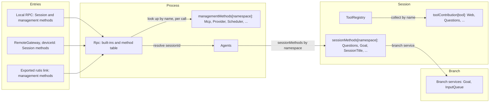
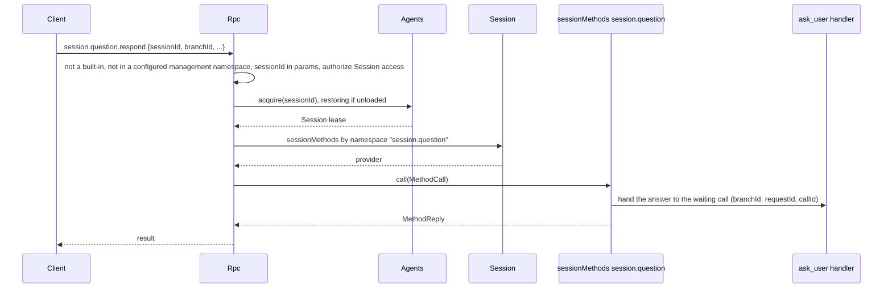
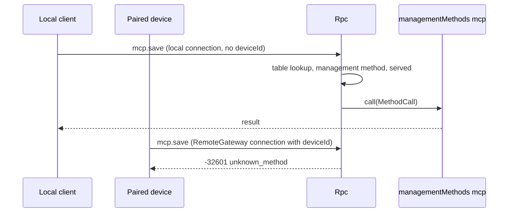

# Methods and tool contributions

Status: Draft. Overall design: [overview §3 integration](../overview.md#3-integration-by-existing-mechanisms), [Appendix B Rpc and ToolRegistry](../overview.md#appendix-b-supplements-to-existing-plugins); rules: [ADR 002](../../adr/002-plugin-scope.md) D2, D3, D5. Phase: P0. Language: neutral contracts; Rust binding in [Appendix F](#appendix-f-rust-binding). The [C4 binding](../session-typescript.md) implements a non-Rust Session tool/method subset; Session broadcast uses the separate C4 leaf observation contract.

This contract defines three named services in the language-neutral form of ADR 002 D5. Each is identified by a service name, a scope and an instance key; its methods take and return serializable data; errors are data; cancellation is a protocol action. A plugin in any language provides them by declaring them in its `provides` (loader row), and consumers collect them by name and scope. They are built on mechanisms the runtime already has: named services collected per scope and Rpc's existing dispatch through the Session, as `approval.respond` does today. Implementation status: `managementMethods` (#14), `sessionMethods` (C1) and the `toolContribution` attach rule (C3) are implemented through the Rust bindings in Appendix F; of `callChannel`, only per-call `progress` (C1) is implemented. The C4 embedding entry also derives Session tools/namespaces from `provides` and binds their neutral DTO subset. The rest of `callChannel` and general plugin installation are not implemented, nor are `ConnectionEntry {name, deviceId}`, routing by `deviceId` and exported rutis links (proposed for P3, with RemoteGateway).

| Service | Scope | Key | Provided by | Collected by |
| --- | --- | --- | --- | --- |
| `sessionMethods` | Session | namespace | Session-scoped plugin parts (Questions, Goal, SessionTitle, Attachments, ShellInput) and InputQueue (`session.input`) | Rpc, dispatching through the Session |
| `managementMethods` | Process | namespace | Process plugins only (Mcp, Provider, Scheduler, ...; Settings has no namespace yet) | Rpc, looked up per call |
| `toolContribution` | Session | tool name | Session-scoped plugin parts (Questions, Goal, Web, Scheduler, Workflow) | ToolRegistry (supplement: named tool services) |

**Management methods** are client RPC methods about the host rather than a Session: `account.*`, `provider.*`, `mcp.*` and `skills.*`, plus the methods of new process plugins (settings methods are future work; Settings publishes none yet). `daemon.shutdown` stays an Rpc built-in and is likewise never served to paired devices. Before #14, Rpc injected their services directly (`ProductServices` and `ExecutionServices` in [connection.rs](../../../crates/dim-app-server/src/connection.rs)); #14 removed them, and Rpc now looks the methods up through `managementMethods`, per call and without a dependency on their providers. Only process plugins provide them, and they are never served to paired remote devices. Session methods have no level; the only split is `sessionMethods` (dispatched through a Session) versus `managementMethods`.

Proposed (P3, with RemoteGateway; not implemented): Rpc decides what a connection is served from its `ConnectionEntry {name, deviceId}`: a local connection gets Session and management methods, a connection with a `deviceId` (a paired device through RemoteGateway) never gets management methods, and an exported rutis link gets management methods only when exported. Today Rpc serves every connection by the existing transport profile rules (A.3). There is no registry, no port and no Management plugin. Providers are optional plugins installed only when enabled. Rpc looks up a `managementMethods` provider on each call and does not depend on it, so a provider that is disabled, Pending, Failed or reloading affects only its own namespace (§3.2). ToolRegistry does not depend on `toolContribution` providers either: it reads the providers active at the first ToolRegistry read during branch initialization and then follows them, so a provider that becomes active later is offered from the next request and a retiring one is withdrawn, without a Session reload (A.5).

Acting on a tool call or an input before it is committed is not a service of this contract. Approval and the Session input path are unchanged; InputQueue's withdrawal is its owner's change ([overview Appendix B](../overview.md#appendix-b-supplements-to-existing-plugins)).

## 1. Structure



| Service | Absent |
| --- | --- |
| `sessionMethods` | `unknown_method` when the Session does not list the namespace; when it lists it but the provider is not active, `service_reloading` while the providing part starts or reloads and `service_unavailable` once it failed or cannot run (A.1) |
| `managementMethods` | `unknown_method` when no configured namespace owns the name or its owner row is disabled or absent (§3.2) |
| `toolContribution` | The tool is omitted and reported in diagnostics (A.5) |

Contracts defined here: the three services, `MethodDecl`, `MethodCall`, `MethodReply`, `MethodError`, the `session.methods` listing method, the `callChannel` companion service (only `progress` implemented), `ToolDeclaration`, `ToolCall`, `ToolResult`, what each entry is served, naming, reserved names, the migration of existing management methods and the compatibility table. Contracts used: `SessionConfig` ([session-access](session-access.md#a3-sessionconfig-fields)), source input conventions ([session-access A.2](session-access.md#a2-source-input-conventions)), the Rpc command envelope and `appError` codes.

## 2. Data and state

No service owns a Timeline event or persisted state. A Session's method table is rebuilt when the Session loads; management providers are looked up on each call. Assembly gives Rpc the configured management `(namespace, row)` pairs (`Owners`) and records each Session's known namespaces (A.1). Proposed (P3, not implemented): each connection records `ConnectionEntry {name, deviceId}` when it is accepted; what it is served follows from that record (§3.2), never from a user identity. A link's management export is host-local structural configuration.

## 3. Flows

### 3.1 Session method



The namespace is resolved by the longest prefix among the namespaces assembly recorded for that Session (A.1). If the Session does not list the namespace, for example because its plugin is not enabled for the Session, the result is `unknown_method`; if it lists the namespace but the provider is not active, the result is `service_reloading` while the part that provides it starts or reloads, and `service_unavailable` once that part failed or cannot run (A.1). Session methods carry no level: every connection that is served Session methods is served all of them, including `shell.*`.

### 3.2 Management method



The connection's entry record is the only check. Being served management methods grants host administrator rights.

Assembly builds the fixed configured `(namespace, row)` pairs in [lib.rs](../../../crates/dim-app-server/src/lib.rs) and passes them to Rpc; Rpc's `apply` ([connection.rs](../../../crates/dim-app-server/src/connection.rs)) rejects a pair whose row the loader does not know and builds `Owners` ([methods.rs](../../../crates/dim-app-server/src/methods.rs)) from them. A name belongs to the longest configured namespace that prefixes or equals it, even while that namespace's owner is disabled; the parent namespace never answers it. On each call Rpc reads that namespace's provider by key (`TypeKey::keyed_dynamic::<ManagementMethods>(ns)`, Appendix F) and does not depend on it. When no provider is active, Rpc reads the owner row's status with `loader.get(row)`: a row that is not running and has not failed (Pending, not started yet, or between generations) returns the retryable `service_reloading`; a row that cannot run again until it is fixed or restarted (Failed, Unresolved, or Disposed: removed and unable to restart) returns the non-retryable `service_unavailable`; a disabled or absent row, or a name that no configured namespace owns, returns `unknown_method`. Rpc, open connections and the other namespaces are unaffected. A call admitted before its provider unloads belongs to the provider, which replies to it according to the method's `interruption` (A.1): a `report` call ends with `operation_interrupted`, a `drain` call replies with its own result, and the provider's unload waits for every call it accepted.

## 4. Timing and conflicts

| Scenario | Order | Outcome | Owner |
| --- | --- | --- | --- |
| Session-scoped provider reloads mid-call | call < reload | `report`: `operation_interrupted`; `drain`: the call's own result; the provider's unload waits for every admitted call (AGENTS.md rule 8) | Provider |
| Session method while the Session's capabilities reload | — | `service_reloading` | Rpc |
| Session method whose providing Session part failed or cannot run | — | `service_unavailable` until the part is fixed (A.1) | Rpc |
| Session method on a Session that does not list that namespace | — | `unknown_method` | Rpc |
| Management owner reloads | — | Calls into its namespace return `service_reloading` until the new generation is active; a Failed, Unresolved or Disposed owner returns `service_unavailable` (§3.2); admitted calls belong to the provider and follow their `interruption`; Rpc does not reload and connections stay open | Rpc |
| Management method or `daemon.shutdown` on a connection with a `deviceId` | — | `unknown_method` | Rpc |
| Two providers claim one namespace or tool name | assembly | Assembly fails; keys are unique per scope | Assembly |
| A Session namespace overlaps a configured management namespace | assembly | Assembly fails (A.1) | Assembly |
| Tool-contribution provider reloads during a turn | call < reload | The in-flight call fails; that provider's tools are withdrawn and offered again, as a new version, once its next generation is active; ToolRegistry and Loop keep running (D3) | ToolRegistry |

Full table: [Appendix B](#appendix-b-full-conflict-table).

## 5. Context mapping

Methods have no model-visible effect. A method that changes model context does so through its owner's input or Timeline facts, and those owners' mappings apply. A `toolContribution` reaches the model only through its declaration and its `ToolResult`, as any tool does.

## 6. Interfaces (summary)

| Service and method | Mode | Purpose |
| --- | --- | --- |
| `sessionMethods[namespace].describe() -> MethodDecl[]` | async | Session-scoped method declarations |
| `sessionMethods[namespace].call(MethodCall) -> MethodReply` | async | Execute a Session-scoped method |
| `managementMethods[namespace].describe / call` | async | Same shapes, process scope, management methods; implemented only as the Rust subset in Appendix F |
| `session.methods {sessionId}` (wire, Rpc built-in) | async | List a Session's methods (protocol v3) |
| `callChannel.progress / notify / closed` (Rpc) | sync / async | Per-call progress (implemented, Appendix F) and connection-bound notifications (not implemented) |
| `toolContribution[tool].declaration() -> ToolDeclaration` | sync | Tool declaration |
| `toolContribution[tool].execute(ToolCall) -> ToolResult` | async | Tool execution |

## 7. Security

Proposed (P3, with RemoteGateway; not implemented): the connection's `ConnectionEntry {name, deviceId}` is the only authority for what it is served: local RPC gets Session and management methods, a connection with a `deviceId` (RemoteGateway) gets Session methods only (paired devices may call every Session method, including `shell.*`, decision E3), and a rutis link serves management methods only when they are explicitly exported in host-local link configuration. Rpc validates only at the external boundary: param shape and `sessionId` authorization for every Session-scoped method, exactly as for its built-ins. Feature checks (content sniffing, size limits, model capability) belong to the method's owner. A `toolContribution` is admitted by Approval and Permission like every tool, under its declared risk. There is no host-local approval: Approval and Permission govern only actions an agent decides, and commands that user or project configuration runs are that configuration's responsibility and run when enabled ([overview §6.4](../overview.md#64-conventions)). The former `mcp.approve`/`mcp.revoke` are removed (A.4).

## 8. Rule check

| Rule | How this document complies |
| --- | --- |
| §4 rule 1 (command events) | Not applicable: the services write no Timeline event themselves; a method that changes branch state calls its owner, which writes (for example InputQueue's `input/deleted` for `session.input.withdraw`). |
| §4 rule 2 (handover) | Not applicable: methods and tool contributions hand nothing over; a tool call is handed to ToolExecutor by the existing `step/tool-call` contract. |
| §4 rule 3 (before callbacks only) | Rpc validates only param shape and `sessionId` authorization; feature checks belong to the method's owner, and acting before a commit is left to Timeline before callbacks. |
| §4 rule 4 (no business meaning in core) | Rpc and ToolRegistry collect services by name and never name a provider or interpret a method. |
| §4 rule 5 (batch) | Not applicable: no decision here is taken on a Timeline event; owners decide from their own facts. |
| §4 rule 6 (model context) | Methods have no model-visible effect, and a `toolContribution` reaches the model only through its declaration and `ToolResult` (§5). |
| §4 rule 7 (public events and services) | Providers reach branches only through the branch's public services, and Rpc dispatches only through the Session's `sessionMethods`. |
| §4 rule 8 (requirements) | A keyed read of a Session service by name is raised in §9.1; drain on unload and listing active providers are withdrawn (rutis is an external dependency). |
| §4 rule 9 (only decision facts in the Timeline) | Method tables and served entries are assembly data, never Timeline facts (§2). |
| §1 (Capability and App Server boundary) | Rpc only collects and dispatches; the business code of every method lives in its provider's plugin. |
| ADR 002 D1 | `sessionMethods` and `toolContribution` are Session-scoped, `managementMethods` process-scoped, matching their owners. |
| ADR 002 D2 | No registry, port or Management plugin; Rpc and ToolRegistry collect by name. |
| ADR 002 D3 | Providers depend on their own or an enclosing scope. ToolRegistry offers the `toolContribution` providers that are active, following their activation and retirement, and does not depend on them (A.5); Rpc depends neither on management providers (§3.2) nor on Session method providers (A.1), so their reloads stay within their namespace. |
| ADR 002 D4 | A link's management export is structural host-local configuration; no business configuration is defined here. |
| ADR 002 D5 | Every service is named with scope, key and data-only methods; Rust types appear only in Appendix F. The implemented Rust binding of `managementMethods` is a subset that does not yet meet D5 (Appendix F). |

## 9. Requirements raised to mechanism owners

### 9.1 Lookup of a keyed Session service by name

| Item | Content |
| --- | --- |
| Blocked by | Rpc must dispatch a Session method without naming its provider (§4 rule 4, ADR 002 D2 and D5); the Session facade today returns only unnamed typed services. |
| Existing mechanisms considered | `Session::session_service::<T>()` reads one unnamed service per type, so it cannot hold one service per namespace. `SessionScope::named_key` builds the needed key, but only code inside the Session's assembly can read with it. A Session service that lists providers: a wiring module (D2). |
| Generic capability | A generic keyed read by name on the Session facade, for example `Session::session_named_service::<T>(name)`, built on `SessionScope::named_key::<T>(name)`, with the same `Reloading` error as `session_service` when the key is missing. Telling an absent namespace from a reloading one uses the known namespaces assembly records (A.1), not this read. |
| Effect on sequence, batch, interrupt, reload | None on sequence or batches; a read during a Session reload fails, and Rpc answers a listed namespace from the row that provides it (A.1). |
| Owner and issue | Runtime (Session facade); implemented in C1 (#47). |

### 9.2 Unload waits for `drain` calls

Withdrawn: rutis is an external dependency, so no requirement is raised to it. Rpc already waits for the commands it admitted before it unloads.

### 9.3 Listing the active providers of a process-scoped service

Withdrawn: rutis is an external dependency, so no requirement is raised to it. Rpc dispatches management methods with what rutis provides today (keyed reads, the configured `Owners` and `loader.get(row)`, §3.2); how `hello.features` reports them is Rpc's own design.

### 9.4 The Session's scope on its facade

| Item | Content |
| --- | --- |
| Blocked by | Rpc answers a listed Session namespace whose provider is not active from the copy, in that Session's instance, of the row that provides it (A.1). Rpc holds the `Session` handle, which does not say which instance its rows run in. |
| Existing mechanisms considered | `Session::diagnostics` walks the Session's plugin tree on every such call. A Session part that provides its own scope as a public service adds a part to every Session only to republish what the facade already holds. |
| Generic capability | `Session::scope()`, a read of the `SessionScope` that plugin factories already receive. Keys under it stay readable only from inside the Session (rutis refuses an instance key outside its instance), so it opens no service beyond `PublicService`. |
| Effect on sequence, batch, interrupt, reload | None. The Session scope plugin refuses to reload, so the scope does not change while the Session is loaded; on a closed Session the read fails with `Closed`, as the other facade reads do. |
| Owner and issue | Runtime (Session facade); implemented for [#207](https://github.com/arcships/dim/issues/207). |

The implemented foreign Session subset is [C4](../session-typescript.md); general plugin installation remains separate work.

## Appendix A. Interface details

Shapes are JSON with camelCase fields; a `?` after a field name marks it optional and `|` separates alternatives. These shapes are canonical: plugin documents use these field names (Rust bindings map them to snake_case). Every error is `MethodError` data.

### A.1 Method contributions

`sessionMethods` (Session, key namespace) and `managementMethods` (process, key namespace) have the same two methods. C4 and the process-row binding implement the neutral subset described in Appendix F through the same native call owner.

| Method | Mode | Request | Reply |
| --- | --- | --- | --- |
| `describe` | async | — | `MethodDecl[]` |
| `call` | async | `MethodCall` | `MethodReply`, or `MethodError` |

```text
// MethodDecl
{ "name": "session.goal.set",          // full wire name inside the namespace
  "mutating": true,
  "interruption": "report" | "drain",  // the provider replies on unload: report → operation_interrupted; drain → the call's own result
  "progress": false,
  "notifications": ["session.goal.changed"], // inside the namespace
  "reply": "direct" | "handoff" }      // handoff: daemon.shutdown
// MethodCall
{ "callId": "string", "method": "session.goal.set",
  "params": {},                        // as sent; Session methods keep sessionId (and branchId) here
  "origin": { "entry?": { "name": "string", "deviceId?": "string" }, // the connection's ConnectionEntry
              "connectionId?": "string", "peer?": "string" } } // peer: rutis link; diagnostics only
// MethodReply
{ "kind": "value", "value": {} } | { "kind": "handedOff" }
// MethodError
{ "code": -32000, "appError": "string", "message": "string" }
```

Implemented today (Appendix F): `MethodDecl.name`, `MethodDecl.mutating`, `interruption` and `progress`; C4 decodes these fields from foreign Session declarations and supplies a fresh `callId`. `notifications`, `reply`, `origin` and `handedOff` are not implemented.

Cancellation and interruption: the provider replies to its own calls, not Rpc. Two events interrupt an admitted call: the unload of the provider's generation and the unload of the Rpc load that admitted it. On either, the handler's cancellation token fires, for `drain` calls too. A `report` call then replies `operation_interrupted` at once (the operation may already have committed) and settles afterwards; a `drain` call replies with its own result. The provider's unload waits for every call it accepted, `report` calls included. A caller's disconnect cancels nothing.

| Rule | Content |
| --- | --- |
| Namespace | `<segment>(.<segment>)*`, segments `[a-z][a-z0-9_]*`, at most 128 bytes, owned by the provider; a namespace may itself be a method (`session.rename`). A name outside this grammar is `unknown_method` without any lookup |
| Ownership | A management name belongs to the longest configured management namespace (`Owners`) that prefixes or equals it, even while that namespace's owner is disabled. A Session method name belongs to the longest namespace the Session lists |
| Reserved names | Two parts. Exact built-ins: every name `is_builtin_method` accepts ([protocol.rs](../../../crates/dim-app-server/src/protocol.rs)); no contributed namespace, prefix of a namespace or declared method may equal one, and no exact built-in may lie inside a contributed namespace. For management namespaces this last rule holds today only because every exact built-in lies under a reserved root; `provide` does not check it. For Session namespaces, which may lie under `session`, Rpc checks it when it loads (for example `session.mcp` is an exact built-in, so a Session namespace `session.mcp` or one containing it is rejected). Reserved roots: `hello`, `daemon`, `agent`, `approval` and `session`; a management namespace may not lie in any of them (`ManagementMethods::provide` rejects it). A Session namespace may lie under `session` (`session.goal`, `session.input`) but is never the bare `session` root. `session.input` is not reserved: InputQueue provides `session.input.withdraw` through `sessionMethods` (proposed), so Rpc names no owning service |
| Precedence and routing | A built-in method; else a configured management namespace; else, only for protocol v3+ and only when the connection's entry is served Session methods, a Session namespace recorded at assembly (Known namespaces); else `unknown_method`. One wire name space |
| Namespace collisions | Assembly fails when a Session namespace equals, contains or lies inside a configured management namespace, so no name has both a management and a Session owner |
| Session-scoped call | A name that is neither built-in nor inside a configured management namespace, and lies inside a Session namespace recorded at assembly, is a Session method candidate; any other name is `unknown_method` whatever its params, as in [management methods](../appserver/management-methods.md). Rpc reads `sessionId` from a candidate's raw params; if it is missing the result is `-32602`. Rpc authorizes it and acquires the Session through `index.acquire`, which restores an unloaded Session (unlike `approval.respond`, which returns `session_closed` for a Session that is not loaded). Rpc then resolves the longest namespace the Session lists: none → `unknown_method`; listed but not active → the status of the row that provides it, read as its copy in this Session, with the management owner table (§3.2): `service_reloading` while that copy is not started, Pending, Loading or between generations, `service_unavailable` while it is Failed, Unresolved, Disposed or Stopped; `service_reloading` when assembly records no row for the namespace or the copy left with the Session's instance. Rpc holds the Session use until the call's operation settles. `sessionId` and `branchId` stay inside `params`; Rpc reads `sessionId` only to authorize and resolve. The provider reaches a branch through that branch's services. A name that no Session namespace can own never has its params read and never restores a Session |
| Call ownership | The Session-scoped provider generation owns the calls it admitted, as `ManagementMethods` does: it replies to them, its unload interrupts them per `interruption` and waits for them (Cancellation above) |
| Known namespaces | The runtime's `Session::session_service` returns `Reloading` for any missing key, so a read alone cannot tell an absent namespace from a reloading one. Assembly records each Session's known namespaces with `AgentBuilder::session_methods(ns)`, the counterpart of `Owners`: a namespace not in that list → `unknown_method`; one in the list whose provider is not active answers from the row that provides it (Session-scoped call above). Assembly also records the row of each namespace a TypeScript Session part declares in `RowSchema.provides`, and Rpc finds that row's copy in the Session's instance through `Session::scope` (§9.4). The Rust Session parts the builder registers have no recorded row: each must be active before its Session is published. Rpc receives the namespaces recorded across the assembly, so they also decide whether a name is a Session method candidate before any Session is read (Session-scoped call above). Every Agent of the process is built from that one assembly, so every Session lists every recorded namespace, and a provider must provide its recorded namespace in every Session |
| Shared types | `MethodDecl`, `Interruption`, `Handler`, `Progress` and `RpcError`, with the call admission both services share, live in a `methods` module of dim-agent-capabilities, because Session capabilities there cannot depend on dim-app-server. They sit beside the Session counterpart `SessionMethods` (Appendix F), as `ToolContribution` and `ToolHandler`, which also takes a `CancellationToken`, live beside ToolRegistry. Not dim-agent-types: it admits only serde and serde_json (`xtask check`; [architecture](../../architecture/README.md): no Tokio or rutis), while `Handler` takes tokio-util's `CancellationToken` and returns a rutis `BoxFuture`; and with `RpcError` there, `From<AgentError> for RpcError` could be implemented only in dim-agent-runtime (orphan rule). In dim-agent-capabilities that conversion lives with `RpcError`, so Rpc and Session providers keep `?` on runtime errors |
| Not dispatched | No configured namespace owns the name and it is not a Session method candidate, the owner row is disabled or absent, the Session does not list the namespace, the provider does not declare the name, a management method on a connection with a `deviceId` or an unexported link, or v1/v2 → `-32601 unknown_method`. Session reloading, a listed Session namespace whose provider is not active while its providing row is not recorded or has not failed, or a management owner row that is not running and has not failed (Pending, not started yet, or between generations) → `-32000 service_reloading` (retryable). A management owner row, or the copy of the row providing a listed Session namespace, that is Failed, Unresolved or Disposed (a copy also Stopped) → `-32000 service_unavailable` (not retryable). A started `report` call interrupted → `operation_interrupted` |
| `hello.features` (v3) | Built-ins, plus, when the connection is served management methods (local v3), the methods of the active providers of the configured namespaces, each listed only under the namespace that owns it. Discovering namespaces from loader rows' `provides` is future work ([ADR 004](../../adr/004-loader-plugin-management.md)). Session-scoped methods are not listed here; `session.methods` lists them per Session |
| `session.methods` | Public surface, an Rpc built-in for protocol v3, like the methods it lists: `session.methods {sessionId}` → `{ "methods": [ { "name": "string", "mutating": true } ] }`, the declared methods of the namespaces the Session lists whose providers are active. It is authorized and resolved like other Session-scoped built-ins (restoring an unloaded Session), lists each method under the namespace that owns it, sorted by name, and adds one exact built-in name. v3 `hello.features` lists it where Session operations are served |
| Ready latch | The native binding waits for its required process providers before the first `hello`. The [TS process binding](../process-typescript.md#21-startup-and-availability) excludes optional extension rows from host startup/restart readiness; `hello.features` lists only their providers Active at that call, with later ones visible at the next `hello`. |

How Rpc routes a call once the connection's entry admits it:

```text
call
  |
  built-in? ------------------------------------ yes --> built-in handler
  | no
  inside a configured management namespace? ---- yes --> managementMethods (§3.2)
  | no
  v3+, entry served Session methods, inside a
  Session namespace recorded at assembly? ------ no ---> -32601 unknown_method
  | yes
  sessionId in params? ------------------------- no ---> -32602
  | yes
  authorize; index.acquire (restores an unloaded Session)
  |
  longest namespace the Session lists? --------- none -> -32601 unknown_method
  |
  Session::session_named_service (§9.1) -------- not active -> status of the providing row's
  |                                                 copy in this Session (§3.2):
  |                                                 starting, reloading or not recorded
  |                                                   -> -32000 service_reloading
  |                                                 Failed, Unresolved, Disposed or Stopped
  |                                                   -> -32000 service_unavailable
  |
  SessionMethods call --> reply (an undeclared name: -32601 unknown_method)
```

Known Session-scoped namespaces: `session.question` (Questions), `session.goal` (Goal), `session.rename` (SessionTitle), `session.input` (InputQueue), `attachment` (Attachments), `shell` (ShellInput). Hooks provides no Session methods: its `hooks.*` methods are management methods ([Hooks A.7](../plugins/Hooks.md#a7-management-methods)). Each plugin document is authoritative for its methods.

### A.2 Call channel

Only `progress` is implemented (C1); `notify`, `closed` and `takeFinalReply` are not. Rpc provides the process service `callChannel` to method providers; the Rust binding of `progress` is the handler's per-call `Progress` (Appendix F).

| Method | Mode | Request | Reply |
| --- | --- | --- | --- |
| `progress` | sync | `{callId, data}` | — (dropped unless the method declared `progress`) |
| `notify` | async | `{connectionId, method, params}` | `{}`, or error `unsupported` (link), `undeclared`, `gone` |
| `closed` | async | `{connectionId}` | Resolves when the connection closes |
| `takeFinalReply` | async | `{callId}` | `{}` after the final reply is written; `handoff` methods only |

Progress is sent as the notification `management.progress {id, method, data}` for Session and management methods, ordered before the response, best effort (below) and dropped after disconnect. Notification names must be declared and lie inside the namespace. A `connectionId` stays valid for `notify` until the connection closes.

How progress of one call reaches its caller:

```text
Client A               Rpc                        call admission              provider handler
  | x.run {..} id 7 -->|                              |                            |
  |                    |-- accept(.., sink of A) ---->|-- handler(.., progress) -->|
  |                    |                              |    (sink only if declared) |
  |<-- management.progress {id: 7, method: "x.run", data} ------- progress.send -->|
  |                    |                              |<-- result -----------------|
  |                    |                              | close progress, then reply |
  |<-- result id 7 ----|<-- reply --------------------|                            |
  |                    |              a later progress.send is dropped             |
```

Only the calling connection receives it; other clients of the Session do not. After A disconnects its sender is closed, so progress and the reply are dropped while the call continues.

Progress is best effort: a notice the calling connection cannot take, because the client reads too slowly or the notice is too large, is dropped and the connection stays open. The reply is unaffected; it always follows every notice that arrives. A client that falls behind on replies and durable notifications is still disconnected like any slow consumer. Keep notices small and each useful on its own; whatever the caller must have belongs in the reply.

```text
                    the calling connection's outbound queue
progress.send --> progress allowance ------------+
                  full, or the notice too large: |
                  dropped, the connection stays  +--> one FIFO queue --> client A
reply ----------> reply and notice allowance ----+
                  full: a slow consumer, the connection closes
```

### A.3 Entries and export

| Entry | Served | Notes |
| --- | --- | --- |
| Local protected transport | Session and management methods | Today's protected-profile rules unchanged |
| Bare WebSocket, protected profile | as today | Everything but `hello`/`daemon.ping` is `local_transport_required` |
| RemoteGateway (`deviceId` set) | Session methods only | Proposed (P3, not implemented); [RemoteGateway](../plugins/RemoteGateway.md) |
| Exported rutis link | Management methods | Proposed (P3, not implemented). Only when exported in host-local link configuration. Without a caller sink, progress is dropped and `notify` returns `unsupported` |

### A.4 Migration and compatibility

Sources before #14: `MANAGEMENT_METHODS`, `MCP_METHODS` and `Call::is_management` in [protocol.rs](../../../crates/dim-app-server/src/protocol.rs), which #14 removed; `LOCAL_EXECUTION_METHODS` there and `validate_call` in [connection.rs](../../../crates/dim-app-server/src/connection.rs) remain.

| Methods | Destination | Provider (namespace) |
| --- | --- | --- |
| `account.providers/status/recover/logout`, `account.login.*` | `managementMethods` | ManagedProviders (`account`) |
| `account.codex.*`, `account.grok.*` | `managementMethods` | OpenAI Codex OAuth (`account.codex`), Grok OAuth (`account.grok`) |
| `provider.*` | `managementMethods` | Provider (`provider`) |
| `skills.catalog/set_enabled/refresh` | `managementMethods` | SkillsCatalog (`skills`) |
| `mcp.catalog/set_enabled/save/remove/disconnect`, `mcp.auth.start/complete/logout` | `managementMethods` | Mcp (`mcp`) |
| `mcp.approve/revoke` | Removed; `unknown_method` (no host-local approval; servers run when enabled; project entries start disabled; [ADR 003](../../adr/003-approval-scope.md)) | — |
| `daemon.shutdown` | Rpc built-in, reply handoff; never served to a connection with a `deviceId` | — |
| `hello`, `daemon.ping`, `agent.*`, existing `session.*`, `approval.respond` | Rpc built-ins | — |
| New `session.input.withdraw` | `sessionMethods` | InputQueue (`session.input`) |
| New Session methods | `sessionMethods` | Each owner (A.1) |

Interruption reproduces today's behaviour: `mcp.*` and `skills.*` are `report`, and `account.*` and `provider.*` are `drain`. Rpc's `When<ProductServices>` and `When<ExecutionServices>` were removed by #14, not replaced by a collection: Rpc looks up `managementMethods` per call (§3.2) and no longer names or depends on any owning service. Built-ins that read a management service (model selection for `session.create` and `session.model.update`, Mcp for `session.mcp`) read it per call and return a retryable error while it is not active ([management methods](../appserver/management-methods.md)).

| Client | Before | After |
| --- | --- | --- |
| v1, v2 | Management methods `unknown_method` | Same |
| v3 local, product profile | `hello.features` has the 33 product names | Same names; params, results, codes and `appError` unchanged |
| v3 local, execution | `LOCAL_EXECUTION_METHODS` + `MCP_METHODS` | Same names |
| v3 bare WebSocket, protected profile | `local_transport_required` | Same |
| v3 RemoteGateway (new) | Did not exist; execution Session methods (`session.permission.get/update`, `session.exec.stop`, `session.skills`, `session.model.update`, `session.prompt.refresh`, `session.mcp`, `session.mcp.refresh`) were local-only | **Compatibility change (E3):** available to paired devices; management names `unknown_method` |
| v3, MCP disabled | `mcp.*` `unknown_method` | Same, with Rpc's message |
| v3, Mcp reloading | `service_reloading` | Same: `mcp.*` returns `service_reloading` until Mcp is active again; Rpc does not reload and the connection stays open |

No protocol version is added and persistence formats are unchanged.

### A.5 Tool contribution

ToolRegistry accepts named tool services without a hard dependency on their providers (C3, ADR 002 D3, #34). The fixed table holds the configured host tools. Each configured contributed tool is a registry-owned versioned set keyed `#contributed:<tool>` (#241): it is offered while its provider is Active, withdrawn when the provider is missing or its generation is unloading, and replaced under a new version when a new generation becomes active. A version is a new UUID, never reused even across registry instances and processes, so a version persisted in `tool_sources` names one generation. The registry reads contributors from ToolBinding's first read during branch initialization (it may not read undeclared services while it applies) and again whenever a provider enters or leaves Active or a service binding changes, in its own task, which ends when the Session starts closing. That task and ToolBinding's background adoption never call into a foreign provider (its declaration is a synchronous call into another runtime): they withdraw a replaced foreign set, and the next request's read attaches the new generation, with no registry lock held; a branch whose configuration has a tool part adopts it for the request after. A contributor that is not yet active is omitted and reported in diagnostics; it is offered from the next request after it becomes active, without a Session reload. Required dependency waiting rules are unchanged, and optional providers still never gate Session readiness (#132).

ToolBinding reconciles the table through the existing Prompt / BranchOpening flow before the Session accepts input. A branch with adopted model configuration uses `Prompt::adopt_tools` when its tool part differs; a branch whose configuration has no tool part declares and binds the registry's current host and contributed tools through PrepareModelHost / `bind_current` on every request, so a contributed tool's change needs no adoption there. No new core readiness phase is needed. Source changes, including contributed tools in a configuration with a tool part, go through the existing registry notification and Prompt adoption path (`context/configured` with `tool_sources`), and requests retain the handlers selected for their own prefix. Tool names come from host-side `AgentBuilder::session_tool` until #4 provides `provides`-based registration. Name uniqueness and host-tool collisions are unchanged. A contributed tool is offered while its provider is Active; `SessionConfig.tools` selects and orders host tools and may name a contributed tool to fix its position ([tool contributions](../../architecture/rust-agent/tool-contributions.md)).

| Method | Mode | Request | Reply |
| --- | --- | --- | --- |
| `declaration` | sync | — | `ToolDeclaration` |
| `execute` | async | `ToolCall` | `ToolResult` |

```text
// ToolDeclaration
{ "name": "web_fetch",           // equals the key
  "description": "string",
  "inputSchema": { /* JSON Schema */ },
  "source": "static" | "builtin" | "extension" | "dynamic", // required, as ToolDefinition requires it
  "risk": "network" }            // Permission category; required for new tools
// ToolCall
{ "sessionId": "string", "branchId": "string", "turnId": "string", "callId": "string",
  "arguments": {}, "config": { /* SessionConfig data */ } }
// ToolResult
{ "content": [ { "type": "text", "text": "..." } | { "type": "image", "...": "..." } ],
  "structuredContent?": {}, "isError": false }
```

Cancellation: turn interrupt sends a cancel request for `callId` (or drops the call); ToolExecutor settles the call as interrupted. A provider error is returned as `ToolResult` with `isError: true`. The declaration may depend on the Session's configuration. ToolRegistry reads it when it attaches a provider generation: at ToolBinding's first read during branch initialization, or at the first read for a request after that generation becomes active; its background task never calls it, since the call is synchronous; the next request offers it without a Session reload (A.5).

## Appendix B. Full conflict table

| Scenario | Sequence order | Outcome | Owner of the decision |
| --- | --- | --- | --- |
| Session method during branch `stop/interrupt` | per owner's facts | Decided by the owner (for example, a Questions answer after ToolExecutor cancelled the call replies `question_not_pending`) | Owning plugin |
| Session method on a closed branch | — | Owner's `BranchMissing` error | Owning plugin |
| Session method on an unloaded Session | — | Rpc restores it through `index.acquire`, then dispatches (unlike `approval.respond`, which returns `session_closed`) | Rpc |
| Session-scoped provider reloads mid-call | admitted < reload | `report`: `operation_interrupted`; `drain`: the call's own result; the unload waits for both | Provider |
| Process owner reloads | — | Pending, not started yet, or between generations: `service_reloading` until it is active again; Failed, Unresolved or Disposed: `service_unavailable` (§3.2); admitted calls belong to the provider and follow their `interruption`; Rpc does not reload | Rpc |
| Rpc reload with calls in flight | — | The handler's token fires: `report` replies `operation_interrupted`, `drain` replies its own result; Rpc's unload waits for the replies it owes and for each interrupted operation to settle; `closed` resolves (`callChannel`, not implemented) | Rpc |
| Management method on a connection with a `deviceId` | — | `unknown_method` | Rpc |
| Client detaches mid-call | — | Call continues; reply discarded | Rpc |
| A Session namespace overlaps a configured management namespace | assembly | Assembly fails | Assembly |
| Two clients mutate the same configuration | storage revision | Second gets the provider's conflict | Provider |
| `daemon.shutdown` concurrent with another call | admission | Admission stops, then admitted calls settle per `interruption` | Process coordinator |
| Tool contribution called during turn `stop/interrupt` | interrupt < result | Cancel request for `callId`; ToolExecutor settles the call as interrupted | ToolExecutor |
| Unsettled tool batch, compaction, child branch cut, `input/withdraw`, `input/deleted` | — | No effect on methods | — |
| Process restart mid-call | — | Reply lost; outcome per provider persistence; never replayed | Provider |

## Appendix C. Errors and recovery

| Case | Wire result |
| --- | --- |
| No owner (management owner row disabled or absent, namespace not listed by the Session, name not declared by its provider), not served to the connection, or v1/v2 | `-32601`, `unknown_method` |
| Session method candidate without `sessionId` | `-32602` |
| Session reloading, a listed Session namespace not active while its providing row is not recorded or has not failed, or a management owner row not running and not failed (Pending, not started yet, or between generations) | `-32000`, `service_reloading` (retryable) |
| Management owner row, or the copy of the row providing a listed Session namespace, Failed, Unresolved or Disposed (a copy also Stopped) | `-32000`, `service_unavailable` (not retryable) |
| `report` call interrupted | `-32000`, `operation_interrupted` |
| Provider error | `-32000`, provider's `appError` |

## Appendix D. Acceptance

1. A Session-scoped method dispatches through the Session it names. On a Session that does not list the namespace it returns `unknown_method`, on one that lists it while the provider is not active it returns `service_reloading` while the providing part starts or reloads and `service_unavailable` once that part is Failed or Unresolved, and Rpc never names the provider.
2. A management method is reachable on the local entry, returns `unknown_method` on RemoteGateway, and is reachable over a link only when exported. A `shell.*` Session method is reachable on RemoteGateway like every Session method.
3. A recorded transcript of every migrated management method matches the pre-migration transcript, and `hello.features` is unchanged for v3 local profiles.
4. On a RemoteGateway test entry, `session.permission.update` and `session.exec.stop` succeed.
5. A tool provided as `toolContribution` by a non-Rust plugin is declared to the model and executed through ToolExecutor like a Rust tool. A contributed tool whose provider is missing is omitted and reported in diagnostics, and the Session still starts, whether or not `SessionConfig.tools` names it.
6. Progress precedes the response; progress the connection cannot take is dropped without closing the connection or losing the response; `notify` reports `gone` after disconnect.
7. With an enabled management provider that is Pending, `hello` succeeds, every other namespace works, and the provider's namespace returns `service_reloading`; with one that is Failed or Unresolved it returns `service_unavailable`; with a disabled one it returns `unknown_method`. Once PluginManager provides `plugin.set_enabled` (not implemented), it can disable the provider unless it is PluginManager itself. Reloading a management provider neither reloads Rpc nor closes connections.

## Appendix E. Assumptions

| # | Assumption | Basis | Effect if rejected |
| --- | --- | --- | --- |
| A1 | Session-scoped namespaces may use roots other than `session` (`attachment`, `shell`) | Existing wire names | All move under `session.` |
| A2 | The Session can look up a keyed Session service by name for Rpc | Existing keyed Session services; raised as §9.1 | Rpc enumerates providers through a Session service |
| A3 | Session-scoped methods are listed per Session, not in `hello.features` | They differ per Session | A global list with per-Session availability |
| A4 | Rpc dispatches a management method by a keyed read of the active provider on each call (`Ctx::get_as`) | Implemented by #14 (`Owners::dispatch` in [methods.rs](../../../crates/dim-app-server/src/methods.rs)); Mcp reads its loader-row servers the same way ([publication.rs](../../../crates/dim-app-server/src/mcp/publication.rs)) | Rpc depends on every provider, and one inactive provider blocks all RPC |

## Appendix F. Rust binding

The [TypeScript process binding](../process-typescript.md) implements same-row
projection of the existing `managementMethods` subset, reusing native call
admission and settlement. Entry admission is unchanged.

The neutral services map to the existing native owners below. C3 attaches tools by name as their providers become active (A.5). The [C4 binding](../session-typescript.md) accepts Session services as `dyn HostDispatch` at `host_key_in("toolContribution:<tool>", session_instance)` and `host_key_in("sessionMethods:<namespace>", session_instance)`. ToolRegistry decodes each attached generation's declaration once and retains that generation's handler. The same loader row binds neutral method DTOs to C1 admission/progress/report/drain and drains admitted calls before the foreign cleanup runs. The host derives names from the row's `RowSchema.provides`; no arbitrary service lookup is added to the Session facade. Management methods use the same native call owner through the process-row binding. The separate `sessionEvents:<part>.bind` contract supplies Session identity/configuration/closing to original rows; `session.event` carries Session-filtered native observations through NodeRows-owned FIFO workers. It adds no public facade lookup or critical branch input path. Connection notifications, handoff and origin remain outside the implemented C4 subset.

| Neutral service | Rust type and key | Registration in Rust assemblies | Collection | Status |
| --- | --- | --- | --- | --- |
| `managementMethods[ns]` | `ManagementMethods`, process scope, key `TypeKey::keyed_dynamic::<ManagementMethods>(ns)` | `ManagementMethods::provide(ctx, ns, Vec<MethodDecl>, Handler)` in the owner's `apply`; assembly adds the `(ns, row)` pair to `Owners` | Per call through `Owners`: keyed read with `Ctx::get_as`, row status from `loader.get(row)`; not in Rpc's `Deps` | Implemented (#14) |
| `sessionMethods[ns]` | `SessionMethods`, the Session-scoped counterpart of `ManagementMethods`, in dim-agent-capabilities `methods` with the shared types (A.1), key `SessionScope::named_key::<SessionMethods>(ns)` | `AgentBuilder::session_methods(ns)`, which also records the Session's known namespaces | Per call: `Session::session_named_service::<SessionMethods>(ns)` (§9.1) on the Session `sessionId` names, after `index.acquire`; not in Rpc's `Deps` | Implemented (C1) |
| `toolContribution[tool]` | `ToolContribution {definition, handler}`, `SessionScope::named_key::<ToolContribution>(tool)` | `AgentBuilder::session_tool(tool)` (existing) | Keyed reads at ToolBinding's first read and again when a provider becomes active or retires; missing or inactive providers omitted and reported in diagnostics; each generation is a registry-owned versioned set (A.5, #241) | Implemented in C3 |
| `callChannel` | `progress`: the handler's `Progress` argument, one per call | — | Rpc gives each admitted call a sink to its calling connection | `progress` implemented (C1); `notify`, `closed`, `takeFinalReply` not implemented |

```rust
// crates/dim-agent-capabilities/src/methods.rs (C1), shared by both services
pub type Handler = Arc<
    dyn Fn(String, Value, CancellationToken, Progress)
        -> BoxFuture<'static, Result<Value, RpcError>> + Send + Sync,
>; // (method, params, cancellation token, progress)
impl Progress {
    pub fn send(&self, data: Value); // best effort; dropped unless declared, or once the reply is handed over
}
pub enum Interruption { Report, Drain }
pub struct MethodDecl {
    pub name: String,
    pub mutating: bool,
    #[serde(skip_serializing)]
    pub interruption: Interruption, // required in foreign declarations
    #[serde(skip_serializing)]
    pub progress: bool,             // required in foreign declarations
}
impl MethodProvider { // one provider generation: declarations, handler, admitted calls
    pub fn new(ctx: &Ctx, namespace: &str, declarations: Vec<MethodDecl>, handler: Handler)
        -> Result<Arc<Self>, CordisError>;
    pub fn accept(&self, method: String, params: Value, entry_stopping: CancellationToken,
        progress: impl Fn(Value) + Send + Sync + 'static) -> Result<Accepted, RpcError>;
}
impl SessionMethods { // Deref<Target = MethodProvider>
    pub fn provide(ctx: &Ctx, scope: &SessionScope, namespace: &str,
        declarations: Vec<MethodDecl>, handler: Handler) -> Result<Arc<Self>, CordisError>;
}
// crates/dim-app-server/src/methods.rs (#14)
impl ManagementMethods { // Deref<Target = MethodProvider>
    pub fn provide(ctx: &Ctx, namespace: &str, declarations: Vec<MethodDecl>, handler: Handler)
        -> Result<Arc<Self>, CordisError>;
}
```

`MethodProvider::new` rejects invalid declarations (the A.1 grammar; at least one method, each unique and inside the namespace) and registers the unload effect that interrupts admitted `Report` calls on either unload and waits for every admitted call, so `SessionMethods` and `ManagementMethods` cannot diverge. `ManagementMethods::provide` adds the A.1 reserved-name checks and provides the service under `TypeKey::keyed_dynamic::<ManagementMethods>(namespace)`. `SessionMethods::provide` provides it under `SessionScope::named_key::<SessionMethods>(namespace)`; Rpc checks the namespaces recorded with `AgentBuilder::session_methods` against reserved and management names when it loads. The handler receives the method name, the raw params, a cancellation token that fires on either unload (A.1) and the call's `Progress`. `RpcError`, with its `From<AgentError>`, lives in the same module (A.1 Shared types); dim-app-server keeps `ManagementMethods`, its reserved-name checks and `Owners`.

`Progress` binds A.2 `progress` per call rather than through a `callChannel` process service: Rpc passes each admitted call a sink that writes `management.progress {id, method, data}` to the calling connection, and the admission hands it to the handler only when the method declares `progress` and closes it before it hands over the reply. The sink queues progress under its own allowance on the connection, so progress never takes room from the reply or durable notifications. Management methods use the same path; none declares `progress` today.

C4's Session `describe`/`call` binding accepts the required declaration fields above, `{callId, method, params}`, a cancellation Promise and a per-call progress callback. It decodes `{kind:"value", value}` or owned `{code, appError, message}` errors; an omitted `value`, including JavaScript `undefined` omitted by JSON serialization, becomes JSON `null`. The original row's cancellation ends a pending `describe` wait. Unsupported declaration/reply fields and malformed data fail at this boundary. Not implemented: the corresponding foreign management binding, `callChannel` connection notifications/final-reply handoff, `origin`, and the `notifications` and `reply` declaration fields.

`ToolContribution` and `ToolHandler` remain the native types in `dim-agent-capabilities/src/tool_registry.rs`. C4 decodes a foreign synchronous declaration when ToolRegistry attaches its generation and wraps its async execute service in a `ToolHandler`. That handler retains both the service and the original row context's existing cancellation token under the tool's Session-scoped typed key. Row cancellation rejects later calls through the retained handler and ends its in-flight native wait without rebinding to a replacement generation; the foreign owner still settles its JavaScript work. Each execution derives a child cancellation token so completing one call cannot cancel other tools in the same batch.
