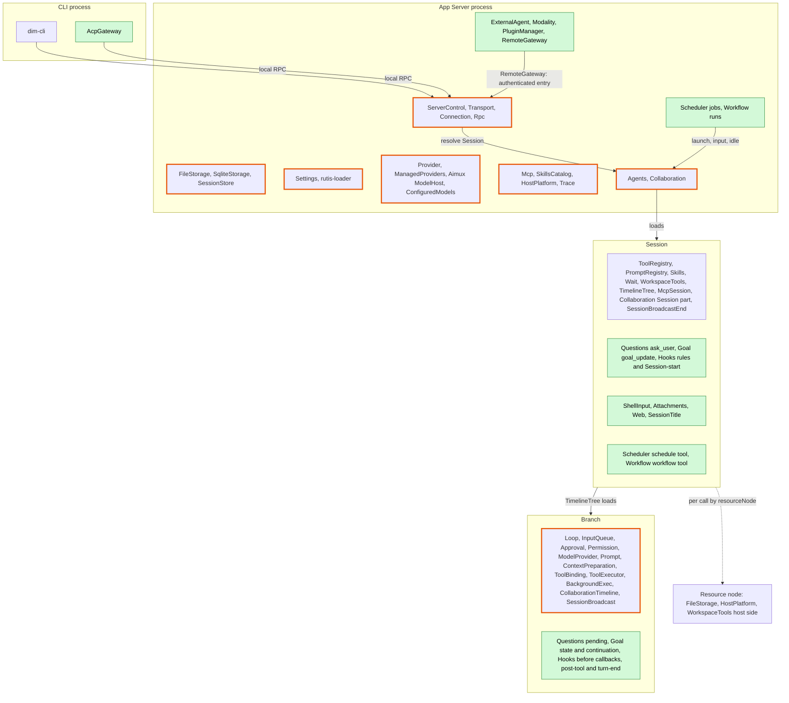
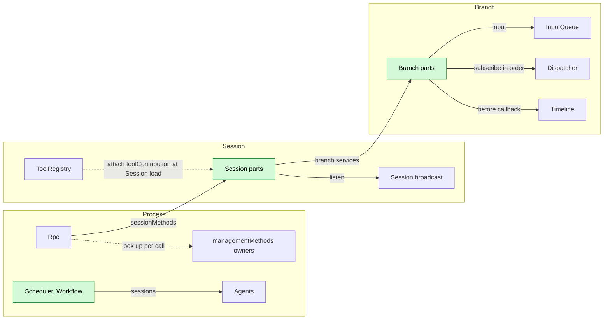
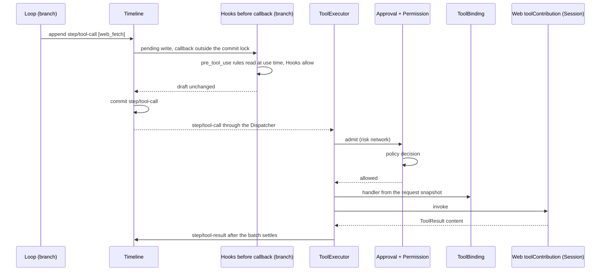
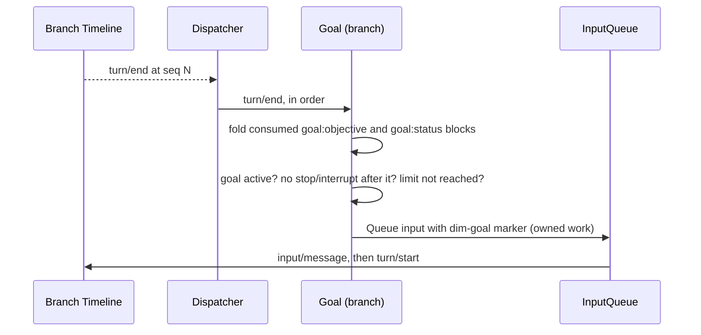
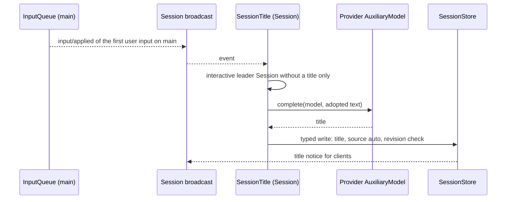
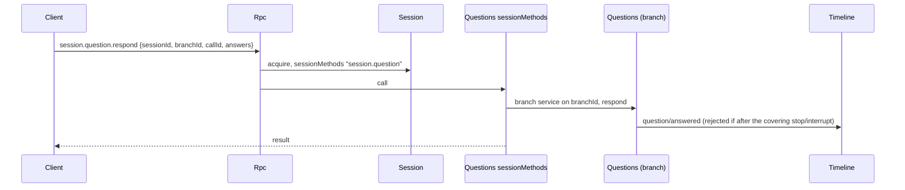
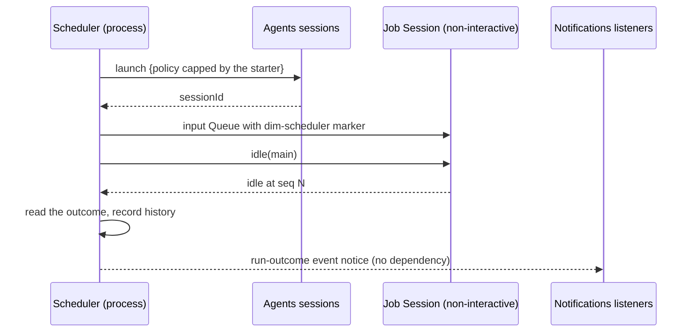
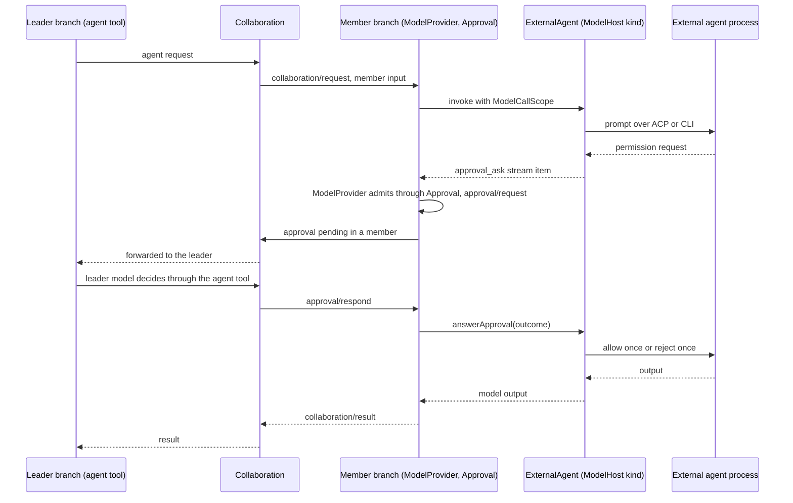

# Overall design: plugins for undesigned features

Status: Draft

This document starts from the [CLI feature list](../feature-list.md), identifies the features that existing plugins do not cover, and places the new plugins in the existing system. Each new plugin is designed in `docs/design/plugins/<Name>.md`. Supplements to existing plugins are listed in [Appendix B](#appendix-b-supplements-to-existing-plugins) and designed by the plugin that owns them.

> **Scope rule** ([ADR 002](../adr/002-plugin-scope.md)): a plugin part lives at the scope that owns its state and lifecycle (process, Session or branch), and parts integrate only through mechanisms the runtime already has. No new mechanism is introduced. Every contract is language-neutral (D5): a named service with a scope, an instance key and data-only methods, so plugins in any language provide or use it ([§3.1](#31-contract-form)). The two contracts describe supplements to existing interfaces: [methods and tool contributions](contracts/session-boundary.md) (Rpc, ToolRegistry) and [session access](contracts/session-access.md) (Agents, the Session facade, InputQueue).

The main body covers premises, the scope diagram and assignment, integration, the catalog, key flows, constraints, events, phases and open questions. The appendices cover feature ownership, supplements to existing plugins, the implementation language, the CLI layer, the document template and the requirements raised to mechanism owners.

## 1. Scope and premises

| Item | Convention |
| --- | --- |
| Terminal form | Only scrollback is designed. Items marked "full-screen TUI only" in the feature list are out of scope |
| Multimodality | All categories are targeted (image, video, speech, music, audio, 3D assets, motion, realtime, OCR). "Specific Desktop builds only" is an availability constraint ([Modality](plugins/Modality.md)) |
| Not planned | The Todo status and the `plan` Skill |
| Dynamic events | Assumes [#2](https://github.com/arcships/dim/issues/2): plugins register their own event types at runtime, registration follows the plugin lifecycle, and Timeline checks that a written event's type is registered |
| Model context | Per [ADR 001](../adr/001-harness-foundation.md): the model sees only adopted input and tool results, and plugin events are not projected. #2 follows the same boundary ([§9](#9-open-questions)) |
| Configuration | [ADR 002](../adr/002-plugin-scope.md) D4: structural plugin configuration (enable, runtime and package paths, node binding) lives in loader rows (#3 editable layer) and may reload the row. Business configuration lives in the owner's named Settings sources, is read at use time and never reloads; today Settings serves Rust owners only, and the language-neutral service comes later ([§6.4](#64-conventions), [roadmap](roadmap.md) S8a/S8b). Project files keep their own authority (ADR 001); project files in a directory, such as Workflow's `.dimcode/workflows/*.yaml` and Hooks' `.dimcode/hooks.json`, are not Settings sources and are read by their owners through FileStorage; commands that such configuration runs need no approval (§6.4 Approval scope). The project directory is `.dimcode/` |
| Existing design | [Time bus](../architecture/rust-agent/time-bus.md), [design rules](../architecture/rust-agent/principles.md), [single-tree assembly](../architecture/rust-agent/single-tree.md), [lifecycle](../architecture/rust-agent/lifecycle.md), [event-driven flows](../architecture/rust-agent/event-driven-flows.md), [tool contributions](../architecture/rust-agent/tool-contributions.md) and the ADR 001 trust contract apply |

## 2. Scope assignment

Green parts are new and orange-bordered parts are changed. Each new plugin part sits at the scope that owns its state. A feature with parts at two scopes is one plugin package with one part per scope, as SkillsCatalog, Skills and SkillsBranch are. Optional Session and branch parts are installed only when the plugin is enabled, never as placeholders.

| Plugin | Process | Session | Branch | Reason |
| --- | --- | --- | --- | --- |
| Questions | — | `ask_user` tool; `session.question.*` methods; in non-interactive Sessions `ask_user` answers that no one is available to answer | Pending questions, `question/*` facts, following Approval | A question belongs to a branch's turn |
| Goal | — | `goal_update` tool and `session.goal.*` methods, which only write one `input/message` with `goal:objective` and/or `goal:status` keyed blocks | Goal state folded in sequence order from consumed goal change blocks; continuation decided by Goal when it consumes `turn/end`, `stop/interrupt` or `input/deleted` through the Dispatcher | A goal belongs to exactly one branch: the fold uses only that branch's own events, so child branches and forked Sessions start with no goal; continuation follows its events in order |
| Hooks | — | Rules from business sources; Session-start Hooks | Before callbacks on `input/message` (`user_prompt_submit`) and `step/tool-call` (`pre_tool_use`); post-tool and turn-end Hooks from the Dispatcher | Rules apply to a Session; execution happens in a branch |
| ShellInput | — | `shell.*` Session methods; runs in the Session's workspace and writes its input | — | Commands belong to the Session |
| Attachments | — | `attachment.put`; Session files through SessionStore | — | Attachments are Session data |
| Web | — | `web_search`, `web_fetch` tools | — | No state shared across Sessions |
| SessionTitle | — | Observes the adoption (`input/applied`) of the first user input through the Session broadcast; `session.rename`; title stored by SessionStore | — | The title belongs to the Session |
| **Withdrawn (Notifications withdrawn).** Notifications | — | Observes the Session broadcast; `notify` tool | — | Triggers are the Session's events |
| Scheduler | Triggers, run history; jobs in the Settings business source `schedule` | `schedule` tool | — | Schedules span Sessions |
| Workflow | Runs; definitions in the Settings business source `workflow` or project files | `workflow` tool | — | A run spans Sessions |
| ExternalAgent | Connections, ModelHost kind | — | — | External agent connections are shared |
| Modality | Tasks, realtime connections | — | — | Tasks and provider connections are shared |
| PluginManager | Marketplaces, packages | — | — | Installation is per host |
| RemoteGateway | Remote entry, devices | — | — | An external entry |
| AcpGateway | CLI process | — | — | A client |

Management is not a plugin. Management methods are client RPC methods about the host rather than a Session ([definition](contracts/session-boundary.md)); only process plugins provide them, as `managementMethods` services collected into Rpc's method table. Session methods have no level. Rpc serves a local connection Session and management methods, never serves management methods to a connection with a `deviceId` (a paired device), and serves an exported rutis link management methods only when exported.

## 3. Integration by existing mechanisms

Plugins never add wiring plugins (ADR 002 D2). Each need maps to a mechanism that already exists at the plugin's own scope:

| Need | Mechanism | Used by |
| --- | --- | --- |
| Offer a tool to a Session | Session-scoped `toolContribution` ([methods A.5](contracts/session-boundary.md#a5-tool-contribution)) or `SessionToolSource` ([tool contributions](../architecture/rust-agent/tool-contributions.md)) | Questions, Goal, Web, Scheduler, Workflow |
| Offer instructions | PromptRegistry prompt sources | Existing |
| Observe a Session's events | The existing Session broadcast (`session/<id>` channel), from a Session-scoped plugin | SessionTitle, Hooks Session-start |
| Observe and act on a branch's events in order | The branch Dispatcher, from a branch-scoped plugin | Goal, Questions, Hooks post-tool and turn-end |
| Put content into the model context | Branch input (raw blocks, keyed blocks) or tool results ([session access](contracts/session-access.md#a2-source-input-conventions)) | Goal, Hooks, ShellInput, Scheduler, Workflow |
| Act on a write before it is committed | A synchronous Timeline before callback registered by a branch-scoped plugin ([single-tree](../architecture/rust-agent/single-tree.md)): it transforms the draft inside the commit lock, never blocks the write and never waits for external work; the original draft commits on failure ([principles §4 rule 3](../architecture/rust-agent/principles.md)) | None planned (Hooks is to be designed, #21) |
| Client method about a Session | `sessionMethods`, which Rpc dispatches through the Session ([A.1](contracts/session-boundary.md#a1-method-contributions)) | Questions, Goal, SessionTitle, Attachments, ShellInput, Hooks, InputQueue (`session.input.withdraw`) |
| Host management method | `managementMethods` of a process plugin, looked up by Rpc per call | Existing management methods, Settings (business configuration, `settings.read`/`settings.update`, S8b, not implemented), Scheduler, Workflow, ExternalAgent, Modality, PluginManager, RemoteGateway |
| Reach other Sessions | Agents' `sessions` service (`launch`, `input`, `history`, `idle`, ...), as Collaboration does ([session access](contracts/session-access.md#a1-the-sessions-service)) | Scheduler, Workflow |
| React to another process plugin's outcome | An event notice, not a dependency | Scheduler run outcomes |

The arrows are dependency edges, and they point to the same or an enclosing scope (D3). Dependencies point from extensions to the core (D3): a core collector never depends on optional contributors. ToolRegistry attaches the tools of optional plugins active when the Session loads (later ones on the next reload), Rpc looks up management method owners on each call (the dotted arrow, [methods §3.2](contracts/session-boundary.md#32-management-method)), and Session assembly does not wait for optional parts, so an inactive or reloading provider affects only its own features. Reloads follow only rare structural operations (install, upgrade, enable, disable, crash). Their propagation, including failing in-flight turns, is an accepted and documented cost, and nothing is added to prevent it. Business configuration changes never reload (D4).

### 3.1 Contract form

Every contract the designs define or use is a named service (ADR 002 D5): service name (camelCase), scope, instance key, and methods marked `sync` or `async` whose requests, replies and errors are serializable data. Cancellation is a cancel request or the consumer dropping the call. A plugin declares what it provides in its `provides` and loader row; consumers collect by service name and scope. rutis calls such services across languages (rutis-bridge runtimes, `host_key(name)`, `TypeKey::named`), so a TypeScript or Python part satisfies a contract without a hand-written Rust binding. Rust traits, `TypeKey`, `Contributions<T>` and `AgentBuilder` calls appear only in each document's "Rust binding" appendix.

| Service | Scope | Key | Methods | Defined in |
| --- | --- | --- | --- | --- |
| `sessionMethods` | Session | namespace | `describe(): async -> MethodDecl[]`; `call(MethodCall): async -> MethodReply` | [methods A.1](contracts/session-boundary.md#a1-method-contributions) |
| `managementMethods` | process | namespace | same | [methods A.1](contracts/session-boundary.md#a1-method-contributions) |
| `toolContribution` | Session | tool name | `declaration(): sync -> ToolDeclaration`; `execute(ToolCall): async -> ToolResult` | [methods A.5](contracts/session-boundary.md#a5-tool-contribution) |
| `sessions` | process | — | `launch`, `input`, `lookup`, `history`, `withdraw`, `stop`, `idle`, `delete` | [session access A.1](contracts/session-access.md#a1-the-sessions-service) |
| `modelKind` | process | kind | `invoke(ModelRequest, target, ModelCallScope): async -> model stream` | [ExternalAgent](plugins/ExternalAgent.md) |
| `scheduleJobs` (proposed) | process | — | Session-to-process job operations for the `schedule` tool | [Scheduler](plugins/Scheduler.md) |
| `workflowRuns` (proposed) | process | — | Session-to-process run operations for the `workflow` tool | [Workflow](plugins/Workflow.md) |

The runtime's existing typed services (Timeline, Dispatcher, ToolHost and others) stay as they are. Exposing them by name to non-Rust Session and branch parts is the work of [#4](https://github.com/arcships/dim/issues/4); rutis itself already calls across languages.

## 4. Plugin catalog

Index of plugin design documents: [plugins/README.md](plugins/README.md).

| Plugin | Scopes | Role | Phase | Language | Document |
| --- | --- | --- | --- | --- | --- |
| Questions | Session + branch | `ask_user`; pending questions and answers; `session.question.respond` | P1 | Rust | [Questions](plugins/Questions.md) (needs redesign) |
| ShellInput | Session | `!command` / `!!command` as `shell.run/stop/list` Session methods | P1 | Rust | [ShellInput](plugins/ShellInput.md) |
| Attachments | Session | `attachment.put` for large text; Session files | P1 | Rust | [Attachments](plugins/Attachments.md) |
| SessionTitle | Session | Title from the first adopted user input; `session.rename` | P1 | TypeScript first | [SessionTitle](plugins/SessionTitle.md) |
| Goal | Session + branch | Goal state folded from `goal:objective` and `goal:status` input blocks; continuation; `goal_update`; `session.goal.*` | P2 | TypeScript first | [Goal](plugins/Goal.md) |
| Web | Session | `web_search`, `web_fetch` | P2 | TypeScript first | [Web](plugins/Web.md) |
| Hooks | Session + branch | Command Hooks: Session start, prompt-submit and pre-tool before callbacks, post-tool, turn end | P2 | Rust | [Hooks](plugins/Hooks.md) (to be designed) |
| Scheduler | Process + Session | Scheduled jobs; `schedule` tool; run-outcome notice | P2 | TypeScript first | [Scheduler](plugins/Scheduler.md) |
| Workflow | Process + Session | Multi-stage runs across Sessions; `workflow` tool | P2 | TypeScript first | [Workflow](plugins/Workflow.md) |
| Notifications | Session | Delivery to channels; `notify` tool | P2 | TypeScript first | [Notifications](plugins/Notifications.md) (withdrawn) |
| ExternalAgent | Process | External agents as a ModelHost provider kind | P3 | TypeScript first | [ExternalAgent](plugins/ExternalAgent.md) (needs redesign) |
| AcpGateway | CLI process | ACP server over local RPC | P3 | TypeScript first | [AcpGateway](plugins/AcpGateway.md) |
| RemoteGateway | Process | Remote entry, pairing, devices | P3 | Rust | [RemoteGateway](plugins/RemoteGateway.md) |
| Modality | Process | Multimodal tasks and realtime connections | P3 | TypeScript first | [Modality](plugins/Modality.md) |
| PluginManager | Process | Marketplaces, packages, `PluginContents` | P3 | Rust | [PluginManager](plugins/PluginManager.md) |

| Contract | Owner | Defines |
| --- | --- | --- |
| [Methods and tool contributions](contracts/session-boundary.md) | Rpc, ToolRegistry | `sessionMethods`, `managementMethods` (and the definition of management methods), `callChannel`, what each entry is served, `unknown_method`/`service_reloading`, migration and compatibility of existing management methods, `toolContribution` |
| [Session access](contracts/session-access.md) | Agents, InputQueue | the `sessions` service; `launch` with a capped policy, `SessionConfig.interactive`, source raw blocks, fixed-prefix read, withdrawal (`session.input.withdraw` through `sessionMethods`) |

## 5. Key flows

### 5.1 Tool call with a Session tool and a Hooks before callback

> Withdrawn: Hooks is to be designed and the asynchronous before callback is withdrawn ([#21](https://github.com/arcships/dim/issues/21)).

A call that a Hook denies stays in the draft and is marked `skip: {reason}` (a proposed generic field of the `step/tool-call` data contract, owned by Loop and ToolExecutor). ToolExecutor neither asks Approval and Permission about a skipped call nor executes it, and writes its error result (`reason` as the error text) in its normal batch `step/tool-result`; the other calls proceed unchanged ([Hooks](plugins/Hooks.md)). Hooks never writes `step/tool-result`. A before callback never fails or blocks the write: the callback keeps a fallback draft up to date (here every call not yet allowed is marked skipped, fail closed through the draft), and the runtime commits the latest fallback draft when the callback cannot finish (registrant unload, branch close, callback fault, timeout, or a queued write of a kind in `cancel_on`, such as `stop/interrupt`). Approval is unchanged. The `skip` handling is a Loop and ToolExecutor change ([Appendix B.1](#b1-session-and-branch-capabilities)); asynchronous before callbacks are a runtime requirement ([Appendix F](#appendix-f-requirements-raised-to-mechanism-owners)).

### 5.2 Goal continuation from the branch Dispatcher

Every goal change (set, edit, pause, resume, clear, and the model's completed or blocked report through `goal_update`) is one `input/message` whose raw blocks carry the key `goal:objective` (set, edit), `goal:status` (set, pause, resume, completed, blocked, automatic pause) or retire both (clear); continuations carry no key and are only counted. Compaction ([ContextCompaction](https://github.com/arcships/dim/blob/roadmap/f1-production-compaction-host-compact-and-u/docs/design/plugins/ContextCompaction.md), F1; branch link until PR #108 merges) keeps the events from `retain_from` (the last turns) verbatim and replays the latest live block of each key placed before it, so the model keeps the current objective and status; it is a Loop step that writes no `turn/*`, so it never triggers a continuation decision. The tool and the `session.goal.*` methods only write that event; they never read Goal's state or decide. Goal's state is the fold of the consumed blocks in sequence order, with no exceptions: the latest live block of each key is the current objective and status, so what compaction replays always equals the fold, and a goal exists only while `goal:objective` is live. Goal decides continuation itself when it consumes `turn/end`, `stop/interrupt` or `input/deleted` through the Dispatcher, from consumed state only; it registers the write as owned work, returns, and rechecks consumed state before writing. Deleted inputs never change the state. A goal belongs to exactly one branch: the fold uses only the events written on that branch, never the inherited prefix, so a child branch and a forked Session's `main` start with no goal and a change there affects only that branch; when Goal consumes a new branch's `branch/start` and the inherited prefix still has a live goal key, it writes one `clear` there as owned work, so the model on the new branch does not take the parent's goal as its own. A `stop/interrupt` pauses the goal. If the interrupt lands after the continuation input, at most one extra turn runs, and the model sees the paused block.

### 5.3 Observer through the Session broadcast (SessionTitle)

A manual title is never overwritten. A deleted input never produces a title, and only adopted text is sent to the auxiliary model. The title is SessionStore process state, not a Timeline fact: SessionTitle writes it through SessionStore's typed write operation, and SessionStore emits a Session broadcast notice that clients consume (constraint 2).

### 5.4 Session method through the Session (Questions)

### 5.5 Scheduled run through Agents

> The Notifications listener and the run-outcome notice below are withdrawn with Notifications. Notifying a run's outcome is Scheduler's own feature, to be refined in its design review.

The `schedule.ended` notification is delivered by the Notifications instance of the run Session; if that Session is not loaded when the notice is published, the notification is lost. This is accepted ([Notifications](plugins/Notifications.md)).

### 5.6 Collaboration delegation to an external agent

> Withdrawn: the approval path below is withdrawn with ExternalAgent's redesign ([#28](https://github.com/arcships/dim/issues/28)).

The permission request reaches the member branch as an `approval_ask` item in the model stream; ModelProvider admits it through the branch's Approval and answers with `answerApproval`, so it becomes an ordinary dim approval (existing `approval/request` and `approval/respond` facts). A Collaboration member's approval goes to the leader's model, and with no leader the user decides. `always` options are never selected.

## 6. Common constraints

### 6.1 Integration methods

The table in [§3](#3-integration-by-existing-mechanisms) is exhaustive. A new plugin part is created only for state or behaviour at its scope that no existing plugin owns, and changes within existing responsibilities are recorded in [Appendix B](#appendix-b-supplements-to-existing-plugins).

### 6.2 Constraints

1. **Minimal events**: add an event only for an outcome that affects later behaviour and cannot be derived from tool calls and results, `input/*`, `turn/*` or `stop/interrupt` (time bus rule 3). Process output goes to diagnostics.
2. **Ownership**: declaring an event type defines its data contract. Producers use the owner's public service. Whoever starts work writes its start and terminal facts. Decisions use only consumed facts, never another plugin's memory. Process-level state with no Timeline (SessionStore title, Provider connection entries, Agents profiles, Settings business sources, plugin storage) never enters the Timeline: writes go through the owner's typed public write operation, and when a UI must show the change the owner emits a Session broadcast notice that clients consume.
3. **External entry**: RPC never writes events. It calls the owning service, which writes (precedent `approval.respond`). Rpc validates only at the external boundary (param shape, `sessionId` authorization); feature checks such as image sniffing, size limits and model capability belong to their owners (the owner of the upload method, the client, or ModelProvider when it builds the request), never to Rpc, a before callback or `session.submit`. Races are decided by Timeline sequence.
4. **Reload and side effects**: work that started but did not terminate is settled as "did not survive recovery" and is never re-executed. Resuming observation of an external job by polling a saved handle is allowed.
5. **Scope**: each part depends only on its own or an enclosing scope (D3). Session and branch parts read the Session's `SessionConfig`. Process parts read a Session only through Agents' `sessions` service.
6. **Interrupt**: a plugin cancels in-flight work and releases resources before writing terminal facts ([interrupt](../architecture/rust-agent/interrupt.md)).
7. **Admission**: new tools declare a risk category. No new Permission category is added: a risk Permission does not know is unclassified, which ReadOnly denies, WorkspaceWrite asks about and FullAccess allows (`permission.rs`); a tool may still declare a descriptive risk such as `persistent_configuration`. Sessions started by automation use the starter's policy as an upper bound, which Scheduler jobs and Workflow definitions may narrow. Runs started by a management method default to read-only unless declared, capped by host configuration. `workflow` uses the `agent` tool's risk category.
8. **Dependency direction and reload cost**: core parts never depend on optional plugins; an optional plugin's reload or failure affects only its own features (D3). A reload that reaches its real dependents may fail their in-flight turns; this is accepted and documented in each plugin's conflict table, never prevented.
9. **Management plane**: management methods (`account.*`, `provider.*`, `mcp.*`, `skills.*`, `settings.read`/`settings.update` once S8b adds them, and the methods of new process plugins) are provided only by process plugins through `managementMethods`. Session methods have no level; `shell.*` is an ordinary Session method. Local RPC serves both kinds, RemoteGateway serves Session methods only, and a rutis link serves management methods only when explicitly exported (host administrator rights). There are no identity tiers. `hello`, `daemon.*`, `agent.*` and the existing `session.*` methods stay Rpc built-ins; `daemon.shutdown` is a built-in never served to a paired device (a connection with a `deviceId`).
10. **Remote Session methods**: paired devices may call every Session method, including `session.permission.update` and `shell.*` (compatibility change, [methods A.4](contracts/session-boundary.md#a4-migration-and-compatibility)).
11. **In-flight work**: there is no shared registry. Each owner provides its own query and stop, and the CLI aggregates them.
12. **Withdrawal**: one contract owned by InputQueue. `input/withdraw {input_id, reason?}` is a command event written by any legitimate producer: clients through `session.input.withdraw` (a Session method InputQueue provides through `sessionMethods`), and process callers through `sessions.withdraw`. InputQueue consumes it in order; only if it still holds that input unapplied (no `input/applied`) does it write the result fact `input/deleted {input_id}` and never apply the input. Otherwise (unknown, applied or already deleted) nothing is written and the caller's reply is `notHeld`. An applied input cannot be withdrawn, and Loop is unchanged. "Withdraw and re-submit as Steer" is one atomic batch. Every pending-input derivation excludes deleted inputs, which never enter model context (their keyed blocks never take effect).
13. **Acting before commit**: a plugin acts on another owner's write before it is committed only through a Timeline before callback, which synchronously transforms the draft, never blocks the write and never waits for external work; the consumers of the write get no plugin-specific changes.
14. **Low business coupling**: raw-block markers and keys, configuration keys and method namespaces carry the owner's prefix. A consumer's choice of model for its own task is its own configuration and is passed to shared services explicitly; shared services keep no per-consumer policy. Collectors never name contributors.
15. **Interactive Sessions**: `interactive` means the Session has an interaction counterpart that can answer its questions and approvals, the user or another Session's or branch's agent ([session access A.3](contracts/session-access.md#a3-sessionconfig-fields)). `session.create` sets `interactive` (clients send it only when false). Exec and automation create non-interactive Sessions; an ACP Session is interactive, since the editor answers its approvals. Assembly does not depend on `interactive`, so the tool set and prompt prefix stay the same across a fork (#30); in such Sessions `ask_user` answers that no one is available to answer. SessionTitle acts only on interactive leader Sessions.

### 6.3 Multiple nodes

rutis nodes connect through links, export and import services, run plugins on the peer (`peer:<node>/<plugin>`) and forward events ([rutis nodes](https://github.com/arcships/rutis/blob/main/docs/guide/nodes.md), [#5](https://github.com/arcships/dim/issues/5)).

| Rule | Content |
| --- | --- |
| Control node | Hosts the App Server: Timeline, Sessions, configuration sources, Providers, scheduling |
| Resource node | Where host resources live (files, processes, shell, isolation, local CLIs). Each Session will bind one as `SessionConfig.resourceNode`, fixed at creation, an optional field added in P3 whose absence means the control node; in P1/P2 every Session uses the control node |
| Host services | FileStorage, HostPlatform, isolation and the WorkspaceTools host side of the Session's resource node are looked up on each call by the Session's `resourceNode` (#38). Process plugins with no Session (Modality OCR, ExternalAgent bridges) name a node in their own business configuration, read at use time; ExternalAgent's bridges become loader rows in its redesign (#37) |
| Node-bound data | Isolation configuration and the external agent directory are identified by node and path |
| Offline | A call on an offline resource node fails with `node_unavailable`; dependents do not reload or go Pending. Because node services are looked up on each call by `resourceNode`, an offline node fails only those calls with `node_unavailable`; no requirement is raised to rutis (#38). When a link drops, the resource node's own HostPlatform ends the processes it started |
| Authentication | Reuses the rutis link token; management methods are exported only when configured |
| Future | Cross-control-node collaboration is not designed here |

### 6.4 Conventions

| Topic | Convention |
| --- | --- |
| Context | Model context only through tool results and inputs; standing rules through prompt sources or keyed raw blocks |
| Configuration | One source per item, written only through its owner's interfaces. Structural items (such as `enabled`) live in loader rows and are changed only by PluginManager's structural operations (install, enable, disable, update) on the loader editable layer (#3); no plugin writes its own structural fields. Business items live in Settings sources: an owner has one or more named sources, each holding exactly one document type (MCP owns `mcp` and `mcp-projects`); source names use `[a-z0-9_-]`. Settings depends on no plugin. **S8a (Rust, implemented):** an owner implements `BusinessDocument` for each source (name, user file, optional project file, `validate`, `Default`); a read returns `{revision, document}` and an update is CAS on the revision. Settings has no subscription API of its own: a successful write emits the rutis event `settings.changed` `{source, scope, revision}` on the channel `settings_changes(source)` (`settings/<source>`), for user and project scope alike, never with the body; a newly authorized project emits `settings.project_authorized` `{root, cwd}` on `project_authorizations()`. A consumer listens with `ctx.events().on`, so its listener lives and dies with its own plugin, reads once and then follows the events; `SettingsChanged` and `settings_changes` are declared in `dim-agent-capabilities` so that owners in any crate (MCP, the Skills catalog) listen to the same type. Validation and defaults are applied only at the Settings boundary, on write and when reading a persisted file (a missing file is the default document); consumers use the document as delivered, with no re-validation and no defaults of their own. New native sources are additive `user/<source>` rows in v13 storage. **Later (S8b, with the TypeScript bridge C4; not implemented):** a language-neutral named `settings` service, `read(source, scope) -> {revision, document}`, `update(source, scope, expectedRevision, document)` with CAS, and the same `settings.changed` events, over JSON documents; the plugin manifest declares each source's JSON Schema, defaults, allowed scopes and user-only fields, and `BusinessDocument` remains the Rust binding. Writes take one of two paths: the client management methods `settings.read`/`settings.update`, or the owner's typed writes, including those on behalf of its own tool; an owner write on behalf of its tool that changes a user-only field is rejected. A rule JSON Schema cannot express (such as a CIDR) is an owner-side diagnostic at use time. Credentials are `secretRef`-style `*Ref` fields holding opaque strings, checked non-empty at write and resolved by one resolver `credentials.resolve(owner, reference)`, unified with Provider's `secretRef` resolver, or with Provider's structured AWS case kept and the reason recorded. Scheduler jobs (source `schedule`) and saved Workflow definitions (source `workflow`, one document mapping name to definition, plus project-enable records) are Settings documents. Project files in a directory (Workflow's `.dimcode/workflows/*.yaml`, Hooks' `.dimcode/hooks.json`) are not Settings sources: their owners read them through FileStorage under project-file authority. Run records live in `pluginFiles` (extended). RemoteGateway listener settings, Modality's OCR component path and ExternalAgent bridges are business configuration |
| Approval scope | Approval and Permission govern only actions an agent decides (model tool calls). Commands that run because of user or project configuration and not because of an agent decision (an MCP stdio server launched on connect, Hook commands, workflow files, plugins) are that configuration's responsibility, outside the agent system: they run when enabled, with no approval. Feature switches (enable, disable) are plain configuration, unrelated to approval; entries from a project source start disabled and only the user's local configuration enables them. There is no host-local approval ([ADR 003](../adr/003-approval-scope.md)); the former `mcp.approve`/`mcp.revoke` and their approval records are removed ([Appendix B.2](#b2-app-server-process-plugins)) |
| Security settings | Host security settings never enter the Timeline, and replay and fork never restore or widen them. The permission preset is a Timeline fact (`permission/changed`) inherited by child branches and copied with the facts on fork |
| Persistence | Process storage uses `pluginFiles` (extended): per-plugin root, UTF-8 and binary atomic replace, lock, format version ([trusted plugin storage](../../crates/dim-app-server/README.md#trusted-plugin-storage)). Session files live under SessionStore |
| Protocol | Rpc built-ins take precedence over contributed methods |
| Internationalization | User-visible text belongs to the CLI; model-visible text to prompt sources |

## 7. New Timeline events

| Event | Writer | Why it is needed |
| --- | --- | --- |
| `question/asked {call_id, turn_id, request_id, questions}` | Questions (branch) | Pending state cannot be derived, because results publish only after the whole batch (precedent Approval) |
| `question/answered {call_id, answers, declined}` | Questions (branch), through `session.question.respond` | Ordered against interrupts by sequence |
| `question/cancelled {call_id, reason}` | Questions (branch) | Ends a pending question on interrupt, branch close or reload |
| `input/withdraw {input_id, reason?}` | Clients (`session.input.withdraw`, provided by InputQueue), process callers (`sessions.withdraw`) | A command ordered against adoption by sequence; the optional `reason` (generic text, no business meaning) is what clients show for a deleted input |
| `input/deleted {input_id}` | InputQueue | Result fact: the held input is never applied; queue state must be rebuildable |

The three `question/*` rows are under review: Questions needs redesign ([Questions](plugins/Questions.md)), and they may be removed.

| Event not added | Used instead | Reason |
| --- | --- | --- |
| `goal/*` | Keyed raw blocks, including terminal blocks | Goal state is input |
| `shell/*` | `!command` result written as Append input | Not branch in-flight work |
| **Withdrawn (Hooks to be designed, #21).** `hook/*` | Tool denials as `skip: {reason}` on the call in the `step/tool-call` draft (ToolExecutor writes the error results), prompt denials as `input/withdraw {input_id, reason}` (then `input/deleted`), injected input, diagnostics; Hooks declares no event ([Hooks](plugins/Hooks.md)) | Not a core event |
| `external_agent/*` | Collaboration facts, member events, approval facts | External agents are model connections |
| `session/titled` | SessionStore process state written through its typed operation, plus a Session broadcast notice | Does not affect branch behaviour |
| `workflow/*`, scheduled run outcomes | Tool results, report input, `pluginFiles` storage, event notice | Process-level outcomes |
| Queued message to Steer | `input/withdraw` + new Steer input in one batch | No separate event |

## 8. Phases

Prerequisites always land in an earlier phase than their consumers.

| Phase | Content |
| --- | --- |
| P0 Foundation | `SessionConfig.interactive` set by `session.create`; `sessions` service with `launch`; `sessionMethods` dispatch; `managementMethods` in Rpc's table with migration of existing management methods; `toolContribution` in ToolRegistry; Settings business sources with change notification (S8a); the language-neutral `settings` service and credential resolver (S8b, with C4); `pluginFiles` (extended: binary, format version); Provider `AuxiliaryModel` (one model call outside any Session); SessionStore metadata and Session files; FileStorage listing and removal; HostPlatform argv helper |
| P1 Core interaction | Questions (needs redesign), ShellInput, Attachments, SessionTitle; InputQueue withdrawal; Permission rules; model parameters; SessionStore deletion, cleanup and fork; HostPlatform isolation; #4 named exposure of the runtime's typed services for non-Rust parts; CLI subcommands, image conversion, `/export`, `exec --json` |
| P2 Feature extension | Goal, Web, Scheduler, Workflow; ModelProvider `ModelCallScope`; Collaboration member approvals delivered to the leader as input; Mcp OAuth; production compaction host |
| P3 External integration | ExternalAgent, AcpGateway, RemoteGateway with Transport `EntryHost` and `ConnectionEntry {name, deviceId}`, Modality; PluginManager; resource nodes (services looked up per call by `resourceNode`) |

The HostPlatform exec-shell change recorded in ADR 002 (business configuration read per spawn) is separate work and blocks no phase.

## 9. Open questions

| Question | Status |
| --- | --- |
| How events enter context | Decided: only adopted input and tool results (ADR 001). #2 was revised on 2026-10-15 to match |
| MCP stdio isolation | Open: whether MCP stdio processes are isolated by default |
| Remote access trade-offs | Open: authentication, disconnection and TLS deployment, related to [#5](https://github.com/arcships/dim/issues/5) ([RemoteGateway](plugins/RemoteGateway.md)) |
| TypeScript Session parts | Open: SessionTitle, Goal, Web and the Session parts of Scheduler and Workflow provide neutral contracts by name; those that also use the runtime's typed services (Timeline, Dispatcher, InputQueue) need #4 to expose them by name, otherwise they start in Rust |
| **Withdrawn (Notifications withdrawn).** Scheduled job outcome for Notifications | Decided: job Sessions are non-interactive, so Scheduler publishes a run-outcome notice that Notifications listens to, with no dependency; it is delivered by the run Session's Notifications instance and lost if that Session is not loaded (§5.5) |
| Scheduled task liveness | Decided: the daemon must be alive ([Scheduler](plugins/Scheduler.md)) |
| FullAccess and new categories | Decided: allowed automatically (constraint 7) |
| External agent permissions | Redesign (#28): the request is an `input/message` to the main model's branch, and the main model decides through a tool ([ExternalAgent](plugins/ExternalAgent.md)) |
| External conversation continuation | Proposed: re-initialize from the branch history ([ExternalAgent](plugins/ExternalAgent.md)) |
| Permission preset on fork | Decided: no special handling; the preset is copied with the facts, and the application sets a different one after the fork if it wants (#26) |
| Reload propagation | Decided: accepted cost of rare structural operations ([ADR 002](../adr/002-plugin-scope.md) D3) |
| **Withdrawn (Hooks to be designed, #21).** Asynchronous before and synchronous writers | Decided: the writer's append returns on acceptance and the commit is reported through the Dispatcher, so writers such as Loop do not block. Part of the asynchronous before requirement ([Appendix F](#appendix-f-requirements-raised-to-mechanism-owners)) |
| Workflow stages run by a Collaboration member | Future feature: reuse a member's context across stages. Today every stage runs in a launched Session ([Workflow](plugins/Workflow.md)) |

## Appendix A. Feature ownership

"Existing" means covered by existing plugins. "Extension" means an existing responsibility, listed in Appendix B. "New" means a new plugin (§4). "CLI" refers to Appendix D.

| Area | Feature | Ownership |
| --- | --- | --- |
| Providers | OAuth / API-key Providers, `/connect`, `/models` | Existing: Provider, ManagedProviders, OAuth plugins, Aimux |
| Providers | `/effort`, `/fast` | Extension: Prompt, ModelProvider |
| Providers | Sub-agent and auxiliary models | Extension: Provider (`AuxiliaryModel`) |
| Sessions | `/new`, `/resume`, Session list, `/history` | Existing: Agents, SessionStore |
| Sessions | `/timeline`, `/export` | CLI |
| Sessions | Session titles | New: SessionTitle |
| Sessions | Fork, deletion, cleanup | Extension: SessionStore, Agents |
| Sessions | Request snapshot export | Extension: Trace |
| Sessions | File and conversation rollback | Out of scope (full-screen TUI only) |
| Interaction | Send, queue, auto-send, Steer, interrupt | Existing: InputQueue, Loop |
| Interaction | `Ctrl+S`, `/queue`, recall, delete queued messages | Extension: InputQueue (withdrawal) |
| Interaction | Multi-line editing, history, completion, references, paste, clipboard, copy, links | CLI |
| Interaction | Large pastes, mixed attachments | New: Attachments; the CLI converts images to image blocks |
| Interaction | `!command`, `!!command` | New: ShellInput |
| Interaction | Streaming output, run status, file change feedback | Existing events, rendered by the CLI |
| Interaction | Tool approval | Existing: Approval, Permission |
| Interaction | User questions | New: Questions |
| Interaction | Todo status | Not planned |
| Interaction | Viewing and stopping background tasks | Each owner (BackgroundExec, Collaboration, Workflow, ShellInput), aggregated by the CLI |
| System | `/exit`, `/theme`, `/keys`, upgrade | CLI |
| System | `/settings` | Each item belongs to its plugin; the CLI aggregates |
| System | `/usage` | Extension: ContextPreparation, ManagedProviders |
| System | `/language` | CLI; Extension: PromptSources |
| System | `/debug`, debug logs | Existing: Trace diagnostics |
| System | `/stats`, mouse settings | Out of scope |
| Agent behaviour | `/agent` | Extension: Agents, Prompt |
| Agent behaviour | `/goal`, continuation, Goal mode | New: Goal (mode is covered by goal state) |
| Agent behaviour | `/approvals`, command rules | Extension: Permission, Settings |
| Agent behaviour | Three permission levels | Existing: Permission |
| Agent behaviour | Sandbox | Extension: HostPlatform |
| Agent behaviour | `/compact`, automatic compaction | Extension: ContextPreparation |
| Agent behaviour | `/scheduled`, scheduled tasks | New: Scheduler |
| Extensions | `/plugins`, `/reload-plugins`, marketplace | New: PluginManager |
| Extensions | `/skills`, `/reload-skills`, Skill sources | Existing: SkillsCatalog, Skills; installation by PluginManager |
| Extensions | `plan` Skill | Not planned |
| Extensions | `AGENTS.md` | Existing: PromptSources |
| Extensions | `/mcp`, MCP connections | Existing: Mcp, Settings; Extension: HTTP/SSE OAuth ([MCP OAuth](appserver/mcp-oauth.md)) |
| Extensions | `/workflow`, `/workflow:save` | New: Workflow |
| Extensions | `/external-agents` | New: ExternalAgent, delegated through Collaboration |
| Extensions | Parallel sub-agents | Existing: Collaboration; Extension: Provider model selection |
| Extensions | Hooks | New: Hooks |
| Extensions | Web search and fetch | New: Web |
| Extensions | Slack and Feishu | Per-platform plugins with their own tools; no generic channel or `notify` tool |
| Workspace tools | `read`, `write`, `edit`, `glob`, `grep`, `exec`, `wait` | Existing: WorkspaceTools, BackgroundExec, Wait |
| Remote access | JSON-RPC resident service | Existing: Transport, Rpc |
| Remote access | ACP | New: AcpGateway |
| Remote access | `/web`, `/remote`, phone pairing, remote Sessions | New: RemoteGateway |
| Remote access | VS Code | CLI |
| CLI commands | Subcommands, `exec --json`, `exec --verify` | CLI, calling each plugin's RPC |
| Multimodality | `image generate/edit/enhance`, `modality`, `modality task` | New: Modality |
| Multimodality | `image read` | Existing: a vision model reads images through `read` |
| Multimodality | `video`, `speech`, `music`, `audio`, `asset`, `motion`, `realtime` | New: Modality (provider-executed) |
| Multimodality | `ocr` | New: Modality (host-executed; OCR runtime component) |

## Appendix B. Supplements to existing plugins

A **supplement** adds services, methods or configuration. A **change** alters existing behaviour or contracts and needs compatibility notes. Declaring existing event types through #2 is #2's work, and `input/message` is unchanged.

### B.1 Session and branch capabilities

| Plugin | Type | Content | Reason |
| --- | --- | --- | --- |
| **Withdrawn (Hooks to be designed, #21).** Timeline (runtime) | Supplement | `Timeline::before` gains asynchronous callbacks. When a branch write matches a registered asynchronous callback, the write keeps its place in sequence order and is committed only after the callback completes; later writes on that branch queue behind it; the commit lock is not held while awaiting. The callback receives the draft (its event id fixed when the write takes its place) and returns a transformed draft and/or events appended to the same atomic batch (only commands to an event's owner or events the registrant declares itself, never another module's result facts); synchronous `before` handlers then apply in the commit lock as today, and appended events are not matched again. A before callback never fails or blocks the write: when it starts it returns a fallback draft and keeps it up to date while running, and the runtime commits the latest fallback draft when the callback cannot finish (timeout, callback fault, registrant unload, branch close, or a queued write of a kind in `cancel_on`). Registration options, all the registrant's choice: `timeout`; `cancel_on` (event kinds whose queued write cancels the pending callback). The writer's append returns on acceptance and the commit is reported through the Dispatcher, so synchronous writers such as Loop do not block. A callback never awaits a write on its own branch. Generic: no business semantics. Five items: [Hooks §9](plugins/Hooks.md#9-requirements-raised-to-mechanism-owners) | Hooks |
| **Withdrawn (#28).** Approval | Supplement | Accepts a host-source admission (made by ModelProvider for an `approval_ask` stream item) while a model step is open, writing the ordinary `approval/request`, `approval/respond`, `approval/cancelled` facts; generic, with no knowledge of the model kind | ExternalAgent (first user) |
| InputQueue | Change | Consumes `input/withdraw {input_id, reason?}` in order (`reason`: proposed generic optional text, at most 2 KiB, written by any producer and shown by clients, such as a Hooks prompt denial; InputQueue ignores it for its decision; events without it are unchanged; design rules §4 rule 9 allow descriptive fields on a required event; designed in [Hooks](plugins/Hooks.md)) and writes `input/deleted {input_id}` only for an input it still holds unapplied (else nothing, `notHeld`); `session.input.withdraw` provided through `sessionMethods` (namespace `session.input`, proposed); "withdraw and re-submit as Steer" as one batch; queue state rebuilt from events ([session access A.4](contracts/session-access.md#a4-withdrawal)) | `Ctrl+S`, `/queue`; Hooks, AcpGateway, Scheduler |
| Runtime Session facade | Supplement | Lookup of `sessionMethods` by namespace (the fixed-prefix read is composed from the existing facade, #50) | Rpc; process callers |
| ToolRegistry | Supplement | Accepts named `toolContribution` services besides existing registrations ([methods A.5](contracts/session-boundary.md#a5-tool-contribution)) | Non-Rust Session tools |
| Agent assembly | Supplement | Collects the named services each installed plugin declares in `provides`; optional Session and branch parts installed per enabled plugin | All Session plugins |
| **Withdrawn (Hooks to be designed, #21).** Loop, ToolExecutor | Change | `step/tool-call` calls gain the generic optional field `skip: {reason: string}` (proposed data-contract change, no business meaning). ToolExecutor does not ask Approval and Permission about a skipped call, does not execute it, and writes its error result (`reason` as the error text) in its normal batch `step/tool-result`. Designed in [Hooks](plugins/Hooks.md) | Hooks |
| Permission | Supplement | Command rules read at use time (no new risk category: unknown risks are unclassified, #45) | `/approvals` |
| ModelProvider | Supplement | Passes `ModelCallScope` (session, branch, request and step ids, `SessionConfig`) to the model kind; when building a request, sends an image, or replaces it with a text placeholder if the model lacks image support; history is unchanged (moved out of Rpc) | ExternalAgent; Attachments |
| Prompt, ModelProvider | Supplement | Model parameters (effort, fast mode); switching Agent configuration as one adoption | `/effort`, `/fast`, `/agent` |
| PromptSources | Supplement | Prompt language source | `/language` |
| ContextPreparation | Supplement | Usage query; manual compaction; production compaction host implementing `ResolveContextModel` | `/usage`, `/compact` |
| FileStorage | Supplement | Directory listing and removal under a root (S6); directory creation (S5a, [session files](appserver/session-files.md#7-filestorage-additions)) | Session files, cleanup |
| HostPlatform | Supplement | OS isolation at process start (macOS seatbelt, Linux landlock or bubblewrap, Windows explicitly unavailable), per-node host-local configuration; exec-argv helper; exec shell read per spawn (ADR 002); when the link to the control node drops, the node's HostPlatform ends the processes it started | Sandbox; ShellInput, Hooks, ExternalAgent |

### B.2 App Server process plugins

| Plugin | Type | Content | Reason |
| --- | --- | --- | --- |
| Rpc | Change | Method table: built-ins, then `managementMethods` looked up per call without depending on their owners (replacing `When<ProductServices>` and `When<ExecutionServices>`), then the Session's `sessionMethods`; `callChannel` for providers. Management methods and `daemon.shutdown` are never served to a connection with a `deviceId`. `session.create {interactive}` (sent only when false). `session.delete` and `session.fork` built-ins (S5c, implemented: [deletion and fork](appserver/session-deletion-and-fork.md)). Session broadcast notice records forwarded to subscribed clients unchanged (SessionTitle). `title`/`titleSource` in Session lists. Validation only at the external boundary (param shape, `sessionId` authorization); `session.submit` checks shape only and no longer validates images ([methods](contracts/session-boundary.md)) | All method owners; SessionTitle |
| Transport, Connection | Change | `EntryHost` with upgrade authenticators; `ConnectionEntry {name, deviceId}` | RemoteGateway |
| Agents | Supplement | The `sessions` service ([sessions service](appserver/sessions-service.md)); `SessionConfig.interactive`; `launch` with a policy capped by the starter, `LaunchRequest.agent` optional (absent: Agents' default profile; request `model` over the profile's model); creation from another Session's cut ([deletion and fork](appserver/session-deletion-and-fork.md#6-fork)); profiles with an external agent as model, written through Agents' typed public write operation ([session access](contracts/session-access.md)) | Scheduler, Workflow, fork, ExternalAgent |
| Collaboration | Change | Member model: the profile's model, else the default selection; a member's approval request is delivered to the leader branch as an `input/message`; the leader model answers through a Collaboration tool whose call passes the leader's Approval and Permission, and Collaboration writes the answer through Approval's public respond operation (Approval unchanged, #29) | ExternalAgent |
| SessionStore | Supplement | Title metadata with revision checks, written only through `setTitle`, with a Session broadcast notice on change (owners of process-level state emit such notices); deletion and cleanup; fork (copies facts before the cut) (S5c, implemented: [deletion and fork](appserver/session-deletion-and-fork.md)); Session files on the resource node, shared on fork and deleted with the last owner (S5a, implemented: the `sessionFiles` service, [session files](appserver/session-files.md)) | SessionTitle, Attachments, fork |
| Settings | Supplement | S8a (Rust, implemented): one or more named business sources per owner, each holding one document type; no subscription API of its own: a committed write emits the rutis event `settings.changed` `{source, scope, revision}` on `settings/<source>`, for user and project scope, without the body, and a newly authorized project emits `settings.project_authorized`; validation and defaults only at the Settings boundary; additive `user/<source>` rows in v13 (D4). S8b (with C4, not implemented): the language-neutral `settings` service with manifest-declared JSON Schema, defaults, allowed scopes and user-only fields; management methods `settings.read`/`settings.update`; credential resolver `credentials.resolve(owner, reference)` (§6.4) | Every plugin with business configuration, including user-written Scheduler jobs (source `schedule`) and Workflow definitions (source `workflow`) |
| Provider | Supplement | `AuxiliaryModel` service: `complete(model, request)`, one non-streaming call outside any Session, with the model passed by the caller from its own configuration ([design](appserver/auxiliary-model.md)); non-conversational connections per Modality category; external agent connection type; connection entries written through Provider's typed public write operation | SessionTitle, Modality, ExternalAgent |
| Aimux / ModelHost | Supplement | Provider kinds from other plugins; requests of a kind without a provider fail before acceptance | ExternalAgent |
| `pluginFiles` (`PluginFilesPlugin`) | Supplement | Binary read and write and a format version ([trusted plugin storage](../../crates/dim-app-server/README.md#trusted-plugin-storage)); code location unchanged | Scheduler, Workflow, ExternalAgent, Modality, RemoteGateway, PluginManager |
| Mcp, Provider, SkillsCatalog, ManagedProviders, OAuth plugins | Change | Provide their existing management methods as `managementMethods` (wire-compatible); Mcp's `mcp.approve`/`mcp.revoke` are removed, servers run when enabled, and project entries start disabled until the user's local configuration enables them (§6.4 Approval scope) | Rpc migration |
| ManagedProviders | Supplement | Plan usage query | `/usage` |
| Mcp | Supplement | HTTP/SSE OAuth ([MCP OAuth](appserver/mcp-oauth.md)); receives package MCP configuration from PluginManager through its typed operations (#36) | MCP; PluginManager |
| SkillsCatalog | Supplement | Receives package Skill roots from PluginManager through its typed operations (#36) | PluginManager |
| Trace | Supplement | Model request snapshot export | Snapshot export |

## Appendix C. Implementation language

| TypeScript first | Rust |
| --- | --- |
| Business rules still need validation | Security boundaries and admission: command execution, approval, before callbacks, isolation, remote entry |
| Mainly external I/O or protocols | Input and Session method boundary |
| Not on the turn hot path | Settlement of in-flight tool calls |
| Failure affects only that feature | Loader and plugin management; base services |

TypeScript process plugins run today as loader rows (Node starts only when configured, [App Server](../../crates/dim-app-server/README.md)). TypeScript parts provide and use the neutral contracts of [§3.1](#31-contract-form) by name; Session and branch parts that also use the runtime's typed services need [#4](https://github.com/arcships/dim/issues/4) to expose them by name, and #2 (§9). The API-key baseline does not depend on Node: TypeScript-first features ship with a pinned Node and are explicitly unavailable without it. When a plugin moves from TypeScript to Rust, its neutral contracts, event types, tool and method names and storage formats stay unchanged; the move only swaps the loader row, flow tests pass unchanged, and only one implementation is loaded at a time. Existing-plugin supplements are Rust.

## Appendix D. CLI layer

The following are implemented only in the CLI: multi-line editing, input history, command completion, `$` and `@` references, paste and drag-and-drop paths, clipboard, message copy, opening links, `/timeline`, `/export`, `/exit`, `/theme`, `/keys`, interface language, upgrade, VS Code integration, the subcommand system, `exec --json`, the `exec --verify` repair loop, aggregated background tasks, and Modality category listing with unavailability reasons.

## Appendix E. Plugin document template

Plugin and contract documents use this layout:

- A header (status, overview link, phase, language) and a summary.
- 1 Structure: a scope diagram and a part table with each part's scope.
- 2 Data and state.
- 3 Flows: sequence diagrams.
- 4 Timing and conflicts: key races, including reload propagation, in a short table.
- 5 Context mapping.
- 6 Interfaces (summary).
- 7 Security.
- 8 Rule check: a table with one row each for [design rules](../architecture/rust-agent/principles.md) §4 rules 1–9, §1 (Capability and App Server boundary) and [ADR 002](../adr/002-plugin-scope.md) D1–D5, each answered in one sentence or marked "Not applicable: <reason>".
- 9 Requirements raised to mechanism owners: only requirements to the runtime or rutis, with the five items of §4 rule 8 each, or "None". The document that needs a requirement most states it; others link to it. Changes needed from other plugins are listed in [Appendix B](#appendix-b-supplements-to-existing-plugins) and linked from the document.
- Appendices for interface details, the full conflict table (with an `input/deleted` row where inputs are derived), errors and recovery, acceptance, assumptions and open questions.

## Appendix F. Requirements raised to mechanism owners

One row per requirement to the runtime or rutis; changes to other plugins are in [Appendix B](#appendix-b-supplements-to-existing-plugins). The linked document states the five items of [design rules](../architecture/rust-agent/principles.md) §4 rule 8; other documents link to it.

| Requirement | Owner | Issue | Needed by | Five items |
| --- | --- | --- | --- | --- |
| **Withdrawn (Hooks to be designed, #21).** Asynchronous Timeline before callbacks (place kept in order, a fallback draft kept up to date by the callback and committed when it cannot finish, `timeout`, `cancel_on`), with the writer's append returning on acceptance so synchronous writers such as Loop do not block | Runtime | To be opened | Hooks | [Hooks §9](plugins/Hooks.md#9-requirements-raised-to-mechanism-owners) |
| Runtime typed services (Timeline, Dispatcher, InputQueue, Session broadcast and others) exposed by name to non-Rust parts | Runtime | [#4](https://github.com/arcships/dim/issues/4) | SessionTitle, Goal, Web, Scheduler, Workflow, ExternalAgent, PluginManager | [session access §9](contracts/session-access.md#9-requirements-raised-to-mechanism-owners) |
| **Withdrawn (existing facade composes it, #50).** Fixed-prefix history read on the Session facade | Runtime | To be opened | Process callers, branch parts deciding from Timeline facts | [session access §9](contracts/session-access.md#9-requirements-raised-to-mechanism-owners) |
| Agent assembly collects named services from `provides` and installs optional parts per enabled plugin | Runtime | To be opened | All Session plugins | [session access §9](contracts/session-access.md#9-requirements-raised-to-mechanism-owners) |
| Lookup of a keyed Session service by name (`sessionMethods` by namespace) and named `toolContribution` collection | Runtime | To be opened | Rpc, ToolRegistry | [session boundary §9](contracts/session-boundary.md#9-requirements-raised-to-mechanism-owners) |
| **Withdrawn (rutis is an external dependency).** Unload of a Session-scoped method provider waits for its `drain` calls | rutis lifecycle | To be opened | Rpc | [session boundary §9](contracts/session-boundary.md#9-requirements-raised-to-mechanism-owners) |
| Plugins register their own event types at runtime | Runtime | [#2](https://github.com/arcships/dim/issues/2) | No current consumer (Questions needs redesign) | [Questions §9](plugins/Questions.md#9-requirements-raised-to-mechanism-owners) |
| **Withdrawn (rutis is an external dependency).** Services imported over a rutis link stay registered while the link is down and each call fails with `node_unavailable` (processes on the node are ended by that node's own HostPlatform) | rutis | [#5](https://github.com/arcships/dim/issues/5) | ExternalAgent, Modality, ShellInput, Hooks, Attachments, Workflow, Scheduler, PluginManager, RemoteGateway | [ExternalAgent §9](plugins/ExternalAgent.md#9-requirements-raised-to-mechanism-owners) |
| **Withdrawn (Notifications withdrawn).** Named process events emitted and listened to across languages | rutis | To be opened | Scheduler, Notifications | [Scheduler §9](plugins/Scheduler.md#9-requirements-raised-to-mechanism-owners) |
| **Withdrawn (rutis is an external dependency).** A provider sends requests back to the caller within one call (call-scoped requests) | rutis | To be opened | RemoteGateway | [RemoteGateway §9](plugins/RemoteGateway.md#91-call-scoped-requests-from-provider-to-caller) |
| Session broadcast notice record `{source, kind, data}` emitted by owners of process-level state after a committed change | Runtime (Session broadcast) | To be opened | SessionTitle | [SessionTitle §9](plugins/SessionTitle.md#9-requirements-raised-to-mechanism-owners) |
| **Withdrawn (rutis is an external dependency).** Typed operations on the loader editable layer | rutis-loader | [#3](https://github.com/arcships/dim/issues/3) | PluginManager | [PluginManager §9](plugins/PluginManager.md#9-requirements-raised-to-mechanism-owners) |
