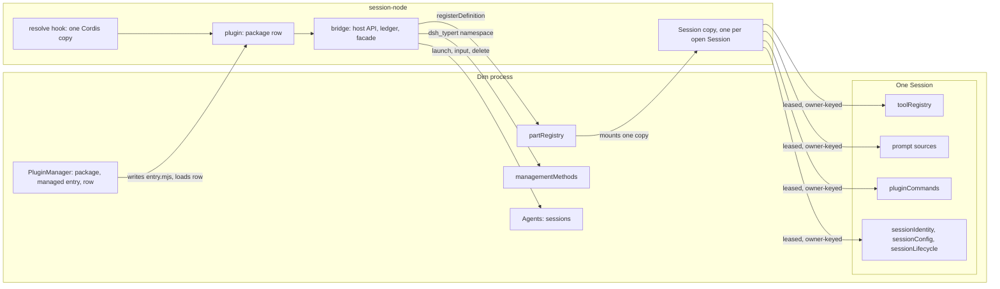
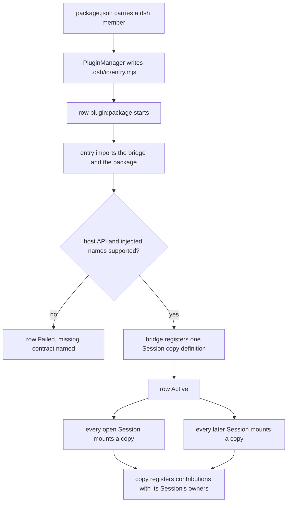
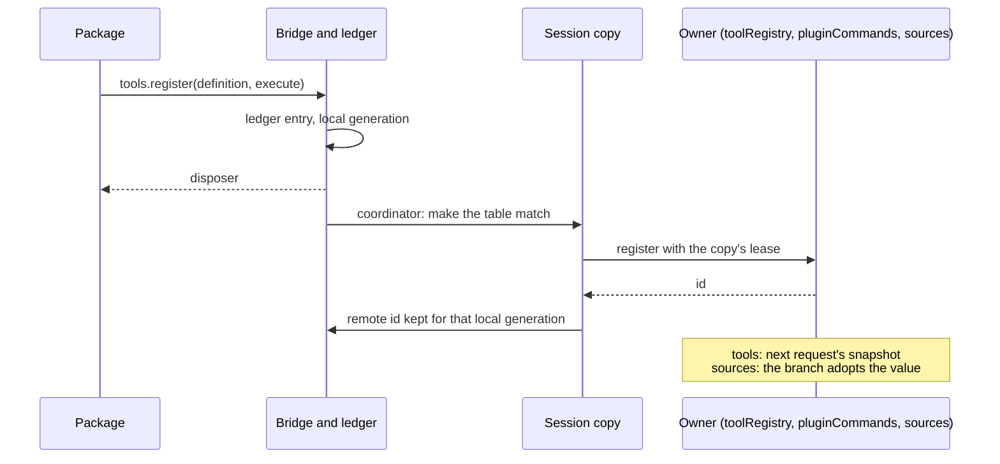
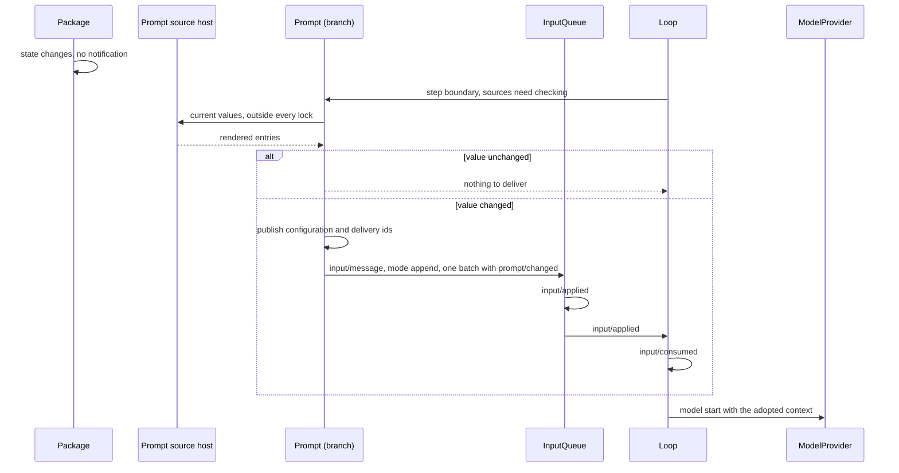
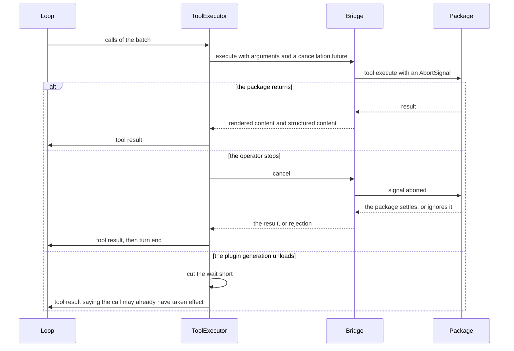
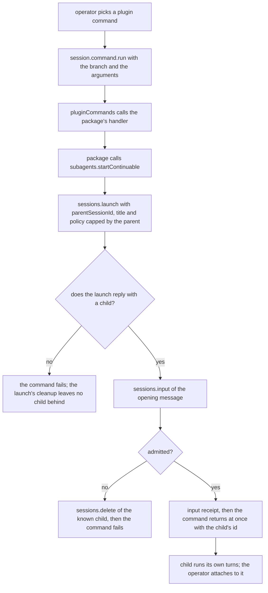

# DSH packages

Status: Draft ([#1753](https://github.com/arcships/dim/issues/1753)). Rules: [design rules](../../architecture/rust-agent/principles.md) §1 and §4, [ADR 002](../../adr/002-plugin-scope.md), [plugin contract](../plugin-contract.md) ([ADR 006](../../adr/006-plugin-contract.md)). Scope: process and Session. Language: Rust for the Dim side, TypeScript for the bridge. Chinese: [中文](../../zh/design/plugins/DshPackages.md).

DSH is the harness whose plugin packages this design runs. A DSH package is a Cordis 4 plugin package, which Dim already loads as a Node loader row ([rutis usage](../rutis-usage.md)). What such a package lacks in Dim is the host API it programs against: tools, system-prompt sections, slash commands, child Sessions, local management actions, and the Session lifecycle notices it reacts to. This design supplies that host API and nothing else, so a package published for DSH runs with its own files untouched, its own dependencies and its own persistence, when it uses only the host APIs listed in [§2.2](#22-the-host-api).

Two real packages define phase 1: `dsh-mysql`, which registers four tools, contributes a table-guide context that changes without a notification, exports a `mysql` service to peer packages, reacts to the Session lifecycle and exposes seven local connection actions; and `dsh-side-session`, which registers one slash command and starts a child Session with a parent, a capping policy and a rolled-back cancellation. Three further packages, `dsh-memory-recall`, `dsh-trellis` and `dsh-auto-retry`, fail at load with the missing contract named ([§11](#11-not-in-this-design)).

**The package stays a row.** No wrapper row, no second business logic, no per-package code in Dim: one managed entry generated per package, one bridge library shipped with the runtime, and every contribution registered with its Dim owner by the package's own row.

## 1. Structure



| Part | Scope | Holds |
| --- | --- | --- |
| The package row `plugin:<package>` | Process, one per package | The package's own module state, its peer services and its contributions' desired state, through the bridge |
| The bridge | Inside that row, not a name and not a row | The host API objects it supplies to the package, the contribution ledger, the Agent facades, one Session copy definition |
| The Session copy | Session, one per open Session | The copy's own Cordis fiber and the service leases it calls the owners through |
| The managed entry | Process, one file per package | Nothing at runtime: it names the package's real entry and hands it to the bridge |

**No wiring module.** The bridge is a library the package's own row imports; it provides no name to the process and adapts no other plugin's interface. It registers the package's contributions with the owners those contributions belong to, which is what [ADR 002 D2](../../adr/002-plugin-scope.md#d2-no-wiring-modules) asks of any part. It owns no separate service: what it holds is the per-row ledger, the facades and one copy definition ([§2.6](#26-what-the-bridge-does-not-keep)), none of which is a catalog name or a second owner of another part's state.

**The Agent is not a Dim Session.** Dim's Session, its memory instance and its branches are Rust core state. What a package calls an agent is the object the bridge hands it in `agent/created` ([§2.4](#24-the-agent-facade)), one per Session the package is mounted in. Nothing of the package's model is branched: a package contributes nothing branch-scoped, and creating ten branches on a Session mounts no extra copies.

**The runtime resolves one Cordis copy.** A DSH package imports its harness's Cordis package at module top level, and two Cordis copies in one process cannot share a context. The Node runtime starts with a resolve hook (`node --import`, available on the runtime's pinned Node 24) that points every package's Cordis import at the single copy the runtime already loads, and resolves the harness's pure helper packages (tool definitions, schema helpers) from the bridge's own dependencies. The launch command belongs to RuntimeManager, so the hook is raised to it ([§10.9](#109-runtimemanager-the-node-launch-carries-the-bridges-resolve-hook)). The runtime's copy is Cordis 4.0.4 (`runtime/package-lock.json`), and a package whose `peerDependencies` range for Cordis the copy does not satisfy is refused at load with `cordis_range` ([Appendix B](#appendix-b-errors-and-recovery)); a package that resolves a copy of its own is refused as well, which the runtime already does for an entry that resolves a different copy.

## 2. The entry and the bridge

### 2.1 The managed entry

A DSH package is not a Dim plugin: it carries no `dim-plugin.json`, and its `package.json` describes it to its own harness. The two phase 1 packages differ in the one way that matters here: the database package declares a peer dependency on Cordis `~4.0.4`, optionally, and the side-session package declares no Cordis dependency at all, while both declare a `dsh` member whose `bundle.patch` names the harness's own bundle patch. The `dsh` member is what marks a package, and that bundle patch is not read: this design's managed entry replaces it.

Recognising such a package, recording it and writing its entry belong to PluginManager ([§10.8](#108-pluginmanager-recognising-a-dsh-package-recording-it-and-writing-its-managed-entry)). The design fixes the entry's path under the plugin files root, `.dsh/<plugin id>/entry.mjs`, and its content: three lines that import the bridge from the runtime's single copy and re-export `dshPackageRow(<the package's real entry>)`. The package's directory is read-only throughout, including when it is installed from a path rather than a registry, so an upgrade of Dim changes the bridge and leaves every package untouched.

The runtime stamps a row's module URL with the file's modification time and size, so a reload of a changed row imports the file rather than the module it cached. That rule is the runtime package's, not this repository's: it lives in the `rutis-runtime` package, the version [`runtime/package.json`](../../../runtime/package.json) pins, and the entry is a row's module like any other ([PluginManager §3.4](PluginManager.md#34-reload): the host watches no files, the reload call is the signal). The entry belongs to PluginManager's record of the plugin and is written again whenever the row is resolved; it holds no state and nothing reads it but the runtime.

### 2.2 The host API

The bridge supplies these objects to the row, in the row's own isolated scope so two packages never see each other's. Each is the package's whole view of Dim.

| What the package calls | What it does with it | What Dim receives |
| --- | --- | --- |
| `tools.register(tool)`, one object carrying `parameters`, `output` and `execute` | Declares a tool, its input schema, its rendered output and its execution | A `toolRegistry` registration for the Session, whose handler is the package's `execute` ([Appendix A](#appendix-a-the-bridges-host-api)) |
| `systemPrompt.section({name, order, text})`, `.context({name, order, text, required?})` | Contributes system text, and per-request state text that may be a function of the assembly | One prompt source per contribution, `delivery: system` or `state`, read again before each step ([§3.5](#35-the-request-admission-order), [§10.1](#101-prompt-and-loop-a-step-re-reads-its-dynamic-sources-and-waits-for-their-admission)) |
| `commands.register({name, description, input?, handler})` | Registers a slash command whose handler receives `{commandId, agent, rawInput, attachments, signal}` and returns `{kind, text}` | One `pluginCommands` entry; the handler's reply is the run's reply ([§6](#6-terminal-ui), [§10.3](#103-plugin-commands-a-session-command-table-and-a-fixed-method-namespace)) |
| `subagents.startContinuable({provider, label, request: {parent, prompt}, signal})` | Starts a child Session under the calling agent and reads its id | `sessions.launch` with the parent, then `sessions.input` ([§3.7](#37-a-command-and-its-child-session), [§10.4](#104-agents-sessionslaunch-takes-a-parent-session)) |
| `./typert` actions, read from the package's `exports` | Exposes local configuration actions to the client | `managementMethods` under `dsh_typert.<package>` ([§6](#6-terminal-ui), [§10.6](#106-client-the-stop-hint-and-the-surfaces-plugin-commands-and-actions-need)) |
| `ctx.on('agent/created' \| 'agent/disposed')` | Per-Session setup and teardown | The bridge's own facade events ([§2.4](#24-the-agent-facade)) |
| `ctx.provide(name, service)` | Offers a service to peer packages | Nothing in Dim: it stays in the shared Node process, resolved by the runtime |

Appendix A gives each shape's harness definition and its mapping. Anything else a package calls, and anything it injects that this table does not cover, makes the row fail at load with the missing name in its failure ([§3.4](#34-failure)): an interception point the harness has and Dim does not serve (a step-before hook, a tool pre-execute guard, a request-error handler, an HTTP route, a synchronous whole-history read) fails the same way, and so do `systemPrompt.variable`, `systemPrompt.suppressRuntimeContext`, `agent.getHistory`, `agent.ctx` and the harness's later `subagents.startActivation` ([§11](#11-not-in-this-design)). A package is never loaded with part of its host API absent.

### 2.3 The contribution ledger

The package's registration API is synchronous (a tool registration returns a disposer at once), while every Dim owner is reached over the process boundary. The bridge keeps one ledger per package row to bridge the two: the desired state, an entry per contribution, with a local generation number, and one serial coordinator per Session copy that makes the owners' tables match it.

| Situation | What the coordinator does |
| --- | --- |
| Registered, never sent, withdrawn | Sends nothing. The entry leaves the ledger |
| Registered, in flight, withdrawn | Waits for the reply that names the registration's id, then withdraws by that id, so no orphan entry remains |
| Withdrawn while the Session is closing | Sends nothing; the copy's unload withdraws everything the copy registered |
| Registered twice under one name | Refused synchronously in the package's call, as the harness refuses it |
| A failed registration | Recorded in the Session copy's diagnostics; the other contributions stand |

The ledger is per row and never shared between packages. It is the only state the bridge keeps for contributions, and it exists because the package's API cannot wait and the owners' tables are asynchronous.

### 2.4 The Agent facade

The object a package receives in `agent/created` is the identity it uses as a map key and as the subject of its per-Session state. It is therefore one object per Session for as long as the process runs, and it is a shell: it holds the Session id and a slot for the current Session copy's service handles. An idle unload empties the slot; a restore fills it with the new copy's handles.

```text
agent/created            session.close / Session delete      daemon restart
  agent = facade(id)       agent/disposed(agent)               first load of a Session
  package keeps it         facade keeps its identity             agent/created once,
  idle unload: slot empty                                        source: 'resume'
  restore:     slot rebound
```

The bridge can only send these two notices because the Session's scope tells it why it ends, and because a delete is reported to the process as well as to the Session's own copy. A Session scope ends on a business close and on an idle unload alike ([plugin contract §2](../plugin-contract.md#2-the-instance-tree); the runtime cancels one closing token for both, `crates/dim-agent-runtime/src/agent.rs:804-808`, `finish(unloading)`), and `sessionLifecycle` offers `activated`, `closing`, `hold` and `release` and nothing that separates them ([plugin contract §4](../plugin-contract.md#4-dims-services), `crates/dim-agent-runtime/src/config.rs:403-408`). A copy that sent `agent/disposed` on `closing` would implement the idle-unload notice this design rejects. A delete after an idle unload has no copy left to tell: the delete removes the stored rows of a Session that is not loaded (`crates/dim-app-server/src/agents.rs:1519-1534`, which closes a Session only when it is loaded), and the package's per-Session state and facade live in the row, not in the copy. `sessionIdentity` does report `{sessionId, restored}` (`crates/dim-agent-runtime/src/config.rs:234-249`), which is the `source: 'resume'` fact: `restored` is `true` exactly for `SessionInitialization::Restore` (`crates/dim-agent-runtime/src/assembly.rs:1749`), which is the load that restores a stored Session rather than creating one (`crates/dim-agent-runtime/src/agent.rs:169-183`). And a business delete announces `agent/session-deleted` on the process root, a host-internal bus event, not a face a row reads ([plugin contract §5.3](../plugin-contract.md#53-bus-events)).

So the two notices rest on one requirement on the Session owner ([§10.7](#107-agents-and-the-session-lifecycle-why-a-session-scope-ends-and-how-it-began)): the copy learns the reason its scope ends, business close, delete or idle unload; a part in the process scope learns that a Session is gone, loaded or not; and either learns whether its Session was created or restored. With that, `agent/disposed` follows a business close and a delete, whether the Session was loaded at that moment or had been unloaded before it, and never an idle unload; `agent/created` follows a first mount in this process, and the `source` names a restore. A Session deleted after an idle unload sends it once, and the bridge then drops that Session's facade and the package's retained state for it, so a `Map` keyed by the agent does not outlive the Session.

The facade's identity never changes, so a package's `WeakMap` or `WeakSet` keyed by the agent stays correct across an idle unload, and `agent/disposed` at close reaches the same object the package registered state under. A call the package makes through a stale handle before the slot is rebound fails as an unavailable service rather than reaching another Session's copy.

### 2.5 Registration states

One contribution of one package, from the package's call to its effect in Dim. The state is per Session: the same contribution can be published in one Session and refused in another.

| State | Owner's table | What the model sees | Ends when |
| --- | --- | --- | --- |
| Desired | unchanged | nothing | the coordinator picks it up, or the disposer runs first |
| Registering | unchanged | nothing | the owner replies, or the copy unloads |
| Registered | the entry is in the table | nothing yet for tools; a prompt value at the branch's next adoption | withdrawal, or the copy's unload |
| Adopted | unchanged | tools in the next request's snapshot; a prompt value as an Append block | the next change, or a withdrawal |
| Withdrawing | the entry is being removed | the current request keeps what it already bound | the owner confirms |
| Withdrawn | the entry is gone | nothing new; the block the value was adopted with stays in the history, and a Revoke adds a `<dim-state cleared="true">` block that ends it | nothing: a second withdrawal is a no-op, because the id no longer matches |

A registration that changes a name already in the table is a withdrawal followed by a registration, in that order, so the second never races the first into a duplicate-name refusal. Two generations of one name are separate entries with separate ids: withdrawing the old id cannot remove the new one.

### 2.6 What the bridge does not keep

No queue of contributions, no retry, no timer and no second registry. The concrete state it holds is one ledger per row, one facade per Session the row has seen, and one copy definition per row. A registration whose owner refuses it is reported to the package's call or to the copy's diagnostics and is not remembered. There is no in-memory cache of a Session's history, no shadow of the Timeline, and no copy of the model's context.

## 3. Flows

### 3.1 Loading a package



The row is `Active` only after its definition is handed over and its services announced, as any Node row is. Sessions already open mount a copy when the definition is registered; Sessions opened later mount one while they open, before they publish. A package therefore contributes to the first request of a Session it was loaded before, with no catch-up step.

### 3.2 Registering and publishing



A tool reaches a request through the Session's tool source set, which the request's tool binding takes as a snapshot, so a registration or a withdrawal while a request runs changes only the following requests. A prompt value reaches a request through adoption ([§3.5](#35-the-request-admission-order)), which is the one path by which text from a package enters the model's context.

### 3.3 Withdrawing one contribution

A disposer runs in the package's own call stack. It removes the ledger entry and wakes the coordinator, which withdraws by the id the owner assigned, and only for the Session copies that registered it. A withdrawal is invisible to a request already bound: that request keeps its snapshot and says nothing about what left. A withdrawal of a prompt state value is a Revoke, which writes a `<dim-state source="…" cleared="true"></dim-state>` block: the earlier block stays in the history, and this one ends it for what follows (`crates/dim-agent-capabilities/src/prompt.rs:1163-1197`). A Revoke does not rewrite history that already happened, and it is not a silence about what the model read before it.

Nothing withdraws a contribution except its disposer, its Session copy unloading, or its package row unloading. A Session close withdraws a copy's contributions by unloading the copy, without one call per contribution.

### 3.4 Failure

| Failure | Where it is decided | Effect |
| --- | --- | --- |
| A package injects a name this design does not serve | Bridge, before the row is Active | Row Failed, the missing name in the message |
| A package registers a hook the harness has and Dim does not serve | Bridge, in that registration's call | Row Failed: a partially loaded package would run without the guard its author expected |
| A package imports its own Cordis copy | Runtime, at module resolution: its existing refusal | Row Failed, naming the entry and the copy |
| A package's Cordis peer range excludes the runtime's 4.0.4 | Bridge, before the row is Active | Row Failed with `cordis_range`, naming the range |
| The package module throws while loading | Runtime | Row Failed with the module error |
| One Session copy fails to build | Part registry, for that Session | Only that copy is marked Failed; the row and the other Sessions stay healthy |
| One contribution collides with a host tool or another plugin's name | Owner, in the registration's reply | The contribution is refused and that Session's copy records the refusal. The ledger's desired entry stays, because another Session's copy publishes it there |
| The package's `dispose` throws | Runtime, during unload | Recorded as the row's cleanup error; the other rows are unaffected |

A refused contribution is never retried silently: the package sees the refusal in the call that made it, or in the Session copy's diagnostics when the call had already returned. A refusal is per Session, not per row: the ledger keeps the desired entry, so a name one Session's table already holds is refused only in that Session, and every other Session's copy still publishes it. The copy records its own refusal in its diagnostics, so the operator sees which Session lost which contribution.

### 3.5 The request admission order

A package's dynamic context has no notification: `dsh-mysql` reads the selected database from a closure in its own module when the harness assembles the step, and the harness therefore re-reads it before every step. Dim's prompt sources are registered once and adopted by a branch at its open, so without a re-read a package's changed value would reach the model only on the next Session open. The re-read needs two things from the prompt owners, and this design raises both ([§10](#10-requirements-raised-to-mechanism-owners)): a branch asks its sources for their current value before a step, and a step does not reach the provider until the input written for that value is admitted to the loop.



| Step | Who acts | The fact that lets the step proceed | A cancellation or reload here |
| --- | --- | --- | --- |
| 1 | Package changes its own state | none: the value is read when it is asked for | nothing to cancel |
| 2 | Loop reaches a step boundary | the turn's own start, a tool result batch, a compaction result, or a replaced request | an interrupt ends the turn as cancelled |
| 3 | Prompt reads the values it needs | outside every lock, with the branch's cancellation | an interrupt ends the turn at once, without waiting for the read |
| 4 | Prompt compares and publishes | one atomic batch: `prompt/changed` and the Append input | the batch refuses itself under the commit lock when the branch is closing or the step was cancelled |
| 5 | InputQueue admits the Append input | the queue's own ordering | the input stays for the next turn if the turn ended first |
| 6 | Loop admits the delivery | the input's id, which the publisher named | an id the turn no longer waits for is ignored |
| 7 | Loop starts the request | every delivery of this step admitted | a request already started is replaced as any steered request is |

The chain has three properties this design depends on. The read is outside the commit lock, so a package that blocks in its own code delays its own step and no other Session's. An Append input does not start a turn: an adopted value on an idle Session waits for the operator's next message instead of opening one. And a value that did not change writes nothing, so a package that is queried every step costs one boundary call and no Timeline write.

A package that blocks in its own code blocks every row in the Node runtime, because the package shares that runtime's event loop (the `rutis-runtime` package runs one Node process per runtime and loads each row into it). What the design can bound is the effect on Dim: the read is outside the commit lock, so one blocked package delays the steps of the Sessions it is mounted in and no Session it is not, and no lock, batch or other plugin's call waits on it ([Appendix C](#appendix-c-static-cost)). The operator's way out is the same one the stop hint names: reload or disable the plugin.

If the process stops between steps 4 and 7, the turn has a start and an adopted configuration but no model request in it. The existing rebuild settles such a turn as failed and leaves the Append input in the queue for the next turn, so a package's context is neither replayed nor lost.

### 3.6 A tool call and a stop



A stop is cooperative, as it is for every foreign tool: it passes the cancellation into the package and waits for the call to settle. Only unloading the plugin generation cuts the wait short, and then the result says the call may already have taken effect, because nothing in Dim can observe whether an external write landed. A package that ignores the signal is waited for, and the operator ends the wait by reloading or disabling the plugin ([§6](#6-terminal-ui)).

The bridge builds the tool's `AbortSignal` from that cancellation future: it aborts when the future settles. What the host passes is a future and not a flag (`crates/dim-agent-capabilities/src/tool_registry.rs:767-772`), so a package treats the signal as aborted from the moment it fires; the design does not promise that it is already aborted on the package's first synchronous read. A call cancelled before it was dispatched is one the package never receives at all: the executor refuses it before it reaches the provider and answers `Tool cancelled before execution` (`crates/dim-agent-capabilities/src/tool_executor.rs:408-415`, `:447-456`).

### 3.7 A command and its child Session



The command returns when the child's first message is queued, not when the child answers, which is what the harness's continuable subagent contract promises its handler. The child is an ordinary Session: it persists, it is listed as a Session a person started, with its parent, it unloads when idle like any other, and deleting the parent deletes it through the stored parent relation ([§10.4](#104-agents-sessionslaunch-takes-a-parent-session)). The parent's Timeline is untouched: the command writes no input and no fact there.

The opening input is built the way any caller builds one (`crates/dim-app-server/src/agents/sessions.rs:126-136`): submission id `dsh-side-session:<commandId>`, so a retried run of the same command is one input and the branch accepts it once; `mode: queue`, since the child has no turn to steer; `rawBlocks` holding the package's `prompt` blocks in order, the first of which is the caller's marker; and empty `content`, so the input carries only what the package wrote. A `prompt` the child's branch refuses, an empty one among them, fails the command with the package's own error text and no Session is left behind: the launch has already answered, so the bridge deletes the child it holds by id before the command returns its error ([Appendix B](#appendix-b-errors-and-recovery)). Cancellation is the other case and belongs to the launch: a caller that stops waiting before the reply removes the Session the launch created itself ([§10.4](#104-agents-sessionslaunch-takes-a-parent-session)).

## 4. Lifetimes

One Session across everything that can happen to it. The row's package state is the module's own closures, which is where a package keeps a per-Session `Map`.

| Event | Dim Session | Memory instance | The package's per-Session copy | Package state in its row | External work |
| --- | --- | --- | --- | --- | --- |
| Steady state | stored | loaded | mounted, contributions registered | alive | none |
| Idle unload | stored, unchanged | unloaded, writes nothing | unmounted; its contributions gone; its leases returned | alive; the facade's slot empties; no `agent/disposed` | none: an unload never cancels accepted work |
| Restore after an unload | stored, unchanged | loaded again, branches open as `branch/resume` | mounted again: the package's contributions registered again from the row's own `apply` of the copy | alive; the facade's slot rebinds; no `agent/created` | none |
| `session.close` | stored, `closed` for this process | unloaded | unmounted | alive; `agent/disposed` for that Session | none: the close waits for what it accepted |
| Session delete | rows removed | unloaded | unmounted if it was loaded; an idle-unloaded Session has no copy | alive; `agent/disposed` for that Session, whether it was loaded or had been unloaded before the delete; the facade and that Session's retained state are dropped | none |
| Plugin reload or disable | stored | loaded | unmounted with the row; remounted with the new generation | a fresh module: the package's memory starts empty | a call in flight is cut short with may-have-taken-effect |
| Daemon restart | stored | loaded when acquired | mounted on the first load | fresh process: the package's memory starts empty; `agent/created` once, with `source: 'resume'` when the Session was restored | the old process's sockets close with it; whether a write landed is unknown |

The fourth and fifth rows are the ones the Session owner has to make observable: an idle unload and a business close end the same scope, so the copy cannot tell them apart from `sessionLifecycle.closing` alone ([§10.7](#107-agents-and-the-session-lifecycle-why-a-session-scope-ends-and-how-it-began)). The last row's `source` comes from `sessionIdentity.restored`, which is `true` for a load that restored a stored Session and `false` for one that created it (`crates/dim-agent-runtime/src/config.rs:234-249`, `crates/dim-agent-runtime/src/assembly.rs:1749`).

A Session that is touched and not closed keeps its entry in the package's per-Session `Map` for the life of the process, so that memory is proportional to the Sessions a package has seen and not closed, not to the Sessions loaded now. A daemon restart clears it, exactly as a restart of the harness does.

## 5. Context mapping

| Where | What the model sees | Form | Survival |
| --- | --- | --- | --- |
| Any branch of the Session | The package's tools, with the descriptions and schemas it declared | Tool declarations in the request's snapshot | While the contributing copy is mounted |
| Any branch of the Session | The package's tool results, rendered by the package and carried as text | `ToolResult.content`; the package's structured value stays out of the model's view | As any tool result |
| Any branch of the Session | The package's system section, when it declares one | Part of the adopted system prompt | Republished when the value changes |
| Any branch of the Session | The package's dynamic context | One `<dim-state>` block, adopted like any captured state source, and superseded by the next value | A later value is a new block; a withdrawal adds a `<dim-state cleared="true">` block that ends it ([§3.3](#33-withdrawing-one-contribution)) |
| Child Session | Its own turns, starting from the opening message | Ordinary Session context | Its own |
| Parent Session | Nothing the command wrote; only the command's own reply text for the operator | Not model context | not applicable |

The package never writes a Timeline fact, never reaches `dispatcher` and never appends text to a request. Every model-visible byte it contributes arrives through a tool result or through adoption.

## 6. Terminal UI

Four surfaces, all client-side. The keys and the layout of each belong to the terminal UI owner ([cli-commands](../cli-commands.md)); the shapes below are what this design needs them to show, and the `r` key is an illustration of the way out, not a binding this design sets. All four are raised in [§10.6](#106-client-the-stop-hint-and-the-surfaces-plugin-commands-and-actions-need).

**The command menu.** A Session's plugin commands are listed in the `/` menu after the built-in commands and before the Skills, which is the one position the [command menu contract](../cli-commands.md#command-menu) leaves for a dynamic group. A row names its command, its description and the plugin it came from.

```text
+----------------------------------------------------------------------+
| > /side                                                              |
+----------------------------------------------------------------------+
|  /side-chat    start a side chat that keeps its own conversation     |
|                [plugin: dsh-side-session]                            |
+----------------------------------------------------------------------+
  Enter runs session.command.run("side-chat") · Tab fills · Esc closes
```

**The child Session.** A child Session is listed as any other Session, with its parent and its origin, and the operator attaches to it rather than driving it through the parent. `launch` records the origin `client`, the same one a Session a person started has, so the listing shows it without a class filter and the `/resume` picker lists it like any other conversation ([§10.4](#104-agents-sessionslaunch-takes-a-parent-session)). The listing's parent field is `SessionInfo.parentSessionId`, which a stored Session already reports. The `/resume` picker is that listing ([cli-commands](../cli-commands.md#the-resume-picker)); selecting one Session's children is a catalog parameter raised in [§10.6](#106-client-the-stop-hint-and-the-surfaces-plugin-commands-and-actions-need).

```text
+--------------------- /sessions  (Tab: all | children of this [1]) --------------------+
| > side chat 14:32   [client · parent 8f3a..c1]     "ready, ask your first question"   |
|   this session      [client   · 8f3a..c1]          "check the slow order query"  2m   |
+--------------------------------------------------------------------------------------+
  Enter attaches to the child · d deletes · Esc closes
```

**Plugin actions.** A package that exports local actions gets one panel in `/plugins`, generic over any package: a list of the package's actions, the JSON arguments to one of them with the current Session id filled in where the action names a Session, and the structured reply. The panel and its actions are raised in [§10.6](#106-client-the-stop-hint-and-the-surfaces-plugin-commands-and-actions-need).

```text
+------------------ /plugins -> dsh-mysql -> Actions (local actions) -------------------+
| action: [ selectConnection ]   listConnections | saveConnection | testConnection      |
| arguments (session id filled in):                                                     |
|   { "sessionId": "8f3a9c10-…", "connectionId": "orders-ro" }                          |
| result: { "ok": true, "connectionId": "orders-ro", "connectionIds": ["orders-ro"] }   |
+--------------------------------------------------------------------------------------+
  Ctrl+Enter runs dsh_typert.dsh_mysql.selectConnection · Esc backs out
```

**The stop that waits.** While a stop waits on a plugin tool, the turn's running state carries one line naming the plugin and the way out. It is a client-wide hint, not a DSH one: it applies to every foreign tool that has not settled.

```text
  Stopping. dsh-mysql has not returned yet.
  r reloads that plugin to end the wait; it then affects every session and its
  in-memory state is reset. Esc leaves the stop waiting.
```

## 7. Interfaces

Every name below is either an existing face this design consumes or a face it raises to its owner. The owner document is the contract; this table says what this design does with each.

| Name | Scope | Face | Owner contract | This design |
| --- | --- | --- | --- | --- |
| `partRegistry` | process | data (`registerDefinition`) | [rutis usage §2](../rutis-usage.md#2-plugins-are-rows-instances-mount-their-parts), [plugin contract §4](../plugin-contract.md#4-dims-services) | Each package row registers one Session copy definition |
| `managementMethods` | process | data (`register`) | [session boundary §3.2](../contracts/session-boundary.md#32-management-method) | Each package's local actions, under `dsh_typert.<package>`, where a `-` in the package name is written `_` (so `dsh-mysql` is `dsh_typert.dsh_mysql`) |
| `toolRegistry` | session | data (`register`) | [plugin contract §4](../plugin-contract.md#4-dims-services), [ToolRegistry](../../architecture/rust-agent/plugins/ToolRegistry.md) | Each copy registers the package's tools |
| `promptRegistry`, `promptHost`, `initialPromptConfiguration` | session | the prompt data face ([PromptSources](PromptSources.md), [Prompt](Prompt.md)) | same | Each contribution is one prompt source, and a source of another language registers through a route raised in [§10.1](#101-prompt-and-loop-a-step-re-reads-its-dynamic-sources-and-waits-for-their-admission) |
| `pluginCommands` | session | data, raised to its owner in [§10.3](#103-plugin-commands-a-session-command-table-and-a-fixed-method-namespace) | `dim-agent-capabilities`, the Session part that owns the command table; the menu is [cli-commands](../cli-commands.md#command-menu) | Each copy registers the package's commands |
| `session.command.list`, `session.command.run` | session, in `sessionMethods` | data | [session boundary §3](../contracts/session-boundary.md), [cli-commands](../cli-commands.md#command-menu) | The client reads and runs plugin commands |
| `sessions` | process | data (`launch`, `input`, `delete`, `stop`) | [session access A.1](../contracts/session-access.md#a1-the-sessions-service) | Child Sessions and their opening input |
| `sessionIdentity`, `sessionConfig` | session | data | [plugin contract §4](../plugin-contract.md#4-dims-services) | The copy reads its Session's identity, including `restored`, and its configuration |
| `sessionLifecycle` | session | data | [plugin contract §4](../plugin-contract.md#4-dims-services) | The copy waits for `activated` and stops work on `closing`; the reason the scope ends is raised to the Session owner in [§10.7](#107-agents-and-the-session-lifecycle-why-a-session-scope-ends-and-how-it-began) |
| The Session's ending reason | session | data, raised to the Session owner in [§10.7](#107-agents-and-the-session-lifecycle-why-a-session-scope-ends-and-how-it-began) | [plugin contract §4](../plugin-contract.md#4-dims-services) | Tells a business close, a delete and an idle unload apart, which `agent/disposed` depends on |
| The delete of any Session | process | data, raised to the Session owner in [§10.7](#107-agents-and-the-session-lifecycle-why-a-session-scope-ends-and-how-it-began) | [plugin contract §4](../plugin-contract.md#4-dims-services) | Reaches the row when the deleted Session had no copy left, which is a delete after an idle unload |
| `agent/session-deleted` | process, bus event | host-internal, not a face this design consumes | [plugin contract §5.3](../plugin-contract.md#53-bus-events) | Not read by the bridge: the delete's reason arrives through the Session face of [§10.7](#107-agents-and-the-session-lifecycle-why-a-session-scope-ends-and-how-it-began) |

Names this design owns: the managed entry path `<plugin files root>/.dsh/<plugin id>/entry.mjs`, the management namespace `dsh_typert.<package>` with `-` written `_`, and the bridge's own package name, which is not a Dim service name and is not in the catalog.

The bridge's own host API is a contract with package authors and lives in the generated TypeScript declarations beside the Dim service declarations, so a package author type-checks against it the way they type-check against `npm/plugin.d.ts`.

## 8. Security

- **The package is trusted host code.** A loaded row runs in the runtime's process with the user's own privileges, as every Node row does; a trusted in-process part is not isolated by its declarations ([AGENTS.md](../../../AGENTS.md) rule 11, [ADR 003](../../adr/003-approval-scope.md)), so nothing here sandboxes it. A package's tool calls are still admitted by Approval and Permission under the Session's policy, exactly like a tool Dim ships.
- **The bridge declares every DSH tool's risk, and it is the narrow one.** Dim refuses a foreign tool whose declaration carries no risk (`crates/dim-agent-capabilities/src/tool_registry.rs:685-698`), and the harness has no risk category for a package to declare, so the bridge supplies `network` for every DSH tool: such a tool reaches systems outside Dim's own file tree by its own means, and Dim cannot classify it more narrowly. The presets then treat it as they treat any network tool ([Permission](../../architecture/rust-agent/plugins/Permission.md); `crates/dim-agent-capabilities/src/permission.rs:678-750`): allowed under full access, asked under workspace-write, refused under read-only. An operator who trusts a named tool adds it to `allowedTools`. The bridge never picks a broader category to make a package load.
- **A hard dependency on an unsupported name is a refusal, not a degraded load.** A package that needs an HTTP route or a step-before hook fails at load, so the model never runs under a package that believes a guard is in place and is not.
- **Secrets stay with the package.** Dim has no secret store ([settings service §1.2](../appserver/settings-service.md)), and this design adds none: a package that persists a credential does so in its own files, and its action replies are its own. What reaches a client is what the package returns; a package that returns a password is the package's defect, and the panel shows the document it returns.
- **Management actions are local.** `managementMethods` is served to protected local connections only, never to a paired device, so a package's configuration actions are a host-administrator surface.
- **Session ids are not authorization.** `sessions`, `pluginCommands` and the prompt sources take a Session id as data, as their owners document. A package may name any Session; the operator's approval still governs what its tools do in that Session.
- **The entry writes nothing into the package.** The managed entry lives under the plugin files root, and the package's directory is read-only; a package that writes to its own directory continues to fail at the same place it would in the harness.

## 9. Rule check

| Rule | How this design complies |
| --- | --- |
| §4 rule 1 Commands for state owned by others | The package writes no other owner's state. A dynamic context change is published by `Prompt` through the existing publisher, and a child Session is created by `sessions.launch`, both in the owner's own flow |
| §4 rule 2 No take-back after hand-over | An adopted Append input belongs to InputQueue and Loop; the package cannot withdraw it, and a later value is a new adoption. A tool result is the executor's fact |
| §4 rule 3 `before` callbacks | Not applicable: the bridge registers no `before` callback, and the interception points that would need one are refused at load |
| §4 rule 4 No business meaning in core | Timeline, Dispatcher, InputQueue and Loop gain nothing package-specific. The step re-read and the admission barrier are stated in the owners' terms and serve any prompt source |
| §4 rule 5 Atomic batches, ordered delivery | The configuration and its delivery inputs are one batch; the step waits for the delivered input to be admitted, so one request cannot see a value without its input |
| §4 rule 6 Context only from handed-over events | Every model-visible byte arrives as a tool result or through adoption; nothing is injected into a request, and the bridge cannot append text |
| §4 rule 7 Public events and services only | The package reaches Dim through `partRegistry`, `toolRegistry`, the prompt sources, `pluginCommands`, `managementMethods`, `sessions` and the Session lifecycle face, declared above with their owners, plus the delete's process-scope face of [§10.7](#107-agents-and-the-session-lifecycle-why-a-session-scope-ends-and-how-it-began); it reads no other plugin's state, and in particular not a host-internal bus event |
| §4 rule 8 Infrastructure unchanged | The bridge changes nothing in rutis or the loader; it uses the row, the definition and the lease contracts as they are. What it needs of other owners is stated in [§10](#10-requirements-raised-to-mechanism-owners) in each owner's terms: Prompt and Loop (10.1), the registration owners (10.2), the Session table (10.3), Agents (10.4), ToolExecution (10.5), the client and the session catalog (10.6), the Session lifecycle (10.7), PluginManager (10.8) and RuntimeManager (10.9) |
| §4 rule 9 Only facts later decisions use | No Timeline event is added. The ledger, the facades and the copy definitions are process and Session memory, none of it needed to decide anything later |
| §1 Capability and App Server boundary | No part of this design is a Capability: no part folds branch facts or writes a fact. The bridge is a library inside a row; no business code goes into the App Server |
| ADR 002 D1 Scope follows the owner | The package row and its peer services are process state; the contributions are the Session's, so the copy that registers them is Session-scoped; nothing is branch state |
| ADR 002 D2 No wiring modules | The bridge provides no name to the process and adapts no other plugin's interface: it owns no separate service. It registers the package's own contributions with their owners, which is what each contributing part does, and the state it keeps is the per-row ledger, the facades and one copy definition |
| ADR 002 D3 Dependencies follow scope | The bridge depends on process and Session owners and writes into Sessions through `sessions`; nothing in the core depends on it, and a package's failure affects only its own contributions |
| ADR 002 D4 Structural and business configuration | The row's enablement and the package's install are PluginManager's; the package's business configuration stays in its own files and actions, with no Settings source added |
| ADR 002 D5 Language-neutral contracts | Each face above is stated as operations, data and error codes; the bridge's TypeScript API is one binding of the same operations |
| ADR 008 D2 and D3 No status, own scope only | The document states the design, the requirements it raises and what it consumes. Each requirement names its owner and what is needed, and leaves that owner's document to state the change in the owner's own terms; this page describes no other module's internals |

## 10. Requirements raised to mechanism owners

### 10.1 Prompt and Loop: a step re-reads its dynamic sources and waits for their admission

- **Blocked by:** a package's context changes without a notification. `initialPromptConfiguration` is read when a branch opens and a source's value is adopted then, so a value that changes afterwards reaches no request ([PromptSources](PromptSources.md), [Prompt §3.4](Prompt.md#34-adopted-when-its-writer-loads)). The publisher's own confirmation that a batch was published does not tell the branch that the input it wrote was admitted to the loop, so starting the request on that confirmation alone can miss the value it just adopted.
- **Existing mechanisms considered:** a periodic branch check (which the instruction sources use) delays a change by up to its own interval and writes on a schedule, so it cannot serve a value the model must see at the next step; registering the package's text as a `System` source instead of a state source would put a per-step value in the cached prefix; a package writing the input itself would write another owner's state (rule 1).
- **Needed:** in the prompt owner's terms, a branch can ask before a step whether its dynamic sources need re-reading, read them outside every lock, adopt what changed in the existing atomic batch, and hand the loop the delivery ids it wrote; the loop then starts the request only after those inputs are admitted, and an interrupt during that wait ends the turn as cancelled. A value that did not change writes nothing and does not wait.
- **Needed for a source of another language:** a registration route a foreign row can call from its own `apply`, since a package's system text and dynamic context are prompt sources and the registry today takes a Rust `Arc<dyn LoadPrompt>` with a Rust `Ctx` (`crates/dim-agent-capabilities/src/prompt_registry.rs:18-38`, `host.rs:177-183`; [plugin contract §4](../plugin-contract.md#4-dims-services) keeps prompt sources Rust-only until a foreign part needs one). The route is `promptSources.register({name, delivery, order}, read)` plus `promptSources.withdraw({name})`, bound to the calling row so an entry ends when that row unloads, as its other registrations do. `read` is called into the row once per step and answers the current value, which is the read the first paragraph needs. It cannot block a step forever and cannot fail one silently: the call carries the step's cancellation, a read that rejects or throws is recorded in the copy's diagnostics and that step proceeds without the value, the next step reads again, and a read that outlives its step is abandoned at the step's end, so a package that never returns delays only its own steps. Withdrawing one source is one registration withdrawal, not a row reload; a reload of the row withdraws every source of the old generation, so a step in between sees the old values or the new ones and never a mixture.
- **Effect on sequence, batch, interrupt, reload:** no new event kind, and the batch stays atomic; an interrupt ends the turn without waiting for a package that ignores its cancellation; a crash between the batch and the request leaves the turn to the existing rebuild, which fails it and keeps the Append input for the next turn.
- **Owner and verification:** `dim-agent-capabilities` (`prompt`, `prompt_registry`, `agent_loop`) and `dim-agent-runtime` for binding a foreign registration to the calling row, with their own documents ([Prompt](Prompt.md), [PromptSources](PromptSources.md), and the Loop architecture page) stating the change. Verified by a flow test: a source whose value changes between two turns reaches the second request as one `<dim-state>` block, an unchanged value writes nothing, an interrupt during the read ends the turn as cancelled with no request started, a foreign source registers and reaches the next request, a rejection in its read is recorded and the step proceeds, and an unload of its row withdraws every source it registered.

### 10.2 Runtime contributions: an owner-keyed single-entry withdrawal

- **Blocked by:** a package's disposer withdraws one contribution while its row stays loaded. The registrations table removes an entry only when the row that owns it unloads, so a package that swaps one tool for another would have to reload its whole row, which resets its per-Session state for every Session.
- **Existing mechanisms considered:** unloading and reloading the row (correct but discharges every Session's package state and every other contribution); a second table in the bridge that hides withdrawn entries (a shadow registry, which rule 8 forbids and which leaves the owner's table wrong).
- **Needed:** the registrations table records the owner of each entry and one cleanup per owner generation, a register reply carries the entry's id, and one withdrawal removes the entry whose id and owner match; a mismatch is refused rather than removing another owner's entry. This applies to `toolRegistry`, the prompt sources and `pluginCommands` alike.
- **Effect on sequence, batch, interrupt, reload:** none on the Timeline; a withdrawal changes what the next request's snapshot contains and nothing already bound. A row's unload still removes everything it registered, in one step.
- **Owner and verification:** `dim-agent-runtime` (registrations) and `dim-agent-capabilities` (the three owners' faces). Verified by a flow test: registering and withdrawing one tool five hundred times leaves one cleanup on the owner's side; another row's withdrawal of the same name is refused; a request bound before the withdrawal still returns the old handler's result, and the next request does not declare the tool.

### 10.3 Plugin commands: a Session command table and a fixed method namespace

- **Blocked by:** command names contain a hyphen (`/side-chat`) and Session method names may not: a namespace and method name are `[a-z][a-z0-9_]*` segments (`crates/dim-agent-capabilities/src/methods.rs:205-213`, [session boundary §3.1](../contracts/session-boundary.md#31-session-method)). A per-command method would therefore be impossible for a legal command name, and one method per command would also make the command list unreadable to a client that has not subscribed to every name.
- **Existing mechanisms considered:** sanitizing the command name into a method (the client and the package would then disagree about the name the operator types); a tool instead of a command (a slash command is not a model action and must not cost a request); `sessionMethods` with one shared namespace and a name argument (this is the shape adopted below, and it needs the table behind it).
- **Needed:** a Session part that owns a command table, `pluginCommands`, with `register`, `withdraw` and `list` as data operations whose entries belong to the calling copy, and one fixed Session method namespace `session.command` with `list` and `run {name, branchId?, args?}`. A run belongs to the Rpc generation that admitted it: it ends when that generation unloads or the provider unloads, and a client that stops waiting or disconnects does not cancel it, because a disconnect carries no cancellation to the provider. `run` replies `{kind, text}` as the handler returned them. A command name is `[a-z][a-z0-9_-]*`. A name that collides with a built-in slash command is refused by the client side of the menu, since the built-in list is that client's contract, and `pluginCommands` refuses only a collision with an entry another copy of the same Session holds.
- **Effect on sequence, batch, interrupt, reload:** no Timeline fact; the table is Session memory, rebuilt when the copies mount. A reload of the package interrupts an admitted run and the client sees it as interrupted. A withdrawal makes a later call answer `unknown_command` instead of a reloading error.
- **Owner and verification:** `dim-agent-capabilities` for the part, and the [command menu](../cli-commands.md#command-menu) owner for the menu slot ([§10.6](#106-client-the-stop-hint-and-the-surfaces-plugin-commands-and-actions-need)). Verified by a flow test: a hyphenated command registers, `session.command.list` returns it, `session.command.run` executes it, a provider unload during a run interrupts that run while a disconnect does not, a menu collision with a built-in is refused by the client, and a withdrawal makes the next run `unknown_command`.

### 10.4 Agents: `sessions.launch` takes a parent Session

- **Blocked by:** a package's child Session must be its parent's child, and it must be visible where the package says it is. `sessions.launch` passes no leader when it creates its Session (`crates/dim-app-server/src/agents/sessions.rs:456-475`), so no parent is stored, the child is not listed under its parent, and deleting the parent does not cascade to it: the delete path removes the Sessions `led_members` returns, and that read selects only Sessions whose stored configuration marks them as a collaboration member (`crates/dim-app-server/src/agent_records.rs:159-178`, called at `crates/dim-app-server/src/agents.rs:1531-1533`). A child Session this design creates is not a collaboration member, so that cascade does not reach it. Its visibility has the same gap: `launch` records `origin: internal` unless the caller declares `automation` (`sessions.rs:100-115`, `:466`), and an internal Session is left out of the client's listing and out of the `/resume` picker unless the client asks for that class (`docs/design/appserver/session-catalog.md` §3.1 `withInternal`; `crates/dim-app-server/src/storage/catalog.rs:268`), while the harness's child is an ordinary conversation the operator opens. `parentSessionId` is already reported per row (`crates/dim-app-server/src/protocol.rs:1306-1308`, `crates/dim-app-server/src/storage/catalog.rs:305-308`), but the catalog has no filter on it.
- **Existing mechanisms considered:** the package calling `session.create` and setting a title that names the parent (a title is text, not a relation, and the cascade still misses the child); a second launch entry (a duplicate of the one owner's method); listing every internal Session in the picker so a child appears (it also shows the work no person asked for); filtering children in the client over one page (a page is a window, so a filtered page misses children beyond it).
- **Needed:** an optional `parentSessionId` on the launch request, stored as the child's leader through the existing column, and the delete path's cascade extended to every stored Session whose leader is the Session being deleted, not only to a collaboration member. Collaboration's own reads keep their member filter: `led_members` (`crates/dim-app-server/src/agent_records.rs:159-178`) and `members` (`:215-236`, used at `crates/dim-app-server/src/collaboration.rs:510`) go on excluding a child that is not a member, so a package's child is a Session with a parent and not a delegate. The request also takes an `origin` that records `client`, which is the origin a Session a person started has (`crates/dim-app-server/src/connection.rs:1811`, `crates/dim-app-server/src/storage/timeline.rs:2584-2596` for a fork), so the child is listed and reachable by the operator; `LaunchOrigin` gains that value beside `automation` and stays a closed enum the App Server owns. `starter` bounds the child's policy and `parentSessionId` only records the relation, so the bridge passes both. A child launched with `interactive: false` answers `ask_user` with the declared "no one is available" result and its approvals still hold the turn open on the asking side (`crates/dim-agent-questions/src/lib.rs:335-345`; `docs/design/appserver/sessions-service.md` D10), so the flag is not what makes the child usable: the operator reaching it is, and that is the visibility above.
- **Effect on sequence, batch, interrupt, reload:** no Timeline change; the parent's Timeline is untouched by the launch. `launch` creates the Session in a spawned task (`crates/dim-app-server/src/agents/sessions.rs:457-476`), so dropping the caller's call cancels the wait and not the creation. A launch whose caller stops waiting before the reply removes the Session it created itself: the requirement is on `launch` and holds for every caller, not only the bridge, so no half-created child remains whatever the caller does.
- **Owner and verification:** Agents (`crates/dim-app-server`), with the sessions service document stating the fields and the cleanup. Verified by a flow test: a launched child records its parent, is listed as a client-origin Session, runs its first message, and is deleted with its parent; a caller that drops the launch before its reply leaves no Session behind, and that case is tested through `launch` itself, not through the bridge.

### 10.5 Tool execution: a crash recovery must not claim a call did not run

- **Blocked by:** a tool call interrupted by a crash or a capability reload is settled when the branch rebuilds. The rebuild selects every committed tool-call batch that has no result and no child results, and settles each of its calls either as "Tool did not finish before Capability reload; an effect may have happened" or, when the batch produced no child result at all, as "Tool was not executed: capability reloading" (`crates/dim-agent-capabilities/src/tool_executor.rs:1020-1060,1146-1159`). The second wording is chosen from the batch, not from whether a call was dispatched. A single-call foreign write batch that reached its package and then crashed therefore settles as not executed, and the model reads that a write did not happen, which is false.
- **Existing mechanisms considered:** the executor progress fact per call, which would let the batch distinction become a per-call one (off in the shipped assembly, and it turns every tool call into an extra Timeline write); the package reporting its own progress (the package is the thing whose outcome is unknown, and the harness it comes from does not ask it to).
- **Needed:** the recovery text for a call whose dispatch cannot be ruled out must say that the call did not finish and that an effect may have happened, not that it did not run; a batch that is known never to have been dispatched keeps the not-executed wording. The `may already have taken effect` wording the foreign tool path already uses at unload is the precedent.
- **Effect on sequence, batch, interrupt, reload:** the same single result event, one string changed; a reload still leaves the turn failed.
- **Owner and verification:** `dim-agent-capabilities` (`tool_executor`), with [ToolExecution](../../architecture/rust-agent/plugins/ToolExecution.md) stating the settlement. Verified by a flow test that opens a store with an unmatched tool call and asserts the recovered result says the effect may have happened.

### 10.6 Client: the stop hint, and the surfaces plugin commands and actions need

- **Blocked by:** four client surfaces this design needs and does not own. A stop can wait on a foreign tool that ignores its cancellation, and the operator is told nothing. The `/` menu has a fixed curated order with no place for a Session's plugin commands ([cli-commands](../cli-commands.md#command-menu)). The `/plugins` panel is one owner's area over PluginManager's methods, with no way to render or run a package's own local action ([management surfaces](../cli-commands.md#management-surfaces)). And the Session listing cannot select one Session's children: each row reports `parentSessionId` (`crates/dim-app-server/src/protocol.rs:1306-1308`), but `session.catalog` has no parameter for it (`docs/design/appserver/session-catalog.md` §3.1), so a client-side filter would miss children beyond the page it holds.
- **Needed:** one line on a running turn whose stop waits on a tool of another language, naming the plugin and the way out ([§6](#6-terminal-ui)), for every foreign tool and not only these packages; a dynamic group in the `/` menu after the built-in commands and before the Skills, whose rows come from `session.command.list` and run through `session.command.run`; one action panel in `/plugins`, generic over any plugin that serves a `dsh_typert.<package>` namespace, listing its actions, editing one action's arguments with the shown Session's id filled in where the action names a Session, and showing the structured reply; and a parent filter on the Session listing. The filter belongs to the catalog, not to the client: `session.catalog` takes an optional `parentSessionId`, applies it in the query before the page boundary and adds it to the cursor's filter set as its other filters are, so a page of children is a full page of children. Its owner is Agents with the [session catalog](../appserver/session-catalog.md#31-sessioncatalog), which states the parameter beside `withInternal`.
- **Effect on sequence, batch, interrupt, reload:** none on the Timeline; all four are read paths plus one existing method call each. The panel does not read a package's own settings: it renders the actions the namespace declares and the replies it returns.
- **Owner and verification:** the terminal UI owner for the four surfaces, with the command menu contract naming the group and the management-surfaces contract naming the panel's action kinds; Agents with the session catalog for the parent filter. Verified by a CLI flow test: a Session with a registered command lists it in the menu and runs it; a stop that waits on a plugin tool shows the hint; a package's namespace renders in `/plugins` and one action runs; and a child Session is found through the filter while a Session further down than one page is not missed.

### 10.7 Agents and the Session lifecycle: why a Session scope ends, and how it began

- **Blocked by:** the bridge sends `agent/disposed` on a business close and a Session delete and never on an idle unload, and it sends `agent/created` with `source: 'resume'` for the first load of a Session after a daemon restart. No face beside the Session tells it any of that. A Session scope ends on both a business close and an idle unload ([plugin contract §2](../plugin-contract.md#2-the-instance-tree)), and the runtime cancels one closing token for both (`crates/dim-agent-runtime/src/agent.rs:804-808`, `finish(unloading)`, reached from `unload_if_idle` at `:754-764` and from `close` at `:801-803`), so `sessionLifecycle.closing` cannot separate them (`crates/dim-agent-runtime/src/config.rs:403-408`; its row in [plugin contract §4](../plugin-contract.md#4-dims-services) lists `activated`, `closing`, `hold`, `release` and nothing else). A delete is announced as `agent/session-deleted`, a host-internal bus event ([plugin contract §5.3](../plugin-contract.md#53-bus-events)). The create-or-restore half is already data: `sessionIdentity.get()` is `{sessionId, restored}` (`crates/dim-agent-runtime/src/config.rs:234-249`), and `restored` is `SessionInitialization::Restore` (`crates/dim-agent-runtime/src/assembly.rs:1749`, chosen at `crates/dim-agent-runtime/src/agent.rs:169-183`).
- **Existing mechanisms considered:** reading `agent/session-deleted` directly in the bridge (a host-internal event, not a face, and the row cannot tell it from an idle unload of the same Session); sending `agent/disposed` on every `closing` (that is the idle-unload notice this design rejects, because it discards a package's per-Session choice on an unload it must survive); a `hold` on every Session a package has seen (it defeats idle unload for every Session the package touches, which is the cost this design refuses to pay).
- **Needed:** a public data face from the Session owner, in that owner's terms, from which a part in the Session scope learns two facts: why its Session scope is ending or has ended, with the distinction between a business close, a delete and an idle unload as the owner already knows it, and whether this load of its Session created or restored it. The face is available before the copy's first `apply` returns, so `agent/created` can carry the right `source` on the first mount. A reason the owner has no meaning for is not invented: the face reports what the owner already decides. A delete is observable whether or not the Session is loaded: the delete removes the stored rows of a Session that an idle unload already unmounted, and the process row that a package keeps still holds that Session's facade and state, so the delete's fact must reach a part in the process scope as well, not only a copy in the Session scope. `agent/session-deleted` already announces every delete that removed rows, loaded or not (`crates/dim-app-server/src/agents.rs:1588-1600`), so the requirement is a public face over that fact, not a new fact.
- **Effect on sequence, batch, interrupt, reload:** no Timeline fact and no new event kind; the closing reason is runtime state of the Session, and an idle unload stays as invisible to the Timeline as it is today (`crates/dim-agent-runtime/src/agent.rs:754-764` writes nothing). A plugin reload keeps sending nothing: the copy unloads with its row, which is neither a close nor a delete.
- **Owner and verification:** Agents and the runtime's Session lifecycle (`crates/dim-agent-runtime`, `crates/dim-app-server`), with [plugin contract §4](../plugin-contract.md#4-dims-services) and the Session row of §2 stating the face. Verified by a flow test: an idle unload and a business close of the same Session are reported with different reasons, a delete is reported as a delete both for a loaded and for an idle-unloaded Session, a load after a daemon restart reports `restored: true` and a new Session `false`, and a package's per-Session choice survives an unload and the restore after it ([Appendix D](#appendix-d-acceptance) items 7, 8 and 11).

### 10.8 PluginManager: recognising a DSH package, recording it, and writing its managed entry

- **Blocked by:** a DSH package carries no `dim-plugin.json`, so PluginManager has no candidate for it and its row is never created. Its `package.json` is written for its own harness, and its `dsh` member is that harness's bundle declaration, not a Dim manifest ([§2.1](#21-the-managed-entry)).
- **Existing mechanisms considered:** asking the user to add a `dim-plugin.json` to every package (the package's directory is read-only, and a package that needed editing would not be unmodified); a second install flow beside PluginManager's (a duplicate of the one owner's acquisition, record and cleanup).
- **Needed:** a recognition rule, a row record derived without a manifest, and a managed entry.

The recognition rule is the `dsh` member of `package.json`, which both phase 1 packages declare, with `dsh.bundle.patch` naming the harness's bundle patch and `dsh.client` naming its client half where there is one. A Cordis dependency is not the rule: the side-session package declares none, and the database package declares only an optional `peerDependencies` `~4.0.4`. The harness's bundle patch is not read and not applied; the managed entry replaces it.

The row record is derived from the same files, since `Manifest::read` requires `dim-plugin.json` and a DSH package has none (`crates/dim-app-server/src/plugin_manager/record.rs:14`, `:353`), which is why install, startup reconciliation, reload, list, update and remove all stop today. Each field has one source:

| Field | Source for a DSH package |
| --- | --- |
| `id` | `package.json`'s `name`, with its npm scope prefix dropped, lowercased and `-` kept, checked by the existing id rule `[a-z0-9_-]{1,64}`; a name outside it, or one already installed, is refused as for any plugin |
| `name` | `package.json`'s `name` verbatim, the name `plugin.list` shows and a `names` entry may select |
| `version` | `package.json`'s `version` |
| `code.entry` | `package.json`'s `exports["."]`, a string or its `default`, resolved inside the package directory by the existing `code.entry` rule and pointing at the package's real entry, so the managed entry is the only module Dim writes |
| `code.inject` | Empty. Neither package declares an `inject` in `package.json`; each exports `inject` from its own module (`dsh-side-session` `src/index.ts:31`), and the row applies that export at load as any Cordis plugin's, which is what Dim's loader already does for a Node row |
| `code.provides` | Empty: a DSH package provides services to its own Node context, not to Dim (§2.2) |
| `code.instanceNames` | Empty: a DSH package contributes to one Session through its copy, and no field names a group |
| `code.config` | Empty, with the host's patch for the plugin name deep-merged over it as for any plugin |
| `kinds` | `code` only. `dsh.client` declares a browser half the harness renders; it is not this PluginManager's `ui` kind, which is a Dim UI-extension package with its own manifest, so nothing of it is recorded |

Install acquires and renames the directory exactly as for any plugin, and writes the entry after the record (§2.1). Startup reconciliation reads each installed plugin's `package.json` in place of its manifest and writes the entry again for every one in use; a package whose `package.json` cannot be read, or that carries no `dsh` member, is logged and left out with its record kept, rather than dropped. Reload re-reads the record and writes the entry again, which is what picks up an upgraded `dsh-mysql`. `plugin.list` reports the record's `name`, `version` and `kinds` as it does for any plugin; `update` is available for a path or Git source as for any plugin and re-reads `package.json` after acquiring; `remove` deletes the record and the entry and never touches the package directory. Nothing here is read from the harness's bundle patch or from `dsh.profile`.
- **Effect on sequence, batch, interrupt, reload:** none on the Timeline. A `plugin.reload` of a package whose own entry changed imports the changed file, because the runtime stamps a row's module URL with the file's modification time and size ([§2.1](#21-the-managed-entry)).
- **Owner and verification:** PluginManager (`crates/dim-app-server/src/plugin_manager`), with [PluginManager](PluginManager.md) §2.1, §2.2 and §3.2 stating the recognition rule, the derived record, the entry's path and its removal. Verified by a flow test: the two phase 1 packages install from a directory, gain a record with the derived fields and an entry, load as rows, and their directories keep every file and modification time; `plugin.list` names them after a restart, a reload picks up a changed `lib/index.js`, and disabling and removing the plugin leaves neither entry nor record behind.

### 10.9 RuntimeManager: the Node launch carries the bridge's resolve hook

- **Blocked by:** a package whose Cordis import resolves to a second copy cannot share a context with the runtime's, so the bridge must point those imports at the one copy the runtime loads ([§1](#1-structure)). The Node runtime's launch command is RuntimeManager's, and it is `node --import tsx src/runner.mjs` (`docs/design/plugins/RuntimeManager.md:114`, built at `crates/dim-app-server/src/session_typescript.rs:393-406`), with no hook of its own.
- **Existing mechanisms considered:** a wrapper script around `runner.mjs` (a second launch path beside the one owner's, and it changes what `--import` resolves relative to); a package-side import map (the package's files are read-only, and a package that needed one would not be unmodified); relying on Node's own resolution to pick the runtime's copy (the runtime's refusal catches only a package that resolves its own copy, and the harness's helper packages are not Cordis).
- **Needed:** the Node launch adds one `--import` of the bridge's resolve hook, before `tsx`, so `registerHooks` covers every package's module graph. Node applies `--import` in the order given and `registerHooks` composes with it; repeated `--import` flags are accepted on the runtime's pinned Node 24.21.0. The hook's rules, its Cordis target and the helper packages it resolves are the bridge's, stated in [§1](#1-structure).
- **Effect on sequence, batch, interrupt, reload:** none on the Timeline. The hook runs in the runtime process for every row, not only these packages, so it must leave every other module's resolution unchanged; a package whose Cordis range the runtime's copy does not satisfy is refused with `cordis_range` ([Appendix B](#appendix-b-errors-and-recovery)), and one that resolves its own copy with `cordis_duplicate`.
- **Owner and verification:** RuntimeManager (`crates/dim-app-server/src/runtime_manager.rs`, `session_typescript.rs`), with [RuntimeManager](RuntimeManager.md) §2.3 stating the command. Verified by a flow test: a package that imports Cordis at its top level loads against the runtime's single copy, a package that resolves its own copy still fails with `cordis_duplicate`, and a row of another language is unaffected.

Nothing else is asked of another owner: the managed entry's path and content, the bridge's host API and the `dsh_typert` namespace are this design's own, and a plugin's actions use `managementMethods` as it is ([§7](#7-interfaces)).

## 11. Not in this design

- **Packages that need the harness's own HTTP routes, a synchronous read of the whole history, or an interception point.** `dsh-memory-recall` injects the harness's web server and reads the whole history synchronously; `dsh-trellis` intercepts the step before a model request and the tool call before it executes; `dsh-auto-retry` handles model request errors and would become a second owner of retry. Each fails at load naming the contract that is missing. Loading part of such a package would be worse than refusing it: a workflow guard that is silently absent is a guard the model believes in.
- **Synchronous history reads and a per-request view of the context.** Both are general capabilities, to be designed in phase 2 together with the extension surface of the other harness. That work does not promise support for the three packages above, which each need one more mechanism of their own.
- **The harness surface phase 1 does not serve, and the packages that need it.** Five names are refused at load and belong to phase 2, each with the contract it would need: `systemPrompt.variable`, a text path shared across packages with no ownership rule for who sets a variable two packages read; `systemPrompt.suppressRuntimeContext`, which would let a package remove Dim's own runtime context and needs a rule for what it may suppress; `subagents.startActivation`, the harness's current child-start shape, which returns an activation with `result` and `dispose` and needs Dim to own a rollout-back or caller-delivery contract for it ([Appendix A](#appendix-a-the-bridges-host-api)); `agent.getHistory`, a synchronous whole-history read, which is the item above; and `agent.ctx`, the harness's per-agent Cordis context, which would let a package register into another owner's tables directly instead of through the faces in [§7](#7-interfaces).
- **A `Pending` display for a dependency met inside a package's own process.** When one package injects a service another provides in the same runtime, the runtime's own context holds the wait, and Dim's loader shows the consumer row `Active` meanwhile. The bridge can report the wait it observes, and this design uses that for diagnostics. A loader-side display for those names is an upstream improvement that is not required here, and it is not a prerequisite for anything in phase 1.
- **Running packages from another runtime.** Only the Node runtime carries the bridge; a package written for another language runtime is out of scope.
- **Per-package Sessions or a second Session store.** A child Session is an ordinary Session with a parent.
- **A client UI for a package's own views.** A package that ships web UI code for the harness's client ships nothing this design can render; its commands, tools and actions are the supported surface.
- **A package marketplace, install flow or update policy.** PluginManager's install flow covers a package directory; this design adds only the recognition of a package and the managed entry it runs from ([§10.8](#108-pluginmanager-recognising-a-dsh-package-recording-it-and-writing-its-managed-entry)).

## Appendix A. The bridge's host API

The API is not this design's invention: it is the harness's own, at the shape each phase 1 package calls. The consumers are `dsh-mysql` 0.3.3 (`lib/index.js:302-700`, commit `b200ed5`), which registers four tools, one dynamic context and seven actions, and `dsh-side-session` 0.1.0 (`src/index.ts:34-70`, commit `39443eb`), which injects `commands` and `subagents` and registers one command. Each is read, never edited.

One shape needs its revision stated. The harness at `39163dd30f` has no `subagents.startContinuable`: it is `startActivation` there (`packages/subagent/subagent/src/index.ts:252-267`), a different shape that returns an activation with `result` and `dispose`. The side-session package calls `startContinuable` as the harness defined it before that rename (tag `dsh-v0.2.1-alpha.1`: `packages/subagent/subagent/src/index.ts:262`, `packages/subagent/subagent/src/types.ts:32-58`), so phase 1 serves that name, and `startActivation` is refused at load and listed for phase 2 ([§11](#11-not-in-this-design)).

| Harness shape, and where it is defined | What the package passes | How the bridge maps it |
| --- | --- | --- |
| `tools.register(definition, options?) -> () => void` (`packages/core/tools/src/index.ts:128-153`) | One object: `name`, `description`, `parameters` (a JSON Schema object, `packages/llm/llm/src/types.ts:517-528`), `output` (`{schema, render}`, `packages/core/tools/src/contracts.ts:17-24`), `timeoutMs?`, `execute(args, exec)` | `toolRegistry.register` with `{name, description, inputSchema: parameters}` and the package's `execute` as the handler. `output.schema` stays in the bridge: a returned value that fails it becomes a tool error naming the declaration. `output.render(args, value)` builds the result text, and the canonical value is the `structuredContent` (`crates/dim-agent-types/src/tool.rs:483-496`) |
| `execute(args, exec)` with `exec: ToolRunContext` (`contracts.ts:245-262`) | `exec.agent` (the agent on whose behalf the call runs, `:188`), `exec.signal`, `exec.callId`, `exec.arguments` | `exec.agent` is the Session's facade ([§2.4](#24-the-agent-facade)); `exec.signal` the bridge's `AbortSignal`; the rest the call's own values. No `risk` is asked of the package: the bridge supplies it ([§8](#8-security)) |
| `timeoutMs?: number` (`contracts.ts:63-70`) | A cooperative deadline: the tool forwards `exec.signal` and reaches quiescence when it aborts | The bridge aborts that same signal at the deadline. Dim keeps waiting for the call to settle, as it does for a stop ([§3.6](#36-a-tool-call-and-a-stop)); the timeout is not a second cancellation path |
| `systemPrompt.section(section) -> () => void` (`packages/core/system-prompt/src/index.ts:485-492`) | `{name, order, text, interpolate?, complete?}`, `text` a string or `(assemble) => string` (`:53-76`) | One prompt source, `delivery: system`, its text read again before each step |
| `systemPrompt.context(context) -> () => void` (`:520-527`) | `{name, order, text, interpolate?, required?}`, `text` a string or a function of `AssembleContext` (`:79-90`) | One prompt source, `delivery: state`: one `<dim-state>` block per value ([§5](#5-context-mapping)) |
| `AssembleContext` (`:42-50`, with `agent?` and `modelSelection?` merged in at `packages/core/agent/src/runtime-types.ts:19-25`) | `assemble.agent` is the agent whose step assembles; also `scope` and `signal` | `assemble.agent` is the facade, so a function-valued text reads its own Session's state; `scope` and `signal` are the branch's own |
| `commands.register(definition) -> () => void` (`packages/interaction/commands/src/index.ts:285-291`) | `{name, description, input?, recordInput?, handler}` (`:61-78`) | One `pluginCommands` entry. `name` is `[a-z][a-z0-9_-]*` (`:32`), so `/side-chat` is legal |
| `handler(invocation)` (`:41-58`) | `{commandId, agent, rawInput, attachments, signal}`, answering `{kind: 'success', text?}` or `{kind: 'error', text}` (`types.ts:34-41`) | `agent` is the facade, `rawInput` the text after the command name, `attachments` the input's blocks, `signal` the run's cancellation. The reply's `{kind, text}` is `session.command.run`'s reply ([§10.3](#103-plugin-commands-a-session-command-table-and-a-fixed-method-namespace)) |
| `subagents.startContinuable(spec)` (tag `dsh-v0.2.1-alpha.1`: `packages/subagent/subagent/src/index.ts:262`, `types.ts:32-58`) | `{provider, label, request: {parent, prompt, cwd?, agentOptions?, ...}, signal}`, answering `{childId, messageId}` | `sessions.launch` with `parentSessionId` from the facade and `title` from `label`, then `sessions.input` of `prompt`: `childId` is the launched Session and `messageId` its input id. `provider` names a backend in the harness and Dim has one, so `spawn` and `fork` are accepted and any other name is refused before the launch ([§3.7](#37-a-command-and-its-child-session)) |
| `ctx.provide(name, service)` | A service for peer packages | The runtime's own shared context; Dim adds nothing |
| `ctx.on('agent/created')` and `ctx.on('agent/disposed')` (`packages/core/agent/src/runtime-types.ts:291-300`) | `{agent, source, signal?}` and `{agent}` | The bridge's facade events, with `source` mapped from `sessionIdentity.restored` ([§2.4](#24-the-agent-facade)) |
| `exports["./typert"]` with a `TYPERT` manifest (`packages/typert/loader/src/index.ts:39-145`; `dsh-mysql` `lib/typert.host.js:40-114`) | `package`, `face: 'host'`, `invocations[{id, service, namespace, method, invocation, parameters, result}]`, `model.services[].members[]` | One `managementMethods` namespace `dsh_typert.<package>`, with `-` written as `_` because a Dim namespace segment is `[a-z][a-z0-9_]*` (`crates/dim-agent-capabilities/src/methods.rs:203-213`). Each invocation is a `MethodDecl`: `mutating` from the member, `interruption` `Drain`, `progress` false (`crates/dim-agent-capabilities/src/methods.rs:566-599`) |

Four rules hold for all of them. A registration returns the harness's own disposer, and calling it twice is a no-op. `signal` is an `AbortSignal` that aborts when the call's cancellation fires, and a call cancelled before it was dispatched is never passed to the package (`crates/dim-agent-capabilities/src/tool_executor.rs:408-415`, `:447-456`). A refusal is thrown as a typed error carrying the owner's code, never as a string. A field this table does not name is not served, and a package that needs one fails at load.

## Appendix B. Errors and recovery

| Code | Where | Meaning |
| --- | --- | --- |
| `unsupported_host_api` | Row load | The package injects a name or registers an interception this design does not serve; the message names it. The names removed from phase 1 (`systemPrompt.variable`, `systemPrompt.suppressRuntimeContext`, `subagents.startActivation`, `agent.getHistory`, `agent.ctx`) are refused here |
| `package_loading` | Row load | The entry could not be read or the module threw; the message is the module's |
| `cordis_duplicate` | Row load | The package resolved its own Cordis copy; the runtime already refuses this (the `rutis-runtime` package, the check beside `cordisOf` in `runner.mjs`), and the bridge reports it under this code |
| `cordis_range` | Row load | The package's `peerDependencies` range for Cordis excludes the runtime's 4.0.4; the message names the range |
| `invalid_tool` | `tools.register` | A field outside its bound, a name already taken, or a value the tool's own `output.schema` refuses |
| `invalid_command` | `commands.register` | A name outside `[a-z][a-z0-9_-]*`, an empty description, or a name this Session's table already holds |
| `duplicate_name` | `tools.register`, `commands.register`, `systemPrompt.*` | Another contribution of this Session holds the name |
| `session_closed` | Any registration, `subagents.*` | The Session is closing or gone; nothing was registered |
| `reloading` | Any registration | The owner is reloading; the copy fails and is mounted again with its row |
| `rejected` | Any launch or input | The request was refused with its reason |
| `unknown_command` | `session.command.run` | No such command in this Session, including one just withdrawn |
| `interrupted` | `session.command.run`, an unload during a run | The package generation unloaded; the call may have had an effect |

Recovery:

- **A lost registration reply** leaves the contribution unregistered and is reported to the copy; the copy's next mount registers again from the row's own state, so no operator action is needed.
- **A row that fails to load** leaves every Session untouched, and the plugin's status in `/plugins` names the missing contract. Reloading it after an upgrade of Dim is the recovery.
- **A prompt value adopted but not used before a crash** is in the Timeline with its input queued; the next turn consumes it.
- **A child Session whose opening input failed** is deleted by the bridge before the command returns its error, so no empty Session is left behind.
- **A stop that never settles** is ended by reloading the plugin, which cuts the call short with may-have-taken-effect; the operator is told so before acting.

## Appendix C. Static cost

No measurement is stated here; every line is a property of the code paths.

| Path | What it costs |
| --- | --- |
| A package row loading | One module import per package, one managed entry read, one definition registered. No work per Session until one opens |
| A Session opening with a package loaded | One definition copy built and mounted, one Node row keyed for that copy, one service lease per Session service the copy injects (each lease is a scoped registration on the owner), and one registration per contribution. Every one of these is an existing runtime operation, and none of them writes the Timeline |
| A Session opening with the package not loaded | Nothing: the registry has no entry |
| A request on a Session with a package mounted, value unchanged | One boundary call to the Session's prompt source, whose reply is compared byte for byte; no Timeline write, no input, no extra task |
| A request whose value changed | The same call, one atomic batch with the configuration and its Append input, one InputQueue batch, and one wait for the input to be admitted. The commit lock never spans a package call |
| A tool call | One call across the process boundary, awaited; the arguments and the rendered result are serialized once each way. A concurrent call overlaps only in its external wait: every row of one runtime shares its Node event loop, so a package's own synchronous work blocks that runtime's other rows while it runs |
| A command run | One boundary call, one Session creation or none, and one input |
| An idle unload | Unmounting the copy: one row unload, one lease release per injected service, and one ledger dropped |
| Memory per touched Session | One facade object, one per-Session entry in each package `Map`, and nothing else once the Session is unloaded. A copy's fiber and leases live only while the Session is loaded |
| A reload of the package | The old generation's copies unmount, then the new generation's definition is handed over; the cost is one unload and one mount per open Session, not one per branch |

## Appendix D. Acceptance

The implementation's flow tests cover, against the two phase 1 packages and fixtures beside them. The fixtures are the packages' own published artifacts at the versions this page states (`dsh-mysql` 0.3.3, `dsh-side-session` 0.1.0), vendored as test data from those versions and landed with the implementation pull request, since neither package is in this repository:

1. A package installed from a directory loads unmodified: its directory's contents and modification times are unchanged, its tool declarations reach a request, and a call returns the package's rendered content.
2. A package whose state changes between two turns delivers the new `<dim-state>` block to the second request, exactly once; an unchanged value writes nothing, and an interrupt during the read ends the turn as cancelled without a request.
3. A tool call from a package that ignores its cancellation keeps the turn running under a stop, and reloading the plugin settles it with may-have-taken-effect; the hint is shown while it waits.
4. A hyphenated command registers, is listed by `session.command.list`, runs with the operator's cancellation, and answers `unknown_command` after its disposer.
5. A child Session records its parent, is listed as a client-origin Session, receives its opening message built as [§3.7](#37-a-command-and-its-child-session) states, and is deleted with its parent. Separately, a caller that drops `sessions.launch` before its reply leaves no Session behind: that case is tested through `launch` itself, as [§10.4](#104-agents-sessionslaunch-takes-a-parent-session) requires of every caller. A child beyond the first page of the listing is still found through the parent filter.
6. The seven local actions of the database package are reachable from a protected local connection, refuse a paired remote one, and return the package's own replies.
7. A Session's idle unload and restore keep the package's per-Session choice: a selection the operator cleared stays cleared across the unload, `agent/disposed` is not sent for the unload, and `agent/created` is not sent twice. Its verification of the ending reason and of `restored` is requirement [§10.7](#107-agents-and-the-session-lifecycle-why-a-session-scope-ends-and-how-it-began)'s.
8. `session.close` and Session delete send `agent/disposed` once each, and the Session face of [§10.7](#107-agents-and-the-session-lifecycle-why-a-session-scope-ends-and-how-it-began) is what tells the copy which of the two, and which unload, it is in; a daemon restart sends `agent/created` with `source: 'resume'` on the first load, reading `sessionIdentity.restored`.
9. Each excluded package fails at load with its missing contract named, and no part of it is active.
10. A reload of the package affects every Session it was mounted in, and each Session's next request carries the new generation's declaration.
11. A Session is idle-unloaded, then deleted while unloaded: the surviving row receives `agent/disposed` for it once, drops that Session's facade and the package's retained state for it, and sends nothing on the unload that preceded the delete.
