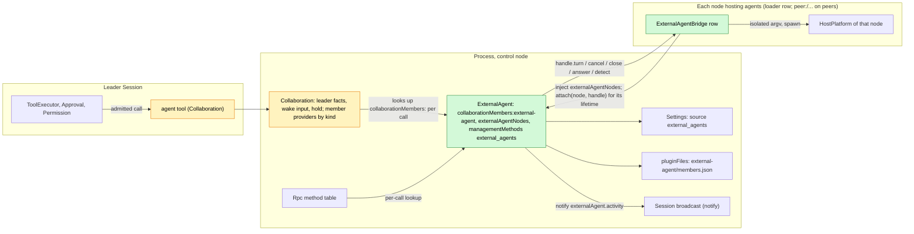
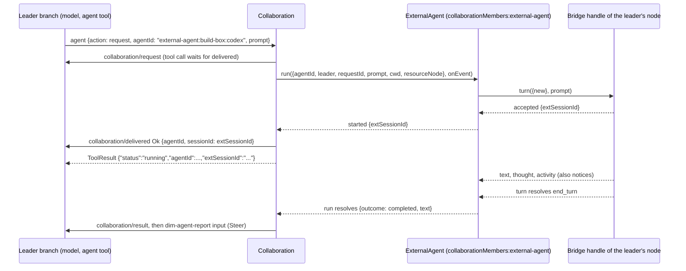

# ExternalAgent

Status: Draft (second redesign, [#145](https://github.com/arcships/dim/issues/145)). It supersedes the model framing of [#182](https://github.com/arcships/dim/pull/182). The maintainer's decisions are recorded in [Appendix F](#appendix-f-recorded-decisions); what remains for Ready is listed in [§10](#10-ready-status). Overall design: [overview §4](../overview.md#4-plugin-catalog); scope: [ADR 002](../../adr/002-plugin-scope.md) (process, with per-node bridge rows). Phase: P3. Language: TypeScript first ([overview Appendix C](../overview.md#appendix-c-implementation-language)).

ExternalAgent lets a Session's model delegate work to locally installed coding agents (Claude Code, Codex, Cursor, OpenCode, ZCode and similar) the way it delegates to a sub-agent. An external agent is a **sub-agent, not a model**: the delegating Session keeps its own model, gives the external agent a task through Collaboration's `agent` tool, and later receives the agent's final report as the member's result. The external agent works in its own conversation with its own tools; dim never presents its output as dim model output.

ExternalAgent is one more **member kind** of Collaboration, dim's existing sub-agent mechanism ([collaboration.rs](../../../crates/dim-app-server/src/collaboration.rs)), rather than a parallel one. Collaboration keeps owning the delegation: the `agent` tool, the leader's `collaboration/*` facts, the `dim-agent-report` wake input, cancellation, reload settlement and the leader's Session hold. ExternalAgent supplies the member: it starts the external conversation, carries tasks and messages to it, reports activity and permission asks, returns the final text, and owns the member record that stores the external session id. When the agent asks permission for one of its own actions, the ask travels on Collaboration's member-approval route ([#29](https://github.com/arcships/dim/issues/29), decided in #19) to the leader's model, whose decision is an ordinary tool call under the leader's own Approval and Permission. Agent processes live in per-node bridge rows that the loader manages. All contracts are language-neutral named services ([ADR 002 D5](../../adr/002-plugin-scope.md#d5-contracts-are-language-neutral)); Rust forms are in [Appendix G](#appendix-g-rust-binding).

## 0. Why a Collaboration member

| Shape | What it needs | Verdict |
| --- | --- | --- |
| **External agent as one more Collaboration member kind** (this design) | Collaboration routes its existing operations for a kind to a member provider looked up per call; ExternalAgent implements the provider | Chosen (D1): the model sees one delegation surface, and detached work keeps one owner whose contract already covers delivery, results, wake-up, cancel, close, reload and restart ([event-driven flows §3](../../architecture/rust-agent/event-driven-flows.md)). Persisted `collaboration/*` data is unchanged |
| An `external_agent` tool with its own detached-work events, owned by ExternalAgent | A second request/result/wake/cancel owner and a second sub-agent tool for the model | Rejected: duplicates Collaboration's owner rules |
| A member Session whose turns the external agent runs (the #182 framing) | A Provider entry, a model kind and ModelHost/ModelProvider changes, so that the agent's work appears as dim model output | Rejected by the maintainer: an external agent is a sub-agent, not a model |

What changed from #182, which this design supersedes:

| #182 (model framing) | This design |
| --- | --- |
| Provider entry `external-agent:<node>:<agent>`, `modelKind:external-agent`, `ModelConnection::Kind`, `ModelCallScope`, ModelHost lookup | Removed. No Provider, Aimux, ModelProvider or chunk-mapping supplement |
| Agents profiles with an external model, written by ExternalAgent | Removed. Collaboration lists external agents from ExternalAgent's catalog |
| Delivery decision from the calling branch's Timeline (records, cursor, transcript initialization) | Removed. A member receives only its task and its team's messages, as dim members do |
| `external_agent_allow` / `external_agent_reject` tools, a Session part and a client route | Removed. Asks use Collaboration's member-approval route (§3.2); ExternalAgent has no Session part |
| SessionTitle and AuxiliaryModel exclusions of `external-agent:*` models | Removed, in the design and in the SessionTitle package |
| Memory-only conversation records | Members persist only `{leaderSessionId, agentId, extSessionId, cwd}` and reopen with ACP `session/load` or CLI resume after an ExternalAgent reload or dim restart (§2, §3.5, D5). The conversation content belongs to the external agent |
| Kept | Per-node bridge loader rows that attach to ExternalAgent, ExternalAgent emitting its own notices, business configuration in Settings, the shared ACP schema |

## 1. Structure



External agent connections and live conversations are shared host resources, so ExternalAgent is a process plugin (ADR 002 D1). Agent processes are host resources of a node, so they belong to a plugin on that node: `ExternalAgentBridge` is a process plugin with one loader row per node that hosts agents. The control node's row is part of the product profile whenever ExternalAgent is enabled. A peer node's row is `peer:<node>/external-agent-bridge`, added or removed only by PluginManager's structural operations (ADR 002 D4, D6). A peer row waits while its node or link is gone and loads again when it returns. The bridge's resources are released by its own `ctx.effect` whenever the row unloads.

A bridge row injects `externalAgentNodes` (on a peer, imported over the link) and, in `apply`, attaches a by-reference handle for its node; its effect detaches it, and a dropped link or exited runtime closes the reference, which ExternalAgent treats as detached. The loader runs a row's generations in order, so one node has at most one attachment. This is the registration form #37 accepted. A TypeScript row cannot look up a service per call ([sessions-service D1](../appserver/sessions-service.md), [process TypeScript §5.1](../process-typescript.md#51-p6p7-access-through-declared-feature-dependencies)), so ExternalAgent never looks a bridge up.

Collaboration, which is native, looks up `collaborationMembers:<kind>` on each call without a dependency, as Rpc does for management method providers. No core part and no Session depends on ExternalAgent; it injects only `settings`, `pluginFiles` and `managementMethods`, which never reload. ExternalAgent has no Session part: the delegation and decision tools are Collaboration's.

| Part | Scope | Depends on (`inject`) | Provides |
| --- | --- | --- | --- |
| `ExternalAgent` | Process row, control node | `settings`, `pluginFiles`, `managementMethods` | `collaborationMembers:external-agent`; `externalAgentNodes`; registers `external_agents` with `managementMethods`; Settings source `external_agents`; `externalAgent.activity` notices |
| `ExternalAgentBridge` | Process row, one per node hosting agents | `externalAgentNodes`; that node's HostPlatform exec-argv helper | Nothing by name; a `BridgeHandle` by reference through `attach` |
| Collaboration (change, §9.2) | Existing process, Session and branch parts | Looks up member providers per call | Routes its operations for non-Session members to the provider of their kind |

**Contracts depended on.** [`pluginFiles`](../../../crates/dim-app-server/README.md#trusted-plugin-storage) (storage envelope version 1, one file under the installer-provisioned directory `external-agent/`); Collaboration's `agent` tool, `collaboration/*` events and detached-work behavior, with the changes of §9.2 and the member-approval route of §9.3; Settings' typed writes and `settings.changed`; Session broadcast notices with the TypeScript binding of §9.1; process rows and management methods through #4 ([process TypeScript](../process-typescript.md)); each node's HostPlatform exec-argv helper and isolation (overview Appendix B, P3); `SessionConfig.resourceNode` (P3); rutis links that export `externalAgentNodes` to linked nodes.

**Contracts defined here.** The member-provider contract `collaborationMembers:<kind>` (with Collaboration, §9.2) and its `external-agent` implementation; the member store payload format 1 (§2); `externalAgentNodes` and `BridgeHandle`; `externalAgent.activity` notices; business configuration and methods `external_agents.*`; the ACP schema and conformance suite shared with [AcpGateway](AcpGateway.md) (client side).

Provider, Aimux, ModelProvider, Approval and Permission never name this plugin. Collaboration and Agents name member kinds and Sessions only as data.

## 2. Data and state

**Business configuration** ([ADR 002](../../adr/002-plugin-scope.md) D4) is one user-scope document in the Settings source `external_agents`, declared by ExternalAgent's process row: `{ nodes: { <node>: { <agent>: { enabled, description?, executable?, args?, env?, reasoning? } } } }`. Settings validates it and applies defaults; ExternalAgent reads it at use time and passes the entry with each bridge call. It is written only through ExternalAgent's management methods (A.1). `env` values may hold an agent's credentials; ExternalAgent owns them ([settings-service §1.2](../appserver/settings-service.md#12-decision-secrets-belong-to-their-owner)), and the source has no project scope. A change is a data update plus `settings.changed`, never a reload.

**Loader rows.** Each node's `external-agent-bridge` row is structural: it says which nodes may run agents, not which agents run there.

**Attached bridges.** `node -> handle` in ExternalAgent's memory, from `attach` until `detach` or until the reference closes.

**Member record.** One per external member. The durable part is the mapping; the conversation content belongs to the external agent:

```text
StoredMember {                  // durable, member store payload format 1
  leaderSessionId: String,      // the leader-member relation: the only Session that may address it
  agentId: "external-agent:<node>:<agent>",
  extSessionId: String,         // ACP sessionId or CLI conversation id
  cwd: String,
}
LiveMember {                    // memory only, while a process exists
  state: idle | running { requestId },
  activity: [Entry],            // of the current or latest request; for read and notices
  asks: { askId -> {title, kind, detail} },
}
```

A member ends only on an explicit `close`. A Session close does not imply closing related Sessions; a leader's close, delete, idle unload, graceful shutdown and restart do not close, delete or clean up its members. ExternalAgent does not observe the leader Session lifecycle. An open run is Collaboration's detached work and is settled by Collaboration's existing rules; ExternalAgent only handles the `cancel` it receives. Agent processes are bridge resources: a bridge row's effect, an optional idle timeout in the bridge, or `close` ends them. Records stay.

A leader's deletion does not cascade either ([session deletion and fork](../appserver/session-deletion-and-fork.md): a delete does not remove other owners' records). The record stays in the store. No Session can address it any more, because every record call is authorized by `leaderSessionId`, and there is no dedicated cleanup entry; one can be added later if a real need appears.

**Member store.** One `pluginFiles` file, `external-agent/members.json`, whose envelope text is the payload `{"format": 1, "members": [StoredMember]}`. Like Scheduler's `scheduler/` and Workflow's `workflow/`, the `external-agent/` directory is provisioned by whoever installs ExternalAgent before enabling it: today the embedding host that supplies the rows, later PluginManager ([process TypeScript §5.2](../process-typescript.md#52-public-pluginfiles-binding)); the file API does not create parents. `pluginFiles` has no delete or list operation, so all records share this one file. ExternalAgent rewrites it inside one `withLock` lease per change (read, change its own records, `replace`); it is the only writer, so the lease is the owner serializing its own state. Format decision (AGENTS.md): payload format 1 is new; an incompatible change raises `format`. ExternalAgent reads the store once in `apply`. A missing directory (`io`), an unreadable file, an unknown `format` or an invalid payload puts the store in the `unavailable` state: the file is not rewritten, reset or migrated, no stored member is served, every new `request` is refused before anything is spawned (`member_create_failed: external agent storage is unavailable (<code>)`), and the state is reported through `external_agents.list` until an operator fixes it and ExternalAgent reloads. There is no memory-only fallback. Credentials are never stored here.

| Change | Write | If the process dies in between |
| --- | --- | --- |
| New member reaches `accepted` | Add the record, then emit `started` | Record written, `started` not emitted: Collaboration settles the operation as closed; after restart the record is listed `not_running` and the leader may give it a task or close it |
| `close` | Remove the record | Removal not written: the next `close` removes it |
| Restore failure | No write | The record stays; the next `run` retries the restore |

An appended message is memory only. If the process dies before the next prompt, the message is lost; it is not persisted.

If a write after `accepted` fails, ExternalAgent cancels the turn and `run` rejects `member_create_failed` with the storage code; no member exists. The same holds when the `started` sink call itself fails (Collaboration dropped the call): ExternalAgent cancels the turn and removes the new record.

**Timeline.** ExternalAgent writes nothing to any Timeline and declares no event. The leader branch gets Collaboration's ordinary facts: `collaboration/request`, `collaboration/delivered`, `collaboration/message`, `collaboration/cancel`, `collaboration/close`, `collaboration/result`, the `dim-agent-report` input, and, for asks, the inputs, tool calls and approval facts of Collaboration's member-approval route. Their data formats are unchanged: an external member is `CollaborationTarget::Agent { agent_id: "external-agent:<node>:<agent>" }` when created and `Member { agent_id, session_id: <extSessionId> }` afterwards.

**Not in the Timeline** (principles §4 rule 9): configuration, attachments, member records (in the member store), activity, processes. Clients see activity through notices.

## 3. Flows

### 3.1 Delegation



1. The leader's model calls `agent` `request` with an external `agentId` (new member) or with `agentId` + `extSessionId` of an existing external member (next task). Collaboration writes `collaboration/request` as today.
2. Collaboration looks up the provider for the agent id's kind and calls `run`, which it keeps awaiting until it settles. ExternalAgent checks the entry (enabled, node attached, node equals the leader's resource node, store available), creates or reuses the member, and starts the external turn with the task text. On `accepted` it writes the record and emits `started {extSessionId}`, and Collaboration writes `collaboration/delivered`; the tool call returns. A refusal before `started` becomes `collaboration/delivered Error` with Collaboration's code and ExternalAgent's detail. A stop before `started` calls `cancel {requestId}`; ExternalAgent stops the launch and writes no record.
3. The request is detached work owned by Collaboration: it holds the leader Session, a turn interrupt of the leader does not stop it, and its result wakes the leader.
4. While running, `append` messages are held in memory and sent as a follow-up prompt in the same conversation when the current prompt ends; a `steer` message makes ExternalAgent call the handle's `cancel`, wait for the turn to end, and prompt again with the message. The request completes when a prompt ends with no held message.
5. `run` resolves with the outcome and the final text (A3). Collaboration writes `collaboration/result` and its `dim-agent-report` input exactly as for a Session member.

A member works in the leader's cwd on the leader's resource node, as Collaboration's Session members do. One task per member at a time: `run` on a running member is refused as `busy`.

### 3.2 Permission asks

The agent's own action is not a dim tool call, so dim's Approval does not admit it ([ADR 003](../../adr/003-approval-scope.md) D1). It is the work of a member, and #19 decided where a member's approvals go: to the leader branch as an input, decided by the leader's model with a Collaboration tool whose call passes the leader's Approval and Permission ([overview Appendix B](../overview.md#appendix-b-supplements-to-existing-plugins), Collaboration). An external member's ask uses that same route (D2).

```mermaid
sequenceDiagram
  participant B as Bridge (ACP client)
  participant X as ExternalAgent
  participant C as Collaboration
  participant L as Leader branch (model, ToolExecutor, Approval, Permission)
  participant U as User
  B->>X: permissionAsked(askId, title, kind, rawInput, options)
  X-->>C: onEvent ask {askId, title, kind, detail}
  C->>L: member-approval input (Steer)
  L->>L: model calls Collaboration's allow decision
  L->>L: Permission: allow risk; WorkspaceWrite asks
  U-->>L: approval.respond (only when the leader's policy asks)
  L->>C: admitted decision
  C->>X: answer({extSessionId, askId, decision: allow})
  X->>B: answer allow_once
```

- ExternalAgent supplies `title`, a coarse `kind` (A5) and `detail` (the agent's raw input). Collaboration owns the input's text, the decision tools and their results.
- Allow selects an `allow_once` option and reject selects `reject_once`; when the needed option is absent the agent is answered `cancelled`. `*_always` is never selected.
- When an ask ends unanswered (the run is cancelled or ends, the agent withdraws it, the bridge detaches, ExternalAgent unloads), ExternalAgent answers the agent `cancelled` if it still waits and emits `askEnded`; Collaboration withdraws its input if unapplied, and a later decision gets `not_pending`.
- There is always a delegating branch. If it is stopped or closes, Collaboration cancels the run, which ends the asks. ExternalAgent has no client route of its own: the user takes part through the leader's Approval when the leader's policy asks.
- The `agent` tool keeps its existing risk classification; no new risk category is added. A leader that cannot call `agent` cannot delegate. Once the call is allowed, the leader's Permission bounds the asks it decides, not actions the agent takes without asking. Adapters launch agents in their most asking mode (A6); the node's HostPlatform isolation is the enforcement boundary.
- Non-interactive CLI adapters have no request channel. They launch in the agent's own non-auto-approving mode, so the agent refuses actions it cannot ask about (A6).

### 3.3 Cancel, close, interrupt

Cancellation is an explicit call, never an aborted call: rutis-bridge drops an aborted call together with its late reply. `run` and `turn` are therefore awaited until they settle; the exceptions are Collaboration's own reload and a leader close, which call `cancel`, settle the request themselves and drop the call. Each trigger has one row:

| Operation | Effect |
| --- | --- |
| `agent` `cancel` | Collaboration calls the provider's `cancel` and keeps awaiting `run`; ExternalAgent calls the handle's `cancel`, which sends ACP `session/cancel` (or signals the CLI) and answers pending asks `cancelled`; the turn ends when the agent ends the prompt with stop reason `cancelled` (or the CLI exits), the agent's own terminal fact; `run` then resolves `cancelled` and the report says `cancelled by leader`. The member stays and can take the next task |
| Agent ignores the cancel | `run` stays open until the agent ends the prompt; the leader can `close` the member, which calls the handle's `close` and ends the process |
| `agent` `close` | Provider `close`: cancel as above if running, then `BridgeHandle.close`, remove the record |
| Leader turn `stop/interrupt` | Before `delivered`: Collaboration's existing rule suppresses the operation and calls `cancel {requestId}`; `run` rejects `cancelled` and `delivered` is an `interrupted` error. After `delivered`: no effect on the running task (detached-work contract) |
| Leader branch stop (branch-scope interrupt) | Collaboration calls `cancel`, awaits `run`, and settles with the outcome it presets for a Session member |
| Leader close: business close, the close that starts a delete, graceful shutdown | ExternalAgent does not observe it. Collaboration cancels the open run, settles it `cancelled (leader closed)` and drops the call without waiting for the external process. The record and process stay; the process ends with the bridge row, the bridge's idle timeout, or an explicit `close` |
| Leader idle unload | An open request holds the leader, so no `run` is open; ExternalAgent does nothing |
| Collaboration reload with a run open | Collaboration calls `cancel`, settles the request `failed (reloading)` without waiting and drops the call; ExternalAgent does not clean up |
| Leader Session deletion | No cascade; the record remains, unaddressable (§2); ExternalAgent does nothing |

### 3.4 Bridge lifecycle

| Event | Who acts | Effect |
| --- | --- | --- |
| ExternalAgent enabled in the product profile | Loader | Control-node bridge row loads after ExternalAgent and attaches |
| PluginManager enables the bridge on peer node `n` | Loader | Adds `peer:n/external-agent-bridge`; once the link is up the row loads on `n`, imports `externalAgentNodes` and attaches `n`; ExternalAgent runs `detect` on it |
| Link to `n` drops | Loader (peer row behaviour) | The row stops: its effect cancels turns and kills its processes; the reference closes, so the running `run`s on `n` reject `external_agent_exited`. Records are kept; they have no process. Until the row attaches again, a new member for `n` is refused `member_create_failed` and an existing one is refused as unavailable (A.2) |
| Agent enabled or disabled on a node | ExternalAgent (business configuration) | No row change and no reload; the catalog changes; requests for a disabled agent are refused; running members finish |
| Bridge crash or reload | Loader | As a dropped link, local to that node |
| ExternalAgent reload | Loader | Bridges reload with it; every running `run` rejects `provider_unavailable`; records load from the store with no process and reopen on next use (§3.5) |

One ACP process per member, from its first use until the member closes, the bridge row unloads, or the bridge's idle timeout ends it. A leader close or leader idle unload does not end it.

### 3.5 Restore after reload or restart

```mermaid
sequenceDiagram
  participant L as Leader (model)
  participant C as Collaboration
  participant X as ExternalAgent (restarted)
  participant S as pluginFiles members.json
  participant B as Bridge handle
  X->>S: read at apply; records load with no process
  Note over C: the old generation's open request was already settled: cancelled during the leader's close (graceful), failed by the rebuild (crash)
  L->>C: agent request {agentId, extSessionId}
  C->>X: run({extSessionId, leader, prompt, ...})
  X->>X: leader matches record; node attached and equal to the leader's resource node
  X->>B: turn({load: {extSessionId}}, prompt)
  alt load succeeds
    B-->>X: accepted (replayed history dropped)
    X-->>C: started; the request proceeds as §3.1
  else load fails
    B-->>X: rejects restore_failed
    X-->>C: reject restore_failed
  end
```

- **Settlement stays with its owner.** A request open at that moment is settled once, by Collaboration: an ExternalAgent reload makes `run` reject `provider_unavailable` (settled `failed`); a graceful restart settles it `cancelled (leader closed)` through Collaboration's existing close rule; a crash leaves it to Collaboration's rebuild, which settles it `failed`. ExternalAgent never reports a result for an earlier generation's run and never resumes it. Restore brings back only the conversation; the member takes the next request as a new request.
- **Records load without a process.** Nothing is spawned until a request needs the conversation. `message` returns `member_not_running`; `read` returns an empty page; `close` removes the record without spawning.
- **ACP.** The bridge spawns the agent and sends `session/load {sessionId: extSessionId, cwd, mcpServers: []}`. It does not check a capability flag; every supported integration must implement `session/load`. Updates replayed by the load are dropped. Then the task is sent with `session/prompt`.
- **CLI.** Every supported CLI adapter has a resume form (for example `--resume <id>`); the bridge uses it with `extSessionId` on the next spawn.
- **Failure is a clear error, never a silent new conversation.** A failed `session/load` or resume makes `run` reject before `started` with `restore_failed` and a detail; the record stays, and the next request retries. An unattached node is unavailability, not a failed restore: `node_unavailable`, record kept.
- **Ownership survives restarts.** The stored `leaderSessionId` authorizes every operation (§9.2), so nothing is re-registered with Collaboration.

## 4. Timing and conflicts

Collaboration's facts order everything that reaches the leader; ExternalAgent's memory and store order only its own members.

| Scenario | Order | Outcome | Owner |
| --- | --- | --- | --- |
| Leader turn interrupt while the request is undelivered | interrupt < `delivered` | Collaboration's existing rule: the operation is suppressed and the run cancelled | Collaboration |
| Cancel while an ask waits on the leader's decision | — | Ask ends `cancelled`; unapplied ask input withdrawn; a later decision `not_pending`; report `cancelled` | ExternalAgent, Collaboration |
| Decision admitted before the cancel | — | Delivered to the agent, then the cancel | ExternalAgent |
| Leader under ReadOnly | — | The `agent` tool is unclassified, so ReadOnly cannot call it; no delegation | Permission |
| Ask pending for a long time | — | No dim timeout; the leader can cancel (A7) | Leader |
| Append message while running | `collaboration/message` | Held in memory; sent as the next prompt in the same request | ExternalAgent |
| Steer message while running | `collaboration/message` steer | Handle `cancel`; after the turn ends the message is the next prompt; text already produced stays in activity | ExternalAgent |
| `cancel {requestId}` while a steer waits to re-prompt | cancel < re-prompt | `run` resolves `cancelled`; the held steer message is dropped | ExternalAgent |
| Message to a member with no process | — | `member_not_running` | ExternalAgent |
| Request to a running member | — | `busy` | ExternalAgent |
| ExternalAgent reload mid-run | — | `run` rejects `provider_unavailable`; Collaboration writes `collaboration/result` failed; the record reloads with no process (§3.5) | Collaboration, ExternalAgent |
| Collaboration (leader) reload mid-run | — | Collaboration cancels and settles `failed (reloading)` without waiting; the member stays | Collaboration |
| Leader closed mid-run | leader close | Collaboration cancels, settles `cancelled (leader closed)` and drops the call; ExternalAgent does nothing; the record and process stay | Collaboration |
| Graceful restart mid-run | shutdown closes the leader | As a leader close; after the restart the record loads with no process and the next request restores | Collaboration, ExternalAgent |
| Crash mid-run | — | The bridge's processes end with the old process; Collaboration's rebuild writes the open request `failed`; the record loads with no process | Collaboration, ExternalAgent |
| Leader deleted | delete's close < delete | No cascade: the record remains and no Session can address it (§2) | ExternalAgent |
| Bridge row stops mid-run | — | `run` rejects `external_agent_exited`; result failed; record kept | Bridge, Collaboration |
| Leader Session forked | — | The fork has another Session id and is refused as not in the team, matching Collaboration's fork rule ([#127](https://github.com/arcships/dim/issues/127)) | ExternalAgent |

All other rows: [Appendix B](#appendix-b-full-conflict-table).

## 5. What the model sees

All of it arrives through Collaboration's existing tool results and inputs (`ToolResult.content` is what the model reads):

| Moment | Leader model reads |
| --- | --- |
| `list` | External agents among `agents`: `{"agentId": "external-agent:build-box:codex", "name": "Codex (build-box)", "description": "..."}`; external members among `participants` with their `extSessionId` and status |
| `inspect` | `{"agentId": ..., "profile": {"name", "description", "kind": "external-agent", "node", "agent", "version"}}` |
| `request` accepted | `{"status": "running", "agentId": "external-agent:build-box:codex", "extSessionId": "..."}`; the work continues detached |
| `request` refused | Collaboration's refusal text, for example `member_create_failed: codex is not enabled on build-box`, `member_create_failed: node build-box is unavailable`, `member_create_failed: codex needs its own login (run "codex login" on build-box)`, `busy: ...`, `team_member_not_found: ...` |
| Progress | Not pushed into context. `read` returns the member's activity of its current or latest request, `{entries: [{seq, kind: "text" \| "thought" \| "tool" \| "ask", ...}], nextCursor}`; after the process ends, earlier activity is not kept |
| Permission ask | Collaboration's member-approval input (§3.2), naming the agent, member, action title, kind and detail |
| Final report | The `dim-agent-report` input: `Status: completed\|failed\|cancelled.`, a preview of the final text, and how to read the full result with `result` |
| `result` | `{"resultId", "result": {agentId, extSessionId, text, outcome}}` from the leader's own `collaboration/result` |
| Cancel | `{"status": "cancelled", ...}` from the tool, then a `cancelled` report |
| Errors after start | A `failed` report whose reason names the cause (`external agent exited`, `node build-box disconnected`, `external agent reloaded; the member can take a new task`, `refusal`, `max_turn_requests`) |
| Restore failed | `restore_failed: could not restore the conversation of Codex (build-box): ...; the member record is kept` |
| Provider or node unavailable | `closed: member provider external-agent is unavailable; try again later` (Collaboration's generic text) or `closed: node build-box is unavailable; try again later` (the provider's detail) |

The external agent sees only its task text, the messages of its team (each prefixed with its sender: the leader, or a teammate by name, §9.2) and its own conversation. It never sees the leader's history, dim prompts, tool declarations or other plugins' data. The leader's context holds the report and ask inputs only after they are applied, and withdrawn ask inputs never enter it.

## 6. Interfaces (summary)

| Interface | Kind | Purpose |
| --- | --- | --- |
| `collaborationMembers:external-agent` | Process service, looked up per call by Collaboration | Catalog, members and member operations ([A.2](#a2-member-provider)) |
| `externalAgentNodes` | Process service, injected by bridge rows | `attach` / `detach` of a node's `BridgeHandle` ([A.3](#a3-bridge-and-adapters)) |
| `BridgeHandle` | By-reference object of one bridge row | `detect`, `turn`, `cancel`, `close`, `answer` on a node ([A.3](#a3-bridge-and-adapters)) |
| `externalAgent.activity` | Session broadcast notice on the leader Session, source `ExternalAgent` | Live progress for clients ([A.4](#a4-activity-and-notices)) |
| `external_agents.list` / `set_enabled` / `configure` | `managementMethods`, namespace `external_agents` | Detection, enablement, configuration ([A.1](#a1-management-methods)) |
| ACP schema and conformance suite | Shared with AcpGateway | Client side ([A.5](#a5-shared-acp-schema)) |

**Streamed calls.** `run` and `BridgeHandle.turn` produce a sequence of items. Over rutis-bridge 0.16.0 they are `async` methods whose request carries a sink function by reference (`onEvent`, `onUpdate`): the callee calls the sink once per item and awaits each call before the next; the call resolves when the sequence ends and rejects with the error that ends it. They take no AbortSignal: aborting would drop the call and its late reply, so cancellation is the separate `cancel` method and the call is awaited to its end. A closed reference fails the call.

**Clients.** A member whose `agentId` contains `:` is a provider member (`<kind>:<rest>`); Agents' ids are UUIDs ([agents.rs](../../../crates/dim-app-server/src/agents.rs) `create`), so they never contain one. A dim member's id is its `sessionId`; an external member's id is its `extSessionId`, which is not a dim Session. Collaboration's persisted `sessionId` field carries the external `extSessionId`; the `agent` tool result names it `extSessionId`. Clients do not call `session.attach`, `session.history` or `session.stop` with an `extSessionId`. Its view is the leader's own `collaboration/*` facts plus the `externalAgent.activity` notices the client receives while attached to the leader. There is no per-member stop for the user, as for any detached work: `session.stop` is turn-scoped and delivered Collaboration work survives it. The user's options are to ask the leader's model to `cancel` or `close` the member while the leader is open. Closing the leader does not close its members.

## 7. Security

- External agents run with their own accounts and tools. The `agent` tool keeps its existing risk classification; no new risk category is added. A leader that cannot call it cannot delegate. Once delegation is allowed, the leader's Permission bounds the asks it decides, not actions an agent takes without asking (§3.2). The node's HostPlatform isolation is the enforcement boundary; adapters launch agents in their most asking mode (A6).
- Authority over an ask is the leader's: the decision is a leader tool call and needs whatever the leader's preset and rules require. `*_always` is never selected.
- Credentials are `env` values that ExternalAgent reads from its own user-scope document at turn time and passes to the bridge over the authenticated link. They are never written to Timelines, notices, diagnostics, activity, replies or the member store.
- Enabling an agent is business configuration, not an approval ([ADR 003](../../adr/003-approval-scope.md) D2), changed only through management methods, which are never served to paired devices. The model cannot enable agents. Adding a bridge to a node is a structural operation of PluginManager. Executables are resolved on the node, never from project files.
- `externalAgentNodes` is exported only over authenticated links; a bridge attaches only its own node, and attaching runs nothing.

## 8. Rule check

Rules: [principles §1 and §4](../../architecture/rust-agent/principles.md), [ADR 002](../../adr/002-plugin-scope.md) D1–D5.

| Rule | How this document complies |
| --- | --- |
| §4.1 Command events for others' state | ExternalAgent writes no event. Leader facts are Collaboration's; decisions are leader tool calls decided by the leader's Approval and Permission; withdrawals of ask inputs are Collaboration's `input/withdraw` commands. |
| §4.2 No take-back after hand-off | A task handed to the agent is only cancelled, never recalled; an applied ask input is never withdrawn, and a late decision gets `not_pending`. |
| §4.3 Before callbacks | Not applicable. |
| §4.4 Core mechanisms carry no business meaning | Collaboration's provider lookup is by kind and names no plugin; no lifecycle consequence is added to Session close or deletion. The `agent` tool gains no new risk category. |
| §4.5 Read the whole batch | ExternalAgent reads no Timeline. |
| §4.6 Model context holds only handed-over events | The leader sees external work only through applied report and ask inputs and tool results (§5). |
| §4.7 Only public events and services | ExternalAgent is reached through `collaborationMembers` and management methods; it reaches bridges through attached handles and clients through `notify`. |
| §4.8 Infrastructure unchanged by default | Timeline, Dispatcher, envelope, loader and facades are unchanged. Requested: the notice binding (§9.1) and the native projection of the member-provider family (§9.5); the Collaboration items are plugin changes. |
| §4.9 Only facts later decisions use | Requests, deliveries, results and decisions are Collaboration's facts; member records live in ExternalAgent's own store. Configuration, activity and processes stay out. |
| §1 Capability and App Server boundary | Process rows only; agent processes are bridge row resources released by its effect; an attachment lives as long as its row; the service graph is acyclic (bridges → ExternalAgent → Settings, pluginFiles; Collaboration looks up per call). |
| ADR 002 D1 | Live conversations and member records are shared host state (process); agent processes are a node's (bridge row per node). Per-Session work stays Collaboration's. |
| ADR 002 D2 | No wiring module: Collaboration and Rpc look up by name per call; bridges attach through an injected service. |
| ADR 002 D3 | ExternalAgent injects only services that never reload; nothing depends on ExternalAgent except its own bridges, so its absence fails only external delegations. |
| ADR 002 D4 | Agent entries are business configuration; bridge rows are structural and changed by PluginManager. |
| ADR 002 D5 | `collaborationMembers`, `externalAgentNodes`, `BridgeHandle`, notices, methods and the store format are named services and data. |

## 9. Requirements raised to mechanism owners

Two bindings are requested: the TypeScript notice binding (§9.1) and the assembly projection of the member-provider family (§9.5). The other items are changes of Collaboration, a plugin, stated so its owner can accept them.

### 9.1 TypeScript binding of Session notices

| Item | Content |
| --- | --- |
| Blocked | ExternalAgent owns member activity and must emit `externalAgent.activity` after its own changes ([session notices §4](../appserver/session-notices.md#4-emitting): the owner emits). Its process row is TypeScript, and no binding exists |
| Mechanisms considered | Collaboration relaying activity: it does not own the state; Timeline events: display-only data, forbidden by principles §4 rule 9; only `read`: no live display for clients |
| Needed | `notify(sessionId, {source, kind, data})` for TypeScript process rows with the native contract unchanged: synchronous, no dependency, dropped when nobody listens, no replay |
| Effect on sequence, batch, interrupt, reload | None: notices are not events |
| Owner | Session notices / #4 TypeScript bindings (dim runtime) |

### 9.2 Collaboration member providers

Collaboration's members are dim Sessions today: every operation goes through the member's `Session` (input, idle, stop, history). The change adds members provided by other plugins, keyed by kind:

- An `agentId` of the form `<kind>:<rest>` whose kind has a provider (`collaborationMembers:<kind>`, looked up per call by name, no dependency) is a provider member. Agents' ids are UUIDs and never contain `:`.
- `list` / `inspect` add the provider's `catalog()` and `members()` entries; `request`, `message`, `cancel`, `close` and `read` call the provider (A.2); `result` is unchanged (it reads the leader's own facts).
- `collaboration/delivered` is written on the provider's `started`; `collaboration/result` on `run`'s resolution or rejection. Where Collaboration stops or interrupts a Session member it acts on the provider: a turn interrupt before `delivered`, `cancel` and a branch stop call `cancel`, addressed by the `requestId` passed to `run`, so a run can be cancelled before `started`; a reload calls `cancel` and settles `failed (reloading)` without waiting. A leader close, idle unload or deletion does not call a provider cleanup: Collaboration settles an open run by its existing detached-work rule and leaves the member record and process alone. The leader hold, wake input and rebuild settlement apply unchanged. A stop that covers a new member's operation before its `started` calls `cancel {requestId}`; ExternalAgent stops the launch and writes no record.
- **The record owner holds the relation.** Collaboration keeps no relation for provider members. ExternalAgent's stored `leaderSessionId` is the relation, and every provider call carries the leader Collaboration resolves for the caller: the calling Session itself when it leads, or the leader of the caller's team when a dim member addresses an external teammate (`message`, `read`), with `from` naming the sender. The provider answers by that leader id; another leader, a fork or an unknown id get `not_in_team`, reported as Collaboration's existing `team_member_not_found` without revealing whether the member exists. This is enough because authorization and enumeration are a pure function of records the provider already owns and persists; a registration or reconciliation protocol would copy them into a second owner that must be rebuilt after every restart.
- **Kinds.** Collaboration gets the configured kinds from assembly, which reads the `collaborationMembers:<kind>` services the rows declare and passes the names to Collaboration. Collaboration names no plugin. `list` calls `catalog` and `members` for each configured kind whose provider is found. This needs the assembly item of §9.5.
- **Provider unavailable.** When no provider is found for a kind, operations on it are refused with Collaboration's existing `closed` and the generic detail `member provider <kind> is unavailable; try again later`; nothing is written, `list` omits that kind, and the same `extSessionId` works again once the provider is back.
- **No new risk category.** The `agent` tool keeps its existing classification, so a leader that cannot call it cannot delegate. No Workflow change is part of this design. A leader close does not call a provider cleanup: Collaboration settles an open run and drops the call; the record and process stay.
- No event or persisted format changes: target and member ids already are strings.

### 9.3 Member-approval route accepts provider asks

The leader-side route, decision tools and user-review requirements are defined by
[Collaboration member approval](../subagent-tool-approval.md). For provider members the route takes asks from the provider's `run` events (`ask`, `askEnded`) and returns decisions through the provider's `answer`, addressed by `extSessionId`. Its allow/reject decisions use that route's tools and risk classification; this document defines only how provider asks and answers enter it.

### 9.4 Imported services stay registered while a link is down (#5)

Withdrawn: rutis is an external dependency, so no requirement is raised to it. Offline nodes follow rutis' existing behaviour and [overview §6.3](../overview.md#63-multiple-nodes): a dropped link stops the peer bridge row, whose effect ends its processes, and closes its handle reference (§3.4). Other documents link to §9 for this decision.

### 9.5 Native projection of member providers (assembly)

| Item | Content |
| --- | --- |
| Blocked | Collaboration (native) calls a `MemberProvider` per call and needs the configured kinds. ExternalAgent's process row is TypeScript. Assembly projects no service a TypeScript row declares into a native type: tools and method namespaces register with their owners (`toolRegistry`, `sessionMethods`, `managementMethods`; [session_typescript.rs](../../../crates/dim-app-server/src/session_typescript.rs)), and any other declared service is registered as a bare shared `HostDispatch`, and `CollaborationPlugin::new` takes no kinds |
| Mechanisms considered | Calling the bare `HostDispatch` from Collaboration: no typed contract, no method-mode check, and the streamed `run` needs a native sink passed by reference; a Collaboration Settings source listing kinds: duplicates what the rows already declare and can drift from them |
| Needed | Assembly accepts the family `collaborationMembers:<kind>` on process rows (TypeScript or native): it checks the declared method modes at the configuration boundary, projects a TypeScript provider as the native `MemberProvider` (Appendix G; `run` with the sink by reference, the other methods `async`), and passes the configured kinds to `CollaborationPlugin::new` |
| Effect on sequence, batch, interrupt, reload | None on Timelines. A provider row's reload is handled per call like any optional provider: Collaboration finds no provider and refuses with `closed` |
| Owner | App Server assembly / #4 TypeScript bindings |

## 10. Ready status

| Item | Needed from |
| --- | --- |
| Accept §9.2: member providers, provider-side relation, cancel by `requestId`, configured kinds; no provider cleanup on leader close | Collaboration owner |
| Accept §9.5: project `collaborationMembers:*` from TypeScript process rows natively and pass the configured kinds to Collaboration | App Server assembly owner (#4 bindings) |
| Integrate provider asks under §9.3 with the [member-approval route](../subagent-tool-approval.md) (#19); native permission inheritance does not configure the provider | Collaboration owner |
| Accept §9.1 (TypeScript `notify` binding) | Session notices owner (dim runtime) |
| Clients recognize external members by `agentId` and use `extSessionId` only for the provider view, never as a dim Session ([§6](#6-interfaces-summary), "Clients") | Client owners |
| All supported integrations implement ACP `session/load` or CLI resume; no runtime capability check | ExternalAgent integration owners |
| P3 prerequisites: `SessionConfig.resourceNode`, HostPlatform exec-argv helper and isolation, link export of `externalAgentNodes` | P3 owners |

[#241](https://github.com/arcships/dim/issues/241) no longer applies: ExternalAgent contributes no tools.

## Appendix A. Interface details

### A.1 Management methods

Namespace `external_agents`, which ExternalAgent's process row registers with `managementMethods`:

| Method | Params | Result | `mutating` |
| --- | --- | --- | --- |
| `external_agents.list` | `refresh?` | `revision`, the `external_agents` document's Settings revision, which `set_enabled` and `configure` take as `expectedRevision`; store state (`available`, `unavailable` with its code); per configured or attached node: `attached` or `unavailable`; per agent: executable, version, protocol (ACP or CLI), enabled, description, configuration (references only) | no |
| `external_agents.set_enabled` | `node`, `agent`, `enabled`, `expectedRevision?` | New state | yes |
| `external_agents.configure` | `node`, `agent`, `description?`, `executable?`, `args?`, `env?: {name: value}`, `reasoning?`, `expectedRevision?` | New configuration | yes |

Detection calls a bridge's `detect` when it attaches and on `refresh` (A1). Detected agents stay disabled until enabled (A2). Writes go through Settings' typed write with the revision read (CAS); a caller sends the `revision` it last read as `expectedRevision`, a stale one is `settings_conflict` ([settings service §6](../appserver/settings-service.md#6-errors)) and writes nothing, and without it the owner's own read-then-CAS applies. ExternalAgent applies `settings.changed` without a reload. Enabling writes nothing else: the catalog is derived from this document.

### A.2 Member provider

`collaborationMembers:<kind>`, process scope; ExternalAgent provides kind `external-agent`. Every call carries `leader: {sessionId}`, the leader Collaboration resolved for the caller. Calls that address a member record (`run` with `extSessionId`, `message`, `answer`, `read`, `close`) are authorized by its stored `leaderSessionId`; `catalog` is a read of a node's enabled agents by that leader, a `run` without `extSessionId` creates a record owned by it, `cancel` addresses the leader's own run by `(leader, requestId)`, and `members` selects records by it.

| Method | Mode | Request | Reply |
| --- | --- | --- | --- |
| `catalog` | async | `{leader, resourceNode}` | `[{agentId, name, description, profile}]`: enabled agents of that node |
| `members` | async | `{leader}` | `[{agentId, extSessionId, name, status: running \| idle \| not_running}]` of that leader |
| `run` | async, streamed (§6) | `{agentId, extSessionId?, leader: {sessionId, branchId}, requestId, prompt, cwd, resourceNode}`, `onEvent` | Events `{started: {extSessionId}}`, `{activity: Entry}`, `{ask: {askId, title, kind, detail}}`, `{askEnded: {askId, outcome}}`; resolves `{outcome: completed \| failed \| cancelled, reason?, text}`; rejects `{code, detail}` |
| `cancel` | async | `{leader, requestId}` | `{}`; the pending `run` with that `requestId` resolves `cancelled` when the agent ends its prompt; before `started` the launch is stopped and `run` rejects `{code: cancelled}` |
| `message` | async | `{extSessionId, leader, from: {role: leader \| member, name}, content, mode: append \| steer}` | `{}` or `member_not_running` |
| `answer` | async | `{extSessionId, leader, askId, decision: allow \| reject}` | `{outcome: allowed \| rejected}` or `{code: not_pending}` |
| `read` | async | `{extSessionId, leader, after, limit}` | `{entries, nextCursor}`; empty when the member has no process |
| `close` | async | `{extSessionId, leader}` | `{}` |

Codes map to Collaboration refusals:

| Provider code | When | Collaboration |
| --- | --- | --- |
| `not_enabled`, `wrong_node`, `not_installed`, `auth_required`, `launch_failed`, `storage_unavailable` | New member, before `started` | `member_create_failed` with the detail |
| `node_unavailable` | New member | `member_create_failed` with the detail |
| `node_unavailable` | Existing member (record kept) | `closed` with the detail `node <node> is unavailable; try again later` |
| `busy` | Request to a running member | `busy` |
| `cancelled` | `cancel` before `started` | `delivered` error `interrupted` (or `closed` while the leader closes), by Collaboration's existing rule |
| `not_in_team` | No record for this leader (another leader, a fork, an unknown id) | `team_member_not_found` |
| `restore_failed` | Reopen failed (record kept) | `restore_failed` with the detail |
| `member_not_running` | Message with no process | `member_not_running` |

`run` on a record with no process reopens it first (§3.5). `text` is the agent's message text after its last tool activity in the request's last prompt, or all message text of that prompt when it used no tools (A3). ExternalAgent prefixes each sent message with its sender (`Message from your team leader:` or `Message from teammate <name>:`).

### A.3 Bridge and adapters

`externalAgentNodes`, process scope, provided by ExternalAgent and exported to linked nodes:

| Method | Mode | Request | Reply |
| --- | --- | --- | --- |
| `attach` | async | `{node, handle: BridgeHandle}` | `{}` |
| `detach` | async | `{node}` | `{}` |

`BridgeHandle`, by reference, one per bridge row:

| Method | Mode | Request | Reply |
| --- | --- | --- | --- |
| `detect` | async | `{adapters}` | `[{agent, executable, version, protocol: acp \| cli}]` |
| `turn` | async, streamed | `TurnSpec {turnId, agent, config (the entry, with its env), cwd, conversation: {new} \| {continue: {extSessionId}} \| {load: {extSessionId}}, prompt: text}`, `onUpdate` | `{accepted: {extSessionId}}`, `{text}`, `{thought}`, `{activity: {id, title, status}}`, `{permissionAsked: {askId, title, kind, rawInput?, options}}`, `{permissionWithdrawn: {askId}}`; resolves `{end: end_turn \| max_tokens \| max_turn_requests \| refusal \| cancelled}`; rejects `{code}` (`restore_failed` before `accepted` for `{load}`) |
| `cancel` | async | `{turnId}` | `{}`; the pending `turn` resolves `{end: cancelled}` when the agent ends the prompt |
| `close` | async | `{extSessionId}` | `{}`; idempotent; kills that conversation's process; a pending `turn` on it rejects `external_agent_exited` |
| `answer` | async | `{turnId, askId, answer: allow \| reject \| cancelled}` | `{}` |

| Adapter | Open | Turn | Cancel |
| --- | --- | --- | --- |
| ACP client | Spawn with the node's HostPlatform exec-argv helper (cwd, isolation); `initialize` with fs and terminal client capabilities off; `session/new {cwd, mcpServers: []}`, or for `{load}` `session/load {sessionId: extSessionId, cwd, mcpServers: []}` (replayed updates dropped) | `session/prompt`; `session/update` → text, thought, activity; `session/request_permission` → `permissionAsked` | `session/cancel`, answer pending requests `cancelled`; the prompt response ends the turn, and a following prompt is sent only after it |
| Non-interactive CLI | Spawn per prompt; continuing and `{load}` both use the adapter's resume form with `extSessionId` | Prompt on stdin, structured output parsed per adapter; restrictive permission flags (A6) | Interrupt signal; the exit ends the turn |

One ACP process per member, from its first use until the member closes, the bridge row unloads, or the bridge's idle timeout ends it. A leader close or leader idle unload does not end it. Adapter definitions are data inside the bridge package.

Outcome mapping: `end_turn` → `completed`; `max_tokens`, `max_turn_requests`, `refusal`, CLI non-zero exit → `failed` with that reason; `cancelled` → `cancelled`.

### A.4 Activity and notices

Each `text`, `thought` (folded per block), `activity` and ask becomes an activity entry `{seq, kind, ...}` of the member's current or latest request (cleared when the next request starts) and an `externalAgent.activity {extSessionId, agentId, entry}` notice on the leader Session (source `ExternalAgent`, §9.1). Notices are not replayed; a client that attaches later sees new activity only, and the leader's model reads the current request's activity with `read`.

### A.5 Shared ACP schema

Pinned protocol version, generated types per language, and a transcript-based conformance suite shared with AcpGateway: initialize, new/load, prompt, streamed updates, cancel during a prompt, permission requests answered allow, reject and cancelled, a permission request during cancel, and process exit mid-prompt. No runtime code is shared.

## Appendix B. Full conflict table

| Scenario | Order | Outcome | Owner |
| --- | --- | --- | --- |
| Cancel before `started` | — | Provider `cancel`; the turn ends if it started; `delivered` follows Collaboration's interrupted/closed rule | Collaboration |
| Cancel after `started` | — | Turn cancelled; asks ended; result `cancelled` | ExternalAgent, Collaboration |
| Agent ignores the cancel | — | `run` stays open; `close` calls `BridgeHandle.close` and ends the process | Leader, bridge |
| Several asks in one run | — | Independent, routed in arrival order | ExternalAgent, Collaboration |
| Permission request during a cancel | — | Answered `cancelled` by the bridge | Bridge |
| Agent withdraws its request | `permissionWithdrawn` | `askEnded`; the route withdraws its input | ExternalAgent, Collaboration |
| Leader's allow denied or rejected by its Approval | — | No answer; ask waits; the model may reject | Approval, Permission |
| Two decisions for one ask | arrival at ExternalAgent | First wins; second `not_pending` | ExternalAgent |
| `read` while running | — | Entries up to now; `nextCursor` continues | ExternalAgent |
| Request for an agent on another node than the leader's resource node | — | `member_create_failed` (`wrong_node`) | ExternalAgent |
| Agent disabled while a member runs | `settings.changed` | Running task finishes; new requests refused | ExternalAgent |
| Agent needs login | before `started` | `member_create_failed` naming the login command | ExternalAgent |
| Duplicate `set_enabled` | — | Idempotent | ExternalAgent |
| Message to a member with no process | — | `member_not_running` | ExternalAgent |
| `close` of a member with no process | — | Record removed; nothing spawned | ExternalAgent |
| Dim member messages an external teammate | — | Delivered with `from` naming the teammate | Collaboration, ExternalAgent |
| Member addressed by a forked leader or another Session | — | `team_member_not_found` | ExternalAgent |
| Operation while no provider is loaded | — | `closed` with the generic detail; records untouched; works again once the provider is back | Collaboration |
| Leader closes (business close or a delete's close) | leader close | Collaboration cancels, settles the open run `cancelled (leader closed)` and drops the call; ExternalAgent does nothing; record and process stay | Collaboration |
| Server shuts down gracefully | shutdown closes each leader | As a leader close; after the restart the record loads with no process and the next request restores | Collaboration, ExternalAgent |
| Leader idle-unloaded | idle unload | No open run; ExternalAgent does nothing; record and process stay | — |
| Stop covers a new member before `started` | stop < `started` | `cancel {requestId}`; launch stopped; no record | Collaboration, ExternalAgent |
| `started` sink call fails (call dropped) | — | ExternalAgent cancels the turn and removes the new record | ExternalAgent |
| `cancel {requestId}` while a steer waits to re-prompt | — | `run` resolves `cancelled`; the held steer message is dropped | ExternalAgent |
| Leader deleted | delete's close < delete | No cascade; the record remains, unaddressable | ExternalAgent |
| Restore with the node detached | — | `closed` (node unavailable); record kept for the node's return | ExternalAgent |
| `external-agent/` not provisioned, or store of unknown format | load | Store `unavailable`: no stored member served, new requests refused with `member_create_failed`, nothing spawned, file untouched | ExternalAgent |
| Record write fails after `accepted` | — | Turn cancelled; `member_create_failed`; no member | ExternalAgent |
| Client detach | — | No effect | — |

## Appendix C. Errors

| Code | When | Model sees |
| --- | --- | --- |
| `not_enabled`, `not_installed`, `auth_required`, `launch_failed`, `wrong_node`, `storage_unavailable` | Before `started` | `member_create_failed: <detail>` |
| `node_unavailable` | Before `started` | New member: `member_create_failed: <detail>`; existing member: `closed: node <node> is unavailable; try again later` |
| `busy` | Request to a running member | `busy` |
| `cancelled` | `cancel` before `started` | `interrupted` (or `closed`) as Collaboration's `delivered` error |
| `not_in_team` | No record for this leader | `team_member_not_found` |
| `restore_failed` | Reopen failed; record kept | `restore_failed: <detail>` |
| `member_not_running` | Message with no process | `member_not_running` |
| (no provider) | Provider not loaded | `closed: member provider <kind> is unavailable; try again later` |
| `external_agent_exited` | Process exited or handle closed after `started` | Report `failed` |
| `provider_unavailable` | ExternalAgent unloading | Report `failed`; the member stays |
| `refusal`, `max_tokens`, `max_turn_requests` | The agent ended its prompt so | Report `failed` with the reason |

## Appendix D. Acceptance

Flow tests in the actual Node runtime through public interfaces, with a scripted ACP agent and a scripted CLI, in disposable homes:

1. `list` shows enabled external agents of the leader's node; `request` returns `running` with an `extSessionId`; the final text arrives as one `dim-agent-report` input and `result` returns it.
2. A second `request` to the same member continues its conversation; a request to a running member is `busy`.
3. Append and steer messages behave as §3.1 step 4; a dim member's message to an external teammate arrives with its sender; a message to a member with no process is `member_not_running`.
4. Cancel before `started` (a slow launch) and after it, through the provider's `cancel` addressed by `requestId` (no aborted call), settles the request once; `close` removes the member and ends its process; a leader turn interrupt does not stop the task; a leader branch stop does.
5. A permission ask reaches the leader through Collaboration's member-approval route; WorkspaceWrite asks the user; approve → `allow_once`; reject → `reject_once`; cancel while waiting withdraws the unapplied input and a later decision is `not_pending`; no `allow_once` option → `cancelled`. ReadOnly cannot call the unclassified `agent` tool.
6. Refusals before `started` (disabled, not installed, wrong node, unavailable node) produce `member_create_failed` with the detail; failures after `started` produce a `failed` report.
7. ExternalAgent reload mid-run writes one failed result and leaves Collaboration, Provider, ModelProvider and Sessions loaded; bridges re-attach; the next request to that member reopens it with `session/load` and its final text arrives as a normal report.
8. After a graceful restart with a loaded leader and a running member, the open request is settled `cancelled` (leader closed), the record loads with no process, and the next request reopens the conversation; after a crash, the open request is settled `failed` by Collaboration's rebuild and the member reopens the same way.
9. A failing `session/load` or CLI resume refuses the next request with `restore_failed` and keeps the record; a forked leader gets `team_member_not_found`; with no provider loaded, operations are refused as `closed` and work again after it loads; an unprovisioned `external-agent/` refuses new requests without spawning.
10. Leader lifecycle: closing a loaded leader does not close or delete its members; Collaboration cancels the open run and settles `cancelled (leader closed)`; the record and any idle process remain; an explicit `close` ends the member and its process; an idle-unloaded leader does nothing to the member; deleting a leader leaves the record in the store, and no Session can address it.
11. An unknown member store `format` leaves the file untouched and serves no stored member.
12. Stopping a peer bridge row fails only that node's running members and keeps their records; its return re-attaches.
13. A client recognizes an external member by its `agentId` and `extSessionId` and never sends `session.attach`, `session.history` or `session.stop` with the `extSessionId`.
14. No Provider entry, Agents profile or model kind exists for external agents; the leader's model and requests are unchanged.
15. Shared ACP conformance suite passes on the client side, including `session/load`.

## Appendix E. Assumptions

| # | Assumption | Basis | Effect if rejected |
| --- | --- | --- | --- |
| A1 | Detection on attach and explicit refresh | Judgment | Background polling |
| A2 | Detected agents are disabled until enabled | They spend the user's accounts | Default on |
| A3 | The result text is the agent's final message (after its last tool activity) of the last prompt | Matches Collaboration's "last turn text" for Session members | Whole transcript |
| A5 | ACP tool kind shown as a coarse category; the decision's risk is fixed | Permission risk is static per tool | Per-kind decisions |
| A6 | Agents launch in their own most asking mode; CLI adapters cannot ask dim and refuse instead | No request channel for CLIs | Per-CLI permission bridges |
| A7 | No timeout on an ask | Approval has none | Timeout answering reject |
| A8 | A member ends only with an explicit `close`; records of deleted leaders remain; leader close does not end processes or records; a failed restore keeps the record | Maintainer decision: a Session close does not imply closing related Sessions | Members would end with their leader, against the decision |
| A9 | Every supported integration implements ACP `session/load` or CLI resume; dim does not feature-detect | Maintainer requirement for integrating an external agent | An agent that cannot restore cannot be supported |

## Appendix F. Recorded decisions

Decided by the maintainer on 2026-10-22 and narrowed on 2026-10-23:

| # | Decision | Recorded |
| --- | --- | --- |
| D1 | Shape | One more Collaboration member kind (§0) |
| D2 | Approval surface | Collaboration's member-approval route from #19 (§3.2); ExternalAgent has no decision tools |
| D3 | Member id field | The external member's id is its `extSessionId` (ACP session id or CLI conversation id). Collaboration's `sessionId` field carries it; there is no separate id field; no schema change |
| D4 | Delegation risk | No new risk category. The `agent` tool keeps its existing classification, so a leader that cannot call it cannot delegate |
| D5 | Persisted members | Persist `{leaderSessionId, agentId, extSessionId, cwd}` in ExternalAgent's `pluginFiles` store, reopened with ACP `session/load` or CLI resume after an ExternalAgent reload or dim restart. A failed restore keeps the record and returns `restore_failed`. A member ends only on an explicit `close`; a leader's close, idle unload or deletion does not cascade or clean up |
| D6 | Bridge rows | Structural rows changed by PluginManager (ADR 002 D4) |
| D7 | Restore support | Every supported integration must restore its own session; dim does not check a capability flag. Failure is an error, never a new conversation |

**Non-goal: workspace isolation for concurrent members.** External members work in the leader's cwd, as Collaboration's Session members do, so two members (external or not) may edit the same files. Isolating them (for example a worktree per member) is not part of this design: it would be a Collaboration-wide change affecting dim members too, and it needs its own decisions on merging results back.

## Appendix G. Rust binding

| Neutral | Rust |
| --- | --- |
| `collaborationMembers:<kind>` | Named process service looked up by Collaboration per call by `TypeKey::named`, no `Deps` entry; a TypeScript provider is projected to this trait by assembly (§9.5), which also passes the configured kinds to `CollaborationPlugin::new` |
| Member store | `pluginFiles` file `external-agent/members.json`, payload `{format: 1, members: [StoredMember]}` |
| `externalAgentNodes` | Process service in each bridge's `Deps`; the bridge detaches in its effect |
| Notices | `session_broadcast::notify(ctx, leader_session_id, Notice { source: "ExternalAgent", kind: "activity", data })` |
| Namespace `external_agents` registered with `managementMethods` | Looked up by Rpc per call |

```rust
trait MemberProvider { // collaborationMembers:<kind>
    async fn catalog(&self, leader: &str, node: &str) -> Vec<CatalogEntry>;
    async fn members(&self, leader: &str) -> Vec<MemberEntry>;
    async fn run(&self, request: RunRequest, events: mpsc::Sender<MemberEvent>) -> Result<RunOutcome, MemberError>;
    async fn cancel(&self, leader: &str, request_id: &str) -> Result<(), MemberError>;
    async fn message(&self, ext_session_id: &str, leader: &str, from: Sender, content: String, mode: MessageMode) -> Result<(), MemberError>;
    async fn answer(&self, ext_session_id: &str, leader: &str, ask: &str, decision: Decision) -> Result<AskOutcome, MemberError>;
    async fn read(&self, ext_session_id: &str, leader: &str, after: u64, limit: usize) -> Result<ActivityPage, MemberError>;
    async fn close(&self, ext_session_id: &str, leader: &str) -> Result<(), MemberError>;
}
enum MemberEvent { Started { ext_session_id: String }, Activity(Entry),
                   Ask { ask_id: String, title: String, kind: String, detail: Option<JsonObject> },
                   AskEnded { ask_id: String, outcome: AskOutcome } }
```

`BridgeHandle` additionally exposes `close(ext_session_id)`, which kills that conversation's process and makes a pending `turn` reject `external_agent_exited`.
