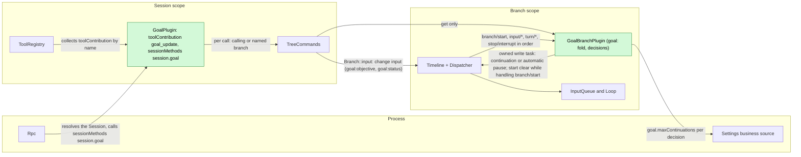
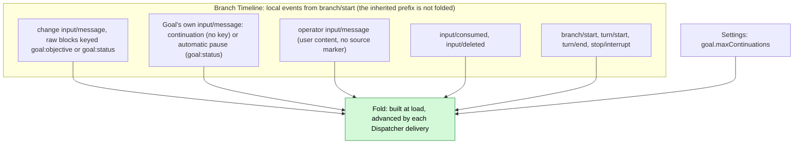
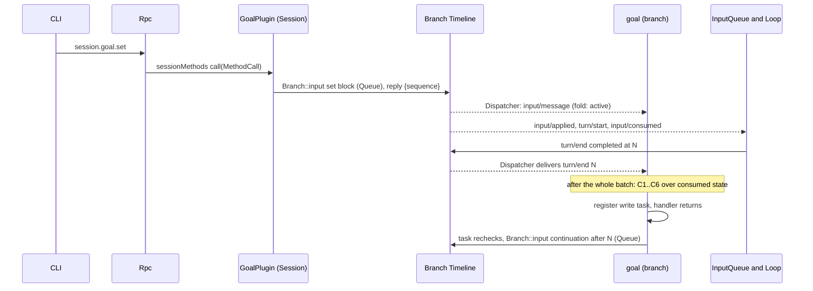
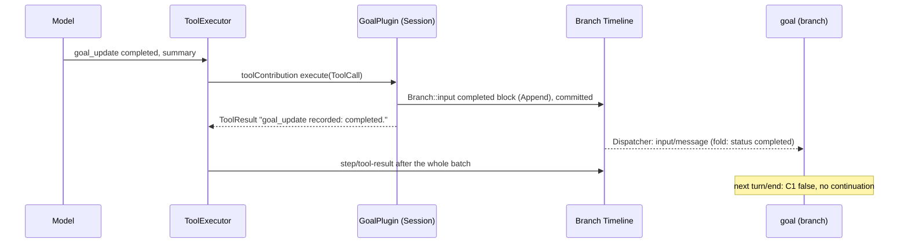
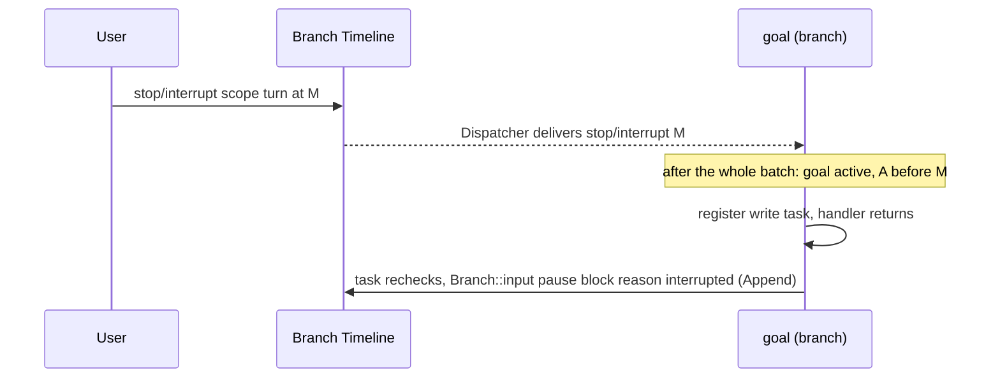
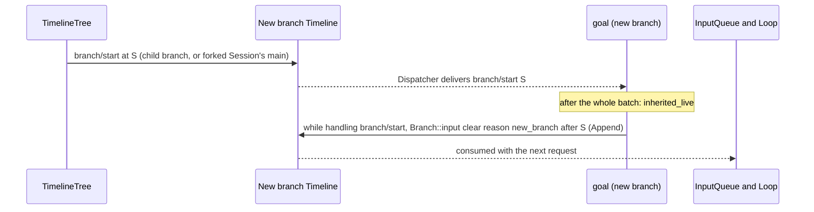
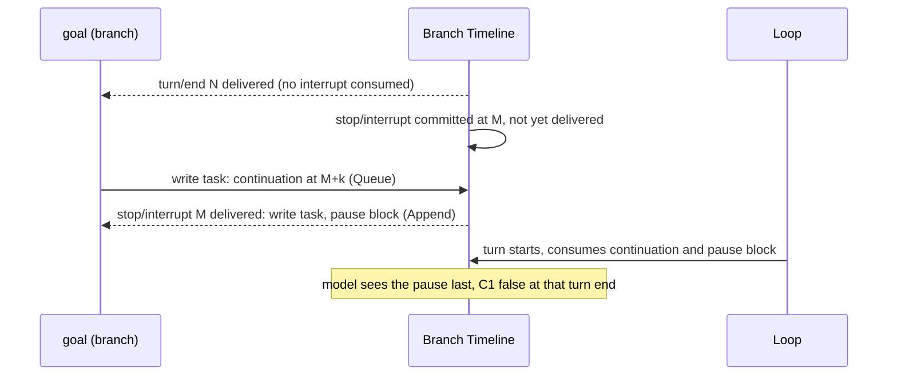

# Goal

Status: Draft. Overall design: [overview §4](../overview.md#4-plugin-catalog). Phase: P2. Language: TypeScript first ([overview Appendix C](../overview.md#appendix-c-implementation-language)). Scope: Session + branch ([ADR 002](../../adr/002-plugin-scope.md)).

Requirement ([feature list](../../feature-list.md), BranchScope Agent behavior): `/goal` sets, edits, pauses, resumes and clears a goal ("switch Goal mode"), and Goal continuation keeps working toward an explicit goal and records its completion or blockage.

Goal keeps a standing objective on a branch and continues the branch automatically until the model reports the objective completed or blocked, the user pauses, clears or interrupts, or a continuation limit is reached. Goal is an event-driven state machine on the branch. **Every change is one `input/message`** on the branch whose raw blocks carry one of two keys: `goal:objective` holds the objective and is written by `set` and `edit`; `goal:status` holds the status and is written by `set`, `pause` and `resume` from the user, `completed` or `blocked` from the model's `goal_update` tool, and Goal's own automatic pause; `clear` retires both keys. **A goal belongs to exactly one branch**: Goal's fold for branch `B` uses only the events written on `B` itself (its local suffix, from `B`'s `branch/start`), never the inherited prefix, so a child branch and the `main` branch of a forked Session start with no goal; when a new branch's inherited prefix still has a live goal key, Goal retires both keys with one `clear` it writes while handling that branch's `branch/start` ([§3.4](#34-a-new-branch-clears-the-inherited-goal)). Continuations carry no key and are not changes. The tool and the methods only write that event; they never read Goal's state and never decide whether the change is allowed. **Goal's state is the fold of the events Goal has consumed**, in sequence order, under fixed rules ([§2](#2-data-and-state)). The **branch part** owns that fold and decides continuation itself when its Dispatcher handler consumes `turn/end`, `stop/interrupt` or `input/deleted`, after the whole batch and from consumed state only; when a decision needs a write (a continuation or an automatic pause), the handler registers the write as owned work and returns. The **Session part** provides the `goal_update` tool as a `toolContribution` service (Session scope, key `goal_update`) and the `session.goal.*` methods through a `sessionMethods` service (Session scope, key `session.goal`) ([session-boundary](../contracts/session-boundary.md)); each call resolves the calling or named branch and writes through the branch's public input entry `Branch::input`, and only `session.goal.get` asks the branch part for its fold. Goal writes no events of its own type and has no separate "Goal mode": the presence and status of a goal, visible through `session.goal.get` and the goal blocks, cover the feature-list wording "switch Goal mode". Every contract here is language-neutral (service name, scope, key, methods with data shapes), so a TypeScript implementation satisfies it without a hand-written Rust binding; the Rust form is [Appendix G](#appendix-g-rust-binding). Goal also uses the runtime's typed services (`S:TreeCommands`, `B:Timeline`, `B:Dispatcher`); exposing them by name to non-Rust capability parts is the work of [#4](https://github.com/arcships/dim/issues/4) (requirement stated in [session access §9](../contracts/session-access.md#9-requirements-raised-to-mechanism-owners)), and Goal starts in Rust until then.

## 1. Structure

All model-visible effects are `input/message` facts consumed by the existing InputQueue and Loop.

| Part | Scope | Depends on | Provides |
| --- | --- | --- | --- |
| `GoalPlugin` | Session | `S:TreeCommands` | `toolContribution` key `goal_update`; `sessionMethods` key `session.goal`; writes change inputs through `Branch::input` |
| `GoalBranchPlugin` | Branch | `B:Timeline`, `B:Dispatcher`, Settings business source (enclosing scope) | `goal` (branch scope; `get` only), used only by the Session part; the fold, the continuation decision and Goal's own writes |

Both parts declare their services in the plugin's `provides` and are installed only in Sessions where Goal is enabled; ToolRegistry and Rpc collect them by name and scope. `goal.maxContinuations` is business configuration in the Settings business source ([ADR 002](../../adr/002-plugin-scope.md) D4): read at each decision, changed by a data update, never a reload. Goal reads only public data contracts of `branch/start`, `input/message`, `input/consumed`, `input/deleted`, `turn/start`, `turn/end` and `stop/interrupt`; it never reads another plugin's state.

## 2. Data and state

Goal owns no persistent state. The goal of branch `B` is a pure function of the local events of `B` consumed so far, from `B`'s own `branch/start` on; the inherited ancestor prefix (a child branch) or the copied facts (a forked Session's `main`, A11) precede that `branch/start` and never contribute a goal. The branch part folds the local events at load and advances the fold on each Dispatcher delivery. Compaction does not change it because the fold is built from events, not model context.

A change takes effect at the sequence of its `input/message`. A change that InputQueue later deletes (`input/deleted`) is removed and the fold is recomputed without it, because a deleted input never takes effect ([session access](../contracts/session-access.md#a2-source-input-conventions)). Fixed fold rules, applied in sequence order to `B`'s local events, with no exceptions: the current objective is the latest live local `goal:objective` block and the current status is the latest live local `goal:status` block, exactly the blocks compaction replays ([§5](#5-context-mapping)) once a new branch's inherited keys are retired by its start `clear` (§3.4), so the replay equals the fold (A16). A goal exists only while `goal:objective` is live. A status block written while no objective is live still becomes the current status, but `session.goal.get` reports no goal and C1 fails until an objective is live again:

| Change (`op` in the marker) | Written by | Keys | Effect on the fold |
| --- | --- | --- | --- |
| `set {objective}` | `session.goal.set` | `goal:objective`, `goal:status` (active) | Objective and status live: `objective`, `status = active`; count restarts |
| `edit {objective}` | `session.goal.edit` | `goal:objective` | Objective live: `objective` replaced; status stays the latest live `goal:status` block (`none` if no status is live, for example after `clear`) |
| `pause` (reason `user`) | `session.goal.pause` | `goal:status` | `status = paused (user)`, whatever it was |
| `resume` | `session.goal.resume` | `goal:status` | `status = active`, whatever it was (a `completed` or `blocked` goal reopens); count restarts; the Queue input drives a turn |
| `clear` | `session.goal.clear` | Both retired | No goal and no status |
| `clear` (reason `new_branch`) | Goal itself, on a new branch (§3.4) | Both retired | No goal and no status; retires the inherited keys in the model context |
| `completed` / `blocked {summary}` | `goal_update` | `goal:status` | `status = completed` / `blocked` with `summary`, whatever it was; a repeated report restates it. It changes only the fold of the branch written on |
| `pause` (reason `interrupted`, `limit`, `turn_failed`) | Goal itself | `goal:status` | `status = paused (reason)`; Goal writes it only after C1 held (A.4) |
| continuation (not a change) | Goal itself | None | Counted only: count + 1 |

Derived values over the consumed events:

| Field | Derivation |
| --- | --- |
| `goal` | `{objective, status, reason?, summary?}` while a local `goal:objective` block is live, or none; `status` is `none` when no local `goal:status` block is live |
| `A` | Sequence of the latest change that set `status = active` (`set` or `resume`) |
| `interrupted` | A `stop/interrupt {scope: turn}` in `B`'s local events with sequence greater than `A` |
| `inherited_live` | The prefix before `B`'s `branch/start` has a live `goal:objective` or `goal:status` block (§3.4) |
| `last_operator` | Latest operator input: `input/message` with `user` content not marked by a source (A5) |
| `count` | Goal continuation inputs (marker `kind="continuation"`, no key) with sequence greater than `max(A, last_operator)` |
| `decided` | For each `turn/end` sequence `N`, whether a Goal write marked `after="N"` exists (continuation or automatic pause) |
| `pending_driving` | Local `input/message` with effective mode Queue or Steer that has neither `input/consumed` nor `input/deleted` (session access §2 pending rule). Goal does not interpret `input/withdraw`, InputQueue's command; only InputQueue's result `input/deleted` removes an input |
| `turn_open` | A `turn/start` after the latest `turn/end` |

Runtime-only: the fold and the set of write tasks in flight, keyed by the sequence of the event that decided them. The Dispatcher handler advances the fold, decides, registers a write task when needed and returns; it awaits only the start `clear`, written while handling `branch/start` (§3.4). There is no worker, no lock shared with calls and no wait for a sequence. Both are rebuilt by the load fold; a new generation never inherits in-flight tasks (the old generation's tasks end with its unload).

## 3. Flows

### 3.1 Set and continue

The method does not read the fold; it writes and replies with the sequence of its input. The continuation is written by a task Goal owns; InputQueue and Loop consume it through their own subscriptions.

### 3.2 Completion through `goal_update`

The block commits before the batch's `step/tool-result`, so the status replayed after compaction is `completed`, the same as the fold, until a later status block replaces it. The tool confirms the write; the block becomes the current status by the fold rule, visible through the goal blocks and `session.goal.get`.

### 3.3 Interrupt pauses the goal

`scope: branch` interrupts are ignored: the branch is closing.

### 3.4 A new branch clears the inherited goal

The runtime fact is `branch/start`, the first local event of every new branch: a child branch's Timeline starts with it ([event-driven flows](../../architecture/rust-agent/event-driven-flows.md)), and a new Session's root branch, including a forked Session's `main`, starts with it after any copied facts (A11). When Goal handles `branch/start` at `S` and `inherited_live` holds, it writes one `clear` input (both keys retired, Append, `reason="new_branch" after="S"`) immediately, as part of handling `branch/start`, the way Prompt writes its initial configuration while handling it ([prompt](../../architecture/rust-agent/prompt.md)); there is no deferred task and no recheck. Nothing can precede it: a child branch appears in the public branch list and operation entries only after its `branch/start` is processed ([lifecycle](../../architecture/rust-agent/lifecycle.md)), so no client or user can write to it before the `clear`. Compaction then no longer replays the parent's goal, and the model on the new branch does not take it as its own. On restart the `clear` is already in the branch's own events, so the fold sees it.

## 4. Timing and conflicts

### 4.1 Interrupt committed before the continuation (at most one extra turn)

Decided by sequence: the decision and the task's recheck used only events consumed through `N`, so the continuation stands and the later pause block ends the goal. This extra turn is accepted (decision E18); Goal does not withdraw its continuation.

### 4.2 Reload

A reload of either part follows a rare structural operation. A Session part reload propagates to ToolRegistry like any contribution reload and may fail in-flight turns; this is an accepted cost ([ADR 002](../../adr/002-plugin-scope.md) D3). A branch part reload refolds; its unload ends in-flight write tasks. If the latest `turn/end` is not `decided` and the goal is active, the new generation takes that decision once (C4 and C5 deduplicate). A change committed before a reload stands, because it is a fact on the Timeline.

### 4.3 Other key rows

| Scenario | Sequence order | Outcome | Owner |
| --- | --- | --- | --- |
| User Queue/Steer input pending at decision | input < `turn/end` N, unconsumed | C5 fails: no continuation; the user's turn's end decides, count reset | Goal |
| Driving input deleted | input < `input/deleted` < N | Not pending; continuation proceeds | InputQueue; Goal |
| Driving input deleted after N (for example a prompt withdrawn by a Hook in its own batch) | input < N < `input/deleted` | C5 stopped at N; consuming `input/deleted` takes N's decision again; continuation if C1–C6 hold | InputQueue; Goal |
| Two `goal_update` calls in one batch | both blocks before `step/tool-result` | Both written, both results confirm the write; the fold applies both in order and the second is the current status | Goal |
| `resume` after `completed` or `blocked` | terminal block < resume | The goal reopens: `active`, count restarts, the Queue input drives a turn | Goal |
| Change withdrawn while held | change < `input/deleted` | Removed from the fold; the latest undecided or stopped decision is taken again | InputQueue; Goal |
| Child cut after the goal block | consumed < cut < `branch/start` | Child's fold has no goal; Goal writes the start `clear` (§3.4); no continuation; a `goal_update` or any change there affects only the child | Goal |

Full table: [Appendix B](#appendix-b-full-conflict-table).

## 5. Context mapping

| What the model sees | Form | Placement |
| --- | --- | --- |
| Each change | One `input/message` without `user` content whose first raw block is `<dim-goal kind="goal" op=... branch=...>`; `edit` keys it `goal:objective`, the status changes key it `goal:status`, `set` adds a second block keyed `goal:status`, and `clear` retires both keys with two blocks (A.5) | At its `input/consumed` position; Queue blocks start the turn they drive, Append blocks join the next request |
| Continuation | `input/message`, Queue, `<dim-goal kind="continuation" count=k limit=L after=N branch=...>`, no key; does not restate the objective | Start of the turn it drives |
| `goal_update` | Fixed tool declaration in the adopted `context/configured`; result in `ToolResult.content` | Tool-result position of its batch |

| Aspect | Rule |
| --- | --- |
| Compaction | The baseline replays the latest live block of each key verbatim, so the model sees the current objective (`goal:objective`) and the current status (`goal:status`); retired keys are not replayed; continuations and earlier blocks survive only through the summary |
| Child branches and forked Sessions | Inherit the blocks before the cut, which name their branch and tell delegated work not to call `goal_update`; Goal retires the inherited keys with one `clear` (reason `new_branch`) written while handling the new branch's `branch/start` (§3.4), so the new branch starts with no goal (A3) |
| Non-interactive Sessions | Same mapping; continuations drive turns without a user present |
| Never visible | `submissionId`, mode, count of operator inputs, the fold, diagnostics, other plugins' events |

Exact texts: [Appendix A.5](#a5-model-visible-texts).

## 6. Interfaces (summary)

| Interface | Kind | Purpose |
| --- | --- | --- |
| `goal_update {status, summary}` | `toolContribution` (Session, key `goal_update`), risk `session` | Model reports completion or blocking; writes one change input and confirms the write |
| `session.goal.set/edit/pause/resume/clear` | `sessionMethods` (Session, key `session.goal`) | User changes the goal; each writes one change input and replies with its sequence |
| `session.goal.get` | Same service | The fold of a branch and the sequence it covers; replaces any "mode" query (A8) |
| `goal` | Branch service, internal to Goal | `get` of the fold |
| `goal.maxContinuations` | Business configuration (Settings) | Continuation limit, read at each decision |

Details: [Appendix A](#appendix-a-interface-details).

## 7. Security

Goal writes only `input/message` under source `goal` on the branch it serves; resulting turns run under the Session's Permission and Approval policy, and a goal grants no authority. Users cannot forge goal blocks: `session.submit` accepts no raw blocks and the marker renderer escapes the objective and summary. `goal_update` is admitted under `session`. Diagnostics record Session id, branch id, decision and reason, never objective text.

## 8. Rule check

Rules: [principles §1 and §4](../../architecture/rust-agent/principles.md), [ADR 002](../../adr/002-plugin-scope.md) D1–D5.

| Rule | How this document complies |
| --- | --- |
| §4.1 Command events for others' state | Every change is an input Goal itself consumes; Goal never deletes or applies inputs, and it relies on InputQueue's `input/deleted` rather than reading `input/withdraw`. |
| §4.2 No recall after handoff | Goal never withdraws its continuation; a continuation applied after an interrupt runs one extra turn and the later pause block ends the goal. |
| §4.3 Only before callbacks, never block | Not applicable: Goal registers no before callback, and its tool and methods add no entry check (they write without deciding). |
| §4.4 No business meaning in core | Goal needs no change to Timeline, Dispatcher, InputQueue or Loop; its markers are ordinary raw blocks under two ordinary keys. |
| §4.5 Read the whole batch | The fold advances over every event, and decisions on `branch/start`, `turn/end`, `stop/interrupt` and `input/deleted` are taken after the whole batch, from consumed state only; owned write tasks recheck consumed state only before writing. |
| §4.6 Context only from handed-off events | Goal blocks and continuations reach the model only after adoption; deleted inputs never do and leave the fold. |
| §4.7 Public events and services only | Goal reads only public `branch/start`, `input/*`, `turn/*` and `stop/interrupt` contracts and writes through `Branch::input`. |
| §4.8 Requirements to mechanism owners | The only requirement, #4, is stated in [session access §9](../contracts/session-access.md#9-requirements-raised-to-mechanism-owners). |
| §4.9 Only facts later decisions use enter the Timeline | Each change input is both model context and an input to the fold, and Goal's own writes drive turns or end continuation; the fold is the latest live block of each key, which compaction replays (A16); the fold, in-flight tasks and diagnostics stay out of the Timeline. |
| §1 Capability and App Server boundary | Both parts are Capabilities in their own package; Rpc only dispatches `sessionMethods`. |
| ADR 002 D1 Scope | The tool and methods are Session services; the goal, its fold and its decisions are branch state. |
| ADR 002 D2 No wiring modules | ToolRegistry and Rpc collect Goal's services by name and scope; nothing names Goal. |
| ADR 002 D3 Scope dependencies | The branch part depends on branch services and the enclosing Settings source; reloads refold and are accepted. |
| ADR 002 D4 Configuration | `goal.maxContinuations` is business configuration read at each decision. |
| ADR 002 D5 Language-neutral contracts | Tool, methods, branch service and block formats are neutral; Appendix G is one binding. |

## 9. Requirements raised to mechanism owners

| Requirement | Owner | Five items |
| --- | --- | --- |
| Runtime services exposed by name to non-Rust capability parts | Runtime, [#4](https://github.com/arcships/dim/issues/4) | See [session access §9](../contracts/session-access.md#9-requirements-raised-to-mechanism-owners); Goal needs `S:TreeCommands`, `B:Timeline`, `B:Dispatcher` and `Branch::input` for a TypeScript implementation and starts in Rust until then |

## Appendix A. Interface details

### A.1 Tool `goal_update`

Service `toolContribution`, Session scope, key `goal_update`: `declaration(): sync -> ToolDeclaration` (name, the description in A.5, the parameter schema below, risk `session`); `execute(ToolCall): async -> ToolResult`; cancellation is a cancel request on the call.

| Item | Value |
| --- | --- |
| Parameters | `{status: "completed" \| "blocked", summary: string}`; `summary` 1..=2000 characters (A10) |
| Result | `ToolResult.content`: `goal_update recorded: completed.` or `goal_update recorded: blocked.` The result confirms the write only; the block becomes the current status by the fold rule (A15). Errors are parameter errors only |
| Risk category | `session` (writes only branch input) (A9) |
| Offered | In every Session where Goal is enabled, all roles (A9) |
| Handler | Validates the parameters, writes one change input (`op` = status, Append) on the calling branch through `Branch::input` via `S:TreeCommands`, awaits its commit, returns. It does not read the fold. On cancellation before the append nothing is written; once appended the write stands |

### A.2 Session methods

Service `sessionMethods`, Session scope, key `session.goal`. `describe()` returns one `MethodDecl` per row with `interruption: report`, `progress: false`, `notifications: []`, `reply: direct`, and `mutating: true` except for `get`. `call(MethodCall)` takes the params below and replies with the result as `MethodReply`; errors are `MethodError` data (Appendix C).

| Method | Params | Result | Write |
| --- | --- | --- | --- |
| `session.goal.set` | `{sessionId, branchId?, objective}` | `{sequence}` | `set`, Queue |
| `session.goal.edit` | `{sessionId, branchId?, objective}` | `{sequence}` | `edit`, Append (A1) |
| `session.goal.pause` | `{sessionId, branchId?}` | `{sequence}` | `pause` (reason `user`), Append |
| `session.goal.resume` | `{sessionId, branchId?}` | `{sequence}` | `resume`, Queue (A12) |
| `session.goal.clear` | `{sessionId, branchId?}` | `{sequence}` | `clear` (key retired), Append |
| `session.goal.get` | `{sessionId, branchId?}` | `{goal: GoalView \| null, through}` | None (A8) |

`branchId` defaults to `main` (A13). `GoalView = {status, objective, reason?, summary?, count, limit, sequence}`; `through` is the last sequence the fold has consumed, so a client sees the effect of its write once `through >= sequence`. The writing methods validate only their own parameters; what a change does is decided by the fold rules of §2 (each block becomes the current value of its key), never by the method. Rpc resolves the Session (restoring it if unloaded) and sends the call; the handler resolves the named branch through `S:TreeCommands`.

### A.3 Branch service `goal`

Branch scope, no key, provided by `GoalBranchPlugin` and called only by its Session part.

| Method | Request | Reply | Errors |
| --- | --- | --- | --- |
| `get` | `{}` | `{goal: GoalView \| null, through}` | — |

During unload `get` fails `service_reloading`.

### A.4 Continuation decision

After the whole atomic batch containing `turn/end` at sequence `N` on branch `B` is consumed, over the fold through that batch:

| # | Condition | If false |
| --- | --- | --- |
| C1 | A goal exists (a local `goal:objective` block live), `status = active` | Stop |
| C2 | `!interrupted` | Write pause (`interrupted`) and stop |
| C3 | The `turn/end` at `N` is `completed` | `failed`: write pause (`turn_failed`) (A6); `cancelled`: handled by C2 |
| C4 | `N` is the latest `turn/end`, `!turn_open` and `N` is not `decided` | Stop (a newer turn's end will trigger) |
| C5 | `!pending_driving` (includes Goal's own unconsumed continuation; excludes deleted inputs) | Stop |
| C6 | `count < maxContinuations` | Write pause (`limit`) and stop |
| — | All hold | Write continuation (Queue) with `count + 1` |

Delivery of `stop/interrupt` at `M` (`scope: turn`), after its whole batch: if C1 holds and `A < M`, write pause (`interrupted`).

Delivery of `input/deleted`, after its whole batch: refold without the deleted input; if the latest `turn/end` is not `decided`, take its decision again (C4 and C5 deduplicate).

Every write except the start `clear` (§3.4) is owned work: the handler registers a task keyed by the deciding sequence and returns. If a task for the same sequence is already in flight, nothing more is registered. Before writing, the task rechecks the same conditions over the fold as consumed at that moment ([time-bus](../../architecture/rust-agent/time-bus.md) §4) and writes nothing if they no longer hold; facts committed but not yet consumed are not read, and their consumers resolve them in sequence (§4.1). Goal's writes carry `after="N"` (or `after="M"`), so the fold records the decision and a reload does not repeat it.

Delivery of `branch/start` at `S`, after its whole batch: if `inherited_live`, write the start `clear` (reason `new_branch`, `after="S"`) while handling it, with no task and no recheck (§3.4).

### A.5 Model-visible texts

Each write is one `input/message` with no `user` content. Its first raw block is the marker `<dim-goal kind="..." ...>`, newline, escaped body, newline, `</dim-goal>` (A2); `set` and `clear` add a second block of the same form. One `InputWrite` carries any number of `RawBlock`s, each with its own key ([session access A.1](../contracts/session-access.md#a1-the-sessions-service)), so every change stays one input. A key-less continuation is not a change.

| Write | Blocks (key use) | Mode | Text |
| --- | --- | --- | --- |
| `set` | 1: `goal:objective` live; 2: `goal:status` live | Queue | 1: `<dim-goal kind="goal" op="set" branch="B">` / `Objective:` / `<objective>` / blank / `This is the user's standing goal for branch B. If you are working on a delegated sub-task started from branch B, treat this goal as background and do not call goal_update.` / `</dim-goal>`; 2: `<dim-goal kind="status" status="active" branch="B">` / `The goal for branch B is active. Keep working toward it across turns. When it is fully achieved, call goal_update with status "completed". If you cannot make progress without the user, call goal_update with status "blocked" and explain why.` / `</dim-goal>` |
| `edit` | `goal:objective` live | Append | `op="edit"`; `Objective:` / `<objective>` / blank / `The user set the objective of the goal for branch B. This does not change its status.` |
| `pause` (user) | `goal:status` live | Append | `op="pause" reason="user"`; `The user set the goal status for branch B to paused. Do not continue working toward a goal for branch B on your own; respond only to the user's latest input.` |
| `resume` | `goal:status` live | Queue | `op="resume"`; `The user set the goal status for branch B to active. If branch B has a goal objective, keep working toward it across turns; when it is completed or blocked, call goal_update.` |
| `completed` / `blocked` | `goal:status` live | Append | `op="completed"` or `op="blocked"`; `Result:` or `Blocker:` / `
` / blank / `goal_update set the goal status for branch B to completed.` or `... to blocked.` + ` Do not continue working toward a goal for branch B on your own.` |
| `clear` | 1: `goal:objective` retire; 2: `goal:status` retire | Append | 1: `op="clear"`; `The previous goal was cleared by the user. Disregard it.`; 2: `<dim-goal kind="status" status="cleared" branch="B">` / `The goal for branch B has no status.` / `</dim-goal>` |
| `clear` (Goal, new branch) | Same as `clear` | Append | 1: `op="clear" reason="new_branch" after="S"`; `Any goal above belongs to another branch, not to branch B. Disregard it; branch B has no goal.`; 2: same as `clear` |
| pause (Goal) | `goal:status` live | Append | `op="pause" reason="interrupted\|limit\|turn_failed" after="N"`; `The goal is paused (<reason phrase>). Do not continue working toward it on your own; respond only to the user's latest input.` |
| continuation | none | Queue | `<dim-goal kind="continuation" count="k" limit="L" after="N" branch="B">` / `Continue working toward the active goal for branch B. If it is completed or blocked, call goal_update. If you are working on a delegated sub-task started from branch B, do not call goal_update.` |

Status blocks state only the status and the objective is a separate block, so a status block replayed while no objective is live claims no goal; `set` and Goal's pauses are written only together with or under a live objective. Reason phrases: `interrupted` "the user interrupted the turn", `limit` "the automatic continuation limit was reached", `turn_failed` "the last turn failed". Tool declaration description: "Report that the current goal is completed or blocked."

### A.6 Timeline mechanics

| Step | Path |
| --- | --- |
| Load | Subscribe to the Dispatcher (`"Goal"`), fix `S = committed()` under the gate, fold the local events through `S`, set `rebuilt = S`, provide `goal`. If the latest `turn/end` is not `decided` and the goal is active, take its decision once |
| Consume | The Dispatcher handler skips `sequence <= rebuilt`, advances the fold, and after each whole batch decides on `branch/start`, `turn/end`, `stop/interrupt` and `input/deleted` (A.4); it writes the start `clear` while handling `branch/start` and otherwise registers a write task when needed and returns without awaiting |
| Write | `input/message` with source `goal`, `submissionId: "goal:<uuid>"`, marker and mode, written through `Branch::input`, the branch's public input entry, which validates at the boundary and appends the `input/message` ([interrupt](../../architecture/rust-agent/interrupt.md)). The Session part's calls write the same way and never consult the fold |
| Consumption | InputQueue appends `input/applied`; Loop appends `input/consumed`. Goal never writes Steer |
| Recheck | The write task rechecks over consumed state only ([time-bus](../../architecture/rust-agent/time-bus.md) §4); later facts precede the write in sequence and are resolved by InputQueue, Loop and the fold |
| Unload | The unload disposer ends the subscription and the in-flight write tasks; a task cancelled before its append writes nothing |
| Restart, Session restore | Same as load; a committed unconsumed continuation is restored with the Session |

## Appendix B. Full conflict table

| Scenario | Sequence order | Outcome | Owner |
| --- | --- | --- | --- |
| User Queue input while a goal turn runs | input < `turn/end` N, unconsumed | C5 fails; the user's turn runs; its end continues with count reset | Goal, InputQueue |
| User input committed after N, before the continuation | N < input < continuation | Both run in order: user turn, then continuation turn; count reset | InputQueue, Loop |
| User input after the continuation | continuation < input | Continuation turn first; Queue next; Steer joins the continuation turn | InputQueue, Loop |
| Steer during a goal turn | consumed in turn | Same turn; resets count if operator input (A5) | Loop; Goal |
| Steer after `turn/end`, before its delivery to Goal | `turn/end` < steer | Steer starts a turn; C4 or C5 fails at a later decision; that turn's end decides | Goal |
| Append input while idle | — | Not driving; continuation proceeds; Append consumed with its first request | Loop |
| Driving input deleted before N | input < `input/deleted` < N | Excluded from `pending_driving`; continuation proceeds | InputQueue; Goal |
| Driving input deleted after N | N < `input/deleted` | C5 stopped at N; consuming `input/deleted` takes N's decision again: continuation if C1–C6 hold | Goal |
| Prompt withdrawn by a Hook in its own batch, `input/deleted` after N | input + `input/withdraw` < N < `input/deleted` | Same as above: Goal ignores the command and re-decides on InputQueue's `input/deleted` | InputQueue; Goal |
| Goal's own continuation withdrawn by the user while held | continuation < `input/deleted` | Never applied or consumed, not pending, removed from the fold (N no longer `decided`); the next decision may continue again | Goal |
| Change withdrawn by the user while held (e.g. a `pause`) | change < `input/deleted` | Refold without it; the latest `turn/end` is decided again if not `decided` | InputQueue; Goal |
| Other source's Queue follow-up after the same `turn/end` (e.g. Hooks) | both after N | Two turns in order; at most one continuation per `turn/end`; that input does not reset the count unless it is operator input | InputQueue; Goal |
| Interrupt before N | interrupt < N | C2: pause (`interrupted`), no continuation | Goal |
| Interrupt between N and the continuation | N < interrupt < continuation | One extra turn; then the pause (E18) | Loop; Goal |
| Interrupt after the continuation started its turn | consumed < interrupt | Turn cancelled; pause | Loop; Goal |
| Interrupt after apply, before consumption | applied < interrupt | Continuation pending; pause after it; the next driving input consumes both, model sees the pause last | Loop; Goal |
| Interrupt during `goal_update` after its write | block < interrupt | Fold `completed`/`blocked`; the interrupt finds no active goal: no pause | Goal |
| Interrupt during `goal_update` before its write | interrupt < handler write | Handler cancelled, no write; goal paused by the interrupt | ToolExecutor; Goal |
| Resume vs a later-delivered interrupt | interrupt M < resume | `A > M`: not `interrupted`, no pause | Goal |
| Branch-scoped interrupt or branch close | close < write | Nothing written; branch part ends | Runtime facade |
| Tool batch not settled | terminal block < `step/tool-result` | Block consumed after the batch result; `turn/end` sees a non-active goal | ToolExecutor, Loop |
| Two `goal_update` calls in one batch | first < second | Both written, both confirm the write; the fold applies both in order, so the second is the current status | Goal |
| `goal_update` while the goal is not active | — | Written; the block becomes the current status (a `paused` goal becomes `completed` or `blocked`); with no live objective `get` reports no goal; the result confirms the write | Goal |
| `completed` after `blocked`, the reverse, or `pause` after either | first < second | Latest wins; a repeated report restates the status with its new summary | Goal |
| `resume` after `completed` or `blocked` | terminal block < resume | Reopens: `active`, count restarts, the Queue input drives a turn; compaction replays the resume block | Goal |
| `goal_update` vs `edit`/`clear`/`pause` | sequence order | The fold applies them in sequence; a later change overrides an earlier one | Goal |
| `pause` or `resume` without a goal | — | Written; the status key goes live and compaction replays it, but `get` reports no goal and C1 fails; `resume` still drives one turn, with no continuation | Goal |
| `edit` without a goal | — | The objective goes live, so a goal exists with the latest live status (`none` after `clear`); continuation follows only if that status is `active` | Goal |
| Compaction between a goal write and its consumption | write < compaction < consumed | Block delivered at its consumed position after the summary; later baselines replay it | History projection |
| Compaction after several goal blocks | — | Only the latest `goal:objective` block and the latest `goal:status` block replayed; continuations are not; the fold reads events | History projection; Goal |
| Child cut between a goal write and its consumption | write < cut < consumed | Child does not adopt it; the child's fold has no goal; if a goal key is live in its prefix, Goal writes the start `clear` (§3.4) | InputQueue (child); Goal |
| Child cut after consumption | consumed < cut < `branch/start` | Child's fold has no goal; Goal writes the start `clear`; no continuation; a `goal_update` there affects only the child (A3) | Goal |
| Goal set on a child branch | — | The child's own keys and fold; the parent is unaffected | Goal |
| Local change committed before the start `clear` | — | Cannot happen: a child branch is published only after its `branch/start` is processed, and Goal writes the `clear` while processing it | Branch lifecycle; Goal |
| Any change on a child branch (`edit`, `pause`, `goal_update`) | — | Affects only the child's fold, which starts with no goal; the parent is unaffected (A3) | Goal |
| Session fork | facts copied < `branch/start` | Fork's `main` starts with no goal; Goal writes the start `clear` if a copied goal key is live (A11) | Goal |
| Branch part reload or restart after `branch/start` | — | No second `clear`: it is already in the branch's own events and the fold sees it | Goal |
| Branch part reload or restart after an undecided `turn/end` | — | Load takes the decision once; `decided`, C4 and C5 deduplicate | Goal |
| Branch part unload with a write task in flight | — | Task ends; if it had not appended, the new generation decides again at load | Goal |
| Session part reload during `goal_update` or a goal turn | — | Propagates like any contribution reload; in-flight turn may fail (pause `turn_failed` at its end); committed change stands (D3) | ToolRegistry; Goal |
| Session idle unload | — | Parts unload with the Session; a method call restores it; restore refolds | AgentIndex; Goal |
| Session close | — | Methods return `session_closed` | Rpc |
| Duplicate `resume` | — | Two Queue inputs, two turns; each sets `active` and restarts the count | Goal (A12) |
| Duplicate `set` | — | Each sets a new goal; count restarts | Goal (A12) |
| Turn failed | `turn/end {failed}` | Pause (`turn_failed`) (A6) | Goal |
| Limit reached | count = limit | Pause (`limit`) | Goal |
| Resource node offline | calls on the node fail | Goal uses no node service: inputs commit and turns run; workspace tool calls fail `node_unavailable` as tool errors; nothing reloads or goes Pending ([overview §6.3](../overview.md#63-multiple-nodes)) | Goal; WorkspaceTools |
| Client detach | — | No effect | — |

## Appendix C. Errors and recovery

| Error code | Cause |
| --- | --- |
| `invalid_params` | Empty or oversize objective or summary (A10), malformed branch id |
| `session_closed`, `branch_missing` | Session or branch gone |
| `service_reloading` | Goal reloading; the write did not happen, or it committed and `get` shows its effect |
| `unknown_method` | Goal not enabled in this Session |

State errors such as "no goal" or "not active" do not exist: every change is written and becomes the current value of its key; a status written while no objective is live leaves `get` reporting no goal. Goal never retries a write on its own. Process exit leaves only committed facts; the next load refolds them.

## Appendix D. Acceptance

Flow tests through Session methods, the `goal_update` tool and Timeline events (fake model):

1. Set on an idle branch starts a turn; normal end writes a continuation; `goal_update completed` ends continuation; the completed block precedes the batch's `step/tool-result`.
2. Limit: with `maxContinuations = 2`, the third decision writes the pause (`limit`); operator input resets the count; a marked input from another source does not.
3. Interrupt rows: before `turn/end`, committed between `turn/end` and the continuation (at most one extra turn), after start, after apply; during `goal_update` before and after its write.
4. Pending Queue/Steer input suppresses continuation; Append does not; a deleted input does not suppress it; an input deleted after the `turn/end` it suppressed triggers that decision again; a withdrawn `pause` is removed from the fold.
5. Branch part reload and restart after an undecided `turn/end`: exactly one decision; a reload with a write task in flight yields exactly one write.
6. Compaction after `completed`: the baseline contains `completed`, not `active`, and `get` reports `completed`. After compaction the baseline contains the latest `goal:objective` block and the latest `goal:status` block; a continuation is not replayed.
7. Child branch created after a goal is set on the parent: the child's `get` reports no goal from its first event, Goal writes exactly one start `clear` and the child's context after it shows no parent goal as its own, and there is no continuation; a reload or restart of the child writes no second `clear`; a `goal_update` or `set` on the child changes the child's `get` only, never the parent's. A forked Session's `main`: the same, with no goal and one start `clear`.
8. Unloaded Session: `session.goal.pause` restores it and writes. Goal not enabled: `unknown_method`. Changing `goal.maxContinuations` takes effect at the next decision without reloading Goal.
9. Two `goal_update` calls in one batch both return the confirmation and the fold shows the second status; `pause` and `resume` without a goal write a block that compaction replays while `get` reports no goal; `edit` without a goal makes a goal exist with the latest live status; the tool and the methods never read the fold (tested by writing while the branch part is reloading).
10. `edit` (only `goal:objective` changes), `clear` (both retired keys not replayed), forged `</dim-goal>` in an objective or summary is escaped; `session.goal.get` reflects every status and `through` reaches each write's `sequence`.
11. Set → `completed` → `resume`: the goal reopens (`active`, count restarted), the resume input drives a turn and its normal end writes a continuation; a compaction after the resume replays the resume block and `get` reports `active`.
12. Set → `completed` → `blocked`: `get` reports `blocked` with the second summary; a compaction after each status change replays the same status `get` reports.

## Appendix E. Assumptions

| # | Assumption | Basis | Effect if rejected |
| --- | --- | --- | --- |
| A1 | `set`, `resume` and the continuation use Queue; `edit`, `pause`, `clear`, `goal_update` and Goal's pauses use Append | Judgment (overview fixes Queue only for continuation); a method cannot know the status, so `edit` never starts a turn | Set would not start work on an idle branch, or pause would start a turn |
| A2 | Exact block formats and texts in Appendix A.5; the objective and the status are separate keys (`goal:objective`, `goal:status`), `set` and `clear` write both in one input, and continuations carry no key | Judgment; [session access A.1](../contracts/session-access.md#a1-the-sessions-service) lets one input carry several keyed raw blocks | Text and parsing change together; with one key, compaction would replay only the latest change and lose the objective after a status change |
| A3 | A goal belongs to exactly one branch: the fold uses only the branch's local events, and a new branch retires live inherited goal keys with one start `clear` | User decision | Child branches would continue or complete the parent's goal, or the model there would take the parent's goal as its own |
| A4 | `goal.maxContinuations` default 20, range 1..=1000 | Judgment | Different default |
| A5 | Count restarts on `set`, `resume` and operator input only: `user` content and no source marker as first raw block | Judgment | Another plugin's automatic input would reset the limit |
| A6 | A failed turn pauses the goal (`turn_failed`) | Judgment (avoid retry loops on provider errors) | Failed turns would continue and consume the limit |
| A7 | Pause does not interrupt the running turn | Judgment | Pause would also call `stop` |
| A8 | `session.goal.get` is the status query that replaces a "Goal mode" | Decision E18; decisions §3 (no Goal mode) | CLI derives status by parsing Goal's blocks |
| A9 | `goal_update` risk `session`, offered to all roles | Judgment | Tool hidden for some roles or admitted under another category |
| A10 | Objective ≤ 4000 characters, summary ≤ 2000 | Judgment | Other limits |
| A11 | A forked Session's `main` starts with no goal; its `branch/start` follows the copied facts, as for any new Session's root branch ([prompt](../../architecture/rust-agent/prompt.md)) | User decision; the position of `branch/start` after the copied facts is a judgment, since the fork copy is not yet specified | The copied goal blocks would count as the fork's own events, so the fork would keep the source's goal |
| A12 | `resume` always drives one turn (reopening a completed or blocked goal, or restarting an active idle one); duplicate `set` and `resume` are not deduplicated | Judgment; a method cannot see `turn_open` or pending inputs | Restarted goals need `set` again, or duplicate resumes would need state reads |
| A13 | `branchId` defaults to `main`; any branch may hold its own goal | Judgment | Goal limited to `main` |
| A14 | A change takes effect at its `input/message` sequence and is removed from the fold when InputQueue deletes it | Judgment: a pause written during a turn must stop that turn's continuation before the Append is applied | Changes would take effect at `input/applied`, and a pause written during a turn would not stop its continuation |
| A15 | A second `goal_update`, or one without an active goal, returns the write confirmation, not an error, and its block becomes the current status (A16) | Decision G1 (behaviour change; answers the PR review "Goal calls observe earlier committed writes" by removing caller-side decisions) | The tool would have to read the fold and wait for it, which reintroduces caller-side decisions |
| A16 | The fold has no exceptions: the latest live local block of each key is the current objective and status, and a goal exists only while a local `goal:objective` block is live | User decision (answers the PR review "Keep replayed Goal status consistent with the fold") | A status replayed after compaction could disagree with `get` |

## Appendix F. Open questions

| Question | Description |
| --- | --- |
| `edit` of an active idle goal | `edit` is Append (A1) and starts no work on an idle branch; the user resumes to restart. A Goal-side rule that starts a continuation on consuming an `edit` is possible if users need it |

## Appendix G. Rust binding

Goal is TypeScript first; a Rust implementation (or a Rust start before #4) binds the neutral contracts as follows.

| Neutral contract | Rust binding |
| --- | --- |
| `toolContribution` key `goal_update` | `S:ToolContribution`, collected by ToolRegistry as `Contributions<ToolContribution>` entry `goal_update`; cancel request = batch `CancellationToken`; `cancelled` = `HostError::Cancelled` |
| `sessionMethods` key `session.goal` | `SessionMethodContribution(Arc<dyn MethodProvider>)`, key `SessionScope::named_key::<SessionMethodContribution>("session.goal")`; `describe` = `methods()`, `call` = `call(MethodCall, CallChannel, CancellationToken)` |
| `goal` | `B:Goal`, key `BranchScope::key::<Goal>()`, `get` returning the fold |
| Keys | `const OBJECTIVE_KEY: &str = "objective"` and `const STATUS_KEY: &str = "status"`, written as `KeyUse::Live(name)` / `KeyUse::Retire(name)` and stored as `goal:objective` / `goal:status`; continuations carry no `KeyUse` |
| Unload disposer | `ctx.effect` |
| Write task | A task registered on the branch part's `ctx` by the Dispatcher handler, keyed by the deciding sequence; ended by unload |
| Writes | `Branch::input` through `S:TreeCommands`, from the Session part's calls and from the write tasks |
