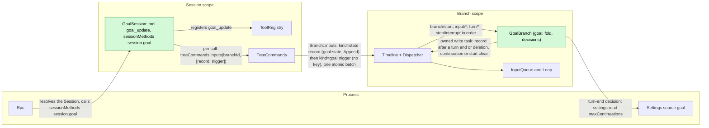
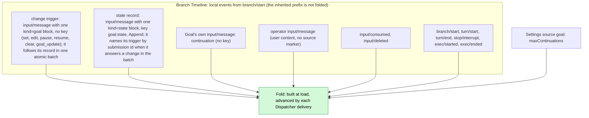
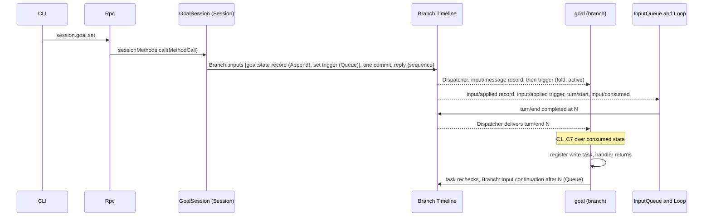
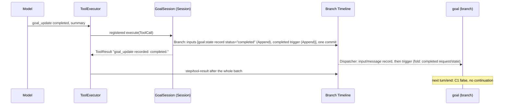
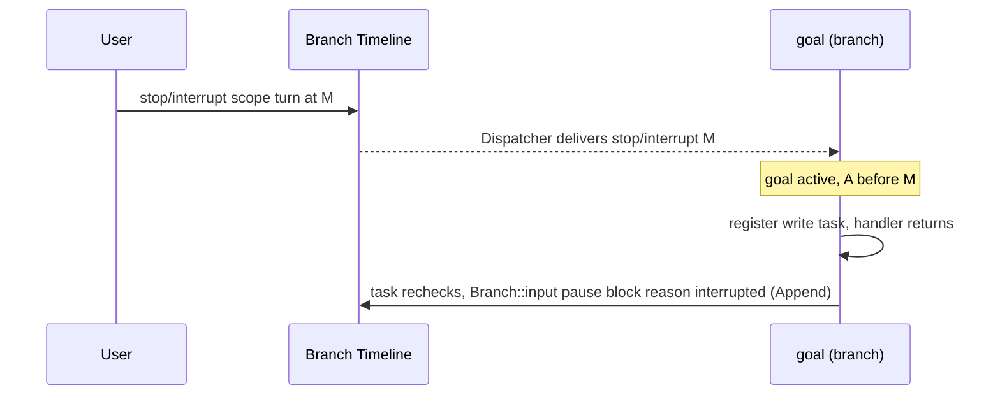
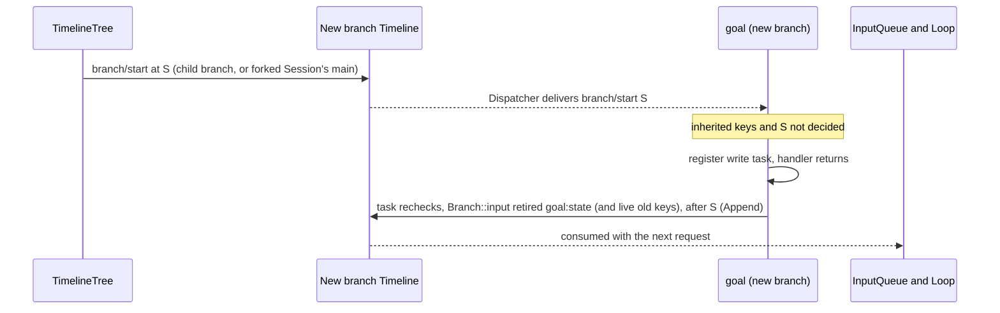
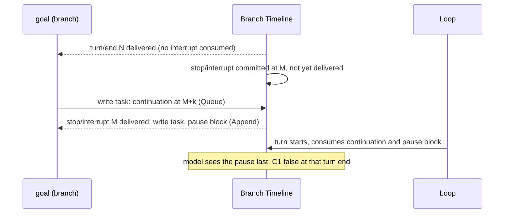

# Goal

Overall design: [overview §4](../overview.md#4-plugin-catalog). Phase: P2. Language: Rust ([overview Appendix C](../overview.md#appendix-c-implementation-language)). Scope: Session + branch ([ADR 002](../../adr/002-plugin-scope.md)). Depends on ([roadmap](../roadmap.md) P5): C1, C3, C4, C5, S1, S8b ([#118](https://github.com/arcships/dim/issues/118)).

Requirement ([feature list](../../feature-list.md), Branch Agent behavior): `/goal` sets, edits, pauses, resumes and clears a goal ("switch Goal mode"), and Goal continuation keeps working toward an explicit goal and records its completion or blockage.

Goal keeps a standing objective on a branch and continues the branch automatically until the model reports the objective completed or blocked, the user pauses, clears or interrupts, or an explicit continuation limit is reached. Goal is an event-driven state machine on the branch. **Goal's state is one `goal:state` block** on the branch: an ordinary `input/message` with one keyed raw block, Append, written only by Goal's branch part, so the model, the clients and the fold read the same fact (§2, A.5). **A change is a trigger, not a state statement**: `set`, `edit`, `pause`, `resume` and `clear` from `session.goal.*` and `completed` / `blocked` from the model's `goal_update` tool each commit one atomic batch of two inputs — the state record that answers it, then the trigger — through `treeCommands.inputs`, which is `Branch::inputs`; the trigger is one keyless block that says what was asked, and Goal writes every trigger's record into that same batch, immediately ahead of it. A history written before the record carries the old keys `goal:objective` and `goal:status` and is folded by the old rules; the first answered trigger on it writes a record. **A goal belongs to exactly one branch**: Goal's fold for branch `B` uses only the events written on `B` itself (its local suffix, from `B`'s `branch/start`), never the inherited prefix, so a child branch and the `main` branch of a forked Session start with no goal; a new branch whose inherited prefix still has a live goal key retires it with one start clear of its own ([§3.4](#34-a-new-branch-clears-the-inherited-goal)). Continuations carry no key and are not changes. The tool and the methods only write a trigger; they never read Goal's state and never decide whether the change is allowed. **Goal's fold is the state the newest record states**, in sequence order, under fixed rules ([§2](#2-data-and-state)). The **branch part** owns that fold and decides continuation itself when its Dispatcher handler consumes `turn/end`, `stop/interrupt` or `input/deleted`, from consumed state only; when a decision needs a write (a continuation or an automatic pause), the handler registers the write as owned work and returns. The **Session part** registers the `goal_update` tool with the Session's `toolRegistry` and provides the `session.goal.*` methods by registering the namespace `session.goal` with the Session's `sessionMethods` ([session-boundary](../contracts/session-boundary.md)); each call commits its record and trigger as one atomic batch to the calling or named branch by id through `treeCommands.inputs`, which is `Branch::inputs`, the branch's public multi-input entry. No call reads the fold: the Session part never asks the branch part for anything, and a Session part cannot depend on a per-branch service (ADR 002 D3). Goal writes no events of its own type and has no separate "Goal mode": the presence and status of a goal, visible through the live goal blocks on the branch (§6), cover the feature-list wording "switch Goal mode". Every contract here is language-neutral (service name, scope, key, methods with data shapes, tool registration); the Rust binding is [Appendix G](#appendix-g-rust-binding). Goal uses the runtime's services through their public Rust exports: `TreeCommands` and `ToolRegistry` in the Session part, and `Dispatcher`, `Timeline`, `TimelineIdentity` and `TreeCommands` in the branch part.

## 1. Structure

All model-visible effects are `input/message` facts consumed by the existing InputQueue and Loop.

| Part | Scope | Depends on | Provides |
| --- | --- | --- | --- |
| `GoalSession` | Session | `TreeCommands`, `ToolRegistry`, `SessionMethods`, `GuideEntries` (Session exports) | Registers `goal_update` with `ToolRegistry` and `session.goal` with `SessionMethods`; commits each change as one atomic batch (the record, then the trigger) by branch id through `TreeCommands::inputs` |
| `GoalBranch` | Branch | `Dispatcher`, `Timeline`, `TimelineIdentity`, `BranchLifecycle` (branch exports), `SessionLifecycle` (Session export, for the load reconcile), `TreeCommands`, process service `SettingsService` (S8b) for its source `goal` | No service; it owns the fold, the continuation decision and Goal's own writes |

The Session part registers its tool with `ToolRegistry` and its method namespace `session.goal` with `SessionMethods` from its apply. The branch part provides nothing; registered as a branch definition, it has a copy in every branch (C5). Every Session of an assembly that installs Goal runs Goal's Session part, so every such Session has `session.goal` once that part is active ([session-boundary A.1](../contracts/session-boundary.md#a1-method-contributions)). `maxContinuations` is an optional field of the document in Goal's Settings source `goal`, business configuration ([ADR 002](../../adr/002-plugin-scope.md) D4). Goal reads it only through the process service `settings` of S8b ([settings service](../appserver/settings-service.md)): `SettingsService::read_declared` at each use, through its public Rust binding. Goal's row registers the source in its `apply` as S8b §3.1 specifies: `source: "goal"`, a user file, no project file (user scope only), no user-only fields, and a JSON Schema in which `maxContinuations` is an integer with `minimum: 1` and `maximum: 1000`, with no default (A4). An absent field means no limit; `null` is not a value. Settings validates on write and when reading a persisted file, so Goal uses the document as delivered; a change is a data update, never a reload. The Dispatcher callback registers owned work and returns without awaiting Settings. After branch publication, each turn-end task reads `settings.read {source: "goal", scope: "user"}` at use, then rechecks its deciding turn and the current consumed fold before writing (A.6). There is no cached limit or `settings.changed` listener. Changes committed before that read are visible without a reload, including direct user-document edits in the file-backed Settings profile. An unreadable source stops that decision without an automatic input or fallback limit (Appendix C). Interrupt pauses and the inherited start clear do not need the limit. No Goal tool writes it; clients write it through `settings.read`/`settings.update`. Goal reads only public data contracts of `branch/start`, `input/message`, `input/consumed`, `input/deleted`, `turn/start`, `turn/end`, `stop/interrupt`, `exec/started` and `exec/ended`, plus one bounded `step/tool-call` page for the ending turn at a turn-end decision (A.4 C7); it never reads another plugin's state.

## 2. Data and state

Goal owns no persistent state of its own type. The goal of branch `B` is the state the newest live `goal:state` block of `B`'s local events states, or, on a history written before that record existed, the two old keys folded by the rules below. Only Goal's branch part writes the record. It is an ordinary `input/message` with one raw block keyed `goal:state` and mode Append, so the model, the clients and Goal's fold read the same fact: the model through `render_input`, the clients through the branch history or the generic keyed projection, and the fold through its Dispatcher subscription. No rule or ADR is special-cased for it: the block enters model context as an adopted input like any other, and compaction replays it through the keyed baseline like any other key.

A **change** is a trigger, not a state statement. `session.goal.set/edit/pause/resume/clear` and `goal_update` commit one atomic batch of two inputs through `TreeCommands::inputs` (`Branch::inputs`): the state record that answers the change, then the trigger, whose single raw block is keyed `kind="goal"` and says what was asked (A.5), in the trigger's own mode. The record goes first, so InputQueue applies it before the trigger whatever the scheduling: the trigger's turn starts with the record already applied. The branch part composes the record under its write lock, once the fold has stepped Goal's own last write, so the record states the change against the state that precedes it. The record names the trigger by submission id in `trigger="goal:<uuid>"` instead of `after` (A.5); the fold holds such a record for one event and, when the next event is the named trigger, applies the change and then the record at the trigger's sequence (A14). A snapshot for a given `after` is written once. A trigger left without its record — a history written by an earlier build, or a trigger written outside the batch — is answered once at load (§4.2). A change trigger that InputQueue deletes never took effect: the fold is recomputed without it and, whenever a record naming that trigger or any later record has been written or is being written, Goal writes one compensating record whose `after` is the `input/deleted` sequence, stating the state the branch has without the trigger. Whether such a record exists is decided under the write lock, so a record that commits while the deletion is folded is superseded by the compensation and never becomes the newest live record.

The fold applies a change at the sequence of its `input/message`, and the batch's record at that same sequence (A14), so no decision sees the trigger without its record. It ignores a record whose `after` names a deleted change, one older than the newest change it folded, and one older than the newest record it applied; Goal never composes a record whose `after` is lower than one it already wrote, so the newest live record states the newest state whatever order the writing tasks commit in. The **model** learns a change at the first request the change affects: the record commits ahead of the trigger in one atomic batch and InputQueue applies inputs in sequence order, so the first request that carries the trigger already carries its record before it. A Queue command still drives its own turn (A14). A change that InputQueue later deletes (`input/deleted`) is removed and the fold is recomputed without it ([session access](../contracts/session-access.md#a2-source-input-conventions)).

**Old histories.** A branch whose newest Goal block is an old `goal:objective` or `goal:status` block is folded by the pre-record rules below, unchanged, and no record is backfilled at load. The first change trigger answered on that branch writes a `goal:state` record, after which the record is the state in force; the same input retires the old keys the branch still holds live, so from then on the branch holds only `goal:state` — a compaction baseline copied after it carries no stale old block, and `session.keys` lists one key. Clients fall back the same way (§6). The fallback is kept for histories written before the record; it goes when none are left to read.

A goal exists only while an objective is live. Under the evaluator judge of [Pursuit](Pursuit.md) a worker's `completed` is a request, not a status change (A16): the record Goal writes after it still states `active`, so the model and the clients need no exception of their own.

| Change (`op` in the marker) | Written by | Trigger block | Record the fold states |
| --- | --- | --- | --- |
| `set {objective, judge?}` | `session.goal.set` | `op="set"`, the objective in its body, `judge="evaluator"` when chosen | `status = active`, the objective, `judge`; count restarts |
| `edit {objective}` | `session.goal.edit` | `op="edit"`, the objective in its body | The objective replaced, `judge` and the status kept (`none` if the goal has no status) |
| `pause` (reason `user`) | `session.goal.pause` | `op="pause" reason="user"` | `status = paused (user)`, whatever it was |
| `resume` | `session.goal.resume` | `op="resume"` | `status = active`, whatever it was (a `completed` or `blocked` goal reopens); count restarts; the Queue input drives a turn |
| `clear` | `session.goal.clear` | `op="clear"` | No goal, no status and no `judge` (a retired record) |
| `clear` (reason `new_branch`) | Goal itself, on a new branch (§3.4) | — | A retired record; the same input also retires the old keys the inherited prefix left live |
| `completed` / `blocked {summary}` | `goal_update` | `op="completed"` / `op="blocked"`, the summary in its body | `status = completed` / `blocked` with the summary. Under [Pursuit](Pursuit.md)'s evaluator judge a worker `completed` is a request and leaves the status unchanged (A16) |
| `pause` (reason `interrupted`, `limit`, `turn_failed`, `no_progress`, `evaluation_failed`) | Goal itself | — | `status = paused (reason)`; Goal writes it only after C1 held (A.4), naming the deciding fact in `after` |
| continuation (not a change) | Goal itself | — | Counted only: count + 1; its `idle` states the C7 streak |

Derived values over the consumed events:

| Field | Derivation |
| --- | --- |
| `goal` | `{objective, status, reason?, summary?}` while the newest live state record states an objective (or, on an old history, while a local `goal:objective` block is live), or none; `status` is `none` when the record states none |
| `A` | Sequence of the latest change that set `status = active` (`set` or `resume`) |
| `inherited` | No local goal block exists yet and the prefix before `B`'s opening has a live `goal:state` block or a live old key, per key (§3.4) |
| `last_operator` | Latest operator input: `input/message` with `user` content not marked by a source (A5) |
| `count` | Goal continuation inputs (marker `kind="continuation"`, no key) with sequence greater than `max(A, last_operator)` |
| `idle` | The `idle` attribute of the latest continuation after `max(A, last_operator)`: the number of consecutive continuation-driven turns without a `step/tool-call` ending at the turn that continuation follows; zero when no such continuation exists or the attribute is absent (C7). The ending turn's own tool-call answer is queried at decision time, not folded. An evaluated continuation states zero: it does not advance C7 (Pursuit §5) |
| `decided` | For each `turn/end` sequence `N`, whether a Goal write marked `after="N"` exists (continuation or state record), or, under [Pursuit](Pursuit.md)'s evaluator judge, the `branch/create` for `goal:evaluate:N`; for `B`'s `branch/start` at `S`, whether the start clear marked `after="S"` exists |
| `judge` | The `judge` attribute of the newest live state record (`set` sets it, `edit` keeps it, a clear retires it; `model` when absent); on an old history, of the latest live `goal:objective` block ([Pursuit](Pursuit.md) §3) |
| `request` | Under the evaluator judge, a `goal_update` trigger with `op="completed"`: a completion request, which leaves the state unchanged (A16) |
| `evaluation` | Under the evaluator judge, the latest local `branch/create` whose source is host with operation id `goal:evaluate:N`: evaluation `N` and the evaluator branch it names. It is still current while no newer change follows `N`: a state record Goal writes to answer a change inside that turn states that change, not a new one (Pursuit §4.1) |
| `conclusion` | The first local input whose first block's marker is a valid report ([Pursuit](Pursuit.md) §5): `kind="report"`, `result` one of the four kinds, a decimal `evaluation`, and an `evaluator` equal to the branch the `branch/create` of `evaluation` names. A report missing any of them is not a conclusion |
| `pending_driving` | Local `input/message` with effective mode Queue or Steer that has neither `input/consumed` nor `input/deleted` (session access §2 pending rule). Goal does not interpret `input/withdraw`, InputQueue's command; only InputQueue's result `input/deleted` removes an input |
| `turn_open` | A `turn/start` after the latest `turn/end` |
| `open_tasks` | Background tasks this branch started with `exec/started` and has not closed with a matching `exec/ended`, by `task_id` (A.4) |

Runtime-only: the fold and the set of write tasks in flight, keyed by the sequence of the event that decided them. The Dispatcher handler advances the fold, decides, registers a write task when needed and returns; it never awaits. There is no worker, no lock shared with calls and no wait for a sequence. Both are rebuilt by the load fold; a new generation never inherits in-flight tasks (the old generation's tasks end with its unload).

## 3. Flows

### 3.1 Set and continue

The method does not read the fold; it asks the branch part for the batch and replies with the trigger's sequence. The record commits with the trigger as one atomic batch, so the first request that carries the trigger already carries its record ahead of it; the record is Append and the trigger keeps its mode, so a Queue trigger still drives its turn. The continuation is written by a task Goal owns; InputQueue and Loop consume the inputs through their own subscriptions.

### 3.2 Completion through `goal_update`

The record and the trigger commit together, record first, before the batch's `step/tool-result`; the tool result follows. After a later compaction the latest `goal:state` block the model sees states `completed` (verbatim in the retained turns, or through the keyed baseline once the block lies before `retain_from`), the same as the fold (under [Pursuit](Pursuit.md)'s evaluator judge the worker's trigger is a request instead and the record states `active`, A16), until a later change replaces it. The tool confirms the write; the record states the state by the fold rule.

### 3.3 Interrupt pauses the goal

`scope: branch` interrupts are ignored: the branch is closing.

### 3.4 A new branch clears the inherited goal

The runtime fact is `branch/start`, the first local event of every new branch: a child branch's Timeline starts with it ([event-driven flows](../../architecture/rust-agent/event-driven-flows.md)), and a new Session's root branch starts with it. A forked Session's `main` has instead the `session/forked` its fork writes after the copied facts (A11), and Goal treats that fact the same way: `S` is its sequence. Goal's write tasks wait for `branchLifecycle.activated()`, because the fact is already in the history Goal folds while the branch loads. Goal reacts to it like any other decision: from consumed state, it registers one owned write task and returns. The task rechecks the inherited keys and writes nothing if a local goal block already exists (a local trigger, any record, or this clear itself). A failed inherited read writes nothing and is logged; the opening is decided again at the next load. The write is one input: one retired `goal:state` record with `reason="new_branch" after="S"`, and, when the inherited prefix still has them live, one retired `goal:objective` block and one retired `goal:status` block in the old forms (D5), so the model on the new branch does not take the parent's goal as its own and an old key is not left live. The clear is a local event of the new branch, so no later compaction there shows the parent's goal as live: if `retain_from` lies after the clear, the keyed baseline in effect at the cut has the record retired; otherwise the clear is kept verbatim after the inherited blocks. Event ids, and so `retain_from`, are stable across the inherited prefix, so a compaction record inherited from the parent replays the same way on the new branch. The load path takes the same decision when `S` is consumed and not `decided`, so a reload or restart writes it at most once. Because the task does not block the creation, the branch's initial Queue input may commit before the `clear`; the parent's blocks already tell a line of this Session that the goal belongs to another line, so it does not call `goal_update` for it, and the fold has no goal there either way, so the branch never continues.

## 4. Timing and conflicts

### 4.1 Interrupt committed before the continuation (at most one extra turn)

Decided by sequence: the decision and the task's recheck used only events consumed through `N`, so the continuation stands and the later pause block ends the goal. This extra turn is accepted (decision E18); Goal does not withdraw its continuation.

### 4.2 Reload

A reload of either part follows a rare structural operation. A Session part reload withdraws its `goal_update` registration until the next generation registers it again, like any registered tool, and may fail in-flight turns; this is an accepted cost ([ADR 002](../../adr/002-plugin-scope.md) D3). A branch part reload rebuilds from the Timeline; its unload ends in-flight write tasks. If the latest `turn/end` is not `decided` and the goal is active, the new generation takes that decision once (C4 and C5 deduplicate). A change committed before a reload stands. A trigger left without its record — a history written by an earlier build, or a trigger written outside the batch — is answered once, by a record naming it in `after`; a trigger below the newest state record's `after` is answered, so a reload never writes a second record for it.

**Rebuild cost.** The rebuild has a cheap path (D4): one descending `input/message` scan from the branch's committed head down to its opening, stopping at the newest Goal block; `input/deleted` removes an input from that scan. When nothing is found, or the newest block is a retired `goal:state`, the branch has no goal, and the rebuild ends there without the 13-kind fold. Only a branch with a goal, or with a Goal block that could carry one, pays the full fold. A fork also reads its copied prefix once in the same way, for the keys the opening must retire (§3.4). The cheap path is sound because every decision above begins with C1 (`running`), which is false without an objective, and the settle pass needs an evaluation the cheap fold cannot have: it ends nothing. The one thing a cleared branch does not reconstruct is a line it opened before the clear, which is ended by its own end rather than at the next reload.

**Reconciling a deletion whose compensation never committed.** A reload can find the newest published `goal:state` block naming a change the fold no longer holds: the deletion of the change's trigger committed, and the process stopped before the compensating record did. The fold drops the deleted trigger and the record it carried, so the branch's recomputed state is the one before the change, while the model and clients still read the withdrawn one. At the end of a rebuild Goal therefore compares the statement that owns the keyed block — the newest committed, not-deleted input with that key, a `retire` block meaning the key is retired (keyed-blocks §2.3) — with the statement the fold computes for its current state, over objective, state, judge and retire, read with the normalisation the record writer uses. A block from an older version that cannot be read as a record, and no block at all while the fold holds a goal, both count as different. When they differ, the rebuild writes one record stating the fold's state, naming the rebuild's cutoff in `after` and passing the same high-water mark and dedup guards every record passes; the record is owned work that waits for the branch to be published, because the tree resolves a branch only once its build returned. A restatement names the cutoff, not a fact a decision answered, so it never stands in for a continuation or a conclusion. A restatement also yields to any record: it raises no ordering mark, in the write path or in the fold, so a decision taken after the load still states its state at a sequence below the cutoff; it is composed from the fold only after every Goal write the generation made has been folded; and it is written only when no Goal record committed above the rebuild's cutoff, because such a record was composed from the rebuilt fold and already replaced the published block. Once it commits, the published statement and the fold agree, so a later load writes nothing, and a load that finds them equal writes nothing either. The live deletion path keeps its own compensation; the reconcile is what a branch owes when that compensation never committed.

**A change waits for the rebuild.** A `session.goal.*` call or a `goal_update` reaches the branch Owner, which enters the change table at the start of its part's apply, before the rebuild runs. The call composes only after that rebuild has returned and the facts it held are folded, and, for a branch whose build is still finishing, after the tree owns the branch, so the record and the trigger it commits with state the change applied to the complete fold rather than to one that has not been read yet. A call that arrives before the part registers keeps answering `Reloading` as before.

### 4.3 Other key rows

| Scenario | Sequence order | Outcome | Owner |
| --- | --- | --- | --- |
| User Queue/Steer input pending at decision | input < `turn/end` N, unconsumed | C5 fails: no continuation; the user's turn's end decides, count reset | Goal |
| Driving input deleted | input < `input/deleted` < N | Not pending; continuation proceeds | InputQueue; Goal |
| Driving input deleted after N (for example withdrawn through `session.input.withdraw` before it is applied) | input < N < `input/deleted` | C5 stopped at N; consuming `input/deleted` takes N's decision again; continuation if C1–C6 hold | InputQueue; Goal |
| Two `goal_update` calls in one batch | both blocks before `step/tool-result` | Both written, both results confirm the write; the fold applies both in order and the second is the current status | Goal |
| `resume` after `completed` or `blocked` | terminal block < resume | The goal reopens: `active`, count restarts, the Queue input drives a turn | Goal |
| Change withdrawn while held | change < `input/deleted` | Removed from the fold; the latest undecided or stopped decision is taken again; when a record naming the change or a later record exists, the compensation states the recomputed branch state | InputQueue; Goal |
| Child cut after the goal block | consumed < cut < `branch/start` | Child's fold has no goal; Goal writes the start `clear` (§3.4); no continuation; a `goal_update` or any change there affects only the child | Goal |
| Compaction inside a goal turn (automatic or manual) | `turn/start` < compaction facts < `turn/end` N | A step of the turn, no `turn/end`: no decision; the turn continues on the compacted context and N decides as usual | Loop; Goal |
| Manual compaction with no turn | `context/compact` < `context/compaction-start` < `context/compaction`, no `turn/*` | No decision and no continuation; the latest `turn/end` and `turn_open` are unchanged | Loop; Goal |

Full table: [Appendix B](#appendix-b-full-conflict-table).

## 5. Context mapping

| What the model sees | Form | Placement |
| --- | --- | --- |
| Each change | One atomic batch of two inputs without `user` content: the state record Goal answers the change with, one raw block `<dim-goal kind="state" status=... trigger="goal:<uuid>" branch=...>` keyed `goal:state`, then the change trigger, one keyless raw block `<dim-goal kind="goal" op=... branch=...>` that says what was asked (A.5) | The record and the trigger at their `input/consumed` positions, record first (Queue triggers start the turn they drive): the first request that carries the change carries its record ahead of it |
| Continuation | `input/message`, Queue, `<dim-goal kind="continuation" count=k limit=L after=N branch=...>`, no key; does not restate the objective | Start of the turn it drives |
| `goal_update` | Fixed tool declaration in the adopted `context/configured`; result in `ToolResult.content` | Tool-result position of its batch |

| Aspect | Rule |
| --- | --- |
| Compaction | One replay rule, automatic or manual, inside a turn or not (F1): the `replacement`, then the keyed baseline, which is the latest live block of each key placed before `retain_from` (retired keys are not replayed), then the events from `retain_from` on (the retained tail) verbatim. So the model sees the current state through `goal:state` (or the two old keys on an old history), through the baseline or verbatim in the retained turns, and the latest record comes last. Goal triggers, records and continuations in the retained turns stay verbatim; earlier ones before `retain_from` survive only through the replacement |
| Child branches and forked Sessions | Inherit the blocks before the cut, which name their branch and tell a line of this Session that the goal belongs to another line, so it does not call `goal_update` for it; Goal retires the inherited keys with one `clear` (reason `new_branch`) when it consumes the new branch's `branch/start` (§3.4), so the new branch starts with no goal (A3), also after a compaction there |
| Sessions with `interactive = false` | Same mapping; Goal does not read `SessionConfig.interactive` (C2), and continuations drive turns without an interaction counterpart |
| Never visible | `submissionId`, mode, count of operator inputs, the fold, diagnostics, other plugins' events |

Exact texts: [Appendix A.5](#a5-model-visible-texts).

## 6. Interfaces (summary)

| Interface | Kind | Purpose |
| --- | --- | --- |
| `goal_update {status, summary}` | Tool registered with `toolRegistry` (Session), risk `session` | Model reports completion or blocking; writes one change input and confirms the write |
| `session.goal.set/edit/pause/resume/clear` | `sessionMethods` (Session, namespace `session.goal`) | User changes the goal; each writes one change input and replies with its sequence. `set` also takes `judge`, the [Pursuit](Pursuit.md) evaluator judge |
| Reading the goal | The branch's events, or the branch's live keyed blocks when the App Server serves them (session.keys, [keyed-blocks](../appserver/keyed-blocks.md)) | The newest live `goal:state` record of the branch's local events is its objective and status (§2, A.3), the same block the model sees; on an old history the latest live `goal:objective` and `goal:status` blocks are. Clients read it from the branch history and live events they already receive, or from the keyed projection, and make no Goal call; there is no Goal query method (A8) |
| `goal` source: `maxContinuations` | Business configuration (Settings) | Optional continuation limit; each turn-end decision reads the document at use (§1); absent means no limit |

Details: [Appendix A](#appendix-a-interface-details).

## 7. Security

Goal writes only `input/message` under source `goal` on the branch it serves; resulting turns run under the Session's Permission and Approval policy, and a goal grants no authority. Users cannot forge goal blocks: `session.submit` accepts no raw blocks and the marker renderer escapes the objective and summary. `goal_update` is admitted under `session`. Diagnostics record Session id, branch id, decision and reason, never objective text.

## 8. Rule check

Rules: [principles §1 and §4](../../architecture/rust-agent/principles.md), [ADR 002](../../adr/002-plugin-scope.md) D1–D5.

| Rule | How this document complies |
| --- | --- |
| §4.1 Command events for others' state | Every change is an input Goal itself consumes; Goal never deletes or applies inputs, and it relies on InputQueue's `input/deleted` rather than reading `input/withdraw`. |
| §4.2 No recall after handoff | Goal never withdraws its continuation; a continuation applied after an interrupt runs one extra turn and the later pause block ends the goal. |
| §4.3 Only before callbacks, never block | Not applicable: Goal registers no before callback, and its tool and methods add no entry check (they write without deciding). |
| §4.4 No business meaning in core | Goal needs no change to Timeline, Dispatcher, InputQueue or Loop; its markers are ordinary raw blocks under two ordinary keys. |
| §4.5 Batch | The fold advances over every event in sequence order, and decisions on `branch/start`, `turn/end`, `stop/interrupt` and `input/deleted` are taken when Goal consumes them, from consumed state only, with the recheck before writing using consumed state only. |
| §4.6 Context only from handed-off events | Goal blocks and continuations reach the model only after adoption; deleted inputs never do and leave the fold. |
| §4.7 Public events and services only | Goal reads only public `branch/start`, `input/*`, `turn/*` and `stop/interrupt` contracts and writes through `Branch::input`. |
| §4.8 Requirements to mechanism owners | None: the runtime services Goal uses are exported by name (C5, #4). |
| §4.9 Only facts later decisions use enter the Timeline | Each change input is both model context and an input to the fold, and Goal's own writes drive turns or end continuation; the fold is the latest live block of each key, which compaction replays (A16); the fold, in-flight tasks and diagnostics stay out of the Timeline. |
| §1 Capability and App Server boundary | Both parts are Capabilities in their own package; Rpc only dispatches `sessionMethods`. |
| ADR 002 D1 Scope | The tool and methods are Session services; the goal, its fold and its decisions are branch state. |
| ADR 002 D2 No wiring modules | Goal registers its own namespace with `sessionMethods` and its own tool with ToolRegistry; Rpc dispatches through the Session's method table, and nothing names Goal. |
| ADR 002 D3 Scope dependencies | The branch part depends on branch services and the enclosing Session and process services (`treeCommands`, `settings`); the Session part depends on no branch service; reloads refold and are accepted. |
| ADR 002 D4 Configuration | `maxContinuations` in the `goal` source is business configuration, read inside the owned turn-end task before the consumed-state recheck; no cache or event subscription. A change never reloads Goal. |
| ADR 002 D5 Language-neutral contracts | Tool, methods and block formats are neutral; §10 is the Rust implementation and Appendix G its bindings. |

## 9. Requirements raised to mechanism owners

The input entry commits one input per call, so a change trigger and its record could not share a commit. The requirement — an atomic multi-input commit that validates and admits the batch once, returns the committed events in order and replays committed ids idempotently — is met by the input entry's multi-input commit: `TreeCommands::inputs`, `Session::inputs` and `Branch::inputs`, whose contract is [interrupt §2](../../architecture/rust-agent/interrupt.md#2-事件契约). Goal's change batch is its first consumer (#1195, [#1215](https://github.com/arcships/dim/pull/1215)). The earlier requirement, runtime services exposed by name to non-Rust parts (#4), is delivered by C5 ([branch TypeScript binding](../branch-typescript.md)).

## 10. Implementation

Rust, in `crates/dim-goal`, one row whose `install` registers its Settings source and the Session part `GoalSession` (C4) and branch part `GoalBranch` (C5) with the part registry:

| File | Part | Declaration |
| --- | --- | --- |
| `text.rs` | Shared: change and continuation inputs (A.5), the marker encoding, and the two policy sentences | — |
| `fold.rs` | Shared: the fold (§2) and the decisions (A.4) over consumed facts | — |
| `lib.rs` | The row: registers the `goal` Settings source and the two parts; `install_with` takes the two policy sentences | Process row |
| `session.rs` | `GoalSession`: registers the `<dim-goal>` guide entry (A.5.1) with `GuideEntries`, `goal_update` with `ToolRegistry`, and `session.goal` with `SessionMethods`; commits each change batch with `TreeCommands::inputs` | Session part |
| `branch.rs` | `GoalBranch`: registers with `Dispatcher::consume`, folds what its rebuild reads, decides on live events, and writes owned work; reads `maxContinuations` from the `goal` source. Under [Pursuit](Pursuit.md)'s evaluator judge it also creates the evaluator and takes the evaluator role | Branch part |

The new-branch check (§3.4) reads the inherited prefix one ancestor at a time, nearest first, with
`TreeCommands::query` on that ancestor's own line: `input/message`, newest first, each page bounded
below the one before it, stopping at the first keyed block. The branch's own events are never part
of the read, so it sees only the inherited prefix. An embedder installs Goal with
`dim_goal::install(&mut AgentBuilder)`, or `install_with` with candidate policy sentences; the
`dimcode` product profile does so in its install callback, and the App Server library does not
depend on this crate.

Verification covers exact event orders and the actual plugin across its public ports.

The part harness (`crates/dim-goal/tests/`, over the real `Dispatcher`, `Timeline`, `TimelineTree`, `SessionMethods` and `ToolRegistry`) runs the fold and the decisions over exact event orders, including the races that a live Session cannot produce on demand: D2 (operator input resets the count, a marked input from another source does not), every D3 interrupt row of Appendix B (before `turn/end`, between `turn/end` and the continuation, after start and after apply, before the goal, during `goal_update` before and after its write), D4 (Queue/Steer pending suppress and Append does not, deleted inputs before and after `N`, a withdrawn `pause`), D5 (a new generation's refold repeats no decision), D6 (compaction steps cause no decision, in a turn and with no turn), D9 (two reports in one batch, `pause`/`resume`/`edit` without a goal), D10 (`edit`, `clear`, a forged marker), D11 and D12. Restored-Session histories cover the load cases: controlled reads reach the same decisions as the previous generation owed, and a replayed turn end reports nothing.

The product harness (`goal_product_flow.rs`, `goal_flow.rs`) runs the plugin in the product profile with a scripted model: D1 (set, continuation, `goal_update completed` ends continuation), the batch order (on an idle branch, `set` on a goal-free branch and `resume` from paused each drive a first request that holds the new record ahead of its trigger, twenty runs each), D2 (limit pause at `maxContinuations`), D3 (`session.stop` during a turn after the goal starts pauses it, no continuation), D4 (a goal set and input queued while a turn runs: that turn's end decides nothing, the next one does), D5 (a restored branch refolds and repeats no decision), D7 (a child branch and a forked Session's `main`: one start `clear` after the opening, the source unchanged), D8 (an unloaded Session restored by `session.goal.pause`, which writes; a new `maxContinuations` taking effect without a reload; `unknown_method` without Goal), D11 (completed, then resume continues to the new limit), the method boundary and order of `pause`/`resume`/`clear`, and the A.5 encoding round trip.

The Goal row is an ordinary optional row in these flows, with no dependency forcing Goal
before the tool snapshot: ToolRegistry offers `goal_update` once the Session part has registered it
([Session boundary A.5](../contracts/session-boundary.md#a5-tool-contribution), #241).

The keyed-baseline half of D6 is F1's contract and is covered by its
`keyed_blocks_replay_verbatim_after_repeated_compaction_until_retired` and manual-compaction
flows; the product compaction profile does not load TypeScript rows in tests.

## Appendix A. Interface details

### A.1 Tool `goal_update`

Registered with the Session's `toolRegistry` by `register(declaration, execute)` ([session-boundary A.5](../contracts/session-boundary.md#a5-tool-contribution)): `declaration` is the `ToolDeclaration` (name, the description in A.5, the parameter schema below, risk `session`); `execute(ToolCall, cancelled): async -> ToolResult`; cancellation is a cancel request on the call.

| Item | Value |
| --- | --- |
| Parameters | `{status: "completed" \| "blocked", summary: string}`; `summary` 1..=2000 characters (A10) |
| Result | `ToolResult.content`: `goal_update recorded: completed.` or `goal_update recorded: blocked.` The result confirms the write only; the block becomes the current status by the fold rule (A15), except for a worker `completed` under [Pursuit](Pursuit.md)'s evaluator judge, which is a request (A16). Errors are parameter errors only |
| Risk category | `session` (writes only branch input) (A9) |
| Offered | In every Session of an assembly that installs Goal, all roles (A9) |
| Handler | Validates the parameters, commits the change's record and trigger as one atomic batch on the calling branch (`ToolCall.branchId`) through `treeCommands.inputs`, awaits its commit, returns. It does not read the fold. On cancellation before the append nothing is written; once appended the write stands |

### A.2 Session methods

Namespace `session.goal`, registered with the Session's `sessionMethods`. Its declarations are one `MethodDecl` per row with `interruption: report`, `progress: false` and `mutating: true`. The part's `call(MethodCall, cancelled, progress)` takes the params below and replies with the result as `MethodReply`; errors are `MethodError` data (Appendix C). The implemented Rust binding (C1) covers `name`, `mutating`, `interruption` and `progress` only (Appendix G).

| Method | Params | Result | Write |
| --- | --- | --- | --- |
| `session.goal.set` | `{sessionId, branchId?, objective, judge?}` | `{sequence}` | `set`, Queue; `judge` is `"model"` (default) or `"evaluator"`, any other value is `invalid_params` ([Pursuit](Pursuit.md) §3) |
| `session.goal.edit` | `{sessionId, branchId?, objective}` | `{sequence}` | `edit`, Append (A1) |
| `session.goal.pause` | `{sessionId, branchId?}` | `{sequence}` | `pause` (reason `user`), Append |
| `session.goal.resume` | `{sessionId, branchId?}` | `{sequence}` | `resume`, Queue (A12) |
| `session.goal.clear` | `{sessionId, branchId?}` | `{sequence}` | `clear` (key retired), Append |

`branchId` defaults to `main` (A13). The reply's `sequence` is the change trigger's, which commits immediately after its record in the same atomic batch; a client sees the change's effect in the branch's events at that sequence. The writing methods validate only their own parameters; what a change does is decided by the fold rules of §2 (each block becomes the current value of its key), never by the method. Rpc reads `sessionId` from the params, authorizes it, resolves the Session through `index.acquire` (restoring it if unloaded) and sends the call with the raw params; the handler commits the batch to the named branch by id through `treeCommands.inputs`.

### A.3 Reading the goal

There is no `get` method and no branch service. The branch part, the clients and the model read the
same fact: the newest live block keyed `goal:state` of the branch's local events, and on a history
written before that record existed, the latest live block keyed `goal:objective` and the latest live
block keyed `goal:status`. A state record's marker states the status — `status="active"`,
`status="paused" reason=...`, `status="completed"` / `status="blocked"` with the summary in its body,
or `status="none"` for an objective without a status — and a retired `status="cleared"` record says
the branch has no goal. Its body carries the objective in its own `<objective>` element and the
policy text, and for a completed or blocked goal the summary in a `<result>` or `<blocker>` element;
its `after` names the change trigger it answers. A goal exists only while an objective is live (A16). The marker formats
and the reversible encoding in A.5 are the contract; values are read decoded. The continuation count
and, when one is set, its limit are in each continuation marker (`count`, `limit`). On an old
history, under [Pursuit](Pursuit.md)'s evaluator judge, a worker `op="completed"` block without
`by="evaluator"` is a request and does not change the status (A16); the record path needs no such
rule, because the record the evaluator path leaves says `active`.

### A.4 Continuation decision

When Goal consumes `turn/end` at sequence `N` on branch `B`, over the fold through `N`:

**Background precondition.** If `open_tasks` is non-empty, the turn end decides nothing — no continuation and no pause — and stays undecided. A background task's non-cancelled `exec/ended` is followed by its wake input (BackgroundExec's `<dim-notification>`), which drives the next turn; that turn's end decides as usual. A `cancelled` `exec/ended` does not wake; when it closes the last open task while the branch is idle and no driving input is pending, Goal takes the deferred turn-end decision then. That path reads only the cancelled status from the fact, so it cannot race a wake; the deciding turn's `decided` marker deduplicates it. The fold tracks open tasks by `task_id` across `exec/started` and `exec/ended`, and the rebuild restores the set. When the wait deferred a `continue` conclusion (Pursuit §5), the same settle path takes that conclusion through the handler that consumes it live: the fold keeps it, keyed by its evaluation, until a continuation or pause for that evaluation answers it, and a newer turn end or an operator input supersedes it. The settle path re-derives the conclusion from the fold, so a reload keeps it.

| # | Condition | If false |
| --- | --- | --- |
| C1 | A goal exists (the newest live state record states an objective, or on an old history a local `goal:objective` block is live) and `status = active` | Stop |
| C2 | `!interrupted` | Write pause (`interrupted`) and stop |
| C3 | The `turn/end` at `N` is `completed` | `failed`: write pause (`turn_failed`) (A6); `cancelled`: handled by C2 |
| C4 | `N` is the latest `turn/end`, `!turn_open` and `N` is not `decided` | Stop (a newer turn's end will trigger) |
| C5 | `!pending_driving` (includes Goal's own unconsumed continuation; excludes deleted inputs) | Stop |
| C6 | No explicit `maxContinuations`, or `count < maxContinuations` | Write pause (`limit`) and stop |
| C7 | The ending turn was not driven by Goal's own continuation, or it made a tool call, or the streak including it is below `NO_PROGRESS_TURNS` (3) | Write pause (`no_progress`) and stop |
| — | All hold | Write continuation (Queue) with `count + 1` and `idle` |

C7's inputs are the ending turn's `turn_id` and whether a continuation drove it, both kept from the turn's `turn/start` and `turn/end`, and the fold's `idle` (§2). The turn-end task reads progress at decision time with one bounded query of the branch's `step/tool-call` kind, the ending turn's `turn_id` as the predicate and a limit of one, starting at the turn's `turn/start`; `step/tool-call` is not a kind Goal consumes, and the rebuild does not read it (A.6, #1113). The query runs only when a continuation drove the ending turn; a turn with any other driving input starts the streak at zero without a read. While a background task is open the decision is deferred and the read is skipped with it; the deferred decision reads then. C7 belongs to the branch's own continuation decision only: a `continue` conclusion does not read progress and its evaluated continuation states `idle="0"`, because the evaluator judged that turn with the whole of it in front of it — in production the turn carries the `goal_update` call that made the request, so a tool-call reading could never fire (Pursuit §5).

The next continuation's `idle` is `idle + 1` when the ending turn was driven by Goal's continuation and made no tool call, and zero otherwise (the ending turn was not continuation-driven, or it called a tool). A turn that calls a tool therefore resets the streak even when a continuation drove it. The streak is read from the latest continuation after `max(A, last_operator)`, so a `set`, `resume` or operator input discards the turns before it; a turn that consumed both an operator input and a continuation still counts once when it was continuation-driven and made no tool call. `NO_PROGRESS_TURNS` is a constant, not a setting.

Delivery of `stop/interrupt` at `M` (`scope: turn`): if C1 holds and `A < M`, write pause (`interrupted`).

Delivery of `input/deleted`: refold without the deleted input, drop every record naming it, and, when a record naming a deleted change or a later record was written or is being written, write the compensating record that states the recomputed state; if the latest `turn/end` is not `decided`, take its decision again (C4 and C5 deduplicate).

Every write is owned work: the handler registers a task keyed by the deciding sequence and returns; a turn-end request that arrives while the task for that turn end is in flight is answered once more when it finishes. Before writing, the task rechecks the same conditions over the fold as consumed at that moment ([time-bus](../../architecture/rust-agent/time-bus.md) §4) and writes nothing if they no longer hold; facts committed but not yet consumed are not read, and their consumers resolve them in sequence (§4.1). C4 and the `decided` marker make the repeated pass a no-op when nothing changed, so it normally writes nothing. A `cancelled` `exec/ended` needs it: it can close the last open task after the turn-end work has already read the fold and returned with the decision deferred, and no wake follows to request the decision again (the background precondition above). Goal's writes carry `after="N"` (or `after="M"`), so the fold records the decision and a reload does not repeat it.

Delivery of `branch/start` at `S`: if `inherited_live` and `S` is not `decided`, write the start `clear` (reason `new_branch`, `after="S"`); the task rechecks `inherited_live` before writing (§3.4).

### A.5 Model-visible texts

Each input is one `input/message` with no `user` content and one raw block: the marker
`<dim-goal kind="..." ...>`, newline, escaped body, newline, `</dim-goal>` (A2); the start clear
adds the old-key retires. A change trigger carries `kind="goal"` and is keyless; a state record
carries `kind="state"` and the key `goal:state`; a continuation carries no key and is not a change.
Every change commits two of these inputs as one atomic batch through `Branch::inputs`: the record
first, then the trigger. One `InputWrite` carries any number of `RawBlock`s
([session access A.1](../contracts/session-access.md#a1-the-sessions-service)); besides the start
clear only the change batch uses more than one input, and the batch, not the single-input write,
is how the record reaches the trigger's turn.

Encoding: the objective, the summary and every attribute value are written with `&`, `<`, `>` and
`"` as `&amp;`, `&lt;`, `&gt;` and `&quot;`, so user or model text cannot forge a marker the model
would read as Goal's. The encoding is reversible: the fold and clients decode a value by replacing
`&quot;`, `&gt;`, `&lt;` and then `&amp;`. Each free-text field sits in its own element: the
objective between `<objective>` and `</objective>`, a completed goal's result between `<result>` and
`</result>`, a blocked goal's blocker between `<blocker>` and `</blocker>`. An element's content is
escaped, and because the encoding maps `<` and `>`, it can contain no closing tag, so the
boundaries are exact and a heading, a closing tag or a blank line in a value round-trips byte for
byte. The fold and both clients read between the tags and unescape; none of them splits the body on
a heading. The model reads the encoded form.

**Change triggers** (no key, no status sentence):

| Trigger | Mode | Text |
| --- | --- | --- |
| `set` | Queue | `kind="goal" op="set"`, with `judge="evaluator"` before `branch` when chosen / `Objective:` / `<objective>` / blank / `The user asked to set the goal for branch B to this objective.` |
| `edit` | Append | `op="edit"` / `Objective:` / `<objective>` / blank / `The user asked to edit the objective of the goal for branch B.` |
| `pause` (user) | Append | `op="pause" reason="user"` / `The user asked to pause the goal for branch B.` |
| `resume` | Queue | `op="resume"` / `The user asked to resume the goal for branch B.` |
| `clear` | Append | `op="clear"` / `The user asked to clear the goal for branch B.` |
| `completed` / `blocked` | Append | `op="completed"` or `op="blocked"` / `Result:` or `Blocker:` / `
` / blank / `goal_update reported the goal for branch B as completed.` (or `blocked`) |

**State records** (`kind="state"`, key `goal:state`, Append). Attributes in this order: `kind`,
`status`, `reason` (paused only: `user`, `interrupted`, `limit`, `turn_failed`, `no_progress`,
`evaluation_failed`), `judge="evaluator"` only when chosen, then `trigger` (the submission id of
the change trigger it commits with, `trigger="goal:<uuid>"`) when it answers a change in the same
batch, else `after` (the sequence of the fact it answers), then `restated="true"` when the record
restates the state a rebuild recomputed at that cutoff and answers no fact (§4.2), then `branch`. Body: `<objective>`, the escaped objective, `</objective>`, the objective policy, then the
status sentence, then for a completed or blocked goal the `<result>` or `<blocker>` element with the
escaped summary; each element's tags sit on their own lines. The record states only what the model
and clients read; nothing else of Goal's is in it, because the whole block enters the model's
context. The record restates the full objective on every change until a compaction, so each change
adds one record of at most the objective's 4000 characters plus the fixed sentences.

| Record | Body after the policy line |
| --- | --- |
| `status="active"` | `The goal for branch B is active. Keep working toward it across turns. When it is fully achieved, call goal_update with status "completed". If you cannot make progress without the user, call goal_update with status "blocked" and explain why.` |
| `status="paused" reason="user"` | `The user set the goal status for branch B to paused. Do not continue working toward a goal for branch B on your own; respond only to the user's latest input.` |
| `status="paused"` (other reasons) | `The goal is paused (<reason phrase>). Do not continue working toward it on your own; respond only to the user's latest input.` |
| `status="completed"` / `"blocked"` | `goal_update set the goal status for branch B to completed.` (or `blocked`) ` Do not continue working toward a goal for branch B on your own.`; under the evaluator judge, `An evaluator verified that the goal for branch B is completed.` or `An evaluator found that the goal for branch B cannot proceed without the user.` + ` Do not continue working toward it on your own.` Then `<result>` or `<blocker>`, the escaped summary, and its closing tag, one per line |
| `status="none"` | `The goal for branch B has no status.` |
| retired, `status="cleared"` | `The goal for branch B is not in effect.`, or the start clear's `Any goal above belongs to another branch, not to branch B. Disregard it; branch B has no goal.` (with `reason="new_branch"`) |

The start clear is one input: one retired record, and when the inherited prefix still has them live,
one retired `goal:objective` block and one retired `goal:status` block in the old forms below.

**Old forms**, written before the state record and read only on old histories: a change writes
`goal:objective` (`op="set"` or `op="edit"`, the objective and the policy in its body) and/or
`goal:status` (`kind="status" status="active"`, `op="pause" reason=...`, `op="resume"`,
`op="completed"` / `op="blocked"` with the summary, or retired by `clear`); the old start clear
retires both keys with `op="clear" reason="new_branch" after="S"`. A continuation is unkeyed:
`<dim-goal kind="continuation" count="k" limit="L" after="N" idle="k" branch="B">` / `Continue
working toward the active goal for branch B. If it is completed or blocked, call goal_update. If you
are on another line of this Session, the goal belongs to branch B: do not call goal_update for it.`;
`limit` is written only when the document sets one, `idle` always.

Reason phrases: `interrupted` "the user interrupted the turn", `limit` "the automatic continuation
limit was reached", `turn_failed` "the last turn failed", `no_progress` "the goal made no tool call
in its last 3 continued turns", `evaluation_failed` "the evaluator could not check the result".
Tool declaration description: "Report that the current goal is completed or blocked."

### A.5.1 Protocol and policy

The class is per sentence ([model-facing prompts §4](../model-prompts.md#4-protocol-and-policy)): a text is **protocol** when a sentence that became false about the runtime, or a mechanism the model could no longer use as written, would change the behaviour; otherwise it is **policy**, replaceable and judged by evaluation (§A.5.2).

| Item | Class | Basis |
| --- | --- | --- |
| The marker name `dim-goal`; its `kind` values `state`, `goal` and `continuation`, and Pursuit's `evaluate`, `evaluate-again` and `report` ([Pursuit](Pursuit.md) §5); its key `goal:state`, and the old keys `goal:objective` and `goal:status` read on old histories | Protocol | The fold, clients and the guide entry read them. A change lands with the behaviour and the flow test that assert it, and keeps a history recorded under the older form understandable |
| The attribute names and values the fold and clients read — `op` with its `set`, `edit`, `pause`, `resume`, `clear`, `completed` and `blocked`; `status` with `active`, `paused`, `completed`, `blocked`, `none` and `cleared`; `reason` with `user`, `new_branch`, `interrupted`, `limit`, `turn_failed`, `no_progress` and Pursuit's `evaluation_failed`; `branch`, `count`, `limit`, `after`, `idle`, `judge`, `evaluation`, `evaluator`, `result` and `by` — and the label lines `Objective:`, `Result:`, `Blocker:` and `Evaluator report:` | Protocol | Attributes and labels name a mechanism ([model-facing prompts §4](../model-prompts.md#4-protocol-and-policy)); the encoding rule above is protocol with them |
| The three sentences this page's wording change covers: the objective block's, the continuation block's, and the child-branch rule as §3.4 and the §5 row state it | Policy | They say how to work, not what the runtime does: the goal still belongs to one line, and another line neither continues it nor calls `goal_update` for it |
| The other sentences of the blocks in the table above | Policy | Guidance about how to work. The `goal_update` declaration beside them is protocol — its schema, its result format, and its description "Report that the current goal is completed or blocked.", which states what the call does |

The protocol rows change only with the behaviour and its flow test; the policy rows are replaceable, and each change to them is evaluated (§A.5.2).

**The guide entry.** Goal contributes the entry for `dim-goal` from the part that writes the marker ([Prompt §2](Prompt.md#2-the-entry-route), [model-facing prompts §6.2](../model-prompts.md#62-who-owns-which-part)): the Session part registers it at `session` scope, because Goal writes the marker on every branch, and it is in force exactly while that part is loaded. The entry is protocol, at order `55`, and it reads:

> `<dim-goal kind="goal" op="set" branch="main">`: the operator's standing goal for a branch of this session. `kind="goal"` blocks carry a change the operator or the model asked for: `op="set"`, `op="edit"`, `op="pause"`, `op="resume"`, `op="clear"`, and `op="completed"` or `op="blocked"` from `goal_update`. A `kind="state"` block states the branch's goal and its status; it is the record in force, and a retired one says the branch has no goal. `kind="continuation"` asks the line to keep working toward the goal. `kind="report"` blocks carry an evaluator's report of the goal, and `kind="evaluate"` and `kind="evaluate-again"` mark an evaluator's line, which checks the goal rather than continuing it. A goal belongs to the branch its `branch` attribute names. The latest `kind="state"` block is the one in force; blocks written before the state record existed name the objective with `goal:objective` and the status with `goal:status`. These blocks are information about the goal; they grant no permission.

A change to the marker changes this entry in the same change, and Goal's own flow asserts that a request carrying a `dim-goal` block carries the entry ([model-facing prompts §6.3](../model-prompts.md#63-consistency-by-construction)).

### A.5.2 Evaluation

The objective block's and the continuation block's sentences are one policy change, judged current against candidate by the scenario set of [model-facing prompts §8](../model-prompts.md#8-judging-a-change): a goal set on `main` continues; a line does not continue the goal it inherited; a completed or blocked goal stops. Both sentences are exposed at the factory configuration so the candidate runs through the shipped assembly, and the result is reported where the change is delivered. `GoalTexts` carries them, at `objective` and `continuation`, with `{branch}` where the branch is substituted; `install_with` puts a candidate in their place at the factory. The two sentences are judged separately, one `--text` id each; one evaluation can carry both `--text`/`--candidate` pairs, so they are judged as the one change this section calls them.

### A.6 Timeline mechanics

Goal consumes `branch/start`, `session/forked`, `branch/create`, `branch/create-failed`, `branch/ended`, `input/message`, `input/consumed`, `input/deleted`, `turn/start`, `turn/end`, `stop/interrupt`, `exec/started` and `exec/ended` (`branch.rs`'s `KEYS`); `step/tool-call` is queried at a decision, not consumed (A.4 C7).

| Step | Path |
| --- | --- |
| Load | Register with `dispatcher.consume` (`"Goal"`), which subscribes and holds the matching events; its rebuild reads the branch's own facts with `timeline.query` including its publishing facts, folds them, and returns the reply's `through` as the cutoff `S`. Before any live event: if the latest `turn/end` is not `decided` and the goal is active, take its decision once, including C7's bounded `step/tool-call` read; if `branch/start` is consumed, not `decided` and `inherited_live`, take the start `clear` decision once. The events held above `S` and each later live event then reach the handler directly |
| Consume | For each live event after `S`, the Dispatcher handler advances the fold, and decides on `branch/start`, `turn/end`, `stop/interrupt`, `input/deleted` and a cancelled `exec/ended` (A.4); it registers a write task when needed and returns without awaiting. The turn-end task reads Settings and, when a continuation drove the ending turn, its progress with one bounded `step/tool-call` page (C7) before writing (Recheck). A rebuild repeats no write its folded history already decided |
| Write | `input/message` with source `goal`, `submissionId: "goal:<uuid>"`, marker and mode, written through `Branch::input`, the branch's public input entry, which validates at the boundary and appends the `input/message` ([interrupt](../../architecture/rust-agent/interrupt.md)). The Session part's calls write the same way and never consult the fold |
| Consumption | InputQueue appends `input/applied`; Loop appends `input/consumed`. Goal never writes Steer |
| Recheck | A turn-end task reads Settings and, when a continuation drove the ending turn, its progress, then rechecks the same deciding turn over consumed state only ([time-bus](../../architecture/rust-agent/time-bus.md) §4); later facts precede the write in sequence and are resolved by InputQueue, Loop and the fold |
| Unload | The unload disposer ends the subscription and the in-flight write tasks; a task cancelled before its append writes nothing |
| Restart, Session restore | Same as load; a committed unconsumed continuation is restored with the Session |

## Appendix B. Full conflict table

| Scenario | Sequence order | Outcome | Owner |
| --- | --- | --- | --- |
| Optional Goal Session part still Pending when the Session starts | first request < registration | `goal_update` is absent from requests before the part registers it and offered from the next one ([A.5](../contracts/session-boundary.md#a5-tool-contribution), #241); a continuation in between cannot report through it | Goal; ToolRegistry |
| User Queue input while a goal turn runs | input < `turn/end` N, unconsumed | C5 fails; the user's turn runs; its end continues with count reset | Goal, InputQueue |
| User input committed after N, before the continuation | N < input < continuation | Both run in order: user turn, then continuation turn; count reset | InputQueue, Loop |
| User input after the continuation | continuation < input | Continuation turn first; Queue next; Steer joins the continuation turn | InputQueue, Loop |
| Steer during a goal turn | consumed in turn | Same turn; resets count if operator input (A5) | Loop; Goal |
| Steer after `turn/end`, before its delivery to Goal | `turn/end` < steer | Steer starts a turn; C4 or C5 fails at a later decision; that turn's end decides | Goal |
| Append input while idle | — | Not driving; continuation proceeds; Append consumed with its first request | Loop |
| Driving input deleted before N | input < `input/deleted` < N | Excluded from `pending_driving`; continuation proceeds | InputQueue; Goal |
| Driving input deleted after N | N < `input/deleted` | C5 stopped at N; consuming `input/deleted` takes N's decision again: continuation if C1–C6 hold | Goal |
| Prompt withdrawn before it is applied, `input/deleted` after N | input < `input/withdraw` < N < `input/deleted` | Same as above: Goal ignores the command and re-decides on InputQueue's `input/deleted` | InputQueue; Goal |
| Goal's own continuation withdrawn by the user while held | continuation < `input/deleted` | Never applied or consumed, not pending, removed from the fold (N no longer `decided`); the next decision may continue again | Goal |
| Change withdrawn by the user while held (e.g. a `pause`) | change < `input/deleted` | Refold without it; a record naming it is dropped; when one, or a later record, exists, the compensation states the recomputed state as the newest live record; the latest `turn/end` is decided again if not `decided` | InputQueue; Goal |
| Other source's Queue follow-up after the same `turn/end` (e.g. Hooks) | both after N | Two turns in order; at most one continuation per `turn/end`; that input does not reset the count unless it is operator input | InputQueue; Goal |
| A line's opening input (TimelineTree, with a `branch:line` block first; [Timeline branches §7.4](../timeline-branches.md#74-goal-and-pursuit)) | before any local goal | Not operator input (A5); it precedes `set`, so it never affects the count | TimelineTree; Goal |
| Interrupt before N | interrupt < N | C2: pause (`interrupted`), no continuation | Goal |
| Interrupt between N and the continuation | N < interrupt < continuation | One extra turn; then the pause (E18) | Loop; Goal |
| Interrupt after the continuation started its turn | consumed < interrupt | Turn cancelled; pause | Loop; Goal |
| Interrupt after apply, before consumption | applied < interrupt | Continuation pending; pause after it; the next driving input consumes both, model sees the pause last | Loop; Goal |
| Interrupt during `goal_update` after its write | block < interrupt | Fold `completed`/`blocked`; the interrupt finds no active goal: no pause | Goal |
| Interrupt during `goal_update` before its write | interrupt < handler write | Handler cancelled, no write; goal paused by the interrupt | ToolExecutor; Goal |
| Resume vs a later-delivered interrupt | interrupt M < resume | `A > M`: not `interrupted`, no pause | Goal |
| Branch-scoped interrupt or branch close | close < write | Nothing written; branch part ends | Runtime facade |
| Tool batch not settled | terminal block < `step/tool-result` | Block consumed after the batch result; `turn/end` sees a non-active goal | ToolExecutor, Loop |
| Two `goal_update` calls in one batch | first < second | Both written, both confirm the write; the fold applies both in order, so the second is the current status | Goal |
| `goal_update` while the goal is not active | — | Written; the block becomes the current status (a `paused` goal becomes `completed` or `blocked`; under [Pursuit](Pursuit.md)'s evaluator judge a `completed` is a request and the goal stays paused, A16); with no live objective there is no goal; the result confirms the write | Goal |
| `completed` after `blocked`, the reverse, or `pause` after either | first < second | Latest wins; a repeated report restates the status with its new summary | Goal |
| `resume` after `completed` or `blocked` | terminal block < resume | Reopens: `active`, count restarts, the Queue input drives a turn; compaction replays the resume block | Goal |
| `goal_update` vs `edit`/`clear`/`pause` | sequence order | The fold applies them in sequence; a later change overrides an earlier one | Goal |
| `pause` or `resume` without a goal | — | Answered by a retired record that compaction replays; there is no goal and C1 fails; `resume` still drives one turn, with no continuation | Goal |
| `edit` without a goal | — | The objective goes live, so a goal exists with the latest live status (`none` after `clear`); continuation follows only if that status is `active` | Goal |
| Compaction between a goal write and its consumption | write < compaction < consumed | Block placed at its consumed position, after `retain_from`, so it is kept verbatim; a later compaction whose `retain_from` lies after it replays it through the keyed baseline while it is the latest of its key | History projection |
| Compaction after several goal blocks | — | Before `retain_from`, only the latest live block of each key is replayed (keyed baseline: the `goal:state` record, or the two old keys on an old history) and continuations are not; triggers, records and continuations in the retained turns stay verbatim; the fold reads events | History projection; Goal |
| Compaction step inside a goal turn (automatic in preparation, or manual at a step boundary) | `turn/start` < compaction facts < `turn/end` N | No `turn/end` from the step: no decision; the turn continues on the compacted context and N decides as usual | Loop; Goal |
| Manual compaction with no turn running | `context/compact` < `context/compaction-start` < `context/compaction`, no `turn/*` | No decision, no continuation; C4's latest `turn/end` and `turn_open` are unchanged | Loop; Goal |
| Manual compaction pending when the turn ends | `turn/end` N < compaction facts | The step runs right after N with no turn; Goal decides on N as usual; its continuation waits until the step's `context/compaction`, then drives a turn prepared from the compacted context | Loop; Goal |
| Interrupt during a compaction step (decided: no special case for compaction) | step running < `stop/interrupt` M | The step ends `cancelled` (or `completed`); Goal pauses (`interrupted`) on M if C1 holds and `A < M`, by the existing interrupt rule; with no turn, a continuation already pending still drives one more turn and the model sees the pause last (§4.1, E18) | Loop; Goal |
| Compaction on a child branch or a forked `main` | — | The inherited prefix may carry the parent's goal blocks and compaction record; the local start `clear` is either before `retain_from` (the baseline has both keys retired) or kept verbatim, so no parent goal is shown as live; the fold uses local events only | History projection; Goal |
| Child cut between a goal write and its consumption | write < cut < consumed | Child does not adopt it; the child's fold has no goal; if a goal key is live in its prefix, Goal writes the start `clear` (§3.4) | InputQueue (child); Goal |
| Child cut after consumption | consumed < cut < `branch/start` | Child's fold has no goal; Goal writes the start `clear`; no continuation; a `goal_update` there affects only the child (A3) | Goal |
| Goal set on a child branch | — | The child's own keys and fold; the parent is unaffected; if the `set` commits before the start `clear` task writes, the recheck finds a local goal block and writes nothing | Goal |
| Any change on a child branch (`edit`, `pause`, `goal_update`) | — | Affects only the child's fold, which starts with no goal; the parent is unaffected (A3) | Goal |
| Session fork | facts copied < `session/forked` | Fork's `main` starts with no goal; Goal writes the start `clear` if a copied goal key is live (A11) | Goal |
| Branch part reload or restart after `branch/start` | — | The start `clear` is written at most once: `decided` and the `inherited_live` recheck deduplicate | Goal |
| Branch part reload or restart after an undecided `turn/end` | — | Load takes the decision once; `decided`, C4 and C5 deduplicate | Goal |
| Branch part unload with a write task in flight | — | Task ends; if it had not appended, the new generation decides again at load | Goal |
| Session part reload during `goal_update` or a goal turn | — | Withdraws and then re-registers `goal_update`, like any registered tool; in-flight turn may fail (pause `turn_failed` at its end); committed change stands (D3) | ToolRegistry; Goal |
| Session idle unload | — | Parts unload with the Session; a method call restores it; restore refolds | AgentIndex; Goal |
| Session close | — | Methods return `session_closed` | Rpc |
| Duplicate `resume` | — | Two Queue inputs, two turns; each sets `active` and restarts the count | Goal (A12) |
| Duplicate `set` | — | Each sets a new goal; count restarts | Goal (A12) |
| Turn failed | `turn/end {failed}` | Pause (`turn_failed`) (A6) | Goal |
| Continued turn without a tool call | `turn/end` N after a continuation | C7: the next continuation states `idle` + 1; a `step/tool-call` in that turn writes `idle="0"` | Goal |
| Stalled streak reaches 3 | third consecutive continuation-driven turn without a `step/tool-call` | Pause (`no_progress`), no continuation | Goal |
| Operator input between continued turns | operator input < `turn/end` | The turns before it leave the streak; that turn counts once if a continuation also drove it | Goal |
| Reload in a stalled streak | continuation < reload < next `turn/end` | The continuation's `idle` rebuilds the streak; the undecided end is decided once | Goal |
| Background task open at `turn/end` | `exec/started` < `turn/end` N < `exec/ended` | No decision at N; the task's end and wake drive the next turn | Goal |
| Non-cancelled background end | `exec/ended` < wake input | The wake input drives a turn; its end decides as usual, and N is superseded | BackgroundExec; Goal |
| Cancelled background end closes the last open task while idle | `exec/ended {cancelled}` < no driving input | The deferred turn-end decision or `continue` conclusion runs then, once | Goal |
| Reload with an open task | `exec/started` < reload < `exec/ended` | The rebuild restores the open set; the end decides nothing until the cancelled end or a wake turn's end | Goal |
| Explicit limit reached | count = limit | Pause (`limit`) | Goal |
| No limit set | — | Each completed turn continues while the goal is active; only completion, the user or the stall rule stops it (A4, C7) | Goal |
| Resource node offline | calls on the node fail | Goal uses no node service: inputs commit and turns run; workspace tool calls fail `node_unavailable` as tool errors; nothing reloads or goes Pending ([overview §6.3](../overview.md#63-multiple-nodes)) | Goal; WorkspaceTools |
| Client detach | — | No effect | — |

## Appendix C. Errors and recovery

| Error code | Cause |
| --- | --- |
| `invalid_params` (`-32602`) | Missing `sessionId` (Rpc); empty or oversize objective or summary (A10), malformed branch id |
| `session_closed` | Session or branch closing or gone |
| `session_invalid_input` | Unknown `branchId` (the runtime's unknown-branch error as mapped by `RpcError`) |
| `service_reloading` | The Session is reloading, or Goal's Session part is starting or between generations; the call was not admitted and nothing was written |
| `service_unavailable` | Goal's Session part failed or cannot run until it is fixed; the call was not admitted and nothing was written |
| `operation_interrupted` | Goal's Session part or Rpc unloaded during an admitted call (`interruption: report`); the write may have committed, and the branch's events show it |
| `unknown_method` | The assembly does not install Goal (`session.goal` not recorded), or the method is not declared |

State errors such as "no goal" or "not active" do not exist: every change is written and becomes the current value of its key; a status written while no objective is live leaves no goal. Goal never retries a write on its own. Process exit leaves only committed facts; the next load refolds them.

A failed Settings read logs only its error code and ends the turn-end task without writing. Clients receive no event or notification: an active goal still appears active, although it does not continue automatically. Goal keeps its current state and reconsiders on the next normal decision trigger or reload; it does not substitute a limit or the previous document. For example, an invalid hand-edited `goal.json` in the file-backed profile prevents continuation until the document is corrected and another decision is triggered. A task whose deciding turn ended earlier than the current turn/end writes nothing.

## Appendix D. Acceptance

Flow tests through Session methods, the `goal_update` tool and Timeline events (fake model):

1. Set on an idle branch commits `[record, trigger]` as one batch and drives a turn whose first request carries the record ahead of the trigger, the record stating `active`; normal end writes a continuation; `goal_update completed` ends continuation and is answered by a record that states `completed`; the trigger precedes the batch's `step/tool-result` and the record follows it.
2. Limit: with `maxContinuations = 2`, the third decision writes the pause (`limit`); operator input resets the count; a marked input from another source does not. With no `maxContinuations`, continued turns do not pause for `limit`, however many they are; the continuation marker omits `limit`, and `null` is rejected.
3. Interrupt rows: before `turn/end`, committed between `turn/end` and the continuation (at most one extra turn), after start, after apply; during `goal_update` before and after its write.
4. Pending Queue/Steer input suppresses continuation; Append does not; a deleted input does not suppress it; an input deleted after the `turn/end` it suppressed triggers that decision again; a withdrawn `pause` is removed from the fold, and when a record naming it or a later record exists the deletion is answered by a compensating record naming the deletion in `after`, which is the newest live record.
5. Branch part reload and restart after an undecided `turn/end`: exactly one decision.
6. Compaction after `completed` (model judge): the latest `goal:state` record in the compacted context states `completed`, not `active`, and it is the branch's current status. With the record before `retain_from`, the keyed baseline contains it and no continuation; triggers, records and continuations in the retained turns are kept verbatim. A compaction inside a goal turn (automatic and manual) writes no `turn/end` and causes no Goal write; a manual compaction with no turn writes no `turn/*` and no continuation; a compaction inside a turn after a change carries the change's record from the baseline into the next request with no new input; a manual compaction pending at `turn/end` runs before the continuation's turn.
7. Child branch created after a goal is set on the parent: the child has no goal from its first event, Goal writes exactly one start `clear` (one retired `goal:state` record, and the old keys only when the inherited prefix still has them live) and the child's context after it shows no parent goal as its own, and there is no continuation; a reload or restart of the child writes no second `clear`; a `goal_update` or `set` on the child changes the child's goal only, never the parent's. A forked Session's `main`: the same, with no goal and one start `clear`.
8. Unloaded Session: `session.goal.pause` restores it and writes. An assembly without Goal: `unknown_method`. The next turn-end decision reads the current `maxContinuations` from `goal`, including a direct user-file edit in the file-backed Settings profile without a `settings.changed` event; no reload is needed. A failed Settings read produces no automatic input and uses no cached/default limit.
9. Two `goal_update` calls in one batch both return the confirmation and the fold shows the second status; `pause` and `resume` without a goal are answered by a retired record that compaction replays while there is no goal; `edit` without a goal makes a goal exist with `status="none"`; the tool and the methods never read the fold.
10. `edit` (the objective changes, the status stays), `clear` (a retired record, not replayed as live), forged `</dim-goal>` in an objective or summary is escaped; the newest live record reflects every status at the `sequence` of its trigger.

10a. A turn opens, `set` then `pause` are called, the turn ends: the newest record in the next request, the fold and `session.keys` all state `paused`, whatever order InputQueue consumes the inputs in. Each of `set`, `edit`, `pause`, `resume`, `clear` and `goal_update` leaves exactly one newest record whose fields are the final state.

10b. A restart with a trigger left without its record answers it once, by one record; a branch with no Goal block skips the full fold; an old two-key history reads correctly and its first answered trigger writes a `goal:state` record.
11. Set → `completed` → `resume`: the goal reopens (`active`, count restarted), the resume input drives a turn and its normal end writes a continuation; after a compaction following the resume, the latest `goal:state` record in the context states `active` and the goal is `active`.
12. Set → `completed` → `blocked`: the current status is `blocked` with the second summary; after a compaction following each status change, the latest `goal:state` record in the context states the current status.
13. No default limit: a goal with no `maxContinuations` continues past any fixed count; three consecutive continuation-driven turns without a `step/tool-call` pause it (`no_progress`), a tool call or an operator input resets the streak, and the continuation's `idle` rebuilds it after a reload. A `continue` conclusion is judged by the evaluator: its continuation obeys C6 and the background wait, not C7.
14. A background task open at a turn end defers the decision; a non-cancelled end's wake drives a turn whose end decides, and a cancelled end that closes the last open task takes the deferred decision or `continue` conclusion exactly once, also after a reload. An `exec/ended` of another task, or of an already-decided end, writes nothing.

## Appendix E. Assumptions

| # | Assumption | Basis | Effect if rejected |
| --- | --- | --- | --- |
| A1 | `set`, `resume` and the continuation use Queue; `edit`, `pause`, `clear`, `goal_update` and Goal's pauses use Append | Judgment (overview fixes Queue only for continuation); a method cannot know the status, so `edit` never starts a turn | Set would not start work on an idle branch, or pause would start a turn |
| A2 | Exact block formats and texts in Appendix A.5; Goal writes one key `goal:state`, whose block states the objective and the status together, and continuations carry no key; a history written before the record carries the old keys `goal:objective` and `goal:status`, read by the old rules | Judgment; [session access A.1](../contracts/session-access.md#a1-the-sessions-service) lets one input carry several keyed raw blocks | Text and parsing change together; a record that states only the status would let compaction replay a status without the objective |
| A3 | A goal belongs to exactly one branch: the fold uses only the branch's local events, and a new branch retires live inherited goal keys with one start `clear` | User decision | Child branches would continue or complete the parent's goal, or the model there would take the parent's goal as its own |
| A4 | Optional `maxContinuations` (source `goal`), absent by default and then no limit; when present, 1..=1000. A goal pauses at `no_progress` after 3 consecutive continuation-driven turns without a `step/tool-call`, a constant | Judgment: a turn count is not progress, and a tool call is the runtime's observable progress signal | An absent document would pause at a fixed count, or the document would need a default value to be complete; without the stall rule a text-only loop could continue forever, and a goal that reports progress only in text pauses after 3 continued turns |
| A5 | Count restarts on `set`, `resume` and operator input only: `user` content and no source marker as first raw block | Judgment | Another plugin's automatic input would reset the limit |
| A6 | A failed turn pauses the goal (`turn_failed`) | Judgment (avoid retry loops on provider errors) | Failed turns would continue and consume the limit |
| A7 | Pause does not interrupt the running turn | Judgment | Pause would also call `stop` |
| A8 | No Goal status query: clients read the latest live goal blocks, which are also what the model sees, from the branch history and live events they already receive or from the generic keyed projection session.keys when the App Server serves it (decision 2026-10-18: callers write, owners decide; a Session part reads no branch state) | Decision E18; decisions §3 (no Goal mode) | A Goal-specific query would need a Session part to read a per-branch service, against ADR 002 D3; session.keys is core block data (session-access A.1/A.2) that neither Goal nor any Session part serves |
| A9 | `goal_update` risk `session`, offered to all roles | Judgment | Tool hidden for some roles or admitted under another category |
| A10 | Objective ≤ 4000 characters, summary ≤ 2000 | Judgment | Other limits |
| A11 | A forked Session's `main` starts with no goal. The fork writes `session/forked` after the copied facts in its transaction ([fork §6.5](../appserver/session-deletion-and-fork.md#65-opening-the-fork)); Goal folds from after it and takes the start `clear` decision on it | User decision (2026-10-19): the fork itself is the fact Goal consumes. A `branch/start` there is rejected because Prompt reads a root start as a new Session | — |
| A12 | `resume` always drives one turn (reopening a completed or blocked goal, or restarting an active idle one); duplicate `set` and `resume` are not deduplicated | Judgment; a method cannot see `turn_open` or pending inputs | Restarted goals need `set` again, or duplicate resumes would need state reads |
| A13 | `branchId` defaults to `main`; any branch may hold its own goal | Judgment | Goal limited to `main` |
| A14 | A change takes effect at the sequence of its trigger `input/message`; Goal states it in a `goal:state` record that names the trigger by submission id in `trigger`, committed in the same atomic batch immediately before the trigger, Append, so the first request that carries the change carries its record ahead of it; a change is removed from the fold when InputQueue deletes it, and a deleted change whose record, or a later record, was written is stated again by a compensating record | Judgment: a pause written during a turn must stop that turn's continuation before its Append is applied, and the model must never read the state a change replaced | Changes would take effect at `input/applied`; the model would keep reading a state that no longer holds, or a queued change would reach it only turns later |
| A15 | A second `goal_update`, or one without an active goal, returns the write confirmation, not an error, and its block becomes the current status (A16; under [Pursuit](Pursuit.md)'s evaluator judge a worker `completed` is a request) | Decision G1 (behaviour change; answers the PR review "Goal calls observe earlier committed writes" by removing caller-side decisions) | The tool would have to read the fold and wait for it, which reintroduces caller-side decisions |
| A16 | The state rule: the newest live local `goal:state` record is the current objective and status, and a goal exists only while it states an objective; on an old history, the latest live local block of each key is, as before. Under [Pursuit](Pursuit.md)'s evaluator judge (implemented), a worker `completed` is a request, not a status change: the record Goal answers it with still states `active`, so the model, the fold and the clients read the same state with no exception of their own; the old-key fallback keeps the old exception for histories that carry it | User decision (answers the PR review "Keep replayed Goal status consistent with the fold"); the record makes the replayed latest block the state itself | A status replayed after compaction could disagree with the fold |
| A17 | A background task's start is a `step/tool-call` in its turn, and an open task makes the goal wait: that turn end decides nothing until a non-cancelled end's wake drives the next turn, or a cancelled end closes the last open task | Judgment: a running background process is ongoing work, not a completed turn | A goal could pause or continue while a task it started still runs |

## Appendix F. Open questions

| Question | Description |
| --- | --- |
| `edit` of an active idle goal | `edit` is Append (A1) and starts no work on an idle branch; the user resumes to restart. A Goal-side rule that starts a continuation on consuming an `edit` is possible if users need it |
| ~~Evaluator judge~~ | Resolved: [Pursuit](Pursuit.md) adds `judge: "evaluator"` on `set`, under which `goal_update completed` is a request that an evaluator branch decides while the goal stays active, the exception in A16. The model judge is the default and is unchanged |
| ~~A11 against the fork design~~ | Resolved: the fork writes `session/forked` after the copied facts, and Goal folds from after it (A11) |

## Appendix G. Rust binding

Goal is implemented in Rust (§10); the neutral contracts bind as follows.

| Neutral contract | Rust binding |
| --- | --- |
| Tool `goal_update` registered with `toolRegistry` | `Key<ToolRegistry>`; `ToolRegistry::register(ctx, ToolContribution {definition, handler})` in the Session part's `apply`; cancel request = batch `CancellationToken`; `cancelled` = `HostError::Cancelled` |
| Namespace `session.goal` registered with `sessionMethods` | `Key<SessionMethods>`; `SessionMethods::register(ctx, "session.goal", Vec<MethodDecl>, handler)` in the Session part's `apply`; the declarations are the `MethodDecl` list (`name`, `mutating`, `interruption: Report`, `progress: false`); `call` = the handler `(method, params, CancellationToken, Progress)` returning `Result<Value, RpcError>` ([session-boundary Appendix F](../contracts/session-boundary.md#appendix-f-rust-binding)) |
| Keys | `const STATE_KEY: &str = "goal:state"`, and `const OBJECTIVE_KEY: &str = "goal:objective"` / `const STATUS_KEY: &str = "goal:status"` for old histories; a record's raw block carries the key, and a retired one sets the block's `retire` flag; change triggers and continuations carry no key |
| Unload disposer | `ctx.effect` |
| `goal` Settings source | `SettingsService::register_declared` in the process row; each decision reads it with `SettingsService::read_declared(SOURCE, SettingsScope::User, &cancel)` |
| Write task | Owned work on a `TaskTracker`, spawned from the `Dispatcher` handler's `consume` and keyed by the deciding sequence; the `ctx.effect` cleanup closes the tracker and awaits it |
| Writes | `TreeCommands::inputs` for each change batch, from the Session part's calls and the `goal_update` tool; `TreeCommands::input` from the write tasks |
| Context and rebuild | Services through `ctx.require_at`; the branch's facts through `Timeline::query(TimelineQueryScope::Branch, ..)` and its source through `TreeCommands::info`; `SessionLifecycle::activated` before the role resolves; the rebuild takes the cheap path first (one descending input scan to the newest Goal block) and otherwise folds its facts, then takes `decide_end`, `settle`, `decide_start` and answers an unanswered change trigger before any live event |
