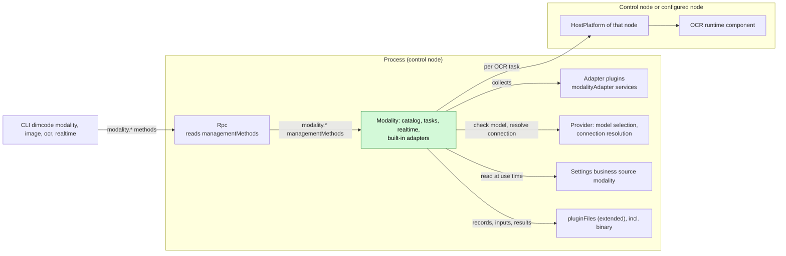
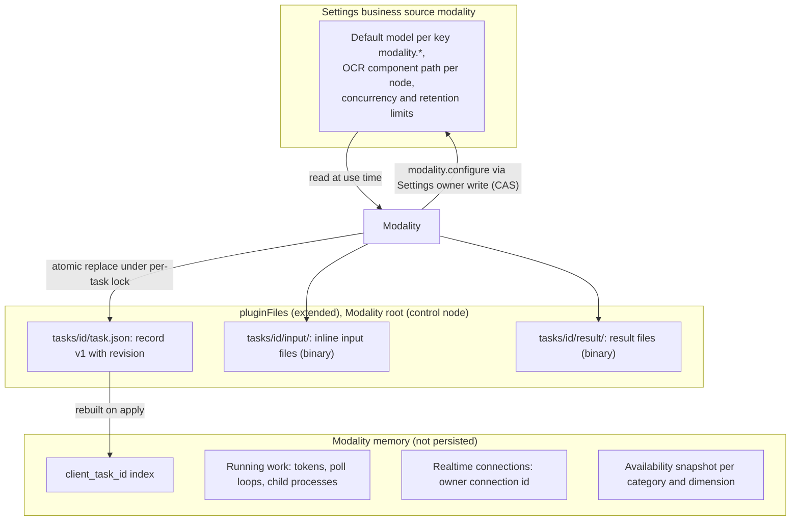
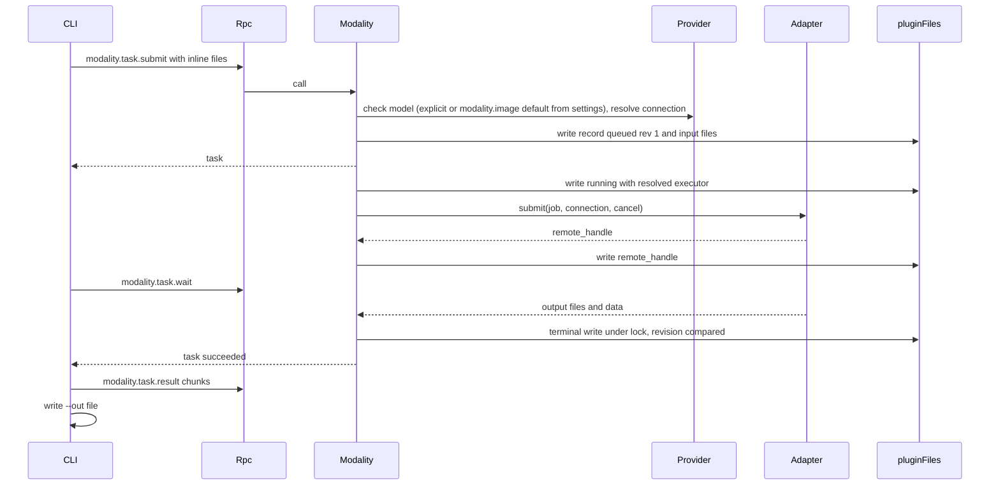
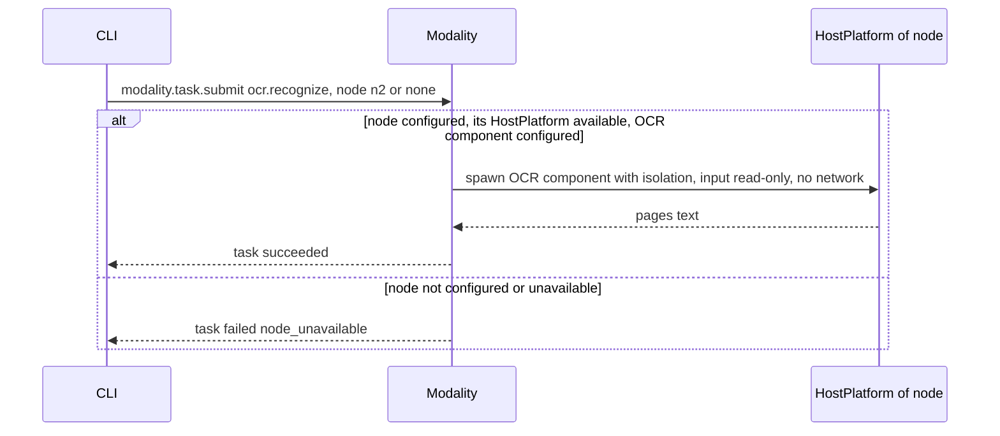
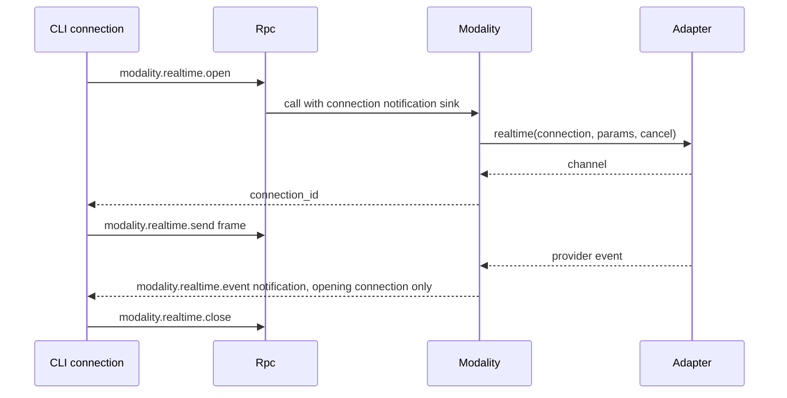
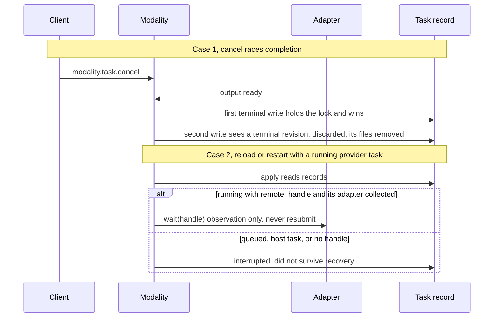

# Modality

Status: Draft. Overall design: [overview §4 Plugin catalog](../overview.md#4-plugin-catalog), [ADR 002](../../adr/002-plugin-scope.md). Phase: P3. Language: TypeScript first for provider-executed categories; OCR depends on the OCR runtime component ([overview Appendix C](../overview.md#appendix-c-implementation-language)).

> **Adapters are looked up per task ([#40](https://github.com/arcships/dim/issues/40)).** Modality looks up the adapter of a category when a task needs it instead of collecting every adapter as a dependency; a missing adapter makes only its category unavailable.

> **P3: redesign with rutis' existing capabilities.** rutis is an external dependency; the requirements this document raises to rutis are withdrawn ([principles §4 rule 8](../../architecture/rust-agent/principles.md)).

Modality is a process plugin ([ADR 002](../../adr/002-plugin-scope.md): tasks and provider connections are shared across Sessions) and the single entry for non-conversational multimodal work in nine categories: image, video, speech, music, audio, 3D asset, motion, realtime and OCR. It reports availability per category with reasons, resolves the default model from its own `modality` settings document, runs asynchronous tasks (submit, status, wait, cancel) stored through `pluginFiles` (extended), and holds realtime connections bound to the opening client connection. Provider adapters are built into Modality or provided by adapter plugins, in any language, as named process services `modalityAdapter`; OCR runs through the HostPlatform of the control node or of a configured node. Its methods are the namespace `modality`, which it registers with `managementMethods`: process-plugin methods about the host, which Rpc dispatches and never served to paired remote devices. Modality's settings, including the OCR component path per node, are business configuration in its own Settings business source, written through Settings typed operations and read at use time. It has no Session or branch part: it writes no Timeline events and offers no model-visible tool.

## 1. Structure



All dependencies are process services at the same scope ([ADR 002 D3](../../adr/002-plugin-scope.md)). Modality collects every process-scoped `modalityAdapter` service by name, so an adapter reload reloads Modality. Rpc looks up Modality's `modality` namespace in `managementMethods` per call and does not reload with it ([methods §3.2](../contracts/session-boundary.md#32-management-method)). Adapter reloads are rare structural events; their propagation is an accepted cost, and task recovery (§4) keeps it bounded: provider tasks with a stored handle resume by polling, others become `interrupted`. No Session or branch plugin depends on Modality.

| Part | Scope | Depends on | Provides |
| --- | --- | --- | --- |
| `Modality` | Process (control node) | Provider model selection (`ModelSelectionHost`) and non-conversational connection resolution; `pluginFiles` (extended: UTF-8 and binary); Settings business source `modality`; all `modalityAdapter` services; HostPlatform of the control node and of each configured OCR node; diagnostics | `modalityTasks` process service; registers `modality` (`modality.*`) with `managementMethods` |
| Adapter plugins | Process | their own provider dependencies | `modalityAdapter` service, key adapter name, declared in the plugin's `provides` |

**Contracts depended on:** the [methods](../contracts/session-boundary.md) contract (namespaces registered with `managementMethods`, per-call progress sink, connection-bound notifications); Provider's model selection (`ResolveModelSelection::resolve`, which rejects an unselectable explicit model; [AuxiliaryModel](../appserver/auxiliary-model.md)) and non-conversational connection resolution ([overview Appendix B.2](../overview.md#b2-app-server-process-plugins)); `pluginFiles` (extended) with binary atomic replace and a format version ([App Server README](../../../crates/dim-app-server/README.md#trusted-plugin-storage)); HostPlatform spawn with isolation ([HostPlatform](../../architecture/rust-agent/plugins/HostPlatform.md), isolation supplement in [overview Appendix B.1](../overview.md#b1-session-and-branch-capabilities)).
**Contracts defined here:** category and operation identifiers; default keys `modality.<category>` and `modality.<category>.<operation>` in the `modality` settings document (Modality's own; Provider holds none); the `modalityAdapter` and `modalityTasks` services ([language-neutral](../../adr/002-plugin-scope.md#d5-contracts-are-language-neutral), A.2 and A.3; Rust binding in Appendix G); the `modality` settings document and its schema; task record and result formats (format version 1); the `modality.*` methods and the `modality.realtime.event` notification. Provider knows nothing about modalities; Modality knows no provider-specific semantics outside its built-in adapters.

## 2. Data and state



Task records are the only durable state; the index is rebuilt from them on `apply`, and non-terminal records are settled by the startup rule (§4). Running work and realtime connections are never rebuilt. Modality settings, the default model per key and the OCR component path per node included, are business configuration ([ADR 002 D4](../../adr/002-plugin-scope.md)), written through Settings typed operations into the `modality` business source under the schema Modality declares: a change is a data update with a notification, read at the next use, never a reload (A16). The set of adapter plugins is structural configuration in loader rows; a "configured node" is a peer node the host already imports over a rutis link (structural link configuration, not Modality's), and which of them OCR uses is chosen per task by the caller. No Timeline state, no `StateCell`; ordering of competing writes uses the record `revision` under the per-task lock.

## 3. Flows

### 3.1 Submit, wait and retrieve (`dimcode image generate`)



The CLI reads inputs and writes outputs itself; Modality writes only inside its storage root (A7).

### 3.2 OCR on the control node or a configured node



Modality has no Session, so OCR runs on the control node unless the caller names a configured node (A15). A peer node's HostPlatform is the one imported over the rutis link ([overview multiple nodes](../overview.md#63-multiple-nodes)). When that node is offline, OCR tasks for it fail `node_unavailable`; Modality does not reload and no import goes Pending. This requires the imported HostPlatform to stay registered while the link is down and fail calls (requirement on [#5](https://github.com/arcships/dim/issues/5), [§9](#9-requirements-raised-to-mechanism-owners)).

### 3.3 Realtime connection



A connection closes on `close`, when the opening client connection ends, after 10 minutes idle (A9), on Modality reload, and on process exit. It has no task record and is never resumed.

### 3.4 Capability listing and default model

`dimcode modality` calls `modality.capabilities` and lists all nine categories. Each unavailable category or operation is shown with its reason per dimension, for example "not in this build", "OCR component not installed", "no adapter", "not configured", "no adapter for the configured model" (decision E16). The last is derived from business configuration Modality has adopted (the default in the `modality` settings document or an explicit model, and its Provider connection) against the adapters it collected. Nothing is hidden and there is no `--all`. `dimcode modality set-default image <provider>/<model>` calls `modality.configure`, which validates that the model is selectable through Provider and that an adapter serves it for that operation, then writes `modality.image` in Modality's own `modality` settings document through its owner write (Settings CAS).

## 4. Timing and conflicts

Modality is not branch work: turn and branch facts never affect tasks. Races are decided by the task record `revision` under the per-task lock.



| Scenario | Outcome | Owner |
| --- | --- | --- |
| Adapter plugin reloads | Modality reloads with it (D3); startup rule applies: tasks with a handle resume by polling, others `interrupted`; realtime connections close | Modality |
| Modality reload | `modality.*` returns `unknown_method` until Modality is active again, and Rpc does not reload; in-flight calls follow the [methods](../contracts/session-boundary.md) contract; disposer cancels local work, terminates OCR processes, closes realtime connections, writes `interrupted` for host tasks and tasks without handle | Rpc, Modality |
| Settings change | Read at next use; availability recomputed; existing tasks keep their resolved executor; no reload | Modality |
| Duplicate `submit` with the same `client_task_id` | Existing task returned | Modality |
| Client detach while waiting | Task continues; that client's realtime connections close | Modality |

Full table in Appendix B.

## 5. Context mapping

No model-visible effect. Modality offers no tool, prompt source, input or Timeline fact (decision E16, A13). A result reaches a model only when a user puts it into a Session by ordinary means (an `@` file reference, an attachment, pasted text), which are input facts owned by their plugins. The model never sees task records, availability, defaults, progress or diagnostics. Compaction, child branches and non-interactive Sessions are therefore unaffected.

## 6. Interfaces (summary)

| Interface | Kind | Purpose |
| --- | --- | --- |
| `modality.capabilities` | Management method | Every category and operation with availability reasons and default model |
| `modality.configure` | Management method | Validate, then set or clear the default in Modality's `modality` settings document (owner write, Settings CAS) |
| `modality.task.submit/status/list/wait/cancel/result` | Management methods | Task lifecycle; chunked binary result retrieval |
| `modality.realtime.open/send/close`, `modality.realtime.event` | Management methods and connection-bound notification | Realtime connection |
| `modalityTasks` | Process service, no key | Same operations as the task methods, for other process plugins |
| `modalityAdapter` | Process service, key adapter name, collected by Modality | Provider-executed categories |
| `modality` settings document | Business configuration (Settings source, schema declared by Modality, written through Settings typed operations) | Default model per key, OCR component path per node, limits; read at use time |
| `dimcode modality`, `image`, `video`, `speech`, `music`, `audio`, `asset`, `motion`, `ocr`, `realtime` | CLI | Thin clients of the methods |

Details in Appendix A.

## 7. Security

- All `modality.*` methods are management methods (they spend provider credit and run host processes): only a process plugin provides them, and they are never served to paired remote devices ([methods](../contracts/session-boundary.md)); RemoteGateway never serves them.
- Credentials are resolved by Provider per call; never in records, results, diagnostics or errors.
- The OCR component is an installed executable, not project content; started through the executing node's HostPlatform with that node's isolation, input read access only, no network (A14). Its path comes from the `modality` settings document, read at use time, never from request data.
- Inline inputs are size-checked and stored under the task directory; `node_path` is read by the component on its node with that node's permissions. Modality never writes outside its storage root; files are owner-only.
- Realtime events go only to the opening connection.

## 8. Rule check

Rules: [principles §1 and §4](../../architecture/rust-agent/principles.md), [ADR 002](../../adr/002-plugin-scope.md) D1–D5.

| Rule | How this document complies |
| --- | --- |
| §4.1 Command events for state owned by others | Modality changes only its own task records; the default model is Modality's own business configuration, written through Settings' typed owner write (CAS) on its `modality` source, with no Timeline. |
| §4.2 No withdrawal after handover | Not applicable: Modality hands no Timeline object to another module; a task's terminal state is decided once under its lock. |
| §4.3 Intervene before a write only through before callbacks | Not applicable: Modality registers no before callback and adds no check at a Session or RPC entry; it validates only its own method parameters. |
| §4.4 Core mechanisms carry no business meaning | Modality asks no change of Timeline, Dispatcher or Rpc; Provider holds no per-consumer keys; Modality passes the model explicitly. |
| §4.5 Read the whole batch before deciding | Not applicable: Modality reads no Timeline event. |
| §4.6 Model context only from handed-over events | Modality writes nothing model-visible; a result reaches a model only as an ordinary input owned by another plugin. |
| §4.7 Plugins interact only through public events and services | Modality uses Provider, Settings, `pluginFiles`, HostPlatform and `modalityAdapter` through their public services only. |
| §4.8 Generic requirements to mechanism owners | The offline-node requirement is raised to rutis as [#5](https://github.com/arcships/dim/issues/5) (§9). |
| §4.9 Only facts later decisions use enter the Timeline | Modality writes no Timeline event; task records stay in `pluginFiles`, the default model and other settings in its Settings business source. |
| §1 Capability and App Server boundary | Modality is a process plugin, not a Capability; its business code lives in its own package, and the App Server only dispatches the namespace it registers with `managementMethods`. |
| ADR 002 D1 Scope follows the owner | Tasks and provider connections are shared across Sessions, so Modality is process-scoped. |
| ADR 002 D2 No wiring modules | Adapters are collected by service name and scope; no wiring module exists. |
| ADR 002 D3 Dependencies follow scope | All dependencies are process services; adapter and Modality reloads propagate as accepted rare structural events. |
| ADR 002 D4 Structural and business configuration | Adapter plugins are loader rows and peer nodes come from the host's link configuration; the OCR component path per node and the limits are business configuration in the `modality` source, written through Settings and read at use time. |
| ADR 002 D5 Language-neutral contracts | `modalityAdapter`, `modalityTasks` and the methods are given in neutral form; Appendix G is a binding only. |

## 9. Requirements raised to mechanism owners

| Requirement | Owner | Five items |
| --- | --- | --- |
| Services imported from a peer node stay registered while the link is down and fail calls with `node_unavailable` | rutis, [#5](https://github.com/arcships/dim/issues/5) | [ExternalAgent §9](ExternalAgent.md#9-requirements-raised-to-mechanism-owners); Modality needs it so an offline OCR node fails only its tasks and never reloads Modality or makes it Pending |
| Runtime services exposed by name to non-Rust plugins | runtime, [#4](https://github.com/arcships/dim/issues/4) | [session access §9](../contracts/session-access.md#9-requirements-raised-to-mechanism-owners); needed only for a TypeScript implementation of Modality |

The Provider supplement (non-conversational connections), the Settings business source and the `pluginFiles` supplement are changes to other plugins, listed in [overview Appendix B.2](../overview.md#b2-app-server-process-plugins).

## Appendix A. Interface details

### A.1 Categories and operations

| Category | CLI | Operations | Input | Result | Executor | Default key |
| --- | --- | --- | --- | --- | --- | --- |
| `image` | `image` | `generate`, `edit` (image, optional mask), `enhance` (`upscale`, `restore`, `denoise`, `sharpen`, `remove_background`, `colorize`) | prompt, files | image files | Provider | `modality.image` |
| `video` | `video` | `generate`, `edit`, `enhance` | prompt, files | video file | Provider | `modality.video` |
| `speech` | `speech` | `synthesize`, `transcribe` | text or audio | audio file; or `data: { text, segments: [{ start_ms, end_ms, text }] }` plus `transcript.txt` | Provider | `modality.speech.synthesize`, `modality.speech.transcribe` |
| `music` | `music` | `generate` | prompt | audio file | Provider | `modality.music` |
| `audio` | `audio` | `generate` | prompt | audio file | Provider | `modality.audio` |
| `asset` | `asset` | `generate` | prompt, optional images | 3D file | Provider | `modality.asset` |
| `motion` | `motion` | `generate` | prompt | motion data file | Provider | `modality.motion` |
| `realtime` | `realtime` | `connect` | — | connection | Provider | `modality.realtime` |
| `ocr` | `ocr` | `recognize` | image or PDF | `data: { pages: [{ index, text }] }` plus `text.txt` | Host runtime component | none; component path per node in the `modality` settings document |

Image understanding is not Modality (vision models through `read`, [WorkspaceTools §read results and images](../../architecture/rust-agent/plugins/WorkspaceTools.md#read-results-and-images)). Per-operation keys are resolved before the category key (A3). Operation parameters beyond the input are declared by each adapter and validated at submission (A4).

### A.2 Adapters and OCR nodes

Service `modalityAdapter`, scope process, key adapter name, declared in the adapter plugin's `provides`; built-in adapters register the same service. Modality collects all of them by name and scope. Cancellation is a protocol action: Modality drops the call (or sends the binding's cancel request); the adapter stops local work. Errors are data `{ code, message }` with `code` one of `invalid_input`, `unavailable`, `provider_error`.

| Method | Kind | Request | Reply |
| --- | --- | --- | --- |
| `available` | sync | `{}` | `{ available: bool, reason? }`; read at each use, no reload on change |
| `connectionKinds` | sync | `{}` | `string[]` (Provider connection kinds served) |
| `operations` | sync | `{ model: "<provider>/<model>" }` | `[{ category, operation, params_schema }]` |
| `submit` | async | `{ job: Job, connection: ResolvedConnection }` | `{ remote_handle? }` |
| `wait` | async | `{ remote_handle?, connection }`; progress as `{ fraction?, message? }` notifications on the call | `{ files: [{ name, media_type, path }], data? }`; `path` inside the job's work directory |
| `cancelRemote` | async | `{ remote_handle, connection }` | `{ outcome: "cancelled" \| "unsupported" \| "already_finished" }` |
| `realtimeOpen` | async | `{ connection, params }`; provider events as `{ channel_id, event }` notifications on the call until closed | `{ channel_id } \| null` (unsupported) |
| `realtimeSend` | async | `{ channel_id, frame }` | `{}` |
| `realtimeClose` | async | `{ channel_id }` | `{}` |

`Job` is `{ task_id, category, operation, model, params, files: [{ name, media_type, path }], work_dir }`. `ResolvedConnection` is the data shape Provider's non-conversational connection resolution returns (`kind`, `provider_id`, `model`, endpoint and credential material), passed per call and never stored or logged.

`available` reports runtime availability without a reload (for example, a provider endpoint unreachable). A configured default (or explicit model) whose Provider connection kind no collected adapter serves is reported as "no adapter for the configured model", and its submits fail `unavailable`. OCR is not an adapter: per task, Modality uses the HostPlatform of the target node (absent or unavailable: `node_unavailable`), probes the OCR component path the `modality` settings document gives for that node, and spawns it there; an offline peer node fails the call with `node_unavailable` and nothing reloads (§3.2). `wait` with a stored `remote_handle` must work in a new generation; an adapter that returns no handle cannot be resumed.

### A.3 Methods

Namespace `modality`, registered with the process's `managementMethods` (declarations and `call` per the [methods](../contracts/session-boundary.md) contract); every method is a management method. `modalityTasks` (process, no key) offers `submit`, `status`, `list`, `wait`, `cancel` and `result` with the same requests and replies as the `modality.task.*` methods below. `wait` uses the per-call progress sink; realtime uses connection-bound notifications ([methods](../contracts/session-boundary.md)).

| Method | Parameters | Result |
| --- | --- | --- |
| `modality.capabilities` | `{}` | `{ categories: [{ category, available, reasons, operations: [{ operation, available, reasons: [{ dimension: "build" \| "platform" \| "runtime" \| "adapter" \| "configuration", detail }], params_schema?, default_model? }] }] }`; every category present |
| `modality.configure` | `{ category, operation?, model: "<provider>/<model>" \| null }` | Validates that the model is selectable through Provider and an available adapter serves it, then writes or clears the default for the key in the `modality` settings document (owner write, Settings CAS) |
| `modality.task.submit` | `{ category, operation, params, files?: [{ name, media_type, data_base64 } \| { node_path }], model?, node?, client_task_id? }` | `{ task }`; an existing `client_task_id` returns the existing task |
| `modality.task.status` | `{ task_id }` | `{ task }` |
| `modality.task.list` | `{ state?, category?, limit? (≤100), after? }` | `{ tasks, next? }`, newest first |
| `modality.task.wait` | `{ task_id, timeout_ms? (≤600000, default 600000) }` | `{ task }` when terminal or at timeout (not an error); progress on the call's progress sink |
| `modality.task.cancel` | `{ task_id }` | `{ task }`; idempotent |
| `modality.task.result` | `{ task_id, name, offset, length (≤4 MiB) }` | `{ data_base64, eof }` |
| `modality.realtime.open` | `{ model?, params }` | `{ connection_id }` |
| `modality.realtime.send` | `{ connection_id, frame: { type: "text" \| "audio" \| "control", data } }` | `{}` |
| `modality.realtime.close` | `{ connection_id }` | `{}` |
| `modality.realtime.event` | Notification `{ connection_id, event }` | To the opening connection only |

Boundary validation: files at most 100 MiB per submission and 25 MiB per inline file (A5); media types checked per operation; `node_path` only for host-executed operations; `node` only for host-executed categories, default control node (A15). Model selection: explicit `model`, else the default in the `modality` settings document, else `no_default_model`; the resolved model is fixed in the record. At most 4 running tasks per category; others stay `queued` in submission order (A6).

### A.4 Task record (`pluginFiles` (extended), format version 1)

| Field | Type |
| --- | --- |
| `version` | `1` |
| `task_id` | `mt_<uuid>` |
| `client_task_id` | string or null |
| `revision` | integer, incremented on every write |
| `category`, `operation` | identifiers from A.1 |
| `executor` | `{ kind: "provider", provider_id, model, adapter }` or `{ kind: "host", node }` |
| `params` | validated object; input files replaced by `{ name, media_type, bytes, sha256 }`, stored under `input/` |
| `state` | `queued`, `running`, `succeeded`, `failed`, `cancelled`, `interrupted` |
| `remote_handle` | string or null; written before `running` progress is reported |
| `progress` | `{ fraction?, message? }` or null; written at most once per second (A10) |
| `result` | `{ files: [{ name, media_type, bytes, sha256 }], data? }` or null |
| `error` | `{ code, message }` or null |
| `remote_cancel` | `"cancelled"`, `"unsupported"`, `"already_finished"` or null |
| `created_at`, `updated_at`, `finished_at` | RFC 3339 |

Records and result files use `pluginFiles` (extended): per-plugin root, UTF-8 and binary atomic replace, lock, format version. Retention: terminal tasks deleted with their files after 30 days or beyond 200 terminal tasks, oldest first (A2); non-terminal tasks never.

### A.5 CLI

| Command | Behavior |
| --- | --- |
| `dimcode modality` | Table of all categories and operations; unavailable ones marked with their reason; default models |
| `dimcode modality set-default <category>[.<operation>] <provider>/<model>` / `--clear` | `modality.configure` |
| `dimcode modality settings [<key> [<value>]]` | Reads or writes the `modality` settings document (OCR component path per node, limits) through Settings' typed operations on that business source (Settings supplement); not a `modality.*` method |
| `dimcode modality task list\|status\|wait\|cancel` | Task methods; `wait --out <path>` retrieves results |
| `dimcode image generate\|edit\|enhance`, `video`, `speech synthesize\|transcribe`, `music`, `audio`, `asset`, `motion` | Submit; by default waits and writes results to `--out` or the current directory; `--no-wait` prints the id; `--json` prints the record |
| `dimcode ocr <file> [--node <id>]` | Submit `ocr.recognize`; prints text |
| `dimcode realtime` | Open, relay stdin lines as text frames, print events |

Invoking an unavailable category prints the same reason as the listing. The first Ctrl+C during a foreground wait stops waiting and prints the task id; the task continues (A8).

### A.6 Task mechanics

| Step | Mechanism |
| --- | --- |
| Submit | Validate at the boundary; write `queued` (revision 1) and input files; return. The scheduler task registered with `ctx.effect` starts it when a slot frees |
| Start | Write `running` with the resolved executor; call `submit`; write `remote_handle` as soon as known |
| Terminal | One write under the per-task lock comparing `revision`; first terminal write wins; later outcomes discarded and their files removed |
| Cancel | Mark requested; cancel the local token (aborts HTTP, or terminates the component's process tree through HostPlatform); `cancel_remote` when a handle exists; release resources; then write `cancelled` (with `remote_cancel`) |
| Unload (own reload, adapter reload, Provider reload) | Disposer cancels local work, terminates OCR processes, closes realtime connections, writes `interrupted` for host tasks and provider tasks without handle; tasks with handle stay `running` |
| Startup (every `apply`) | `queued` → `interrupted` (never started later, A11); `running` host task → `interrupted`; `running` provider task with handle and its adapter collected → continue `wait` (observation only, A12); otherwise `interrupted` "did not survive recovery" |
| Configuration change | `modality` settings change (defaults included): data update and notification, read at next use; availability recomputed; existing tasks keep their resolved executor; no reload |

## Appendix B. Full conflict table

| Scenario | Order | Outcome | Owner |
| --- | --- | --- | --- |
| Turn `stop/interrupt` or branch close in any Session | — | No effect; tasks are not branch work | — |
| Session unload, restore, close; compaction; child branch; Steer/Queue/Append; `input/withdraw`, `input/deleted` | — | No effect; no model-visible output | — |
| Cancel before start | `queued` < cancel | `cancelled` without contacting the executor | Modality |
| Cancel races completion | lock order | First terminal write wins | Modality (revision) |
| Cancel on a terminal task | terminal < cancel | Unchanged record returned | Modality |
| Duplicate `submit` with same `client_task_id` | second after first | Existing task returned | Modality |
| Duplicate `cancel` | — | Idempotent | Modality |
| `wait` during Modality reload | wait pending | Interrupted per the methods contract; client calls `wait` again after reconnecting | Rpc, client |
| Adapter plugin reloads or is removed | structural change | Modality reloads (D3); per A.6; a removed adapter's handle-bearing tasks `interrupted` | Modality |
| Adapter reports unavailable at runtime | flag false | New submits for it `unavailable`; running tasks continue | Modality |
| Process restart mid-task | `running` record | Startup rule; never resubmitted | Modality |
| Retention deletes a task a client still references | — | Terminal tasks only; `result` fails `not_found` | Modality |
| OCR node unavailable before start | — | Task `failed` `node_unavailable`; other nodes unaffected | Modality |
| OCR node lost mid-run | process lost | Task `interrupted`; Modality does not reload (requirement on [#5](https://github.com/arcships/dim/issues/5)) | Modality |
| Client detach while waiting | — | Task continues; that client's realtime connections close | Modality |
| Provider credentials removed mid-task | — | Adapter call fails; `failed` `provider_error` | Modality |
| Default model changed after submission | — | Task keeps its recorded model | Modality |
| Realtime send after the owner connection closed | close < send | `not_found` | Modality |

## Appendix C. Errors and recovery

| Code | Meaning |
| --- | --- |
| `invalid_input` | Unknown category or operation, parameter or file violation |
| `unavailable` | Category or operation unavailable; `reasons` from `modality.capabilities` included |
| `no_default_model` | No explicit model and no default for the key in the `modality` settings document |
| `node_unavailable` | Requested node not configured or its HostPlatform unavailable |
| `provider_error` | Adapter or provider failure; message stripped of secrets |
| `executor_error` | OCR component failed or produced invalid output |
| `not_found` | Unknown or deleted task, result file or connection |
| `storage_error` | Record or file write failed; the task is marked `failed` if possible, else settled at next startup |
| `unknown_method`, `service_reloading` | Modality absent or reloading ([methods](../contracts/session-boundary.md)) |

Billing side effects of provider jobs submitted and then interrupted are not undone; the record states `interrupted` and the `remote_handle` if known.

## Appendix D. Acceptance

Flow tests through `modality.*` methods with a fake adapter plugin (controllable handle, delays, cancel support) and a fake OCR component on two nodes:

1. `modality.capabilities` lists all nine categories with reasons per dimension; the CLI shows every category, unavailable ones with their reason; there is no `--all`.
2. `configure` writes the `modality` settings document through Settings' owner write; submit without `model` uses it; a task keeps its model after the default changes.
3. Submit, status, list, wait (terminal and timeout, progress received), chunked binary result with matching `sha256`.
4. Concurrency limit queues the fifth task of a category.
5. Cancel before start, during run (local abort, remote cancel, unsupported), on a terminal task; cancel racing completion yields one terminal state.
6. Duplicate `client_task_id` returns the same task.
7. Restart: host task `interrupted`; provider task with handle resumes without a second `submit`; without handle `interrupted`; `queued` `interrupted`.
8. Reloading the adapter plugin reloads Modality; its handle-bearing task resumes by polling; with the adapter removed and a configured default naming its model, `modality.capabilities` reports "no adapter for the configured model".
9. OCR on the control node and on a second node; that node offline fails only its tasks with `node_unavailable` and does not reload Modality or Rpc.
10. Realtime: events reach only the opening connection; close on disconnect and idle timeout.
11. No Timeline event, tool declaration or input appears in any Session.
12. Changing the `modality` settings document (default models, OCR path, limits) applies at the next use without reloading Modality.

## Appendix E. Assumptions

| # | Assumption | Basis | Effect if rejected |
| --- | --- | --- | --- |
| A2 | Retention 30 days or 200 terminal tasks | Judgment | Disk use differs |
| A3 | Default keys per category, per operation for speech, with per-operation override | Overview §4; judgment | Synthesis and transcription share one default |
| A4 | Operation parameters declared by adapters, validated at submission | Judgment | Fixed schema per operation |
| A5 | 25 MiB per inline file, 100 MiB per submission | Judgment | Limits change |
| A6 | At most 4 running tasks per category | Judgment | Other concurrency |
| A7 | The CLI sends inputs inline and writes outputs; Modality writes only its storage root | Overview §4; judgment | Modality needs write access to caller paths |
| A8 | Ctrl+C during a CLI wait detaches rather than cancels | Judgment | Ctrl+C cancels costly tasks |
| A9 | Realtime idle timeout 10 minutes | Judgment | Connections outlive clients |
| A10 | Progress written at most once per second | Judgment | More storage writes |
| A11 | `queued` tasks are not started after restart or reload | Overview §6.2 constraint 4, extended | Queued tasks start after restart |
| A12 | A running provider task with a stored handle is resumed by polling (observation, not re-execution) | Decision E16 | All running tasks `interrupted` on restart |
| A13 | No model-visible tool | Decision E16; feature list defines only CLI commands | A Session-scoped tool contribution must be designed |
| A14 | OCR component runs with input read access and no network | Judgment; overview isolation supplement | Weaker isolation |
| A15 | OCR runs on the control node unless the caller names a configured node | Modality has no Session | A Session-derived default node needs a Session parameter |
| A16 | Modality settings (default model per key, OCR component path per node, concurrency and retention limits) are business configuration in a Settings business source `modality` | ADR 002 D4; the path is read per task and changes no loaded row | A path change would reload Modality as a structural loader field |
| A17 | Adapters are named process services `modalityAdapter` collected by Modality; an adapter reload reloads Modality; Rpc looks up Modality per call and does not reload | ADR 002 D2, D3, D5 | Adapters built into Modality only |

## Appendix F. Open questions

| Question | Description |
| --- | --- |
| Provider catalog by category | Whether Provider tags non-conversational models by category, or adapters stay the only source of which model serves which operation |
| Build vs feature list | Feature list places seven categories outside the standalone CLI's default scope; this design keeps them in scope and reports them unavailable by build |

Requirement on [#5](https://github.com/arcships/dim/issues/5): see [§9](#9-requirements-raised-to-mechanism-owners).

## Appendix G. Rust binding

A Rust adapter plugin may implement the generated binding instead of handling the named service directly; the neutral form in A.2 is normative.

```rust
/// Binding for service `modalityAdapter` (process, key adapter name).
pub trait ModalityAdapter: Send + Sync + 'static {
    fn available(&self) -> Availability;
    fn connection_kinds(&self) -> Vec<String>;
    fn operations(&self, model: &ModelRef) -> Vec<OperationSpec>;
    fn submit(&self, job: Job, conn: ResolvedConnection, cancel: CancellationToken)
        -> HostFuture<'_, Result<Submitted, AdapterError>>;
    fn wait(&self, handle: Option<&str>, conn: ResolvedConnection, progress: ProgressSink,
        cancel: CancellationToken) -> HostFuture<'_, Result<AdapterOutput, AdapterError>>;
    fn cancel_remote(&self, handle: &str, conn: ResolvedConnection) -> HostFuture<'_, RemoteCancel>;
    fn realtime(&self, conn: ResolvedConnection, params: JsonObject, cancel: CancellationToken)
        -> HostFuture<'_, Option<RealtimeChannel>>;   // maps realtimeOpen/Send/Close
}
pub enum RemoteCancel { Cancelled, Unsupported, AlreadyFinished }
```

Registration in Rust uses `TypeKey::named("modalityAdapter")` with the adapter name as instance key; Modality's own `managementMethods` and `modalityTasks` use the bindings of the [methods](../contracts/session-boundary.md) contract and a `ModalityTasks` handle with the same operations.
