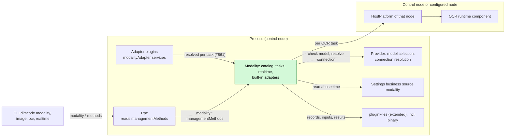
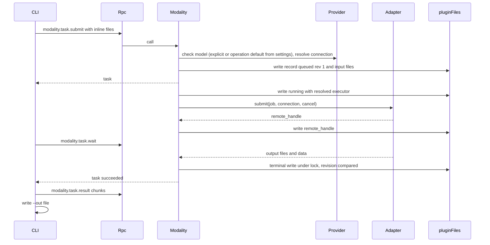
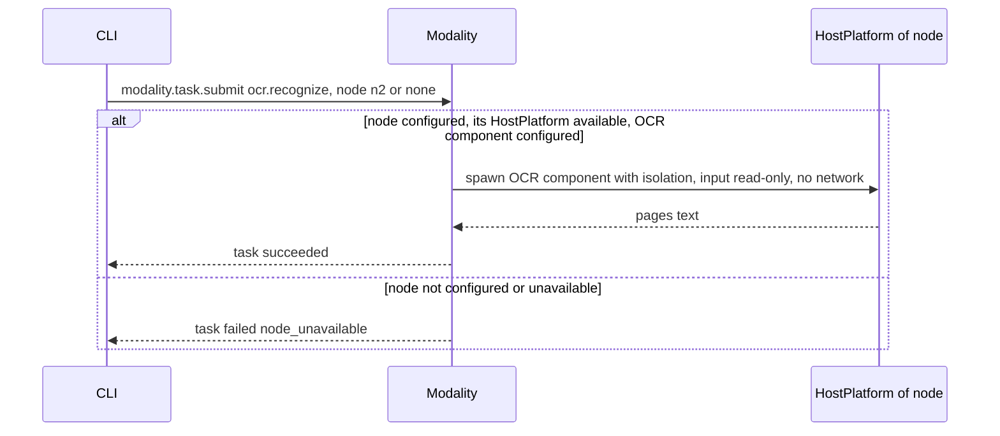
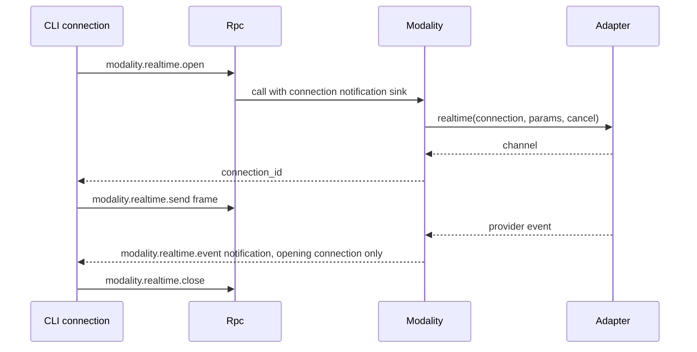

# Modality

Status: Draft. Overall design: [overview §4 Plugin catalog](../overview.md#4-plugin-catalog), [ADR 002](../../adr/002-plugin-scope.md). Phase: P3. Language: TypeScript first for provider-executed categories; OCR depends on the OCR runtime component ([overview Appendix C](../overview.md#appendix-c-implementation-language)).

> **Adapters are resolved per task once the runtime lookup lands ([#40](https://github.com/arcships/dim/issues/40), [#861](https://github.com/arcships/dim/issues/861)).** [#40](https://github.com/arcships/dim/issues/40) decided in [#19](https://github.com/arcships/dim/issues/19) that Modality resolves a category's adapter when a task needs it instead of collecting every adapter as a dependency; the runtime mechanism that lookup needs is tracked by [#861](https://github.com/arcships/dim/issues/861). This design depends on that lookup and does not restate how an adapter is registered or found. Once it lands, a missing adapter makes only its operations unavailable; §1 states the fallback until then.

> **P3: redesign with rutis' existing capabilities.** rutis is an external dependency; the requirements this document raises to rutis are withdrawn ([principles §4 rule 8](../../architecture/rust-agent/principles.md)).

Modality is a process plugin ([ADR 002](../../adr/002-plugin-scope.md): tasks and provider connections are shared across Sessions) and the single entry for non-conversational multimodal work in nine categories: image, video, speech, music, audio, 3D asset, motion, realtime and OCR. It reports availability per category with reasons, resolves the default model per operation from its own `modality` settings document (explicit, then configured default, then automatic through Provider's selection), runs asynchronous tasks (submit, status, wait, cancel) stored through `pluginFiles` (extended), and holds realtime connections bound to the opening client connection. Provider adapters are built into Modality or provided by adapter plugins, in any language, as named process services `modalityAdapter`; OCR runs through the HostPlatform of the control node or of a configured node. Its methods are the namespace `modality`, which it registers with `managementMethods`: process-plugin methods about the host, which Rpc dispatches and never served to paired remote devices. Modality's settings, including the OCR component path per node, are business configuration in its own Settings business source, written through Settings typed operations and read at use time. It has no Session or branch part: it writes no Timeline events and offers no model-visible tool.

## 1. Structure



All dependencies are process services at the same scope ([ADR 002 D3](../../adr/002-plugin-scope.md)). Adapter lookup is the per-task resolution [#40](https://github.com/arcships/dim/issues/40) decided in [#19](https://github.com/arcships/dim/issues/19); the runtime mechanism it needs is not delivered yet ([#861](https://github.com/arcships/dim/issues/861)). This design depends on that lookup and does not restate how an adapter is registered or found. **Until it lands**, the design's fallback is to declare every process-scoped `modalityAdapter` service by name as a dependency: that collection gates Modality on all of them, so one Pending or Failed adapter makes Modality Pending, an adapter reload reloads Modality, and a removed adapter affects every operation. Statements about an adapter resolved per task (the §4 table, Appendix B and flow test 8) describe the target design after [#861](https://github.com/arcships/dim/issues/861) lands; every other statement on this page holds today. Rpc looks up Modality's `modality` namespace in `managementMethods` per call and does not reload with it ([methods §3.2](../contracts/session-boundary.md#32-management-method)). No Session or branch plugin depends on Modality.

| Part | Scope | Depends on | Provides |
| --- | --- | --- | --- |
| `Modality` | Process (control node) | Provider model selection (`ModelSelectionHost`) and non-conversational connection resolution; `pluginFiles` (extended: UTF-8 and binary); Settings business source `modality`; the per-task adapter lookup [#40](https://github.com/arcships/dim/issues/40) decided, tracked by [#861](https://github.com/arcships/dim/issues/861) (not delivered; the collection gates until it lands); HostPlatform of the control node and of each configured OCR node; diagnostics | `modalityTasks` process service; registers `modality` (`modality.*`) with `managementMethods` |
| Adapter plugins | Process | their own provider dependencies | `modalityAdapter` service, key adapter name, declared in the plugin's `provides`; resolved per task after [#861](https://github.com/arcships/dim/issues/861) lands |

**Contracts depended on:** the [methods](../contracts/session-boundary.md) contract (namespaces registered with `managementMethods`, per-call progress sink, connection-bound notifications); the per-task adapter lookup ([#861](https://github.com/arcships/dim/issues/861), §9.1); Provider's model selection (`ResolveModelSelection::resolve`, which rejects an unselectable explicit model; [AuxiliaryModel](../appserver/auxiliary-model.md)), its selectable-model read for the option list (§9.2), and, for image generation, editing and enhancement, its non-conversational connection resolution ([overview Appendix B.2](../overview.md#b2-app-server-process-plugins), §9.3); `pluginFiles` (extended) with binary atomic replace and a format version ([App Server README](../../../crates/dim-app-server/README.md#trusted-plugin-storage)); HostPlatform spawn with isolation ([HostPlatform](../../architecture/rust-agent/plugins/HostPlatform.md), isolation supplement in [overview Appendix B.1](../overview.md#b1-session-and-branch-capabilities)).
**Contracts defined here:** category and operation identifiers; default keys `modality.<category>` and `modality.<category>.<operation>` in the `modality` settings document (Modality's own; Provider holds none); the `modalityAdapter` and `modalityTasks` services ([language-neutral](../../adr/002-plugin-scope.md#d5-contracts-are-language-neutral), A.2 and A.3; Rust binding in Appendix G); the `modality` settings document and its schema; task record and result formats (format version 1); the `modality.*` methods and the `modality.realtime.event` notification. Provider knows nothing about modalities; Modality knows no provider-specific semantics outside its adapters.

## 2. Data and state


Task records are the only durable state; the index is rebuilt from them on `apply`, and non-terminal records are settled by the startup rule (§4). Running work and realtime connections are never rebuilt. Modality settings, the operation defaults and the OCR component path per node included, are business configuration ([ADR 002 D4](../../adr/002-plugin-scope.md)), written through Settings typed operations into the `modality` business source under the schema Modality declares: a change is a data update with a notification, read at the next use, never a reload (A16). The set of adapter plugins is structural configuration in loader rows. How Modality finds their `modalityAdapter` services is the per-task lookup [#40](https://github.com/arcships/dim/issues/40) decided; its runtime mechanism is [#861](https://github.com/arcships/dim/issues/861). Until it lands, each adapter is a declared dependency and its presence gates Modality (see §1 and §9.1). A "configured node" is a peer node the host already imports over a rutis link (structural link configuration, not Modality's), and which of them OCR uses is chosen per task by the caller. No Timeline state, no `StateCell`; ordering of competing writes uses the record `revision` under the per-task lock.

The `defaults` member holds one entry per operation key, each a Provider model reference. Image operations use per-operation keys and have no category fallback in this design; the `modality.` prefix names the setting, not another nesting level:

```json
{
  "defaults": {
    "modality.image.generate": {"providerId": "openai", "modelId": "gpt-image-2"},
    "modality.image.edit": {"providerId": "openai", "modelId": "gpt-image-2"}
  }
}
```

## 3. Flows

### 3.1 Submit, wait and retrieve (`dimcode image generate`)



The CLI reads inputs and writes outputs itself; Modality writes only inside its storage root (A7).

### 3.2 OCR on the control node or a configured node



Modality has no Session, so OCR runs on the control node unless the caller names a configured node (A15). A peer node's HostPlatform is the one imported over the rutis link ([overview multiple nodes](../overview.md#63-multiple-nodes)). When that node is offline, OCR tasks for it fail `node_unavailable`; Modality does not reload and no import goes Pending. This requires the imported HostPlatform to stay registered while the link is down and fail calls (requirement on [#5](https://github.com/arcships/dim/issues/5), [§9](#9-requirements-raised-to-mechanism-owners)).

### 3.3 Realtime connection



A connection closes on `close`, when the opening client connection ends, after 10 minutes idle (A9), on Modality reload, and on process exit. It has no task record and is never resumed.

### 3.4 Capability listing and default model

`dimcode modality` and the Web settings page call `modality.capabilities`, which returns every category and operation with its availability reasons, selectable options, the persisted default and the model a task or consumer would use now. Nothing is hidden and there is no `--all`. Each unavailable category or operation is shown with its reason per dimension, for example "not in this build", "OCR component not installed", "no adapter", "not configured", "no adapter for the configured model" (decision E16). The last is derived from business configuration Modality has adopted (the default in the `modality` settings document or an explicit model, and its Provider connection) against the adapters Modality can resolve (§9.1).

The image operations are the first implementation slice, and that slice ships only a fixture adapter: `generate`, `edit` and `enhance` are adapter operations, and `understand` is selection only. In the product build there is no adapter, so `generate`, `edit` and `enhance` report `unavailable` with an `adapter` reason ("no adapter in this build") and their defaults cannot be set; `understand` resolves and displays its default but has no runtime consumer until §9.4 lands. Flow tests configure the fixture adapter to serve the adapter operations they exercise, so a default can be set for those operations there. This is the intended scope and satisfies the issue's fixture-task acceptance, not a defect. The other categories report a `build` reason until their adapters and runtime exist.

`dimcode modality set-default image.generate <provider>/<model>` and the Web page call `modality.configure`, which validates that the model is selectable through Provider and, for an adapter operation, that an available adapter serves it (for `image.understand`, that it is a selectable vision model), then writes the operation key in Modality's own `modality` settings document through its owner write (Settings CAS). `model: null` clears that key. The reply is the same snapshot `modality.capabilities` returns, including the new `revision`, so a client applies it without a second read.

A task resolves its model in this order: the explicit `model` in the request; the persisted default for the operation key; automatic resolution — Provider's global default selection when that model is selectable and serving the operation, otherwise the first selectable model that serves it in the order Provider's own automatic selection uses. An explicit model or a persisted default that is no longer selectable fails the task (`model_unavailable` or `default_unavailable`); an operation with no available adapter for the resolved model fails `unavailable`. Modality never substitutes another model. Only an absent default reaches automatic resolution, so clearing a default restores it. The resolved model is written into the task record and does not change when the default changes later.

`image.understand` uses the same resolution but has no task: Modality resolves its default and exposes it in `modality.capabilities`, and the Session image-understanding path (attachments and `read`) is the consumer. That path does not read the default yet; the Agent/Prompt requirement in §9.4 must land before the default changes the model the runtime uses. Until then the understanding row resolves and displays only.

The `modality` source is user scope only: operation defaults belong to the user, not a project. A missing source reads as empty defaults. The methods are additive protocol-v3 management methods; an older daemon answers `unknown_method` and a client shows the category unavailable. The legacy product's `modality-settings.json` is not imported; a later migration would be its own change. Provider records, model descriptors and the chat default selection are unchanged; Modality stores no Provider or Session state and writes no Timeline event.

## 4. Timing and conflicts

Modality is not branch work: turn and branch facts never affect tasks. Races are decided by the task record `revision` under the per-task lock.


The adapter row states the target design after [#861](https://github.com/arcships/dim/issues/861) lands, with the fallback until then; the other rows hold today.

| Scenario | Outcome | Owner |
| --- | --- | --- |
| Adapter plugin reloads | After [#861](https://github.com/arcships/dim/issues/861) lands: Modality does not reload. A running adapter call may be interrupted; its task becomes `interrupted` and is never resubmitted. New tasks resolve the adapter again; other operations are unaffected. Until then Modality depends on every adapter, so its reload reloads Modality: tasks with a handle resume by polling, others become `interrupted`, and realtime connections close | Modality, runtime ([#861](https://github.com/arcships/dim/issues/861)) |
| Modality reload | `modality.*` returns `unknown_method` until Modality is active again, and Rpc does not reload; in-flight calls follow the [methods](../contracts/session-boundary.md) contract; disposer cancels local work, terminates OCR processes, closes realtime connections, writes `interrupted` for host tasks and tasks without handle | Rpc, Modality |
| Settings change | Read at next use; availability recomputed; existing tasks keep their resolved executor; no reload | Modality |
| Duplicate `submit` with the same `client_task_id` | Existing task returned | Modality |
| Client detach while waiting | Task continues; that client's realtime connections close | Modality |

Full table in Appendix B.

## 5. Context mapping

No model-visible effect. Modality offers no tool, prompt source, input or Timeline fact (decision E16, A13). A result reaches a model only when a user puts it into a Session by ordinary means (an `@` file reference, an attachment, pasted text), which are input facts owned by their plugins. The model never sees task records, availability, defaults, progress or diagnostics. Compaction, child branches and non-interactive Sessions are therefore unaffected.

## 6. Interfaces (summary)

| Interface | Kind | Purpose |
| --- | --- | --- |
| `modality.capabilities` | Management method | Every category and operation with availability reasons, selectable options, persisted default, effective model and settings revision |
| `modality.configure` | Management method | Validate, then set or clear one operation default in Modality's `modality` settings document (owner write, Settings CAS); returns the new snapshot |
| `modality.task.submit/status/list/wait/cancel/result` | Management methods | Task lifecycle; chunked binary result retrieval |
| `modality.realtime.open/send/close`, `modality.realtime.event` | Management methods and connection-bound notification | Realtime connection |
| `modalityTasks` | Process service, no key | Same operations as the task methods, for other process plugins |
| `modalityAdapter` | Process service, key adapter name; resolved per task after [#861](https://github.com/arcships/dim/issues/861) lands, by the collection until then (§9.1) | Provider-executed categories |
| `modality` settings document | Business configuration (Settings source, schema declared by Modality, written through Settings typed operations) | Operation defaults, OCR component path per node, limits; read at use time |
| `dimcode modality`, `image`, `video`, `speech`, `music`, `audio`, `asset`, `motion`, `ocr`, `realtime` | CLI | Thin clients of the methods |

Details in Appendix A.

## 7. Security

- All `modality.*` methods are management methods (they spend provider credit and run host processes): only a process plugin provides them, and they are never served to paired remote devices ([methods](../contracts/session-boundary.md)); RemoteGateway never serves them.
- The authenticated loopback Web entry is served exactly `modality.capabilities` and `modality.configure`; task, realtime and result methods stay unavailable to browser clients. Replies contain model identities, availability reasons and the settings revision, never credentials, task records or results.
- Credentials are resolved by Provider per call; never in records, results, diagnostics or errors.
- The OCR component is an installed executable, not project content; started through the executing node's HostPlatform with that node's isolation, input read access only, no network (A14). Its path comes from the `modality` settings document, read at use time, never from request data.
- Inline inputs are size-checked and stored under the task directory; `node_path` is read by the component on its node with that node's permissions. Modality never writes outside its storage root; files are owner-only.
- Realtime events go only to the opening connection.

## 8. Rule check

Rules: [principles §1 and §4](../../architecture/rust-agent/principles.md), [ADR 002](../../adr/002-plugin-scope.md) D1–D5.

| Rule | How this document complies |
| --- | --- |
| §4.1 Command events for state owned by others | Modality changes only its own task records; operation defaults are Modality's own business configuration, written through Settings' typed owner write (CAS) on its `modality` source, with no Timeline. |
| §4.2 No withdrawal after handover | Not applicable: Modality hands no Timeline object to another module; a task's terminal state is decided once under its lock. |
| §4.3 Intervene before a write only through before callbacks | Not applicable: Modality registers no before callback and adds no check at a Session or RPC entry; it validates only its own method parameters. |
| §4.4 Core mechanisms carry no business meaning | Modality asks no change of Timeline, Dispatcher or Rpc; Provider holds no per-consumer keys; Modality passes the model explicitly. |
| §4.5 Read the whole batch before deciding | Not applicable: Modality reads no Timeline event. |
| §4.6 Model context only from handed-over events | Modality writes nothing model-visible; a result reaches a model only as an ordinary input owned by another plugin. |
| §4.7 Plugins interact only through public events and services | Modality uses Provider, Settings, `pluginFiles`, HostPlatform and the `modalityAdapter` services it may resolve (§9.1) through their public services only. |
| §4.8 Generic requirements to mechanism owners | The offline-node requirement is raised to rutis as [#5](https://github.com/arcships/dim/issues/5); the per-task adapter lookup, Provider's selectable-model read and Provider's non-conversational connection are raised in §9. |
| §4.9 Only facts later decisions use enter the Timeline | Modality writes no Timeline event; task records stay in `pluginFiles`, the operation defaults and other settings in its Settings business source. |
| §1 Capability and App Server boundary | Modality is a process plugin, not a Capability; its business code lives in its own package, and the App Server only dispatches the namespace it registers with `managementMethods`. |
| ADR 002 D1 Scope follows the owner | Tasks and provider connections are shared across Sessions, so Modality is process-scoped. |
| ADR 002 D2 No wiring modules | Adapter lookup is runtime work tracked by [#861](https://github.com/arcships/dim/issues/861); this design adds no wiring module. |
| ADR 002 D3 Dependencies follow scope | All dependencies are process services. Until [#861](https://github.com/arcships/dim/issues/861) lands, collecting adapters by name gates Modality; after it lands, a missing adapter affects only its operations. |
| ADR 002 D4 Structural and business configuration | Adapter plugins are loader rows and peer nodes come from the host's link configuration; the OCR component path per node and the limits are business configuration in the `modality` source, written through Settings and read at use time. |
| ADR 002 D5 Language-neutral contracts | `modalityAdapter`, `modalityTasks` and the methods are given in neutral form; Appendix G is a binding only. |

## 9. Requirements raised to mechanism owners

Rules: [principles §4 rule 8](../../architecture/rust-agent/principles.md). Each entry states the problem, the existing mechanisms considered, the generic capability, the impact on ordering and reload, and the owner/issue.

| Requirement | Owner | Five items |
| --- | --- | --- |
| Services imported from a peer node stay registered while the link is down and fail calls with `node_unavailable` | rutis, [#5](https://github.com/arcships/dim/issues/5) | [ExternalAgent §9](ExternalAgent.md#9-requirements-raised-to-mechanism-owners); Modality needs it so an offline OCR node fails only its tasks and never reloads Modality or makes it Pending |
| Runtime services exposed by name to non-Rust plugins | runtime, [#4](https://github.com/arcships/dim/issues/4) | [session access §9](../contracts/session-access.md#9-requirements-raised-to-mechanism-owners); needed only for a TypeScript implementation of Modality |
| Per-task adapter lookup without gating Modality | runtime/assembly, [#861](https://github.com/arcships/dim/issues/861) | [§9.1](#91-per-task-adapter-lookup) |
| Provider read-only contract for selectable models and declared capabilities | Provider, [#790](https://github.com/arcships/dim/issues/790) | [§9.2](#92-provider-read-only-contract) |
| Provider non-conversational connection | Provider, [#799](https://github.com/arcships/dim/issues/799) | [§9.3](#93-provider-non-conversational-connection) |
| Session image-understanding consumer of `modality.image.understand` | Agent/Prompt owner, [#798](https://github.com/arcships/dim/issues/798) | [§9.4](#94-session-image-understanding-consumer) |

The Settings business source and the `pluginFiles` supplement are changes to other plugins, listed in [overview Appendix B.2](../overview.md#b2-app-server-process-plugins).

### 9.1 Per-task adapter lookup

- **Problem.** An adapter that is missing, Pending, Failed or reloading must not hold Modality Pending or reload it; only the operations that adapter served may become unavailable. A dependency on every `modalityAdapter` service does the opposite.
- **Existing mechanisms.** Declaring each adapter with `Keyed` gates the consumer until every provider is Active; collecting named services has the same effect. The optional per-call read (`Ctx::get`, `Ctx::get_at`) does not gate, and Rpc and `AgentIndex` read `managementMethods`, `sessions` and `auxiliaryModel` that way; but the catalog keys one name to one key per copy and a bridged plugin's `provides` entry carries no per-provider instance key, so several providers of one name cannot each be resolved by their adapter name and a consumer cannot enumerate the active ones. Registration tables (`managementMethods`, `toolRegistry`) deliver contributions to their owner, but they are not services: adapters would have to depend on a table owner and register callbacks, which inverts the declared dependency and duplicates the `modalityAdapter` contract.
- **Needed capability.** A per-call resolution of a process-scoped provider by its provider identity (the adapter name) that does not gate the consumer and creates no reload relation in either direction: a provider that is absent, Pending, Failed or reloading is simply not resolved for that call, and the next call sees it when it returns. An equivalent shape, such as a distinct registered name per configured provider read optionally per call, is acceptable if the owner can enumerate the providers active now without a reload when one appears or goes away.
- **Ordering impact.** Adapter unload/reload affects only its operations; no Modality reload and no Timeline or batch change; in-flight tasks settle per A.6.
- **Owner/issue.** runtime/assembly, [#861](https://github.com/arcships/dim/issues/861). [#40](https://github.com/arcships/dim/issues/40) decided the consumer side in [#19](https://github.com/arcships/dim/issues/19) and is closed; Modality only declares the dependency.

### 9.2 Provider read-only contract

- **Problem.** `modality.capabilities` must compute `options` and automatic resolution from the models Provider can select. Provider's model-selection port resolves one model, and the catalog reads are client management methods, so a process owner cannot enumerate the selectable set with its declared capabilities.
- **Existing mechanisms.** The single-model selection port cannot filter by an operation's capability. A new client method would expose management to the owner and duplicate the catalog. The Provider-side read-only contract is tracked separately by #790.
- **Needed capability.** The read-only contract tracked by [#790](https://github.com/arcships/dim/issues/790): selectable-model enumeration with declared capabilities. Modality consumes it; this design does not define Provider's internal shape.
- **Ordering impact.** Read at each `capabilities` call and task submission; no reload and no Timeline.
- **Owner/issue.** Provider, [#790](https://github.com/arcships/dim/issues/790).

### 9.3 Provider non-conversational connection

- **Problem.** Image generation and editing adapters need a model's endpoint, protocol and credential material per call. Provider resolves connections only for a `ModelRequest`.
- **Existing mechanisms.** `ProviderConnectionResolver` is tied to `ModelRequest`; adapters cannot own Provider credentials, and Modality must not store them.
- **Needed capability.** A per-call resolution of a model's non-conversational connection, owned by Provider, used only for that call and never persisted or returned to a client.
- **Ordering impact.** Resolved at submit; no reload; credentials never enter task records, results, diagnostics or errors.
- **Owner/issue.** Provider, [#799](https://github.com/arcships/dim/issues/799).

### 9.4 Session image-understanding consumer

- **Problem.** Modality resolves `modality.image.understand`, but the Session image-understanding path (attachments and `read`) sends images to the Session's adopted model; nothing reads the Modality default. Until this requirement lands, the understanding row can resolve and display only.
- **Existing mechanisms.** `read` returns image blocks to the Session model, and `session.model.update` plus Prompt's adopted configuration choose that model. There is no input path or typed lookup from the Session path to a process owner's default. Choosing in the browser would be the browser-only default the requirement excludes.
- **Needed capability.** The Session image-understanding path resolves its model through Modality's `modality.image.understand` default (explicit → default → automatic), or an equivalent typed handoff. The mechanism belongs to Agent/Prompt.
- **Ordering impact.** Per read or attachment; no Timeline event; existing Sessions keep their behavior until the requirement lands; no reload.
- **Owner/issue.** Agent/Prompt owner, [#798](https://github.com/arcships/dim/issues/798).

## Appendix A. Interface details

### A.1 Categories and operations

| Category | CLI | Operations | Input | Result | Executor | Default key |
| --- | --- | --- | --- | --- | --- | --- |
| `image` | `image` | `generate`, `edit` (image, optional mask), `enhance` (`upscale`, `restore`, `denoise`, `sharpen`, `remove_background`, `colorize`), `understand` (image; selection only, consumer is the Session image-understanding path) | prompt, files; image for `understand` | image files; text for `understand` | Provider | `modality.image.generate`, `modality.image.edit`, `modality.image.enhance`, `modality.image.understand` |
| `video` | `video` | `generate`, `edit`, `enhance` | prompt, files | video file | Provider | `modality.video` |
| `speech` | `speech` | `synthesize`, `transcribe` | text or audio | audio file; or `data: { text, segments: [{ start_ms, end_ms, text }] }` plus `transcript.txt` | Provider | `modality.speech.synthesize`, `modality.speech.transcribe` |
| `music` | `music` | `generate` | prompt | audio file | Provider | `modality.music` |
| `audio` | `audio` | `generate` | prompt | audio file | Provider | `modality.audio` |
| `asset` | `asset` | `generate` | prompt, optional images | 3D file | Provider | `modality.asset` |
| `motion` | `motion` | `generate` | prompt | motion data file | Provider | `modality.motion` |
| `realtime` | `realtime` | `connect` | — | connection | Provider | `modality.realtime` |
| `ocr` | `ocr` | `recognize` | image or PDF | `data: { pages: [{ index, text }] }` plus `text.txt` | Host runtime component | none; component path per node in the `modality` settings document |

Image understanding is an image operation whose default is resolved by Modality (`modality.image.understand`). Its consumer is the Session image-understanding path (attachments and `read`, [WorkspaceTools §read results and images](../../architecture/rust-agent/plugins/WorkspaceTools.md#read-results-and-images)); that path does not consume the default yet, so the Agent/Prompt requirement in §9.4 must land before the default changes the model the runtime uses. Until it does, the understanding row resolves and displays only. Image operations use per-operation keys and have no category fallback in this design; other categories resolve a per-operation key before their category key (A3). Operation parameters beyond the input are declared by each adapter and validated at submission (A4).

### A.2 Adapters and OCR nodes

Service `modalityAdapter`, scope process, key adapter name, declared in the adapter plugin's `provides`; built-in adapters provide the same service. How an adapter is registered and found is the per-task lookup [#40](https://github.com/arcships/dim/issues/40) decided, tracked by [#861](https://github.com/arcships/dim/issues/861) (§9.1); this design depends on it and does not restate it. Until it lands, adapters are collected by name and gate Modality. Once it lands, Modality resolves the adapter for an operation when a task needs it, so a missing, Pending or reloading adapter affects only its operations. Cancellation is a protocol action: Modality drops the call (or sends the binding's cancel request); the adapter stops local work. Errors are data `{ code, message }` with `code` one of `invalid_input`, `unavailable`, `provider_error`.

| Method | Kind | Request | Reply |
| --- | --- | --- | --- |
| `available` | sync | `{}` | `{ available: bool, reason? }`; read at each use, no reload on change |
| `connectionKinds` | sync | `{}` | `string[]` (Provider connection kinds served) |
| `operations` | sync | `{ model: {providerId, modelId} }` | `[{ category, operation, params_schema }]` |
| `submit` | async | `{ job: Job, connection: ResolvedConnection }` | `{ remote_handle? }` |
| `wait` | async | `{ remote_handle?, connection }`; progress as `{ fraction?, message? }` notifications on the call | `{ files: [{ name, media_type, path }], data? }`; `path` inside the job's work directory |
| `cancelRemote` | async | `{ remote_handle, connection }` | `{ outcome: "cancelled" \| "unsupported" \| "already_finished" }` |
| `realtimeOpen` | async | `{ connection, params }`; provider events as `{ channel_id, event }` notifications on the call until closed | `{ channel_id } \| null` (unsupported) |
| `realtimeSend` | async | `{ channel_id, frame }` | `{}` |
| `realtimeClose` | async | `{ channel_id }` | `{}` |

`Job` is `{ task_id, category, operation, model: {providerId, modelId}, params, files: [{ name, media_type, path }], work_dir }`. `ResolvedConnection` is the data shape Provider's non-conversational connection resolution returns (`kind`, `provider_id`, `model`, endpoint and credential material), passed per call and never stored or logged.

`available` reports runtime availability without a reload (for example, a provider endpoint unreachable). An operation whose available adapters do not serve the configured or explicit model is reported as "no adapter for the configured model", and its submits fail `unavailable`. `image.understand` is not an adapter operation: it is served by a selectable vision model and is selection-only. OCR is not an adapter: per task, Modality uses the HostPlatform of the target node (absent or unavailable: `node_unavailable`), probes the OCR component path the `modality` settings document gives for that node, and spawns it there; an offline peer node fails the call with `node_unavailable` and nothing reloads (§3.2). `wait` with a stored `remote_handle` must work in a new generation; an adapter that returns no handle cannot be resumed.

### A.3 Methods

Namespace `modality`, registered with the process's `managementMethods` (declarations and `call` per the [methods](../contracts/session-boundary.md) contract); every method is a management method. `modalityTasks` (process, no key) offers `submit`, `status`, `list`, `wait`, `cancel` and `result` with the same requests and replies as the `modality.task.*` methods below. `wait` uses the per-call progress sink; realtime uses connection-bound notifications ([methods](../contracts/session-boundary.md)).

| Method | Parameters | Result |
| --- | --- | --- |
| `modality.capabilities` | `{}` | The default snapshot below; every category present |
| `modality.configure` | `{ expectedRevision, category, operation?, model: {providerId, modelId} \| null }` | The same snapshot after the write; `modality_conflict`, `modality_invalid_selection` or `modality_unknown_operation` on failure |
| `modality.task.submit` | `{ category, operation, params, files?: [{ name, media_type, data_base64 } \| { node_path }], model?, node?, client_task_id? }` | `{ task }`; an existing `client_task_id` returns the existing task. `image.understand` is selection-only and has no task; its consumer is the Session image-understanding path (§9.4) |
| `modality.task.status` | `{ task_id }` | `{ task }` |
| `modality.task.list` | `{ state?, category?, limit? (≤100), after? }` | `{ tasks, next? }`, newest first |
| `modality.task.wait` | `{ task_id, timeout_ms? (≤600000, default 600000) }` | `{ task }` when terminal or at timeout (not an error); progress on the call's progress sink |
| `modality.task.cancel` | `{ task_id }` | `{ task }`; idempotent |
| `modality.task.result` | `{ task_id, name, offset, length (≤4 MiB) }` | `{ data_base64, eof }` |
| `modality.realtime.open` | `{ model?, params }` | `{ connection_id }` |
| `modality.realtime.send` | `{ connection_id, frame: { type: "text" \| "audio" \| "control", data } }` | `{}` |
| `modality.realtime.close` | `{ connection_id }` | `{}` |
| `modality.realtime.event` | Notification `{ connection_id, event }` | To the opening connection only |

The default snapshot is the one shape both methods return. A model reference is `{providerId, modelId}`; a reason is `{dimension: "build" | "platform" | "runtime" | "adapter" | "configuration" | "provider", detail}` and `detail` is display text, never parsed by a client.

```json
{
  "revision": "native:user/modality:7",
  "categories": [{
    "category": "image",
    "available": true,
    "reasons": [],
    "operations": [{
      "operation": "generate",
      "key": "modality.image.generate",
      "available": true,
      "reasons": [],
      "default": {"providerId": "p", "modelId": "m", "available": true},
      "effective": {"providerId": "p", "modelId": "m", "source": "default"},
      "options": [{"providerId": "p", "modelId": "m", "available": true}]
    }]
  }]
}
```

- `revision` is the `modality` settings document revision; only `configure` consumes it.
- `default` is the persisted choice or `null`. When the model is no longer selectable or no available adapter serves it (for `image.understand`, when it is not a selectable vision model), `available` is `false` and `reason` says why.
- `effective` is the model a task or consumer would use now. It is the default when available. When `default` is `null`, it is automatic resolution: Provider's global default selection when selectable and serving the operation, else the first selectable model that serves it in the order Provider's own automatic selection uses; `source` is `"automatic"`. An unavailable default yields `effective: null`, never a substituted model.
- `options` lists the models that serve the operation and Provider can select: an available adapter serves them for `generate`, `edit` and `enhance`, and a selectable vision model serves `image.understand`. An adapter's `operations` decides which models it serves; Provider's `modalityCapabilities` declaration is not routing input for these operations, and `image.understand` needs Provider's `vision` capability. The current default is included when it is no longer selectable, marked with its reason. The owner computes them at read time from Provider's read-only contract (#790) and the available adapters; the client does not derive them. An option carries only `{providerId, modelId, available, reason?}`: #790 returns ids and capabilities, not display names, so the client joins names from its existing Provider list or catalog reads by `{providerId, modelId}` and shows the ids when a name is unavailable.
- `configure` validates the operation, Provider selectability and, for an adapter operation, adapter support (for `image.understand`, selectable vision support), then writes or clears the operation key through Settings' owner write with CAS. `model: null` clears that key; clearing restores automatic resolution. `operation` is required where the operation has its own key (image, speech) and may be absent only for a category-keyed category. The write happens before the reply is sent, so a success means the default is persisted.

Boundary validation: files at most 100 MiB per submission and 25 MiB per inline file (A5); media types checked per operation; `node_path` only for host-executed operations; `node` only for host-executed categories, default control node (A15). Model selection: explicit `model`; else the operation default; else automatic resolution; else `no_default_model`. An explicit model that is not selectable fails `model_unavailable`, an unavailable default fails `default_unavailable`, and a resolved model no available adapter serves fails `unavailable`; none of them falls back to another model. The resolved model is fixed in the record. `image.understand` is selection-only and has no task; a task submission for it fails `modality_unknown_operation`. At most 4 running tasks per category; others stay `queued` in submission order (A6).

### A.4 Task record (`pluginFiles` (extended), format version 1)

| Field | Type |
| --- | --- |
| `version` | `1` |
| `task_id` | `mt_<uuid>` |
| `client_task_id` | string or null |
| `revision` | integer, incremented on every write |
| `category`, `operation` | identifiers from A.1 |
| `executor` | `{ kind: "provider", provider, adapter }` where `provider` is `{providerId, modelId}`, or `{ kind: "host", node }` |
| `params` | validated object; input files replaced by `{ name, media_type, bytes, sha256 }`, stored under `input/` |
| `state` | `queued`, `running`, `succeeded`, `failed`, `cancelled`, `interrupted` |
| `remote_handle` | string or null; written before `running` progress is reported |
| `progress` | `{ fraction?, message? }` or null; written at most once per second (A10) |
| `result` | `{ files: [{ name, media_type, bytes, sha256 }], data? }` or null |
| `error` | `{ code, message }` or null |
| `remote_cancel` | `"cancelled"`, `"unsupported"`, `"already_finished"` or null |
| `created_at`, `updated_at`, `finished_at` | RFC 3339 |

Records and result files use `pluginFiles` (extended): per-plugin root, UTF-8 and binary atomic replace, lock, format version. Retention: terminal tasks deleted with their files after 30 days or beyond 200 terminal tasks, oldest first (A2); non-terminal tasks never.

### A.5 CLI

| Command | Behavior |
| --- | --- |
| `dimcode modality` | Table of all categories and operations; unavailable ones marked with their reason; default models |
| `dimcode modality set-default <category>[.<operation>] <provider>/<model>` / `--clear` | `modality.configure` |
| `dimcode modality settings [<key> [<value>]]` | Reads or writes the `modality` settings document (OCR component path per node, limits) through Settings' typed operations on that business source (Settings supplement); not a `modality.*` method |
| `dimcode modality task list\|status\|wait\|cancel` | Task methods; `wait --out <path>` retrieves results |
| `dimcode image generate\|edit\|enhance`, `video`, `speech synthesize\|transcribe`, `music`, `audio`, `asset`, `motion` | Submit; by default waits and writes results to `--out` or the current directory; `--no-wait` prints the id; `--json` prints the record |
| `dimcode ocr <file> [--node <id>]` | Submit `ocr.recognize`; prints text |
| `dimcode realtime` | Open, relay stdin lines as text frames, print events |

Invoking an unavailable category prints the same reason as the listing. The first Ctrl+C during a foreground wait stops waiting and prints the task id; the task continues (A8).

### A.6 Task mechanics

| Step | Mechanism |
| --- | --- |
| Submit | Validate at the boundary; write `queued` (revision 1) and input files; return. The scheduler task registered with `ctx.effect` starts it when a slot frees |
| Start | Write `running` with the resolved executor; resolve the operation's adapter (per task after [#861](https://github.com/arcships/dim/issues/861) lands, from the collected dependencies until then); call `submit`; write `remote_handle` as soon as known |
| Terminal | One write under the per-task lock comparing `revision`; first terminal write wins; later outcomes discarded and their files removed |
| Cancel | Mark requested; cancel the local token (aborts HTTP, or terminates the component's process tree through HostPlatform); `cancel_remote` when a handle exists; release resources; then write `cancelled` (with `remote_cancel`) |
| Unload (own reload or Provider reload) | Disposer cancels local work, terminates OCR processes, closes realtime connections, writes `interrupted` for host tasks and provider tasks without handle; tasks with handle stay `running` |
| Startup (every `apply`) | `queued` → `interrupted` (never started later, A11); `running` host task → `interrupted`; `running` provider task with handle and its adapter available → continue `wait` (observation only, A12); otherwise `interrupted` "did not survive recovery" |
| Configuration change | `modality` settings change (defaults included): data update and notification, read at next use; availability recomputed; existing tasks keep their resolved executor; no reload |

## Appendix B. Full conflict table

The adapter row states the target design after [#861](https://github.com/arcships/dim/issues/861) lands and the fallback until then; the other rows hold today.

| Scenario | Order | Outcome | Owner |
| --- | --- | --- | --- |
| Turn `stop/interrupt` or branch close in any Session | — | No effect; tasks are not branch work | — |
| Session unload, restore, close; compaction; child branch; Steer/Queue/Append; `input/withdraw`, `input/deleted` | — | No effect; no model-visible output | — |
| Cancel before start | `queued` < cancel | `cancelled` without contacting the executor | Modality |
| Cancel races completion | lock order | First terminal write wins | Modality (revision) |
| Cancel on a terminal task | terminal < cancel | Unchanged record returned | Modality |
| Duplicate `submit` with same `client_task_id` | second after first | Existing task returned | Modality |
| Duplicate `cancel` | — | Idempotent | Modality |
| `wait` during Modality reload | wait pending | Interrupted per the methods contract; client calls `wait` again after reconnecting | Rpc, client |
| Adapter plugin reloads or is removed | no Modality reload after [#861](https://github.com/arcships/dim/issues/861); until then a dependency reloads Modality | After [#861](https://github.com/arcships/dim/issues/861) lands: a running call interrupted by the unload leaves its task `interrupted` and never resubmits; a task not yet started fails `unavailable` if its adapter is gone; other operations are unaffected. Until then a reload reloads Modality and a removed, Failed or reloading adapter affects every operation | Modality, runtime ([#861](https://github.com/arcships/dim/issues/861)) |
| Adapter reports unavailable at runtime | flag false | New submits for it `unavailable`; running tasks continue | Modality |
| Process restart mid-task | `running` record | Startup rule; never resubmitted | Modality |
| Retention deletes a task a client still references | — | Terminal tasks only; `result` fails `not_found` | Modality |
| OCR node unavailable before start | — | Task `failed` `node_unavailable`; other nodes unaffected | Modality |
| OCR node lost mid-run | process lost | Task `interrupted`; Modality does not reload (requirement on [#5](https://github.com/arcships/dim/issues/5)) | Modality |
| Client detach while waiting | — | Task continues; that client's realtime connections close | Modality |
| Provider credentials removed mid-task | — | Adapter call fails; `failed` `provider_error` | Modality |
| Default model changed after submission | — | Task keeps its recorded model | Modality |
| Realtime send after the owner connection closed | close < send | `not_found` | Modality |

## Appendix C. Errors and recovery

| Code | Meaning |
| --- | --- |
| `invalid_input` | Unknown category or operation, parameter or file violation |
| `unavailable` | Category or operation unavailable; `reasons` from `modality.capabilities` included |
| `no_default_model` | No explicit model, no operation default, and automatic resolution found no serving model |
| `default_unavailable` | The persisted operation default is no longer selectable; clear or replace it |
| `model_unavailable` | An explicit model is not selectable |
| `modality_conflict` | The settings revision is stale; reread and retry |
| `modality_invalid_selection` | The model is not selectable through Provider, no available adapter serves the operation, or `image.understand` names a model without vision; the reply carries the reason |
| `modality_unknown_operation` | Unknown category, operation or default key |
| `node_unavailable` | Requested node not configured or its HostPlatform unavailable |
| `provider_error` | Adapter or provider failure; message stripped of secrets |
| `executor_error` | OCR component failed or produced invalid output |
| `not_found` | Unknown or deleted task, result file or connection |
| `storage_error` | Record or file write failed; the task is marked `failed` if possible, else settled at next startup |
| `unknown_method`, `service_reloading` | Modality absent or reloading ([methods](../contracts/session-boundary.md)) |

Billing side effects of provider jobs submitted and then interrupted are not undone; the record states `interrupted` and the `remote_handle` if known.

## Appendix D. Acceptance

Flow tests through `modality.*` methods with a fake adapter plugin (controllable handle, delays, cancel support) and a fake OCR component on two nodes:

1. `modality.capabilities` lists all nine categories with reasons per dimension; every image operation carries its default, effective model, options and the settings revision; the CLI shows every category, unavailable ones with their reason; there is no `--all`.
2. `configure` writes the `modality` settings document through Settings' owner write and returns the new snapshot; submit without `model` uses the default; a task keeps its model after the default changes; `model: null` clears it and a later task uses automatic resolution.
3. Submit, status, list, wait (terminal and timeout, progress received), chunked binary result with matching `sha256`.
4. Concurrency limit queues the fifth task of a category.
5. Cancel before start, during run (local abort, remote cancel, unsupported), on a terminal task; cancel racing completion yields one terminal state.
6. Duplicate `client_task_id` returns the same task.
7. Restart: host task `interrupted`; provider task with handle resumes without a second `submit`; without handle `interrupted`; `queued` `interrupted`.
8. Adapter reload and removal: until [#861](https://github.com/arcships/dim/issues/861) lands, reloading an adapter plugin reloads Modality and a removed, Failed or reloading adapter affects every operation, so the first slice does not claim otherwise. After it lands: reloading or removing an adapter plugin does not reload Modality; its running call is interrupted and the task `interrupted`; with the adapter removed and a configured default naming its model, `modality.capabilities` reports "no adapter for the configured model" and other operations remain available.
9. OCR on the control node and on a second node; that node offline fails only its tasks with `node_unavailable` and does not reload Modality or Rpc.
10. Realtime: events reach only the opening connection; close on disconnect and idle timeout.
11. No Timeline event, tool declaration or input appears in any Session.
12. Changing the `modality` settings document (operation defaults, OCR path, limits) applies at the next use without reloading Modality.
13. Disabling or deleting the default model, its Provider or its adapter makes `default.available` false with a reason; for a task operation, submit fails `default_unavailable`; clearing the default restores automatic resolution; no other operation is disabled.
14. Two `configure` calls with the same revision: the second fails `modality_conflict` and writes nothing; a reread shows the first writer's value.
15. Automatic resolution: with no default, a task uses Provider's global default selection when it serves the operation, otherwise the first served model in Provider's order; `effective.source` is `"automatic"` and names that model.
16. Web admission: the authenticated loopback Web entry can call `modality.capabilities` and `modality.configure`; the bare and unauthenticated WebSocket cannot; `modality.task.*` and realtime methods are not admitted; advertisement matches dispatch.
17. Web rendering: wide and compact layouts show owner options, automatic effective model and unavailable reasons, including understanding's "not yet applied" state; a conflict keeps the typed draft and offers reload; a Provider or model mutation made in the Web session refreshes the page; replies carry no credentials.
18. `image.understand` resolves and displays a default through `modality.capabilities`/`modality.configure`. Before the Agent/Prompt requirement in §9.4 lands, the Session image-understanding path keeps using the Session model and the page says so; after it lands, a fixture image-understanding flow uses the configured default and clearing it restores automatic resolution.

## Appendix E. Assumptions

| # | Assumption | Basis | Effect if rejected |
| --- | --- | --- | --- |
| A2 | Retention 30 days or 200 terminal tasks | Judgment | Disk use differs |
| A3 | Operation defaults: image and speech use per-operation keys; other categories use a category key. Image has no category fallback in this design | Overview §4; judgment | Image operations would share one default, or a fallback would hide a cleared operation key |
| A4 | Operation parameters declared by adapters, validated at submission | Judgment | Fixed schema per operation |
| A5 | 25 MiB per inline file, 100 MiB per submission | Judgment | Limits change |
| A6 | At most 4 running tasks per category | Judgment | Other concurrency |
| A7 | The CLI sends inputs inline and writes outputs; Modality writes only its storage root | Overview §4; judgment | Modality needs write access to caller paths |
| A8 | Ctrl+C during a CLI wait detaches rather than cancels | Judgment | Ctrl+C cancels costly tasks |
| A9 | Realtime idle timeout 10 minutes | Judgment | Connections outlive clients |
| A10 | Progress written at most once per second | Judgment | More storage writes |
| A11 | `queued` tasks are not started after restart or reload | Overview §6.2 constraint 4, extended | Queued tasks start after restart |
| A12 | A running provider task with a stored handle is resumed by polling (observation, not re-execution) | Decision E16 | All running tasks `interrupted` on restart |
| A13 | No model-visible tool | Decision E16; feature list defines only CLI commands | A Session-scoped tool contribution must be designed |
| A14 | OCR component runs with input read access and no network | Judgment; overview isolation supplement | Weaker isolation |
| A15 | OCR runs on the control node unless the caller names a configured node | Modality has no Session | A Session-derived default node needs a Session parameter |
| A16 | Modality settings (operation defaults, OCR component path per node, concurrency and retention limits) are business configuration in a Settings business source `modality` | ADR 002 D4; the path is read per task and changes no loaded row | A path change would reload Modality as a structural loader field |

## Appendix G. Rust binding

A Rust adapter plugin may implement the generated binding instead of handling the named service directly; the neutral form in A.2 is normative.

```rust
/// Binding for service `modalityAdapter` (process, key adapter name).
pub trait ModalityAdapter: Send + Sync + 'static {
    fn available(&self) -> Availability;
    fn connection_kinds(&self) -> Vec<String>;
    fn operations(&self, model: &ModelRef) -> Vec<OperationSpec>;
    fn submit(&self, job: Job, conn: ResolvedConnection, cancel: CancellationToken)
        -> HostFuture<'_, Result<Submitted, AdapterError>>;
    fn wait(&self, handle: Option<&str>, conn: ResolvedConnection, progress: ProgressSink,
        cancel: CancellationToken) -> HostFuture<'_, Result<AdapterOutput, AdapterError>>;
    fn cancel_remote(&self, handle: &str, conn: ResolvedConnection) -> HostFuture<'_, RemoteCancel>;
    fn realtime(&self, conn: ResolvedConnection, params: JsonObject, cancel: CancellationToken)
        -> HostFuture<'_, Option<RealtimeChannel>>;   // maps realtimeOpen/Send/Close
}
pub enum RemoteCancel { Cancelled, Unsupported, AlreadyFinished }
```

Registration in Rust provides `ModalityAdapter` at `TypeKey::named("modalityAdapter")` with the adapter name as instance key. How the adapter is registered and found follows the per-task lookup [#40](https://github.com/arcships/dim/issues/40) decided and [#861](https://github.com/arcships/dim/issues/861) tracks; this appendix binds only the operations. Modality's own `managementMethods` and `modalityTasks` use the bindings of the [methods](../contracts/session-boundary.md) contract and the handles above.
