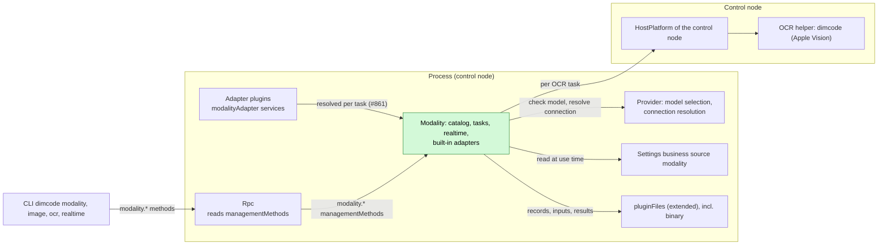
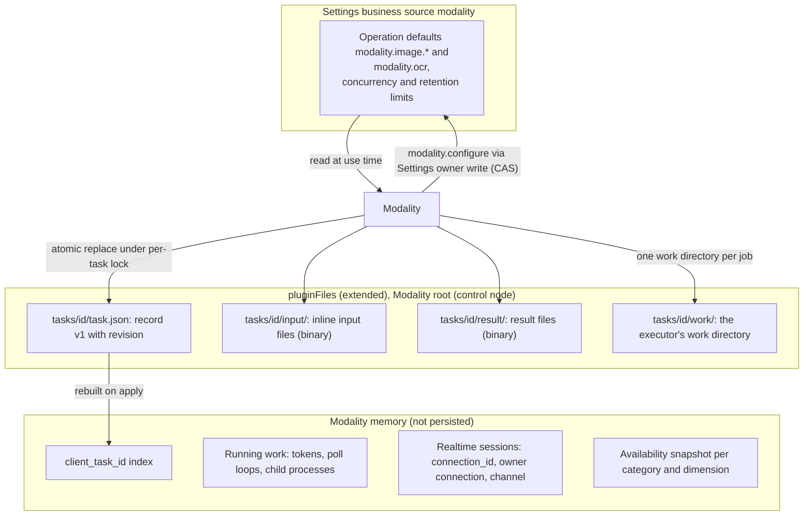
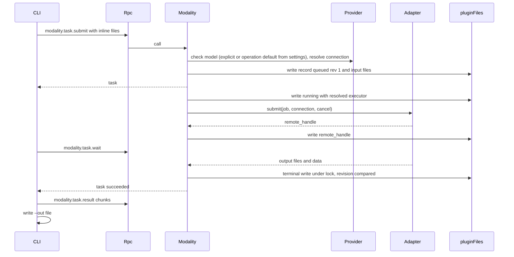
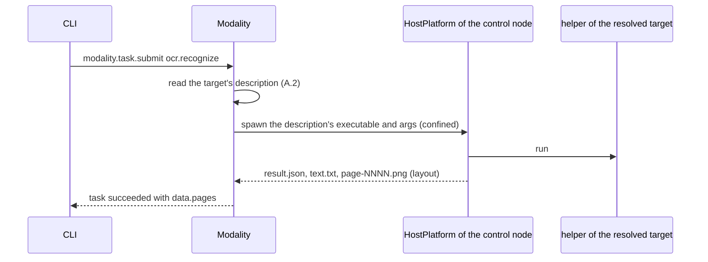
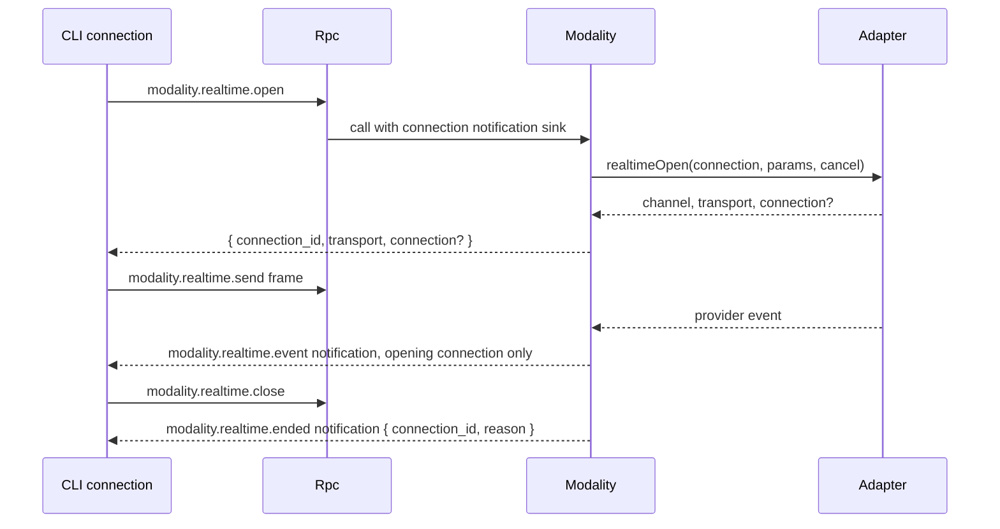

# Modality

Status: Draft. Overall design: [overview §4 Plugin catalog](../overview.md#4-plugin-catalog), [ADR 002](../../adr/002-plugin-scope.md). Phase: P3. Language: TypeScript first for provider-executed categories ([overview Appendix C](../overview.md#appendix-c-implementation-language)).

> **Adapters are resolved per task once the runtime lookup lands ([#40](https://github.com/arcships/dim/issues/40), [#861](https://github.com/arcships/dim/issues/861)).** [#40](https://github.com/arcships/dim/issues/40) decided in [#19](https://github.com/arcships/dim/issues/19) that Modality resolves a category's adapter when a task needs it instead of collecting every adapter as a dependency; the runtime mechanism that lookup needs is tracked by [#861](https://github.com/arcships/dim/issues/861). This design depends on that lookup and does not restate how an adapter is registered or found. Until it lands, the image slice reads the single process `modalityAdapter` service per call, so a missing adapter makes only its operations unavailable; §1 states the current form and the target.

> **P3: redesign with rutis' existing capabilities.** rutis is an external dependency; the requirements this document raises to rutis are withdrawn ([principles §4 rule 8](../../architecture/rust-agent/principles.md)).

Modality is a process plugin ([ADR 002](../../adr/002-plugin-scope.md): tasks and provider connections are shared across Sessions) and the single entry for non-conversational multimodal work in nine categories: image, video, speech, music, audio, 3D asset, motion, realtime and OCR. It reports availability per category with reasons, resolves the default model per operation from its own `modality` settings document (explicit, then configured default, then automatic through Provider's selection), runs asynchronous tasks (submit, status, wait, cancel) stored through `pluginFiles` (extended), and holds realtime connections bound to the opening client connection. Provider adapters are built into Modality or provided by adapter plugins, in any language, as named process services `modalityAdapter`; OCR runs as a host task on the control node, which starts the resolved target's helper — the build's own `dimcode` helper for Apple Vision, or one a process plugin supplies — through HostPlatform's confined spawn. Its methods are the namespace `modality`, which it registers with `managementMethods`: process-plugin methods about the host, which Rpc dispatches and never served to paired remote devices. Modality's settings, including its operation defaults, are business configuration in its own Settings business source, written through Settings typed operations and read at use time. It has no Session or branch part: it writes no Timeline events and offers no model-visible tool. The Rust implementation is the `dim-modality` crate, which depends on the App Server for the Settings service and management methods; the OCR helper's contract and Apple Vision engine live in the `dim-ocr` crate; the product's installer adds them, together with the built-in `dim-modality-aimux` adapter that executes the media operations aimux serves (A.2), to the process assembly.

## 1. Structure



All dependencies are process services at the same scope ([ADR 002 D3](../../adr/002-plugin-scope.md)). Adapter lookup is the per-task resolution [#40](https://github.com/arcships/dim/issues/40) decided in [#19](https://github.com/arcships/dim/issues/19); the runtime mechanism it needs is not delivered yet ([#861](https://github.com/arcships/dim/issues/861)). This design depends on that lookup and does not restate how an adapter is registered or found. **Until it lands**, the image slice reads the single process `modalityAdapter` service on each call without declaring a dependency: its absence makes only the adapter operations unavailable, a reload is picked up by the next call, and neither gates nor reloads Modality. That shape does not distinguish adapters by their adapter name. **After it lands**, Modality resolves an operation's adapter by name per task and can enumerate the adapters active now without a reload, so several adapters can serve different operations independently. Statements that distinguish the later form (the §4 table, Appendix B and flow test 8) state both forms; every other statement on this page holds today. Rpc looks up Modality's `modality` namespace in `managementMethods` per call and does not reload with it ([methods §3.2](../contracts/session-boundary.md#32-management-method)). No Session or branch plugin depends on Modality.

| Part | Scope | Depends on | Provides |
| --- | --- | --- | --- |
| `Modality` | Process (control node) | Provider model selection (`ModelSelectionHost`) and non-conversational connection resolution; `pluginFiles` (extended: UTF-8 and binary); Settings business source `modality`; the per-task adapter lookup [#40](https://github.com/arcships/dim/issues/40) decided, tracked by [#861](https://github.com/arcships/dim/issues/861) (not delivered; the slice reads the single process service per call until it lands); HostPlatform of the control node (OCR); diagnostics | `modalityTasks` process service; registers `modality` (`modality.*`) with `managementMethods` |
| Adapter plugins | Process | their own provider dependencies | `modalityAdapter` service, key adapter name, declared in the plugin's `provides`; resolved per task after [#861](https://github.com/arcships/dim/issues/861) lands |

**Contracts depended on:** the [methods](../contracts/session-boundary.md) contract (namespaces registered with `managementMethods`, per-call progress sink, connection-bound notifications); the per-task adapter lookup ([#861](https://github.com/arcships/dim/issues/861), §9.1); Provider's model selection (`ResolveModelSelection::resolve`, which rejects an unselectable explicit model; [AuxiliaryModel](../appserver/auxiliary-model.md)), its selectable-model read for the option list (§9.2), and, for every adapter operation and realtime session, its non-conversational connection resolution ([overview Appendix B.2](../overview.md#b2-app-server-process-plugins), §9.3); `pluginFiles` (extended) with binary atomic replace and a format version ([App Server README](../../../crates/dim-app-server/README.md#trusted-plugin-storage)); HostPlatform spawn with isolation ([HostPlatform](../../architecture/rust-agent/plugins/HostPlatform.md), isolation supplement in [overview Appendix B.1](../overview.md#b1-session-and-branch-capabilities)).
**Contracts defined here:** category and operation identifiers; default keys `modality.<category>` and `modality.<category>.<operation>` in the `modality` settings document (Modality's own; Provider holds none); the `modalityAdapter` and `modalityTasks` services ([language-neutral](../../adr/002-plugin-scope.md#d5-contracts-are-language-neutral), A.2 and A.3; Rust binding in Appendix G); the `modality` settings document and its schema; task record and result formats (format version 1); the `modality.*` methods and the `modality.realtime.event` and `modality.realtime.ended` notifications. Provider knows nothing about modalities; Modality knows no provider-specific semantics outside its adapters.

## 2. Data and state



Task records are the only durable state; the index is rebuilt from them on `apply`, and non-terminal records are settled by the startup rule (§4). Running work and realtime connections are never rebuilt. Modality settings, the operation defaults included, are business configuration ([ADR 002 D4](../../adr/002-plugin-scope.md)), written through Settings typed operations into the `modality` business source under the schema Modality declares: a change is a data update with a notification, read at the next use, never a reload (A16). The set of adapter plugins is structural configuration in loader rows. How Modality finds their `modalityAdapter` services is the per-task lookup [#40](https://github.com/arcships/dim/issues/40) decided; its runtime mechanism is [#861](https://github.com/arcships/dim/issues/861). Until it lands, Modality reads the one process `modalityAdapter` service per call (see §1 and §9.1). A task's `node` names the node its executor runs on (A15); OCR runs on the control node, and a task naming another node fails `node_unavailable` because no other node's HostPlatform is reachable. No Timeline state, no `StateCell`; ordering of competing writes uses the record `revision` under the per-task lock.

The `defaults` member holds one entry per operation key, each a Provider model reference. Image operations use per-operation keys and have no category fallback in this design; the `modality.` prefix names the setting, not another nesting level:

```json
{
  "defaults": {
    "modality.image.generate": {"providerId": "openai", "modelId": "gpt-image-2"},
    "modality.image.edit": {"providerId": "openai", "modelId": "gpt-image-2"}
  }
}
```

## 3. Flows

### 3.1 Submit, wait and retrieve (`dimcode image generate`)



The CLI reads inputs and writes outputs itself; Modality writes only inside its storage root (A7).

### 3.2 OCR on the control node



Modality has no Session, so OCR runs on the control node. The `node` parameter and `node_unavailable` stay in the contract: a task that names a node other than the control node fails `node_unavailable`, because no other node's HostPlatform is reachable.

An OCR target is a host target: `local/apple-vision`, the build's own helper, or `local/pp-ocr`, a helper a process plugin supplies (A.2). Modality starts either the same way: it reads the target's description — the executable, its arguments and the paths it must read — and starts it through HostPlatform's confined spawn (§7, A.14); its artifacts and parameters are in A.1 and A.2. Modality names no product executable of its own: the description is the target's, and the Apple Vision target's description is the build's.

### 3.3 Realtime connection



A session ends on `close`; when the opening client connection ends, silently, because nothing can be written to it; when the provider ends it; at a direct connection's `expires_at`; after 10 minutes without a `send` or a provider event (A9); on Modality unload, reported best-effort as `unloaded`; and on process exit. A slow client is disconnected by the transport's held allowance, and its sessions end with it. A session has no task record, is never stored and is never resumed after a daemon restart. Frames are bounded: a `send` of more than 1 MiB of decoded data fails `invalid_input` and the session stays open, while a provider message over the adapter's bound ends the session with `ended {reason: "error"}`. At most four sessions are open per process; `open` past it fails `realtime_limit` before any provider call. `send` and `close` from a connection other than the opening one answer `not_found`.

### 3.4 Capability listing and default model

`dimcode modality` and the Web settings page call `modality.capabilities`, which returns every category and operation with its availability reasons, selectable options, the persisted default and the model a task or consumer would use now. Nothing is hidden and there is no `--all`. Each unavailable category or operation is shown with its reason per dimension, for example "not in this build", "Apple Vision needs macOS 12 or later on Apple Silicon", "the PP-OCR plugin is not running", "the PP-OCR plugin needs an update", "no adapter", "not configured", "no adapter for the configured model" (decision E16). The last is derived from business configuration Modality has adopted (the default in the `modality` settings document or an explicit model, and its Provider connection) against the adapters Modality can resolve (§9.1).

The image operations are the first implementation slice, and the product build now ships an adapter for part of it: the built-in `dim-modality-aimux` adapter (A.2) serves `generate` and, where the provider's package reads an edit's input files, `edit` through aimux, and `enhance` remains an adapter operation no build serves, so it reports `unavailable` with an `adapter` reason. Availability is a property of the runtime and is answered per model: `available` is true once the adapter is installed, and `operations` decides what it serves for the model a task names. The adapter is bound to the bundled catalog providers listed in A.2, so a created provider — whose id is a canonical UUID and matches no binding — reports the `adapter` reason for any media model it declares and its models are refused at `configure` with that reason. A collected adapter that serves none of the models Provider lists is not a missing adapter and says so: the image operations keep the `adapter` dimension with "the adapter serves no image model Provider lists", and their options are the declared models, as for any operation no adapter serves. `understand` resolves and displays its default but has no runtime consumer until §9.4 lands. Configurability is a property of settings: `configure` accepts a default for every A.1 operation that has a default key whenever the model is in that operation's options, so defaults can be persisted before a runtime lands, and an operation this build cannot run keeps `available: false` with its `build` or `adapter` reason. Flow tests configure the fixture adapter to serve the adapter operations they exercise, and the end-to-end flows run the built-in adapter against a stub provider.

`dimcode modality set-default image.generate <provider>/<model>` and the Web page call `modality.configure`, which validates that the model is one of the operation's options: for an adapter operation, that an available adapter serves it; for `image.understand`, that it is a selectable vision model; for an operation no adapter serves, that the model is in Provider's modality read and its catalog entry declares `<category>.<operation>`, which may be a model execution cannot select (a non-chat model or one whose text limits are undeclared). It then writes the operation key in Modality's own `modality` settings document through its owner write (Settings CAS). `model: null` clears that key. The reply is the same snapshot `modality.capabilities` returns, including the new `revision`, so a client applies it without a second read.

A task resolves its model in this order: the explicit `model` in the request; the persisted default for the operation key; automatic resolution — Provider's global default selection when that model is selectable and serving the operation, otherwise the first selectable model that serves it in the order Provider's selectable-model read returns. An explicit model or a persisted default that is no longer selectable fails the task (`model_unavailable` or `default_unavailable`); an operation with no available adapter for the resolved model fails `unavailable`. Modality never substitutes another model. Only an absent default reaches automatic resolution, so clearing a default restores it. The resolved model is written into the task record and does not change when the default changes later.

`image.understand` uses the same resolution but has no task: Modality resolves its default and exposes it in `modality.capabilities`, and the Session image-understanding path (attachments and `read`) is the consumer. That path does not read the default yet; the Agent/Prompt requirement in §9.4 must land before the default changes the model the runtime uses. Until then the understanding row resolves and displays only.

The `modality` source is user scope only: operation defaults belong to the user, not a project. A missing source reads as empty defaults. The methods are additive protocol-v3 management methods; an older daemon answers `unknown_method` and a client shows the category unavailable. The legacy product's `modality-settings.json` is not imported; a later migration would be its own change. Provider records, model descriptors and the chat default selection are unchanged; Modality stores no Provider or Session state and writes no Timeline event.

## 4. Timing and conflicts

Modality is not branch work: turn and branch facts never affect tasks. Races are decided by the task record `revision` under the per-task lock.


The adapter row states the target design after [#861](https://github.com/arcships/dim/issues/861) lands and the current form before it; the other rows hold today.

| Scenario | Outcome | Owner |
| --- | --- | --- |
| Adapter plugin reloads | Modality never reloads with an adapter. A running adapter call may be interrupted; its task becomes `interrupted` and is never resubmitted. Before [#861](https://github.com/arcships/dim/issues/861) the slice reads the single process service per call, so the next task resolves it again; after it lands, adapters are resolved by name, so a reload affects only the operations that adapter served. Tasks with a handle resume by polling and realtime connections close in both forms | Modality, runtime ([#861](https://github.com/arcships/dim/issues/861)) |
| Modality reload | `modality.*` returns `unknown_method` until Modality is active again, and Rpc does not reload; in-flight calls follow the [methods](../contracts/session-boundary.md) contract; disposer cancels local work, terminates running OCR helpers, closes realtime connections, writes `interrupted` for host tasks and tasks without handle | Rpc, Modality |
| Settings change | Read at next use; availability recomputed; existing tasks keep their resolved executor; no reload | Modality |
| Duplicate `submit` with the same `client_task_id` | Existing task returned | Modality |
| Client detach while waiting | Task continues; that client's realtime connections close | Modality |

Full table in Appendix B.

## 5. Context mapping

No model-visible effect. Modality offers no tool, prompt source, input or Timeline fact (decision E16, A13). A result reaches a model only when a user puts it into a Session by ordinary means (an `@` file reference, an attachment, pasted text), which are input facts owned by their plugins. The model never sees task records, availability, defaults, progress or diagnostics. Compaction, child branches and non-interactive Sessions are therefore unaffected.

## 6. Interfaces (summary)

| Interface | Kind | Purpose |
| --- | --- | --- |
| `modality.capabilities` | Management method | Every category and operation with availability reasons, selectable options, persisted default, effective model and settings revision |
| `modality.configure` | Management method | Validate, then set or clear one operation default in Modality's `modality` settings document (owner write, Settings CAS); returns the new snapshot |
| `modality.task.submit/status/list/wait/cancel/result` | Management methods | Task lifecycle; chunked binary result retrieval |
| `modality.realtime.open/send/close`, `modality.realtime.event`, `modality.realtime.ended` | Management methods and connection-bound notifications | Realtime sessions |
| `modalityTasks` | Process service, no key | Same operations as the task methods, for other process plugins |
| `modalityAdapter` | Process service, key adapter name; after [#861](https://github.com/arcships/dim/issues/861) resolved per task by name; the image slice reads the single process service per call (§9.1) | Provider-executed categories |
| `ocrHelper` | Process service, no key, provided by a plugin's process row; Modality reads it per call (§9.1) | The description of the `local/pp-ocr` target: executable, args, read paths (A.2.1) |
| `modality` settings document | Business configuration (Settings source, schema declared by Modality, written through Settings typed operations) | Operation defaults, limits; read at use time |
| `dimcode modality`, `image`, `video`, `speech`, `music`, `audio`, `asset`, `motion`, `ocr`, `realtime` | CLI | Thin clients of the methods |

Details in Appendix A.

## 7. Security

- All `modality.*` methods are management methods (they spend provider credit and run host processes): only a process plugin provides them, and they are never served to paired remote devices ([methods](../contracts/session-boundary.md)); RemoteGateway never serves them.
- The authenticated loopback Web entry is served exactly `modality.capabilities` and `modality.configure`; task, realtime and result methods stay unavailable to browser clients. Replies contain model identities, availability reasons and the settings revision, never credentials, task records or results.
- Credentials are resolved by Provider per call; never in records, results, diagnostics or errors.
- The Apple Vision helper is this build's own `dimcode` executable, started by Modality through HostPlatform's confined spawn: the input readable; the task's work and temp directories and the OCR cache writable; no network; a timeout and output caps (A14). Its path is the running binary, never request data.
- A plugin-supplied OCR helper is started from that plugin's description (A.2): the executable, its arguments and its read paths come from the plugin's process service, never from request data. Modality adds the task's input to those read paths and makes the task's work directory the helper's only write path; no network; `SystemServices::None`; the operation's timeout and output caps (A14).
- A platform without confinement — Windows, and Linux without `bubblewrap` on the captured `PATH` — runs the helper unconfined, as agent commands do there; the task's executor records `confined: false` (A.4, A14).
- Inline inputs are size-checked and stored under the task directory; `node_path` is read by the OCR helper on the control node, or in place by a provider task's adapter in the control node's process. Modality never writes outside its storage root; files are owner-only.
- Realtime events go only to the opening connection.

## 8. Rule check

Rules: [principles §1 and §4](../../architecture/rust-agent/principles.md), [ADR 002](../../adr/002-plugin-scope.md) D1–D5.

| Rule | How this document complies |
| --- | --- |
| §4.1 Command events for state owned by others | Modality changes only its own task records; operation defaults are Modality's own business configuration, written through Settings' typed owner write (CAS) on its `modality` source, with no Timeline. |
| §4.2 No withdrawal after handover | Not applicable: Modality hands no Timeline object to another module; a task's terminal state is decided once under its lock. |
| §4.3 Intervene before a write only through before callbacks | Not applicable: Modality registers no before callback and adds no check at a Session or RPC entry; it validates only its own method parameters. |
| §4.4 Core mechanisms carry no business meaning | Modality asks no change of Timeline, Dispatcher or Rpc; Provider holds no per-consumer keys; Modality passes the model explicitly. |
| §4.5 Read the whole batch before deciding | Not applicable: Modality reads no Timeline event. |
| §4.6 Model context only from handed-over events | Modality writes nothing model-visible; a result reaches a model only as an ordinary input owned by another plugin. |
| §4.7 Plugins interact only through public events and services | Modality uses Provider, Settings, `pluginFiles`, HostPlatform, the `modalityAdapter` services it may resolve (§9.1) and the `ocrHelper` service a plugin provides, all through their public services only. |
| §4.8 Generic requirements to mechanism owners | The per-task adapter lookup, Provider's selectable-model read and Provider's non-conversational connection are raised in §9. |
| §4.9 Only facts later decisions use enter the Timeline | Modality writes no Timeline event; task records stay in `pluginFiles`, the operation defaults and other settings in its Settings business source. |
| §1 Capability and App Server boundary | Modality is a process plugin, not a Capability; its business code lives in its own package, and the App Server only dispatches the namespace it registers with `managementMethods`. |
| ADR 002 D1 Scope follows the owner | Tasks and provider connections are shared across Sessions, so Modality is process-scoped. |
| ADR 002 D2 No wiring modules | Adapter lookup is runtime work tracked by [#861](https://github.com/arcships/dim/issues/861); this design adds no wiring module. |
| ADR 002 D3 Dependencies follow scope | All dependencies are process services. Adapters are read per call, so a missing adapter affects only its operations before and after [#861](https://github.com/arcships/dim/issues/861); after it lands each adapter is resolved by name. |
| ADR 002 D4 Structural and business configuration | Adapter plugins are loader rows; the operation defaults and the limits are business configuration in the `modality` source, written through Settings and read at use time. |
| ADR 002 D5 Language-neutral contracts | `modalityAdapter`, `modalityTasks` and the methods are given in neutral form; Appendix G is a binding only. |

## 9. Requirements raised to mechanism owners

Rules: [principles §4 rule 8](../../architecture/rust-agent/principles.md). Each entry states the problem, the existing mechanisms considered, the generic capability, the impact on ordering and reload, and the owner/issue.

| Requirement | Owner | Five items |
| --- | --- | --- |
| Services imported from a peer node stay registered while the link is down and fail calls with `node_unavailable` | rutis, [#5](https://github.com/arcships/dim/issues/5) | [ExternalAgent §9](ExternalAgent.md#9-requirements-raised-to-mechanism-owners) |
| Runtime services exposed by name to non-Rust plugins | runtime, [#4](https://github.com/arcships/dim/issues/4) | [session access §9](../contracts/session-access.md#9-requirements-raised-to-mechanism-owners); needed only for a TypeScript implementation of Modality |
| Per-task adapter lookup without gating Modality | runtime/assembly, [#861](https://github.com/arcships/dim/issues/861) | [§9.1](#91-per-task-adapter-lookup) |
| Provider read-only contract for selectable models and declared capabilities | Provider, [#790](https://github.com/arcships/dim/issues/790) | [§9.2](#92-provider-read-only-contract) |
| Provider non-conversational connection | Provider, [#799](https://github.com/arcships/dim/issues/799) | [§9.3](#93-provider-non-conversational-connection) |
| Session image-understanding consumer of `modality.image.understand` | Agent/Prompt owner, [#798](https://github.com/arcships/dim/issues/798) | [§9.4](#94-session-image-understanding-consumer) |

The Settings business source and the `pluginFiles` supplement are changes to other plugins, listed in [overview Appendix B.2](../overview.md#b2-app-server-process-plugins).

### 9.1 Per-task adapter lookup

- **Problem.** An adapter that is missing, Pending, Failed or reloading must not hold Modality Pending or reload it; only the operations that adapter served may become unavailable. A dependency on every `modalityAdapter` service does the opposite.
- **Existing mechanisms.** Declaring each adapter with `Keyed` gates the consumer until every provider is Active; collecting named services has the same effect. The optional per-call read (`Ctx::get`, `Ctx::get_at`) does not gate, and Rpc and `AgentIndex` read `managementMethods`, `sessions` and `auxiliaryModel` that way; but the catalog keys one name to one key per copy and a bridged plugin's `provides` entry carries no per-provider instance key, so several providers of one name cannot each be resolved by their adapter name and a consumer cannot enumerate the active ones. Registration tables (`managementMethods`, `toolRegistry`) deliver contributions to their owner, but they are not services: adapters would have to depend on a table owner and register callbacks, which inverts the declared dependency and duplicates the `modalityAdapter` contract.
- **Needed capability.** A per-call resolution of a process-scoped provider by its provider identity (the adapter name) that does not gate the consumer and creates no reload relation in either direction: a provider that is absent, Pending, Failed or reloading is simply not resolved for that call, and the next call sees it when it returns. An equivalent shape, such as a distinct registered name per configured provider read optionally per call, is acceptable if the owner can enumerate the providers active now without a reload when one appears or goes away.
- **Ordering impact.** Adapter unload/reload affects only its operations; no Modality reload and no Timeline or batch change; in-flight tasks settle per A.6.
- **First slice.** Until this lands, the image slice reads the single process `modalityAdapter` service per call (`Ctx::get`) and declares no adapter dependency: absence makes only the adapter operations unavailable, with no gate and no reload relation. That is the target resolution shape for one adapter; enumerating several adapters by their adapter name and resolving them per task still needs this issue.
- **The OCR helper service.** A target a plugin supplies is read the same way, on every OCR task: the plugin's process row provides the process-wide service `ocrHelper` (A.2), Modality reads it per call without declaring a dependency, and a service that is absent, Pending, Failed or reloading resolves to nothing, so only that target disappears. One provider of one name needs none of this issue's per-provider resolution: there is exactly one helper service, and its absence is the target's absence.
- **Owner/issue.** runtime/assembly, [#861](https://github.com/arcships/dim/issues/861). [#40](https://github.com/arcships/dim/issues/40) decided the consumer side in [#19](https://github.com/arcships/dim/issues/19) and is closed; Modality only declares the dependency.

### 9.2 Provider read-only contract

- **Problem.** `modality.capabilities` must compute `options` and automatic resolution from the models Provider can select. Provider's model-selection port resolves one model, and the catalog reads are client management methods, so a process owner cannot enumerate the selectable set with its declared capabilities.
- **Existing mechanisms.** The single-model selection port cannot filter by an operation's capability. A new client method would expose management to the owner and duplicate the catalog. The Provider-side read-only contract is tracked separately by [#790](https://github.com/arcships/dim/issues/790). Delivered: the process host port `SelectableModelsHost` in `dim-agent-capabilities`, provided by Provider and by the configured model profile, whose `selectableModels` read enumerates the models execution would accept with their declared capabilities.
- **Needed capability.** That read is shaped for execution: a model without a `text` modality, a non-chat model and a model whose text limits are undeclared never appear, so the image, video, speech, music, audio, asset, motion and realtime models Modality routes to are all missing. Provider adds one read to the same port, `selectableForModality`, returning each model it would select for a non-conversational use with the `<category>.<operation>` ids its catalog entry declares. It applies the same provider, account, model, route, credential and status rules as `selectableModels`, without those three chat requirements.
- **Ordering impact.** Read at each `capabilities` call and task submission; no reload and no Timeline.
- **Owner/issue.** Provider, [#790](https://github.com/arcships/dim/issues/790) and this change.

### 9.3 Provider non-conversational connection

- **Problem.** Image generation and editing adapters need a model's endpoint, protocol and credential material per call. Provider resolves connections only for a `ModelRequest`.
- **Existing mechanisms.** `ProviderConnectionResolver` is tied to `ModelRequest`; adapters cannot own Provider credentials, and Modality must not store them.
- **Needed capability.** A per-call resolution of a model's non-conversational connection, owned by Provider, used only for that call and never persisted or returned to a client. Provider defines the contract on its own page ([provider management §3.6](../appserver/provider-management.md#36-selectable-models-for-process-owners)): the input, the reply, the selectability and credential rules, and the lifetime. The port is `ResolveModalityConnection` and `ModalityConnectionHost` in `dim-agent-capabilities` with `ModalityTarget` carrying the model identity and the operation; Modality resolves it per adapter call (`submit`, `wait`, `cancel_remote`) and passes the connection to the adapter. Adapters call it and hold no credentials.
- **Ordering impact.** Resolved at submit; no reload; credentials never enter task records, results, diagnostics or errors.
- **Owner/issue.** Provider, [#799](https://github.com/arcships/dim/issues/799).

### 9.4 Session image-understanding consumer

- **Problem.** Modality resolves `modality.image.understand`, but the Session image-understanding path (attachments and `read`) sends images to the Session's adopted model; nothing reads the Modality default. Until this requirement lands, the understanding row can resolve and display only.
- **Existing mechanisms.** `read` returns image blocks to the Session model, and `session.model.update` plus Prompt's adopted configuration choose that model. There is no input path or typed lookup from the Session path to a process owner's default. Choosing in the browser would be the browser-only default the requirement excludes.
- **Needed capability.** The Session image-understanding path resolves its model through Modality's `modality.image.understand` default (explicit → default → automatic), or an equivalent typed handoff. The mechanism belongs to Agent/Prompt.
- **Ordering impact.** Per read or attachment; no Timeline event; existing Sessions keep their behavior until the requirement lands; no reload.
- **Owner/issue.** Agent/Prompt owner, [#798](https://github.com/arcships/dim/issues/798).

## Appendix A. Interface details

### A.1 Categories and operations

| Category | CLI | Operations | Input | Result | Executor | Default key |
| --- | --- | --- | --- | --- | --- | --- |
| `image` | `image` | `generate`, `edit` (image, optional mask), `enhance` (`upscale`, `restore`, `denoise`, `sharpen`, `remove_background`, `colorize`), `understand` (image; selection only, consumer is the Session image-understanding path) | prompt, files; image for `understand` | image files; text for `understand` | Provider | `modality.image.generate`, `modality.image.edit`, `modality.image.enhance`, `modality.image.understand` |
| `video` | `video` | `generate`, `edit`, `enhance` | prompt, files | video file | Provider | `modality.video` |
| `speech` | `speech` | `synthesize`, `transcribe` | text or audio | audio file; or `data: { text, segments: [{ start_ms, end_ms, text }] }` plus `transcript.txt` | Provider | `modality.speech.synthesize`, `modality.speech.transcribe` |
| `music` | `music` | `generate` | prompt | audio file | Provider | `modality.music` |
| `audio` | `audio` | `generate` | prompt | audio file | Provider | `modality.audio` |
| `asset` | `asset` | `generate` | prompt, optional images | 3D file | Provider | `modality.asset` |
| `motion` | `motion` | `generate` | prompt | motion data file | Provider | `modality.motion` |
| `realtime` | `realtime` | `voice`, `transcribe`, `avatar` | — | session | Provider | `modality.realtime` |
| `ocr` | `ocr` | `recognize` | image or PDF | `data: { pages: [{ page, text? }], textTruncated? }`, whose page texts stay within 1 MiB and whose later pages carry only `page`; `result.json`; `text.txt`; in `layout` mode `page-NNNN.png` per rasterized page | Host helper (`local/apple-vision`, or a target a plugin supplies) | `modality.ocr` |

Image understanding is an image operation whose default is resolved by Modality (`modality.image.understand`). Its consumer is the Session image-understanding path (attachments and `read`, [WorkspaceTools §read results and images](../../architecture/rust-agent/plugins/WorkspaceTools.md#read-results-and-images)); that path does not consume the default yet, so the Agent/Prompt requirement in §9.4 must land before the default changes the model the runtime uses. Until it does, the understanding row resolves and displays only. Image operations use per-operation keys and have no category fallback in this design; other categories resolve a per-operation key before their category key (A3). Operation parameters beyond the input are declared by each adapter and validated at submission (A4); a host operation declares its own: `ocr.recognize` accepts `params.outputMode`, `"text"` (the default) or `"layout"` (A.2).

The canonical capability id of an operation is `<category>.<operation>`, for example `image.generate` and `realtime.voice`; Provider's `modalityCapabilities` declarations use the same strings, and the snapshot carries the two fields rather than repeating the id. There is no alias (`image.read` is not one) and no id for a realtime sub-call: `open`, `send`, `close` and `event` are methods, and `realtime.voice`, `realtime.transcribe` and `realtime.avatar` are the realtime capabilities. This build serves `realtime.voice` through the built-in adapter; the other two report the `adapter` dimension, and their detail names the operation, as "No available adapter serves realtime.transcribe".

### A.2 Adapters and OCR

Service `modalityAdapter`, scope process, key adapter name, declared in the adapter plugin's `provides`; built-in adapters provide the same service. How an adapter is registered and found is the per-task lookup [#40](https://github.com/arcships/dim/issues/40) decided, tracked by [#861](https://github.com/arcships/dim/issues/861) (§9.1); this design depends on it and does not restate it. Until it lands, Modality reads the single process `modalityAdapter` service per call, so a missing or reloading adapter affects only its operations. Once it lands, Modality resolves the adapter for an operation by adapter name when a task needs it. Cancellation is a protocol action: Modality drops the call (or sends the binding's cancel request); the adapter stops local work. Errors are data `{ code, message }` with `code` one of `invalid_input`, `unavailable`, `provider_error`.

| Method | Kind | Request | Reply |
| --- | --- | --- | --- |
| `available` | sync | `{}` | `{ available: bool, reason? }`; read at each use, no reload on change |
| `operations` | sync | `{ model: {providerId, modelId} }` | `[{ category, operation, params_schema }]` |
| `submit` | async | `{ job: Job, connection: ResolvedConnection }` | `{ remote_handle? }` |
| `wait` | async | `{ task_id, remote_handle?, connection }`; progress as `{ fraction?, message? }` notifications on the call | `{ files: [{ name, media_type, path }], data? }`; `path` inside the job's work directory |
| `cancelRemote` | async | `{ remote_handle, connection }` | `{ outcome: "cancelled" \| "unsupported" \| "already_finished" }` |
| `realtimeOpen` | async | `{ connection, params }`; provider events as `{ channel_id, event }` notifications on the call until closed | `{ channel_id, transport, connection? }`; `transport` is `relay` or `direct`, and `connection` is a `direct` session's short-lived provider material, `{ kind, url?, token?, offer?, ice_servers?, expires_at? }` |
| `realtimeSend` | async | `{ channel_id, frame: { kind: "text" \| "audio" \| "control", data } }` | `{}` |
| `realtimeClose` | async | `{ channel_id }` | `{}` |

`Job` is `{ task_id, category, operation, model: {providerId, modelId}, params, files: [{ name, media_type, path }], work_dir }`. An inline input's `path` is the absolute path of the file Modality stored at `modality/tasks/<task_id>/input/<name>`; an input supplied by `node_path` carries the canonical path Modality recorded (its last component must not be a link; earlier links are resolved), which Modality read once for `bytes` and `sha256` and never copies, and the executor reads it in place. `work_dir` is the task's `modality/tasks/<task_id>/work` directory, created before the call; every result file resolves to a regular file inside it. `ResolvedConnection` is the data shape Provider's non-conversational connection resolution returns (`kind`, `provider_id`, `model`, endpoint and credential material, and the catalog entry's `realtime: { protocol, path }` declaration for a `realtime.*` use), passed per call and never stored or logged. The declaration is Provider's read of the entry's `metadata.raw.realtime`; a model whose entry declares none, and a configured-model profile, which never carries one, is refused `unavailable` with "The model declares no realtime transport" before the adapter is called. The relay takes the socket URL from the connection's base URL, the declared `path` and the model id, so the path is declared by the catalog entry and never derived.

The product's built-in adapter is the `dim-modality-aimux` crate: aimux vocabulary stays inside the adapter. It serves `image.generate`, `image.edit`, `video.generate`, `speech.synthesize` and `speech.transcribe`, bound by catalog provider id, and `realtime.voice` for any model whose entry declares the openai-realtime transport: a realtime session is built from the connection, not from a vendor row. The relay connects to the connection's base URL with the declared path and the model id as its query, `http` and `https` becoming `ws` and `wss`; it sends the connection's headers and its bearer, connects through the connection's proxy, bounds a provider message at 1 MiB at the socket, writes text frames as JSON and audio frames as the decoded bytes, and ends the session on a provider close, a socket failure or a frame it cannot write within ten seconds. It carries no control frames; those belong to a `direct` transport. A row exists for each bundled catalog provider whose media models an aimux vendor package executes (openai, google, xai, grok-build, elevenlabs, fal, deepgram, assemblyai, cartesia, gladia, groq, replicate, stability-ai, recraft, black-forest-labs, luma-ai, runway, kling, hume-ai, mistral-ai, rev-ai), and each row serves only what its package implements. `image.edit` is served only by a package that reads the bytes an edit sends: openai, google, fal, replicate and black-forest-labs do, while stability-ai, recraft and luma-ai serve `image.generate` alone; a package that reports no file input for a given model drops edit for that model too. xAI's image models report `adapter` because that package answers `NoSuchModel`, and its transcription and synthesis models are served. A created provider's id is a canonical UUID, which matches no row, so its media operations report the `adapter` reason and `configure` refuses its models with it. The other A.1 categories (music, audio, 3D asset, motion) have no rows and keep the `build` reason. Amazon Bedrock has no media declaration in the bundled catalog, so a Bedrock connection serves no media operation. `available` answers true once the adapter is installed; what it serves is answered per model by `operations`, so an unreachable endpoint is a call's failure, not a capability. Video is the one resumable operation: `submit` stores the provider's operation reference as the handle and `wait` polls it and streams the result to a file, so a restart resumes the same job instead of starting another; a job that has not settled one hour after its start fails `provider_error`, which keeps a never-settling job from holding a scheduler slot. The hour also bounds a status request in flight and the wait between polls, so a stalled request fails at the deadline rather than running out the connection's longer timeout. aimux exposes no cancel for a started video job, so `cancelRemote` answers `unsupported` and the provider job runs to completion and is billed on its side. An output file's media type is read from the returned bytes, so a provider that answers a format other than the requested one is recorded by what it returned.

`available` reports runtime availability without a reload (for example, a provider endpoint unreachable). An operation whose available adapters do not serve the configured or explicit model is reported as "no adapter for the configured model", and its submits fail `unavailable`. `image.understand` is not an adapter operation: it is served by a selectable vision model and is selection-only. OCR is not an adapter: it is a host task whose target is one of the host targets this build offers, `local/apple-vision` or `local/pp-ocr`, and both are started from a description the target publishes (A.2.1); when `local/pp-ocr` is not offered, it is not an option and `modality.ocr` still resolves `local/apple-vision`. A task naming a node other than the control node fails `node_unavailable`. `wait` names its job by `task_id`; when `submit` returned a `remote_handle`, the adapter may use it instead. `wait` with a stored `remote_handle` must work in a new generation; an adapter that returns no handle keys its own in-flight work by `task_id`, and only within one generation, so it cannot be resumed.

The helper is called with the target's description (A.2.1): its `executable` and `args`, followed by `--input <path> --artifacts <dir> --output-mode <text|layout>`. It prints one JSON line: `{"ok": true, "pageCount": N}` and exits 0 on success, or `{"ok": false, "error": {"code", "message"}}` and exits 2 for a typed refusal; any other exit is a failure. Its artifacts are `result.json`, `text.txt` (the document's `text`) and, in `layout` mode only, one `page-NNNN.png` per rasterized page. All names are single components, so `settle_output` needs no exception. `result.json` is `{ text, pageCount, pages: [{ page, text, width, height, imagePath?, regions: [{ text, confidence, polygon }] }] }`: `page` is 1-based, the same field and numbering as `data.pages`; `imagePath` names that page's image file and is absent in `text` mode, where a rasterized page's image is discarded; `regions` are present in both modes, with `confidence` in [0, 1] and each polygon inside the page bounds. The error codes are `invalid_input`, `encrypted_pdf`, `resource_limit_exceeded`, `local_runtime_unavailable` and `local_runtime_failed`. The input type is sniffed from the bytes, never from the declared media type. The limits are 500 pages, 25,000,000 pixels per page, 1 GiB of artifacts per task and 100 MiB of input; the artifact bound is charged as each file is written, so the directory never holds more than it. Modality builds `data.pages` from one streaming parse of `result.json`, never decoding the document's `text` member and keeping at most `MAX_DATA_TEXT_BYTES` (1 MiB) of page text; a page whose text would cross that budget keeps its number without a `text`, and `data.textTruncated: true` tells the client to read `text.txt` for the whole text. The daemon opens each artifact through the plugin files storage, whose walk never follows a link and accepts only a regular file, so a FIFO or a link left at an artifact name is refused rather than read; it refuses the task when the opened artifacts exceed the 1 GiB bound before reading any of them, and a read never exceeds the length pinned when the file was opened.

#### A.2.1 OCR targets

Two targets share one contract. `local/apple-vision` is the build's own: its description names the product's own executable and the `ocr-helper` argument, so the executable is never request data. `local/pp-ocr` is supplied by a plugin: the plugin's process row provides the process-wide service `ocrHelper` (no key), and Modality reads it per call (§9.1) without declaring a dependency. While the service is absent — the plugin is not installed, or its row is off, Pending, Failed or reloading — the target is not listed and nothing else in Modality changes; a task already running keeps the description it read at its start. That description names a directory PluginManager keeps on disk until the process exits, so an update, a re-acquisition or a removal affects only later calls ([PluginManager §7](PluginManager.md#7-security)). If the copy is unreadable when the helper starts — for example, a user deleted it by hand — the helper fails at load, the task settles `local_runtime_failed` through the unexpected-exit path, and its work directory is removed.

| Method | Kind | Request | Reply |
| --- | --- | --- | --- |
| `describe` | sync | `{}` | `{ contract: 1, target: {providerId: "local", modelId}, label, executable, args, read }` or `null` |

`describe` returns the description or null. Modality calls it when it builds the snapshot's options and at the start of every OCR task, never caches it across calls, and never stores it in the task record. `contract` is the helper-contract version the plugin implements: Modality offers the target only when it is `1`, its own version, and otherwise marks the target unavailable with the `runtime` reason "the PP-OCR plugin needs an update". `target` gives the model id the service provides (`pp-ocr`), so the target is `local/pp-ocr`; `label` is English display text; `executable` is an absolute path; `args` are the arguments that precede `--input`, each one argument; `read` lists absolute paths the helper must read — the canonical Node installation root and the plugin directory, each resolved through real paths — and Modality adds the task's input to them.

A task on a plugin-supplied target starts `executable args… --input <path> --artifacts <dir> --output-mode <text|layout>` through `HostPlatform::spawn_confined` with `Confinement { read: the description's read paths plus the input, write: [the task's work directory], timeout: 30 minutes, stdout_limit: 64 KiB, stderr_limit: 64 KiB, services: SystemServices::None }`. The helper writes its temporary files inside the artifact directory, because nothing else outside the work directory is writable. Its artifacts, JSON line, error codes and limits are the ones below; untrusted input is parsed only in that helper, never in Modality or the daemon, and Modality never names the engine — it reads the description and publishes what the helper wrote.

Targets by platform:

| Platform | `local/apple-vision` | `local/pp-ocr` |
| --- | --- | --- |
| macOS arm64 12+ | yes | yes |
| macOS x64 (Intel) | absent, `platform` | yes |
| Linux x64/arm64 (glibc) | absent, `platform` | yes |
| Linux x64/arm64 (musl) | absent, `platform` | yes |
| Windows x64/arm64 | absent, `platform` | yes |

`local/pp-ocr` is offered wherever the plugin's engine publishes a platform package and Node is available; a platform where the plugin is not installed, or its row is not serving, lists only `local/apple-vision`. `local/apple-vision` stays Apple Silicon only because its recognition path needs Apple Silicon I/O clients, and reports the `platform` reason elsewhere, as it does today. Modality reads only the `ocrHelper` service, so it cannot and does not tell "the plugin is not installed" from "its row is not serving": a persisted default naming `local/pp-ocr` while the target is not offered stays in the snapshot's options marked unavailable with the one `runtime` reason "the PP-OCR plugin is not running". `configure` accepts a target the snapshot currently offers and never answers `modality_unavailable`; an explicit model that is neither host target fails `model_unavailable`.

Text mode differs between the targets: `local/apple-vision` prefers a PDF's embedded text layer through PDFKit and recognizes only the pages it must, while `local/pp-ocr` has no native-text path and rasterizes every page, so the same PDF can yield different text. Both obey the same limits and produce the same `result.json` shape.

### A.3 Methods

Namespace `modality`, registered with the process's `managementMethods` (declarations and `call` per the [methods](../contracts/session-boundary.md) contract); every method is a management method. `modalityTasks` (process, no key) offers `submit`, `status`, `list`, `wait`, `cancel` and `result` with the same requests and replies as the `modality.task.*` methods below. `wait` uses the per-call progress sink; realtime uses connection-bound notifications ([methods](../contracts/session-boundary.md)).

| Method | Parameters | Result |
| --- | --- | --- |
| `modality.capabilities` | `{}` | The default snapshot below; every category present |
| `modality.configure` | `{ expectedRevision, category, operation?, model: {providerId, modelId} \| null }` (`model` is required; `null` clears) | The same snapshot after the write; `modality_conflict`, `modality_invalid_selection`, `modality_unknown_operation` or `modality_failed` on failure |
| `modality.task.submit` | `{ category, operation, params, files?: [{ name, media_type, data_base64 } \| { node_path }], model?, node?, client_task_id? }` | `{ task }`; an existing `client_task_id` returns the existing task. `image.understand` is selection-only and has no task; its consumer is the Session image-understanding path (§9.4) |
| `modality.task.status` | `{ task_id }` | `{ task }` |
| `modality.task.list` | `{ state?, category?, limit? (≤100), after? }` | `{ tasks, next? }`, newest first |
| `modality.task.wait` | `{ task_id, timeout_ms? (≤600000, default 600000) }` | `{ task }` when terminal or at timeout (not an error); progress on the call's progress sink |
| `modality.task.cancel` | `{ task_id }` | `{ task }`; idempotent |
| `modality.task.result` | `{ task_id, name, offset, length (≤4 MiB) }` | `{ data_base64, eof }` |
| `modality.realtime.open` | `{ operation, model?, params }`; `params` is validated against the adapter's schema, which for the relay accepts no field | `{ connectionId, transport, connection? }`; `connection` is present for `direct` only |
| `modality.realtime.send` | `{ connectionId, frame: { kind: "text" \| "audio" \| "control", data } }` | `{}` |
| `modality.realtime.close` | `{ connectionId }` | `{}` |
| `modality.realtime.event` | Notification `{ connectionId, event }` | To the opening connection only |
| `modality.realtime.ended` | Notification `{ connectionId, reason: "closed" \| "provider" \| "expired" \| "idle" \| "unloaded" \| "error" }` | To the opening connection only |

`open` resolves the model as a task does (explicit → the `modality.realtime` default → automatic), requires an available adapter to serve the operation for it, counts the process's sessions, resolves the connection and rejects a model without a `realtime` declaration, and only then calls the adapter. A session belongs to the connection that opened it: `send` and `close` from another connection, and both for an unknown id, answer `not_found`. `close` on a session that already ended answers `not_found` too. Every `realtime.*` operation is a non-task: `modality.task.submit` answers `modality_unknown_operation`, because a session has no record to store.

The default snapshot is the one shape both methods return. A model reference is `{providerId, modelId}`; a reason is `{dimension: "build" | "platform" | "runtime" | "adapter" | "configuration" | "provider", detail}` and `detail` is the owner's English display text, never parsed or translated by a client.

```json
{
  "revision": "native:user/modality:7",
  "categories": [{
    "category": "image",
    "available": true,
    "reasons": [],
    "operations": [{
      "operation": "generate",
      "key": "modality.image.generate",
      "available": true,
      "reasons": [],
      "default": {"providerId": "p", "modelId": "m", "available": true},
      "effective": {"providerId": "p", "modelId": "m", "source": "default"},
      "options": [{"providerId": "p", "modelId": "m", "available": true}]
    }]
  }, {
    "category": "ocr",
    "available": true,
    "reasons": [],
    "operations": [{
      "operation": "recognize",
      "key": "modality.ocr",
      "available": true,
      "reasons": [],
      "default": null,
      "effective": {"providerId": "local", "modelId": "apple-vision", "source": "automatic"},
      "options": [{"providerId": "local", "modelId": "apple-vision", "available": true}]
    }]
  }]
}
```

- `revision` is the `modality` settings document revision; one CAS covers every operation key in that document, so a `configure` for one operation also invalidates a client holding a draft for another. Only `configure` consumes it.
- `default` is the persisted choice or `null`. When the model is no longer selectable or no available adapter serves it (for `image.understand`, when it is not a selectable vision model), `available` is `false` and `reason` says why.
- `effective` is the model a task or consumer would use now once the operation can run: it is resolved from the options even when the operation itself is `available: false` (no adapter in this build), so a client never has to know which part is settings and which is runtime. It is the default when available. When `default` is `null`, it is automatic resolution: Provider's global default selection when selectable and serving the operation, else the first selectable model that serves it in the order Provider's selectable-model read returns; `source` is `"automatic"`. An unavailable default yields `effective: null`, never a substituted model.
- `options` lists the models that serve the operation. The candidates come from Provider's non-conversational read (`selectableForModality`, §9.2), so a media model execution rejects — a non-chat model, or one whose text limits are undeclared — is a candidate when its catalog entry declares the operation. For `generate`, `edit` and `enhance` an available adapter decides which candidates serve which operation: the options are the deduplicated union of Provider's two reads, the execution-selectable models first and the declared ones after, in each read's order, kept when the adapter's `operations` serves them for that operation. For `image.understand` a selectable vision model serves instead, from Provider's `vision` capability. For a realtime operation the options are the models whose entry declares that `<category>.<operation>` id, in Provider's order: the session's adapter is handed the transport the entry declares, so the entry itself is the per-model answer, and `open` refuses `unavailable` a declared model that has no transport. When no adapter serves the operation's category, the adapter narrows nothing and the options are the models whose Provider catalog entry declares that `<category>.<operation>` id, in Provider's order, and an operation nothing declares has none. The owner computes the candidates from Provider's declared capabilities so clients never derive them. The current default is included when it is no longer an option, marked with its reason. The owner computes them at read time from Provider's read-only contract (§9.2) and the available adapters. An option carries only `{providerId, modelId, available, reason?}`: #790 returns ids and capabilities, not display names, so the client joins names from its existing Provider list or catalog reads by `{providerId, modelId}` and shows the ids when a name is unavailable.
- `configure` validates the operation and that the model is in that operation's options (for `image.understand`, selectable vision support; for `ocr.recognize`, one of the host targets the snapshot offers), then writes or clears the operation key through Settings' owner write with CAS. It accepts every A.1 operation that has a default key and never answers `modality_unavailable`: configuring is a settings write, not a runtime claim. An unknown category or operation answers `modality_unknown_operation`; `operation` is required where the operation has its own key (image, speech, OCR) and may be absent only for a category-keyed category. `model: null` clears that key (for OCR, `modality.ocr`); clearing restores automatic resolution, and a missing `model` is `invalid_params`. The write happens before the reply is sent, so a success means the default is persisted, and the reply is the same snapshot a following `modality.capabilities` call returns unless Provider changed in between.
- Configurable and available are different properties: the first belongs to settings, the second to the runtime. A persisted default can name a model of an operation this build cannot run; the snapshot stays honest by keeping that operation's `available: false` and its `build` or `adapter` reason, and `effective` still resolves over the options (the default when available, otherwise automatic) so clients do not implement resolution themselves.

Boundary validation: inline inputs at most 8 MiB in total per submission, larger inputs by `node_path`, an absolute path of an existing regular file on the control node whose last component is not a link (earlier links are resolved); its length is compared with what is left of the 100 MiB submission budget before it is read, the recorded path is the canonical one, the executor reads it there and Modality never copies it; all input files at most 100 MiB per submission (A5). Media types follow A.1's input column: image operations accept `image/*`, video operations `image/*` and `video/*`, `speech.transcribe` `audio/*`, and `asset` `image/*`; an operation whose input names no file refuses files. Each file name is one component, a valid pluginFiles name, distinct within the submission. `node` is refused `invalid_input` for a provider category, and for a host category it names the executing node, which is the control node (A15). Parameters are validated at submission against the adapter's `params_schema`; invalid parameters fail `invalid_input` and write nothing. Model selection: explicit `model`; else the operation default; else automatic resolution; else `no_default_model`. An explicit model that is not selectable fails `model_unavailable`, an unavailable default fails `default_unavailable`, and a resolved model no available adapter serves fails `unavailable`; none of them falls back to another model. The resolved model is fixed in the record. `image.understand` and every `realtime.*` operation are not tasks: a submission for any of them fails `modality_unknown_operation`. `ocr.recognize` is a host task (§3.2): it takes exactly one input file of `image/*` or `application/pdf`, accepts `params.outputMode` `"text"` (the default) or `"layout"`, and validates no adapter schema. Its options are the host targets this host offers (A.2.1) and its default is `modality.ocr`; an explicit model that is neither `local/apple-vision` nor `local/pp-ocr` fails `model_unavailable`, and a host target this host cannot run fails `submit` `unavailable` with the operation's `platform` or `runtime` reason. A `node` other than the control node fails the task `node_unavailable`. At most 4 running tasks per category; others stay `queued` in submission order (A6).

### A.4 Task record (`pluginFiles` (extended), format version 1)

| Field | Type |
| --- | --- |
| `version` | `1` |
| `task_id` | `mt_<uuid>` |
| `client_task_id` | string or null |
| `revision` | integer, incremented on every write |
| `category`, `operation` | identifiers from A.1 |
| `executor` | `{ kind: "provider", provider, adapter }` where `provider` is `{providerId, modelId}`, or `{ kind: "host", node, target, confined }` where `node` is the requested node or null, `target` is `{providerId, modelId}`, and `confined` records whether the helper ran under confinement (A14) |
| `params` | validated object; input files replaced by `{ name, media_type, bytes, sha256 }` for a file stored under `input/`, or by `{ name, media_type, bytes, sha256, node_path }` for the canonical `node_path` read in place |
| `state` | `queued`, `running`, `succeeded`, `failed`, `cancelled`, `interrupted` |
| `remote_handle` | string or null; written before `running` progress is reported |
| `progress` | `{ fraction?, message? }` or null; written at most once per second (A10) |
| `result` | `{ files: [{ name, media_type, bytes, sha256 }], data? }` or null |
| `error` | `{ code, message }` or null |
| `remote_cancel` | `"cancelled"`, `"unsupported"`, `"already_finished"` or null |
| `created_at`, `updated_at`, `finished_at` | RFC 3339 |

Records and result files use `pluginFiles` (extended): per-plugin root, UTF-8 and binary atomic replace, lock, format version. Retention: on every `apply` and after every terminal write, terminal tasks older than 30 days or beyond the newest 200 are deleted with their files, oldest first (A2); non-terminal tasks never.

The record is `modality/tasks/<task_id>/task.json` in the host's version 1 text envelope. Every write takes that file's lock and compares `revision`: the first terminal write wins, and a later terminal outcome is discarded together with the result files it wrote. `params` carries the input files as a `files` array of their metadata; an inline file is stored under `input/` and a caller's `node_path` is recorded by its path and read in place. The `files` key is reserved: a caller's `params.files` is refused with `invalid_input`, and the record always carries the validated metadata, an empty array when the submission has no files. `wait` streams the files an adapter returns from the job's work directory into `result/<name>` while computing `bytes` and `sha256`, and the work directory is removed afterwards.

### A.5 CLI

| Command | Behavior |
| --- | --- |
| `dimcode modality` | Table of all categories and operations; unavailable ones marked with their reason; default models |
| `dimcode modality set-default <category>[.<operation>] <provider>/<model>` / `--clear` | `modality.configure` |
| `dimcode modality settings [<key> [<value>]]` | Reads or writes the `modality` settings document (operation defaults, limits) through Settings' typed operations on that business source (Settings supplement); not a `modality.*` method |
| `dimcode modality task list\|status\|wait\|cancel` | Task methods; `wait --out <path>` retrieves results |
| `dimcode image generate\|edit\|enhance`, `video`, `speech synthesize\|transcribe`, `music`, `audio`, `asset`, `motion` | Submit; inputs up to 8 MiB are sent inline and larger ones by `node_path`; by default waits and writes results to `--out` or the current directory; `--no-wait` prints the id; `--json` prints the record |
| `dimcode ocr <file> [--out PATH] [--json] [--no-wait]` | Submit `ocr.recognize`; prints text |
| `dimcode realtime [--operation <operation>] [--model <provider>/<model>]` | `realtime.open` with `params: {}`; relay stdin lines as text frames, print events and `ended` as JSON lines, and close on EOF or Ctrl+C; a `direct` reply prints its connection and holds ([CLI commands](../cli-commands.md#realtime-sessions)) |

Invoking an unavailable category prints the same reason as the listing. The first Ctrl+C during a foreground wait stops waiting and prints the task id; the task continues (A8).

### A.6 Task mechanics

| Step | Mechanism |
| --- | --- |
| Submit | Validate at the boundary; write `queued` (revision 1) and input files; return. The scheduler registered with `ctx.effect` (Cordis's effect mechanism, [rutis lifecycle](../rutis-usage.md#4-lifecycle-rutis-provides)) starts it when a slot frees; the scheduler and every running task are effect work, so the plugin's unload cleans them up |
| Start | Write `running` with the resolved executor; resolve the operation's adapter (by adapter name per task after [#861](https://github.com/arcships/dim/issues/861) lands; from the single process service until then); call `submit`; write `remote_handle` as soon as known |
| Terminal | One write under the per-task lock comparing `revision`; first terminal write wins; later outcomes discarded and their files removed. Retention applies after the write, before the state is visible to `wait`/`status` |
| Retention | On every `apply` and after every terminal write: terminal tasks older than 30 days or beyond the newest 200, deleted with their files, oldest first (A.4, A2) |
| Cancel | Mark requested; cancel the local token (aborts HTTP, or kills the OCR helper's process tree through HostPlatform). A drive keeps waiting for `submit` after a cancel, so a job the executor accepted yields its handle; the cancel waits for the submit phase to end (both bounded by 3 s, below rutis's unload bound of 10 s). Then re-read the record, `cancel_remote` when a handle exists (raced against the call's token and the generation's stop, so a hung provider neither holds the client nor an unload), release resources, and write `cancelled` with the executor's answer or `null` | An executor that answers `unsupported` leaves the provider job running and billed; the record keeps `unsupported` and Modality stops waiting on it
| Unload (own reload or Provider reload) | Disposer cancels local work, kills the OCR helper's process tree through HostPlatform, closes realtime connections, writes `interrupted` for host tasks and provider tasks without handle; tasks with handle stay `running` |
| Startup (every `apply`) | `queued` → `interrupted` (never started later, A11); `running` host task → `interrupted`; `running` provider task with handle and its adapter available → continue `wait` (observation only, A12); otherwise `interrupted` "did not survive recovery" |
| Configuration change | `modality` settings change (defaults included): data update and notification, read at next use; availability recomputed; existing tasks keep their resolved executor; no reload |

## Appendix B. Full conflict table

The adapter row states the target design after [#861](https://github.com/arcships/dim/issues/861) lands and the current form before it; the other rows hold today.

| Scenario | Order | Outcome | Owner |
| --- | --- | --- | --- |
| Turn `stop/interrupt` or branch close in any Session | — | No effect; tasks are not branch work | — |
| Session unload, restore, close; compaction; child branch; Steer/Queue/Append; `input/withdraw`, `input/deleted` | — | No effect; no model-visible output | — |
| Cancel before start | `queued` < cancel | `cancelled` without contacting the executor | Modality |
| Cancel races completion | lock order | First terminal write wins | Modality (revision) |
| Cancel on a terminal task | terminal < cancel | Unchanged record returned | Modality |
| Duplicate `submit` with same `client_task_id` | second after first | Existing task returned | Modality |
| Duplicate `cancel` | — | Idempotent | Modality |
| `wait` during Modality reload | wait pending | Interrupted per the methods contract; client calls `wait` again after reconnecting | Rpc, client |
| Adapter plugin reloads or is removed | Modality never reloads with an adapter | A running call interrupted by the unload leaves its task `interrupted` and never resubmits; a task not yet started fails `unavailable` if its adapter is gone. Before [#861](https://github.com/arcships/dim/issues/861) the slice reads the single process service per call, so a reload or removal affects only the adapter operations; after it lands, the adapter is resolved by name and only the operations it served are affected | Modality, runtime ([#861](https://github.com/arcships/dim/issues/861)) |
| Adapter reports unavailable at runtime | flag false | New submits for it `unavailable`; running tasks continue | Modality |
| Process restart mid-task | `running` record | Startup rule; never resubmitted | Modality |
| Retention deletes a task a client still references | — | Terminal tasks only; `result` fails `not_found` | Modality |
| OCR task names a node other than the control node | — | Task `failed` `node_unavailable` | Modality |
| OCR helper fails to start or is unavailable | — | Task `failed` with the mapped code, `unavailable` or `executor_error` (Appendix C) | Modality |
| Client detach while waiting | — | Task continues; that client's realtime connections close | Modality |
| Provider credentials removed mid-task | — | Adapter call fails; `failed` `provider_error` | Modality |
| Default model changed after submission | — | Task keeps its recorded model | Modality |
| Realtime send after the owner connection closed | close < send | `not_found` | Modality |

## Appendix C. Errors and recovery

| Code | Meaning |
| --- | --- |
| `invalid_input` | Unknown category or operation, parameter or file violation |
| `unavailable` | Category or operation unavailable; `reasons` from `modality.capabilities` included |
| `no_default_model` | No explicit model, no operation default, and automatic resolution found no serving model |
| `default_unavailable` | The persisted operation default is no longer selectable; clear or replace it |
| `model_unavailable` | An explicit model is not selectable |
| `realtime_limit` | At most four realtime sessions run per process; close one and retry |
| `modality_conflict` | The settings revision is stale; reread and retry |
| `modality_invalid_selection` | The model is not selectable through Provider, no available adapter serves the operation, or `image.understand` names a model without vision; the reply carries the reason |
| `modality_unknown_operation` | Unknown operation or default key |
| `modality_unavailable` | `modality.task.submit` answers it for a known category or operation that this build does not implement (A.3); its `build` reason is in `modality.capabilities` |
| `modality_failed` | An unexpected Settings or Provider failure while reading or writing the owner's configuration |
| `node_unavailable` | The requested node is not the control node, whose HostPlatform is the only one reachable |
| `provider_error` | Adapter or provider failure; message stripped of secrets |
| `executor_error` | The OCR helper failed or produced invalid output |
| `not_found` | Unknown or deleted task, result file or connection |
| `storage_error` | Record or file write failed; the task is marked `failed` if possible, else settled at next startup |
| `unknown_method`, `service_reloading` | Modality absent or reloading ([methods](../contracts/session-boundary.md)) |

Billing side effects of provider jobs submitted and then interrupted are not undone; the record states `interrupted` and the `remote_handle` if known.

## Appendix D. Acceptance

Flow tests through `modality.*` methods with a fake adapter plugin (controllable handle, delays, cancel support) and a fixture OCR helper:

1. `modality.capabilities` lists all nine categories with reasons per dimension; every image operation carries its default, effective model, options and the settings revision; the CLI shows every category, unavailable ones with their reason; there is no `--all`.
2. `configure` writes the `modality` settings document through Settings' owner write and returns the new snapshot; submit without `model` uses the default; a task keeps its model after the default changes; `model: null` clears it and a later task uses automatic resolution.
3. Submit, status, list, wait (terminal and timeout, progress received), chunked binary result with matching `sha256`.
4. Concurrency limit queues the fifth task of a category.
5. Cancel before start, during run (local abort, remote cancel, unsupported), on a terminal task; cancel racing completion yields one terminal state.
6. Duplicate `client_task_id` returns the same task.
7. Restart: host task `interrupted`; provider task with handle resumes without a second `submit`; without handle `interrupted`; `queued` `interrupted`.
8. Adapter reload and removal: Modality never reloads with an adapter. Until [#861](https://github.com/arcships/dim/issues/861) lands, the single process service is read per call, so reloading or removing an adapter plugin affects only the adapter operations; a running call interrupted by the unload leaves its task `interrupted`. After it lands, the adapter is resolved by name per task: with the adapter removed and a configured default naming its model, `modality.capabilities` reports "no adapter for the configured model" and other operations remain available.
9. OCR on the control node. `local/apple-vision` appears on Apple Silicon and is absent with its `platform` reason elsewhere, where a submit of it fails `unavailable`; a task runs the fixture Apple Vision helper through confined spawn and publishes its artifacts, cancel kills it, and a task naming another node fails `node_unavailable`. `local/pp-ocr` is exercised with a fixture plugin whose process row provides `ocrHelper` and whose helper is a stub — no engine, no downloaded file is ever loaded: (a) present: the target is listed beside `local/apple-vision`, a task runs the stub through confined spawn with the description's read paths, and its artifacts and `data.pages` are published; (b) absent: with the fixture plugin not installed the target is not listed, Apple Vision stays available, and a submit naming `local/pp-ocr` fails `unavailable` with its `runtime` reason; (b2) an older contract: a fixture plugin whose `describe` reports another `contract` keeps the target unavailable with "the PP-OCR plugin needs an update" and the submit fails `unavailable`; (c) the provider is removed after the task read the description and before the stub helper starts: a snapshot taken after the removal lists only Apple Vision, the next submit naming `local/pp-ocr` fails, and the admitted task still succeeds from the old copy; the fixture's description names a test-owned gate executable outside the plugin directory, which writes a ready marker into the work directory and waits for a go marker before it execs the stub helper from the plugin directory, and the flow test removes the fixture plugin at the ready marker and writes the go marker afterwards, so the removal lands in that window; a second variant updates the fixture plugin at the ready marker instead, and the task still finishes from the old copy; the gate and the stub are test code under `crates/dim-modality/tests/`, so no production hook is added; the stub reads a file from its plugin directory at start, so a copy deleted in that window would fail the task; (d) the helper fails: a typed refusal becomes the task's error code, an unexpected exit becomes `local_runtime_failed`, and the work directory is removed; (e) the description names a directory the test deletes before spawn: the helper fails at load, the task settles `local_runtime_failed`, and its work directory is removed.
10. Realtime: a session opens with `{ connectionId, transport }`, relays text, audio and control frames to the adapter, and emits provider events only to the opening connection; it ends on `close`, on the opening connection ending, on the provider ending it, at a direct connection's `expires_at`, on the idle bound and on unload, each with its own `ended` reason; a frame over the bound is `invalid_input` and leaves the session open; five sessions fail the fifth with `realtime_limit`; another connection's `send` and `close` are `not_found`; a model without a declaration fails `open` before the adapter is called; every `realtime.*` submission is `modality_unknown_operation`.
11. No Timeline event, tool declaration or input appears in any Session.
12. Changing the `modality` settings document (operation defaults, limits) applies at the next use without reloading Modality.
13. Disabling or deleting the default model, its Provider or its adapter makes `default.available` false with a reason; for a task operation, submit fails `default_unavailable`; clearing the default restores automatic resolution; no other operation is disabled.
14. Two `configure` calls with the same revision: the second fails `modality_conflict` and writes nothing; a reread shows the first writer's value.
15. Automatic resolution: with no default, a task uses Provider's global default selection when it serves the operation, otherwise the first served model in Provider's order; `effective.source` is `"automatic"` and names that model.
16. Web admission: the authenticated loopback Web entry can call `modality.capabilities` and `modality.configure`; the bare and unauthenticated WebSocket cannot; `modality.task.*` and realtime methods are not admitted; advertisement matches dispatch.
17. Web rendering: wide and compact layouts show owner options, automatic effective model and unavailable reasons, including understanding's "not yet applied" state; a conflict keeps the typed draft and offers reload; a Provider or model mutation made in the Web session refreshes the page; replies carry no credentials.
18. `image.understand` resolves and displays a default through `modality.capabilities`/`modality.configure`. Before the Agent/Prompt requirement in §9.4 lands, the Session image-understanding path keeps using the Session model and the page says so; after it lands, a fixture image-understanding flow uses the configured default and clearing it restores automatic resolution.

## Appendix E. Assumptions

| # | Assumption | Basis | Effect if rejected |
| --- | --- | --- | --- |
| A2 | Retention 30 days or 200 terminal tasks | Judgment | Disk use differs |
| A3 | Operation defaults: image and speech use per-operation keys; other categories use a category key. Image has no category fallback in this design | Overview §4; judgment | Image operations would share one default, or a fallback would hide a cleared operation key |
| A4 | Operation parameters declared by adapters, validated at submission | Judgment | Fixed schema per operation |
| A5 | 8 MiB of inline inputs per submission, larger inputs by `node_path`, 100 MiB per submission | Judgment | Limits change |
| A6 | At most 4 running tasks per category | Judgment | Other concurrency |
| A7 | The CLI sends small inputs inline and larger ones by `node_path`, and writes outputs; Modality writes only its storage root | Overview §4; judgment | Modality needs write access to caller paths |
| A8 | Ctrl+C during a CLI wait detaches rather than cancels | Judgment | Ctrl+C cancels costly tasks |
| A9 | Realtime idle timeout 10 minutes | Judgment | Connections outlive clients |
| A10 | Progress written at most once per second | Judgment | More storage writes |
| A11 | `queued` tasks are not started after restart or reload | Overview §6.2 constraint 4, extended | Queued tasks start after restart |
| A12 | A running provider task with a stored handle is resumed by polling (observation, not re-execution) | Decision E16 | All running tasks `interrupted` on restart |
| A13 | No model-visible tool | Decision E16; feature list defines only CLI commands | A Session-scoped tool contribution must be designed |
| A14 | The OCR helper runs confined: the input readable, the artifact and temp directories writable, no network. On a platform where HostPlatform confines nothing (Windows; Linux without bubblewrap) the helper runs unconfined, like agent commands there, and the task records `confined: false`; every other platform records `true`. Measured on macOS arm64 with the CPU provider: the read set {Node installation root, plugin directory, input}, the task's work directory as the only write path and `SystemServices::None` are sufficient; the helper writes nothing outside the work directory and creates no Core ML cache | Judgment; overview isolation supplement; HostPlatform isolation table; measured confined run | Weaker isolation, and a task record that cannot say which it had |
| A15 | OCR runs on the control node; a task naming another node fails `node_unavailable` | Modality has no Session; no other node's HostPlatform is reachable | A remote node needs an imported HostPlatform, as ExternalAgent's bridges have |
| A16 | Modality settings (operation defaults, concurrency and retention limits) are business configuration in a Settings business source `modality` | ADR 002 D4; a change is read at the next use and changes no loaded row | A settings change would reload Modality as a structural loader field |

## Appendix G. Rust binding

A Rust adapter plugin may implement the generated binding instead of handling the named service directly; the neutral form in A.2 is normative. The types below live in `dim-modality`; the connection is the one Provider's non-conversational resolution returns per call, passed to the adapter and never stored, logged or returned.

```rust
/// Binding for service `modalityAdapter` (process, key adapter name).
pub type AdapterFuture<'a, T> = Pin<Box<dyn Future<Output = Result<T, AdapterError>> + Send + 'a>>;
pub struct AdapterOperation { pub category: String, pub operation: String, pub params_schema: Value }
pub struct JobFile { pub name: String, pub media_type: String, pub path: PathBuf }
pub struct Job {
    pub task_id: String,
    pub category: String,
    pub operation: String,
    pub model: ModelId,
    pub params: Value,
    pub files: Vec<JobFile>,
    pub work_dir: PathBuf,
}
pub struct Submitted { pub remote_handle: Option<String> }
pub struct AdapterOutput { pub files: Vec<JobFile>, pub data: Option<Value> }
pub struct AdapterError { pub code: AdapterErrorCode, pub message: String }
pub enum AdapterErrorCode { InvalidInput, Unavailable, ProviderError }
pub enum RemoteCancel { Cancelled, Unsupported, AlreadyFinished }
pub struct AdapterProgress { pub fraction: Option<f64>, pub message: Option<String> }
pub struct ProgressSink(Arc<dyn Fn(AdapterProgress) + Send + Sync>);

pub struct RealtimeFrame { pub kind: RealtimeFrameKind, pub data: Value }
pub enum RealtimeFrameKind { Text, Audio, Control }
pub enum RealtimeTransport { Relay, Direct }
pub struct RealtimeConnection {
    pub kind: String,
    pub url: Option<String>,
    pub token: Option<String>,
    pub offer: Option<Value>,
    pub ice_servers: Option<Value>,
    pub expires_at: Option<String>,
}
pub struct RealtimeOpened {
    pub channel_id: String,
    pub transport: RealtimeTransport,
    pub connection: Option<RealtimeConnection>,
}
pub enum RealtimeEvent { Event(Value), Ended(RealtimeEnd) }
pub enum RealtimeEnd { Provider, Error(String) }

pub trait ModalityAdapter: Send + Sync + 'static {
    fn available(&self) -> bool;
    fn operations(&self, model: &ModelId) -> Vec<AdapterOperation>;
    fn submit(&self, job: Job, connection: ModalityConnection, cancel: CancellationToken)
        -> AdapterFuture<'_, Submitted>;
    fn wait(&self, task_id: &str, handle: Option<&str>, connection: ModalityConnection,
        progress: ProgressSink, cancel: CancellationToken) -> AdapterFuture<'_, AdapterOutput>;
    fn cancel_remote(&self, handle: &str, connection: ModalityConnection)
        -> AdapterFuture<'_, RemoteCancel>;
    fn realtime_open(&self, connection: ModalityConnection, params: Value,
        events: mpsc::Sender<RealtimeEvent>, cancel: CancellationToken)
        -> AdapterFuture<'_, RealtimeOpened>;
    fn realtime_send(&self, channel_id: &str, frame: RealtimeFrame, cancel: CancellationToken)
        -> AdapterFuture<'_, ()>;
    fn realtime_close(&self, channel_id: &str) -> AdapterFuture<'_, ()>;
}
```

The realtime operations of A.2 map to the realtime methods and bind with them: an adapter reports an event on `events`, and reports `Ended(Provider)` when the provider closed the session or `Ended(Error(message))` when its protocol failed; the message is logged and never written to the connection. Modality calls `realtime_close` on every session it ends, bounded at five seconds, and an adapter drops the session when it cannot. Registration in Rust provides `ModalityAdapter` at `TypeKey::named("modalityAdapter")` with the adapter name as instance key. How the adapter is registered and found follows the per-task lookup [#40](https://github.com/arcships/dim/issues/40) decided and [#861](https://github.com/arcships/dim/issues/861) tracks; this appendix binds only the operations.

Modality's own `managementMethods` use the bindings of the [methods](../contracts/session-boundary.md) contract. The `modalityTasks` service is provided by the same implementation at `TypeKey::named("modalityTasks")`, with one method per `modality.task.*` declaration and the same request and reply types:

```rust
impl ModalityTasks {
    pub async fn submit(&self, params: TaskSubmit, cancel: &CancellationToken)
        -> Result<TaskReply, RpcError>;
    pub async fn status(&self, params: TaskStatus) -> Result<TaskReply, RpcError>;
    pub async fn list(&self, params: TaskList) -> Result<TaskListReply, RpcError>;
    pub async fn wait(&self, params: TaskWait, cancel: &CancellationToken,
        progress: Option<&Progress>) -> Result<TaskReply, RpcError>;
    pub async fn cancel(&self, params: TaskCancel, cancel: &CancellationToken)
        -> Result<TaskReply, RpcError>;
    pub async fn result(&self, params: TaskResultQuery, cancel: &CancellationToken)
        -> Result<TaskResultReply, RpcError>;
}
```

The types are the serde types the methods use. This binding is Rust-only: there is no foreign form, because a non-Rust consumer reaches named runtime services only through the runtime-services-by-name requirement ([#4](https://github.com/arcships/dim/issues/4), §9).
