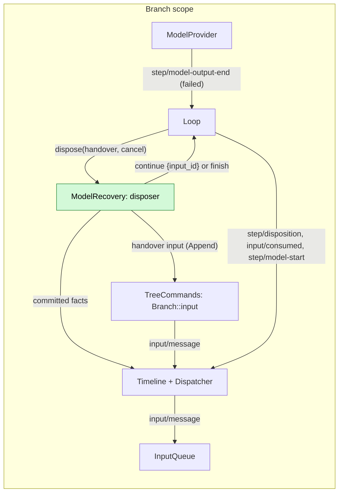

# ModelRecovery

Design: [model-retry-recovery §6](../research/model-retry-recovery.md#6-跨请求续接modelrecovery-的目标合同).
Scope: branch. Owner contracts:
[Loop](../../architecture/rust-agent/plugins/Loop.md#a-failed-model-step-and-its-disposer),
[ModelProvider](../../architecture/rust-agent/plugins/ModelProvider.md#failure-chain) and
[InputQueue](../../architecture/rust-agent/plugins/InputQueue.md#handover-inputs).

Requirement ([#1210](https://github.com/arcships/dim/issues/1210)): when a model request fails after it committed output, the same turn continues once with a new request instead of ending, and the continuation shares the failure chain's budget.

ModelRecovery is one branch part. It registers the disposer of a failed model
step with the Loop's port as an effect of its own `apply`; the registration
lasts until the part unloads. It has no settings and writes no event of its
own: its only writes are handover inputs, through the branch's normal input
entrance. It is in the default product profile: it has no setting, so
default-on is what makes the continuation reach users, and a profile without
its row runs the failure path unchanged. It never runs a model or a tool, never
writes `turn/end`, `step/model-start` or `model/call`, and never reads another
part's state: its decisions use the branch's committed facts.

## 1. Structure

| Part | Scope | Depends on | Provides |
| --- | --- | --- | --- |
| `ModelRecovery` branch part | Branch | `B:AgentLoop` (the disposer port), `B:Timeline` (committed-fact query), `S:TreeCommands` (the handover input) | A disposer registration; no service |

The Loop's port admits one disposer on a branch, and a second registration
fails. Registration is an effect of the part, so an unload withdraws it; the
Loop's task then answers `finish`, and an open handover ends. The part is a
branch part, so each branch has one copy.

## 2. When it continues

The disposer reads only committed facts: the failed `step/model-output-end`
named by `failure_sequence`, the request's output facts, the turn's
`turn/start`, and the turn's `context/prepare` facts. It answers
`continue {input_id}` only when all of these hold; otherwise it answers
`finish`.

- **Retryable failure.** `failure.kind` is `network`, `rate_limited` or
  `server_error`. Every other kind, including `unknown`, `malformed_response`,
  `output_limit`, `context_too_long` and the credential kinds, is outside the
  first coverage.
- **Committed output.** The failed request committed a `step/text`,
  `step/thinking`, `step/tool-use-start`, `step/tool-use` or
  `step/model-content` fact. Output that was produced but dropped at
  settlement is not committed. `replay_safe` is
  ModelProvider's invocation-local flag, not a fact, so the disposer derives
  this condition from the committed output facts.
- **Not forbidden.** `failure.retryForbidden` is not set. A failure the policy
  forbids opens a handover that the disposer declines, so the prohibition
  covers the continuation.
- **Budget left.** The failed terminal's `failure` has `attempts` below 8 and
  `waitedMs` below 300 s. The part reads ModelProvider's [public
  limits](../../architecture/rust-agent/plugins/ModelProvider.md#failure-chain)
  and the failure's own `attempts` and `waitedMs`; it never repeats the
  numbers.
- **No accepted continuation yet.** After this turn's `turn/start`, the turn
  has no `context/prepare` carrying `failure_chain`. The continuation's own
  `context/prepare` carries it, so a second failure in the same turn declines.

The tool-boundary case declines for both reasons: a tool call from a no-tools
continuation request settles failed with `failure.kind = unknown`, which is
outside the coverage, and that request's own `context/prepare` already carried
`failure_chain`, so the turn's one continuation is used. The executor's
snapshot refusal is the second guard; the Loop's contract ends that turn with
the committed text kept.

## 3. The handover input

On `continue`, the part writes one `input/message` through the branch's normal
input entrance, `tree.input`, with mode Append and `handover: {turn_id,
request_id}`; it then answers `continue {input_id}`. The content is a fixed
instruction with three parts: continue from where the committed output ends,
do not repeat completed work, and tools are unavailable for this reply. It
never carries provider error text, headers, response bodies or credentials.
The instruction is a raw block with no `user`, like Goal's automatic inputs. A
client that shows the operator's words never shows the instruction as the
operator's message: the v1 `Input` view takes text only from `user`, so a v1
client sees an input with empty text, as it already does for every automatic
input.

InputQueue never applies the input; the Loop consumes it only in the batch
that starts the handover's continuation, after every pending Append input, so
its text is the last model message. The branch history renders it at that
`input/consumed`, like any other input. If the turn ends without consuming it,
InputQueue deletes it, and it never drives a turn or enters a later request.

The part waits for nothing: it reads committed facts, writes one input and
answers. The disposition therefore has no timer of its own; any backoff is
ModelProvider's, inside the continuation request.

## 4. Cancellation and reload

- **Unload.** The registration is an effect of the part; unloading withdraws
  it, and the Loop finishes an open handover. An answer already returned is
  the Loop's fact and is unaffected.
- **Reload.** The old generation's unload withdraws its registration, and the
  Loop finishes an open handover. The next generation registers again and
  keeps no state to rebuild. A handover input the old generation wrote is
  deleted by InputQueue when the turn ends.
- **Stop, steer, branch close.** They cancel the Loop's disposition task; the
  part writes nothing more for that handover, and a handover input it already
  wrote is deleted by InputQueue if the turn ends without consuming it.

## 5. Observers

Goal, Scheduler and Workflow observe the turn; a continuation writes no
intermediate `turn/end`, so each sees one `turn/end` for the turn and does
not treat the failed request as the end of the work. If the continuation also
fails, the terminal `turn/end` carries that failure and is the one they read.

## 6. Rule check

| Rule | Application |
| --- | --- |
| §1 Capability | A branch Capability: it owns the recovery decision and the handover input, and runs no model or tool. |
| §4 rule 1 | It does not write the Loop's result; it answers through the Loop's port and writes its input through the branch entrance. |
| §4 rule 2 | The Loop's handover is explicit; after `continue`, only the Loop's batch consumes the input. |
| §4 rule 3 | No `before` callback. |
| §4 rule 4 | The new kind is the Loop's own; the core has no ModelRecovery case. |
| §4 rule 5 | The Loop writes the continuation batch atomically; the part writes one input. |
| §4 rule 6 | The handover input reaches the model only through `input/consumed`. |
| §4 rule 7 | Public facts and services only; no other part's state. |
| §4 rule 8 | No infrastructure change. |
| §4 rule 9 | The handover input is model content and `step/disposition` orders the answer against stop and steer; no display-only event. |
| ADR 002 D1 | Branch part, placed by the owner of its state. |
| ADR 002 D2 | No wiring plugin, bus or notification channel. |
| ADR 002 D3 | Declares only public services; no Session part. |
| ADR 002 D4 | No settings or reload policy. |
| ADR 002 D5 | The disposer port is a Rust-only operation, like the Permission advice precedent; its data shapes (`handover`, the answer, `step/disposition`, the handover input) are stated language-neutrally. |

## 7. Requirements raised to mechanism owners

None. The contracts this design uses are stated by their owners: the Loop's
disposer port and `step/disposition`, ModelProvider's `failure_chain`,
InputQueue's handover input. No infrastructure changes: no Timeline,
Dispatcher, facade or rutis change. The part adds its own plugin row and
feature registration, and the generated graph and catalog follow.
