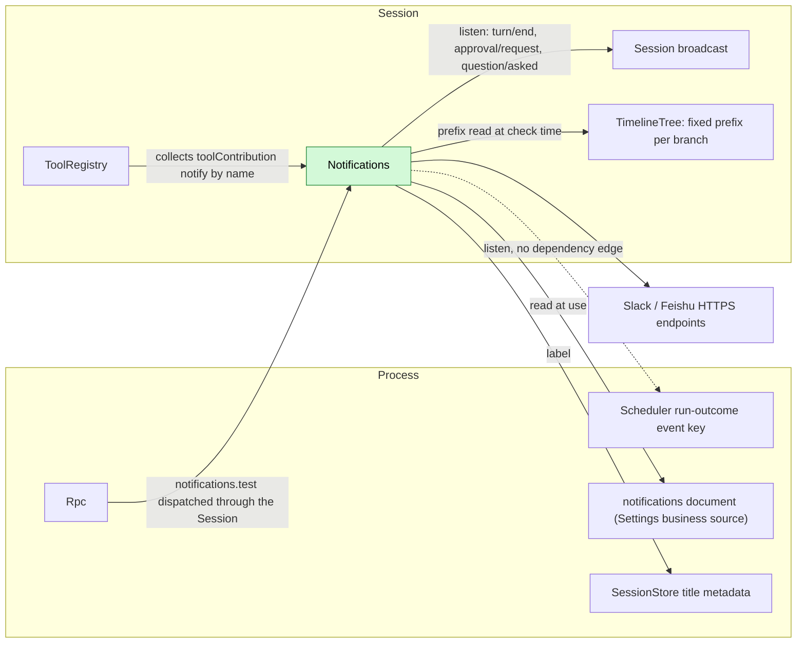
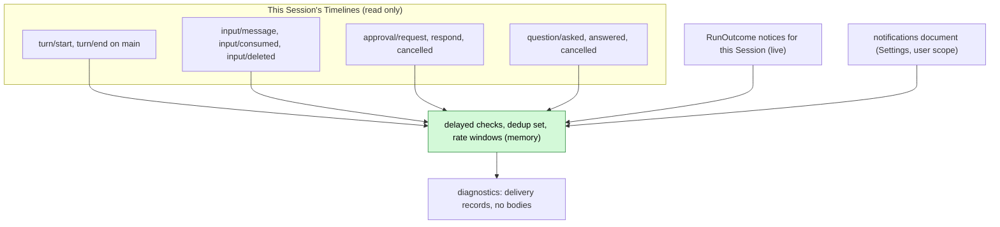
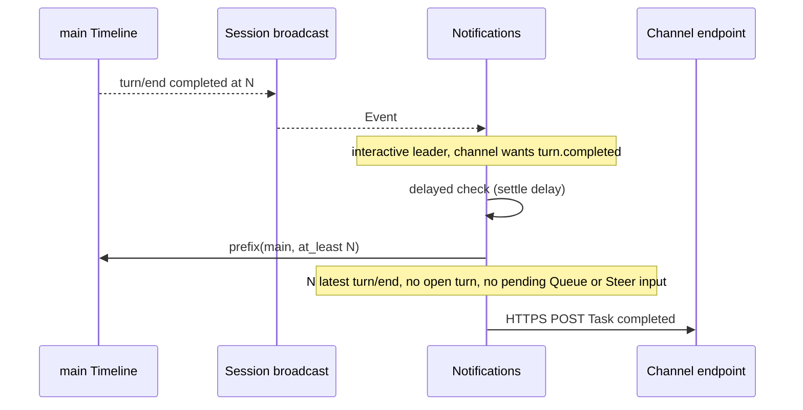
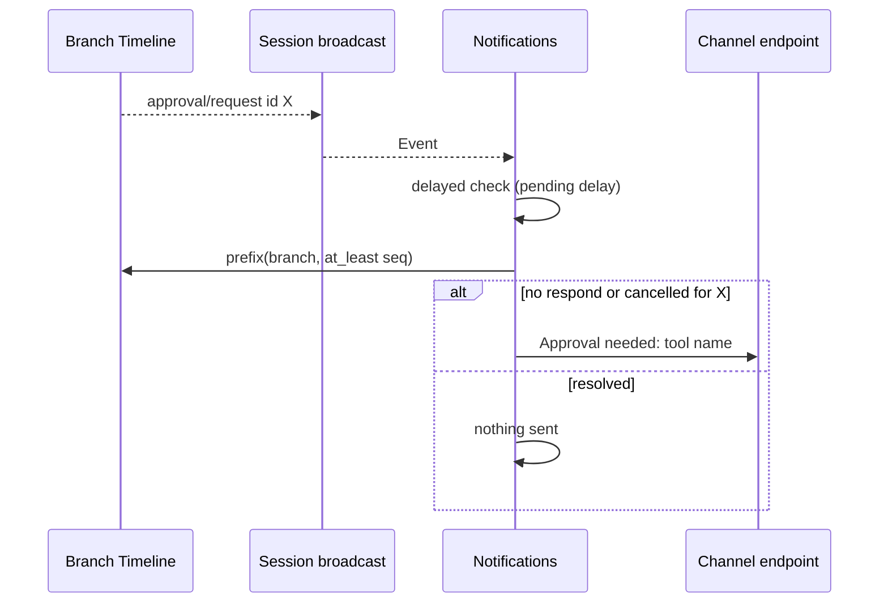
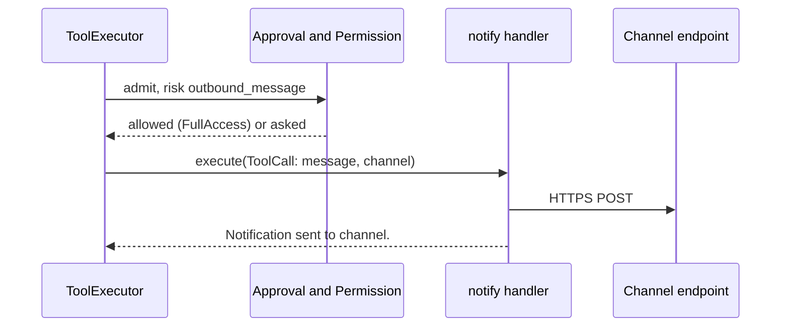
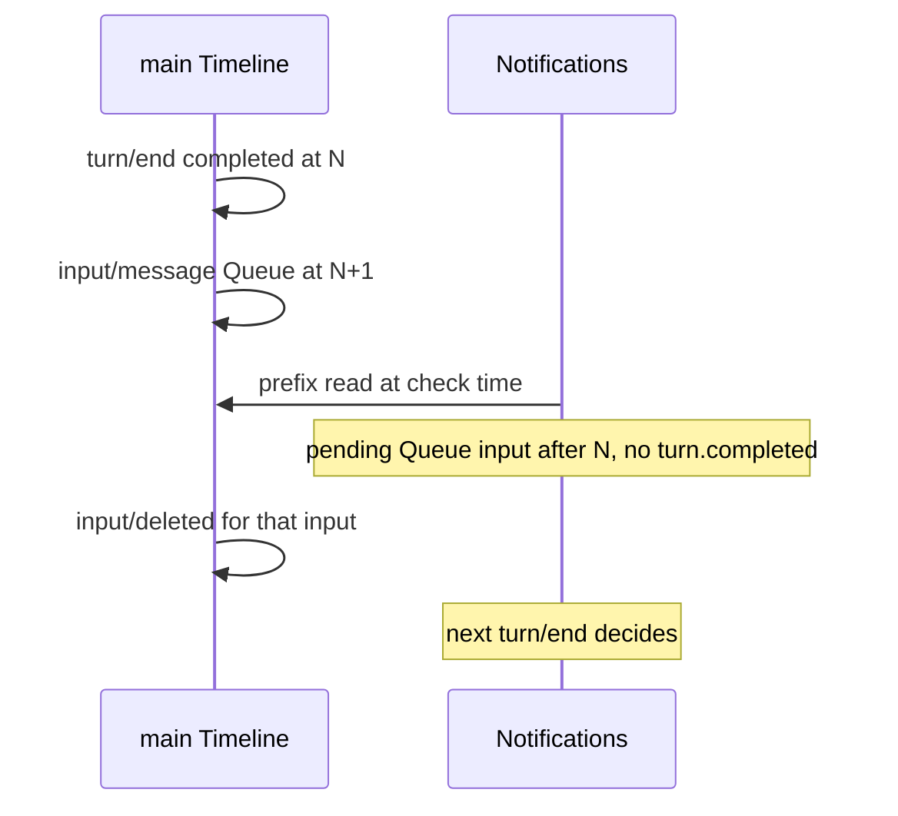

# Notifications

Status: Withdrawn. Overall design: [overview](../overview.md) (Notifications). Phase: P2. Language: TypeScript first. Scope: [ADR 002](../../adr/002-plugin-scope.md) (Session).

> **Withdrawn.** This plugin has no responsibility of its own; each of its duties belongs to an existing owner. Alerts for a Session the user is working in (task ended, approval or question pending) belong to the client, which already receives those events. Notifying a scheduled run's outcome belongs to Scheduler. Talking to an external channel (Slack, Feishu and others) belongs to a per-platform plugin with its own tools; there is no generic channel and no `notify` tool. This document is kept for reference only.

Notifications is a Session plugin. It delivers messages to configured external channels (Slack, Feishu) when a task on its interactive leader Session completes or fails, an approval is pending or a question awaits an answer; it reports a scheduled run that ended in its Session from Scheduler's run-outcome event notice; it offers the model the `notify` tool as a Session-scoped `toolContribution` service keyed `notify`; and it serves `notifications.test` through the Session-scoped `sessionMethods` service keyed `notifications` ([session-boundary](../contracts/session-boundary.md)). It observes its Session only through the existing Session broadcast, confirms each trigger against the fixed prefix of the branch, and writes nothing to any Timeline. In-terminal reminders (bell, focus) belong to the CLI. Contracts are given in neutral form ([ADR 002 D5](../../adr/002-plugin-scope.md#d5-contracts-are-language-neutral)); the Rust binding is in Appendix G.

## 1. Structure



| Part | Scope | Depends on | Provides |
| --- | --- | --- | --- |
| `Notifications` | Session (installed only when enabled) | Session broadcast of its Session, TimelineTree, `SessionConfig`; process services Settings business source and SessionStore title metadata; listens (no dependency) to Scheduler's `scheduled_run_outcomes` event | `toolContribution` key `notify` (risk `outbound_message`) and `sessionMethods` key `notifications` (`notifications.test`), declared in its `provides`; trigger names `turn.completed`, `turn.failed`, `approval.pending`, `question.pending`, `schedule.ended`; business document `notifications` |

The Session broadcast, TimelineTree and `SessionConfig` are existing typed services; the Settings business source and SessionStore title metadata are supplements ([overview Appendix B.2](../overview.md#b2-app-server-process-plugins)). Exposing these services by name to the TypeScript implementation is issue [#4](https://github.com/arcships/dim/issues/4)'s work, stated in [session-access §9](../contracts/session-access.md#9-requirements-raised-to-mechanism-owners); listening to Scheduler's event by name across languages is a rutis requirement stated in [Scheduler §9](Scheduler.md#9-requirements-raised-to-mechanism-owners). Run outcomes arrive as an event notice, not a dependency ([ADR 002 D2](../../adr/002-plugin-scope.md#d2-no-wiring-modules)): without Scheduler the `schedule.ended` trigger is inert. A reload of Settings or SessionStore reloads Notifications and, through `notify`, ToolRegistry and its dependents; this is accepted ([D3](../../adr/002-plugin-scope.md#d3-dependencies-follow-scope-rare-restarts-are-accepted)). The `notifications` document is business configuration ([D4](../../adr/002-plugin-scope.md#d4-structural-configuration-and-business-configuration-are-separate)): read at use time, never a reload.

## 2. Data and state



Notifications owns no persistent state: every trigger is checked against a fresh prefix. Memory state (delayed checks, deliveries in flight, dedup set `(branch, trigger, id)`, rate windows) lives as long as the Session plugin; a new generation starts empty and events are never replayed, so no cross-generation duplicates arise. Rate windows are per Session (A10).

## 3. Flows

### 3.1 Task completed



Wall-clock only delays the read; the decision uses facts and sequence. Deleted inputs (`input/deleted`) are not pending.

### 3.2 Approval pending



`question.pending` works the same with `question/asked` and `call_id`; it is inert in Sessions without Questions.

### 3.3 Scheduled run ended

Scheduler emits one `RunOutcome` per ended run. The Notifications instance of the run's Session (`session_id` in the notice) formats and delivers it; instances of other Sessions ignore it. No prefix read is needed, and the non-interactive exclusion does not apply. If the run Session is not loaded when the notice is emitted, the notice is lost; this is accepted, and `schedule.history` remains the record (A16).

### 3.4 Model sends a message



The model can choose only among user-configured channels, never a URL.

### 3.5 Channel test

A client calls `notifications.test {sessionId, channel?}`; Rpc dispatches it through the Session like any Session method. Notifications sends the fixed text `[dim <label>] Test notification.` to that channel through the normal delivery path (user-source reads at send time, retries, rate window) and replies `{channel, delivered: true}` or an error (A.5). Nothing is written to any Timeline.

## 4. Timing and conflicts



A pending driving input suppresses `turn.completed`. Deleted before the check, it no longer counts; deleted after the check, nothing happens until the next `turn/end` (A15).

| Scenario | Order | Outcome | Owner |
| --- | --- | --- | --- |
| Member, workflow-stage, scheduled or ACP Session | not interactive leader | No event-triggered notification; `schedule.ended` and `notify` still work | Notifications |
| Approval answered or cancelled before the delay | request < respond < check | Nothing sent | Notifications |
| Interrupt during `notify` after sending | send < cancel | `Cancelled; delivery may have occurred.` | Notifications |
| Notifications or a dependency reloads mid-`notify` | — | Call settled as reloaded; never resent (D3) | ToolExecutor |

Full table: [Appendix B](#appendix-b-full-conflict-table).

## 5. Context mapping

Event-triggered notifications have no model-visible effect.

| What the model sees | Form and position |
| --- | --- |
| `notify` declaration | Name, description `Send a short message to one of the user's configured notification channels.`, schema with `channel` as a string, in the adopted `context/configured` while Notifications is active |
| `notify` outcome | `ToolResult.content` at the tool-result position of its batch; survives compaction only through the summary; child branches inherit results before their cut |
| Non-interactive Sessions | Same declaration and results |
| Never visible | Channel targets, credentials, delivery records, retry state, diagnostics |

## 6. Interfaces (summary)

| Interface | Kind | Purpose |
| --- | --- | --- |
| `notify {message, channel?}` | `toolContribution` (Session, key `notify`), risk `outbound_message` | Model-initiated message to a configured channel |
| `notifications.test {sessionId, channel?}` | `sessionMethods` (Session, key `notifications`) | Send a fixed test message to a configured channel |
| `scheduled_run_outcomes` | Process event listened to (Scheduler's contract; no dependency) | `schedule.ended` trigger |
| `notifications` document | Business configuration, Settings user scope, read at use | Channels, triggers, delays |

Channels are tested with `notifications.test`, a Session method, not a management method (A9).

## 7. Security

`notify` is admitted per call under `outbound_message`: FullAccess allows it; other presets ask. Channels come only from the user scope of Settings, never from project files or plugins (A8), so a repository cannot define an exfiltration target. Credentials are owner-managed user-source fields read at send time (§9); local clients can read them through local-only `settings.read`, but they never enter tool results, events, diagnostics or logs. Event-triggered messages carry no Session content unless `includeContent` is enabled per channel. Each instance sees only its own Session's events. `notifications.test` sends only a fixed text to a user-configured channel; paired remote devices may call it like any Session method.

## 8. Rule check

| Rule | How this document complies |
| --- | --- |
| Principles §4 rule 1 (commands for others' state) | Notifications changes no other module's state; `notify` results are written by ToolExecutor, their owner. |
| Principles §4 rule 2 (handover) | Not applicable: Notifications takes over no object; it only reads facts. |
| Principles §4 rule 3 (before callbacks only) | No intervention before a write; `notifications.test` checks its own parameters in its own method. |
| Principles §4 rule 4 (no business meaning in core) | No core change; triggers are Notifications' own reading of public facts. |
| Principles §4 rule 5 (read the whole batch) | Each check reads the fixed prefix through the end of the triggering event's batch, after the delay. |
| Principles §4 rule 6 (context from handed-over events) | Event-triggered messages add nothing to context; `notify` results enter only as `step/tool-result` facts. |
| Principles §4 rule 7 (public events and services only) | It uses the Session broadcast, fixed-prefix read, Settings, SessionStore title metadata and Scheduler's public event notice. |
| Principles §4 rule 8 (requirements to mechanism owners) | No runtime or rutis requirement of its own. #4 (services by name) is stated in [session-access §9](../contracts/session-access.md#9-requirements-raised-to-mechanism-owners); named process events across languages (Scheduler's event) are stated in [Scheduler §9](Scheduler.md#9-requirements-raised-to-mechanism-owners). The Settings and SessionStore supplements it uses are listed in [overview Appendix B.2](../overview.md#b2-app-server-process-plugins). |
| Principles §4 rule 9 (only facts later decisions use) | Notifications writes no event; delivery records are diagnostics only. |
| Principles §1 (Capability and App Server boundary) | Notifications is a Session Capability in its own plugin package; `notifications.test` is a Session method, not a management method. |
| ADR 002 D1 (scope follows state) | Session scope: triggers belong to the Session; a run outcome for an unloaded Session is lost, which is accepted (A16). |
| ADR 002 D2 (no wiring modules) | No wiring module; Scheduler's outcomes are listened to without a dependency. |
| ADR 002 D3 (dependencies follow scope) | Settings and SessionStore are in the enclosing scope; their reload reloads Notifications, which is accepted. |
| ADR 002 D4 (structural vs business configuration) | Enabling is structural; the `notifications` document is business configuration in its own Settings source, read at use. |
| ADR 002 D5 (language-neutral contracts) | Contracts are neutral; the Rust form is Appendix G. |

## 9. Requirements raised to mechanism owners

None of its own. #4 (typed services by name for non-Rust parts) is stated in [session-access §9](../contracts/session-access.md#9-requirements-raised-to-mechanism-owners); named process events across languages, needed to listen to `scheduled_run_outcomes`, are stated in [Scheduler §9](Scheduler.md#9-requirements-raised-to-mechanism-owners). The Settings business source and SessionStore title metadata are supplements listed in [overview Appendix B.2](../overview.md#b2-app-server-process-plugins).

## Appendix A. Interface details

### A.1 Configuration (`notifications` document, user scope only, A8)

```text
notifications.channels: [{
  name: string,                       // [a-z0-9-]{1,32}, unique
  kind: "slack" | "feishu",
  target: { slack: { webhook } | { botToken, channelId } }
        | { feishu: { webhook, signingSecret? } },
  triggers: ("turn.completed" | "turn.failed" | "approval.pending" | "question.pending" | "schedule.ended")[],
  includeContent: bool,               // default false (A5)
  allowTool: bool,                    // default true; channel usable by `notify`
  enabled: bool                       // default true
}]
notifications.settleDelaySeconds: u32   // default 3, 0..=60 (A2)
notifications.pendingDelaySeconds: u32  // default 10, 0..=3600 (A2)
notifications.defaultChannel: string?   // used by `notify` without `channel`
```

Webhook URLs, bot tokens and signing secrets are credentials Notifications owns ([settings-service §1.2](../appserver/settings-service.md#12-decision-secrets-belong-to-their-owner)): they live in the user file under `userOnly`. Local clients can read them back through `settings.read`, which serves local connections only; they are never returned to remote or paired clients, nor placed in tool results, events, diagnostics or logs. Written only through Settings typed operations into Notifications' business source, whose schema Notifications declares; validated there; read at each check and send.

### A.2 Tool `notify`

One `toolContribution` service (Session, key `notify`): `declaration(): sync -> ToolDeclaration` and `execute(ToolCall): async -> ToolResult` with text content. Cancellation is a cancel request or the consumer dropping the call; outstanding HTTP requests are aborted. Errors are error `ToolResult`s with the texts below.

| Item | Value |
| --- | --- |
| Parameters | `{message: string (1..=4000), channel?: string}`; `channel` names a channel with `allowTool && enabled` (A6) |
| Result | `Notification sent to <channel>.`; errors: `Unknown channel <name>.`, `No notification channel is configured.`, `Delivery failed: <fixed reason>.`, `Rate limit reached for <channel>.`, `Cancelled; delivery may have occurred.` |
| Risk category | `outbound_message` |
| Requirements | `interactive: false`, `roles: None` |

Messages sent by the tool are prefixed `[dim <session label>] ` (A7).

### A.3 Trigger rules

| Event | Trigger | Rule (event triggers require `interactive && collaborationRole = leader`) |
| --- | --- | --- |
| `turn/end` on `main` | `turn.completed` / `turn.failed` | `completed` / `failed`; `cancelled` none (A3). Fires only if `N` is the latest `turn/end`, no `turn/start` after it, and no Queue/Steer `input/message` lacks both `input/consumed` and `input/deleted` |
| `approval/request` (any branch) | `approval.pending` | No `approval/respond` or `approval/cancelled` with the same `approval_id` after the delay |
| `question/asked` (any branch) | `question.pending` | No `question/answered` or `question/cancelled` with the same `call_id` after the delay |
| Run outcome `{job_id, job_name, run_id, session_id?, state, reason?, ended_at}` with `session_id` = this Session | `schedule.ended` | Every such notice (A16) |
| `step/text` | Content | Optional excerpt of the turn's last request (`includeContent`) |

Templates (to channels only): `[dim <label>] Task completed.`, `[dim <label>] Task failed.`, `[dim <label>] Approval needed: <tool name>.`, `[dim <label>] The agent is waiting for your answer.`, `[dim schedule <job name>] Run <state>.` With `includeContent`: turn triggers append up to 500 characters of the last request's `step/text`; `approval.pending` the request `reason`; `question.pending` the question texts up to 500 characters (A5).

### A.4 Mechanics

| Step | Path |
| --- | --- |
| Listen | On apply: Session broadcast listener for `turn/end`, `approval/request`, `question/asked`; listener on `scheduled_run_outcomes` filtered to this Session; both removed on unload |
| Trigger | For a matching enabled channel trigger not in the dedup set: start a delayed check owned by the plugin's lifetime |
| Check | After the delay, read the branch's fixed prefix through the end of the triggering event's batch; branch gone → nothing |
| Format | Label = metadata title when available, else Session id (A7) |
| Deliver | Read owner-managed credentials at send time; HTTPS POST; retry on network error, 429, 5xx with 1 s, 4 s, 16 s; no retry on other 4xx; 20 messages per minute per channel per Session, excess dropped with a diagnostic (A10) |
| Timeline | No writes, no Dispatcher registration, no `StateCell` |
| Reload / Session unload | Delayed checks and deliveries cancelled with the plugin; a request already sent is never resent ([time bus](../../architecture/rust-agent/time-bus.md)); events missed while down are not replayed |

### A.5 `notifications.test`

Served through `sessionMethods` (Session, key `notifications`): `describe()` returns one declaration `{name: "notifications.test", mutating: true}`; `call(MethodCall)` handles it.

| Params | Result | Errors |
| --- | --- | --- |
| `{sessionId, channel?: string}`; without `channel`, `notifications.defaultChannel` | `{channel, delivered: true}` | `invalid_params`, `unknown_channel`, `no_channel`, `delivery_failed`, `rate_limited`, `service_reloading`; dispatch errors per [session-boundary](../contracts/session-boundary.md) |

Any configured channel can be tested, whatever its `allowTool` and `enabled` values. The message carries no Session content. A cancel request aborts outstanding requests; delivery may already have occurred and is never resent.

## Appendix B. Full conflict table

| Scenario | Sequence order | Outcome | Owner |
| --- | --- | --- | --- |
| Continuation or queued input before the check | `turn/end` N < input | No `turn.completed` | Notifications |
| That input deleted before the check | input < `input/deleted` < check | Not pending; sent | Notifications |
| That input deleted after the check | check < `input/deleted` | Nothing for N; next `turn/end` decides (A15) | Notifications |
| Input after the check | check < input | Sent (accepted) | Notifications |
| Turn ended by interrupt | `turn/end {cancelled}` | Nothing (A3) | Notifications |
| Turn failed | `turn/end {failed}` | `turn.failed` if still the latest turn | Notifications |
| Approval answered or cancelled before the delay | request < respond/cancelled < check | Nothing | Notifications |
| Approval answered after send | check < respond | Stays sent; no follow-up (A11) | — |
| Question answered or cancelled before the delay | asked < answered/cancelled | Nothing | Notifications |
| Concurrent Steer/Queue/Append | Timeline order | Unconsumed, undeleted Queue/Steer suppresses `turn.completed`; Append does not | Notifications |
| Tool batch not settled | approvals inside the batch | Pending approval notified; `turn/end` cannot precede the batch result | Loop |
| Compaction | — | No effect: checks read facts | — |
| Child branch | approval in child | Notified; child `turn/end` ignored (A1) | Notifications |
| Scheduled run ends in this Session | terminal record < notice | One `schedule.ended` | Scheduler; Notifications |
| Run without a Session (`session_id` absent) or run Session not loaded | — | Not reported: the notice is lost (accepted, A16); `schedule.history` remains the record (A12) | — |
| Scheduler reload or absent | no dependency | Notices stop; Notifications unaffected | — |
| Branch close during the delay | — | Nothing | Notifications |
| Session unload or close during the delay | — | Check cancelled with the plugin (A4) | Lifecycle |
| Interrupt during `notify` before sending | cancel < send | No request; `Cancelled` | Notifications |
| Interrupt during `notify` after sending | send < cancel | `Cancelled; delivery may have occurred.` | Notifications |
| Notifications or dependency reload mid-delivery | — | Cancelled, never resent; `notify` settled as reloaded (D3) | ToolExecutor |
| Process restart | — | Committed `notify` calls settled without re-execution | ToolExecutor |
| Configuration change during the delay | — | Read at check time | Notifications |
| `notifications.test` while Notifications reloads | — | `service_reloading`; nothing sent | Rpc |
| `notifications.test` cancelled after sending | send < cancel | Delivery may have occurred; never resent | Notifications |
| Resource node offline | — | No effect | — |
| Client detach | — | No effect (A13) | — |

## Appendix C. Errors and recovery

| Case | Result |
| --- | --- |
| Invalid configuration | Rejected by Settings at the write boundary; last valid document kept |
| Delivery failure after retries | Diagnostic; `notify` returns an error result |
| Cancellation (interrupt, reload, unload) | Outstanding requests aborted before the tool returns |
| Process exit | In-memory checks lost; no persistent queue (A12) |

## Appendix D. Acceptance

Flow tests with fake HTTP endpoints and a fake model:

1. Completed `main` turn of an interactive leader Session sends one `turn.completed`; a Queue input before the check suppresses it; the same input deleted (`input/deleted`) before the check does not; cancelled sends nothing; failed sends `turn.failed`.
2. Member Sessions and `interactive: false` Sessions send nothing event-triggered.
3. Approval answered before the delay sends nothing; unanswered sends once; cancelled sends nothing.
4. `question/asked` with and without an answer; inert without Questions.
5. A scheduled run that completes, fails or times out sends one `schedule.ended` from its run Session only; with the run Session unloaded nothing is sent; without Scheduler the trigger is inert.
6. `notify`: unknown or no channel errors; sends and returns; FullAccess allows `outbound_message`, other presets ask; interrupt before and during delivery.
7. Retry on 5xx, none on 400, rate-limit drop, rejected credential.
8. `includeContent: false` messages contain no Session text; diagnostics contain no bodies or URLs.
9. `notifications.test` sends one fixed message to the named or default channel; an unknown channel returns `unknown_channel`; a paired remote device can call it.

## Appendix E. Assumptions

| # | Assumption | Basis | Effect if rejected |
| --- | --- | --- | --- |
| A1 | Turn triggers only on `main`; approval and question triggers on any branch | Judgment | Child-branch work would notify on every sub-task |
| A2 | Settle delay 3 s, pending delay 10 s | Judgment | Earlier or later messages |
| A3 | Interrupted turns do not notify | Judgment | Interrupts notify too |
| A4 | Pending checks end with the Session plugin (unload or close) | ADR 002 D1 | A process part would be needed |
| A5 | No Session content unless `includeContent`; excerpt 500 characters | Judgment | Content always or never included |
| A6 | `notify` parameters | Judgment | Different schema |
| A7 | Label = metadata title if available, else Session id | Judgment | Other labels |
| A8 | Channels configurable only in user scope | Judgment | Project configuration could name channels; they would start disabled until the user enables them ([ADR 003](../../adr/003-approval-scope.md) D3), with no approval step |
| A9 | The channel test is the Session method `notifications.test`, not a management method | Maintainer decision | A management method would need a process part |
| A10 | Retry 3 attempts (1/4/16 s); 20 messages per minute per channel per Session | Judgment | Other policies |
| A11 | No follow-up when a pending item resolves after notification | Judgment | Extra messages |
| A12 | Best effort: no persistent outbox, no recovery after restart | Judgment | Process-storage outbox needed |
| A13 | Sent regardless of attached clients | Judgment | Needs an attachment contract |
| A14 | Slack via webhook or bot token + channel id; Feishu via custom-bot webhook with optional signing | Feature list; modes are judgment | Other adapters |
| A15 | A suppressed `turn.completed` is not re-evaluated after a later `input/deleted` | Judgment | Withdrawal needs its own trigger |
| A16 | `schedule.ended` is delivered by the run Session's instance using `RunOutcome.session_id`, with job name and state only; if that Session is not loaded the notice is lost | Scheduler notice carries `session_id`; maintainer decision (loss accepted) | A process part would listen once for all runs |

## Appendix F. Open questions

| Question | Description |
| --- | --- |
| Inbound actions | Answering approvals or questions from Slack/Feishu is out of scope |
| Runs without a Session | Runs that fail before launching a Session are not reported (A12) |
| Services by name | The TypeScript implementation needs the Session broadcast, fixed-prefix read, SessionStore metadata, Settings exposed by name ([#4](https://github.com/arcships/dim/issues/4), stated in [session-access §9](../contracts/session-access.md#9-requirements-raised-to-mechanism-owners)), and Scheduler's event by name ([Scheduler §9](Scheduler.md#9-requirements-raised-to-mechanism-owners)) |

## Appendix G. Rust binding

| Neutral | Rust |
| --- | --- |
| `toolContribution` key `notify` | Session `ToolContribution` registered with `AgentBuilder::session_tool("notify")`; ToolRegistry collects `Contributions<ToolContribution>`; cancellation through `CancellationToken` |
| `sessionMethods` key `notifications` | `SessionMethodContribution(Arc<dyn MethodProvider>)` at `SessionScope::named_key::<SessionMethodContribution>("notifications")` |
| Session broadcast listener | Listener on `session_channel(session_id)`, removed by `ctx.effect` |
| `scheduled_run_outcomes` | `on(host_ctx, &scheduled_run_outcomes(), listener)` with `EventKey<RunOutcome>` ([Scheduler](Scheduler.md)) |
| Delayed checks, deliveries | Tasks under `ctx.effect` |
