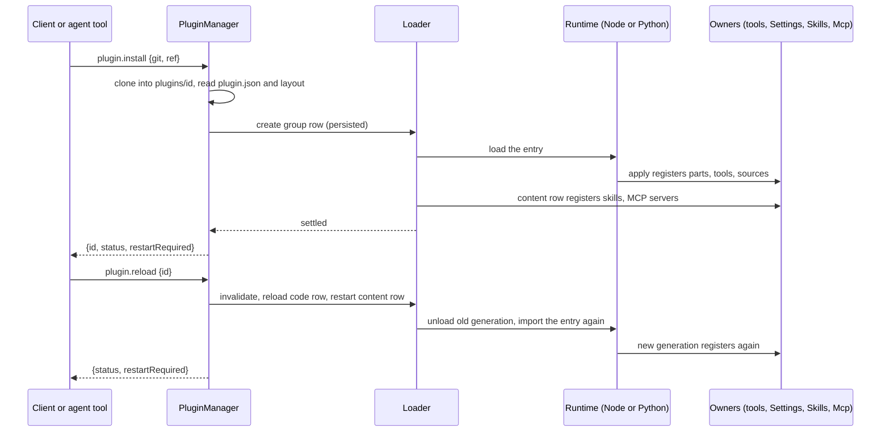

# PluginManager

Status: Design, aligned with the maintainer on 2026-10-26; implementation not started. Requirements:
[plugin management](../plugin-management.md) ([#432](https://github.com/arcships/dim/issues/432)).
Issues: [#3](https://github.com/arcships/dim/issues/3) (the loader's editable layer) and
[#384](https://github.com/arcships/dim/issues/384) (install and enable). Rules:
[ADR 002](../../adr/002-plugin-scope.md), [ADR 003](../../adr/003-approval-scope.md),
[ADR 006](../../adr/006-plugin-contract.md), [How Dim uses rutis](../rutis-usage.md). Language: Rust
(App Server), with changes to Settings, SkillsCatalog, Mcp, the dimcode CLI and launcher, and the
repository's TypeScript plugins.
[中文](../../zh/design/plugins/PluginManager.md)

A user or the agent writes a plugin in a directory, installs it from that path or from Git, and it
runs at once; after an edit, `reload` brings in the new code without a restart. Every plugin, built in
or installed, is a row of the App Server's loader, and the loader's editable layer is the one record of
which plugins are installed and enabled. PluginManager is the process plugin that turns install,
enable, disable, remove, reload and update into edits of that layer and into the rutis-loader calls
that apply them. It adds no plugin machinery: rutis-loader already composes layers, edits and persists
the editable layer, refuses edits a higher layer locks, and reloads a row.

## 1. What exists and what this adds

**Before this design (the implemented state it replaces).** The App Server's loader has one layer, `assembly`, built in code at startup: the built-in
Rust plugins, the Agent builder's plugins and the Agents group, plus the rows of
`dim-app-server --session-rows FILE` for TypeScript and Python plugins. Nothing is editable or
persisted. `dimcode` starts the App Server without `--session-rows`, so the default CLI loads no
TypeScript plugin, not even the repository's own (Goal, Web, SessionTitle, Workflow, Scheduler).
This design removes `--session-rows` (§3.3); it stays only until M1 implements the layers.

**This design adds:**

| Piece | What it is | Section |
| --- | --- | --- |
| Plugin directory | Dim's plugin format: a directory with code, content (skills, MCP configuration, later hooks) or both | §2 |
| Layers and the editable layer | Four loader layers; the user layer is persisted in the App Server's home | §3 |
| Operations | `plugin.*` management methods, `dimcode plugin …` commands, agent tools | §4, §8 |
| Content registration | A built-in content module registers a plugin's content with each owner | §5 |
| Settings sources registered in code | A plugin registers its business configuration sources with Settings from its `apply` | §6 |
| Default config file | Which plugins are on by default and which built-ins cannot be replaced; the repository's TypeScript plugins load from it | §7 |

## 2. The plugin directory

A plugin is a directory. Nothing lists its content: the directory's layout says what it holds.

```
my-plugin/
  plugin.json          the plugin's row file; present when the plugin has code
  index.ts             the entry plugin.json names
  node_modules/        the plugin's own dependencies, @arcships/rutis included
  skills/<name>/SKILL.md
  mcp.json             MCP servers, in the format of the user `mcp` source
  hooks.json           Hook documents, once Hooks is implemented (§13)
```

- **Code.** `plugin.json` holds the fields a plugin's row has today, which the repository's plugins
  already keep in a JSON file next to their code (`web.json`, `process.json`); they are renamed
  `plugin.json`.

  | Field | Meaning |
  | --- | --- |
  | `id` | Optional. The plugin id, `[a-z][a-z0-9-]{0,63}`; defaults to the directory name (path) or the repository name (Git) |
  | `entry` | The module to load, relative to the directory: a `.ts`/`.js` file for Node, or `py:<module>` for Python (the directory is the module's import root) |
  | `inject`, `provides`, `instanceNames`, `config` | As in a row today ([How Dim uses rutis §2](../rutis-usage.md#2-plugins-are-rows-instances-mount-their-parts)) |

  The entry is one rutis plugin: it registers its Session and branch parts with `partRegistry`, its
  tools and methods with their owners, and its business configuration sources with Settings (§6), all
  from its `apply`. `settings` is no longer a row field.
- **Content.** `skills/`, `mcp.json` and (later) `hooks.json` are found by name. Each is in the format
  its owner already reads from the user's own sources.
- **Dependencies.** A plugin brings its own: a local directory has them installed by its author, and a
  Git repository commits built code or its dependencies. Dim never runs a package manager and never
  executes anything from a plugin directory while installing it.
- A directory with neither code nor content is not a plugin (`invalid_plugin`).

## 3. Rows and layers ([#3](https://github.com/arcships/dim/issues/3))

### 3.1 Layers

The loader composes these layers, lowest first. rutis-loader's own rules decide what an edit may
change: a row inserted by a lower layer can be disabled or have fields overridden from the editable
layer, but not removed; a field a higher layer sets cannot be edited.

| Layer | Source | Editable | Holds |
| --- | --- | --- | --- |
| `assembly` | App Server code | No | Built-in rows: host infrastructure, the Agent builder's plugins, the Agents group |
| `defaults` | Default config file (§7) | No | The plugins on by default (the repository's TypeScript plugins); built-ins off by default |
| `user` | `plugins.json` in the App Server home | Yes, the only editable layer | Installed plugins; disable flags and overrides on rows of lower layers |
| `locked` | Default config file (§7) | No | `disabled: false` on every row that cannot be disabled or replaced |

- **Persistence.** PluginManager implements rutis-loader's `Persist` for the `user` layer: one JSON
  file, `plugins.json`, under the App Server home (`--home`, `DIMCODE_HOME`), replaced atomically; the
  version is the SHA-256 of its bytes. A hand edit made while the App Server runs is a version
  conflict on the next save, and rutis-loader replays the queued edits on the file's new content. The
  App Server does not watch the file; a hand edit takes effect at the next start.
- **Single source.** Whether a plugin is installed, enabled or locked is read only from the composed
  layers (`Loader::entries`). There is no other install record.

### 3.2 A plugin's rows

An installed directory is one group row in the `user` layer. Its children are the code row, when the
directory has code, and the content row, when it has content. Enablement, reload and removal act on
the group: rutis disables or removes the subtree. To the user it is one plugin; to rutis, a group of
at most two rows ([ADR 006 D3](../../adr/006-plugin-contract.md#d3-a-plugin-is-one-row-each-instance-mounts-the-parts-registered-for-it)).

```json
{
  "id": "acme-review",
  "group": true,
  "config": [
    {"id": "acme-review.code", "name": "/home/u/.dimcode/rust/plugins/acme-review/index.ts",
     "root": "/home/u/.dimcode/rust/plugins/acme-review",
     "inject": ["partRegistry", "settings"], "provides": {}, "instanceNames": {}, "config": {}},
    {"id": "acme-review.content", "name": "pluginContent",
     "config": {"root": "/home/u/.dimcode/rust/plugins/acme-review"}}
  ]
}
```

- The group row is what `Loader::create` builds from `NewEntry` (`id`, `group`, `disabled` and its
  children as `config`); it carries nothing else. Each child is raw JSON in that `config` and
  records the plugin's directory: the code row in a `root` field next to `provides` and
  `instanceNames`, the content row in its `config`. The directory is the package path, structural
  configuration ([ADR 002 D4](../../adr/002-plugin-scope.md#d4-structural-configuration-and-business-configuration-are-separate)).
- The code row's `name` is the absolute entry path (Node) or `py:<module>` (Python).
- A plugin from a local path is referenced where it is; one from Git is cloned to
  `<home>/plugins/<id>/`, which PluginManager owns. A plugin whose directory is under that root came
  from Git, and its origin is the clone's own: the URL is its `origin` remote and the ref the branch
  it tracks, as `git clone --branch` left them, so they survive a restart with the clone. A clone of a
  tag or a commit tracks no branch: it is pinned, and `update` reports it unchanged.

### 3.3 Startup

The App Server composes the four layers before it builds the loader. From every code row in them it
registers the names the catalog needs before the runtimes start
(`instanceNames`, and `provides` names shared across languages), and puts each Python plugin's
directory on the Python runtime's `PYTHONPATH`. The Node runtime is configured whenever the App Server
knows a Node executable and the rutis runtime package, even with no TypeScript row, so the first
TypeScript plugin can be installed without a restart. `--session-rows` is removed; `--plugin-defaults
FILE` names the default config file (§7), whose directory is the Node runtime's anchor.

Rows in `locked` are the App Server's required rows: a failure among them fails startup, as every
host row does today. Every other row is optional and affects only what it provides.

## 4. Operations ([#384](https://github.com/arcships/dim/issues/384))

Each operation is a call to the running `Loader`, which serializes operations, applies the edit,
persists it, and returns once the tree has settled. PluginManager adds no lock, queue or recheck of its
own.

| Operation | What PluginManager does | Loader calls |
| --- | --- | --- |
| Install from a path | Reads `plugin.json` and the layout; builds the group row | `create` |
| Install from Git | Clones into `<home>/plugins/<id>/`, then as from a path; deletes the clone if `create` fails | `create` |
| Enable, disable | — | `set_disabled` on the group |
| Reload | Re-reads `plugin.json`: changed row fields become edits of the code row; then reloads the code row and restarts the content row | `update`/`set_inject` if changed; `RuntimeResolver::invalidate` and `reload` (code); `restart` (content) |
| Update (Git) | Fetches the clone's tracked branch from `origin` and checks out its new commit, then reloads | as reload |
| Remove | Removes the group; then deletes the clone of a Git plugin. A path plugin's directory is never touched | `remove` |
| List | Projects the composed rows: id, source (the directory; for a clone, its `origin`, branch and commit), kind (built-in, default, installed), enabled, locked, status | `entries`, `waiting_for` |

- **Install means enabled.** An installed plugin runs at once. Disabling keeps it installed.
- **Built-in and default plugins** are disabled, not removed: rutis refuses to remove a row a lower
  layer inserted (`not_removable`). A row in `locked` refuses `set_disabled` (`plugin_locked`).
- **Reload is a generation change.** The old generation unloads and rutis cancels its running calls;
  the new one registers its parts, tools, methods, sources and content again; instances swap the parts
  they mounted; dependents reload; Capabilities rebuild from the Timeline
  ([plugin contract §7.2](../plugin-contract.md#72-generations-reload-and-rebuild)). A TypeScript or
  Python reload imports the plugin's entry module again (the rutis runtime bypasses its module cache
  for a changed entry); modules the entry imports are not imported again, so a change to them needs a
  runtime restart, or code kept in the entry. Rust plugins compiled into Dim cannot be reloaded; they
  are replaced (§7).
- **When a restart is needed.** The catalog of service names is fixed when the loader is built. A
  plugin whose `instanceNames`, cross-language `provides` names or Python import root are new to the
  running App Server is installed and enabled, and the operation answers `restartRequired: true`;
  those names work from the next start. Until then a part providing such a name in more than one
  Session fails there as a duplicate provider, which its status shows. Business configuration sources
  never need a restart (§6).
- **Update needs the user's confirmation,** which is the client's business: the App Server only
  performs `plugin.update`. Nothing updates automatically.
- **A leftover clone.** A directory under `<home>/plugins/` that no row names is left by an
  interrupted install; installing that id replaces it.



## 5. Content registration

The content row is the built-in Rust module `pluginContent`, configured with the plugin's root. In
`apply` it reads the directory's content files and registers each with its owner; the registration is
an effect of the row, so it is withdrawn when the row unloads (disable, remove, reload), as for every
contribution ([How Dim uses rutis R6](../rutis-usage.md#r6-contributions-register-with-their-owner)).
A reload is a restart of the row, which reads the files again. Owners never look for plugins.

| Content | Owner | Registration |
| --- | --- | --- |
| `skills/` | SkillsCatalog | `register(root)`: a skills root besides the user and project roots |
| `mcp.json` | Mcp | `register(document)`: servers besides the user and project sources; a plugin's server id is prefixed with the plugin id |
| `hooks.json` | Hooks | `register(document)`, once Hooks is implemented |

Plugin content is the user's own configuration: it is enabled with the plugin, not subject to ADR
003's project rule (that rule is for files inside a workspace). A file that fails its owner's
validation is reported in that owner's catalog and in the plugin's status; the plugin's other content
still registers.

## 6. Settings sources register in code

A plugin's business configuration sources were declared in its row's `settings` member and read by the
host at startup ([settings service §3.1](../appserver/settings-service.md#31-source-declaration)), so a
plugin installed later could not have any. They now register with Settings like any contribution:

- Settings' process service `settings` gains `register(declaration)`, with the declaration fields of
  §3.1 (`source`, `userFile`, `projectFile`, `schema`, `userOnly`) and the same checks, made when it is
  called. The owner is the calling row (the bridge's `caller_row`; a Rust caller passes its ctx).
- The registration lasts while the caller's generation runs. A second registration of a name fails, as
  a second provider does. While the owner's row is between generations, `settings.read`/`update` on
  its source answer the retryable reloading error, as a withdrawn method namespace does; once nothing
  registers it, `unknown_source`. The documents stay on disk.
- The five repository plugins call `settings.register` in `apply` with the declaration they keep
  today, and drop `settings` from their row file.

## 7. Built-in plugins and the default config file

The default config file ships with the product and decides the defaults. Paths are relative to the
file.

```json
{
  "plugins": ["./goal", "./web", "./session-title", "./workflow", "./scheduler"],
  "disabled": [],
  "locked": ["ServerControl", "Transport", "Connection", "ManagementMethods",
             "SqliteStorage", "SessionStore", "Settings", "Agents"]
}
```

- `plugins`: plugin directories installed and enabled by default; the App Server reads each one's
  `plugin.json` and layout as an install does and composes the group rows into `defaults`.
- `disabled`: built-in rows that start off (for example a gateway the product ships but does not
  enable).
- `locked`: rows that cannot be disabled or replaced, and are required at startup. The list above is
  illustrative; the product fixes it in the file.

**Replacing a built-in plugin.** Disable it and install a plugin that provides the same service
names, or registers parts and contributions under the same names. Rows find services by name, so the
replacement takes its place; a required part (`require_part`) is satisfied by whichever plugin
registers it. A row in `locked` cannot be disabled, and a second provider of its names fails as a
duplicate, so it cannot be replaced.

**The repository's TypeScript plugins** are installed the same way, from the default config file.
The `dimcode` npm package ships them, each bundled with its dependencies, together with the default
config file and the rutis Node runtime package. The launcher already runs under Node; it passes
Node's path, the runtime package and the default config file to the CLI, and the CLI to the App
Server (`--node`, `--js-runtime`, `--plugin-defaults`). A source checkout uses the repository's
`runtime/` the same way. A user turns one off with `dimcode plugin disable goal`.

## 8. Interfaces

### 8.1 Management methods (namespace `plugin`)

PluginManager registers the namespace with `managementMethods`; like every management method it is
never served to paired remote devices.

| Method | Params | Result | Errors |
| --- | --- | --- | --- |
| `plugin.install` | `{source: {path} \| {git, ref?}, id?}` | `{id, status, restartRequired}` | `invalid_plugin`, `plugin_exists`, `source_unavailable` |
| `plugin.list` | `{}` | `[{id, kind, source, enabled, locked, status, waitingFor?, error?}]` | — |
| `plugin.set_enabled` | `{id, enabled}` | `{status}` | `plugin_not_found`, `plugin_locked` |
| `plugin.reload` | `{id}` | `{status, restartRequired}` | `plugin_not_found`, `invalid_plugin`, `not_reloadable` (a Rust built-in) |
| `plugin.update` | `{id}` | `{commit, status, restartRequired}` | `plugin_not_found`, `source_unavailable`; a path plugin answers as `reload` |
| `plugin.remove` | `{id}` | `{cleanupError?}` | `plugin_not_found`, `not_removable` |

`kind` is `builtin`, `default` or `installed`. `status` is `running`, `pending` (with `waitingFor`, the
names it waits for), `failed` (with `error`), `disabled` or `inactive`, from the loader's entry status.
An operation's result is its settled state; a client that wants the current state calls `list`.

### 8.2 CLI

```
dimcode plugin install <path | git-url> [--ref REF] [--id ID]
dimcode plugin list
dimcode plugin enable <id>      dimcode plugin disable <id>
dimcode plugin reload <id>      dimcode plugin update <id>
dimcode plugin remove <id>
```

In the TUI, `/plugin` takes the same subcommands. `update` shows the commit it will move to and asks
before calling `plugin.update`. When a result says `restartRequired`, the CLI says so and offers
`dimcode daemon restart`.

### 8.3 Agent tools

PluginManager registers a Session part, `PluginTools`, whose tools call the same operations:
`plugin_list`, `plugin_install`, `plugin_reload`, `plugin_set_enabled`, `plugin_update` and
`plugin_remove`. They are ordinary tool calls: Permission decides them as it decides any tool, and
`plugin_list` is the only read-only one. Each result's `content` states the plugin id, its status and
whether a restart is needed. A tool installed or reloaded during a turn is declared to the model from
the next sampling, by ToolBinding's existing rule.

## 9. Requirements raised to mechanism owners

None to rutis: every loader operation used here exists in rutis-loader 0.17.1, and the restart rule
of §4 follows its fixed catalog instead of asking for a mutable one. The rest are Dim owners' work,
each delivered with M1:

| Requirement | Owner | Why it is needed |
| --- | --- | --- |
| `register(root)` for a skills root, withdrawn with the caller | SkillsCatalog | Plugin skills (§5) |
| `register(document)` for MCP servers, withdrawn with the caller | Mcp | Plugin MCP servers (§5) |
| `register(declaration)` for a business configuration source, withdrawn with the caller | Settings | Sources of plugins installed while running (§6) |
| `register(document)` for Hook documents | Hooks | After Hooks is implemented (§13) |

Each follows R6's rules for a registration: it belongs to its caller, a duplicate fails, and a
withdrawn one is not used.

## 10. Timing and conflicts

| Scenario | Outcome | Decided by |
| --- | --- | --- |
| Two operations at once | The loader runs them one after the other | Loader |
| Two installs of one id | The second `create` fails: `plugin_exists` | Loader |
| `plugins.json` edited by hand while running | The next save conflicts; rutis-loader replays the edit on the new content | Loader, `Persist` |
| Disable or reload while a part's call runs | rutis cancels the running calls of the unloading generation; a tool call in flight reports that it may have taken effect | rutis, ToolRegistry |
| Disable or reload while a branch uses the plugin's skill | The branch keeps the prompt it adopted until it adopts again | Skills |
| Disable or reload while an MCP server of the plugin is connected | The withdrawn entry's generations retire in every Session, as for a disabled user entry ([ADR 004](../../adr/004-loader-plugin-management.md#ownership-and-updates)) | Mcp |
| A plugin fails to load | It is `failed` in `list`; nothing else is affected unless its names are injected | Loader |
| Interrupted install from Git | Leftover clone, no row; the next install of that id replaces it | PluginManager |
| Session close | No effect on plugins, which are process rows | — |

## 11. Security and context

Installing, enabling and reloading are host configuration: the plugin runs because the user installed
it, with no approval step ([ADR 003 D2](../../adr/003-approval-scope.md#d2-no-host-local-approval-for-configuration)).
A plugin is trusted in-process code (AGENTS rule 11). Plugin management places no other constraint
on plugins; constraints come from running plugins, such as Permission deciding the agent's
`plugin_*` tool calls. Installing never executes plugin files and runs `git` without repository
hooks. A plugin's secrets are its own business configuration; PluginManager never reads it.

Nothing about plugin management enters model context except the results of `plugin_*` tool calls.
Plugin content reaches the model only through its owner (Skill prompt sources, tool declarations).

## 12. Rule check

PluginManager is a process plugin, not a Capability: it reads no Timeline and writes none.

| Rule | How this design complies |
| --- | --- |
| §4.1 State belongs to its owner | Plugin enablement is the loader's; PluginManager changes it only through `Loader` operations |
| §4.2–4.6, §4.9 | Not applicable: no Timeline object, `before` callback, batch or fact is involved |
| §4.7 Interaction through public services | Content and sources reach owners through their `register`; owners never discover plugins |
| §4.8 Requirements to mechanism owners | §9; none to rutis |
| §1 Capability and App Server boundary | Process plugin in the App Server crate; the App Server only dispatches its namespace |
| ADR 002 D1 Scope follows the owner | Installation is per host: process scope |
| ADR 002 D2 No wiring modules | Rows find services by name; no module wires plugins together |
| ADR 002 D3 Dependencies follow scope | All dependencies are process services; `PluginTools` reads PluginManager from its Session |
| ADR 002 D4 Structural and business configuration | Rows hold enablement and paths; business configuration stays in Settings sources the plugin registers |
| ADR 002 D5 Language-neutral contracts | The directory format, `plugin.*` methods and owner registrations are neutral |
| ADR 006 D2 rutis owns the machinery | Uses rutis-loader's layers, edits, `Persist`, reload and restart directly, with no wrapper |
| ADR 006 D3 A plugin is one row | An installed directory is one group row with at most a code and a content row (§3.2) |

## 13. Delivery: M1 and after

M1 (2026-11-01) needs a user and the agent to install, enable and hot-reload plugins, and the default
CLI to load the repository's plugins.

| Item | M1 | After M1 |
| --- | --- | --- |
| Four layers, `plugins.json` persistence, startup from layers (§3) | Yes | |
| `plugin.*` methods, `dimcode plugin`, `/plugin` (§8.1, §8.2) | Yes | Process notification on loader changes |
| Agent tools (§8.3) | Yes | |
| Install from path and Git; reload; update (§4) | Yes | |
| Skills and MCP content (§5) | Yes | Hooks content once Hooks is implemented; Workflow definitions as content |
| Settings sources registered in code (§6) | Yes | |
| Default config file; repository plugins shipped and loaded by default (§7) | Yes | |
| Python plugins | Where the App Server has a Python runtime (`--python`) | A Python runtime the default CLI configures |
| Marketplace | | Yes (requirements: after M1) |

## 14. Acceptance

Flow tests through the `plugin.*` methods, in an isolated home:

1. Install a TypeScript plugin from a path: its tool is declared to a new Session at once; edit the
   entry, `reload`, and the next call runs the new code without restarting the App Server; the other
   TypeScript plugins keep running.
2. Install from a local Git repository; `update` after a new commit moves to it; `remove` deletes the
   clone; removing a path plugin leaves its directory.
3. A content-only plugin's skill and MCP server appear in their owners' catalogs; disable withdraws
   them; enable brings them back.
4. A plugin registering a Settings source installed while running: `settings.read` serves it; reload
   keeps its document.
5. Disable a built-in plugin and install a replacement providing its names: Sessions use the
   replacement. Disabling a `locked` row fails with `plugin_locked`; removing a default plugin fails
   with `not_removable`.
6. Restart: installed, disabled and default plugins come back as they were from `plugins.json` and
   the default config file; a plugin that answered `restartRequired` now provides its names in every
   Session.
7. The agent installs and reloads a plugin through its tools, each decided by Permission.
8. `dimcode` with no flags loads the repository's five plugins.
