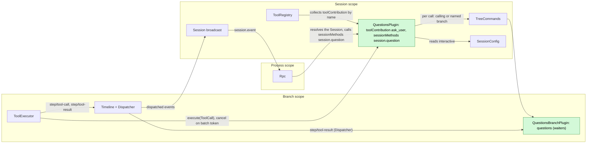
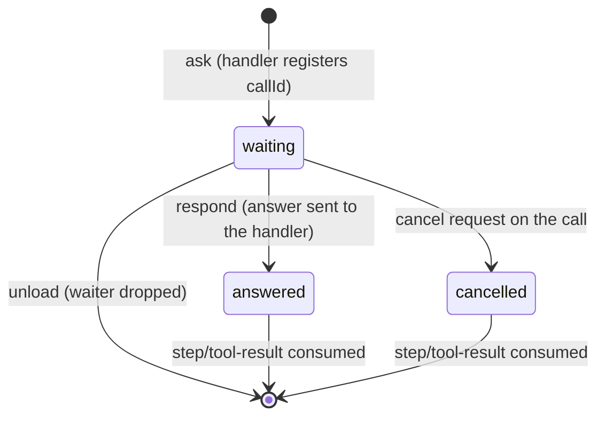
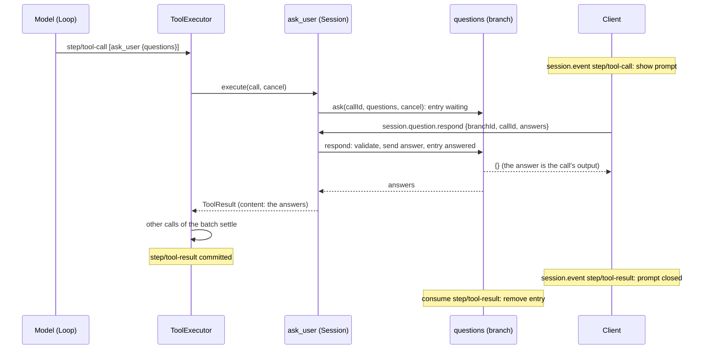
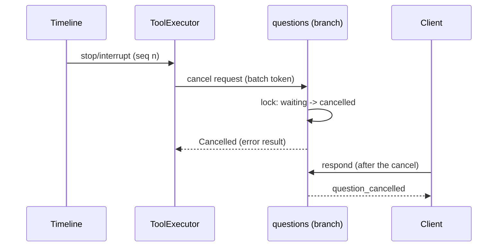

# Questions

Status: Ready for implementation. Overall design: [overview §4](../overview.md#4-plugin-catalog). Milestone: M2. Language: Rust. Scope: Session + branch ([ADR 002](../../adr/002-plugin-scope.md)). Implementation: [#262](https://github.com/arcships/dim/issues/262).

**Delivery boundary.** The Questions capability and its client wiring are unimplemented. The public tool, Session-method and branch-service mechanisms below are available. Implement Appendix D after Ready confirmation; no Timeline event, static RPC variant or new core/rutis mechanism is required.

The model asks the user one or more questions through the `ask_user` tool and waits for the answer: single choice, multiple choice, several questions in one call, custom answer, or a decline. **The question is the pending tool call, and the answer is its tool result.** A client sees the question as the committed `step/tool-call` of `ask_user` that has no `step/tool-result` yet, answers it with the Session method `session.question.respond`, and the waiting handler returns the answer as its `ToolResult`; ToolExecutor publishes it in the batch's `step/tool-result` like any other tool output. The model learns the user's choice only from `ToolResult.content`.

Questions defines **no Timeline events**. The **Session part** provides the `ask_user` tool (`toolContribution`, key `ask_user`) and the method `session.question.respond` (`sessionMethods`, key `session.question`) ([session-boundary](../contracts/session-boundary.md)). The **branch part** holds the waiters of the branch's running `ask_user` calls, in memory, as a running tool holds its I/O. Interrupt, close, reload, restart and fork are settled by the existing tool-call lifecycle of [ToolExecutor](../../architecture/rust-agent/plugins/ToolExecutor.md).

## 1. Structure



The Session part holds no state; it resolves the `questions` service of the calling branch (tool) or the named branch (method) per call through `S:TreeCommands`, as [Wait](../../architecture/rust-agent/plugins/Wait.md) does. Contracts are given in language-neutral form; the Rust form is [Appendix G](#appendix-g-rust-binding).

| Part | Scope | Depends on | Provides |
| --- | --- | --- | --- |
| `QuestionsPlugin` | Session | `S:TreeCommands`, `S:SessionConfig` | `toolContribution` key `ask_user`; `sessionMethods` key `session.question` (`session.question.respond`) |
| `QuestionsBranchPlugin` | Branch | `B:Dispatcher` | `questions` (branch scope; `ask`, `respond`), called only by the Session part |

Installation: both parts are declared in the plugin's `provides` and installed whenever the plugin is enabled; installation never reads `SessionConfig.interactive` ([session access §9.4](../contracts/session-access.md#94-optional-parts-per-enabled-plugin)), so `ask_user` is declared in every Session and a fork keeps the same tool set and prompt prefix.

Contracts depended on: `toolContribution` and ToolExecutor's per-call cancel request and batch settlement; the `step/tool-call` and `step/tool-result` data contracts and their v3 `session.event` forwarding ([tree_protocol.rs](../../../crates/dim-app-server/src/tree_protocol.rs)); the Dispatcher protocol of [single-tree](../../architecture/rust-agent/single-tree.md); `SessionConfig.interactive` ([session access A.3](../contracts/session-access.md#a3-sessionconfig-fields)); `sessionMethods` ([session-boundary A.1](../contracts/session-boundary.md#a1-method-contributions)); Permission risk category `session`.

Contracts defined here: the `ask_user` tool (declaration, input schema, result text), `session.question.respond` and its errors, and the client rule that derives a pending question from history. The `questions` branch service is private to Questions.

### 1.1 Existing native binding and delivery order

Register `ask_user` with `AgentBuilder::session_tool` and provide its
`ToolContribution` under the Session's named key. Register namespace
`session.question` with `AgentBuilder::session_methods`; the Session part uses
`SessionMethods::provide` with A.3's declaration and handler. Rpc already routes
contributed Session methods and exposes `session.methods` discovery. Do not add
a Questions case to `protocol.rs`, a second dispatcher or a static `hello`
feature entry. A client that sees a pending `ask_user` uses the specified method;
disabled or reloading providers keep the existing error contract.

The Session part resolves the branch on each call through `TreeCommands`, as
Wait does. The branch part owns the waiters, cancellation and Dispatcher
subscription; no Session-wide waiter registry or optional-service lookup is
introduced. The existing branch tool token supplies cancellation.

Deliver the capability and protocol flow acceptance on main. TUI integration
in [#262](https://github.com/arcships/dim/issues/262) uses the existing
`AskUserPrompt` on `rust-tui`; line-mode/headless behavior follows A.5. Each
client consumes the same tool-call/result and response shapes. A UI branch
implementation does not make the capability available on main.

## 2. Data and state



The branch part keeps one table, `callId → entry`, under a mutex (no `StateCell`): the entry holds the validated questions and one of `waiting {sender}`, `answered` or `cancelled`. Every state change happens under the lock, so `respond` and cancellation never both win. Answered and cancelled entries stay until Questions consumes the batch's `step/tool-result`, so that a second client is told the call was already answered or cancelled rather than "not pending" (§4.3). The table is never carried across generations and is not rebuilt: an entry is an I/O wait on a human, and a call left waiting by a reload or restart is settled by ToolExecutor ([design rules](../../architecture/rust-agent/principles.md) §4 rule 9; AGENTS.md rule 4).

What the Timeline already holds, and why nothing else is written:

| Need | Existing fact or channel | Why no Questions fact |
| --- | --- | --- |
| The question exists and is pending | The committed `step/tool-call` with an `ask_user` call (its `input` is the questions) and no `step/tool-result` with that `call_event_id` | Derivable from history and live `session.event`; clients already receive both |
| The answer reaches the model | The handler's `ToolResult`, committed by ToolExecutor in `step/tool-result` | `ToolResult.content` is the only text the model reads; a second copy decides nothing |
| Answer versus interrupt | ToolExecutor consumes `stop/interrupt` and cancels the batch token; Questions decides under its lock whether the answer or the cancel came first; a result that completed before the cancel is kept, like any tool's | The answer is tool output, not a command to another module: no later decision reads it except the model, through the result (rule 1 and rule 9) |
| Prompt closes on other clients | `step/tool-result` of the batch | A notice before the batch settles is display only; rule 9 sends display through Session broadcast notices, and none is required (F1) |
| Answer survives a crash before the batch settles | — | After a restart the turn is already `Failed` and the batch reload-settled ([single-tree](../../architecture/rust-agent/single-tree.md) reload rules); a durable answer would be read by nothing. The same window exists for every tool |
| Interrupt, close, reload, restart outcome | ToolExecutor's `step/tool-result` (cancelled or reload-settled) | Owned by ToolExecutor |

**Dynamic events (#2):** Questions defines no events and does not depend on #2.

## 3. Flows

### 3.1 Ask and answer



`{}` means the answer was handed to the waiting call and will be its result unless the batch is reload-settled (§4.2).

### 3.2 Clients, attach and several clients

Pending questions are derived, not replayed: a client attaches (listener first), reads `session.history` per branch through head, and treats each `ask_user` call of a `step/tool-call` without a matching `step/tool-result` as pending; later events arrive live and merge by event identity. No Questions-specific replay or notification is added to Rpc, unlike `approval.request`.

```text
history + live session.event, one branch
  seq 41 step/tool-call  {calls: [ask_user c1 {questions}]}   -> show prompt for c1
  seq 42 step/tool-result {call_event_id: 41, results: [c1]}  -> close prompt for c1
```

Several clients may answer; the first `respond` decides and the others get `question_already_answered`. Their prompts close when `step/tool-result` arrives.

### 3.3 Non-interactive Sessions

`ask_user` is declared as in any Session. Its handler reads `SessionConfig.interactive`; when it is `false` (`exec`, the sessions service's `launch`, Scheduler and Workflow Sessions), the call returns at once with an error result saying that no one can answer and the model should proceed without asking (A.1). No entry is registered, so `respond` finds nothing. How approvals behave in non-interactive Sessions stays Approval's decision ([sessions-service D10](../appserver/sessions-service.md)); Questions does not decide it.

## 4. Timing and conflicts

### 4.1 Answer versus interrupt



Exactly one of `respond` and the cancel request finds the entry waiting. If `respond` wins, the handler returns the answer even when the cancel arrives a moment later; ToolExecutor keeps a completed call's result, and the turn still ends cancelled. If the cancel wins, `respond` replies `question_cancelled`. Either way the client's reply is the truth about the call's output, and only ToolExecutor writes the call's terminal fact. A stop that arrives before the batch is dispatched never reaches the handler: ToolExecutor writes "Tool was not executed".

### 4.2 Reload, restart, close, delete

| Scenario | Outcome |
| --- | --- |
| Branch part reloads while waiting | Unload drops the waiters; handlers return Cancelled with `capability reloading`; the batch is reload-settled and the turn fails. Nothing is re-asked |
| Session part reloads | Propagates to ToolRegistry like any contribution reload; in-flight calls are reload-settled ([ADR 002](../../adr/002-plugin-scope.md) D3) |
| Process restart while waiting | ToolExecutor's rebuild settles the open batch as not executed; the turn fails |
| Answered, then reload before `step/tool-result` | The batch is reload-settled; the answer is lost with it (accepted, as for every tool) |
| Branch close, `session.close`, Session delete | Close cancels the batch token; the waiting call ends cancelled before the branch is removed ([session deletion](../appserver/session-deletion-and-fork.md)) |
| Session unload while waiting | Does not happen: the turn is running, so the Session is not idle |

### 4.3 Fork and branches

A Session fork cuts `main` only at a rest point with no tool proposal lacking its result ([session deletion and fork §6.2](../appserver/session-deletion-and-fork.md)), so a fork never holds a pending question. A child branch inherits only settled calls; a call cut without its result projects as not executed, and the child has no entry. Each branch's questions are answered with that branch's `branchId`.

Other key rows (full table: Appendix B):

| Scenario | Outcome |
| --- | --- |
| Client answers before the handler registered | `question_not_pending`; the batch has no result yet, so the client keeps the prompt and lets the user resend |
| Two clients answer | First accepted; second `question_already_answered` |
| `-p` CLI attached to an interactive Session | The CLI stops the turn with exit code 3 (A8) |
| Steer, Queue, Append while waiting | No effect on the question; consumed after the batch or turn as usual (A11) |

## 5. Context mapping

| What the model sees | Form | Placement |
| --- | --- | --- |
| `ask_user` name, description, schema | Fixed tool declaration | Adopted `context/configured`, every Session |
| Answers or decline | `ToolResult.content` (A.1) | Tool result position, after every call of the batch settles |
| No one can answer (non-interactive) | Error `ToolResult.content` | Same position |
| Cancellation, reload | Error text written by ToolExecutor | Same position |

Never visible: the branch table, `structuredContent`, client rendering. Compaction keeps the declaration and keeps answers only through the summary.

## 6. Interfaces (summary)

| Interface | Kind | Purpose |
| --- | --- | --- |
| `ask_user` | `toolContribution` (Session, key `ask_user`), risk `session` | Ask 1–4 questions, wait for the answer |
| `session.question.respond` | `sessionMethods` (Session, key `session.question`) | Answer or decline a waiting call |
| `questions.ask` / `respond` | Branch service `questions`, private | Register and wait; hand the answer to the waiter |
| Pending-question rule | Client contract | `ask_user` call without its `step/tool-result` |

## 7. Security

`ask_user` uses no host resource and is `session` risk (allowed under every preset; `disallowed_tools` still applies). Answers are user content that become tool output and reach the model; clients must not put secrets in them. `session.question.respond` is available to any client with Session access, including paired remote devices ([RemoteGateway](RemoteGateway.md)); it confers no authority beyond answering a waiting call. Replay never re-asks.

## 8. Rule check

Rules: [principles §1 and §4](../../architecture/rust-agent/principles.md), [ADR 002](../../adr/002-plugin-scope.md) D1–D5.

| Rule | How this document complies |
| --- | --- |
| §4.1 Command events for others' state | Questions changes no other module's state. The answer is the output of Questions' own tool; the call's terminal fact stays ToolExecutor's `step/tool-result`. A `respond` that finds nothing waiting writes nothing and its reply says why. |
| §4.2 No recall after handoff | The answer is handed to the waiting handler once, under the lock; it is never withdrawn, and a cancel arriving later does not replace it. |
| §4.3 Only before callbacks, never block | Not applicable: no before callback; `respond` validates only its parameters against the call's questions. |
| §4.4 No business meaning in core | Timeline, Dispatcher, ToolExecutor and Rpc are unchanged and have no Questions case; Rpc dispatches the method through `sessionMethods`. |
| §4.5 Atomic batches, ordered dispatch | Questions writes no events. It consumes `step/tool-result` only to drop entries; the result is one event, and the decision it supports (answered versus not pending) needs nothing else from its batch. |
| §4.6 Context only from handed-off events | Answers reach the model only through `step/tool-result`. |
| §4.7 Public events and services only | Questions reacts to ToolExecutor's cancel request on its own call (the tool contract) and to the public `step/tool-result`; it reads no other plugin's state. |
| §4.8 Infrastructure unchanged | No change to Timeline, Dispatcher, envelope, assembly or facades; no requirement raised (§9). |
| §4.9 Only facts later decisions use | No event is added; every removed fact is justified in §2. Display before the batch settles would use a Session broadcast notice, not the Timeline (F1). |
| §1 Capability and App Server boundary | Both parts are Capabilities in their own crate; Rpc holds no Questions logic. |
| ADR 002 D1 Scope | Tool and method are Session services; waiters are work bound to a branch's turn, so they live in the branch part. |
| ADR 002 D2 No wiring modules | ToolRegistry and Rpc collect the services by name; the Session part reaches the branch part through `TreeCommands`, as Wait does. |
| ADR 002 D3 Scope dependencies | The Session part depends on Session services only; nothing core depends on Questions; a reload settles waiting calls, which is accepted. |
| ADR 002 D4 Configuration | Not applicable: Questions has no configuration. `interactive` is Session data read at call time, not configuration of Questions. |
| ADR 002 D5 Language-neutral contracts | Tool, method and branch service are given in neutral form (Appendix A); Appendix G is one binding. |

## 9. Requirements raised to mechanism owners

None. Questions uses existing tool, method and branch services. Install both parts when enabled under [session access §9.4](../contracts/session-access.md#94-optional-parts-per-enabled-plugin); installation does not inspect `interactive`.

## 10. Impact

| Module or document | Change | Reason |
| --- | --- | --- |
| Timeline, Dispatcher, ToolExecutor, Rpc | None | The tool-call lifecycle already carries the question and the answer |
| Public content added | The `ask_user` tool, `session.question.respond`, the pending-question client rule | The feature's own entry points |
| [Overview](../overview.md), [plugin index](README.md), [ADR 002](../../adr/002-plugin-scope.md), [session-boundary](../contracts/session-boundary.md), [AcpGateway](AcpGateway.md), [RemoteGateway](RemoteGateway.md) | References to `question/*` replaced by the tool call and its result | Consistency with this document |
| [Hooks](Hooks.md), [Notifications](Notifications.md) (withdrawn) | Still name `question/asked`; a "question pending" trigger becomes the `ask_user` `step/tool-call` | Left to the Hooks design (#143) |

## Appendix A. Interface details

### A.1 Tool `ask_user`

Service `toolContribution`, Session scope, key `ask_user`. `declaration(): sync -> ToolDeclaration` returns the name, a fixed description, the schema below and risk `session`; `execute(ToolCall): async -> ToolResult`. The consumer cancels by a cancel request on the call.

| Parameter | Type | Rule |
| --- | --- | --- |
| `questions` | array, 1..=4 (A4) | Required |
| `questions[].id` | string | Optional; defaults to `"1"`, `"2"`, ... by position; unique in the call |
| `questions[].header` | string, at most 40 chars | Optional short label |
| `questions[].question` | non-empty string | Required |
| `questions[].options` | array of `{label, description?}`, 2..=6, unique labels | Required (A4) |
| `questions[].multiSelect` | boolean, default false | Multiple choice |
| `questions[].allowCustom` | boolean, default true | "Other" free text (A5) |

The handler validates the input; invalid input returns an error result and registers nothing. Results:

| Outcome | `isError` | `content` |
| --- | --- | --- |
| Answered | false | `User answered:` then, per question, `<n>. <question>` and `   -> <label>, <label>` or `   -> (custom) <text>` |
| Declined (A6) | false | `User declined to answer the question(s).` |
| Non-interactive Session | true | `No one is available to answer questions in this session. Proceed without asking.` |
| Invalid input | true | `Invalid ask_user input: <reason>` |
| Cancelled, reload | — | `HostError` cancelled; ToolExecutor writes its error text |

`structuredContent` carries `{answers: Answer[], declined: boolean}` for clients and persistence only.

| Shape | Fields |
| --- | --- |
| `Question` | `{id: string, header?: string, question: string, options: QuestionOption[], multiSelect: boolean, allowCustom: boolean}` |
| `QuestionOption` | `{label: string, description?: string}` |
| `Answer` | `{questionId: string, selected: string[], custom?: string}` |

### A.2 Branch service `questions`

Branch scope, no key, provided by `QuestionsBranchPlugin`, called only by its Session part.

| Method | Mode | Request | Reply | Errors |
| --- | --- | --- | --- | --- |
| `ask` | async | `{callId, questions: Question[]}`, cancel request | `{answers: Answer[], declined: boolean}` | `cancelled {reason}`, `duplicate` |
| `respond` | sync | `{callId, answers: Answer[], declined: boolean}` | `{}`: handed to the waiting call | `not_pending`, `already_answered`, `cancelled`, `invalid {reason}` |

### A.3 Session method `session.question.respond`

Service `sessionMethods`, Session scope, key `session.question`. `describe()` returns `{name: "session.question.respond", mutating: true, interruption: "report", progress: false}`. The handler resolves `questions` of the named branch through `S:TreeCommands`.

`params`: `{sessionId, branchId?: "main", callId, answers: [{questionId, selected: [label], custom?}], declined?: false}` → `{}`. RPC errors carry these `data.appError` codes:

| `appError` | Condition |
| --- | --- |
| `question_not_pending` | No entry: the handler has not registered yet, or the batch already settled |
| `question_already_answered` | Another `respond` was accepted |
| `question_cancelled` | The call was cancelled first |
| `invalid_params` `<reason>` | Unknown question id, label not offered, several labels without `multiSelect`, `custom` without `allowCustom`, nothing selected and no `custom` while not `declined` |
| `service_reloading` | The branch part or the method provider is reloading, or the branch is closing |
| `unknown_method` | Questions not enabled |
| `session_closed` | Session closed |

A client tells "not yet" from "settled" for `question_not_pending` by whether the batch's `step/tool-result` is in its history.

### A.4 Mechanics

| Step | Mechanics |
| --- | --- |
| Tool call | Validate input. If `SessionConfig.interactive` is false, return the non-interactive result. Resolve the calling branch's `questions` through `S:TreeCommands`; a failed lookup returns Cancelled with `capability reloading`, as Wait |
| Ask | Cancel already requested, or the part closed: Cancelled. `callId` already in the table: error result. Else insert `waiting {sender}` and wait: `select! biased { answer, cancel }` |
| Cancel | Lock. `waiting` → `cancelled`, return Cancelled. `answered` → the answer is already sent; return it |
| Respond | Lock. Missing → `not_pending`; `answered` → `already_answered`; `cancelled` → `cancelled`; validate against the entry → `invalid`; send the answer, set `answered`, reply `{}` |
| Consume `step/tool-result` | Dispatcher subscription `"Questions"`: remove the entries of its call ids. No rebuild: the table starts empty in every generation |
| Unload | Set closed, drop every sender (handlers return Cancelled with `capability reloading`), clear the table |

### A.5 CLI contract

The CLI handles questions of every branch of the attached Session (A9).

```text
[question] Storage
Where should the result be saved?
  1. Project
  2. User directory
  0. Other (type your answer)
Choose 1-2:
```

| Situation | CLI behavior |
| --- | --- |
| `ask_user` call in a `step/tool-call`, no prompt open | Parse the input with A.1 (unparsable: no prompt; the handler rejects it). Queue; one call at a time in arrival order. Print `[question] <header>`, each question with numbered options, plus `0. Other (type your answer)` when `allowCustom`. Prompt `Choose 1-N` or `Choose numbers, comma separated`. An empty line on the first question declines the call (A6) |
| Prompt open | Other questions deferred until the prompt closes |
| All questions collected | `session.question.respond`; `{}` closes the prompt |
| `question_already_answered` / `question_cancelled` | Close; print `[question answered elsewhere]` / `[question cancelled]` |
| `question_not_pending`, batch without result | Keep the answers; print `[question not ready; press Enter to send again]` |
| `step/tool-result` for the shown call | Close; print `[question answered elsewhere]` if its result is an answer, else `[question cancelled]` |
| `Ctrl+C` while prompting | `session.stop` (turn); the call ends cancelled |
| EOF | `session.stop`; exit code 130 |
| No interactive input (`-p`) and a question arrives | `Interactive answer required; stopping`, `session.stop`, exit code 3 (A8) |
| Attach or resume | Listener first, then `session.history` per branch; derive pending calls; merge by event identity |

## Appendix B. Full conflict table

`T` = `step/tool-call` with `ask_user`, `R` = its batch's `step/tool-result`, `I` = `stop/interrupt`, `ans` = accepted `respond` (not a Timeline event).

| Scenario | Order | Outcome | Owner of the decision |
| --- | --- | --- | --- |
| Interrupt before the batch is dispatched | I < T consumed | Not executed; no entry | ToolExecutor |
| Cancel already requested when the handler starts | I consumed, then `ask` | `ask` returns Cancelled; no entry | Questions |
| Answer, then interrupt | ans < I | Answer kept as the call's result; turn ends cancelled after R | Questions; ToolExecutor |
| Interrupt, then answer | I < ans attempt | Entry cancelled; `respond` → `question_cancelled` | Questions (lock) |
| Answer and cancel at the same instant | — | Exactly one finds `waiting` under the lock | Questions (lock) |
| Two clients answer | ans1, ans2 | Second `question_already_answered` | Questions (lock) |
| Answer before the handler registered | ans attempt < `ask` | `question_not_pending`; client resends | Client |
| Late answer after R | R < ans attempt | `question_not_pending`; R is in history | Client |
| Answered, other calls of the batch running | ans < R | Answer held in the handler result until R | ToolExecutor |
| Answered, then reload before R | ans < reload | Batch reload-settled; turn Failed | ToolExecutor |
| Branch part reload while waiting | — | Waiters dropped; Cancelled `capability reloading`; batch reload-settled | Questions; ToolExecutor |
| Session part reload while waiting | — | Propagates to ToolRegistry; batch reload-settled (D3) | ToolExecutor |
| Process restart while waiting | T, no R | Rebuild settles the batch; turn Failed | ToolExecutor; Loop |
| Branch close, `session.close`, delete | T, no R | Batch cancelled; entry cancelled | ToolExecutor |
| Several `ask_user` in one batch | T [c1, c2] | Answered independently; one R | Questions; ToolExecutor |
| Same `callId` asked twice | — | Second `ask` → error result | Questions |
| Steer/Queue/Append while waiting | T < input | Consumed after R or `turn/end`; question continues (A11) | Loop, InputQueue |
| `input/withdraw` while waiting | T < withdraw | No effect | InputQueue |
| Compaction between T and R | — | Cannot happen: compaction runs at request preparation | ContextPreparation |
| Session fork | — | Cut only at a rest point; never pending in the fork | Agents |
| Child branch cut between T and R | — | Projects as not executed; no entry in the child | Timeline projection |
| Session unload | T pending | Turn running, not idle, not unloaded | AgentIndex |
| No client ever attached | T pending | Stays waiting, no timeout (A7) | User |
| Non-interactive Session | — | Error result at once; no entry | Questions |
| Paired remote device answers | — | Accepted like any client | Questions |

## Appendix C. Errors and recovery

| Case | Result |
| --- | --- |
| Invalid tool input | Error result; nothing registered |
| Branch service lookup fails | Cancelled with `capability reloading`; ToolExecutor reload-settles |
| Interrupt, close | `execute` ends cancelled; ToolExecutor writes the error result |
| Reload, restart | ToolExecutor reload-settles; never re-asked |
| `respond` during reload | `service_reloading`; after the reload the call is settled, so a retry returns `question_not_pending` |

## Appendix D. Acceptance

Flow tests through RPC, tool calls and events:

1. Single, multiple, multi-question, custom and declined answers produce the specified `content`; invalid answers are rejected by `respond` and the call keeps waiting.
2. `interactive: false` (including `exec` and `launch`): `ask_user` is declared and returns the non-interactive error at once; the tool set equals an interactive Session's.
3. Answer then stop: the result has the answer and the turn ends cancelled. Stop then answer: `question_cancelled` and a cancelled result. A respond racing a cancel yields exactly one of the two.
4. Two concurrent `respond`: one `{}`, one `question_already_answered`.
5. Two `ask_user` plus a slow tool in one batch: answers held until the single `step/tool-result`; a respond after it returns `question_not_pending`.
6. Branch-part reload and process restart while waiting: the batch is reload-settled, the turn fails, nothing is re-asked.
7. Detach and re-attach: history yields the pending call; answering after re-attach works; a paired remote device can answer.
8. The Timeline of a full ask-and-answer contains no Questions event.
9. CLI: rendering, deferral, `Ctrl+C`, EOF, `-p` exit code 3, `question_not_pending` resend.

## Appendix E. Assumptions

| # | Assumption | Basis | Effect if rejected |
| --- | --- | --- | --- |
| A1 | `ask_user` is declared in every Session and refuses when `interactive` is false | [Session access A.3](../contracts/session-access.md#a3-sessionconfig-fields) (assembly never reads `interactive`, #30) | Tool sets differ; a fork loses the prompt prefix |
| A2 | `interactive` absent means interactive | Session access A.3 format decision | Existing Sessions stop asking |
| A4 | 1..=4 questions, 2..=6 options | Judgment | Schema limits change |
| A5 | Custom answers allowed by default | Feature list "custom answers" | Model must opt in |
| A6 | The user may decline a whole call | Maintainer decision | User must answer or stop |
| A7 | No timeout | Maintainer decision | A timeout ends the call with an error result |
| A8 | CLI without input stops with exit code 3 | CLI approval precedent | Different exit policy |
| A9 | Questions of every branch are presented | Approval precedent | Child-branch questions need another client |
| A11 | Steer does not end a waiting question | Judgment | Steer cancels the call |
| A12 | Other clients close the prompt at `step/tool-result`, not at the moment of the answer | Rule 9; usually `ask_user` is alone in its batch | F1 adds an earlier close |

## Appendix F. Deferred scope

| # | Question | Description |
| --- | --- | --- |
| F1 | Earlier close on other clients | Deferred; prompts close at the batch's `step/tool-result` under A12. Earlier display feedback is not required for this implementation. |
| F2 | Approvals in non-interactive Sessions | [sessions-service D10](../appserver/sessions-service.md) tied this to the Questions redesign; Questions does not decide it, and Approval's behavior is unchanged |

## Appendix G. Rust binding

| Neutral contract | Rust binding |
| --- | --- |
| `toolContribution` key `ask_user` | `ToolContribution {definition, handler: Arc<dyn ToolHandler>}` at `SessionScope::named_key::<ToolContribution>("ask_user")`; handler receives `ToolExecutionContext` and the batch `CancellationToken`; cancellation is `HostError::Cancelled` |
| `sessionMethods` key `session.question` | `SessionMethods::provide(ctx, scope, "session.question", declarations, handler)`; key `SessionScope::named_key::<SessionMethods>("session.question")`; failures use `RpcError` with `data.appError` |
| `S:SessionConfig` | `InSession<SessionConfig>`, read per call |
| `questions` | `B:Questions`, key `BranchScope::key::<Questions>()`; Dispatcher subscription `"Questions"` on `step/tool-result` |

```rust
pub struct Question { pub id: String, pub header: Option<String>, pub question: String,
    pub options: Vec<QuestionOption>, pub multi_select: bool, pub allow_custom: bool }
pub struct QuestionOption { pub label: String, pub description: Option<String> }
pub struct Answer { pub question_id: String, pub selected: Vec<String>, pub custom: Option<String> }
pub struct Answered { pub answers: Vec<Answer>, pub declined: bool }

impl Questions {
    /// Registers `call_id` and waits for an answer or `cancel`.
    pub async fn ask(&self, call_id: &str, questions: Vec<Question>,
        cancel: CancellationToken) -> Result<Answered, HostError>;
    /// `Ok` means the answer was handed to the waiting call.
    pub fn respond(&self, call_id: &str, answered: Answered) -> Result<(), RespondError>;
}
pub enum RespondError { NotPending, AlreadyAnswered, Cancelled, Invalid(String) }
```

The unload disposer is registered through `ctx.effect`.
