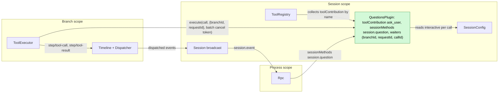
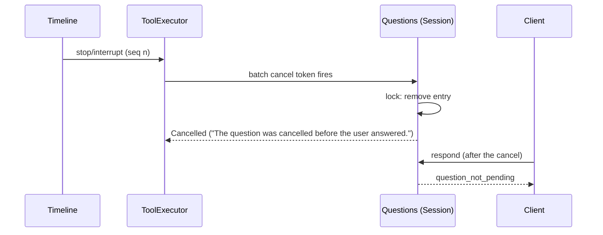

# Questions

Status: Ready (redesign, [#144](https://github.com/arcships/dim/issues/144)); the maintainer's confirmations are recorded in [§12](#12-ready-confirmation). Overall design: [overview §4](../overview.md#4-plugin-catalog). Milestone: M2. Language: Rust. Scope: Session ([ADR 002](../../adr/002-plugin-scope.md)).

The model asks the user one or more questions through the `ask_user` tool and waits for the answer: single choice, multiple choice, several questions in one call, custom answer, or a decline. **The question is the pending tool call, and the answer is its tool result.** A client sees the question as the committed `step/tool-call` of `ask_user` that has no `step/tool-result` yet, answers it with the Session method `session.question.respond`, and the waiting handler returns the answer as its `ToolResult`; ToolExecutor publishes it in the batch's `step/tool-result` like any other tool output. The model learns the user's choice only from `ToolResult.content`.

Questions defines **no Timeline events** and has **one part**, a Session Capability. It provides the `ask_user` tool (`toolContribution`, key `ask_user`) and the method `session.question.respond` (`sessionMethods`, namespace `session.question`) ([session-boundary](../contracts/session-boundary.md)), and holds, in memory, the waiters of the Session's running `ask_user` calls, as a running tool holds its I/O. Interrupt, close, reload, restart and fork are settled by the existing tool-call lifecycle of [ToolExecutor](../../architecture/rust-agent/plugins/ToolExecutor.md).

Changes from the merged redesign ([#178](https://github.com/arcships/dim/pull/178)), all from checking it against current `main` and the ablation review (§11):

- The branch part is removed. The waiter is part of the `ask_user` handler's own call, which already runs in the Session part, so the table moves there, keyed by `(branchId, requestId, callId)`. An entry lives exactly as long as its handler waits; the Dispatcher subscription on `step/tool-result` and the `already_answered` and `cancelled` replies go with it (§11).
- A waiting call is named by `(branchId, requestId, callId)`, where `requestId` is the `request_id` of the call's `step/tool-call`. Call ids may repeat in later model requests, so without it a late answer to a settled call could become a later call's result (§4.3).
- `exec` Sessions are interactive ([CLI commands](../cli-commands.md#execution-and-jsonl-output)); only `session.create {interactive: false}` and `sessions.launch` create non-interactive Sessions (§3.3).
- The text the model reads on interrupt and close is now specified (A.1), and a graceful restart is told apart from a crash or forced shutdown (§4.2).
- The Rust binding uses the implemented `SessionMethods` and `ToolHandler` (Appendix G).
- The client protocol is given with payloads (§3.4) and the CLI with an ASCII rendering (A.5).
- Former F1 now needs no new mechanism (C6 notices are implemented) and former F2 is Approval's, already decided ([CLI commands](../cli-commands.md#execution-and-jsonl-output), [sessions-service D10](../appserver/sessions-service.md)).

## 1. Structure



Contracts are given in language-neutral form; the Rust form is [Appendix G](#appendix-g-rust-binding).

| Part | Scope | Depends on | Provides |
| --- | --- | --- | --- |
| `QuestionsPlugin` | Session | `S:SessionConfig` | `toolContribution` key `ask_user`; `sessionMethods` namespace `session.question` (`session.question.respond`) |

Installation: the part is installed whenever the plugin is enabled; installation never reads `SessionConfig.interactive` ([session access §9.4](../contracts/session-access.md#94-optional-parts-per-enabled-plugin)), so `ask_user` is declared in every Session and a fork keeps the same tool set and prompt prefix.

Contracts depended on, all implemented on `main`:

| Contract | Owner | Status |
| --- | --- | --- |
| `toolContribution`, offered while its provider is active ([session-boundary A.5](../contracts/session-boundary.md)) | ToolRegistry | Implemented (C3, #241) |
| Tool call execution: the call's `ToolExecutionContext.branchId` and `requestId` (the `request_id` of its `step/tool-call`), one cancel token per batch cancelled by `stop/interrupt` and by ToolExecutor's unload, a returned result kept when the cancel comes later, `HostError::Cancelled(reason)` written as an error result with `reason` as its text, reload-settled results that fail the turn ([tool_executor.rs](../../../crates/dim-agent-capabilities/src/tool_executor.rs)) | ToolExecutor | Implemented |
| `sessionMethods` with `MethodDecl {name, mutating, interruption, progress}` ([session-boundary A.1](../contracts/session-boundary.md#a1-method-contributions)) | Rpc, runtime | Implemented (C1) |
| `SessionConfig.interactive`, absent means `true` ([session access A.3](../contracts/session-access.md#a3-sessionconfig-fields)) | Agents | Implemented (C2) |
| `step/tool-call` and `step/tool-result` data contracts (both carry `request_id`) and their `session.event` forwarding, every branch, v2 and v3 ([tree_protocol.rs](../../../crates/dim-app-server/src/tree_protocol.rs)); `session.history` per branch; `session.stop {sessionId, branchId}` | Timeline, Rpc | Implemented |
| Permission risk category `session` ([permission.rs](../../../crates/dim-agent-capabilities/src/permission.rs)) | Permission | Implemented |

Contracts defined here: the `ask_user` tool (declaration, input schema, result text), `session.question.respond` and its errors, and the client rule that derives a pending question from history.

## 2. Data and state

```mermaid
stateDiagram-v2
  [*] --> waiting: ask_user handler registers (branchId, requestId, callId)
  waiting --> [*]: respond (answer sent; entry removed)
  waiting --> [*]: batch cancel token fires (entry removed; Cancelled)
  waiting --> [*]: part unloads (senders dropped; Cancelled capability reloading)
```



The part keeps one table, `(branchId, requestId, callId) → {questions, sender}`, under a mutex (no `StateCell`). `requestId` is the model request that proposed the call: `ToolExecutionContext.requestId`, the same value as the `request_id` of its `step/tool-call`. The key needs it because call ids repeat across requests (§4.3). Only waiting calls have entries; whoever removes the entry under the lock decides the call's output, so `respond` and cancellation never both win. The table is never carried across generations and is not rebuilt: an entry is an I/O wait on a human, and a call left waiting by a reload or restart is settled by ToolExecutor ([design rules](../../architecture/rust-agent/principles.md) §4 rule 9; AGENTS.md rule 4).

What the Timeline already holds, and why nothing else is written:

| Need | Existing fact or channel | Why no Questions fact |
| --- | --- | --- |
| The question exists and is pending | The committed `step/tool-call` with an `ask_user` call (its `input` is the questions; its `data.request_id` and the call id name it) and no `step/tool-result` whose `call_event_id` is that event's `id` | Derivable from history and live `session.event`; clients already receive both |
| The answer reaches the model | The handler's `ToolResult`, committed by ToolExecutor in `step/tool-result` | `ToolResult.content` is the only text the model reads; a second copy decides nothing |
| Answer versus interrupt | ToolExecutor consumes `stop/interrupt` and cancels the batch token; Questions decides under its lock whether the answer or the cancel came first; a result returned before the cancel is kept, like any tool's | The answer is tool output, not a command to another module: no later decision reads it except the model, through the result (rules 1 and 9) |
| Prompt closes on other clients | `step/tool-result` of the batch | A notice before the batch settles is display only; rule 9 sends display through Session broadcast notices, and none is required (F1) |
| Answer survives a crash before the batch settles | — | After a restart the turn is already `Failed` and the batch reload-settled ([single-tree](../../architecture/rust-agent/single-tree.md) reload rules); a durable answer would be read by nothing. The same window exists for every tool |
| Interrupt, close, reload, restart outcome | ToolExecutor's `step/tool-result` | Owned by ToolExecutor |

**Event declaration** ([ADR 001](../../adr/001-harness-foundation.md#events-and-ownership-issue-2)): Questions writes no events and its state and decisions depend on no event. It reads no history and has no Dispatcher subscription; ToolExecutor's cancel token is a service contract, not an event read. Clients depend on `step/tool-call` and `step/tool-result` through the pending-question rule (§3.2), which is a client contract, not a capability's.

**Dynamic events ([#2](https://github.com/arcships/dim/issues/2)):** decided on 2026-10-20 ([ADR 001](../../adr/001-harness-foundation.md#events-and-ownership-issue-2), [#233](https://github.com/arcships/dim/pull/233)). Questions writes no events, so it needs neither an extension event type nor the future dynamic protocol; the previous draft's R1 stays withdrawn.

## 3. Flows

### 3.1 Ask and answer

```mermaid
sequenceDiagram
  participant M as Model (Loop)
  participant TE as ToolExecutor
  participant Q as Questions (Session)
  participant C as Client
  M->>TE: step/tool-call [ask_user {questions}]
  Note over C: session.event step/tool-call: show prompt
  TE->>Q: execute(call, {branchId, requestId}, cancel)
  Q->>Q: validate; lock: insert (branchId, requestId, callId) waiting
  C->>Q: session.question.respond {sessionId, branchId, requestId, callId, answers}
  Q->>Q: lock: validate, remove entry, send answer
  Q-->>C: {} (the answer is the call's output)
  Q-->>TE: ToolResult (content: the answers)
  TE->>TE: other calls of the batch settle
  Note over TE: step/tool-result committed
  Note over C: session.event step/tool-result: prompt closed
```

`{}` means the answer was handed to the waiting call and will be its result unless the batch is reload-settled (§4.2).

### 3.2 Clients, attach and several clients

Pending questions are derived, not replayed: a client attaches (listener first), reads `session.history` per branch through head, and treats each `ask_user` call of a `step/tool-call` without a matching `step/tool-result` as pending; later events arrive live and merge by event identity. No Questions-specific replay or notification is added to Rpc, unlike `approval.request`.

```text
history + live session.event, one branch
  seq 41 step/tool-call   id e41 {request_id: r1, calls: [ask_user c1 {questions}]}  -> show prompt for (r1, c1)
  seq 42 step/tool-result {call_event_id: e41, request_id: r1, results: [c1]}      -> close prompt for (r1, c1)
```

A client keeps the call's `requestId` with its prompt and sends it back with the answer. Several clients may answer; the first `respond` decides and the others get `question_not_pending`. A client that gets `question_not_pending` keeps its prompt until the batch's `step/tool-result` arrives, which closes it on every client (A.3, A12).

### 3.3 Non-interactive Sessions

`ask_user` is declared as in any Session. Its handler reads `SessionConfig.interactive` per call; when it is `false` (Sessions created by `session.create {interactive: false}` or by `sessions.launch`, which Scheduler and Workflow runs use), the call returns at once with an error result saying that no one can answer and the model should proceed without asking (A.1). No entry is registered, so `respond` finds nothing.

`dimcode exec` creates and attaches to an **interactive** Session; it is that Session's interaction client and does not change `interactive` ([CLI commands](../cli-commands.md#execution-and-jsonl-output)). When it has no terminal input it treats a question as it treats an approval: it stops the turn and exits with code 3 (A.5, A8). Approvals in non-interactive Sessions keep Approval's existing owner-side policy ([sessions-service D10](../appserver/sessions-service.md)); Questions does not decide it.

### 3.4 Client protocol

No new notification and one new Session method. All payloads are JSON-RPC over the existing connection.

The question arrives as the existing `session.event` notice carrying the `step/tool-call` event in its existing wire form (shown abbreviated):

```json
{"method": "session.event", "params": {"sessionId": "s1", "branchId": "main",
  "event": {"type": "step", "name": "tool-call", "id": "e41", "sequence": 41,
    "data": {"turn_id": "t1", "request_id": "r1", "calls": [
      {"id": "c1", "name": "ask_user", "input": {"questions": [
        {"header": "Database", "question": "Which database should the service use?",
         "options": [{"label": "PostgreSQL", "description": "managed, relational"},
                     {"label": "SQLite", "description": "single file"}]}]}}]}}}}
```

The client answers with `session.question.respond`:

```json
{"id": 7, "method": "session.question.respond", "params": {"sessionId": "s1", "branchId": "main",
  "requestId": "r1", "callId": "c1", "answers": [{"questionId": "1", "selected": ["PostgreSQL"]}]}}
{"id": 7, "result": {}}
```

`requestId` is the `request_id` of the `step/tool-call` that holds the call. A decline sends `"declined": true` and no `answers`. An error is the existing `MethodError` form with `error.data.appError` (A.3), for example `question_not_pending`. The prompt closes on the `session.event` notice of the `step/tool-result` whose `call_event_id` is `e41`; its `results[]` entry for `c1` carries the `ToolResult` (`content`, `structuredContent`, `isError`). `session.methods` lists `session.question.respond` in every Session where Questions is enabled.

## 4. Timing and conflicts

### 4.1 Answer versus interrupt



Exactly one of `respond` and the cancel removes the entry. If `respond` wins, the handler returns the answer even when the cancel arrives a moment later; ToolExecutor keeps a returned result, and the turn still ends cancelled. If the cancel wins, `respond` replies `question_not_pending`, and the batch's `step/tool-result` shows the cancelled result. Either way the client's reply is the truth about the call's output, and only ToolExecutor writes the call's terminal fact. A stop that arrives before the batch is dispatched never reaches the handler: ToolExecutor writes its own "not executed" text (A.1).

### 4.2 Reload, restart, close, delete

| Scenario | Outcome |
| --- | --- |
| Questions part reloads while waiting | Unload drops the senders; handlers return Cancelled with `capability reloading`; the batch is reload-settled and the turn fails ([ADR 002](../../adr/002-plugin-scope.md) D3). ToolRegistry does not reload with it; the next request offers the new generation, without a Session reload ([session-boundary A.5](../contracts/session-boundary.md#a5-tool-contribution)). Nothing is re-asked |
| ToolExecutor (branch) reloads while waiting | Its unload cancels the batch token; the handler removes its entry and returns; ToolExecutor writes reload-settled results and the turn fails |
| Graceful restart while waiting (SIGINT, SIGTERM, `daemon.shutdown` without `force`) | The App Server closes every loaded Session as `session.close` does (close row below); after the restart the call is already settled and is not asked again |
| Crash or forced shutdown while waiting | On restore, ToolExecutor's rebuild settles the open batch as not executed (`capability reloading`); the turn fails |
| Answered, then reload before `step/tool-result` | The batch is reload-settled; the answer is lost with it (accepted, as for every tool) |
| Branch close, `session.close`, Session delete | A business close, not an unload: it first writes a branch-scope `stop/interrupt`, ToolExecutor cancels the batch token, the waiting call ends cancelled (A.1), and the turn ends Cancelled before the branch is removed ([lifecycle §5](../../architecture/rust-agent/lifecycle.md#5-stop-与-close), [session deletion](../appserver/session-deletion-and-fork.md)). A close that finds the Dispatcher failed or the Loop reloading does not wait for these facts, and the unfinished turn settles as a reload does |
| Session unload while waiting | Does not happen: the turn is running, so the Session is not idle |

### 4.3 Fork and branches

A Session fork cuts `main` only at a rest point with no tool proposal lacking its result ([session deletion and fork §6.2](../appserver/session-deletion-and-fork.md)), so a fork never holds a pending question. A child branch inherits only settled calls; a call cut without its result projects as not executed, and no entry exists for the child. Each branch's questions are answered with that branch's `branchId`.

Call ids come from model output and are unique, by convention, only within one batch: a provider may use `c1` again in a later request of the same branch, or in another branch. The key therefore also holds the `requestId` of the call's batch. The Loop gives every model request a new id and proposes at most one `step/tool-call` per request, so `(branchId, requestId, callId)` names exactly one call. A respond reaches only the call whose prompt the client showed:

```text
branch main, two clients
  T1 step/tool-call {request_id: r1, calls: [ask_user c1 "Deploy staging?"]}
       client A:       respond {requestId: r1, callId: c1, Yes}       -> {}
  R1 step/tool-result {request_id: r1, results: [c1]}                    turn 1 ends
  T2 step/tool-call {request_id: r2, calls: [ask_user c1 "Delete production data?"]}
       client B, late: respond {requestId: r1, callId: c1, Yes}       -> question_not_pending
       client B, late: respond {requestId: r1, callId: c1, declined}  -> question_not_pending
       client A:       respond {requestId: r2, callId: c1, No}        -> {}  (r2 still waited)
  R2 step/tool-result {request_id: r2, results: [c1 "... Delete production data? -> No"]}
```

Other key rows (full table: Appendix B):

| Scenario | Outcome |
| --- | --- |
| Client answers before the handler registered | `question_not_pending`; the batch has no result yet, so the client keeps the prompt and lets the user resend |
| Two clients answer | First accepted; second `question_not_pending`; both prompts close at `step/tool-result` |
| A late answer or decline to a settled call whose call id a later call reuses | `question_not_pending`: the `requestId` differs. The later call keeps waiting and accepts its own answer |
| `exec` without terminal input | The CLI stops the turn with exit code 3 (A8) |
| Steer, Queue, Append while waiting | No effect on the question; consumed after the batch or turn as usual (A11) |

## 5. Context mapping

| What the model sees | Form | Placement |
| --- | --- | --- |
| `ask_user` name, description, schema | Fixed tool declaration | Adopted `context/configured`, every Session |
| Answers or decline | `ToolResult.content` (A.1) | Tool result position, after every call of the batch settles |
| No one can answer (non-interactive) | Error `ToolResult.content` | Same position |
| Cancellation, reload, not executed | Error text (A.1) | Same position |

Never visible: the waiter table, `structuredContent`, client rendering. Compaction keeps the declaration and keeps answers only through the summary.

## 6. Interfaces (summary)

| Interface | Kind | Purpose |
| --- | --- | --- |
| `ask_user` | `toolContribution` (Session, key `ask_user`), risk `session` | Ask 1–4 questions, wait for the answer |
| `session.question.respond` | `sessionMethods` (Session, namespace `session.question`) | Answer or decline a waiting call |
| Pending-question rule | Client contract | `ask_user` call without its `step/tool-result` |

## 7. Security

`ask_user` uses no host resource and is `session` risk (allowed under every preset; `disallowed_tools` still applies). As a model tool call it is governed by Approval and Permission like any tool ([ADR 003](../../adr/003-approval-scope.md) D1). Answers are user content that become tool output and reach the model; clients must not put secrets in them. `session.question.respond` is available to any client with Session access, including paired remote devices ([RemoteGateway](RemoteGateway.md)); it confers no authority beyond answering a waiting call, and Rpc validates only shape and `sessionId` authorization while Questions validates the answer against the call's questions. Replay never re-asks.

## 8. Rule check

Rules: [principles §1 and §4](../../architecture/rust-agent/principles.md), [ADR 002](../../adr/002-plugin-scope.md) D1–D5, [ADR 001 events](../../adr/001-harness-foundation.md#events-and-ownership-issue-2), [ADR 003](../../adr/003-approval-scope.md).

| Rule | How this document complies |
| --- | --- |
| §4.1 Command events for others' state | Questions changes no other module's state. The answer is the output of Questions' own tool; the call's terminal fact stays ToolExecutor's `step/tool-result`. A `respond` that finds nothing waiting writes nothing and its reply says why. |
| §4.2 No recall after handoff | The answer is handed to the waiting handler once, under the lock; it is never withdrawn, and a cancel arriving later does not replace it. |
| §4.3 Only before callbacks, never block | Not applicable: no before callback. Rpc checks only shape and authorization; `respond` validates the answer against the call's questions as the feature owner. |
| §4.4 No business meaning in core | Timeline, Dispatcher, ToolExecutor and Rpc are unchanged and have no Questions case; Rpc dispatches the method through `sessionMethods`. |
| §4.5 Atomic batches, ordered dispatch | Questions writes and consumes no events. The answer and the other results of its batch commit together in ToolExecutor's single `step/tool-result`. |
| §4.6 Context only from handed-off events | Answers reach the model only through `step/tool-result` (AGENTS rule 10). |
| §4.7 Public events and services only | Questions reacts only to the cancel token of its own call (the tool contract) and reads `SessionConfig`; it reads no other plugin's state. |
| §4.8 Infrastructure unchanged | No change to Timeline, Dispatcher, envelope, assembly or facades; no requirement raised (§9). |
| §4.9 Only facts later decisions use | No event is added; every omitted fact is justified in §2. Display before the batch settles would use a Session broadcast notice, not the Timeline (F1). |
| §1 Capability and App Server boundary | The part is a Capability in its own crate; Rpc and the CLI hold no Questions logic beyond the client contract. |
| ADR 002 D1 Scope | Tool, method and waiters are Session services; a waiter is the `ask_user` handler's own call, which the Session-scoped tool contribution runs, so it has the same owner. Branch lifecycle reaches it through ToolExecutor's cancel token. |
| ADR 002 D2 No wiring modules | ToolRegistry and Rpc collect the services by name; there is no adapter part. |
| ADR 002 D3 Scope dependencies | The part depends only on the Session's `SessionConfig`; nothing core depends on Questions; a reload settles waiting calls, which is accepted. |
| ADR 002 D4 Configuration | Not applicable: Questions has no configuration. `interactive` is Session creation data read at call time, not configuration of Questions. |
| ADR 002 D5 Language-neutral contracts | Tool and method are given in neutral form (Appendix A); Appendix G is one binding. |
| ADR 001 event declaration | Given in §2: writes none, depends on none. |
| ADR 003 Approval scope | `ask_user` is an agent decision admitted by Permission under risk `session`; Questions adds no approval and runs nothing from configuration. |

## 9. Requirements raised to mechanism owners

None. Every mechanism Questions uses is implemented (§1). Considered and not raised:

| Candidate | Why not raised |
| --- | --- |
| Client-visible dynamic events ([#2](https://github.com/arcships/dim/issues/2), former R1) | Questions writes no events; #2 is decided independently ([ADR 001](../../adr/001-harness-foundation.md#events-and-ownership-issue-2)) |
| Optional parts installed per enabled plugin (former R2) | Stated in [session access §9.4](../contracts/session-access.md#94-optional-parts-per-enabled-plugin); Questions is one of its users |
| A notice that a question was answered (F1) | C6 Session broadcast notices are implemented ([session notices](../appserver/session-notices.md)); if wanted, Questions emits `{source: "Questions", kind: "answered", data: {branchId, requestId, callId}}` with `session_broadcast::notify`, no mechanism change |
| A question timeout (A7) | A timeout would be Questions' own timer racing the cancel under the same lock; no mechanism needed |

## 10. Impact

| Module or document | Change | Reason |
| --- | --- | --- |
| Timeline, Dispatcher, ToolExecutor, Rpc | None | The tool-call lifecycle already carries the question and the answer |
| Public content added | The `ask_user` tool, `session.question.respond`, the pending-question client rule | The feature's own entry points |
| `dimcode` CLI | Render questions of every branch from `session.event` (today only `main` events are shown), answer them, and extend exit code 3 to "interactive approval or answer required" (A.5) | The client side of the feature |
| [Overview](../overview.md), [plugin index](README.md) | Questions is a Session part only | §1 |
| [Hooks](Hooks.md), [Notifications](Notifications.md) (withdrawn) | Still name `question/asked`; a "question pending" trigger becomes the `ask_user` `step/tool-call` | Left to the Hooks design (#143) |

## 11. Ablation review

| Element | Result |
| --- | --- |
| `question/*` events, Questions replay, dynamic events | Removed in #178 (§2) |
| Branch part `questions`, its Dispatcher subscription on `step/tool-result`, retained answered/cancelled entries, `question_already_answered` and `question_cancelled` | Removed in this revision. The handler that waits already belongs to the Session part, and branch close (through its interrupt) and reload reach it through ToolExecutor's cancel token, so a branch part only added a lookup through `TreeCommands` and a second lifetime. Retained entries only let a second client tell "answered elsewhere" from "not ready" before `step/tool-result`; without them both get `question_not_pending`, and the prompt still closes correctly at `step/tool-result`. Rechecked: answer, decline, interrupt, reload, close, restart and two clients (Appendix B) keep their outcomes |
| `branchId` default `"main"` in `respond` | Removed: a client always has the branch from `session.event`; a default only invites answering the wrong branch |
| Former F2 (approvals in non-interactive Sessions) | Removed: Approval's, decided in [CLI commands](../cli-commands.md#execution-and-jsonl-output) and [sessions-service D10](../appserver/sessions-service.md) |
| Mutex table instead of `StateCell` | Kept: entries are live I/O waits, not state rebuildable from the Timeline |
| `(branchId, requestId, callId)` key and the duplicate-key error | Kept. Call ids come from model output and are unique only by convention within one batch. `requestId` keeps a late answer or decline to a settled call from becoming the result of a later call that reuses the id (§4.3). `branchId` keeps the key independent of request ids across branches, and the duplicate error keeps a collision within one batch from handing one answer to two calls. The key relies on the Loop giving each model request a new id with at most one `step/tool-call`; if that changes, the key must change with it. Considered: the `step/tool-call` event id names the call as exactly, but `ToolExecutionContext` does not carry it, so using it would change ToolExecutor's tool contract; `requestId` is already in both the context and the event |
| `interactive` check in the handler | Kept: it is the only behavior that differs between interactive and non-interactive Sessions while the tool set stays identical (A1) |
| Session-part lock deciding answer versus cancel | Kept: without it, an answer and a cancel could both report success to their callers |

## 12. Ready confirmation

Nothing is blocked by a mechanism. The maintainer confirmed each item as recommended ([#251](https://github.com/arcships/dim/pull/251#issuecomment-6316300432)):

1. The single Session part of this revision (§11), replacing #178's branch part.
2. A6: the user may decline a whole call, and the decline text (A.1).
3. A7: no timeout; a call waits until it is answered, interrupted or settled.
4. A4: 1–4 questions per call, 2–6 options per question.
5. A8 and A9: `exec` without terminal input stops with exit code 3, and the CLI presents questions of every branch of the attached Session.
6. F1: no earlier prompt close.

EN and Chinese documents are kept in sync.

## Appendix A. Interface details

### A.1 Tool `ask_user`

Service `toolContribution`, Session scope, key `ask_user`. The declaration has the name, a fixed description, the schema below and risk `session`; `execute(ToolCall, {branchId, requestId}, cancel)` returns a `ToolResult`. The consumer cancels by the cancel token of the call.

| Parameter | Type | Rule |
| --- | --- | --- |
| `questions` | array, 1..=4 (A4) | Required |
| `questions[].id` | string | Optional; defaults to `"1"`, `"2"`, ... by position; unique in the call |
| `questions[].header` | string, at most 40 chars | Optional short label |
| `questions[].question` | non-empty string | Required |
| `questions[].options` | array of `{label, description?}`, 2..=6, unique labels | Required (A4) |
| `questions[].multiSelect` | boolean, default false | Multiple choice |
| `questions[].allowCustom` | boolean, default true | "Other" free text (A5) |

The handler validates the input; invalid input returns an error result and registers nothing. Results (`content` is one text block):

| Outcome | Written by | `isError` | `content` |
| --- | --- | --- | --- |
| Answered | Questions | false | `User answered:` then, per question, `<n>. <question>` and `   -> <label>, <label>`, with `(custom) <text>` for a custom answer |
| Declined (A6) | Questions | false | `User declined to answer. Proceed without these answers.` |
| Non-interactive Session | Questions | true | `No one is available to answer questions in this session. Proceed without asking.` |
| Invalid input | Questions | true | `Invalid ask_user input: <reason>` |
| Duplicate `(branchId, requestId, callId)` (a call id repeated in one batch) | Questions | true | `Invalid ask_user input: duplicate call id <callId>` |
| Interrupted while waiting | Questions, as `Cancelled(reason)`; ToolExecutor writes the reason | true | `The question was cancelled before the user answered.` |
| Interrupted before the handler started | ToolExecutor | true | `Tool cancelled before execution` or `Tool was not executed: <interrupt reason>` |
| Branch close, `session.close`, delete, graceful restart | Questions, as `Cancelled(reason)`; ToolExecutor writes the reason | true | `The question was cancelled before the user answered.` (the close interrupts the branch first; the turn ends Cancelled) |
| Reload, unload | ToolExecutor | true | `Tool execution cancelled: capability reloading` (reload-settled; the turn fails) |
| Crash or forced shutdown | ToolExecutor rebuild on restore | true | `Tool was not executed: capability reloading` (reload-settled; the turn fails) |
| Timed out | — | — | Not applicable: no timeout (A7) |

Example of an answered result:

```text
User answered:
1. Which database should the service use?
   -> PostgreSQL
2. Which features ship first?
   -> Auth, Search, (custom) audit log
```

`structuredContent` carries `{answers: Answer[], declined: boolean}` for clients and persistence only.

| Shape | Fields |
| --- | --- |
| `Question` | `{id: string, header?: string, question: string, options: QuestionOption[], multiSelect: boolean, allowCustom: boolean}` |
| `QuestionOption` | `{label: string, description?: string}` |
| `Answer` | `{questionId: string, selected: string[], custom?: string}` |

### A.2 Waiter table

Private to the part. `(branchId, requestId, callId) → {questions: Question[], sender}`; no other module reads it.

### A.3 Session method `session.question.respond`

Service `sessionMethods`, Session scope, namespace `session.question`. Declaration `{name: "session.question.respond", mutating: true, interruption: "report", progress: false}`.

`params`: `{sessionId, branchId, requestId, callId, answers?: [{questionId, selected: [label], custom?}], declined?: false}` → `{}`. `requestId` is the `request_id` of the `step/tool-call` that holds the call; `branchId`, `requestId` and `callId` are required and together name the waiting call. Either `declined` is `true` and `answers` is absent, or `answers` has exactly one entry per question. Errors are `MethodError` data:

| `appError` | Condition |
| --- | --- |
| `question_not_pending` | No waiting entry under `(branchId, requestId, callId)`: the handler has not registered yet, another `respond` was accepted, the call was cancelled, or the batch already settled. This includes a late answer or decline to a settled call whose call id a later call reuses; the later call's entry is not touched |
| `invalid_params` `<reason>` | Missing `branchId`, `requestId` or `callId`; unknown or missing question id, label not offered, several labels without `multiSelect`, `custom` without `allowCustom`, nothing selected and no `custom`, `answers` together with `declined`. The entry keeps waiting |
| `service_reloading` | The part is starting or reloading |
| `unknown_method` | Questions not enabled in the Session |
| `session_closed` | Session closed |

A client tells "not yet" from "settled" for `question_not_pending` by whether the batch's `step/tool-result` is in its history: if it is, the prompt is already closed.

### A.4 Mechanics

| Step | Mechanics |
| --- | --- |
| Tool call | Validate input. If `SessionConfig.interactive` is false, return the non-interactive result. If the cancel token has fired or the part is closed, return Cancelled. Lock: if the key `(branchId, requestId, callId)` exists, return the duplicate error; else insert the entry with a one-shot sender. Wait: `select! biased { answer, cancel }` |
| Cancel fires | Lock. Entry present: remove it, return Cancelled with the interrupt text. Entry absent: `respond` won; take the answer already in the channel and return it |
| Respond | Lock. No entry under the params' `(branchId, requestId, callId)` → `question_not_pending`, and no other entry is touched; validate against the entry → `invalid_params` (entry kept); remove the entry, send the answer, reply `{}` |
| Unload | Set closed, drain the table and drop every sender; each handler returns Cancelled with `capability reloading` |

### A.5 CLI contract

The CLI handles questions of every branch of the attached Session (A9). It reads `ask_user` calls from `session.event` of every branch, not only `main`.

```text
 assistant text ...
 [question] Database                                  <- header of the first question, or "question"
 1. Which database should the service use?
    1. PostgreSQL  managed, relational
    2. SQLite      single file
    0. Other (type your answer)                       <- only when allowCustom
 Choose 1-2, 0 for other, empty to decline: 1
 2. Which features ship first?                        <- multiSelect
    1. Auth
    2. Billing
    3. Search
    0. Other (type your answer)
 Choose numbers, comma separated: 1,3,0
 Other: audit log
 [question answered]
```

| Situation | CLI behavior |
| --- | --- |
| `ask_user` call in a `step/tool-call`, no prompt open | Parse the input with A.1 (unparsable: no prompt; the handler rejects it). Queue; one call at a time in arrival order. Print as above. An empty line on the first question declines the call (A6); an empty or invalid line on a later question re-prompts |
| Prompt open | Other notices are deferred until the prompt closes, as for approvals |
| All questions collected | `session.question.respond` with the call's `branchId`, `requestId` and `callId`; `{}` prints `[question answered]` |
| `question_not_pending`, batch result already in history | Close; the result decides the message below |
| `question_not_pending`, no batch result yet | Keep the answers; print `[question not ready; press Enter to send again]` |
| `step/tool-result` for the shown call | Close; print `[question answered elsewhere]` if its result is an answer or decline, else `[question cancelled]` |
| `Ctrl+C` while prompting | `session.stop` (turn); the call ends cancelled; exit code 130 as today |
| EOF | `session.stop`; exit code 130 |
| `exec` without terminal input and a question arrives | Print `Interactive answer required; stopping. Rerun in a terminal to answer it`, `session.stop`, exit code 3 (A8) |
| Attach or resume | Listener first, then `session.history` per branch; derive pending calls, each named by `(branchId, requestId, callId)`; merge by event identity |

## Appendix B. Full conflict table

`T` = `step/tool-call` with `ask_user`, `R` = its batch's `step/tool-result`, `I` = `stop/interrupt`, `ans` = accepted `respond` (not a Timeline event).

| Scenario | Order | Outcome | Owner of the decision |
| --- | --- | --- | --- |
| Interrupt before the batch is dispatched | I < T consumed | Not executed; no entry | ToolExecutor |
| Cancel already fired when the handler starts | I consumed, then execute | Cancelled; no entry | Questions |
| Answer, then interrupt | ans < I | Answer kept as the call's result; turn ends cancelled after R | Questions; ToolExecutor |
| Interrupt, then answer | I < ans attempt | Entry removed by the cancel; `respond` → `question_not_pending`; R shows the cancelled result | Questions (lock) |
| Answer and cancel at the same instant | — | Exactly one removes the entry under the lock | Questions (lock) |
| Two clients answer | ans1, ans2 | Second `question_not_pending`; both close at R | Questions (lock) |
| Answer before the handler registered | ans attempt < execute | `question_not_pending`; client resends | Client |
| Late answer after R | R < ans attempt | `question_not_pending`; R is in history | Client |
| Answered, other calls of the batch running | ans < R | Answer held in the handler result until R | ToolExecutor |
| Answered, then reload before R | ans < reload | Batch reload-settled; turn Failed | ToolExecutor |
| Questions part reload while waiting | — | Senders dropped; Cancelled `capability reloading`; batch reload-settled (D3) | Questions; ToolExecutor |
| ToolExecutor reload while waiting | T, no R | Batch token cancelled; entry removed; reload-settled results | ToolExecutor |
| Branch close, `session.close`, delete, graceful restart | T < I (branch scope) | Batch token cancelled; entry removed; R has the cancelled result; turn ends cancelled | ToolExecutor; Loop |
| Crash or forced shutdown while waiting | T, no R | On restore, rebuild settles the batch; turn Failed | ToolExecutor; Loop |
| Several `ask_user` in one batch | T [c1, c2] | Answered independently; one R | Questions; ToolExecutor |
| Same `callId` twice in one batch while waiting | — | Second call → duplicate error result | Questions |
| Same `callId` in a later request of the branch; late answer or decline to the earlier call | R1 < T2 < ans attempt (r1) | `question_not_pending`; T2's entry is untouched and answered with its own `requestId` | Questions (key) |
| Same `callId` in two branches | — | Independent entries | Questions |
| Steer/Queue/Append while waiting | T < input | Consumed after R or `turn/end`; question continues (A11) | Loop, InputQueue |
| `input/withdraw` while waiting | T < withdraw | No effect | InputQueue |
| Compaction between T and R | — | Cannot happen: compaction runs at request preparation | ContextPreparation |
| Session fork | — | Cut only at a rest point; never pending in the fork | Agents |
| Child branch cut between T and R | — | Projects as not executed; no entry for the child | Timeline projection |
| Session unload | T pending | Turn running, not idle, not unloaded | AgentIndex |
| No client ever attached | T pending | Stays waiting, no timeout (A7) | User |
| Non-interactive Session | — | Error result at once; no entry | Questions |
| Paired remote device answers | — | Accepted like any client | Questions |

## Appendix C. Errors and recovery

| Case | Result |
| --- | --- |
| Invalid tool input | Error result; nothing registered |
| Interrupt, close, graceful restart | `execute` ends Cancelled; ToolExecutor writes the interrupt text |
| Reload, crash or forced shutdown | ToolExecutor reload-settles; never re-asked |
| `respond` during reload | `service_reloading`; after the reload the call is settled, so a retry returns `question_not_pending` |

## Appendix D. Acceptance

Flow tests through RPC, tool calls and events:

1. Single, multiple, multi-question, custom and declined answers produce the specified `content`; invalid answers are rejected by `respond` and the call keeps waiting.
2. `interactive: false` (`session.create {interactive: false}` and `sessions.launch`): `ask_user` is declared and returns the non-interactive error at once; the tool set equals an interactive Session's.
3. Answer then stop: the result has the answer and the turn ends cancelled. Stop then answer: `question_not_pending` and the interrupt text in the result. A respond racing a cancel yields exactly one of the two.
4. Two concurrent `respond`: one `{}`, one `question_not_pending`.
5. Two `ask_user` plus a slow tool in one batch: answers held until the single `step/tool-result`; a respond after it returns `question_not_pending`.
6. Questions part reload, and a crash or forced shutdown, while waiting: the batch is reload-settled, the turn fails, nothing is re-asked.
7. Detach and re-attach: history yields the pending call; answering after re-attach works; a question on a child branch is answered with its `branchId`.
8. The Timeline of a full ask-and-answer contains no Questions event.
9. CLI: rendering, deferral, `Ctrl+C`, EOF, `exec` without terminal input exit code 3, `question_not_pending` resend, a child-branch question.
10. Call ids reused across turns, two clients: client A answers turn 1's `c1`; turn 2 asks a different question, also as `c1`. Client B's late answer and late decline to turn 1's call (its `requestId`) return `question_not_pending`; turn 2's call keeps waiting, accepts its own answer, and the model reads that answer as turn 2's tool result.

## Appendix E. Assumptions

| # | Assumption | Basis | Effect if rejected |
| --- | --- | --- | --- |
| A1 | `ask_user` is declared in every Session and refuses when `interactive` is false | [Session access A.3](../contracts/session-access.md#a3-sessionconfig-fields) (assembly never reads `interactive`, #30) | Tool sets differ; a fork loses the prompt prefix |
| A2 | `interactive` absent means interactive | Session access A.3 format decision, implemented | Existing Sessions stop asking |
| A4 | 1..=4 questions, 2..=6 options | Judgment; confirmed (§12) | Schema limits change |
| A5 | Custom answers allowed by default | Feature list "custom answers" | Model must opt in |
| A6 | The user may decline a whole call | Confirmed (§12) | User must answer or stop |
| A7 | No timeout | Confirmed (§12) | A timeout needs a length and its own result row in A.1 |
| A8 | `exec` without terminal input stops with exit code 3 | CLI approval precedent ([CLI commands](../cli-commands.md#execution-and-jsonl-output)) | Different exit policy, for example declining |
| A9 | Questions of every branch are presented | Approval precedent (approvals of every branch are prompted) | Child-branch questions need another client |
| A11 | Steer does not end a waiting question | Judgment | Steer cancels the call |
| A12 | Other clients close the prompt at `step/tool-result`, not at the moment of the answer | Rule 9; usually `ask_user` is alone in its batch | F1 adds an earlier close |

(A3 of the first draft, the `question/*` payload extension, was removed with the events.)

## Appendix F. Open questions

| # | Question | Description |
| --- | --- | --- |
| F1 | Earlier close on other clients | Decided in §12: not required (A12). If wanted later, either Questions emits a C6 Session broadcast notice `{source: "Questions", kind: "answered", data: {branchId, requestId, callId}}` after `respond` wins, forwarded as `session.notice`, or the product enables ToolExecutor's existing per-call `step/tool-completed` (off today). Neither needs a mechanism change |

## Appendix G. Rust binding

| Neutral contract | Rust binding |
| --- | --- |
| `toolContribution` key `ask_user` | `AgentBuilder::session_tool("ask_user")`; `ctx.provide_as(scope.named_key::<ToolContribution>("ask_user"), ToolContribution {definition, handler})`, as Wait does; `ToolHandler::execute(call, ToolExecutionContext {branch_id, request_id, ..}, CancellationToken)`; cancelled = `HostError::Cancelled(reason)` |
| `sessionMethods` namespace `session.question` | `AgentBuilder::session_methods("session.question")`; `SessionMethods::provide(ctx, &scope, "session.question", vec![MethodDecl::new("session.question.respond", true, Interruption::Report)], handler)`, as ShellInput does |
| `S:SessionConfig` | `InSession<SessionConfig>`, field `interactive` read per call |

```rust
pub struct Question { pub id: String, pub header: Option<String>, pub question: String,
    pub options: Vec<QuestionOption>, pub multi_select: bool, pub allow_custom: bool }
pub struct QuestionOption { pub label: String, pub description: Option<String> }
pub struct Answer { pub question_id: String, pub selected: Vec<String>, pub custom: Option<String> }
pub struct Answered { pub answers: Vec<Answer>, pub declined: bool }

/// (branch_id, request_id, call_id)
struct Waiters { closed: bool,
    table: HashMap<(String, String, String), (Vec<Question>, oneshot::Sender<Answered>)> }
```

The unload disposer (set closed, drain the table) is registered through `ctx.effect`.
