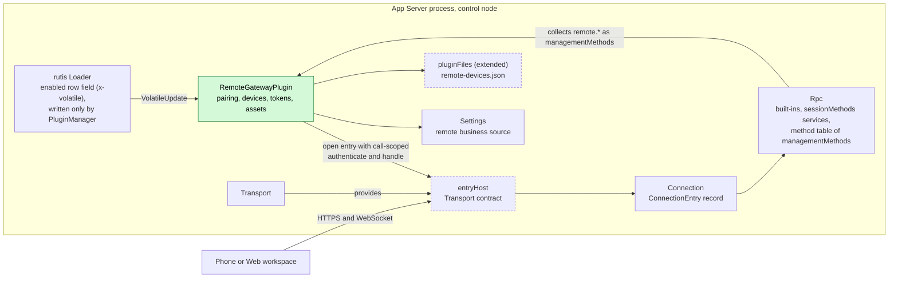
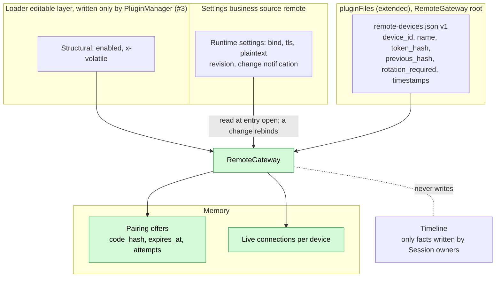
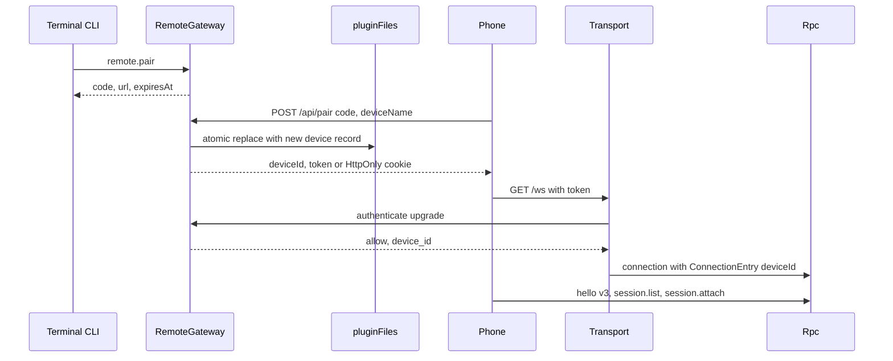
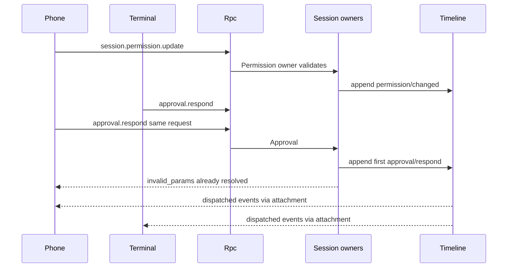
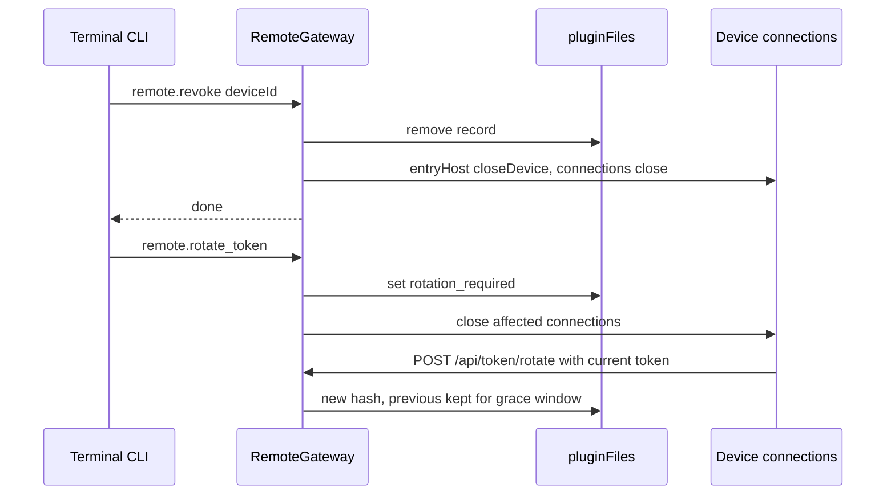
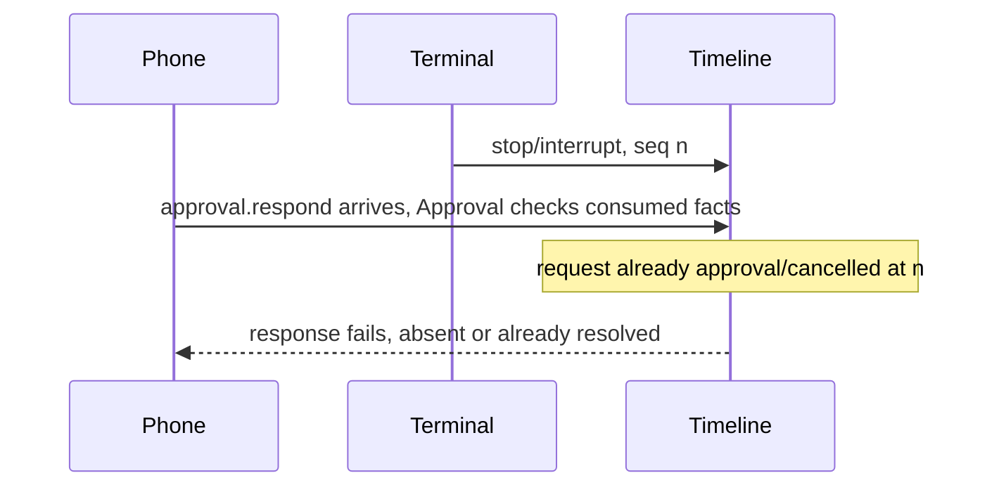

# RemoteGateway

Status: Draft. Overall design: [overview §4 Plugin catalog](../overview.md#4-plugin-catalog), [Transport, Connection changes](../overview.md#b2-app-server-process-plugins), [multiple nodes](../overview.md#63-multiple-nodes), [common constraints](../overview.md#62-constraints), [ADR 002](../../adr/002-plugin-scope.md). Phase: P3 (authentication, disconnection and TLS trade-offs with [#5](https://github.com/arcships/dim/issues/5)). Language: Rust.

> **P3: redesign with rutis' existing capabilities.** rutis is an external dependency; the requirements this document raises to rutis are withdrawn ([principles §4 rule 8](../../architecture/rust-agent/principles.md)).

RemoteGateway opens an authenticated entry on Transport's WebSocket for phones and the Web workspace: pairing by QR code or pairing code, per-device tokens with rotation and revocation, and the Web workspace static assets. Paired devices speak the existing App Server protocol; the entry serves only Session methods of the [methods](../contracts/session-boundary.md) contract (Rpc's Session built-ins and every `sessionMethods` service), so devices may call every Session method, including `session.permission.update` and `shell.*` (decision E3), and never a management method: `managementMethods` and Rpc's management built-ins are never served to paired remote devices. The entry is the product UI plane and never carries the rutis link plane between nodes.

## 1. Structure



RemoteGateway only authenticates upgrades and records the device on the connection; every call afterwards is an ordinary Session method served by its owner. Its own `remote.*` methods are a `managementMethods` process service (key `remote`) that Rpc looks up by name; like every management method they are reachable from the local entry and never from paired devices. Rpc looks that service up per call and does not depend on it, so a RemoteGateway reload does not reload Rpc ([methods §3.2](../contracts/session-boundary.md#32-management-method)).

| Part | Scope | Depends on | Provides |
| --- | --- | --- | --- |
| `RemoteGatewayPlugin` | Process, control node | `entryHost` (Transport), `pluginFiles` (extended), Settings business source `remote`, its own loader row (`VolatileUpdate`) | `managementMethods` key `remote` (`remote.*`), collected by Rpc; answers the call-scoped `authenticate` and `handle` requests of its open entry |
| `TransportPlugin` (change) | Process | existing; nothing of RemoteGateway | existing `ListenAddresses`; added `entryHost` |
| `ConnectionPlugin` / `RpcPlugin` (change) | Process | existing | `ConnectionEntry {name, deviceId}`; Rpc never serves management methods to a connection that carries a `deviceId` |

Contracts defined here: device records and tokens, pairing and rotation HTTP endpoints, `remote.*` methods, the `remote-devices.json` format. Contracts depended on: Transport's `entryHost` service with its call-scoped `authenticate` and `handle` requests (proposed Transport change, [language-neutral](../../adr/002-plugin-scope.md#d5-contracts-are-language-neutral) in A.1, Rust binding in Appendix G; the dependency runs one way, RemoteGateway on Transport), Connection's entry record, the [methods](../contracts/session-boundary.md) contract (`managementMethods` collected into Rpc's method table, never served to paired devices), `pluginFiles` (extended) ([App Server README](../../../crates/dim-app-server/README.md#trusted-plugin-storage)), the structural `enabled` field of its own loader row (`x-volatile`), which only PluginManager writes ([PluginManager](PluginManager.md), typed loader operations of [#3](https://github.com/arcships/dim/issues/3)) and which reaches RemoteGateway as a rutis-loader 0.10 `VolatileUpdate`, and Settings typed operations on the business source `remote` for the listener settings, whose schema RemoteGateway declares (ADR 002 D4). RemoteGateway knows no Session method's meaning and no other plugin.

## 2. Data and state



`enabled` is structural plugin configuration, written only by PluginManager (RemoteGateway never writes it); `bind`, `tls` and `plaintext` are business configuration ([ADR 002 D4](../../adr/002-plugin-scope.md)) read when the entry opens; a change is a data update with a notification, on which RemoteGateway rebinds its listener (close and reopen the entry), never a plugin reload (A16). Device records are host-local security material in `pluginFiles` (extended: atomic replace, lock, format version, owner-only file); a corrupt or unreadable file fails closed. Offers and live connections are in memory and lost on reload or restart. The Timeline holds only facts that Session owners write for remote calls, without device attribution (A2).

## 3. Flows

### 3.1 Pairing and connect



The offer is single use and consumed before the record is written; tokens are stored only as hashes.

### 3.2 Remote control of a Session



Remote and local clients are equal Session clients; owners validate at their boundary and Timeline sequence decides between them. Both attachers see the same events in per-branch order.

### 3.3 Revocation and rotation



Revocation is persisted before connections close, so a racing upgrade with the old token is rejected. Admitted commands of a revoked device continue; their replies are lost.

## 4. Timing and conflicts



Every race between remote and local clients is decided by Timeline sequence inside the owning plugin; RemoteGateway decides only its own pairing, revocation and rotation order.

| Scenario | Outcome | Owner |
| --- | --- | --- |
| Phone and terminal answer the same approval or question | Approval: first consumed fact decides; question: first accepted `session.question.respond` decides; second fails | Approval, Questions |
| Phone `session.permission.update` races terminal | Two `permission/changed` facts; later sequence wins | Permission |
| Phone withdraws an input (`session.input.withdraw`) as it is applied | `input/applied` before `input/withdraw`: `notHeld`, nothing written, consumed normally; `input/withdraw` first: `input/deleted`, never applied | InputQueue |
| Disconnect with a pending approval | Stays pending; replayed on re-attach; no timeout (A14) | Approval |
| Revocation while that device's request runs | Connection closed; command continues; reply lost | Rpc |

Full table: [Appendix B](#appendix-b-full-conflict-table).

## 5. Context mapping

No model-visible effect of its own. Content from remote clients enters the model exactly as local client content: `session.submit` user content (text, images) becomes one user message at the input's consumed position, with no source marker because the user is its author; approvals, stops, withdrawals and permission changes are not model content. Compaction, child-branch inheritance and non-interactive Sessions follow the Session input rules ([session access](../contracts/session-access.md)). The model never sees device ids, device names, tokens, entry names or diagnostics.

## 6. Interfaces (summary)

| Interface | Kind | Purpose |
| --- | --- | --- |
| `GET /`, `/assets/*` | HTTP | Web workspace static assets |
| `POST /api/pair`, `POST /api/token/rotate` | HTTP | Pairing, device token rotation |
| `GET /ws` | WebSocket | App Server protocol v3 for paired devices: all Session methods |
| `remote.status/pair/devices/revoke/rotate_token` | Management methods | Local administration of the entry and devices; the entry is switched on and off by PluginManager's `plugin.set_enabled` |
| `entryHost` (call-scoped `authenticate`, `handle`), `ConnectionEntry` | Transport/Connection change (process service, data record) | Authenticated entries; device connections are never served management methods |
| CLI | `/remote`, `/web`, `dimcode remote`, `dimcode web` | User entries |

Details: [Appendix A](#appendix-a-interface-details).

## 7. Security

Every paired device can call every Session method on every Session of the host: submitting input, answering approvals and questions, stopping turns, `session.permission.update`, `session.exec.stop`, `session.model.update`, `session.mcp*` and creating Sessions in any authorized directory (decision E3, A12). This widens today's local-only execution Session methods and is recorded in the [compatibility table](#a3-protocol-and-compatibility-on-the-remote-entry). The permission preset changed remotely is Session configuration (decision E4): a Timeline fact inherited by child branches and copied with the facts on fork ([#26](https://github.com/arcships/dim/issues/26)). The entry never grants management: pairing, revocation and configuration are management methods, and `daemon.shutdown` is an Rpc built-in; none of them is served to paired devices. Authentication stays minimal ([overview multiple nodes](../overview.md#63-multiple-nodes)): one bearer token per device, hashed at rest, rotated by the device, revoked locally; pairing codes are short-lived, single-use and rate-limited. Cookies are `HttpOnly`, `Secure`, `SameSite=Strict` with a same-origin `Origin` check. Tokens never appear in URLs, logs, diagnostics or Timeline. The entry never accepts rutis link frames or exports services.

## 8. Rule check

Rules: [principles §1 and §4](../../architecture/rust-agent/principles.md), [ADR 002](../../adr/002-plugin-scope.md) D1–D5.

| Rule | How this document complies |
| --- | --- |
| §4.1 Command events for state owned by others | RemoteGateway writes no Timeline event; remote calls reach the owners' own methods, which write their commands and results, and RemoteGateway changes only its own device records and its business source `remote` through Settings typed operations; it never writes its own structural `enabled` field. |
| §4.2 No withdrawal after handover | Remote withdrawal is InputQueue's `input/withdraw`, which has no effect after `input/applied` (`notHeld`); later only `stop/interrupt` applies. |
| §4.3 Intervene before a write only through before callbacks | RemoteGateway adds no check at a Session entry; it authenticates only the transport upgrade, and Rpc keeps its external-boundary checks. |
| §4.4 Core mechanisms carry no business meaning | `entryHost` and `ConnectionEntry` are generic transport records; Rpc only refuses management methods to device connections. |
| §4.5 Read the whole batch before deciding | Not applicable: RemoteGateway decides nothing from Timeline events; owners decide remote calls by their own consumed facts. |
| §4.6 Model context only from handed-over events | Remote content enters the model only as ordinary consumed Session input. |
| §4.7 Plugins interact only through public events and services | RemoteGateway knows no Session method's meaning and uses only Transport, Settings, `pluginFiles` and Rpc's method collection. |
| §4.8 Generic requirements to mechanism owners | Call-scoped requests from provider to caller in the neutral service protocol are raised in §9.1; typed loader operations (#3) are stated in PluginManager §9.1; the Transport and Connection change is in overview Appendix B.2. |
| §4.9 Only facts later decisions use enter the Timeline | RemoteGateway writes no Timeline event; device records, offers and connections stay in `pluginFiles` and memory, and remote calls write only the owners' own facts, without device attribution. |
| §1 Capability and App Server boundary | RemoteGateway is a process plugin in its own crate, not a Capability; Transport, Connection and Rpc get only generic entry changes. |
| ADR 002 D1 Scope follows the owner | Devices and the listener are per host, so RemoteGateway is process-scoped. |
| ADR 002 D2 No wiring modules | Rpc collects `managementMethods` by name; no wiring module exists. |
| ADR 002 D3 Dependencies follow scope | RemoteGateway depends one way on Transport's `entryHost`; Rpc does not depend on RemoteGateway, so its reload does not reload Rpc. |
| ADR 002 D4 Structural and business configuration | Only `enabled` is structural and only PluginManager writes it; `bind`, `tls` and `plaintext` are business configuration in the source `remote`, and a change rebinds the listener without a reload. |
| ADR 002 D5 Language-neutral contracts | `entryHost`, the HTTP surface and the methods are given in neutral form; Appendix G is a binding only. |

## 9. Requirements raised to mechanism owners

### 9.1 Call-scoped requests from provider to caller

Withdrawn: rutis is an external dependency, so no requirement is raised to it. RemoteGateway and Transport solve authentication and handling with dim-side services.

| Item | Content |
| --- | --- |
| Blocked by | `entryHost` (A.1) must ask its caller `authenticate` and `handle` while `open` runs, and ADR 002 D5 requires the contract in neutral form; the neutral service protocol today carries requests from caller to provider and per-call notifications only. |
| Existing mechanisms considered | Per-call notifications carry no reply; `callChannel` is a separate service the provider calls, which would make Transport depend on RemoteGateway; a separate service provided by RemoteGateway and collected by Transport would also reverse the dependency. |
| Generic capability | A request sent by the provider on an open call to its caller, with a reply, scoped to that call and ended when the call ends; no knowledge of entries, devices or HTTP. |
| Effect on sequence, batch, interrupt, reload | No Timeline sequence or batch is involved; dropping the call cancels its pending requests; a reload of either side ends the call and its requests. |
| Owner and issue | rutis (service protocol and rutis-bridge); no issue yet. Rust-to-Rust use (Appendix G) does not wait for it. |

### 9.2 Other requirements (stated elsewhere)

| Requirement | Owner | Five items |
| --- | --- | --- |
| Typed operations on the loader editable layer, used by PluginManager to write RemoteGateway's `enabled` field | rutis-loader, [#3](https://github.com/arcships/dim/issues/3) | [PluginManager §9.1](PluginManager.md#9-requirements-raised-to-mechanism-owners) |

`entryHost`, `ConnectionEntry {name, deviceId}` and Rpc serving no management method to device connections are changes to Transport, Connection and Rpc, listed in [overview Appendix B.2](../overview.md#b2-app-server-process-plugins).

## Appendix A. Interface details

### A.1 Transport change (proposed, owned by Transport)

One process service, `entryHost` (no key), provided by Transport. The entry's authenticator and HTTP routes are not services that Transport collects: they are call-scoped requests that Transport sends to the caller of `open` while the entry is open, the same per-call pattern as `callChannel` in the [methods](../contracts/session-boundary.md) contract. RemoteGateway therefore depends on Transport, and Transport depends on nothing of RemoteGateway. Errors are data `{ code, message }`.

| Method | Kind | Request | Reply |
| --- | --- | --- | --- |
| `entryHost.open` | async, stays open while the entry runs | `{ name, bind: "<ip>:<port>", tls?: { cert_path, key_path } }` | notification `opened { entry_id, address }` on the call once the listener is bound; resolves `{}` after the entry closed |
| `entryHost.close` | async | `{ entry_id }` | `{}` after the listener and every connection it accepted closed (detach) |
| `entryHost.closeDevice` | async | `{ entry_id, device_id }` | `{}` after that device's connections closed |
| `authenticate` (call-scoped request, Transport to caller) | async | `{ headers, origin?, remote_addr }` (tokens only in headers or cookie) | `{ verdict: "allow", device_id } \| { verdict: "deny" }` |
| `handle` (call-scoped request, Transport to caller) | async | `{ method, path, headers, body_base64? }` | `{ status, headers, body_base64? }` |

Every connection accepted on the entry carries the data record `ConnectionEntry { name, deviceId }` (`deviceId` from the `authenticate` reply); Rpc serves a connection with a `deviceId` only Session methods (A1). Revocation calls `closeDevice`; dropping the `open` call or calling `close` closes the entry. Transport and RemoteGateway are Rust and use the binding in Appendix G.

Without RemoteGateway, the bare WebSocket keeps today's rules (protected profiles: `hello` and `daemon.ping` only).

### A.2 HTTP surface

| Path | Auth | Behavior |
| --- | --- | --- |
| `GET /`, `GET /assets/*` | None | Static files confined to the distribution's assets directory; immutable cache headers; restrictive Content-Security-Policy (A5) |
| `POST /api/pair` | Pairing code | `{code, deviceName, web?}` → `{deviceId, token}`; `web: true` sets an `HttpOnly; Secure; SameSite=Strict` cookie instead (A6); offers single use |
| `POST /api/token/rotate` | Current or previous token | New token; previous valid for this endpoint and upgrades until the new one is used or 10 minutes pass (A7) |
| `GET /ws` | Bearer token, or cookie with same-origin `Origin` | Upgrade; 401 when unknown, revoked or `rotation_required` |

Tokens: 32 random bytes, base64url; SHA-256 hashes compared in constant time. Pairing codes: 8 Crockford base32 characters (A8). Attempts: 5 per offer, 20 per minute per entry; exceeding invalidates the offer (A9). Loopback by default; non-loopback requires `tls` or explicit `plaintext: true` (A10).

### A.3 Protocol and compatibility on the remote entry

| Item | Rule |
| --- | --- |
| Version | `hello` v3 only; v1/v2 rejected with `protocol_version` (A11) |
| Methods | Rpc Session built-ins and every `sessionMethods` service, on every Session of the host (E3, A12); management methods (`managementMethods` and Rpc's management built-ins) and the Rpc built-in `daemon.shutdown` → `-32601 unknown_method` |
| `hello.features` | Session features only |
| Identity | `ConnectionEntry.deviceId` for diagnostics and revocation; grants nothing beyond the entry's method set |
| Reverse requests | None: client requests, server notifies ([#5](https://github.com/arcships/dim/issues/5)) |

Compatibility (sources: `LOCAL_EXECUTION_METHODS`, `Call::is_management` in [protocol.rs](../../../crates/dim-app-server/src/protocol.rs); `validate_call` in [connection.rs](../../../crates/dim-app-server/src/connection.rs)):

| Client | Before | After |
| --- | --- | --- |
| v3 remote entry (new) | Did not exist; execution Session methods (`session.permission.get/update`, `session.exec.stop`, `session.skills`, `session.model.update`, `session.prompt.refresh`, `session.mcp`, `session.mcp.refresh`) were local-only | **Compatibility change (E3):** available to paired devices with all other Session methods; management methods and `daemon.shutdown` `unknown_method` |
| v3 bare WebSocket, protected profile, without RemoteGateway | All but `hello`/`daemon.ping` `local_transport_required` | Same |
| v1, v2 on the remote entry | Did not exist | `protocol_version` (A11) |

### A.4 Methods (`managementMethods`, key `remote`)

| Method | Params | Result | Interruption |
| --- | --- | --- | --- |
| `remote.status` | `{}` | `{enabled, running, address?, tls, error?, devices, connections}` | Drain |
| `remote.pair` | `{ttlSeconds?}` (default 300, max 900) | `{code, url, expiresAt}`; `url` is `<origin>/pair#code=<code>` | Drain |
| `remote.devices` | `{}` | `[{deviceId, name, pairedAt, lastSeenAt, connections, rotationRequired}]` | Drain |
| `remote.revoke` | `{deviceId}` | `{}` after record removed and connections closed | Report |
| `remote.rotate_token` | `{deviceId?}` (absent: all) | `{}` after flag persisted and connections closed | Report |

RemoteGateway has no start or stop method and never writes its own `enabled` field. The entry is switched on and off by PluginManager's `plugin.set_enabled {id: "remote-gateway", enabled}` ([PluginManager A.5](PluginManager.md#a5-methods-managementmethods-key-plugin)), which writes the field through the typed loader operations (#3); the loader delivers a `VolatileUpdate` without reloading the plugin, and RemoteGateway calls `entryHost.open` or `close`. Listener settings `bind`, `tls`, `plaintext` are written through Settings typed operations into the business source `remote`, under the schema RemoteGateway declares (which rejects a non-loopback `bind` without `tls` or `plaintext: true`). The CLI `/remote` and `dimcode remote start` write the settings first, then call `plugin.set_enabled`, then read `remote.status`. A business-source change while the entry runs rebinds the listener: RemoteGateway closes and reopens the entry with the new settings (connections detach) without reloading the plugin (A16).

### A.5 Capability mechanics

| Step | Path |
| --- | --- |
| Writes | None by RemoteGateway. Remote calls reach owners through Rpc like local calls: `session.submit` → Session input boundary (`Timeline::append`), `approval.respond` → branch Approval (`approval/respond`), `session.stop` → `stop/interrupt`, `session.permission.update` → Permission (`permission/changed`), `session.input.withdraw` → InputQueue's `sessionMethods` (command `input/withdraw`; InputQueue writes `input/deleted` if it still holds the input) |
| Dispatcher | Not subscribed; devices receive events through their per-connection Session attachment |
| Concurrent attachers | No exclusive owner (A13); all receive the same events in per-branch order |
| Reload | Closes the entry: listener and remote connections close (detach); records persist; offers lost; `remote.*` returns `unknown_method` until RemoteGateway is active again and Rpc does not reload; in-flight `remote.*` calls follow their `interruption`. Transport reload reloads RemoteGateway (it depends on `entryHost`); runtime-settings changes never reload it |
| Process restart | Entry reopens if `enabled`; devices reconnect and re-attach; committed inputs and pending approvals replay on attach |

## Appendix B. Full conflict table

| Scenario | Sequence order | Outcome | Owner of the decision |
| --- | --- | --- | --- |
| Phone and terminal answer the same approval | first `approval/respond` | First decides; second `invalid_params` | Approval |
| Remote answer after turn `stop/interrupt` | interrupt < response | Request already `approval/cancelled`; response fails | Approval |
| Remote answer before the interrupt | response < interrupt | Accepted; tool may still be stopped before start | Approval, ToolExecutor |
| Branch-scoped interrupt or branch close while attached | — | Events delivered; later calls on that branch fail | Session owners |
| Phone Steer while terminal Queue input pending | Timeline order | Applied per mode in sequence order | InputQueue, Loop |
| Remote withdraw vs apply of the input | `input/applied` vs `input/withdraw` in InputQueue's sequence order | Applied first: `notHeld`, nothing written; withdraw first: `input/deleted`, never applied | InputQueue |
| Remote submit during an unsettled tool batch | input < `step/tool-result` | Steer/Append after the batch result; Queue after `turn/end` | Loop |
| Remote `session.permission.update` vs terminal update | sequence | Later `permission/changed` is current; tool admissions use the policy consumed at admission | Permission, Approval |
| Remote `session.exec.stop` vs exec completion | sequence | Earlier terminal fact wins | WorkspaceTools exec owner |
| Compaction or child cut around a remote input | — | As any input ([session access](../contracts/session-access.md)) | ContextPreparation, InputQueue |
| Fork after a remote permission change | — | The fork copies the preset with the facts (E4, #26) | SessionStore |
| Question answered from two devices | first accepted `session.question.respond` | First accepted; second `question_not_pending` | Questions |
| Disconnect while an approval is pending | — | Stays pending; replayed on re-attach (A14) | Approval |
| Disconnect after `session.submit` admitted, reply lost | input committed | Reconnect, `session.input_lookup` by `submissionId` | Client |
| Revocation while a device's request runs | admitted < revoke | Connection closed; command continues; reply lost | Rpc |
| Upgrade racing revocation | record removed < connections closed | Upgrade with the old token rejected | RemoteGateway |
| Two phones use one pairing code | first `POST /api/pair` | Second fails, counts as an attempt | RemoteGateway |
| Rotation response lost | — | Previous token valid in the grace window; device retries | RemoteGateway |
| `remote.rotate_token` while a device rotates | persisted flag order | Rotation before the flag is also flagged | RemoteGateway |
| `enabled` set false (`plugin.set_enabled`) with attached devices | `VolatileUpdate` | Connections close (detach); Sessions continue | RemoteGateway, Transport |
| Rpc reload | — | `service_reloading` for affected calls; connections stay unless the protocol instance changes | Rpc |
| Session plugin contributing Session methods reloads | — | Its names `service_reloading` while it reloads, then served again; in-flight calls follow the [methods](../contracts/session-boundary.md) contract; connections stay | Rpc, contributor |
| Runtime settings change while devices are connected | business source revision | Entry reopens with the new settings; connections detach and reconnect | RemoteGateway |
| Session closed by another client | `session.closed` | Remote attachers receive it | Connection |
| Session idle unload with only remote attachers | — | Attachment pins the Session; detach releases | AgentIndex |
| Resource node of a Session offline | — | Calls that reach that node fail `node_unavailable`, as for local clients; nothing reloads or goes Pending ([overview multiple nodes](../overview.md#63-multiple-nodes)) | Session owners |
| Process restart with offers outstanding | — | Offers lost; devices persist | RemoteGateway |

## Appendix C. Errors and recovery

| Case | Result |
| --- | --- |
| Bind failure after `enabled` is set | `remote.status.error` = `remote_bind_failed`; entry not open; `enabled` unchanged (RemoteGateway never writes it); the CLI reports it |
| TLS files unreadable | `remote.status.error` = `remote_tls_invalid`; entry not open |
| Non-loopback bind without TLS or `plaintext` | The Settings typed write to `remote` fails `invalid_params` (schema declared by RemoteGateway); nothing is written |
| Device file corrupt or unreadable | `remote.status.error`; all upgrades rejected; `remote.devices` fails `remote_storage_failed`; file kept for repair |
| `pluginFiles` lock or write failure on pair/revoke/rotate | `-32000 remote_storage_failed`; in-memory state unchanged; revocation not reported done |
| Unknown device id | `-32602 invalid_params` |
| Upgrade with bad token | HTTP 401, no detail; counted in diagnostics without the token |
| Listener fails while running | Entry closed, `remote.status.error` set, `enabled` unchanged; daemon keeps running (A15) |

## Appendix D. Acceptance

Flow tests in the App Server suite over a real WebSocket entry:

1. `plugin.set_enabled` on RemoteGateway's row opens and closes the entry without a reload, shown by `remote.status`; RemoteGateway itself never writes `enabled`; a non-loopback `bind` without TLS is rejected by the business source schema; restart reopens when `enabled`; changing `bind` in the business source reopens the entry without reloading the plugin.
2. Pairing with valid, expired, reused code and too many attempts; `remote.devices` lists the device.
3. A paired device calls Session methods including `session.permission.update`, `session.exec.stop`, `session.model.update` and `session.input.withdraw`; every management method, including `remote.*` and `daemon.shutdown`, returns `unknown_method`; v1 is rejected.
4. Two attached clients: both receive events; competing `approval.respond`; interrupt before and after a remote response; remote withdraw racing apply (`input/deleted` or `notHeld`).
5. Disconnect with a pending approval and with a submitted input; re-attach replays; `session.input_lookup` finds the input.
6. Revoke closes connections and rejects the token; rotation grace window; `remote.rotate_token` forces rotation.
7. A corrupt device file rejects all upgrades without resetting the file.

## Appendix E. Assumptions

| # | Assumption | Basis | Effect if rejected |
| --- | --- | --- | --- |
| A1 | A connection from a paired device (with `deviceId`) is served only Session methods; management methods are never served to it | Methods contract; decision E3 | — |
| A2 | Device identity is not written to Timeline | Overview §9; judgment | Inputs carry device attribution |
| A3 | Devices stored in `remote-devices.json` in RemoteGateway's `pluginFiles` (extended) root | Decision R8 | Another store with a format change |
| A4 | Pairing offers in memory only | Judgment | Persisted offers |
| A5 | Web workspace assets ship with the distribution, unauthenticated | Feature list `/web`; judgment | Assets require authentication |
| A6 | Browser pairing uses an HttpOnly cookie; native clients get the token | Judgment | Token in browser storage |
| A7 | Device-initiated rotation with a 10-minute grace window; forced rotation by flag | Feature list "rotate access tokens"; judgment | Different rotation model |
| A8 | Pairing code format and 32-byte tokens | Judgment | — |
| A9 | Attempt limits 5 per offer, 20 per minute | Judgment | Different limits |
| A10 | Loopback default; non-loopback needs TLS or explicit plaintext | Overview §6.3; judgment | Policy decided in #5 |
| A11 | Remote entry accepts protocol v3 only | Judgment | v1/v2 on the entry |
| A12 | A paired device can access every Session and every Session method | Decision E3; feature list "access projects and Sessions" | Per-entry method filter or per-device scoping |
| A13 | No exclusive Session ownership; "take over" means attaching and acting | Feature list "collaborate with or take over" | A control-lock protocol |
| A14 | Pending approvals have no timeout with no client attached | Existing Approval behavior | Timeout in Approval |
| A15 | A listener failure stops only the remote entry | Judgment | Daemon shutdown on remote failure |
| A16 | `bind`, `tls`, `plaintext` are business configuration in a Settings business source; only `enabled` is structural, and only PluginManager writes it | ADR 002 D4 (listener settings are business configuration) | Listener settings become structural loader fields |

## Appendix F. Open questions

| Question | Description |
| --- | --- |
| [#5](https://github.com/arcships/dim/issues/5) and overview open questions "Remote access" | Relation of product device identity to peer tokens, link disconnection, TLS deployment |
| Per-device scope | Whether devices may later be limited to workspaces or Sessions (not required by E3) |
| Transport/Connection change | `entryHost` with its call-scoped `authenticate` and `handle` requests is proposed here and needs the Transport change document; the neutral protocol support is the requirement in [§9.1](#91-call-scoped-requests-from-provider-to-caller) |

## Appendix G. Rust binding

Transport and RemoteGateway are Rust; they use this binding of A.1, which is normative in its neutral form.

```rust
/// Binding for service `entryHost` (process, no key).
impl EntryHost {
    /// Maps `open`; dropping the handle maps `close`.
    pub async fn open(&self, spec: EntrySpec) -> Result<EntryHandle, EntryError>;
}
pub struct EntrySpec {
    pub name: String,                                // "remote"
    pub bind: SocketAddr,
    pub tls: Option<TlsFiles>,
    pub authenticate: Arc<dyn UpgradeAuthenticator>, // call-scoped `authenticate`
    pub routes: Arc<dyn HttpRoutes>,                 // call-scoped `handle`
}
pub trait UpgradeAuthenticator: Send + Sync {
    fn authenticate(&self, request: &UpgradeRequest) -> HostFuture<'_, Result<Authenticated, Rejected>>;
}
/// `revoked` maps `closeDevice`: the connection closes when it fires.
pub struct Authenticated { pub device_id: String, pub revoked: CancellationToken }
pub struct ConnectionEntry { pub name: String, pub device_id: Option<String> }
```

`remote.*` use the `managementMethods` binding of the [methods](../contracts/session-boundary.md) contract.
