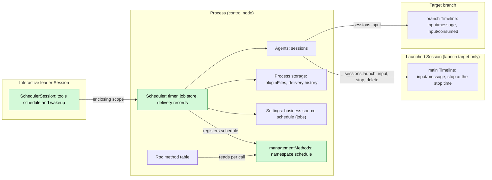
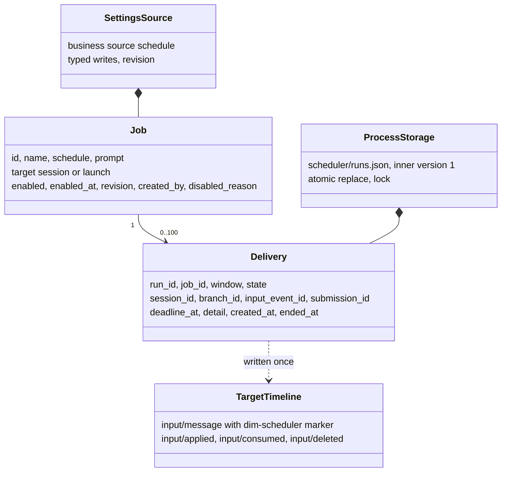
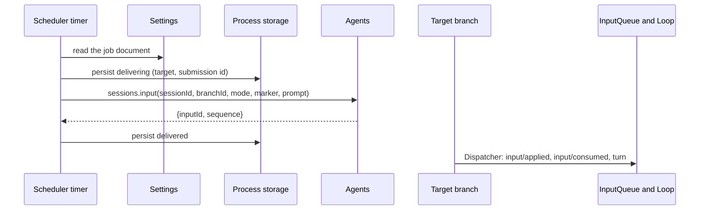
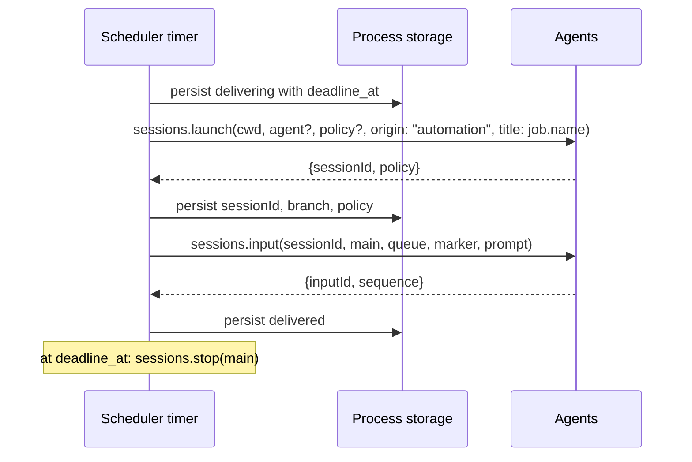
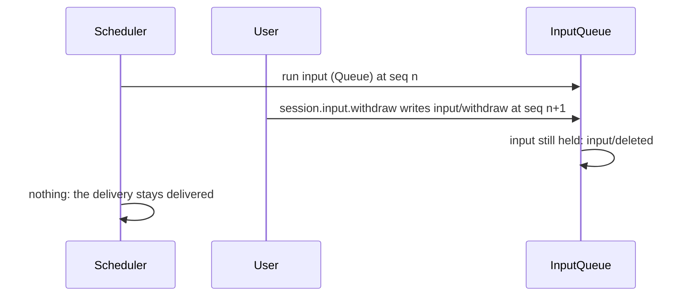

# Scheduler

Status: Design approved. Overall design: [overview §4](../overview.md#4-plugin-catalog); scope: [ADR 002](../../adr/002-plugin-scope.md) (process + Session). Phase: P2. Language: Rust, native, with no Node dependency ([overview Appendix C](../overview.md#appendix-c-implementation-language)). The TypeScript package it replaces is removed with the migration; [Appendix G](#appendix-g-rust-binding) is the Rust binding.

**A job is a delivery.** A job names a target and, on each due window, writes its saved prompt to that target as one ordinary branch input. The target is an existing Session and branch by default — the one that saved the job — or a new Session the job launches, a route only a management client can choose. Scheduler reads no Timeline and keeps no run outcome: it records what it delivered and what failed, and nothing else. The process part owns the jobs, the timer and the delivery records; the Session part offers the `schedule` tool and the `session.wakeup` methods.

**Run reporting.** Scheduler owns its delivery history; `schedule.history` is the durable read path. A run's outcome is its record. Scheduler writes no report input to any Session, and no notification path is required (A.6).

A loop is a second record kind beside the jobs and the wakeups (§12): a session-scoped rhythm whose rounds are ordinary queued inputs, bounded to seven days.

Scheduler keeps scheduled jobs, which are user-written configuration, in its Settings business source `schedule`, and its delivery records in [`pluginFiles`](../../../crates/dim-app-server/README.md#trusted-plugin-storage). For each due window the process part writes the job prompt as one input through `sessions.input` ([session-access](../contracts/session-access.md)), with its own source marker, to the job's target: the branch that saved the job, or a Session this job launched. `queue` is the default wiring; a job may store `steer` or `append`. The Session part declares the `schedule` and `wakeup` tools (risk `persistent_configuration`) in every Session; only interactive leader Sessions can use them. Operators use the specified `schedule.*` management methods. All contracts are language-neutral ([ADR 002 D5](../../adr/002-plugin-scope.md#d5-contracts-are-language-neutral)); the Rust binding limits are in [Appendix G](#appendix-g-rust-binding). Scheduler writes no Timeline event of its own: its deliveries are ordinary inputs to other owners' branches, and its records live in its own stores.

Scheduler also declares the process-scoped data service
[`processActivity`](../../../crates/dim-app-server/README.md#process-activity).
It retains admission from before a delivery's durable acceptance through its
terminal record, including the intervals between inconclusive lookups and a row
reload. These live holds survive a disabled row; a new process reconstructs them
from its `delivering` records before recovery; inert legacy records retain their
compatibility behavior (A.7). Due timer, wakeup, stop and retention passes hold admission
while executing; a future deadline alone is not active work. A paused timer pass
does not consume its deadline. This adds no Scheduler event or record field.

## 1. Structure



Jobs and windows span Sessions, so they belong to the process ([ADR 002](../../adr/002-plugin-scope.md) D1); offering a tool to a Session is the Session part's job (D2). The process part declares the existing `sessions`, `settings`, `pluginFiles` and `managementMethods` services. Agents' stable directory provides `sessions` and finds the current index on each call: index reload fails calls with `reloading`, without reloading Scheduler or any Session ([S2 D1](../appserver/sessions-service.md#3-decisions), [#35](https://github.com/arcships/dim/issues/35)). The Session tool declares its `scheduleJobs` dependency through the accepted binding (§1.1); undeclared `ctx.use` is not a generic optional native lookup. C3 keeps core tool consumers independent of optional rows. No dependency from ToolRegistry, Loop or Session readiness to Scheduler is introduced. Job edits use Settings' owner write and change events, never structural reload.

| Part | Scope | Depends on | Provides |
| --- | --- | --- | --- |
| `Scheduler` | Process (control node) | Stable `sessions`, `settings`, `pluginFiles`, `managementMethods` | Job access, timer, delivery records; specified `scheduleJobs` and management namespace `schedule` |
| `SchedulerSession` | Session, installed when Scheduler is enabled | Existing C4 tool contract; creation configuration; declared `scheduleJobs` dependency (§1.1) | Registers `schedule` and `wakeup` with `toolRegistry` and `session.wakeup` with `sessionMethods`; handlers refuse when `interactive === false` or the Session is a Collaboration member |

**Contracts depended on:** [C4 tools](../session-typescript.md), [Settings](../appserver/settings-service.md), [S2 sessions](../appserver/sessions-service.md), [method admission](../contracts/session-boundary.md) and [pluginFiles](../../../crates/dim-app-server/README.md#trusted-plugin-storage). **Plugin-owned contracts specified here:** job and delivery data, the `schedule` and `wakeup` tools, `scheduleJobs.call`, management namespace `schedule`, the `session.wakeup` namespace, source `schedule`, marker `dim-scheduler` and submission ids `scheduler:<run_id>`. The risk `persistent_configuration` remains unclassified under Permission; no category is added.

### 1.1 Existing bindings and delivery requirements

The [process assembly and management binding](../process-typescript.md) supports explicit process rows. Host startup and restart readiness select required infrastructure, while optional process rows retain their own Pending/failure states. The feature dependency binding is defined below. Concrete package declarations are in §1.3.
The shared declaration gate still permits a hung top-level module load to time
out host startup; process modules follow the binding's author-guide rule.

The [accepted feature dependency binding](../process-typescript.md#51-p6p7-access-through-declared-feature-dependencies)
declares `scheduleJobs` and `toolRegistry` as this optional Session tool module's dependencies.
Provider activation, retirement, retry and recovery follow that binding's current
rules; Scheduler does not define another attachment policy or copy its error
text. The stable process dependency boundary still applies. This settles the
#35 access choice; the package implements the binding's lifecycle contract.

| Surface | Current implementation and consequence |
| --- | --- |
| Session tool | A C4 Session definition, registered by the process row with `partRegistry`, injects `toolRegistry` and registers `schedule` and `wakeup` from its apply with their declarations and asynchronous `execute`. Registration does no I/O. Registration and provider-generation changes follow the current C4 binding (§1.1). |
| Process package / `scheduleJobs` | One optional process row, `Scheduler`, registered with `AgentBuilder::optional_plugin`, installs the process owner; its `apply` registers the `SchedulerSession` part with `partRegistry`. The Session part reads `scheduleJobs` through `names.key()` (§1.1). |
| Management namespace | The process row restores its delivery store before registering `schedule` with `managementMethods` and publishing `scheduleJobs`. A failed restore retains the fault and still registers the namespace before failing the row, so subsequent calls report that row's failed status. Native per-call admission and `report`/`drain` follow the registering row's lifetime and status. |
| Settings | The process row alone registers source `schedule`, user file `schedule.json`, no `projectFile` (§7.1). Read the validated/defaulted document at use, and CAS with its document revision. The native binding uses typed owner reads/writes; clients manage jobs through `schedule.*`, not generic `settings.*`. |
| Storage | The [public binding](../process-typescript.md#52-public-pluginfiles-binding) supplies pluginFiles at the authorized product root. The embedding host provisions `scheduler/` before enabling the row; a missing parent returns `io` before the transaction callback. Scheduler inner v1 (A.7) and host outer v1 are unchanged. |
| Sessions | Calls use `{ok:true,value}` / `{ok:false,error:{code,message,retryable}}`. `launch` returns `{sessionId,policy}`, `input` returns `{inputId,sequence}`, and `lookup` returns `accepted`/`unknown`. Keep data in these existing shapes. |
| Native lifetime | Each S2 call holds its own lease. Agents' automatic idle unload is delivered by [#331](https://github.com/arcships/dim/pull/331) for [#126](https://github.com/arcships/dim/issues/126). Scheduler does not turn detachment into close or add its own unload loop. |

### 1.2 Impact

No facade, loader, event-format or rutis change is proposed; all new business behavior belongs to the Scheduler package. The runtime assembly gains one entry, `AgentBuilder::optional_plugin`, so the process row is optional (the host does not wait for it), and `plugin_rows` returns `PluginRows`, which carries the optional row ids; no core readiness path or mechanism is altered. The source, tools and management namespace above have concrete consumers (Settings, ToolRegistry and operators); `scheduleJobs` exists only for the feature's two scopes. There is no additional registry, readiness service, notification bus or App Server business module.

### 1.3 Concrete package row

The row fields below are the dependency, method-kind and Settings contract that the native binding keeps. Their TypeScript spelling (manifest `code` fields, `definePlugin`, `ctx.use`) is replaced by [Appendix G](#appendix-g-rust-binding). The process part is an optional row registered by the product entry point with `AgentBuilder::optional_plugin`, and the Session part is registered through `partRegistry` from that row's `apply`.

| Row field | Process row |
| --- | --- |
| `id` | `Scheduler` |
| `name` | `Scheduler` |
| `config` | `{}` |
| `inject` | `settings`, `pluginFiles`, `managementMethods`, `partRegistry`, `sessions` |
| `provides` | `scheduleJobs`; apply registers `schedule` with `managementMethods` and the `SchedulerSession` part with `partRegistry` |
| `settings` | The complete `schedule` source in §7.1, including its schema |

The `SchedulerSession` part injects `scheduleJobs`, `toolRegistry`, `sessionMethods`, the guide entries, `SessionConfig` and `SessionIdentity`, provides nothing, and registers `schedule`, `wakeup`, `session.wakeup` and the §5.2 guide entry from its apply.

**Failed-owner reporting.** The coordinated [rutis 0.16 upgrade](../rutis-0.16-upgrade.md) and its later versions supply the loader failure reporting required by Appendix C and Appendix D. An unreadable or invalid delivery store fails the process row; `schedule.*` then returns `service_unavailable`, preserving the original bytes.

The optional process row and its registered Session part agree on dependencies and
method kinds; they are one feature with two owners of work, not separate
runtimes. The process row provides `scheduleJobs` and registers its namespace on the original context;
there is no methods adapter or Session forwarding plugin. Structural config
contains no jobs, policy defaults, credentials, timer settings or run state.

Settings changes use
the declared source and existing event delivery without reloading the process
row. The owner settles accepted calls and native I/O before closing its existing
`pluginFiles` scope. Its cleanup joins its own admitted
report calls (A.6), and S2's admitted-input lifetime in
[#267](https://github.com/arcships/dim/pull/267) keeps such a write running across
index reload; a bridge reply lost during index reload is not an early cleanup boundary.

The tool uses host-supplied `ToolCall.sessionId`, `branchId` and `config.cwd` for the A.2 caller. Before dispatch, it refuses `config.interactive === false` or `config.collaborationRole === "member"`. It does not trust caller identities supplied in model arguments. Its synchronous declaration states the delivery target in §5.1. Once cleanup starts, retained handlers follow the current unavailable-provider and retry contract in the [feature binding](../process-typescript.md#51-p6p7-access-through-declared-feature-dependencies). Scheduler does not hard-code that binding's error text or assume a particular provider reattachment path.

The declarations the process row registers are A.3's seven literal methods. `list`,
`history` and `watch` are non-mutating, `interruption:"report"`; the other four are
mutating, `interruption:"drain"`. All but `watch` use `progress:false`; `watch`
declares progress, and its items are the watch's changes (§11.2, A.3). Their JSON
values and errors use existing `MethodReply`; the tool maps A.2's reply into
`ToolResult.content` and `isError`. No new App Server method is added.

A delivery reads no permission state. A session-route job carries no policy: the delivered input is an ordinary input of the target branch, and its tools are admitted under that branch's own Permission state. A launch-route Session receives the job's optional preset, which `sessions.launch` caps against the live host bound (§3.3). Neither path captures a save-time policy, so the package declares no `sessionPermissions` dependency and keeps no reuse comparison.

## 2. Data and state



Jobs live in the Settings business source and deliveries only in process storage; nothing is rebuilt from the Timeline, and Scheduler owns no `StateCell`. A delivery is decided by its own write: Scheduler reads the target's Timeline never, and the record's state is what the write and the lookup answered. The Session part holds no state.

### 2.1 The two targets

A job's `target` is one of two shapes, and the shape decides what a window does.

| Target | Fields | A due window |
| --- | --- | --- |
| `session` | `session_id`, `branch_id` (`"main"` when omitted), `input_mode?` (`queue` \| `steer` \| `append`; default `queue`) | Writes one input to that branch. No Session is created, configured or deleted. |
| `launch` | `cwd`, `agent_id?` (the Agent profile the new Session runs as; absent, the default profile), `policy?` (optional preset), `max_run_minutes?` (default 60) | Launches a non-interactive Session, writes one input to its `main` branch, and stops it at the stop time (§3.2). |

The `session` target is what the `schedule` tool saves, and it is the only shape the tool can save: the calling Session and branch are its target. The `launch` target exists for work that must run with no live Session; only `schedule.save` sets it (A.2, A.3), and a management create names its target because it has no Session to default to. A job stores exactly one target, and a save replaces it whole.

A delivery never changes the target's name, branch or identity. The target of a job is fixed until a save replaces it; a save never rewrites a delivery already recorded.

### 2.2 Deliveries

A delivery records one window. Its state is `delivering` while the write is unsettled, and one of `delivered`, `failed`, `lost` or `missed` afterwards.

| State | Meaning | Terminal |
| --- | --- | --- |
| `delivering` | The record names the target and, once the launch answered, the Session a `launch` created; the input may or may not have been accepted. Settled by `sessions.lookup` after a restart (A.6). | no |
| `delivered` | The target branch published the input; `input_event_id` is its receipt. | yes |
| `failed` | The window wrote no input, or the Session to write to could not be created. `detail` carries the reason. | yes |
| `lost` | The write's outcome was not determined within the lookup bound (A.6), and the window is not retried. `detail` names the last lookup answer. | yes |
| `missed` | The daemon did not observe the window within its grace (A.4), or the window was skipped while the job had an unsettled delivery (§3.1); `detail` says which. | yes |

A delivery is never updated after it reaches a terminal state, and Scheduler never resends a window. `session_id` and `branch_id` name the target that was used; for `launch` they name the launched Session and its `main` branch, and `deadline_at` is its stop time. `deadline_at` is absent for a `session` target and for a run that never launched.

### 2.3 Jobs and deliveries saved before this change

The stored shapes change additively: a job saved before this change has no `target`, and its old fields are read, mapped to a target, and preserved by writes. `Job` keeps `mode`, `session_id`, `cwd`, `model`, `agent_id`, `policy`, `policy_cap` and `max_run_minutes` as legacy fields (A.1); they are never reported, and no save writes one. `policy_cap` is therefore read and preserved, and no save captures the live host bound: a launch applies the bound in force at the launch (§3.3).

The mapping is fixed and depends on the saving origin, not on the target's convenience:

| Legacy job | Reads as |
| --- | --- |
| `created_by` is a tool, any `mode` | `session` target at that tool's saving Session and branch |
| `created_by` is the user, `mode: "create"` | `launch` target with the stored `cwd`, `agent_id`, `policy` and `max_run_minutes` |
| `created_by` is the user, `mode: "reuse"`, a stored `session_id` | `session` target at that Session's `main` |
| `created_by` is the user, `mode: "reuse"`, no `session_id` | `launch` target with the stored fields |

A tool-saved job maps to its saving branch whatever its `mode` was: its old shape launched Sessions, which is exactly what a tool-saved job must no longer do. For a legacy `reuse` job, the run records tell the two Session cases apart. A Session that appears in a run with the launch origin is one Scheduler launched and bound on the first run: it stays owned by the job and goes with it (A.7). A Session the job only reused is the user's, and is never deleted. A save that changes the job's target releases the launched ownership.

The delivery store keeps inner v1: a record's old state names are decoded as they were written, and a new record uses §2.2's vocabulary. No byte is rewritten and no version changes (A.7). The fields added to a record are `attempts`, the number of lookups made for a `delivering` delivery, and `released`, which marks a launch record whose Session a target-changing save or a delete released (A.7). Both are optional: a record without them reads as zero attempts and as unreleased, and the inner version stays 1.

## 3. Flows

### 3.1 A due window



A `launch` target records the window, launches once, records the Session and the stop time the launch answered with, writes one input, and starts the stop timer:



Those are the whole target: one launch, one input and the stop timer. Scheduler reads no history of the launched Session and subscribes to no broadcast, so a delivery is settled by its own write and nothing follows the launched work (A.6).

The launch declares what the Session is for and how a picker labels it: `origin: "automation"` gives it the class of work a saved configuration runs with no person present, so a client lists it under `session.catalog`'s `withAutomationSessions` without also listing every Collaboration member and Workflow stage, and `title: job.name` is the label a picker shows before the first input. SessionTitle writes that title, under its own text rules ([SessionTitle](SessionTitle.md)); the job name is Scheduler's, and the App Server holds no dependency on Scheduler. A `session` target sends neither: it is the user's own Session, and its origin stays what it was ([session classification](../appserver/session-classification.md#32-which-creation-entry-writes-which-value)).

Window evaluation follows `settings/schedule`, wall-clock minute changes, the earliest remaining window within the current minute, and accepted-delivery settlement. The owned timer checks those deadlines each second without reading Settings or the store on idle ticks.

The `delivering` record is persisted before any external effect, so a restart settles it by lookup instead of writing again. A `launch` window records its stop time with that first write and its Session with the reply, so a crash between the two leaves a `delivering` record that names no Session: nothing can look its input up, and it settles `lost` with `detail: launch_reply_unknown` (Appendix F). A window is written at most once: the branch accepts each `submissionId` once ([sessions service §6.2](../appserver/sessions-service.md#62-input)), and a retry with the same id returns the same receipt.

**Overlap.** A window is skipped while that job has any `delivering` record, so a job has at most one `delivering` record at a time. The skipped window writes no input and records one `missed` delivery with `detail: previous_delivery_unsettled` (A.6), which counts toward retention (A.7). That record is terminal and does not by itself admit the next window: the condition is the job's `delivering` record, not the delivery before it. `schedule.run_now` obeys the same rule; it records its own delivery for the manual window, with its own `run_id` and `window`, and never returns the timer path's record, so a manual window the rule skips returns that `missed` record. The skip lasts no longer than the `delivering` record can stay unsettled, and the bound below fixes that.

**Bound.** A lookup answer settles a `delivering` record only when it carries a fact. `accepted` settles it `delivered` at any attempt, with no second input. `unknown`, `reloading`, `ambiguous` and a transport failure leave it `delivering`; each counts as one attempt toward the five, and the count is persisted as `attempts` before the lookup (A.1). The fifth such answer settles it `lost`, and `detail` names that answer. `unknown` cannot settle a record because it is final only for a write that returned before the lookup began ([sessions service §6.3](../appserver/sessions-service.md#63-lookup)), and a write whose reply was lost keeps running to its own outcome ([§6.2](../appserver/sessions-service.md#62-input)), so `unknown` may mean not committed yet. A window whose write never committed is therefore `lost` after five passes instead of `failed`, and the job's windows are skipped meanwhile. Recovery settles an exhausted budget without another lookup: a stored `delivering` record whose `attempts` is already at the bound settles `lost` with `detail: lookup_budget_exhausted` before any lookup is sent. That crash cannot tell whether the fifth write was accepted, so an input the branch in fact accepted is recorded `lost`; no second write is attempted and nothing is resent, so the cost is one record that understates a delivery, never a duplicate. A `lost` record is terminal and prunable (A.7), so no record stays unsettled for ever and the skip rule cannot outlast those five attempts.

**Queued inputs.** Scheduler bounds its own writes: one input per window per job, and none while the job has an unsettled delivery. How many inputs a target branch holds is that branch's InputQueue's concern, not Scheduler's. InputQueue has no bound today ([input_queue.rs](../../../crates/dim-agent-capabilities/src/input_queue.rs)), so a `queue` job whose target stays busy adds one queued input per window until the branch consumes them. A queue bound would apply to every producer that writes to a branch, so it belongs to an InputQueue design, not to this one.

### 3.2 Completion and timeout

**Completion.** A delivery is complete when the target branch publishes the input; the record becomes `delivered` with the receipt's `input_event_id`. Scheduler then stops looking at it. What the input becomes is the target's own business: its InputQueue and Loop decide whether it starts a turn, queues behind one, or waits, and the target's own Permission state governs the tools of that turn. Scheduler subscribes to no broadcast, reads no history and holds no lease.

**Timeout.** Only a `launch` target has one. `max_run_minutes` is the Session's stop time, fixed when the delivery is accepted as `created_at + max_run_minutes`; the timer stops the Session at it:

- `sessions.stop {sessionId, branchId:"main", reason:"scheduled run reached its stop time"}`. The delivery stays `delivered`; a stop is a bound on the launched work, not a run outcome.
- A stop that fails is retried by the timer at most once a minute while the record still exists. Nothing about the delivery changes.
- A Session stopped at its stop time is deleted by retention when its last naming record leaves the store (A.7), never before its stop time.

A `session` target has no timeout: the delivery belongs to the user's branch, and Scheduler never withdraws or stops it.

### 3.3 Permission of a run

A session-route delivery carries no authority at all. It is an ordinary input of the target branch ([§4 rule 1](../../architecture/rust-agent/principles.md)); the branch's own Permission state admits the tools of the turn, exactly as for an input its user typed. The job stores no policy, and no save changes another branch's authority because there is nothing to take over.

A launch-route Session is created with the job's optional preset, capped by `sessions.launch` against the live host bound — S2 D4's `ServerConfig.session_defaults.permission_policy` ([sessions service](../appserver/sessions-service.md#3-decisions)). Without a preset the request is read-only. The returned policy is recorded on the delivery as the authority observed at launch; it is a record, not a grant, and later Permission changes narrow it.

Automation never widens authority (E2). Because a job captures no policy and compares nothing, there is no save-time cap, takeover or reuse comparison: a save only stores a preset, and every launch applies S2's live cap. A preset above the host bound is not rejected at save; the launch caps it, and the delivery records what the Session actually received.

## 4. Timing and conflicts

Scheduler judges every instant against one clock it owns, and crosses every wait of the timer, the stop timer and a lookup poll through that clock. The instant a record carries and the instant a later generation judges it by therefore come from the same source, across restarts. The clock is process state, not data crossing a boundary: no method parameter or stored record changes with it. A record's time is read inside the transaction that writes it, after the file lease is held, so a wait for the lease is not charged to a run.



Scheduler learns nothing after the write. Every disagreement between a delivery and what the target later did is the target's history, not a run state.

| Scenario | Sequence order | Outcome | Owner |
| --- | --- | --- | --- |
| Target branch busy | — | The input is queued; it is consumed after the running turn (A5) | InputQueue, Loop |
| Target branch idle-unloaded | — | `sessions.input` acquires and restores it | Agents |
| Target branch running with a pending approval | — | The input waits behind the turn; Scheduler is not involved | Approval, InputQueue |
| User interrupts or withdraws the delivered input | input < interrupt or withdraw | The input is deleted or ends with the turn; the delivery stays `delivered` | Loop, InputQueue |
| Target Session deleted or closed | — | The write fails `session_closed`; the run is `failed: session_closed` and the job is disabled (§A.3) | Agents, Scheduler |
| Target branch ended | — | The write fails `branch_ended`; the run is `failed: branch_ended` and the job is disabled | Agents, Scheduler |
| Agents index reload | — | The write answers `reloading`; a delivery in flight settles by lookup (A.6) | Agents |
| Scheduler reload or restart | — | `delivering` records settle by `sessions.lookup`; no window is written twice | Scheduler |
| Daemon down over a window | — | `missed`; no catch-up (E5) | Scheduler |
| Two windows due at once | — | One delivery per window; a window beyond its grace or due while the job has an unsettled delivery is `missed` | Scheduler |
| Job deleted while a launch Session runs | — | The delivery stands and the Session keeps running to its stop time, then retention deletes it (A14) | Scheduler |
| Job saved with a new target | — | Later windows use the new target; recorded deliveries are unchanged | Scheduler |
| Child branch created in the target Session | — | Ignored; a delivery names one branch | Scheduler |

Full table: Appendix B.

## 5. Context mapping

| Where | What the model sees | Form | Placement and survival |
| --- | --- | --- | --- |
| Calling Session | `schedule` declaration | Tool declaration in adopted configuration (every Session; usable only in interactive leaders) | Configuration; survives compaction |
| Calling Session | `wakeup` declaration | Tool declaration in adopted configuration (every Session; usable only in interactive leaders) | Configuration; survives compaction |
| Calling Session | `schedule` result | `ToolResult.content` | Batch result position; summary only after compaction |
| Target branch | `<dim-scheduler kind="scheduled-run" job="..." run="...">job name</dim-scheduler>`, then the prompt as user content | Raw marker block + user text of one input | At its consumed position; unkeyed, so only via summary after compaction; child branches inherit it if consumed before the cut |
| Woken Session | `<dim-scheduler kind="wakeup">wakeup id</dim-scheduler>`, then the prompt as user content | Raw marker block + user text of one input | At its consumed position; unkeyed (§10) |
| Loop's branch | `<dim-scheduler kind="loop" loop="..." round="N"></dim-scheduler>`, then the prompt as user content | Raw marker block + user text of one input | At its consumed position; unkeyed, so only via summary after compaction (§12) |

A launched Session is non-interactive: `ask_user`, `schedule` and `wakeup` stay declared, and their handlers refuse with an error result. Job and delivery records reach a calling model through `ToolResult.content`; there is no automatic context injection of the store, timers or diagnostics.

### 5.1 Model-facing texts

A text is protocol or policy as [model-facing prompts §4](../model-prompts.md#4-protocol-and-policy) decides. Classify each sentence as it is written: the `schedule` declaration carries protocol only, so a change to it ships with its flow test and no §8.1 evaluation ([model-facing prompts §8.2](../model-prompts.md#82-harnesses)).

| Text | Class and sentences |
| --- | --- |
| `schedule` declaration, schema | Protocol: the action set, `job_id`, `enabled`, `limit` and the `job` object with its fields |
| `schedule` declaration, description | Protocol: "Manage scheduled jobs across this host, including other workspaces." states the tool's reach; "A job delivers its saved prompt to the branch that saved it, on its schedule." states where a delivery goes; "A job saved by a client may launch a new Session instead." states the other target; "A Session may save at most 16 jobs." states the save bound. No policy sentence |
| `schedule` result | Protocol: the `schedule: <code>` first line and its message, `schedule is available only in interactive leader Sessions.`, `schedule: cancelled before handover`, and the two unloading notices. The codes are `schedule_invalid`, `schedule_not_found`, `schedule_conflict`, `service_unavailable`, `service_reloading` and `invalid_data`; the model reads them and acts on them |
| `wakeup` declaration, description | Protocol: "The wakeup fires one turn on the same Session with the given prompt, preserving its history and branch; it can be listed and cancelled from any client, and an expired or cancelled wakeup is never replayed." states what the tool does and the replay rule; the first sentence names the action |
| `wakeup` result | Protocol: the `wakeup: created` first line and the `wakeup: <code>` first line of an error, `wakeup is available only in interactive leader Sessions.`, `wakeup: cancelled before handover`, and the two unloading notices; the record fields are the protocol's identifiers |
| Run markers | Protocol: the element `dim-scheduler`, its kinds `scheduled-run` and `wakeup`, the attribute `run` and the job attribute on `scheduled-run`, and the input each opens. The scheduled-run body is the job's name and the text after it is the prompt saved for the job; the wakeup body is the wakeup id and the text after it is the prompt the wakeup was saved with |
| Delivery record | Protocol: the states `delivering`, `delivered`, `failed`, `lost` and `missed`, the window, the target Session and branch, and `detail` |

The description is a factory member: `description` replaces the declaration's description (Appendix G); the product sets nothing, so the built-in text is in force. The flow tests pin every protocol sentence. A profile that wants a policy sentence adds one and takes the §8.1 evaluation that comes with it; the built-in text has none, so the shipped declaration is never a policy change.

**The retired report text.** Removing the report kind removes sentences from the guide entry (§5.2), and the removal is judged sentence by sentence ([model-facing prompts §4](../model-prompts.md#4-protocol-and-policy)):

| Removed sentence | Class | Why |
| --- | --- | --- |
| "`<dim-scheduler kind="report" job="nightly-build" run="run-7f2">`: how that run ended." | Protocol | Names the marker kind and what it opens; the marker no longer exists |
| "job names the job, run names the run, in both." | Protocol | States the attributes the two markers carry, and "in both" is true only while there are two |
| "In the report tag the body states the run's outcome and, when known, the session it ran in: the scheduler's account of how the run ended, information, not a request." | Protocol | States the report's body and its trust class; the body no longer exists |
| "The report's last line is not part of that account: it is guidance on what to do next." | Protocol | States the frame of a body no Scheduler input carries any more, and the guidance line it describes is gone with `report_guidance` |

Every removed sentence states what the runtime writes and how to read it. None tells the model how to work, so the removal is a protocol change: it ships with the flow test that asserts the entry, and needs no §8.1 evaluation. The declaration's own retired policy sentence, "Inspect the old-to-new authority transition in the result.", went with the transition in the previous change.

### 5.2 The guide entry

One entry covers both kinds, and its text is code ([Prompt §5](Prompt.md#5-facts-that-reproduce-it)):

```
<dim-scheduler kind="scheduled-run" job="nightly-build" run="run-7f2">: a scheduled job's saved prompt, delivered when the job runs, and <dim-scheduler kind="wakeup">: a wakeup's prompt, delivered once at its set time as one turn on the same Session. job names the job on a scheduled run and run names the run. In the scheduled-run tag the body is the job's name, and the message after the tag is the prompt saved for the job: the request this run carries out, in the operator's channel. The wakeup body is the wakeup id. A loop round is one of a loop's prompts, delivered when the loop is due; its attributes name the loop and which round this is, and the loop continues only through the model's `loop` action=next.
```

Every sentence is protocol, and each states one thing the model needs in order to place the tags:

- "a scheduled job's saved prompt, delivered when the job runs, and … a wakeup's prompt, delivered once at its set time as one turn on the same Session" — what each tag is.
- "job names the job on a scheduled run and run names the run." — the attributes.
- "In the scheduled-run tag the body is the job's name, and the message after the tag is the prompt saved for the job: the request this run carries out, in the operator's channel." — the scheduled-run input's shape and the channel its prompt arrives in.
- "The wakeup body is the wakeup id." — the wakeup tag's shape.

It follows the exec notification's entry (`<dim-notification>`, order 10, [WorkspaceTools](../../architecture/rust-agent/plugins/WorkspaceTools.md#backgroundexec)) in form and length: a runtime notice whose attributes carry the identifiers of a run.

Both kinds carry the guide entry: the Scheduler Session part registers one entry for `dim-scheduler` from `apply`, session-scoped, so a request in a Session a scheduled-run marker opens and a request in the woken Session the wakeup marker opens each carry the entry from that Session's part ([Prompt §6.2](Prompt.md#62-the-writers)).

Scheduler writes no `dim-scheduler kind="report"` input, so no entry describes that kind. A history resumed from before this change keeps any such block as written: nothing rewrites history, and the tag is simply an element no entry describes ([model-facing prompts §6.1](../model-prompts.md#61-what-it-covers)).

## 6. Interfaces (summary)

| Interface | Kind | Purpose |
| --- | --- | --- |
| `schedule` | Tool registered with `toolRegistry` (Session), risk `persistent_configuration` | Model manages jobs |
| `wakeup` | Tool registered with `toolRegistry` (Session), risk `persistent_configuration` | The model schedules a wakeup for its own Session (§10) |
| `session.wakeup.create/list/cancel` | `sessionMethods` (Session, namespace `session.wakeup`) | Clients create, read and cancel one Session's wakeups (§10) |
| `schedule.list/save/delete/set_enabled/run_now/history/watch` | `managementMethods` (process, namespace `schedule`) | Operators manage jobs and read deliveries |
| Delivery record | `schedule.history`; one row per window; no session notification (A.6) | The durable outcome of a run |
| CLI entry | `dimcode scheduled <verb>` and the `/scheduled` panel ([management surfaces](../cli-commands.md#management-surfaces)) | Operators manage jobs from the terminal over these methods: one job per panel entry, with toggle, edit, add, remove, run and history; the subcommands are the same adapter with no Session |
| `sessions` | Depended on (process) | Input to an existing branch; for a launch target, a non-interactive Session with a starter-free `policy`, and its stop and delete |

## 7. Security

`schedule` declares the risk `persistent_configuration`, which Permission treats as unclassified: FullAccess allows it (E1), WorkspaceWrite asks and ReadOnly denies. No Permission change is needed (#45). A delivery only writes an input; the target branch's tools are admitted under its own policy, and approvals are not pre-granted. A job launched by management runs under the preset the job stores, capped live by S2 at the launch, and its approvals are its own.

Tool access is global within this host's Scheduler: an admitted interactive leader can list/get job prompts across Sessions/workspaces and update another branch's job. An update retargets that job for its later windows; it does not notify the previous target branch and does not change any recorded delivery. Management access can also read all job prompts. This is not Session/cwd isolation.

The `schedule` source uses the existing [Settings trust boundary](../appserver/settings-service.md#7-security): user-owned persisted configuration is trusted. Native clients use `schedule.*`; the Rust source is not exposed through generic `settings.read/update`. A persisted document may supply `target`, `created_by` and the legacy fields; Scheduler uses those declared values for later windows. They are configuration, not proof that Scheduler captured a branch policy, and no policy is captured at all in this shape. The writer is responsible for the document's semantic consistency, including advancing a changed job's `revision`; an edit that reuses that revision is not detected by A.5's revision comparison. Use `schedule.save` for Scheduler's own validation and job-revision behavior.

Writing the user's full document is an operator action that can change all jobs and their targets; it is broader than management `schedule.save`. No project source may supply that authority. In-process plugins remain trusted (AGENTS.md rule 11), not sandboxed by Settings. An already recorded delivery keeps its target and its result. No provenance service, signature, extra metadata store, Settings restriction or core protocol is added.

### 7.1 Settings source

The Scheduler process row registers one source in its `apply`
([Settings §3.1](../appserver/settings-service.md#31-source-registration)); the Session definition does not register it.

| Declaration | Value |
| --- | --- |
| `source` | `schedule` |
| `userFile` | `schedule.json`; the native profile uses Settings' existing `user/schedule` row instead |
| `projectFile` | Absent: user scope only, no project scope or merge |
| Document root | Object with `jobs` (array, default `[]`); job fields and constraints are A.1/A.4 |
| Legacy fields | A stored job may also carry `mode`, `session_id`, `cwd`, `model`, `agent_id`, `policy`, `policy_cap` and `max_run_minutes`; they are read and mapped by §2.3 and preserved by writes, and no save writes one (§2.3). `max_concurrent_runs` (integer, minimum 1, default 4) remains readable and is preserved by job writes solely for stored-document compatibility; it does not affect delivery. No user-configurable concurrency field or `userOnly` declaration is required. |

Settings applies these defaults and validates external documents once at its boundary. An invalid
document is an error, not an empty job list. The source holds jobs only; A.7's inner v1 delivery history
stays in `pluginFiles`. Reading or changing this document never structurally reloads the package.

## 8. Rule check

Rules: [principles §1 and §4](../../architecture/rust-agent/principles.md), [ADR 002](../../adr/002-plugin-scope.md) D1–D5.

| Rule | How this document complies |
| --- | --- |
| §4.1 Command events for others' state | Scheduler changes a target branch only by writing one `input/message` through `sessions.input`; InputQueue and Loop decide what it becomes. A launch target additionally uses `sessions.launch`, `stop` and `delete`, which belong to Agents. |
| §4.2 No take-back after hand-off | Scheduler never withdraws or stops a delivered input. A launch Session is stopped only at its own stop time, which is part of that Session's creation. |
| §4.3 Intervene only through before callbacks | Not applicable: Scheduler adds no entry check and no before callback; job validation is the owner's own boundary validation of its methods and tool. |
| §4.4 Core mechanisms carry no business meaning | Scheduler uses existing tool, Settings, storage and sessions contracts; the delivery policy belongs to Scheduler. |
| §4.5 Read the whole batch before deciding | A delivery decides on its own write and lookup reply; there is no published prefix to read. A.3's window rule reads the whole job document once per tick. |
| §4.6 Model context holds only handed-over events | A delivered prompt reaches the model only as a consumed input of the target branch; a window that wrote nothing reaches no model. |
| §4.7 Only public events and services | Existing `sessions`, `settings` and `pluginFiles`; specified `scheduleJobs` is feature-owned. No private Permission read or internal AgentIndex lease is assumed. |
| §4.8 Requirements to mechanism owners | None (§9). Public bindings are specified; implementation uses them directly. P3 nodes remain separate. |
| §4.9 Only facts later decisions use enter the Timeline | No Scheduler Timeline event; jobs stay in Settings, deliveries in process storage. |
| §1 Capability and App Server boundary | The process plugin owns jobs and deliveries; the Session Capability offers its tools. Storage uses `pluginFiles`; no App Server business module. |
| ADR 002 D1 | Jobs span Sessions (process part); the tools belong to a Session (Session part). |
| ADR 002 D2 | Existing Rpc and ToolRegistry consume feature-owned methods/tools; no wiring plugin or notification bus. The process row registers its namespace with `managementMethods`; Scheduler implements its own methods in the package. |
| ADR 002 D3 | Stable `sessions` isolates index reload; C3 keeps core independent of optional rows. The optional tool row declares its owner dependency under §1.1's availability constraints. |
| ADR 002 D4 | Jobs and the job bound are business data in the Settings business source `schedule`, read at use time; nothing structural changes. |
| ADR 002 D5 | Existing service names/envelopes are used directly; specified feature contracts and binding limits are distinguished (§1.1, Appendix G). |

## 9. Requirements raised to mechanism owners

None. The runtime assembly entries the binding uses (`AgentBuilder::optional_plugin`, `PluginRows` and `PartRegistry::register`) are the ones §1.2 records, and they already exist. Existing C3/C4, S2, Settings and pluginFiles mechanisms remain the baseline. The two sentences elsewhere that named Scheduler's old ownership are corrected in the same change because they follow from this one: [sessions service §8.7](../appserver/sessions-service.md#87-deleting-run-sessions) and [EventHub §10](EventHub.md#10-not-in-this-design). No new App Server method, service, event or infrastructure requirement is added.

## 10. Session-scoped wakeup

A wakeup is a one-shot scheduled `input/message` into an existing Session: create, list and cancel through the `session.wakeup` methods, or through the `wakeup` tool in an interactive leader Session. It is not a Job: it captures no policy, launches nothing, has no deadline, and never appears in `schedule.list` or in the run history.

### 10.1 Owner and record

The Scheduler process part owns wakeups for the reason §1 gives for jobs: the trigger is a host-side timer that must fire while the target Session is idle or unloaded and while no client is connected, and the record must survive client exit and daemon restart. A Session part owns none of that ([ADR 002](../../adr/002-plugin-scope.md) D1); the Session side is only the C1 surface that forwards to the process owner through a keyed service, as `SchedulerSession`→`ScheduleJobs` forwards the `schedule` tool ([session-boundary](../contracts/session-boundary.md) D2's "client method about a Session" row).

Records live in the Scheduler's own [`pluginFiles`](../../../crates/dim-app-server/README.md#trusted-plugin-storage) scope as `scheduler/wakeups.json`: its own inner v1 document inside the host's unchanged `{version: 1, text}` envelope, written with the same `withLock` and `file.replace` transaction as `scheduler/runs.json` (A.7). `runs.json` is untouched and nothing is migrated.

| Field | Meaning |
| --- | --- |
| `wakeup_id` | The record's identity; the tool and the methods return it |
| `session_id`, `branch_id` | The target; the record never changes them |
| `at` | The canonical UTC instant the input is written (A.1's timestamp form) |
| `prompt` | The delivered text (non-empty, at most 32 KiB as a job prompt) |
| `state` | `scheduled`, `fired`, `cancelled` or `expired`; the three terminal states carry `settled_at` |
| `created_at`, `settled_at?` | Canonical UTC timestamps |

A missing file holds no records. A file that is not valid v1 — malformed JSON, an unknown version, a repeated id or an inconsistent record — fails the row like an invalid run store, and its bytes stay unchanged.

### 10.2 Methods and tool

`session.wakeup` is a leaf `sessionMethods` namespace registered by the Scheduler Session part ([session-boundary A.1](../contracts/session-boundary.md)). Rpc restores an unloaded Session for each call, so list and cancel keep working when the target is cold.

| Method | Parameters | Reply |
| --- | --- | --- |
| `session.wakeup.create` | `{sessionId, branchId, at, prompt}` | `{wakeupId}` |
| `session.wakeup.list` | `{sessionId, branchId?}` | `{wakeups: [{wakeupId, at, prompt, state}]}`, newest first; `branchId` defaults to `main` |
| `session.wakeup.cancel` | `{sessionId, wakeupId}` | `{}` when the call settles a `scheduled` record; `{state}` when the record had already reached a terminal state |

`at` is an absolute RFC 3339 instant. Fields are camelCase and `deny_unknown_fields`, and an empty string is `invalid_params` like the neighbouring Session methods. Errors: `invalid_params` for a malformed `at`, an empty field, an unknown field or a prompt over 32 KiB; `wakeup_not_found` for a cancel naming no record of the calling Session (another Session's id answers like an unknown one); Rpc's own `session_closed` for a Session id that names no Session; and the method table's `unknown_method`, `service_reloading` or `service_unavailable` while the Scheduler row is absent, reloading or failed. The size bound is checked at the wire boundary, so a caller's oversized prompt is never the stored data's `invalid_data`; the record's own validation stays as the storage-side guard.

The `wakeup` tool takes `{at, prompt}` and defaults the Session and branch to the caller. Its declaration states the bound as at most 32768 bytes of UTF-8 in the `prompt` description, and its handler refuses a larger prompt with `invalid_params`; the handler is the bound's single authority because JSON Schema's `maxLength` counts characters, not bytes. Its handler refuses non-interactive Sessions and Collaboration members like the `schedule` tool, and a refusal writes nothing.

### 10.3 Firing and the cancel boundary

The timer evaluates wakeups as part of the same one-second pass as job windows; there is no second scheduler and no Job-engine path. A `scheduled` record whose instant is observed within the grace window fires once: the process owner writes one Queue input through the public `sessions.input` with `submissionId` `wakeup:<wakeup_id>`, a first raw block `<dim-scheduler kind="wakeup">wakeup id</dim-scheduler>`, and the prompt as content. Nothing else is called: no `sessions.launch`, no `sessions.stop`, no `withdraw`, no deadline. Several records due in one pass reach their Sessions in `at` order, with the record id as the stable tie-breaker between records sharing an instant; the file's order is not a contract.

The target's own InputQueue and turn scheduler decide what the input becomes: an idle Session gets a turn, a running one queues the input behind it one turn per `turn/end`, and an unloaded Session is restored by the acquire inside `sessions.input`. The Session keeps its id, its `main` branch and its whole Timeline; a fork is a different Session id and inherits nothing.

The record is settled `fired` only after the input's write is published. That write is the cancel/fire boundary: a `session.wakeup.cancel` that settles the record first prevents the input from being written, and one that arrives after the write reports `fired` and is not an error. The pass and a cancel are serialized at the record level, so those two outcomes are exhaustive: a `{}` reply never covers a record whose input was written. A cancel can therefore wait for as long as a cold-session restore takes, because the pass holds the lock across the input write. The same lock covers the expiry check of §10.4, whose `sessions.lookup` acquires the target too: checking a stale record can restore an idle-unloaded Session, and a cancel can wait for that restore. That is accepted because answering exactly whether the prompt was delivered reads the target's Timeline, and the `sessions` service has no read that skips the acquire. The cost is bounded to records past the grace, one lookup each: a definite answer settles the record, so the lookup repeats only while a transient failure keeps it from settling. A record whose target Session is gone (`session_closed`, `branch_missing`, or `branch_ended`: an ended line accepts no new input) is settled `cancelled` and never relaunches a Session. Any other write failure leaves the record `scheduled`: the next pass retries with the same submission id, which a branch accepts once, or the grace window expires it.

### 10.4 Restart and expiry

A record survives an idle unload of the target and a daemon restart. The rule is enforced by the timer's per-second pass, which starts with the row: on start it re-evaluates every `scheduled` record. An instant still inside the 60 s grace (A.4's window rule) fires; an older one becomes `expired` and is never replayed; a record whose Session or branch is gone becomes `cancelled`. The input write is published before the record is settled, so a process that stops between the two leaves a `scheduled` record whose prompt is already in the target's history; before it expires such a record the pass performs the same `sessions.lookup` a restart performs for an uncertain run (`submissionId` `wakeup:<wakeup_id>`) and settles `fired` when the input is found, without writing a second one, so a delivered prompt is never reported `expired` and delivery stays exactly-once. Only a lookup that answers that the target never accepted the submission expires the record, and one that answers that the Session or branch is gone settles it `cancelled`; any other failure leaves it `scheduled` for the next pass, which repeats the check until it gets a definite answer. An instant already past the grace at create is recorded `expired` immediately. An expiry check launches and stops nothing and writes no input; its only effect on the target is the acquire inside `sessions.lookup`, which can restore an idle-unloaded Session (§10.3).

**Retention.** A terminal record has no consumer after it settles: `list` is its only reader, and a record nobody listed is already unrecoverable, so the bound costs no information the design promises. A terminal record is removed once seven days have passed since it settled — `settled_at`, not `created_at`, so a record created long before it fired is not dropped early; the timer pass removes it in the same write that settles the pass's other outcomes, so the file never grows without bound, the per-second pass never parses more than it must, and `list` reads exactly what is stored. The pass reads the file once per second, takes one clock reading, and writes at most once per pass.

### 10.5 Goal and Collaboration

A wakeup in an active Goal flows in like a user input: it is an ordinary Queue input, its `turn/end` is one more Goal decision point, it does not alter the Goal state, and it does not consume the continuation budget, which counts only Goal's own continuation inputs ([Goal §2](Goal.md#2-data-and-state)). In a Collaboration member Session the tool refuses; a wakeup created through the methods remains an ordinary input and interleaves with the leader's delegations by sequence like any other input.

Rule check: the timer writes only `input/message` through the public `sessions` service (§4 rule 1); the wakeup input reaches the model only as a consumed Queue input (§4 rule 6); nothing structural or business lives in core — the record is Scheduler's own business store (D4) and the surface is the specified `sessionMethods` namespace (D5); and no ADR is needed because D1's scope rule and D2's client-method row already decide the placement.

## 11. Client change notices

Scheduler's records are process state with no Timeline fact, so a client that shows them reads the owner's query — `session.wakeup.list` for wakeups, `schedule.list` and `schedule.history` for jobs and deliveries — and otherwise polls. A committed change is announced as a Session notice ([session broadcast notices](../appserver/session-notices.md)): `{source: "Scheduler", kind: "wakeup", data: {branchId, wakeupId, state}}` on the target Session's channel, sent with `session_broadcast::notify` from Scheduler's own context after the record's write commits. The notice reports that the record changed; the owner's query is its truth, and a client that does not handle `source` or `kind` ignores it.

### 11.1 Wakeups

| Change | Notice | When |
| --- | --- | --- |
| `create` stores a record | `state` is the state the record was created with: `scheduled`, or `expired` when the instant is already past the grace | After the file write commits |
| `cancel` settles a `scheduled` record | `cancelled` | After the file write commits; a cancel of a terminal record changes nothing and sends nothing |
| The timer pass settles records | One notice per settled record: `fired`, `cancelled` (the target Session or branch is gone), or `expired` | After the pass's settle write commits |
| Retention pruning | None | A pruned record's last readable change was announced when it settled |

- A `fired` notice is a committed-state notice. The pass publishes the input to the Timeline, settles the record, then announces it after the settle commits. It is not ordered against the input's `session.event`, which the Session emits when it dispatches the input, so either may reach a client first ([session notices §4](../appserver/session-notices.md#4-emitting); the contract's Order rule covers an owner that reacts to an event it observed through the broadcast). A client relates the notice and the input by the input's submission id `wakeup:<wakeup_id>`.
- The notice names `branchId` because the record targets one branch, but it travels on the Session's channel: every client attached to the Session receives it, whichever branch it views.
- No Timeline event and no `hello.features` entry: a notice is not a fact later decisions use, and notifications are not methods ([session broadcast notices §5](../appserver/session-notices.md#5-rpc-forwarding)). Protocol v3 connections receive it; v1 and v2 never do.
- Delivery follows the notice contract: a Session that is not loaded, or that no client observes, has no listener, so the notice is dropped and nothing is replayed. A client reads `session.wakeup.list` when it attaches and on every notice.

### 11.2 Jobs and runs

A management client has no Session, so the jobs-and-runs half is a connection-bound change stream on the calling connection instead of a Session notice. `schedule.watch {}` declares `progress`, stays open while it watches, and sends every item as the call's progress: `management.progress {id, method: "schedule.watch", data}`, written before the reply and never held behind it. Each watch numbers its items from 0:

| Item | When |
| --- | --- |
| `{seq: 0, kind: "watching"}` | Once, after the connection's watch is registered and before any change can be sent to it |
| `{seq: n, kind: "jobs"}` | A write to the `schedule` Settings document commits: a job save, delete or pause/resume; from the `schedule` source's `settings.changed` event |
| `{seq: n, kind: "run", jobId, runId, state, terminal}` | A delivery's record changes: one item for each state the record took in that write, in the order the writes happened; `terminal` is true exactly on a state that ends the delivery: `delivered`, `failed`, `lost` or `missed` |

- Items go only to the connections that watched: there is no broadcast, and a connection that did not watch receives nothing.
- One watch per connection: a second `schedule.watch` on the same connection answers the earlier call `{}` and takes over, so one change sends one item. The earlier call's progress ends at its reply.
- A watch belongs to the generation that admitted it. The call ends in one of three ways, as the client sees it:

  | Event | The open `schedule.watch` call answers |
  | --- | --- |
  | The Scheduler generation unloads (reload, disable, shutdown) | `operation_interrupted`, sent by the existing call admission. The client calls `schedule.watch` again; while the namespace reloads, that call answers `service_reloading`, which is retryable |
  | The same connection calls `schedule.watch` again | `{}`, and the new call takes over |
  | The connection closes | `{}`, which nobody receives. A disconnect cancels nothing, so the handler ends on `caller.closed()` |

- A watch ends as the call's reply, not as a notice: rutis cancels a consumer's generation token at the provider's withdrawal, before any listener or task of the stopping generation can run, and its callers answer `gone` from then on (A.2).
- Progress is best effort: a delivery the connection cannot take is dropped, and an item can be lost. Every item carries its per-watch `seq`; a gap tells the client to re-read.
- The client's rules: call `schedule.watch`, then read `schedule.list` and `schedule.history` after `seq: 0` arrives, which closes the race between registering and reading; re-read on each item; re-read everything on a `seq` gap; on `operation_interrupted`, call `schedule.watch` again. `schedule.list` and `schedule.history` are the truth.
- No notification name is declared: `hello.features` lists `schedule.watch` with the namespace's other methods, and the items are the call's progress, not a notification.

## 12. Loop

A loop is a Scheduler record whose rounds are ordinary inputs of one branch. `/loop` is its entry: the prompt it saves runs now and, for a self-paced loop, whenever the model arms the next round. It is not a job. A job is durable user configuration in the `schedule` Settings source, managed from `/scheduled` and never expiring; a loop is session-scoped and bounded. One record kind carries both cadences, so one `list`, one `stop` and one expiry serve both.

### 12.1 Record

Loops live in `scheduler/loops.json`: one inner v1 JSON document inside the host's `{version, text}` envelope, kept by the same `pluginFiles` lock and replace transactions as [`scheduler/wakeups.json`](#101-owner-and-record). A file that is not valid v1 fails the row and its bytes stay unchanged.

| Field | Meaning |
| --- | --- |
| `loop_id` | The record's identity; the tool and the methods return it |
| `session_id`, `branch_id` | The target; a record never changes them |
| `prompt` | The text each round delivers (non-empty, at most 32 KiB as a job prompt) |
| `cadence` | `self_paced`, or `every_seconds` rounded up to whole minutes with its `anchor` |
| `state` | `running`, `waiting`, `stopped` or `expired` |
| `next_at?` | The next due round; absent while `waiting` and after a terminal state |
| `round` | The round the next delivery carries, 1-based |
| `delivering_round?` | The round whose input may be unsettled, persisted before the write |
| `expires_at` | The bound: creation + 7 days |
| `created_at`, `last_round_at?`, `stopped_reason?`, `settled_at?` | Canonical UTC timestamps; `stopped_reason` names the code when a target is gone |

`running` is a loop with a round due or outstanding; `waiting` is a self-paced loop whose last round named no following one. Only `stopped` and `expired` are terminal, and only they carry `settled_at`. A terminal record is removed once seven days have passed since it settled.

### 12.2 A round is a delivery

Each round is one `input/message` through the public `sessions.input`, `mode: queue`, to the branch that started the loop, with `submissionId` `loop:<loop_id>:<round>` and the first raw block `<dim-scheduler kind="loop" loop="<id>" round="<n>">`. A branch accepts each identity once, so a retry is idempotent. The target's own InputQueue and turn scheduler decide what the input becomes: an idle branch gets a turn and a running one queues it behind, exactly as for a job delivery (§3.2). Nothing else is called, and Scheduler reads no Timeline of the target.

The loop pass runs in the same one-second pass that serves the job windows and the wakeups (§3.1): it reads the file once, takes one clock reading, and writes at most once over the records it changed. `delivering_round` is persisted before any external effect, so a restart settles it by `sessions.lookup` with the same submission id instead of writing the round again (§A.6's rule for a job delivery).

`session.loop.start` records `next_at = now`, so round 1 is a normal delivery with the loop's marker and never a plain user message.

### 12.3 Waiting, and no fallback round

A self-paced round that names no following one leaves the loop `waiting` with no `next_at`: `list` shows it with its last round time, `next` resumes it, and `stop` or expiry settles it. Scheduler writes and forgets (§3.2), so it cannot observe when a round's turn ended, and a system-chosen fallback round would need exactly that. The `kind="loop"` guide entry tells the model that the loop continues only through `loop next`.

A fixed cadence needs no such rule: its window is in the record, and a busy branch defers the round rather than ending the loop.

### 12.4 Self-paced delay

`loop` with `action=next` takes `delay_seconds` and clamps it to 60..3600. The range is a bound, not a schedule: which delay to choose belongs to the model, and the description asks it to wait longer when nothing is pending and to stop instead of waiting when the work is done. Scheduler states no prompt-cache window, because the cache lifetime is the provider's and no contract here declares it.

### 12.5 Limits and outcomes

| Situation | Record | What it says |
| --- | --- | --- |
| A round's input was published | `round` advanced, nothing outstanding | The branch accepted the round once |
| A self-paced round named no following one | `waiting` | `next` resumes it |
| `stop`, from the tool or a client | `stopped` | A second stop reports the settled record and writes nothing |
| `expires_at` passed | `expired` | Nothing is replayed |
| The target is gone (`session_closed`, `branch_missing`, `branch_ended`) | `stopped` with `stopped_reason` | The write failed; the loop needs a new target |
| A round's turn failed | unchanged | The loop is time, not a judge of the round's work: the next round arrives and the model decides whether to stop |
| Two starts in one Session | `loop_limit` at 8 live loops | The bound counts live records |

### 12.6 Interfaces

| Interface | Kind | Purpose |
| --- | --- | --- |
| `loop` | Tool registered with `toolRegistry` (Session), risk `persistent_configuration` | The model starts, arms, stops and lists loops |
| `session.loop.start` | `sessionMethods` (namespace `session.loop`), mutating, `interruption: drain` | A client starts a loop |
| `session.loop.list` | `sessionMethods`, non-mutating, `interruption: report` | A client reads the branch's loops |
| `session.loop.stop` | `sessionMethods`, mutating, `interruption: drain` | A client stops one loop |
| Session notice | `{source: "Scheduler", kind: "loop", data: {branchId, loopId, state, round, nextAt?}}` | The record changed; `session.loop.list` is its truth |
| `loops` | Process-group data face, registered shared and provided at `host_key("loops")` | `start`, `next`, `list` and `stop`, the owner operations the Session part calls; the pass, recovery and `settle_delivering` stay internal |

The tool and the methods refuse a non-interactive Session and a Collaboration member, as `schedule` and `wakeup` do. A round's tools are admitted under the target branch's own Permission state; a loop carries no policy and pre-approves nothing. The record is Scheduler's own business store, and the tool and the methods both reach it through the same typed service: the Session part declares `loops` with `names.key()` and calls the native `Loops` binding directly, while other languages reach the same owner operations through the `loops` data face. The delivery pass, recovery and `settle_delivering` are not on that face.

`/loop` reads: `/loop` prints usage and the branch's loops, `/loop <prompt>` starts a self-paced loop, `/loop <interval> <prompt>` starts a fixed one, and `/loop stop [id]` stops one. The interval counts only as the first token and only when it parses; otherwise the whole line is the prompt.

### 12.7 Rule check

| Rule | How this section complies |
| --- | --- |
| §4.1 Command events for others' state | A round is one `input/message` through `sessions.input`; InputQueue and Loop decide what it becomes |
| §4.2 No take-back after hand-off | Scheduler never withdraws a delivered round |
| §4.6 Model context holds only handed-over events | A round reaches the model only as a consumed input of the target branch |
| §4.9 Only facts later decisions use enter the Timeline | No loop event; the record lives in Scheduler's own store |
| ADR 002 D1 | A loop spans Sessions and must outlive a client, so the record and the pass belong to the process part; the tool belongs to a Session |

### 12.8 Requirements raised to mechanism owners

None.

## Appendix A. Interface details

### A.1 Records

| Record | Fields |
| --- | --- |
| Job | `id`, `name`, `schedule` (A.4), `prompt` (text ≤ 32 KiB), `target` (`session` \| `launch`, A.2/§2.1), `enabled`, `enabled_at?` (required exactly when enabled), `revision`, `created_by` (`user` \| `tool{session_id,branch_id}`; the creating origin), `disabled_reason?` (`{code, at}`; `code` is `session_closed`, `branch_missing` or `branch_ended`) |
| Job target, `session` | `session_id`, `branch_id` (`"main"` when omitted), `input_mode?` (`queue` \| `steer` \| `append`; default `queue`) |
| Job target, `launch` | `cwd`, `agent_id?` (an Agent profile; absent, the default profile), `policy?` (an optional preset), `max_run_minutes?` (default 60, A7) |
| Delivery | `run_id`, `job_id`, `window` (instant or `manual`), `state` (§2.2), `session_id?`, `branch_id?`, `input_event_id?`, `submission_id`, `deadline_at?`, `created_at`, `ended_at?`, `detail`, `attempts?`, `released?`, `job_revision?`. Timestamps use UTC `YYYY-MM-DDTHH:mm:ss.sssZ`, always three fractional digits, so chronological and lexical order agree. |

Delivery states: `delivering`, `delivered`, `failed`, `lost`, `missed`. A terminal delivery carries `ended_at`; a `delivering` record does not. `delivered` requires both `input_event_id` and the target identity; a `launch` delivery also carries `deadline_at`. A `missed` record carries no target and no input. `session_id` and `branch_id` are both present or both absent. `submission_id` is `scheduler:<run_id>`. A `delivering` record may carry `attempts`, the number of `sessions.lookup` attempts made for it; it is absent before the first attempt and reads as zero. A record may carry `released: true`, which marks its launch-origin Session as released (A.7): the record keeps the `session_origin: launch` it recorded and no longer carries deletion authority for that Session. `released` is valid only on a record whose `session_origin` is `launch`; a record with any other origin, or none, that carries it is invalid data. A delivery written by this change also records `job_revision`, the job revision it was due under (§A.7).

A job saved before this change may also carry `mode`, `session_id`, `cwd`, `model`, `agent_id`, `policy`, `policy_cap` and `max_run_minutes`. They are read and mapped by §2.3, preserved by every write and never reported; no save writes one. A job therefore stores no captured authority: its `target.policy` is the only preset it names, and `sessions.launch` caps that against the bound in force at the launch (§3.3). A stored `enabled_at` keeps its meaning: the successful Settings CAS sets it to the save's UTC time on creation enabled or a disabled → enabled transition; disabling removes it. An already-enabled save preserves it, including a schedule edit. Direct local configuration supplies the same invariant; there is no schema default or load-time replacement with now.

Delivery history keeps the last 100 terminal deliveries per existing job, in addition to `delivering` records and the last record naming a launch-owned Session (A.7). The Settings source `schedule` holds one jobs document with the legacy field described in §7.1. Settings applies Scheduler's document defaults and validation on write and when reading persisted data; Scheduler uses the delivered jobs directly. Job writes are Scheduler's typed writes to that document, CAS on its revision, so tool and management saves never overwrite each other silently; this does not authenticate other client/file writes (§7). `Job.revision` is the selected job's revision, advanced by Scheduler on every job mutation. It is distinct from Settings' opaque document revision used for the CAS. Delivery records use the existing `pluginFiles` transactions (A.7).

The following fields carry facts needed after restart. They belong to those existing records; no separate ownership store or scheduler state document is introduced.

| Field | Producer and invariant | Consumer |
| --- | --- | --- |
| `Job.enabled_at` | The successful Settings CAS sets it as above. | A.4's `every` anchor; reload preserves its phase. |
| `Job.disabled_reason` | Written together with `enabled = false` when a delivery settles `failed` with a target-gone code (§A.3); a save, or enabling the job again, clears it. | `schedule.list`, so a client can show why the job stopped. |
| `Delivery.deadline_at` | Set with the `delivering` record of a launch target as `created_at + snapshot.max_run_minutes`; retained on the `delivered` record. | §3.2's stop timer, including after a restart. Launch and admission time count towards the limit. |
| `Delivery.session_id`/`branch_id` | Persisted atomically with `deadline_at` before the input of a launch target (the launch reply's Session), or at acceptance for a `session` target. | A.7's ownership: only a Session recorded from Scheduler's own successful `sessions.launch` is ever deleted. |
| `Delivery.input_event_id` | The published receipt, or the `lookup` reply that confirmed the input. | Whether the delivery is `delivered`; recovery never writes again for the record. |
| `Delivery.attempts` | The lookup pass persists the incremented count before it sends the lookup, under the rule that the file transaction is released before any `sessions` call; a crash between the persist and the lookup still counts that attempt. | The next lookup pass, including after a restart, reads the stored count: a count already at the bound settles the record `lost` with `detail: lookup_budget_exhausted` before any lookup, and the fifth answer without a fact settles it `lost` (§3.1). |
| `Delivery.released` | Set on a launch-origin record by a target-changing save, a delete, or the retention pass that re-derives the release; the record keeps the origin it recorded. | A.7's deletion authority: a released record owns no Session, is retained and reported exactly like any other record, and an earlier build refuses the file as invalid data. |
| `Delivery.job_revision` | Set when the window is recorded: the job's `revision` at the read that produced the delivery. | The target-gone disable compares it with the document it writes (A.3); a record without it never disables its job. |

### A.2 Tool `schedule`

The `schedule` tool is registered independently of interactivity (#30). The handler refuses when `config.interactive === false` or the Session has a member role (A9); omitted `interactive` means true. C4 supplies the original creation configuration in each call, not live Permission state. Its `ToolDeclaration` is built without I/O and declares `persistent_configuration` for all actions (A10). `execute(ToolCall, cancelled): async -> ToolResult` uses the existing second by-reference cancellation Promise. The handler owns cleanup before settling; ToolExecutor owns terminal tool facts. A persisted save stays committed on cancellation.

Specified `scheduleJobs`, process scope: `call(JobRequest): async -> JobReply`, where `JobRequest = {action, job_id?, job?, enabled?, limit?, caller: {sessionId, branchId, cwd}}` and `JobReply = {content: string, records: JSON}` or `{code,message}` from Appendix C. The caller branch is the delivery target a create saves. Its dependency binding follows §1.1; the package implements this plugin-owned business service.

| Parameter | Type | Rule |
| --- | --- | --- |
| `action` | `list` \| `get` \| `create` \| `update` \| `delete` \| `set_enabled` \| `run_now` \| `history` | Required |
| `job_id` | string | All but `list`, `create` |
| `job` | object: `name`, `schedule`, `prompt`, `input_mode?` | `create`, `update` (partial) |
| `enabled` | bool | `set_enabled` |
| `limit` | integer ≤ 50 | `history` |

A `create` saves a `session` target at the calling Session and branch: the tool cannot name a target, set a `launch` target, or choose a model, an Agent or a policy. A Session may create at most 16 jobs through the tool (A13); a later create is `schedule_invalid`. The bound counts jobs and there is no minimum interval. A save is persistent configuration, so under every preset except FullAccess the user approves the job, its schedule and its prompt; each window then delivers that saved prompt, which the model cannot change without another approved save; a window is skipped while the job has an unsettled delivery (§3.1), so one job never has two writes outstanding; and a per-minute job is a request users make on purpose, which a minimum interval would refuse while only moving the number. Under FullAccess the user has waived approvals for every tool, this one included (E1). An `update` changes only the fields in `job` and keeps the stored target, so it can edit a job a client saved but cannot retarget it. `input_mode` defaults to `queue`. Save-time authority is not captured: the delivered input runs under the target branch's own Permission state (§3.3).

Put job and delivery ids and all records needed for subsequent model actions in `ToolResult.content`. `structuredContent` is only persistence/UI data. Validation failures return `isError`, without disguising service/protocol failures as successful results. Tool lists omit prompt bodies. Other job results use a UTF-8 prompt preview of at most 4 KiB and an explicit `prompt_truncated` flag; job names use at most 256 bytes and run reasons at most 512 bytes. Job and delivery identities stay in `content`, while management and structured records retain the full data. These are per-field limits; list output still scales with job count.

The `scheduleJobs`, `wakeups` and `loops` data faces take a positional request and an optional cancellation signal or promise. Malformed requests return their documented data errors. Cancelling or dropping a read stops its wait. An accepted mutation settles in the process owner's task tracker, including its required notices, even when its caller leaves. An already committed write remains committed. Cancellation before handover returns `cancelled` and writes nothing. Native bindings share the owner operations and retain their typed results without a JSON round-trip.

### A.3 Management methods

Namespace `schedule`, registered with `managementMethods`: its declarations list the methods below (`mutating` for all but `list`, `history` and `watch`); its `call(MethodCall, cancelled, progress): async -> MethodReply` dispatches them. Parameters and results are JSON objects; errors are `{code, message}` with business codes from Appendix C. Rpc owns their JSON-RPC error mapping. `schedule.watch` declares `progress` and no notification (§11.2).

| Method | Parameters | Result |
| --- | --- | --- |
| `schedule.list` | `{}` | Jobs with `next_window` and last delivery, in the normalised record shape |
| `schedule.save` | `{job, revision?}` | The saved job in the normalised record shape; a new job needs `name`, `schedule`, `prompt` and `target`, an update keeps the stored target when `target` is omitted; optional `revision` checks `Job.revision`, while the internal write also uses the Settings document CAS; either conflict → `schedule_conflict`. A save clears `disabled_reason`. |
| `schedule.delete` | `{job_id}` | Removes the job from Settings; retires its terminal deliveries and its launch-owned Sessions under A.7. A launch Session already running keeps running to its stop time (A14); a legacy `reuse` job's launched Session goes with the job, and a Session the job only reused is never deleted. |
| `schedule.set_enabled` | `{job_id, enabled}` | Pause/resume. Enabling clears `disabled_reason`. |
| `schedule.run_now` | `{job_id}` | The delivery it records for the manual window: `run_id`, `job_id`, `window`, `state`, `detail`, `created_at`, `ended_at`, `submission_id`, plus the optional fields A.1 defines, as that delivery has them. It records its own delivery with its own `run_id` and `window` and never returns the timer path's record; a manual window §3.1's overlap rule skips returns that `missed` record |
| `schedule.history` | `{job_id, limit?}` | Deliveries, newest first |
| `schedule.watch` | `{}` | `{}`. Registers the calling connection's watch and stays open while it watches (§11.2); a second watch on the same connection answers the earlier call `{}` and takes over |

`schedule.save` is the only entry that may set a `launch` target, and it is the only one that may set `agent_id` and `policy`. A `launch` target's `cwd` is required; a `session` target's `session_id` is required and `branch_id` defaults to `main`. A `policy` preset is stored as given; `sessions.launch` caps it against the live host bound at launch and the delivery records what the Session received.

A delivery that settles `failed` with `session_closed`, `branch_missing` or `branch_ended` also disables the job: the same Settings CAS sets `enabled = false`, clears `enabled_at` and stores `disabled_reason = {code, at}`. `schedule.list` reports it; a save or `set_enabled(true)` clears it. A `failed` delivery for any other reason leaves the job enabled. The disable is required state, not a best-effort note: a CAS that loses to a concurrent write is retried against the current document while the job still names that delivery's Session, a save that replaced the target ends the claim, and a read or write failure leaves it to the timer pass, which reads the claim back from the job's newest terminal delivery. The claim belongs to the job revision the delivery was due under: every delivery records that revision, and the disable write decides on the document it is about to change, on every attempt including a CAS retry, disabling only while the job exists, is enabled, still names the delivery's effective target, and carries that revision. Otherwise the claim is superseded: nothing is disabled, and the terminal record stays in `schedule.history` as it is. A record without the revision — one written before this change — cannot prove its claim is current and never disables the job. While a required disable keeps failing, that read-back keeps the job out of the window path and the job records no new window: the job is disabled in intent, and delivering to a gone target would add only failures.

The process row's `schedule` namespace (§1.3) uses existing method admission: `list`/`history`/`watch` are `report`; mutations are `drain` so accepted operations settle before unload. Rpc returns `service_reloading` for a Pending/reloading owner, `service_unavailable` for a Failed/Unresolved owner, and `unknown_method` when disabled/absent.

### A.4 Schedule formats

| Kind | Form | Rule |
| --- | --- | --- |
| `cron` | `{cron: "m h dom mon dow", tz?: IANA}` | Five fields with lists, ranges, steps; `tz` defaults to the control node's zone; DST-gap times skipped, repeated times fire once |
| `every` | `{every_minutes: n}` | `n` ≥ 1; windows at `anchor + k·n`, anchor = `Job.enabled_at` (A.1) |
| `at` | `{at: RFC 3339 instant}` | One window; after it fires or is missed the job is disabled |

Granularity one minute (A1). After a gap, only the latest due window is considered: it fires if observed within 60 s of its instant (A2); otherwise one `missed` record collapses the stretch. Older windows are never replayed. The timer evaluates wall clock on every tick and on wake, so suspended time is never caught up.

### A.5 Timeline and capability mechanics

A delivery touches the Timeline once, by writing one input; Scheduler never reads it. The steps below are the whole mechanism, for both targets.

| Step | Path |
| --- | --- |
| Trigger | The timer task computes the next window per enabled job; at a window it applies the grace and enablement rules and persists `delivering` with a fresh `run_id` |
| Session target | `sessions.input {sessionId, branchId, mode, submissionId:"scheduler:<run_id>", rawBlocks:[{text:"<dim-scheduler …>…</dim-scheduler>"}], content:[{type:"text",text:prompt}]}` → `{inputId,sequence}`. The marker text is constructed/escaped at Scheduler's external-input boundary; S2 accepts `RawBlock {text,key?}`, not a structured marker object. |
| Launch target | `sessions.launch {agent?, cwd, policy?}` → `{sessionId,policy}`. Agents chooses the profile's model and caps the policy against the live bound; Scheduler does not resolve either. Persist the Session identity and the reply's `policy` on the `delivering` record, start its stop timer, then write the same input shape to the Session's `main` branch. Nothing else is called and nothing follows the Session afterwards. |
| Settle | `{inputId,sequence}` → `delivered` with `input_event_id`. A definite refusal → `failed: <code>`; with a target-gone code, disable the job (A.3). |
| Uncertain reply | `reloading`, `publication_unknown`, `ambiguous` or a transport failure → `sessions.lookup {sessionId,branchId,submissionId}` (§A.6). |
| Missed | A window older than the grace is one `missed` record; no launch, no input. |
| Stop | A launch Session is stopped at `deadline_at` by the record's own stop timer; the record stays `delivered` (§3.2). |

The accepted job snapshot is the `Job` value read from Settings for that window. Only one write happens per window, so no recheck, CAS or binding protects it beyond the document read and the branch's own `submissionId` rule: a save that lands during a delivery affects later windows only.

### A.6 Run outcome delivery

Scheduler delivers no run outcome to a Session, writes no report input, and sends no notification. A delivery's outcome is its record: `schedule.history` reads it (A.7) and `schedule.watch` streams its state changes (§11.2). This section defines what each settled record means and how an uncertain write is resolved.

| Situation | Record | What it says |
| --- | --- | --- |
| The input was published | `delivered` | `input_event_id` is the receipt; the branch accepted the prompt once |
| The target refused | `failed: <code>` | Nothing was written, or no Session was created; `detail` carries the code |
| The target is gone | `failed: session_closed` / `branch_missing` / `branch_ended`, and the job is disabled | Nothing was written; the job needs a new target |
| The reply was lost and lookup found the input | `delivered` | The lookup's `{inputId,sequence}` confirms the one write |
| Lookup answers `unknown`, `reloading`, `ambiguous` or a transport failure | the record stays `delivering`; the answer counts as one attempt toward the bound, and the count is persisted in `attempts` before the lookup | The answer carries no fact: `unknown` may mean not committed yet (§3.1). No second write is attempted while the record is unsettled |
| The fifth answer without a fact | `lost`, with `detail` naming that answer | The outcome was not determined within the bound; the record is terminal and prunable (A.7) |
| A window is due while the job has a `delivering` delivery | `missed: previous_delivery_unsettled` | No input; the window is not retried, and the record is prunable (A.7) |
| The daemon missed the window | `missed` | No launch and no input |

Recovery never rewrites a settled record and never resends a window. A crash between persisting `delivering` and the input's reply is settled by `sessions.lookup` at the next start; a crash after a launched Session was created but before its identity was recorded leaves a Session named by no record (the known limit in Appendix F), and its record names no Session, so no lookup can reach it and it settles `lost` with `detail: launch_reply_unknown`. A lookup always targets the identity its record holds at the start of the pass, so a delivery whose launch reply arrived after the caller's own snapshot predated it is reconciled against the launched Session, not settled `lost` on a stale copy. A launch record that carries its Session resumes only its stop timer in any state, `delivered`, `lost` or `failed`: the timer is `deadline_at`, which the record carries, and it belongs to the launched Session until retention removes the record (A.7). Each `delivering` record is looked up once per timer pass and at most five times in all, across restarts. An `accepted` answer settles it `delivered`; the fifth answer without a fact settles it `lost` (§3.1). Recovery settles a record whose stored `attempts` is already at the bound `lost` with `detail: lookup_budget_exhausted`, before it looks anything up. Each pass persists the incremented `attempts` before the lookup, so a crash between attempts does not start the count again. "Never pruned while unsettled" therefore stays true and becomes bounded: a job whose target keeps failing neither grows records without bound nor writes twice.

### A.7 Run storage and retention

The process owner opens one `pluginFiles` scope and uses `scheduler/runs.json`, relative to the host-authorized root. Its text is one JSON document `{ "version": 1, "runs": [Delivery] }`, with `Delivery` defined in A.1. The host's S10 `{version:1,text}` envelope is separate: Scheduler supplies only the inner JSON text and never reads or writes that envelope itself. Jobs remain solely in Settings; a delivery records its job identity and what the window did, not another editable job configuration.

Inner v1 is unchanged and keeps its old bytes: it decodes a delivery whose `state` is one of this design's states, and it decodes the state names written before this change — `skipped`, `submitted`, `running`, `completed`, `cancelled`, `timed_out`, `lost`, `launching` — with the invariants they were written under. New records use §2.2's vocabulary and omit the fields that no longer apply. No migration pass rewrites the file, and the version stays 1 because no previously written record changes meaning. A delivery may also carry `attempts`, the number of `sessions.lookup` attempts made for it. The field is additive and optional: a record without it reads as zero, and its first lookup pass after a restart is attempt one. No state written before this change is `delivering`, so a stored record from an earlier build never lacks the field. A delivery also records the job revision it was due under, `job_revision`; a record without that field cannot prove its claim is current and never disables its job (A.3).

A missing file means no delivery history. At this persistence boundary, reject malformed JSON, missing or unknown versions, invalid record fields and duplicate `run_id` values. Do not reset, rewrite, back up or migrate invalid bytes automatically. Validate once on read, then pass the typed records directly. A changed committed format requires a new inner version and an explicit compatibility decision. The previous reader rejects a record whose field or state it does not know as invalid data and writes nothing ([runs.rs](../../../crates/dim-agent-scheduler/src/runs.rs)); a file this design writes is therefore refused by a downgrade as `invalid_data`, never silently dropped or reset, and `attempts`, `released` and `job_revision` join the states `delivering` and `delivered` in that set. The version stays 1 because no previously written record changes meaning; downgrade readability is not provided. The job document follows the same rule: a job this design saves carries `target`, so an earlier build's reader that does not know the field refuses the whole document, keeps its bytes and leaves only Scheduler unavailable until an upgrade; downgrade readability of the job document is not provided, and the older build refuses it without rewriting.

Each delivery transition uses the existing `scope.withLock` read/modify/`file.replace` transaction. The `delivering` record is persisted before the input or the launch's input; the file transaction is released before making any `sessions` call. Do not add a JavaScript mutex, storage service, journal or in-memory copy that becomes another authority. A failed read or replace stops new deliveries and surfaces the storage failure; it is not an empty history or a confirmed transition. Cleanup stops new windows, settles owned operations and pending record writes, then closes the file scope.

Retention follows [S2 §8.7](../appserver/sessions-service.md#87-deleting-run-sessions). Select the newest 100 terminal deliveries per existing job by `ended_at`, with `run_id` as a stable tie-breaker, and retain every `delivering` record; A.6 bounds how long one can stay unsettled, so every record this design writes becomes terminal and eligible, including one whose count was exhausted at recovery. A record written before this change in a non-terminal state — `submitted`, `running` or `launching` — is decoded and retained as-is: nothing settles it, the newest-100 terminal selection never picks it, and it is never pruned. This is bounded by the number of such records, and the jobs that own them are the legacy draft-only ones (#317). A launch delivery's stop timer runs from `deadline_at` for as long as the record exists, so a record whose stop time has not passed is not eligible for cleanup; this is live I/O ownership, not a persisted pending state.

Only a Session identity persisted from Scheduler's own successful `sessions.launch` reply is ever deleted. A `session` target's Session is never deleted, and neither is a Session a delivery to a `session` target names. A legacy `reuse` job's launched Session stays owned by that job: deleting the job deletes it, and a save that changes that job's target releases it instead. A release retires the ownership on the record itself: its optional `released` flag is set, the record keeps the `session_origin: launch` it recorded, every record keeps its place and `schedule.history` shows the same deliveries, a released record is retained and reported exactly like any other record, and an earlier build refuses a file carrying `released` as `invalid_data` and rewrites nothing. A retention pass also re-derives a release from the document — a job with a target whose legacy `reuse` binding names a Session releases that Session's launch records — so a save whose own release write failed heals at the next pass; a delete releases before the job leaves the document. The rule covers the legacy `reuse` binding, the only legacy field that names a Session: a legacy `create` or tool-saved job carries no such binding, and its launch-origin records follow ordinary retention. The run record decides which Session that is (§2.3): a Session whose record carries the launch origin is launch-owned, and a Session the job only reused is foreign and is never deleted. Forks and externally supplied Session identities are never deleted. Call existing `sessions.delete` before removing the last expired record carrying that owned Session identity, and only after the Session's stop time. A failed or uncertain deletion keeps that record and surfaces its failure; the next retention pass reads it again instead of using a separate cleanup queue. Once deletion is confirmed, atomically remove the expired records. A crash between deletion and record removal therefore leaves the identity available for reconciliation. Failed cleanup can temporarily retain more than 100 terminal records. A lost launch with no persisted Session identity remains the known Appendix F limit.

Run a retention pass after startup recovery, each settled delivery and `schedule.delete`. While expired records remain after failed cleanup, retry once per minute through the owner's timer, even with no remaining jobs or new deliveries. Each pass reads the delivery snapshot before the current Settings job references; if either read fails, skip deletion and pruning, retain all records and report the failure. An unavailable Settings document never means that reuse jobs have been deleted. A pass skipped because a read failed is retried on the same minute cadence.

## Appendix B. Full conflict table

| Scenario | Sequence order | Outcome | Owner |
| --- | --- | --- | --- |
| `run_now` while a window delivery is in flight | — | The manual window is `missed: previous_delivery_unsettled`; no second write (A.6) | Scheduler |
| Two windows due in one tick | — | One delivery per window; a window past its grace or due while the job has an unsettled delivery is `missed` | Scheduler |
| Target branch busy | prior facts < run input | The input is queued; it is consumed after the running turn (A5) | InputQueue, Loop |
| A `queue` job's target branch stays busy | — | One queued input per window; InputQueue has no bound (§3.1) | InputQueue |
| Target branch waiting on an approval | — | The input waits behind the turn; Scheduler is not involved | Approval, InputQueue |
| User interrupts or withdraws the delivered input | input < interrupt or withdraw | The input is deleted or ends with the turn; the delivery stays `delivered` | Loop, InputQueue |
| Target Session deleted before the write | — | `failed: session_closed`, and the job is disabled with that reason | Agents, Scheduler |
| Target branch ended before the write | — | `failed: branch_ended`, and the job is disabled with that reason | Agents, Scheduler |
| Target Session deleted while a delivery is in flight | — | The write fails `session_closed` or is committed and published; either outcome is the record's | Agents |
| Target Session idle-unloaded between delivery and read | — | No read to fail: the next window's `sessions.input` acquires and restores it | Agents |
| Agents index reload | — | `reloading`; a `delivering` record settles by lookup | Agents |
| `unknown`, `reloading` or a transport failure persists | — | Lookup stops at five answers without a fact and settles `lost`, and the count survives a restart; a due window meanwhile is `missed: previous_delivery_unsettled`; every record this design writes is terminal and prunable | Scheduler, Agents |
| A crash after the fifth attempt was persisted | — | Recovery settles the record `lost` with `detail: lookup_budget_exhausted` without another lookup; an input the branch accepted is recorded `lost`, and nothing is written twice | Scheduler |
| Legacy record in `submitted`, `running` or `launching` | — | Decoded and retained as-is; never selected by retention and never pruned; bounded by the legacy draft-only jobs (#317) | Scheduler |
| Scheduler reload or restart | — | `delivering` records settle by lookup; no window is written twice | Scheduler |
| Daemon down over a window | — | `missed`; no catch-up | Scheduler |
| Launch refused (missing cwd, unknown Agent, policy refusal) | — | `failed: <code>`; no input | Agents, Scheduler |
| Launch reply lost | — | `lost: launch_reply_unknown`; the Session, if any, is named by no record (Appendix F) | Scheduler |
| Stop timer fires while the Session is busy | — | `sessions.stop` ends its turn; the delivery stays `delivered` | Agents, Scheduler |
| Job deleted while a launch Session runs | — | The delivery stands; the Session keeps running to its stop time, then retention deletes it (A14) | Scheduler |
| Job edited between the document read and the write | — | The window uses the read snapshot; later windows use the new job | Scheduler |
| Job saved with a new target | — | Later windows use the new target; recorded deliveries are unchanged | Scheduler |
| Child branch created in the target Session | — | Ignored; a delivery names one branch | Scheduler |
| Client detach | — | No effect | — |

## Appendix C. Errors and recovery

| Case | Result |
| --- | --- |
| Invalid job (schedule, prompt size, target, preset shape) | `schedule_invalid` or error tool result |
| Invalid raw cron | List includes the job's `schedule_error`; the timer skips that job and continues with the others |
| A tool create over the 16-job bound | `schedule_invalid`, and nothing is written |
| A save that names no target on a new job | `schedule_invalid` |
| Settings read before a window fails | That window settles `failed: settings_read_failed`; other jobs continue |
| Delivery write fails `reloading`, or its reply is lost | The record stays `delivering`; lookup settles it (A.6) |
| Delivery write fails `session_closed`, `branch_missing` or `branch_ended` | `failed: <code>`, and the job is disabled with that reason |
| Delivery write fails any other way | `failed: <code>`; the job stays enabled |
| Lookup answers `unknown` | The record stays `delivering` and the answer counts toward the bound; a later `accepted` settles `delivered`, never a second input |
| Lookup answers `reloading`, `ambiguous` or a transport failure | The record stays `delivering` and is retried once a minute; each answer counts, and the fifth answer without a fact settles it `lost` |
| Launch failure | `failed: <code>`; the window is not retried |
| Stop timer call fails | Retried once a minute while the record still exists; the delivery is unchanged |
| Storage unreadable or unknown format version | Scheduler fails to apply (no silent reset) |
| Process exit | Timers stop; `delivering` records settle at the next start |

Error codes: `schedule_invalid`, `schedule_conflict`, `schedule_not_found`, `service_reloading`, `service_unavailable`, `invalid_data`.

## Appendix D. Acceptance

Verify actual flows through the management methods and the `schedule` tool, with a controllable clock:

1. Each schedule kind yields the expected windows, including DST gap/overlap and `at` disabling itself. Restart preserves `enabled_at`; editing an enabled job preserves the anchor, while disabling/re-enabling resets it. An enabled configuration missing the anchor is rejected without changing bytes.
2. A due `session` job writes exactly one input to the saving branch, with the marker and the prompt, and the record reads `delivered`; nothing is written to any other Session, and no report input exists anywhere. Verify the default `queue` mode and a stored `steer` and `append`.
3. A tool create saves the caller's Session and branch and cannot set a target, a model, an Agent or a policy; a tool update keeps the stored target; the seventeenth tool-created job is `schedule_invalid`.
4. A management `schedule.save` sets a `launch` target; a due window launches a non-interactive Session with the saved Agent and the capped preset, writes one input to `main`, and records `delivered` with the deadline the launch answered with. Nothing follows the Session in the record. Verify the Session is stopped at the stop time and not before, and that the job stores no captured authority.
5. A window past its grace is one `missed` record with no launch and no input. A daemon restart over a window yields `missed`.
6. A target that is gone at firing settles `failed` with its code and disables the job; `schedule.list` shows the reason, a save clears it, and later windows do not fire.
7. A lost delivery reply is settled by lookup: `accepted` at any attempt → `delivered` with no second input; `unknown`, `reloading`, `ambiguous` or a transport failure keeps `delivering` and counts toward the bound without writing (item 9).
8. **Unsettled overlap.** While a job has a `delivering` delivery, its next due window records `missed: previous_delivery_unsettled`, writes no input, and the record counts toward retention; `schedule.run_now` in the same state records its own `missed` delivery for the manual window and writes nothing.
9. **Bounded lookup.** A `delivering` record whose lookups keep answering `unknown`, `reloading`, `ambiguous` or a transport failure settles `lost` on the fifth such answer, with `detail` naming it; the record is prunable and no further input is written. A window whose write never committed is `lost`, not `failed`.
10. Restart with a `delivering` record: no duplicate input and no duplicate launch; one whose launch never answered settles `lost: launch_reply_unknown`. Restart with a `delivered` launch record whose stop time has passed stops the Session, never deletes it before its stop time. A record an earlier build left in `launching`, `submitted` or `running` stays as written.
11. Legacy documents: a tool-saved job of either old mode delivers to its saving Session and branch; a user `create` job maps to a launch target; a user `reuse` job with a Session maps to that Session's `main`; a user `reuse` job without one maps to launch. Each reads, delivers and round-trips without rewriting legacy bytes. A legacy `reuse` job's launched Session still goes with its job; a Session the job only reused, and every other target Session, survives job deletion.
12. `schedule.history` reads the new vocabulary and still decodes records written before this change; invalid inner bytes are preserved.
13. Retention keeps active `delivering` records and the newest 100 terminal deliveries per job; a launched Session is deleted only after its stop time; a failed delete keeps the record and is retried.
14. `schedule.watch` streams the new run vocabulary, one item per state, and `terminal` on the last.
15. Tool-created jobs are refused in non-interactive and member Sessions; `schedule` is asked under WorkspaceWrite and allowed under FullAccess.
16. Missing or failed Scheduler rows do not block native Sessions; the management namespace answers `service_unavailable` and the tool answers the unloading notices.
17. **One unsettled write per job.** Delivery R1 is `delivering` when window B is due and still `delivering` when window C is due. B and C each record `missed: previous_delivery_unsettled` and write no input; R1 stays `delivering` until a lookup settles it.
18. **Attempts survive a restart.** A `delivering` record whose stored `attempts` is two makes its third lookup attempt on the next pass after a restart, and a crash between persisting an attempt and sending its lookup still counts that attempt.
19. **Absent attempts read as zero.** A stored `delivering` record without `attempts` reads as zero attempts, and its first lookup pass after the restart is attempt one.
20. **An in-flight write is not settled by `unknown`.** The lookup answers `unknown`, the record stays `delivering` and the attempt counts; a later lookup answers `accepted`, the record settles `delivered`, and no second input was written.
21. **Exhausted lookup budget.** A stored `delivering` record whose `attempts` is at the bound, read after a restart, settles `lost` with `detail: lookup_budget_exhausted`; no lookup is sent for it and no input is written.

## Appendix E. Assumptions

| # | Assumption | Basis | Effect if rejected |
| --- | --- | --- | --- |
| A1 | Formats `cron`, `every`, `at`; one-minute granularity | Feature list ("recurrence"); judgment | Formats change |
| A2 | 60 s grace for a window | Judgment | Other missed detection |
| A4 | One delivery per window; a window observed after its grace is missed, never replayed | Judgment | Queue or catch-up delivery |
| A5 | A busy target branch queues the delivery and consumes it after the running turn | Judgment | Busy targets drop windows |
| A6 | A failed or uncertain delivery is never retried for its window, and never falls back to another target | Judgment | Fallback policy |
| A7 | `max_run_minutes` default 60, as the launch target's stop time | Judgment | Unbounded launched work |
| A8 | The newest 100 terminal deliveries per existing job | Count is judgment; ownership/order follow S2 §8.7 | Other retention |
| A9 | Tools usable only in interactive leader Sessions; the handlers refuse elsewhere | [Overview §6.2](../overview.md#62-constraints) constraint 15; judgment | Launched Sessions could create jobs |
| A10 | One risk category for all actions | [Overview §6.2](../overview.md#62-constraints) constraint 7 | Split read-only tool |
| A11 | Tool-created jobs use the caller's resource node | Judgment (overview §6.3) | Other nodes allowed |
| A13 | At most 16 jobs per Session saved through the tool, and no minimum interval for a tool-saved job | Judgment; the count bounds what an agent can leave behind, while each save is an approved persistent change whose prompt the model cannot alter, and one job never has two writes outstanding (A.2, §3.1) | No bound on tool-created jobs |
| A14 | Deleting a job does not stop its running launch Session | Judgment | Delete stops the Session |

Decided: delivery as the job's only effect; one target per job; the tool cannot set a launch target or any model, Agent or policy; `queue` as the default mode; a gone target disables the job; the legacy mapping of §2.3; run history in `pluginFiles`; no run outcome delivery; a launched Session's authority is a preset capped live (E2); FullAccess allows `persistent_configuration` (E1); daemon liveness (E5); scope ([ADR 002](../../adr/002-plugin-scope.md)).

## Appendix F. Readiness and delivery boundaries

The first-release business choices and public bindings are specified. The remaining work is delivery, not an unresolved design choice.

| Surface | Status |
| --- | --- |
| Gated-row failure reporting | Pinned rutis supplies failed-owner diagnostics and `service_unavailable`. Appendix D items 10 and 14 check incomplete-v1 rejection, known-failed owners and invalid inner versions, with dependencies and assertions unchanged. |
| Public run store | Process-typescript §5.2 supplies the existing pluginFiles provider and actual public storage acceptance. The package must persist `delivering` before its effect; no private managed-plugin slot or direct filesystem access. |
| Sessions | `sessions.input`, `launch`, `stop` and `delete` are the delivered S2 methods; §1.1 keeps their envelopes. |
| Native input lifetime | An admitted input keeps running across unload and index reload; the record's settle waits for it. |
| Launch stop timer | Owned by the process part, in its task tracker; it survives a restart through `deadline_at`, and a launch record this process inherits resumes it in any state. A record an earlier build left in `launching`, `submitted` or `running` has no stop timer here: it is retained as written (A.7). |
| Records | A.1 defines the job and delivery fields and A.7 the inner v1 storage; Appendix D exercises restart, uncertain replies, the stop timer and retention. No core or protocol requirement. |
| Native idle lifetime | [#126](https://github.com/arcships/dim/issues/126) is delivered by merged #331. Scheduler uses existing S2 holds and does not implement host unloading. |

The change ships as four pull requests. The first, this document, is the design and the two companion corrections (§9). The others:

| PR | Scope |
| --- | --- |
| 2 | The `session` target end to end: the job record, the tool's schema and description, `scheduleJobs`'s target and 16-job bound, the timer's delivery path, the delivery record and `schedule.history`, with the launch target's old behaviour retained, and every client read or write of the shapes it changes, so a release cut after it works |
| 3 | The `launch` target reduced to one launch, one input and the stop timer; retirement of the run tracker, the report, `report_guidance`, the guide entry's report kind and the save-time policy capture |
| 4 | The client reads and writes of the shapes PR 3 changes: the launch route's retired fields and its report |

Client-side follow-ups, which are not requirements on another owner: the clients in this repository change with the shapes; the Desktop client adopts A.3's shapes in its own repository. The App Server keeps no compatibility window or gate for the fields those shapes remove.

Known limit: a `launch` can finish after its caller disappears, before its identity is persisted. A delivery without that identity is recorded `lost` and is never relaunched; Scheduler cannot identify the resulting Session for the stop timer or retention. Keep this limitation explicit for later unified recovery design, without adding idempotency, a registry or an infrastructure gate here.

## Appendix G. Rust binding

Scheduler is native Rust with no TypeScript package, Node process or fallback.
The contract above is unchanged; only its binding moves.

Placement: a dedicated business crate, `crates/dim-agent-scheduler`, not App
Server code (principles §1). The product entry point installs it through the App
Server's native-profile installer (`process_entry(args, provider, install)`), so
the App Server crate does not depend on it; a host that does not install it has
no `schedule.*` methods or `schedule` tool. The process part is added with
`AgentBuilder::optional_plugin` and registers its `SchedulerSession` part through
`partRegistry` from its `apply`. Both parts use the Rust names that exist today:
`Names::key`, `Key<T>`, `require_at`, `provide_as` and `PartRegistry::register`.

| Neutral | Rust |
| --- | --- |
| Tool `schedule` registered with `toolRegistry` | Session part keys `ToolRegistry` from `names.key()` and calls `tools.register(ctx, ToolContribution {definition, handler})` in `apply`, as `dim-agent-questions` does |
| Namespace `schedule` registered with `managementMethods` | Process part keys `ManagementMethods` and calls `methods.register(ctx, "schedule", declarations, handler)`; Rpc looks it up per call and holds no dependency on Scheduler |
| `scheduleJobs`, `wakeups`, `loops` | Process-group data faces registered shared and provided at their `host_key`. Native `ScheduleJobs`, `Wakeups` and `Loops` are bindings to the same owner operations, provided under their type keys. The native Session part declares them with `names.key()` and calls them directly. Wire projection happens only at the bridge boundary. `loops` serves `start`, `next`, `list` and `stop`; the delivery pass, recovery and `settle_delivering` stay internal (§12.6) |
| `settings`, `pluginFiles` | Typed App Server services (`SettingsService`, `PluginFileTransactions`) keyed with `names.key()`; the crate depends on `dim-app-server`, which `xtask check` allows |
| `sessions` | The shared host-dispatch name, called with its JSON envelope; its native request types are private to App Server |
| Process storage | The typed `PluginFileTransactions` service of App Server ([trusted plugin storage](../../../crates/dim-app-server/README.md#trusted-plugin-storage)). The host writes the `{version: 1, text}` envelope; Scheduler supplies the inner v1 text, the same bytes the TypeScript version wrote. |
| Timer, delivery writes and the stop timer | Owned by the process part: the timer, delivery tasks and retention run in its task tracker and start after its methods and services are registered. On unload (`ctx.cancellation_token()`), new work stops, waits end, and cleanup joins the tracker before the storage scope closes; an admitted `sessions` call settles first. A record still `delivering` is left in the file for the next generation's recovery. The Session tools return the unloading results of §1.3 and their own `schedule: cancelled before handover` or `wakeup: cancelled before handover`. |
| Policy text | `install_with(builder, SchedulerTexts {description})`; `install` uses the built-in text. The description is protocol only, so no evaluation member is carried and no validation is needed. |
| Guide entry | The Session part keys `GuideEntries` and registers the §5.2 entry, session-scoped, order 110 |
| Optional row | `AgentBuilder::optional_plugin`: the host does not wait for the row, so missing dependencies or an unreadable delivery store fail only Scheduler (Appendix D item 14) |
| Cron and time zones | `croner` and `chrono-tz`, checked by `deny.toml`. Scheduler skips an occurrence whose wall time falls in a DST gap and fires a repeated fall-back time once, at its earlier instant |
| Clock and waits | One crate-local `Clock` trait (`src/clock.rs`) owns every instant the process part reads and every wait it crosses: `now()` and `wait_until(until, stop)`. `SystemClock` is the production seat: the product `install` path reads the system time and waits in real time. A test seats `ManualClock`, which reads real time plus an offset `advance` adds, so a flow that never advances runs in real time and a flow that advances moves only this Scheduler's deadlines. Behind feature `testing`. |
| Tests | Public flows through the management methods, the `schedule` tool and the CLI wire tests, with a scripted model that can hold a turn; private helper unit tests are not added (AGENTS.md Testing) |
