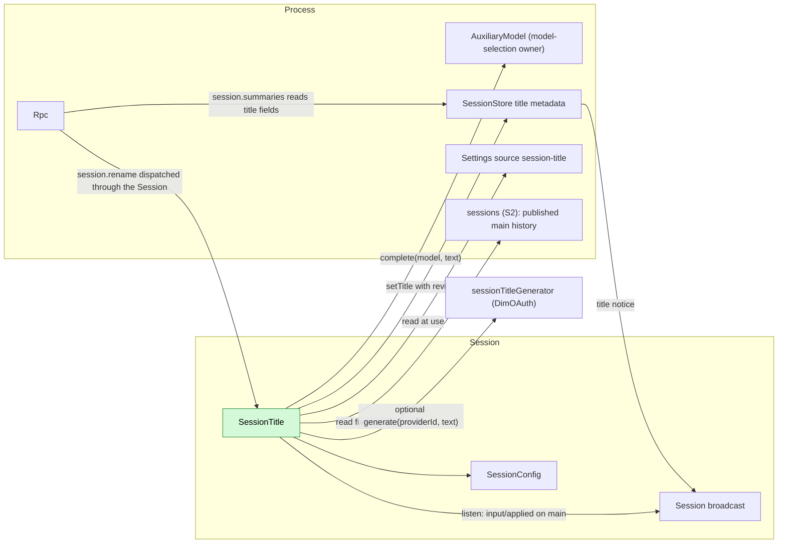
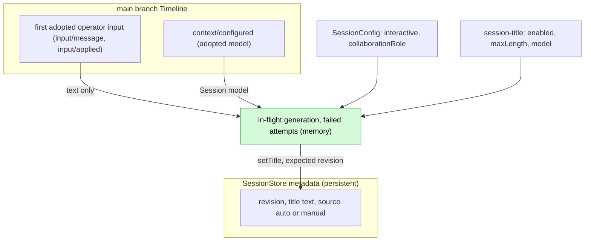
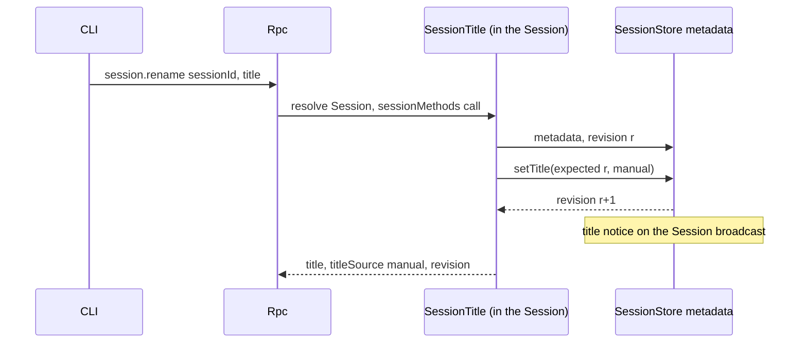
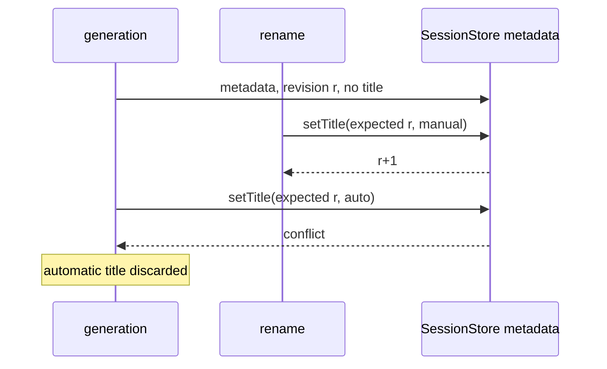

# SessionTitle

Overall design: [overview](../overview.md) (SessionTitle). Scope: [ADR 002](../../adr/002-plugin-scope.md) (Session).

SessionTitle is a Session plugin that gives an interactive leader Session a title stored through SessionStore metadata. It observes its own Session through the existing Session broadcast; when the first operator input on `main` is adopted (`input/applied`), it generates a title from that input's text alone through the routing policy in §3.3. The title is SessionStore state: SessionTitle writes it only through SessionStore's typed `setTitle` operation, and SessionStore announces each change with a Session broadcast notice that clients consume (the delivered C6 notice record is described in [§9](#9-requirements-raised-to-mechanism-owners); the SessionStore title metadata and the Rpc forwarding are supplements in [overview Appendix B.2](../overview.md#b2-app-server-process-plugins)). It serves `session.rename` by registering the namespace `session.rename` with its Session's `sessionMethods` ([methods and tool contributions](../contracts/session-boundary.md)). It writes no Timeline event and has no model-visible effect. Contracts are given in neutral form ([ADR 002 D5](../../adr/002-plugin-scope.md#d5-contracts-are-language-neutral)); the Rust binding is in Appendix G.

## 0. Implementation boundary

The base CLI provides `session-title` from the independent `dim-session-title` Rust crate.
The `dimcode` product profile installs it through `AgentBuilder::plugin`; the App Server
provides only its generic CLI profile callback and existing owner services. The plugin owns
its public generation contract. DimOAuth imports that contract from this crate. Its process row registers
the Settings source and the Session part through the existing part registry; every Session
mounts one copy. Availability does not depend on `--defaults`, a staged TypeScript package,
Node/Python installation or language-runtime acquisition. The owner of model selection in the
profile and storage remain the owners of auxiliary calls and title metadata.

The shipped plugin retains the `session-title` identity, Settings document and metadata format.
PluginManager's source selection owns the transition from the former default package to the
built-in implementation, preserving explicit disablement and installed replacement selections.
Only the selected implementation may register the Settings source or `session.rename`.

Public behavior tests belong to this plugin crate and use `dim-client` and the App Server
public APIs; fixtures install the plugin explicitly. App Server tests have no dependency on
SessionTitle and cover generic host behavior. Verification uses the native flow
[`native_flow.rs`](../../../crates/dim-session-title/tests/native_flow.rs) without
language runtimes. It exercises fixed-prefix history, settings validation, RPC, HTTP auxiliary
execution, Unicode bounds, concurrent adoption, title notices, manual-over-auto conflicts,
restore, fork and closing settlement. The Node-backed
[`scheduler_flow.rs`](../../../crates/dim-session-title/tests/scheduler_flow.rs) exercises
scheduled report provenance without letting reports supply title text. Diagnostics contain
only outcome and duration.

| Boundary | Current contract and Ready decision |
| --- | --- |
| Observation | Read the Session id from `sessionIdentity`, the creation configuration from `sessionConfig` and closing from `sessionLifecycle` ([plugin contract](../plugin-contract.md#9-requirements-raised-to-mechanism-owners) R2), then the records on its Session's `session/{sessionId}` channel. C4 broadcast #180 is delivered; #63/#168 are closed. |
| History | Use the implemented process sessions.history service, not private TimelineTree reads or branch (C5) bindings. |
| Configuration | Existing named Settings and row source declaration, user scope only (A.3/A12). Read settings.read({source:"session-title",scope:"user"}) at each decision and use its validated/defaulted document directly. |
| Metadata/notice | S5b #60/#96 defines the process service `sessionMetadata` (`read` and `setTitle`, both async), its errors `conflict`/`not_found`/`storage`, the handover and the v3 list fields `title`/`titleSource`/`titleRevision` ([title metadata](../appserver/session-title-metadata.md)); A.2 restates that contract. After each commit SessionStore calls `session_broadcast::notify`, and Rpc forwards the record to attached v3 clients as `session.notice {sessionId, source, kind, data}` (C6 #49/#85, [Session broadcast notices](../appserver/session-notices.md)). Names, modes, handover and errors follow S5b. |
| Auxiliary request | The profile's model-selection owner implements AuxiliaryModelHost and its named `auxiliaryModel.complete` HostDispatch/catalog binding: Provider in the product profile, ConfiguredModels in the model-config profile. Inject it through ordinary C4 dependencies; credentials stay with that owner ([S4 §4.3](../appserver/auxiliary-model.md#43-named-binding)). |
| Policies | A1–A12 define the first implementation. Appendix D requires public-flow acceptance; documentation CI alone is not runtime acceptance. |

C7 #50 is already unnecessary (#86). S4 owns its own credential/connection resolution. Missing
required providers keep the Session part Pending under existing rules, including rename; native
Session use continues. Only `sessionTitleGenerator` is optional (§3.3); rename retains its required owner services.

The C4 leaf callback filters `main` adoption on its own Session's channel, registers an owned task and returns;
it does not await Settings/history/model work. Native EventReader delivers only published events,
and SessionBroadcast forwards that Dispatcher stream. Thus the existing history({atLeast:N}) read
can capture published T >= N while the branch exists: no extra publication wait, polling or Core
API. Retain T and page with through=T and after=the last returned sequence; never send atLeast and
through together. Use native HistoryPage/AgentEvent data. The existing named sessions service reads the current index on each call, so index reload does not reload this consumer.

Use the [plugin binding contract](../rutis-usage.md): the plugin's one row injects `partRegistry`
and registers the Session part; each Session mounts a copy. The part injects
`sessionMethods` and registers `session.rename` with it from `apply`; it provides no service.
`apply` reads the Session identity and creation configuration and registers observation/cleanup;
it does not start an asynchronous initialization job. Its creation configuration is immutable.
The plugin depends on the existing public Rust Settings and SessionStore bindings; it does not expose or alter their implementations. Named history replies are decoded once at this plugin boundary. Plugin behavior and cross-plugin title flows live in this crate's tests and use the public client and host APIs. App Server tests have no dependency on this crate and install no title plugin implicitly.

The part injects its required dependencies: the process services `sessions`,
`settings`, `sessionMetadata` and `auxiliaryModel`, and the Session services `sessionIdentity`,
`sessionConfig`, `sessionLifecycle` and `sessionMethods`. The optional `sessionTitleGenerator`
is read by name when used, without injection or a readiness gate, under the
[required/optional binding contract](../rutis-usage.md#3-services-by-name).
The product assembly installs the native
plugin independently of foreign plugin rows. Missing required service providers affect only SessionTitle's
availability under the existing dependency rules, not the Session's execution capabilities.

The fixed snapshot ends at returned T, not necessarily at N. Its first adopted operator input
supplies text. With model=null, the latest ContextConfiguredData.settings in that snapshot supplies
providerId/modelId; without an adopted model, generation uses the excerpt fallback in §3.3 instead of the profile's current default.

Cancellation before setTitle handover stops work without writing. The handover is the setTitle call
itself: from then on SessionStore settles its own atomic operation, and a lost reply does not authorize
repeating or undoing it ([S5b §6](../appserver/session-title-metadata.md#6-handover-cancellation-and-settlement)). No rollback or
coordination mechanism.
Generation takes no Session activity hold ([idle unload D10](../appserver/idle-unload.md#3-decisions));
idle unload follows the same cancellation and store-handover rules.

## 1. Structure



| Part | Scope | Depends on | Provides |
| --- | --- | --- | --- |
| `session-title` | Process | Settings and part registry | Registers the Settings source and Session part |
| `SessionTitle` | Session | Session services `sessionIdentity`, `sessionConfig`, `sessionLifecycle` and `sessionMethods`; process sessions history, Settings, title metadata `sessionMetadata` (S5b) and required `auxiliaryModel` (a profile without an owner of model selection keeps the row Pending); optional `sessionTitleGenerator` read at use | Registers session.rename with sessionMethods |

Dependencies stay in the Session or enclosing process. C4/S2/Settings supply existing observation, prefix reads and configuration; S5b supplies title metadata and C6 the notices; the profile's model-selection owner supplies the named auxiliary operation. The plugin's row registers its source in its `apply`. Real provider reloads cancel the row's work (ADR 002 D3); S2 index reload does not. Business data changes never reload the plugin (D4).

## 2. Data and state



SessionStore owns the title: it keeps the text, source and revision counter and accepts changes only through its typed `setTitle` operation, which SessionTitle alone calls. After each committed change SessionStore emits a title notice on the Session broadcast (A11); the title never enters the Timeline. Each decision reads Settings first and skips disabled generation before metadata or history; otherwise it reads metadata and the fixed prefix. An image-only first input is remembered for the loaded generation. In-memory state is lost on reload or Session unload, which only allows another attempt.

## 3. Flows

### 3.1 Automatic title from the first user input

```mermaid
sequenceDiagram
  participant TL as main Timeline
  participant SB as Session broadcast
  participant ST as SessionTitle
  participant Settings as Settings
  participant Meta as SessionStore metadata
  participant Sessions as sessions (S2)
  participant Gen as Generation path (§3.3)
  TL-->>SB: input/applied at N, branch main
  SB-->>ST: Event
  Note over ST: interactive leader, none in flight
  ST->>Settings: read session-title; skip if disabled
  ST->>Meta: metadata: no title, revision r
  ST->>Sessions: history(main, atLeast N), page fixed T: first adopted operator text
  ST->>Gen: generate from adopted input
  Gen-->>ST: title or excerpt fallback
  ST->>Meta: setTitle(expected r, auto)
  Meta-->>SB: title notice
```

Generation starts when the input is adopted, not after the turn. Only the text of the first adopted operator input on `main` is sent; a deleted input is never adopted, so it never titles the Session and its text never reaches the auxiliary model.
The main turn never waits for title completion; the title task follows its own budget.

### 3.2 Manual rename



Rpc resolves the Session as for any Session method, loading it if needed. On `conflict` SessionTitle rereads and retries up to 3 times.

### 3.3 Generation routing and optional service

SessionTitle owns routing. An explicit Settings `model` goes directly to `auxiliaryModel`.
Otherwise it reads the process service `sessionTitleGenerator` at use time, without a required
dependency, and passes the provider of the latest adopted model in the fixed history prefix.
It never routes from a global default or from the existence of account credentials. A missing,
failed or reloading optional provider does not gate SessionTitle or manual rename.

The service contract belongs to SessionTitle; a provider implements only generation, not Session
selection, persistence or fallback. Its only method is async `generate(request, cancelled?)`:

| Item | Contract |
| --- | --- |
| Request | `{providerId: string, text: string}`; nonempty provider id and text, at most 2000 Unicode code points |
| Generated | `{kind: "generated", title: string}`; nonempty text, normalized by SessionTitle |
| Unavailable | `{kind: "unavailable", reason: "unsupported_provider" \| "account_unavailable" \| "disabled" \| "not_entitled" \| "quota_exhausted" \| "service_reloading"}` |
| Failed | `{kind: "failed"}`; transport, invalid upstream response or transient rejection |
| Cancelled | `{kind: "cancelled"}`; terminal for this title task, with no alternate request or metadata write |
| Invalid request | Reject with `invalid_request`; validate external arguments at the service boundary |
| Cancellation | Optional function returning a promise that resolves on cancellation. The caller resolves it and awaits the original call; the provider cancels its I/O and settles accepted work before unloading |

After an unavailable or failed service call, SessionTitle uses the adopted model through
`auxiliaryModel`. A missing model, auxiliary error, empty normalized output or the shared 30 s
generation deadline uses the input excerpt as a fallback title: collapse whitespace, trim and apply the configured Unicode length bound while preserving punctuation, and write through the same revision-checked
metadata operation with source `auto`. Account-service failure alone does not consume one of
the three failed attempts that cannot complete a metadata write. Session closing or explicit cancellation never falls back.
The deadline includes both generation paths; timing out cancels and joins the active call before
the fallback write. Whitespace-only text has no title and is treated as no text.

DimOAuth implements this optional service for its own provider; its endpoint, authentication,
refresh and rejection classification belong to its [runtime contract](../../../crates/dim-oauth/docs/runtime-contract.md).
SessionTitle receives neither credentials nor an issuer. The model-selection owner, AuxiliaryModel,
model execution, Timeline and Dispatcher have no title routing policy. No additional registry or wiring plugin is used.

## 4. Timing and conflicts



The revision check is the recheck: a manual title always wins.

| Scenario | Order | Outcome | Owner |
| --- | --- | --- | --- |
| Member Session (`collaborationRole`), or a non-interactive Session | `SessionConfig` | Never generated; rename allowed | SessionTitle |
| Second input before generation finishes | — | Skipped (in flight) | SessionTitle |
| First input deleted | input < `input/deleted` | Never adopted: no title from it; the next adopted operator input triggers (A9) | SessionTitle |
| Generation paths failed | — | Input-excerpt fallback (§3.3); storage failure may retry while untitled (A5) | SessionTitle |
| Reload or Session unload mid-generation | — | Cancel before store handover; the next adopted main input may trigger. An admitted mutation settles with SessionStore | Lifecycle / SessionStore |

Full table: [Appendix B](#appendix-b-full-conflict-table).

## 5. Context mapping

No model-visible effect: SessionTitle writes no input, tool, prompt source or event. The auxiliary request is a separate one-shot call:

| Part | Content |
| --- | --- |
| System | `Write a short title for this conversation: at most 8 words, in the language of the user's message, no quotes, no trailing punctuation. Reply with the title only.` (A2) |
| User message | Text blocks of the first adopted operator `input/message` on `main` (one with `input/applied`), joined by newlines, cut to 2000 characters (A2) |

Never sent: images, raw input blocks, deleted inputs, later inputs, assistant output, system prompt, tool calls and results, child-branch events. Diagnostics record outcome and duration only.

## 6. Interfaces (summary)

| Interface | Kind | Purpose |
| --- | --- | --- |
| `session.rename {sessionId, title \| null}` | `sessionMethods` namespace `session.rename` | Set or clear a manual title |
| `session-title` source: `enabled`, `maxLength`, `model` | Business configuration (Settings source) | Turn generation off; title length; explicit title model or automatic routing (§3.3) |
| `title`, `titleSource`, `titleRevision` in v3 `session.summaries` | Rpc protocol fields read from SessionStore ([S5b §8](../appserver/session-title-metadata.md#8-session-lists)) | Display; the revision orders a list against notices |
| Title notice, `data: {title, titleSource, titleRevision}` | Session broadcast notice emitted by SessionStore (C6 record, §9; [S5b §7](../appserver/session-title-metadata.md#7-the-title-notice)) | Live title update for subscribed clients |

## 7. Security

The first input's text is sent only to the generation paths selected by §3.3: an explicit model, or the optional service and adopted model. Titles may contain user content and are returned to every client that can list Sessions. No credentials, host settings or tool output enter the request. Rename input is validated by SessionTitle's method (A.1).

## 8. Rule check

| Rule | How this document complies |
| --- | --- |
| Principles §4 rule 1 (commands for others' state) | The title is SessionStore's process-level state with no Timeline; SessionTitle changes it only through SessionStore's typed `setTitle`, and SessionStore decides through its revision check (principles §4 rule 9). |
| Principles §4 rule 2 (handover) | SessionTitle reads an input only after its handover (`input/applied`) and never acts on the input itself. |
| Principles §4 rule 3 (before callbacks only) | No intervention before a write; rename rules are checked by SessionTitle's own method, not at an entry. |
| Principles §4 rule 4 (no business meaning in core) | The delivered C6 Session broadcast notice in §9 is a generic record for any owner of process-level Session state. |
| Principles §4 rule 5 (batch) | The trigger acts on `input/applied` when it is consumed, in sequence order. |
| Principles §4 rule 6 (context from handed-over events) | SessionTitle adds nothing to model context; the auxiliary request contains only adopted input text. |
| Principles §4 rule 7 (public events and services only) | It uses the Session broadcast, fixed-prefix read, SessionStore `setTitle`, `AuxiliaryModel`, optional `sessionTitleGenerator` (§3.3) and Settings, all public. |
| Principles §4 rule 8 (requirements to mechanism owners) | C6 and S5b deliver the notice and metadata contracts in §9. None for #4: SessionTitle uses the Session services, the Session channel and named process services through existing owner contracts. Requirements to other plugins (SessionStore title metadata and notice emission, Rpc forwarding of notices) are listed in [overview Appendix B.2](../overview.md#b2-app-server-process-plugins). |
| Principles §4 rule 9 (only facts later decisions use) | The title is process-level SessionStore state: it never enters the Timeline, changes through `setTitle` and reaches UIs as a Session broadcast notice. |
| Principles §1 (Capability and App Server boundary) | SessionTitle is a Session part, not a Capability: it injects neither Dispatcher nor Timeline; Rpc only dispatches `session.rename` and reads title fields from SessionStore. |
| ADR 002 D1 (scope follows state) | Session scope: the title belongs to the Session; the stored title is SessionStore's. |
| ADR 002 D2 (no wiring modules) | No wiring module; required services are injected, and the optional generator is read at use under the binding contract. |
| ADR 002 D3 (dependencies follow scope) | Dependencies are in the Session or enclosing process scope; their reload cancels a generation, which is accepted. |
| ADR 002 D4 (structural vs business configuration) | Plugin enablement and source selection are structural; the user-only `session-title` source in A.3 owns business configuration, read at use without reloading the row. |
| ADR 002 D5 (language-neutral contracts) | Contracts are neutral; the Rust form is Appendix G. |

## 9. Requirements raised to mechanism owners

**R1. Session broadcast notice for process-level state — delivered.**

C6 #85 supplies the notice record and Rpc forwarding; S5b #96 supplies title metadata and
post-commit title notices. SessionTitle consumes these delivered contracts.

| Item | Content |
| --- | --- |
| Blocked by | Principles §4 rules 9 and 4: process-level state such as the SessionStore title must not enter the Timeline, yet clients must see title changes live; the delivered C6 `Notice` record carries these post-commit changes ([session_broadcast.rs](../../../crates/dim-agent-capabilities/src/session_broadcast.rs)). |
| Existing mechanisms considered | A `session/titled` Timeline event (puts process state on the Timeline; rejected in overview §7); client polling of `session.summaries` (no live update); a title-specific channel (a business-specific port, rule 8). |
| Generic capability | A notice record `{source, kind, data}` on a Session's broadcast channel, emitted by the owner of process-level state about that Session after a committed change; no business meaning. The title notice is this record with `source: "SessionStore"`, `kind: "title"`, `data: {title, titleSource, titleRevision}` ([S5b §7](../appserver/session-title-metadata.md#7-the-title-notice)). Rpc forwards that record unchanged as `session.notice`, adding the channel's `sessionId` ([C6 D4](../appserver/session-notices.md#10-decisions)), so `data` does not repeat it. |
| Effect on sequence, batch, interrupt, reload | No sequence number and no batch; not replayed: a client that resubscribes reads current state through the owner's query (`session.summaries`); interrupts do not apply; a reload of the emitter only stops notices. |
| Owner and issue | Runtime C6 [#49](https://github.com/arcships/dim/issues/49), implemented in [#85](https://github.com/arcships/dim/pull/85): the record, `session_broadcast::notify` and Rpc's `session.notice` ([Session broadcast notices](../appserver/session-notices.md)). SessionStore emits the title notice ([S5b](../appserver/session-title-metadata.md), the supplement in [overview Appendix B.2](../overview.md#b2-app-server-process-plugins)). |

**#4: None.** Observation uses the Session services and the Session channel; history, Settings, `sessionMetadata` and the auxiliary model are process services. SessionTitle injects no branch service.

**The model-selection owner (S4): the named `auxiliaryModel` binding.** Provider (product) and ConfiguredModels (model-config) bind their existing `AuxiliaryModelHost` operation for C4 injection ([S4 §4.3](../appserver/auxiliary-model.md#43-named-binding)). A profile without such an owner keeps SessionTitle's row Pending through its ordinary required dependency. No core mechanism is needed.

**DimOAuth:** implement the optional generation service defined in §3.3; account requests and settlement remain in its runtime contract. No Provider or Core mechanism change is required.

## Appendix A. Interface details

### A.1 `session.rename`

Registered with `sessionMethods` (Session, namespace `session.rename`) with one declaration `{name: "session.rename", mutating: true, interruption: "report", progress: false}`; its `call(MethodCall, cancelled, progress): async -> MethodReply` handles it. A dropped call is cancelled before `setTitle` or completes atomically after it.

| Params | Result | Errors |
| --- | --- | --- |
| `{sessionId, title: string \| null}` | `{title: string \| null, titleSource: "auto" \| "manual" \| null, revision}` | `invalid_params`, `session_not_found`, `service_reloading`, `storage_failed`; dispatch errors per [session-boundary](../contracts/session-boundary.md) |

`title` is trimmed; 1..=`maxLength` (source `session-title`) characters, no line breaks or control characters (A3). `null` clears the title (A6).

### A.2 Depended-on shapes (owners define them)

| Service | Method | Kind | Request | Reply and errors |
| --- | --- | --- | --- | --- |
| SessionStore `sessionMetadata` (S5b) | `read` | async | `{sessionId}` | `{revision, title: {text, source: "auto" \| "manual"} \| null}`; errors `not_found`, `storage` ([S5b §4](../appserver/session-title-metadata.md#4-operations)) |
| SessionStore `sessionMetadata` (S5b) | `setTitle` | async | `{sessionId, expectedRevision, title: {text, source} \| null}` | `{revision}`; errors `conflict`, `not_found`, `storage`. The call is the handover; after a commit SessionStore emits the title notice |
| SessionStore (S5b) | title notice | Session broadcast notice (C6 record, §9) | — | `{source: "SessionStore", kind: "title", data: {title, titleSource, titleRevision}}` on the Session's broadcast channel; no sequence number, not replayed |
| `AuxiliaryModel` (the profile's model-selection owner) | `complete` | async | `{model: {providerId, modelId}, request: {system, messages: [{role: "user", content: text}]}}`, optional `cancelled: () => Promise<void>` ([S4 §4.3](../appserver/auxiliary-model.md#43-named-binding)) | `{text, stopReason, usage}`; rejects with the existing error code/message. Resolve the cancellation reference on timeout or closing and await the original call's settlement |

### A.3 Configuration

Settings source `session-title`, one document: `enabled: bool` default `true`; `maxLength: u32` default 80, range 10..=200 (A3); `model: {providerId, modelId} | null` default `null`, enabling optional service routing before the latest adopted model in the prefix (§3.3). The schema SessionTitle declares carries the defaults and the range (`minimum`/`maximum`), so Settings rejects an out-of-range value on write and when reading a persisted file, and SessionTitle uses the delivered document without checking it again. Read at each decision. SessionTitle has no tool that writes configuration, so the document is written only through the client methods `settings.read`/`settings.update` (S8b named Settings delivered). A change is a data update with notification, never a reload. Enabling the plugin is structural configuration. An unselectable explicit `model` uses the excerpt fallback (§3.3), without consulting the optional service.

The original row owns the source declaration: `source: "session-title"`,
`userFile: "session-title.json"`, no `projectFile`, and `userOnly: []`. This selects user scope
only; no project document is merged. The file-backed profile uses that user filename; the native
profile uses the existing Settings row `user/session-title`, not a second file or store
([Settings §3–4](../appserver/settings-service.md#3-data-and-state)). The schema rejects unknown
members; `model` is either null or an object requiring nonempty `providerId` and `modelId` strings
and no other members. Missing documents receive the stated defaults at the Settings boundary.
No credentials or model-connection configuration belong in this source.

Character limits for the excerpt and titles count Unicode code points. The auxiliary request
omits `maxOutputTokens`, using S4's existing model limit; the 30 s budget remains SessionTitle's.

### A.4 Mechanics

| Step | Path |
| --- | --- |
| Listen | The Session's copy of the part listens to its Session's `session/{sessionId}` from `apply`, filters main input/applied, registers an owned task and returns; `sessionLifecycle.closing()` or copy cleanup ends owned work |
| Eligibility | C4 creation snapshot: `interactive !== false && collaborationRole === "leader"`; native omission means true |
| Trigger | On `input/applied` at `N`: skip if not eligible, disabled, in flight or failed attempts ≥ 3 (A5); otherwise start a generation task owned by the plugin's lifetime |
| Check | `sessionMetadata.read({sessionId})`: skip if any title exists; keep revision `r` |
| Read | Existing sessions.history with atLeast=N fixes published T >= N, then through=T pages (S2 A.5). Select the first operator input with user content and input/applied; no such input/text means no title (A8/A10) |
| Generate | Route and fall back under §3.3 within the shared 30 s budget (A4); normalize the first line, remove quotes and trailing punctuation, collapse whitespace, cut at `maxLength`, trim again |
| Write | `setTitle({sessionId, expectedRevision: r, title: {text, source: "auto"}})`; `conflict` or `not_found` discards |
| Timeline | No writes, no Dispatcher registration, no `StateCell` |
| Reload / unload | Cancel before store handover; the owner settles an admitted mutation. Events in the gap are not replayed |

## Appendix B. Full conflict table

| Scenario | Sequence order | Outcome | Owner |
| --- | --- | --- | --- |
| First input's turn interrupted or failed | input < `stop/interrupt` | Generation proceeds | SessionTitle |
| Inputs without `user` content (Goal blocks, source markers) | — | Never trigger, never used | SessionTitle |
| First input withdrawn (`session.input.withdraw`) before it is applied | input < withdraw < `input/deleted` | Never applied: no generation, text never sent; the first applied operator input triggers | SessionTitle |
| First user input carries only images | — | No automatic title (A8) | SessionTitle |
| Rename before the check | rename < check | Title present: skip | SessionTitle |
| Rename during generation | check (r) < rename (r+1) < write | `conflict`: automatic title discarded | SessionStore revision |
| Concurrent renames | revision order | Last committed rename wins | SessionStore |
| Duplicate `session.rename` | — | Rewrites the same text | SessionTitle |
| Steer/Queue/Append inputs after the first | — | Never in the excerpt | SessionTitle |
| Tool batch, compaction | — | Irrelevant: only the input fact is read | — |
| Child branch inputs | branch filter | Never trigger | SessionTitle |
| Member, stage, scheduled or ACP Session | `SessionConfig` | Never generated | SessionTitle |
| Session close during generation | — | Cancel before store handover; an admitted mutation remains owned by SessionStore | Lifecycle / SessionStore |
| Session fork | metadata not copied (A7) | Fork untitled; the next adopted operator input on `main` triggers generation from the first adopted operator input in its prefix | SessionTitle |
| SessionTitle, the model-selection owner, SessionStore or Settings reload | — | Before handover, cancel generation; an admitted store mutation follows S5b settlement (D3) | Lifecycle / SessionStore |
| Model or policy unavailable | — | Failure counted; after 3 no further attempts until reload (A5) | SessionTitle |
| Resource node offline | — | No effect | — |
| Client detach | — | No effect | — |

## Appendix C. Errors and recovery

| Case | Result |
| --- | --- |
| Model error, timeout, empty output, unavailable policy | Input-excerpt fallback (§3.3); cancellation never falls back |
| Settings read fails | Automatic: no write, diagnostic, failure counted; rename: `storage_failed`. No fallback document |
| `setTitle` `conflict` on automatic write | Discarded (diagnostic) |
| `setTitle` `storage` | Automatic: failure counted; rename: `storage_failed` |
| Unknown Session on rename | `session_not_found` |
| SessionTitle reloading | Before handover: service_reloading, no rename. After handover/lost reply: read metadata; do not infer no commit or repeat the write |
| Cancellation | Before handover abort the auxiliary call and discard; after store admission, S5b owns the atomic outcome |

## Appendix D. Acceptance

Flow tests through the default native product assembly without language runtimes,
`session.create`/`session.submit`, `session.rename`,
`session.summaries`, `settings.read/update` and a fake auxiliary model:

1. Hold the main turn open with the existing model fixture. The first `session.submit` on an interactive leader Session starts generation after adoption and produces an `auto` title while that controlled turn is still active; the request contains only the system text and that input's text, and one title notice reaches subscribed clients. Completion before turn end is not a production ordering guarantee.
2. Interrupting or failing the first turn does not prevent the title.
3. Member Sessions and `interactive: false` Sessions get no title; rename works on them.
4. Rename during generation (fake model held): manual kept, automatic discarded.
5. A titled Session is never regenerated; clearing allows regeneration at the next adopted input, still from the first adopted input's text.
6. Rename of an unloaded Session loads it through Rpc and succeeds.
7. Child-branch inputs and inputs without `user` content never trigger; image-only first input yields no title and later inputs do not scan history again.
8. Reload before store handover cancels generation without writing; the next adopted input may trigger. Reload after admission leaves settlement to SessionStore; reread metadata after a lost reply without repeating the write. Three failed attempts to obtain settings or commit metadata stop attempts; generation failure uses the excerpt fallback (§3.3).
9. Invalid rename method/type, empty text and control characters return `invalid_params` even when Settings cannot be read; the length check uses the validated Settings document.
10. A first input withdrawn before it is applied (`session.input.withdraw`) produces no title and is never sent to the auxiliary model; the next adopted input titles the Session from its own text.
11. Missing Settings documents yield the declared defaults; invalid persisted settings fail without rewriting them. Updates use existing Settings CAS, reject invalid ranges/shapes, and affect the next title/rename decision without reloading the row. Project scope is rejected. Disabled generation reads neither metadata nor history across repeated inputs. Cover non-BMP text at the excerpt/title limits, punctuation before first-line trailing spaces and whitespace at the truncation boundary in the title flow.

12. Optional generation service absent or withdrawn: ordinary model generation and rename remain available. Nonmatching provider uses only the model; a matching service success avoids a duplicate model request. Explicit model bypasses the service. Unavailable, failed and invalid responses fall back to the model; model failure or deadline uses the excerpt. Closing while the service is pending cancels and settles it without model fallback or metadata writes.

## Appendix E. Assumptions

A1–A12 are the policies for the first implementation.

| # | Assumption | Basis | Effect if rejected |
| --- | --- | --- | --- |
| A1 | Explicit title model first; otherwise optional service then the adopted model (§3.3) | Maintainer decision | Different routing |
| A2 | Instruction text, 8-word target, 2000-character excerpt | Judgment | Different prompt or excerpt |
| A3 | Title length default 80 (10..=200), single line | Judgment | Other limits |
| A4 | 30 s generation budget | Judgment | Other timeout |
| A5 | At most 3 failed attempts per Session per plugin generation | Judgment | More retries, or none |
| A6 | `session.rename` with `null` clears the title | Judgment | Manual title permanent |
| A7 | Session fork does not copy the title | Judgment | Fork shows the source title |
| A8 | A first user input without text produces no automatic title | Decision: title from first user input | Later inputs or a placeholder |
| A9 | Generation waits for adoption (`input/applied`); a deleted input never titles the Session | Maintainer decision | Deleted text could reach the auxiliary model |
| A10 | "User input" means operator input: in an interactive leader Session it is the input with `user` content, since Collaboration, Goal and ShellInput write raw blocks only (Scheduler and Workflow inputs carry `user` content but run in non-interactive Sessions, which SessionTitle does not title) | Judgment | Source-written inputs could title a Session |
| A11 | SessionStore announces title changes with a Session broadcast notice; a client that is not subscribed sees the change at its next `session.summaries` | Principles §4 rule 9 | Clients poll `session.summaries` |
| A12 | User-only source file session-title.json, no project merge; native Settings row user/session-title | Existing S8b row source mechanism, A.3 | Different source/scope requires explicit confirmation |

## Appendix F. Open questions

None. Session list fields follow S5b; observation, history, Settings, metadata and the named
auxiliary binding use the owner contracts in §0. The optional service contract is owned here (§3.3); no Core change is required.

## Appendix G. Rust binding

| Neutral | Rust |
| --- | --- |
| Namespace `session.rename` registered with `sessionMethods` | The Session part calls `methods.register(ctx, "session.rename", Vec<MethodDecl>, handler)` on a `Key<SessionMethods>` dependency |
| Published history | The existing named `sessions.history` HostDispatch contract; decode the external reply at the plugin boundary |
| Title metadata | `SessionStore::metadata` and `SessionStore::set_title` |
| Auxiliary call | `AuxiliaryModelHost.0.complete` with its cancellation token |
| Optional generation | `ctx.get_at(&host_key("sessionTitleGenerator"))` at use; `HostDispatch.generate` with a cancellable callback promise, using the request/reply types exported by `dim-session-title` |
| Session broadcast listener | Listener on `session_channel(session_id)` for `Event` records, removed by `ctx.effect` |
| Generation task | Spawned under `ctx.effect` |

```rust
// SessionStore metadata (S5b; named service `sessionMetadata`)
async fn metadata(&self, session_id: &str) -> Result<SessionMetadata, MetadataError>;
fn set_title(&self, session_id: &str, expected_revision: u64, title: Option<Title>)
    -> impl Future<Output = Result<u64, MetadataError>>; // Conflict | NotFound | Storage; the call is the handover
pub struct SessionMetadata { pub revision: u64, pub title: Option<Title> }
pub struct Title { pub text: String, pub source: TitleSource }   // Auto | Manual
// AuxiliaryModel (the profile's model-selection owner)
async fn complete(&self, model: ModelId, request: AuxiliaryRequest,
    cancel: CancellationToken) -> Result<AuxiliaryReply, AuxiliaryError>;
```
