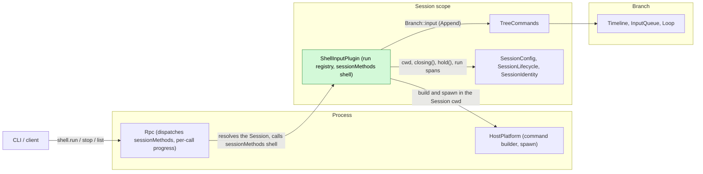
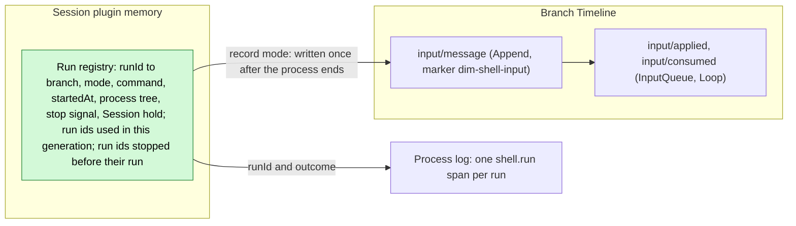
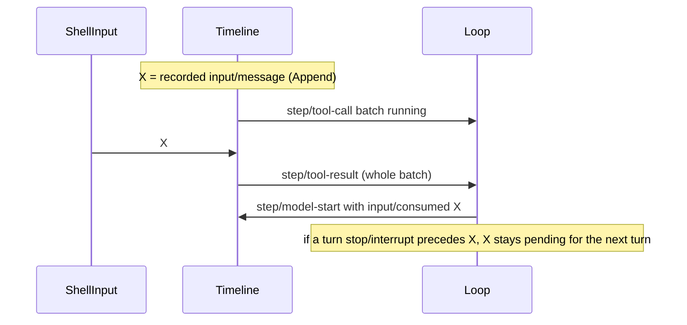

# ShellInput

Status: Implemented ([capability page](../../architecture/rust-agent/plugins/ShellInput.md)). Overall design: [overview §4](../overview.md#4-plugin-catalog). Phase: P1. Language: Rust. Scope: Session ([ADR 002](../../adr/002-plugin-scope.md)). Built on C1 ([#47](https://github.com/arcships/dim/issues/47), including per-call progress, [#125](https://github.com/arcships/dim/pull/125)) and S7 ([#52](https://github.com/arcships/dim/issues/52)) ([roadmap §3.3](../roadmap.md#33-插件开工顺序)).

Executes `!command` and `!!command` typed by the user in the Session's working directory. The result of `!command` (the command and its bounded output) is written as an Append input, so it enters context with the next model request; the output of `!!command` goes only to the calling client. ShellInput is a Session plugin with no events. It provides `shell.run`, `shell.stop` and `shell.list` as ordinary Session methods through a `sessionMethods` service (Session scope, key `shell`; [session-boundary](../contracts/session-boundary.md)); contracts are language-neutral, and the Rust form is [Appendix G](#appendix-g-rust-binding). At most one command runs per Session. A command ends on its own, on `shell.stop`, or when the Session part ends (Session close, ShellInput or Session reload, App Server shutdown). While it runs it holds the Session, so a host's idle unload waits for it (§3.2).

## 1. Structure



| Part | Scope | Depends on | Provides |
| --- | --- | --- | --- |
| `ShellInputPlugin` | Session | `P:HostPlatform` (as WorkspaceTools uses it), `S:SessionConfig` (`cwd`), `S:TreeCommands`, `S:SessionLifecycle`, `S:SessionIdentity` | `sessionMethods` key `shell` |

Contracts depended on:

- `sessionMethods` dispatch, errors and call ownership (C1, [session-boundary A.1](../contracts/session-boundary.md#a1-method-contributions)). The merged contract change [#120](https://github.com/arcships/dim/pull/120) settled where the shared method types live (a `methods` module of dim-agent-capabilities) and that Rpc answers a name outside every Session namespace recorded at assembly with `unknown_method` before it reads params or `sessionId`. ShellInput depends on neither: its binding takes the shared types from where A.1 places them, and it does not depend on the order in which Rpc reports dispatch errors.
- Per-call progress ([session-boundary A.2](../contracts/session-boundary.md#a2-call-channel)): implemented by C1 in [#83](https://github.com/arcships/dim/pull/83) (open) as the handler's `Progress` argument, best-effort as that PR's review requires ([A.5](#a5-changes-to-other-plugins)).
- `Branch::input` with boundary validation, and InputQueue's Append mode: an Append input is applied at once, consumed with the next model request and never starts a turn.
- HostPlatform: `spawn(ProcessSpec)` returning a process tree with stdout, stderr, wait and terminate (implemented); the command builder and `exec`'s output rules (S7, [A.5](#a5-changes-to-other-plugins)).
- `SessionLifecycle::closing()`, the plugin generation's cancellation and its `ctx.effect` disposer ([lifecycle](../../architecture/rust-agent/lifecycle.md)).
- `SessionLifecycle::hold()`, the runtime activity hold ([idle Session unload §5.1](../appserver/idle-unload.md#51-activity-hold), R1): `Session::unload_if_idle()` refuses while a hold exists, and `hold()` is `None` once the Session is closing or an idle release has been decided.
- The context-block element format for the marker ([session-access A.2](../contracts/session-access.md#a2-source-input-conventions)).

Contracts defined here: the `shell.*` methods and the source marker `dim-shell-input` (kind `command`).

## 2. Data and state



The run registry is memory of the plugin generation and is never rebuilt: when the Session part ends, the running command is terminated. It also keeps the run ids used in this generation, so a repeated `runId` is refused (`duplicate_run`) and a command sent once never runs twice, and the run ids a `shell.stop` reached before their run did, so that run starts nothing (A.4). The only durable result is the `input/message` of a recorded run, restored with the Session.

Events: none. A run is started by the user, not by a turn, so a turn or branch interrupt does not end it. The only later-relevant outcome of `!command` is the input; `!!command` affects nothing later. The process log gets one `shell.run` span per started run with the Session and branch ids, the `runId` and the outcome (status and exit), never the command text or output (A11).

## 3. Flows

### 3.1 `!command` and `!!command`

```text
CLI             Rpc                    ShellInput (Session)          HostPlatform       Branch
 |               |                            |                             |               |
 |-- shell.run ->|                            |                             |               |
 |               | authorize sessionId,       |                             |               |
 |               | acquire the Session (C1)   |                             |               |
 |               |-- sessionMethods shell --->|                             |               |
 |               |                            | check params, busy, runId,  |               |
 |               |                            | branch                      |               |
 |               |                            |-- build command (S7) ------>|               |
 |               |                            |-- spawn in Session cwd ---->|               |
 |               |                            |<-- stdout + stderr ---------|               |
 |<- progress ---|<- progress {text, skipped?}|                             |               |
 |               |                            |<-- exit --------------------|               |
 |               |                            |-- record mode only: input (Append) -------->|
 |               |                            |<-- committed sequence ----------------------|
 |<- reply ------|<-- {status, output, recorded?}                                           |
```

The write happens once, after the process has ended and its output has been read. On the branch:

```text
input/message X (append) -> input/applied X {append} -> step/model-start ... input/consumed X
```

InputQueue applies X at once; Loop consumes it at the next model request of a running turn, or with the first request of the next turn when the branch is idle. X starts no turn. `!!command` (mode `private`) is the same flow without the write.

### 3.2 Run lifecycle

```text
                     shell.run admitted (runId registered)
                                       |
                                       v
                                  +---------+
                                  | running |
                                  +---------+
                                       |
     +-----------------+---------------+----------------+---------------------+
     | exits on its    | shell.stop                     | read or wait        | Session closing,
     | own             |                                | error               | generation unload
     v                 v                                v                     v
 completed          stopped                          failed              interrupted
 (exit code         (tree terminated)                (tree terminated)   (tree terminated)
  or signal)
     |                 |                                |                     |
     +-----------------+--------------------------------+                     |
                       |                                                      |
                       v                                                      v
     record mode: one Append input (partial output             nothing written; the call
     for stopped and failed, A5); the reply carries            replies operation_interrupted
     the sequence or the write error
```

- A run is admitted twice: before its command is built, and again with its spawn (A.4 Admission). Until that second admission nothing has started: a call interrupted before it starts nothing and leaves its `runId` unused, and a `shell.stop` that reached the `runId` first makes the run start nothing and reply `stopped`.
- A turn `stop/interrupt` does not reach the run: the CLI's first `Ctrl+C` sends `shell.stop`, a second one falls through to the turn stop.
- A client detach or disconnect does not stop the run. Its progress is dropped and its reply discarded; a recorded run is still written (A10).
- If the Rpc load that admitted the call unloads (a structural reload), the call's cancellation token fires: the call replies `operation_interrupted` as the contract requires for `report` calls, and the handler returns at once instead of waiting for the command, so the reload is not held by it. The run continues in ShellInput's generation as after a disconnect (A10; A.4 Two cancellations).
- A run holds the Session from its second admission until its task has left the registry, after its last fact: the recorded input's append has returned (`record`), the process has exited (`private`), or the tree was terminated (A.4 Hold). Meanwhile `Session::unload_if_idle()` refuses, so a host's idle unload ([idle Session unload §5](../appserver/idle-unload.md#5-detached-work)) never ends a run, even one whose caller has gone; the Session can unload once the run has ended and its input is dispatched. A Session close, a reload and App Server shutdown ignore the hold and end the run as below.
- On `SessionLifecycle::closing()` or the unload of the ShellInput generation, the run task terminates the tree and writes nothing, and the `ctx.effect` disposer waits for the task. A reload after a structural operation therefore ends the run, an accepted cost (ADR 002 D3). App Server shutdown closes every Session the same way. A crash is not designed around (D3): nothing is written, nothing is run again, and leftover processes are whatever HostPlatform leaves for `exec`.

## 4. Timing and conflicts

### 4.1 Result versus turn



Placement is decided by the input owners by sequence; ShellInput has no recheck because its write depends on no Timeline fact.

| Scenario | Outcome |
| --- | --- |
| Second `!` in the same Session while one runs | `shell_busy` |
| `shell.stop` before its run is admitted | The run starts nothing and replies `stopped`; nothing written |
| Rpc reload while the command is being built | Nothing starts; the `runId` stays unused; `operation_interrupted` |
| Branch closed during the run | The write fails; output returned with `recorded.error` |
| `input/withdraw` of X while InputQueue holds it (S1) | `input/deleted`; never applied or consumed; not re-written |
| Session close or reload during the run | Tree terminated; nothing written; the caller gets `operation_interrupted` (A8) |
| A host's idle unload during the run | Refused while the run holds the Session; the run continues and is recorded as usual |
| Exec shell configuration changed | A running command keeps its shell; the next run uses what the builder reads |

Full table: Appendix B.

## 5. Context mapping

| Mode | What the model sees | Form and placement |
| --- | --- | --- |
| `!command` | `<dim-shell-input kind="command" status="completed" exit="0" truncated="false">`, then `$ <command>` and the bounded output, then `</dim-shell-input>` | One unkeyed raw block (user-role message) at the input's consumed position |
| `!!command` | Nothing | — |

No tool declaration, prompt source or key: each run is a one-time observation. After compaction the result survives only through the summary. Child branches inherit it only if it was consumed before the cut. The model never sees the `runId`, durations or process logs.

## 6. Interfaces (summary)

| Interface | Kind | Purpose |
| --- | --- | --- |
| `shell.run` | `sessionMethods` (Session, key `shell`), progress | Run a command (`record` or `private`), stream its output, return the result |
| `shell.stop` | Same | Stop a run by `runId`; idempotent |
| `shell.list` | Same | Running runs of the Session |
| Marker `dim-shell-input` kind `command` | Input convention | Model-visible recorded result |
| CLI `!` / `!!` | Client | Maps the prefixes to `shell.run` modes |

## 7. Security

`!` and `!!` execute arbitrary commands as the service user without Approval: Approval and Permission govern only actions an agent decides, and these commands are the user's ([ADR 003](../../adr/003-approval-scope.md) D1). Nor does `!` refuse a background `&`, which `exec` refuses in POSIX shells: that refusal is a policy of the agent's tool, steering an agent's background work to BackgroundExec, and a `!` command is typed by the user (D1). Processes it leaves in the background keep running as the service user after the run, the Session and the App Server end, and nothing in Dim tracks them (A.2). `shell.*` are ordinary Session methods: any connection served Session methods may call them on any Session it can address. Today that is a local protected connection; with RemoteGateway (P3) it includes paired devices (decision E3, [overview §6.2](../overview.md#62-constraints) constraint 10), so pairing a device grants command execution on the host. Session methods have no level; only management methods are withheld from paired devices ([session-boundary](../contracts/session-boundary.md)). These user-initiated commands use ordinary HostPlatform spawn, outside F5's model-execution isolation (Q4). For `!`, the command text and output are written to the Timeline and replayed to the model; users must avoid printing secrets. The environment is the service's, as for `exec`, never the client's. The process log carries no command text or output (A11).

## 8. Rule check

Rules: [principles §1 and §4](../../architecture/rust-agent/principles.md), [ADR 002](../../adr/002-plugin-scope.md) D1–D5.

| Rule | How this document complies |
| --- | --- |
| §4.1 Command events for others' state | ShellInput changes no other module's state; its only Timeline effect is an ordinary Append input that InputQueue and Loop handle. |
| §4.2 No recall after handoff | The recorded input is written once and never re-written; withdrawing it is InputQueue's command (S1). |
| §4.3 Only before callbacks, never block | Not applicable: ShellInput registers no before callback. At the entry Rpc checks only param shape and `sessionId` authorization; ShellInput validates its own params and makes its own feature checks (busy, run id, branch, shell). |
| §4.4 No business meaning in core | Rpc, InputQueue and Loop gain no ShellInput handling: Rpc reaches it by namespace, and the marker is an ordinary raw block. |
| §4.5 Read the whole batch | Not applicable: ShellInput reads no Timeline event, and its one event (`input/message`) needs no other fact in its batch. |
| §4.6 Context only from handed-off events | The output reaches the model only after InputQueue applies and Loop consumes the input; `!!` output and progress never do. |
| §4.7 Public events and services only | ShellInput uses `Branch::input` through `S:TreeCommands`, `SessionConfig`, `SessionLifecycle`, `SessionIdentity`, HostPlatform and the `sessionMethods` contract. |
| §4.8 Requirements to mechanism owners | Infrastructure is unchanged and nothing is raised to the runtime or rutis (§9). The changes needed from Rpc (per-call progress, in C1) and HostPlatform (command builder, S7) are listed in A.5; the Agents activity handle is replaced by the runtime activity hold that idle unload raised (A.5). |
| §4.9 Only facts later decisions use enter the Timeline | Only the recorded `!` result enters, as an input the model reads. Progress is reply data of one call, not Session state, so it uses neither the Timeline nor a Session broadcast notice; run records go to the process log. |
| §1 Capability and App Server boundary | ShellInput is a Session Capability in its own module of dim-agent-capabilities; Rpc only dispatches `sessionMethods`. |
| ADR 002 D1 Scope | A run is Session work in the Session's working directory, so the plugin is Session scoped. |
| ADR 002 D2 No wiring modules | Rpc reaches `shell.*` through the Session's `sessionMethods` by namespace; nothing names ShellInput. |
| ADR 002 D3 Scope dependencies | ShellInput depends on Session services and the process HostPlatform; no core part depends on it. A process that did not assemble it answers `shell.*` with `unknown_method`; one that did answers `service_reloading` while a Session's ShellInput part is not active. A reload ends the running command, which is accepted. |
| ADR 002 D4 Configuration | ShellInput has no configuration; the exec shell is HostPlatform's business configuration (S7). |
| ADR 002 D5 Language-neutral contracts | Methods, progress data and the recorded input are neutral; Appendix G is the Rust binding. |

## 9. Requirements raised to mechanism owners

None to the runtime or rutis. The changes ShellInput needs from Rpc and HostPlatform are in [A.5](#a5-changes-to-other-plugins) and [overview Appendix B](../overview.md#appendix-b-supplements-to-existing-plugins).

## Appendix A. Interface details

### A.1 Methods

Service `sessionMethods`, Session scope, key `shell`. `describe()` returns one `MethodDecl` per method, each with `interruption: report`, `notifications: []` and `reply: direct`; `shell.run` has `mutating: true` and `progress: true`; `shell.stop` has `mutating: true`; `shell.list` has `mutating: false`. Errors are `MethodError` data (Appendix C).

| Method | Parameters | Result |
| --- | --- | --- |
| `shell.run` | `{sessionId, branchId?: "main", runId, command, mode: "record" \| "private"}` | After the process ends: `{runId, status: "completed" \| "stopped" \| "failed", exitCode?, signal?, reason?, output, truncated, durationMs, recorded?}`. `recorded` (mode `record`): `{sequence}` when written, `{error: {appError, message}}` when the write was rejected (`appError` is absent only for a facade failure that has no application code); absent when nothing ran because a stop came first. Progress items: `{text, skipped?}` |
| `shell.stop` | `{sessionId, runId}` | `{stopped: true}` once the run has ended; `{stopped: false}` when no running run has that `runId`. A stop for a `runId` not yet used in this generation is remembered: a `shell.run` with it then starts nothing and replies `stopped` (A.4) |
| `shell.list` | `{sessionId}` | `{runs: [{runId, branchId, mode, command, startedAt}]}` |

| Field | Rule |
| --- | --- |
| `runId` | Generated by the client so that `shell.stop` can be sent before the `run` reply, even before the run is admitted; `[A-Za-z0-9-]{1,64}` (a UUID fits), for `shell.run` and `shell.stop` alike. A `runId` already used in this generation is `duplicate_run`. A client never retries `shell.run` on its own, because a command is not idempotent (A9) |
| `command` | Non-empty, at most 64 KiB |
| `sessionId`, `branchId` | Rpc reads `sessionId` to authorize and resolve the Session. `branchId` names the branch that receives the recorded input and is checked at start |
| `exitCode`, `signal`, `reason` | `exitCode` when the process exited with a code, `signal` (its name) when a signal ended it, `reason` with `failed` |
| Progress | A best-effort live view (A7), sent only to the calling connection, at most one item per 100 ms. `text` is the output decoded (A.2) since the previous item, control characters removed as in `exec`, cut to its last 64 KiB (UTF-8 bytes, on a character boundary); `skipped` is the number of bytes left out before `text`, absent when none. Rpc may drop items under backpressure without closing the connection, and the reply still arrives (C1, [#83](https://github.com/arcships/dim/pull/83)); `skipped` counts only what ShellInput left out. Clients must not rely on receiving every item; the result is the reply, which keeps its own bounds, as the recorded input does (A.2) |
| Dropped call | A client that goes away does not stop the run (A10) |

The 64 KiB cap keeps every item far below Rpc's 16 MiB frame limit however fast the command writes:

```text
output decoded in one 100 ms window (a fast command: 9 MiB)
|<------------------------------- 9 MiB --------------------------------->|
|<------------------ left out ------------------------------>|<- 64 KiB ->|
                                                                  text
item: {text: the last 64 KiB, skipped: 9371648}
reply and recorded input: the last 2000 lines within 50 KiB, from all output
```

### A.2 Execution

| Item | Rule |
| --- | --- |
| Host | `P:HostPlatform`, the one WorkspaceTools uses |
| Command | The S7 builder's `ProcessSpec` for `command` in the Session's `cwd`: shell, flags, forced environment and runtime `PATH` prefix exactly as `exec` builds them (A2) |
| Process | A fresh process per run (A3); stdin is null, so interactive programs see EOF |
| Environment | The service's, with `exec`'s forced variables; never the client's |
| Timeout | None; the run ends on its own, on `shell.stop`, or with the Session part |
| Output | stdout and stderr merged in arrival order. After the root process exits, ready output is read for `exec`'s grace period, then reading stops and the pipes are closed, so descendants that keep the pipes open do not hold the run |
| Decoding | Each pipe has its own incremental decoder, `exec`'s (H3): the bytes of a character cut off at the end of a read are kept and decoded with the next read, and only bytes still incomplete when the pipe ends become `<0xNN>`. Progress, the reply and the input are built from the decoded text, so no item boundary splits a character |
| Descendants | As for `exec`, except that `&` is not refused (§7): when the root exits on its own, the run ends and the processes it left in the background keep running outside ShellInput; while the root runs, terminating (stop, end of the Session part) ends the whole tree. See below |
| Bounds | Reply and model-visible output follow `exec`'s rules: invalid bytes decoded as `<0xNN>`, control characters removed, the last 2000 lines within 50 KiB; `truncated` when the bound cut anything (A6) |

**Background processes (`!cmd &`).** What happens to a process the command leaves behind:

```text
!cmd &        the shell starts cmd in the background and exits at once

shell   o--x  run completes: output read up to the exit and during the grace is
              replied and recorded; the tree is released
cmd     o---------------------------------------------------------> keeps running
           ^  pipes closed: a later write to stdout or stderr fails
              (POSIX: the default SIGPIPE ends cmd)
              not in shell.list; shell.stop, Session close or reload,
              unload and App Server shutdown do not reach cmd

!cmd & other  the shell is still running

shell   o-------------x  shell.stop or the end of the Session part terminates the tree
cmd     o-------------x  same process group (POSIX) or job (Windows): ended
setsid  o--------------------------------------> own session (POSIX): not reached
```

- The run ends when the shell exits. The reply and the recorded input hold what was read up to the exit and during the grace; later output is not captured.
- HostPlatform keeps the descendants of a root that exited on its own and was reaped, as for `exec` (`ProcessTree`). ShellInput holds nothing afterwards: the processes do not make the Session busy, `shell.list` does not show them, `shell.stop` cannot reach them, and Session close, ShellInput or Session reload, unload and App Server shutdown do not end them. The user stops them with another command, such as `!kill <pid>`.
- Their stdout and stderr are the run's pipes, which are closed once reading stops. A later write fails, and on POSIX the default `SIGPIPE` ends the process. A long-lived command needs its output redirected: `!npm run dev > dev.log 2>&1 &`.
- While the shell still runs, `shell.stop` and the end of the Session part terminate the whole tree, background children included: on POSIX the process group gets `SIGTERM`, then `SIGKILL`; on Windows the job is terminated. `nohup` only ignores `SIGHUP` and stays in the group. On POSIX, a process that starts its own session or process group (`setsid`, a daemon that detaches) leaves the group and is not reached; on Windows the job allows no breakaway.

### A.3 Recorded input

One input written with `Branch::input` on `branchId`:

| Field | Value |
| --- | --- |
| `blocks` | One raw block in the context-block element format: element `dim-shell-input` with attributes `kind="command"`, `status`, `exit` (the exit code or signal name, absent when neither is known) and `truncated`; body `$ <command>`, a newline and the bounded output, escaped as context-block text |
| `user` | None |
| `mode` | `append` |
| `submissionId` | None (A9) |

### A.4 Mechanics

| Step | Mechanics |
| --- | --- |
| Start | Parse the params (`invalid_params`); admit (below); resolve the branch through `S:TreeCommands`; build the `ProcessSpec` (S7; `shell_unavailable`) until the call's token fires; then, under the registry lock in one step, admit again, take the Session hold, `spawn` (`spawn_failed`), register the run with its hold and start its task in the generation's task tracker, not in the call. A `runId` counts as used once its process has spawned or a stop that came first ended it, so a refused start leaves it free |
| Admission | Refuses, in this order: an interrupted call (`operation_interrupted`), an unloading generation (`service_reloading`), a closing Session (`session_closed`), a registered run (`shell_busy`), a used `runId` (`duplicate_run`). The second admission then consumes a stop remembered for the `runId`: nothing starts and the reply is `{runId, status: "stopped", output: "", truncated: false, durationMs: 0}`, with nothing recorded and no span. Otherwise it takes the Session hold: `None` once the Session is closing or an idle release has been decided, which refuses the run `session_closed` and leaves its `runId` unused |
| Hold | One `SessionLifecycle::hold()` per run, kept in its registry entry. The task drops it as it removes the run from the registry, after the run's last fact (Write below, the exit for `private`, or termination) and before `shell.stop` or the reply sees the end. While it is held, `Session::unload_if_idle()` refuses; a Session close ignores it (idle unload §5.1) |
| Run | The task owns the process tree. It reads both pipes, sends capped progress (A.1), keeps the bounded tail, and waits for the exit, `shell.stop`, `SessionLifecycle::closing()` or the generation's cancellation |
| Call | The `shell.run` handler waits for the run's result or the call's cancellation token, whichever comes first. On the token it returns at once and the run is left untouched (Two cancellations below) |
| Stop | `terminate` the tree, then status `stopped` with the output read so far. A stop that finds neither a running run nor a used run with its `runId` is remembered for this generation, for that run's second admission |
| Write (`record`) | Once, after the process has ended and its output has been read, unless the Session part is ending: `Branch::input` validates at the boundary and appends. The committed sequence is `recorded.sequence`; a rejection is `recorded.error`. Never retried; the command never runs again. The ending check is the decision, and no await follows it before the write: a run the Session part ended never writes, while a Session that starts closing right after the check gets the input like any input sent just before its close, which the branch refuses once its own close has started (`recorded.error`) |
| Consumption | InputQueue `input/applied {mode: append}`; Loop `input/consumed` with the next model request |
| Session part ends | Terminate the tree, write nothing, reply `operation_interrupted`; the `ctx.effect` disposer waits for the run task |

**Two cancellations.** They differ in what they end:

| Cancellation | Fires when | Effect |
| --- | --- | --- |
| The call's cancellation token | The Rpc load that admitted the call unloads (an Rpc reload); also when this provider generation unloads | The handler stops waiting and returns at once; C1's call admission has already replied `operation_interrupted`. Before the second admission, nothing starts and the `runId` stays unused, and the handler stops waiting for the command builder too. After it, the run is untouched: after an Rpc reload it keeps running in ShellInput's generation, and a recorded run is written when it ends, as after a disconnect (A10). Progress sent after the reply is dropped |
| `ctx.cancelled()` or `SessionLifecycle::closing()` | This ShellInput generation unloads, or the Session starts closing | The run task terminates the process tree and writes nothing |

The handler must not wait for the command once the token fires. C1 replies `operation_interrupted` to an interrupted `report` call and then waits for its handler to end, and an unloading Rpc load waits for every call it admitted to settle, so a handler that waited for `!npm run dev` would hold an Rpc reload until the command ended. Nor may the token end the run, since an Rpc reload fires it too; when this generation unloads, its own cancellation ends the run.

```text
1. Rpc reload: the call's token fires

   Rpc load   o-- unloading --x  its calls settle at once: the reload completes
   call       o-- handler ----x  replies operation_interrupted, stops waiting
   run task   o---------------------------------------------------x  exits on its own:
                 still owned by ShellInput's generation                recorded as usual (A10)

2. ShellInput unload or Session closing: ctx.cancelled() or SessionLifecycle::closing()

   run task   o-- running ----x  terminates the process tree, writes nothing
   call       o-- handler ----x  replies operation_interrupted
                                 the generation's disposer waits for the run task
```

**Admission.** The command builder may wait, for HostPlatform's shell lock and the shell's resolution, so the handler builds the `ProcessSpec` only until the call's token fires. What counts is the second admission, which reads the call's token, the generation's cancellation, the Session phase, the registry and the remembered stops under the registry lock, in one step with the Session hold, the spawn and the registration:

```text
shell.run    admit --- build the ProcessSpec (may wait) --- [registry lock: admit, hold, spawn, register] --- run task
                          ^                                     ^
call token   fires here: the build is abandoned, the    fires after the lock: the run stays with the
             call returns; nothing starts, the runId     generation and is recorded when it ends (A10)
             stays unused
shell.stop   reaches the runId before the lock: remembered; the second admission consumes it, nothing
             starts and the run replies stopped
```

The spawn holds the registry's std mutex, so `shell.list` never shows a run that has not spawned and `shell.stop` never misses one that has; the disposer closes the task tracker under the same lock, so no run starts once it has closed. No await holds the lock: a concurrent `shell.list` or `shell.stop` waits at most for one fork and exec. A Session that starts closing while a command is built is refused at the second admission (`session_closed`) rather than spawning a command that `closing()` would terminate at once.

### A.5 Changes to other plugins

**Rpc: per-call progress for Session methods** ([overview B.2](../overview.md#b2-app-server-process-plugins) Rpc row, `callChannel`). `shell.run` streams output while the command runs (A7). Session-boundary A.2 defines how: a method declares `progress`, its provider sends progress data on the call it serves, and Rpc sends it to the calling connection as `management.progress {id, method, data}`, before the reply and dropped after a disconnect. As decided in [#125](https://github.com/arcships/dim/pull/125), C1 ([#47](https://github.com/arcships/dim/issues/47)) includes it, and [#83](https://github.com/arcships/dim/pull/83) implements it as the handler's `Progress` argument, with ShellInput as its first consumer. The review of #83 requires progress to be best-effort: under backpressure Rpc drops progress instead of closing the connection, and the reply still arrives. One item must still fit Rpc's 16 MiB frame, which ShellInput's 64 KiB cap ensures (A.1). Only `progress` is needed, not `notify`, `closed` or `takeFinalReply`. Rejected: a Session broadcast notice (C6 carries committed changes of process-level state to every client of the Session, and command output is reply data of one call); a polling method such as `shell.output` (a second path beside the contract, plus latency); output only at exit.

**HostPlatform: command builder and output rules** (S7, [#52](https://github.com/arcships/dim/issues/52); [overview B.1](../overview.md#b1-session-and-branch-capabilities) HostPlatform row). ShellInput builds no argv and copies none of `exec`'s rules. It needs from S7:

| # | Needed | Why |
| --- | --- | --- |
| H1 | One public builder, used by `exec` and ShellInput, that turns a command text and a working directory into the `ProcessSpec` `exec` spawns today: the exec shell's executable, the per-shell flags, the forced environment, the runtime `PATH` prefix for POSIX shells (with the Git Bash path mapping), and the refusal of a working directory the shell cannot use (Command Prompt on a network share). Policies of the `exec` tool stay in `exec`: the background `&` refusal, the heavy-search refusal, timeouts and the `cwd` argument | `!` runs a command exactly as `exec` would |
| H2 | Refusals returned as data with their code and reason: `EXEC_SHELL_UNAVAILABLE`, `EXEC_SHELL_CONFIG_INVALID` and the builder's other refusals | ShellInput reports `shell_unavailable` with that reason |
| H3 | `exec`'s output rules public beside the builder: the incremental decoder of one pipe (an incomplete character at the end of a read waits for the next read; `<0xNN>` for invalid bytes), control-character removal, the last 2000 lines within 50 KiB, and the read grace after the root exits | The client and the model see the text `exec` would produce |

H1 to H3 block ShellInput. The other half of S7, reading the exec shell configuration at each spawn (ADR 002 "Existing plugins"), does not: ShellInput calls the builder for every run, so it uses whatever shell the builder returns. S7 exported the decoder, `sanitize`, `truncate_preview` and the read grace. ShellInput's implementation made the rest public in `workspace_tools::exec`, without changing their behaviour or copying them: `tail_bytes` and `signal_name` as they were, `capture_preview` as a function over the preview buffer, and `pump` over an `OutputSink`, which `exec`'s output (with its file offload) also implements.

**Rpc and Session facade: C1** ([#47](https://github.com/arcships/dim/issues/47), [#83](https://github.com/arcships/dim/pull/83)). No requirement beyond the merged contract and #83's best-effort progress: key `shell` in `sessionMethods`, dispatch through the Session (restoring an unloaded one), `unknown_method` when the assembly did not record `shell` (every Session of an assembly lists every namespace it recorded), `service_reloading` while it is recorded and the Session's provider is not active, and call ownership with `report` interruption (session-boundary A.1). As #83 implements it, the call's cancellation token fires when the Rpc load that admitted it unloads, and the Rpc unload waits until the call settles; ShellInput's handler returns on that token (A.4 Two cancellations).

**Agents: none.** The Session activity handle this section once requested from Agents, so that idle unload would not end a `!` run after its caller disconnects, was dropped with S3 ([#57](https://github.com/arcships/dim/issues/57)). [Idle Session unload](../appserver/idle-unload.md) ([#126](https://github.com/arcships/dim/issues/126)) answers it with the runtime activity hold (its §5 and R1 in §11.1), which every owner of detached work takes: ShellInput holds one per run (A.4 Hold; its R3 in §11.2), so a host's idle unload refuses while a run is in flight and never ends it.

## Appendix B. Full conflict table

`X` = the recorded `input/message` (Append), `I` = turn `stop/interrupt`.

| Scenario | Sequence order | Outcome | Owner of the decision |
| --- | --- | --- | --- |
| Result before the next request of a running turn | X < `step/model-start` | Consumed with that request | Loop |
| Result applied while a tool batch runs | `input/applied` X < `step/tool-result` | Consumed at the next request after the batch result | Loop |
| Result applied after the batch result | `step/tool-result` < `input/applied` X | Consumed with the first request Loop starts after the apply, since Loop decides a request when it dispatches the batch result: after the next batch result, or the first request of the next turn | InputQueue, Loop |
| Result while idle | X, no turn | Pending; consumed when the next Queue or Steer input starts a turn; never starts one | InputQueue, Loop |
| Turn interrupt before X | I < X | Run unaffected; X pending until the next turn | Loop |
| X applied, then interrupt before consumption | X < I | Pending; consumed by the next turn | Loop |
| X consumed, then interrupt | consumed < I | Stays at its consumed position | Loop |
| `input/withdraw` of X while held (S1) | X < withdraw < `input/deleted` | Never applied or consumed; not re-written | InputQueue |
| `input/withdraw` of X after apply (S1) | `input/applied` < withdraw | No effect (`notHeld`); X consumed normally | InputQueue |
| Branch-scoped interrupt or branch close during the run | close < X | Run continues; the write fails; `recorded.error` | Runtime facade; ShellInput |
| `!cmd &`: the shell exits, a background process remains | — | The run completes with the output read so far; the process keeps running outside `shell.list` and `shell.stop`; a later write to its closed pipes fails (A.2) | ShellInput, HostPlatform |
| Session close, reload or App Server shutdown after a `!cmd &` run | — | The background process is not reached and keeps running (A.2) | HostPlatform |
| Session close during the run | — | Tree terminated at `closing()`; nothing written; `operation_interrupted` (A8) | ShellInput |
| ShellInput or Session reload during the run | — | Tree terminated; nothing written; `operation_interrupted` (D3) | ShellInput |
| A host's idle unload during the run, its caller gone or not | — | Refused while the run holds the Session; the run continues and is recorded; the Session can unload once the run has ended (A.4 Hold) | ShellInput, runtime |
| Rpc reload during the run | — | The handler returns at once, so the reload completes; the call replies `operation_interrupted`; the run continues and is recorded or discarded as after a disconnect (A10; A.4) | ShellInput |
| App Server shutdown during the run | — | Sessions close: tree terminated, nothing written | ShellInput |
| Crash during the run | — | Nothing written, never run again; leftover processes as HostPlatform leaves them for `exec` (D3) | HostPlatform |
| Concurrent Steer or Queue and X | Timeline order | Each applied by its mode | InputQueue |
| Second run in the same Session | — | `shell_busy` | ShellInput |
| Compaction between X and consumption | X < compaction < consumed | Placed after the summary at its consumed position | ContextPreparation |
| Compaction after consumption | consumed < compaction | Only through the summary | ContextPreparation |
| Child branch cut between X and consumption | X < cut < consumed | Child does not adopt X | InputQueue (child) |
| Child branch cut after consumption | consumed < cut | Inherited in the prefix | History projection |
| `!!` run | — | No Timeline effect | — |
| Reply lost after the commit | X committed | X stays; a retry with the same `runId` in this generation gets `duplicate_run`; after a restart the client finds X in the branch history (A9) | Client |
| Session unloaded at start | — | Rpc restores it before dispatch (C1) | Rpc, AgentIndex |
| Shell unavailable at start | — | `shell_unavailable`; nothing started | ShellInput |
| Duplicate or late `stop` | — | `{stopped: false}` | ShellInput |
| `stop` before its run is admitted | — | `{stopped: false}`; the stop is remembered, and the run starts nothing and replies `stopped`; nothing written; the `runId` is used | ShellInput |
| Rpc reload, or ShellInput unload, while the command is being built | — | The handler returns at once, so the unload is not held; `operation_interrupted`; nothing starts; the `runId` stays unused | ShellInput |
| Session starts closing while the command is being built | — | `session_closed` at the second admission; nothing starts | ShellInput |
| Session starts closing right after a run ended on its own | — | Written like any input sent before the close; refused once the branch's close has started (`recorded.error`) | ShellInput, runtime facade |
| Client detach or disconnect | — | Run continues and is recorded or discarded; progress dropped (A10) | ShellInput |
| Client reads slower than progress arrives | — | Rpc drops progress items; the connection stays open and the reply arrives (A.1) | Rpc |
| Exec shell changed mid-run | — | The run keeps its shell; the next run uses what the builder reads | HostPlatform |

## Appendix C. Errors and recovery

ShellInput's own errors (`-32000` unless noted):

| Error (`appError`) | Condition |
| --- | --- |
| `invalid_params` (`-32602`) | Params of the wrong shape; empty command or one over 64 KiB; `runId` not `[A-Za-z0-9-]{1,64}`; unknown `mode` |
| `shell_busy` | Another run of the Session is running |
| `duplicate_run` | `runId` already used in this generation |
| `shell_unavailable` | HostPlatform's command construction refused the command (H2): `EXEC_SHELL_CONFIG_INVALID`, `EXEC_SHELL_UNAVAILABLE`, `cwd_not_found`, `EXEC_SHELL_CWD_UNSUPPORTED` or `EXEC_SHELL_PATH_MAPPING_FAILED`; its code and reason are in the message |
| `spawn_failed` | The process could not be started; the reason is in the message |
| `session_closed`, `session_invalid_input` | The runtime facade refused at start (closed Session or branch, unknown branch), with the existing wire mapping of `AgentError`; `session_closed` also when the Session is closing at either admission, or when the second admission gets no Session hold |

Dispatch errors (`unknown_method` when the process did not assemble ShellInput, `-32602` without `sessionId`, `service_reloading` while it is assembled and the Session's ShellInput part is not active) and `operation_interrupted` for an interrupted `report` call are the contract's ([session-boundary Appendix C](../contracts/session-boundary.md#appendix-c-errors-and-recovery)). ShellInput does not depend on the order in which Rpc checks them.

| Case | Result |
| --- | --- |
| Non-zero exit or signal | `status: "completed"` with `exitCode` or `signal`; recorded |
| Read or wait error after start, or a failed terminate | `status: "failed"` with `reason`; recorded with the output read so far (A5) |
| Write rejected | Output returned; `recorded: {error}` |
| Background `&` in the command | Not refused, unlike `exec`, which refuses it in POSIX shells with `exec_invalid_request` (§7); the run completes when the shell exits (A.2) |
| End of the Session part, restart | Run terminated; nothing written; never run again |

## Appendix D. Acceptance

1. `!echo hi` while idle: one Append input with the marker; no turn starts; the first model request of the next prompt contains it before the prompt.
2. `!` during a turn with a tool batch, applied while the batch runs: consumed with the first request after the batch result, in the same turn.
3. `!!`: progress and the result reach the caller; the Timeline is unchanged.
4. A turn stop does not stop a run; `shell.stop` terminates the tree (no process left) and records `status="stopped"` with the partial output.
5. A second `shell.run` in the same Session returns `shell_busy`; a reused `runId` returns `duplicate_run`.
6. A command that writes 10 MiB at once: every progress item holds at most 64 KiB of `text`, with `skipped` counting the bytes left out before it; the items that arrive precede the reply, and the connection stays open; the reply and the input hold the last 2000 lines within 50 KiB with `truncated="true"`.
7. Branch closed during the run: output returned with `recorded.error`. Session closed during the run: tree terminated, nothing written, `operation_interrupted`. Session closing while the run's command is built: `session_closed` at the second admission; nothing starts.
8. A host's idle unload during a run whose client has disconnected: refused; the run continues and is recorded, then the Session unloads and restores with the input and without the run.
9. Client disconnect during the run: the run continues and its input is recorded.
10. Rpc reload during a running `!` command: the reload completes at once and the call replies `operation_interrupted`; the command keeps running, and its input is recorded when it exits.
11. A process that did not assemble ShellInput answers `shell.run` with `unknown_method`; with ShellInput assembled, `shell.*` answer `service_reloading` while the Session's ShellInput part is not active, as when ShellInput alone reloads during a run, which terminates the tree and writes nothing.
12. Rpc reload while a run's command is being built: the reload completes at once, the call replies `operation_interrupted`, nothing starts and the `runId` stays unused.
13. A run is admitted again with its spawn: a `shell.stop` that reached its `runId` first means it starts nothing and replies `stopped`; a run started meanwhile makes it `shell_busy`, and its `runId` used meanwhile `duplicate_run`.

7 (its last case), 12 and 13 hold the build open through the `testing` feature's hook (`shell_input::testing::hold_start`), because HostPlatform's command construction cannot be paused from outside.

## Appendix E. Assumptions

| # | Assumption | Basis | Effect if rejected |
| --- | --- | --- | --- |
| A1 | Methods `shell.run/stop/list` with `mode` | [Overview §4](../overview.md#4-plugin-catalog) catalog; `mode` is judgment | Method set changes |
| A2 | The command is built exactly as `exec` builds it | Judgment; S7 scope | ShellInput builds its own argv |
| A3 | Each run is a fresh process | Judgment | A per-Session shell needs lifecycle and state |
| A4 | One running command per Session | Maintainer decision | Concurrent runs, inputs in completion order |
| A5 | Stopped or failed `!` runs record their partial output | Judgment | Only completed runs recorded |
| A6 | `exec`'s output rules and bounds (2000 lines, 50 KiB) | Existing `exec` constants | Separate rules |
| A7 | Output streams through best-effort per-call progress, at most one item per 100 ms and 64 KiB of text per item | [Session-boundary A.2](../contracts/session-boundary.md#a2-call-channel); C1 (#47, #125, #83); the rate and the cap are judgment, the cap far below Rpc's 16 MiB frame | Output only in the reply at exit |
| A8 | A run is Session work: it ends when the Session starts closing or the ShellInput generation unloads | ADR 002 D1, D3; `SessionLifecycle::closing()` ([lifecycle §3](../../architecture/rust-agent/lifecycle.md#3-初始化与失败回滚)) | Runs need a process owner |
| A9 | No submission identity: clients never retry `shell.run`, `duplicate_run` covers one generation, and after a restart the branch history shows whether X was written | `session.input_lookup` accepts only UUIDs; [#32](https://github.com/arcships/dim/issues/32) plans to move `submission_id` out of `input/message` | A `submissionId` that the lookup accepts |
| A10 | A client disconnect or an Rpc reload does not stop a run | [Lifecycle §5](../../architecture/rust-agent/lifecycle.md#5-stop-与-close) (a closed connection keeps Session work); the call's token only ends the call (A.4) | Disconnects stop runs |
| A11 | The `shell.run` span carries only the Session and branch ids, the `runId` and the outcome | Judgment: process logs are shared for troubleshooting ([ADR 005](../../adr/005-observability.md)), and `!!` output belongs to its caller | Command and output in the span |

## Appendix F. Decisions and deferrals

| # | Question | Outcome |
| --- | --- | --- |
| Q1 | End conditions: an earlier overview named only stop and daemon exit | Decided. The overview no longer states end conditions; this document does: a run ends on its own, on `shell.stop`, or with the Session part (A8) |
| Q2 | Resource nodes | Deferred to P3, which looks node services up on each call by `SessionConfig.resourceNode` ([overview §6.3](../overview.md#63-multiple-nodes)). Then a call on an offline node fails `node_unavailable` while ShellInput stays loaded, and the node's own HostPlatform ends its processes when the link drops (a recorded run then writes its partial output as `failed`). P1 and P2 Sessions use the control node, which is never offline, so the P1 implementation depends only on `P:HostPlatform`. The earlier rows relied on [#5](https://github.com/arcships/dim/issues/5), which is withdrawn |
| Q3 | Paired devices | Deferred to RemoteGateway (P3). Rpc serves `shell.*` to every connection that is served Session methods (E3); ShellInput does not read the connection, so it needs no change |
| Q4 | OS isolation | The maintainer scope in [#76](https://github.com/arcships/dim/issues/76) isolates model-initiated execution. User ShellInput commands remain ordinary spawn; F5 changes no ShellInput caller or lifetime |
| Q5 | Idle unload | Decided by [idle Session unload](../appserver/idle-unload.md) §5 and §11 (#126): each run holds the Session through the runtime activity hold, so an idle unload waits for it and never ends it (A.4 Hold, A.5) |

## Appendix G. Rust binding

ShellInput is implemented in Rust as the `shell_input` module of dim-agent-capabilities ([shell_input.rs](../../../crates/dim-agent-capabilities/src/shell_input.rs)); `defaults::install_local_execution` installs it with `shell_input::install`, beside the other callers of HostPlatform.

| Neutral contract | Rust binding |
| --- | --- |
| Plugin | `TypedPlugin` and `Capability`; `Deps = (Arc<HostPlatform>, InSession<SessionConfig>, InSession<TreeCommands>, InSession<SessionLifecycle>, InSession<SessionIdentity>)`, keys scoped to the factory's `SessionScope` |
| `sessionMethods` key `shell` | `SessionMethods::provide(ctx, &scope, "shell", declarations, handler)` from `dim_agent_capabilities::methods` (C1, [#83](https://github.com/arcships/dim/pull/83)), called in `apply` after ShellInput's own effects, so its unload effect runs first. `declarations` holds `MethodDecl { progress: true, ..MethodDecl::new("shell.run", true, Interruption::Report) }`, `MethodDecl::new("shell.stop", true, Interruption::Report)` and `MethodDecl::new("shell.list", false, Interruption::Report)`. The assembly records the namespace with `AgentBuilder::session_methods("shell")` |
| Handler | A `Handler`, called with the method name, the params, the call's `CancellationToken` (A.4 Two cancellations) and its `Progress`, returning a future of `Result<Value, RpcError>`. Own errors are `RpcError::app(-32000, "shell_busy", ..)` and the like, and `RpcError::invalid` for `invalid_params`; runtime facade errors convert with `?` (`From<AgentError> for RpcError`) |
| Progress | The handler's `Progress` argument: `progress.send(json!({"text": text}))`, with `"skipped"` added when bytes were left out. The run task holds a clone; a send after the reply is dropped |
| Command construction | `HostPlatform::build_process_spec(command, cwd).await` returns `(ProcessSpec, ExecShellRuntime)` or `ProcessSpecError { code, reason }`; it reads the current shell itself. The handler `select!`s it against the call's token |
| Process | `HostPlatform::spawn(ProcessSpec)` returns a `ProcessTree` with `stdout`, `stderr`, `wait` and `terminate` |
| Run tasks | ShellInput's own `TaskTracker`, separate from the calls `SessionMethods` tracks; each task owns its `ProcessTree` and watches `ctx.cancelled()` and `SessionLifecycle::closing()`; `ctx.effect` registers the disposer that waits for the tracker. The call's token, the generation token and the Session phase are read under the registry lock right before `spawn`, and the disposer closes the tracker under that lock. The `SessionHold` from `SessionLifecycle::hold()` is taken there too and kept in the run's registry entry, which the task clears after the run's last fact |
| Recorded input (A.3) | `TreeCommands::get(branch_id)?.input(..)` |
| Process log | A `tracing` span `shell.run` with `session_id`, `branch_id` and `run_id`, with `outcome` recorded when the run ends |

```rust
// shell.run before the spawn: the build ends when the call's token fires.
let (spec, _) = tokio::select! {
    biased;
    _ = token.cancelled() => return Err(RpcError::interrupted()),
    built = platform.build_process_spec(&command, &cwd) => built.map_err(unavailable)?,
};
// Once the run task has started in ShellInput's tracker: the call waits for
// the run's reply and stops waiting when its token fires.
tokio::select! {
    // operation_interrupted when the Session part ended the run
    reply = run_reply => reply,
    _ = token.cancelled() => Err(RpcError::interrupted()),
}
```

```rust
use dim_agent_capabilities::context_block::{element, raw, text};

let marker = element(
    "dim-shell-input",
    &[("kind", "command"), ("status", status), ("exit", exit), ("truncated", truncated)],
    &text(&format!("$ {command}\n{bounded_output}")),
);
branch.input(InputMessageData {
    blocks: vec![raw(marker, None)],
    mode: Some(InputMode::Append),
    ..InputMessageData::default()
})?;
```
