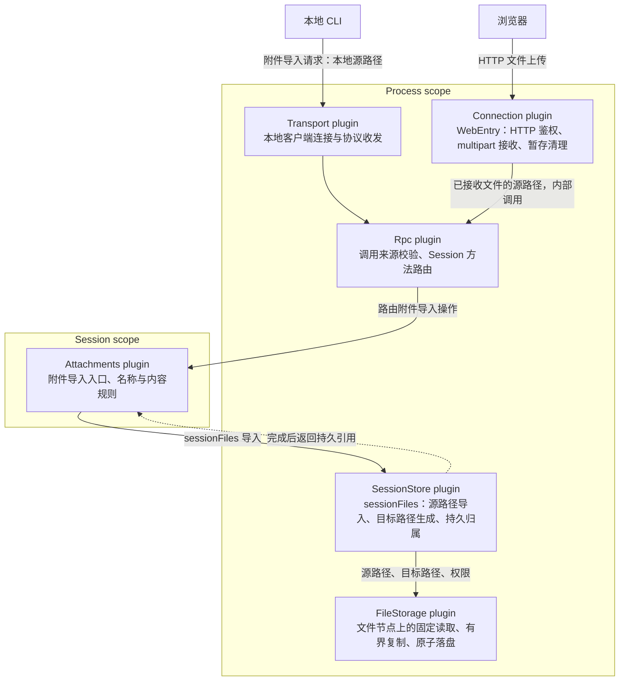
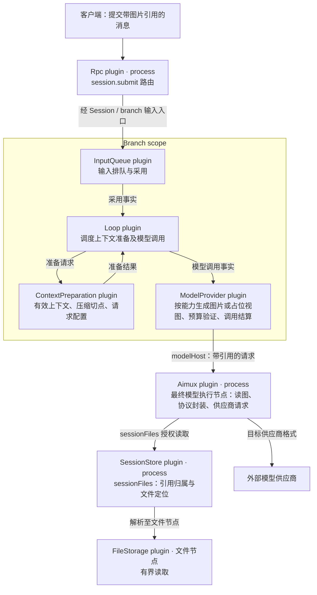

# 文件与图片传输设计

状态：提案。确认后由各 owner 更新自己的契约，再实施。

## 1. 决策

1. Web API 通过标准 HTTP 文件上传接收浏览器文件，流式保存到受控暂存目录。
2. App Server 的附件入口调用 Session files，按已授权的源文件路径导入。Session files 决定最终路径，文件服务执行有界复制及原子落盘，SessionStore 发布文件归属。
3. 本地 CLI 使用同节点文件导入；插件调用所属文件 owner 的路径操作。跨节点文件传送在文件服务边界完成，业务方法传递所属节点可解释的文件位置。
4. 消息、历史和内部模型请求使用持久文件引用；最终模型执行节点读取图片并按供应商协议编码。
5. 文件接收、导入、内容引用、模型切换和恢复作为一个完整交付，统一验收后启用新格式。

## 2. 接口边界与文件导入

### 目标插件关系

以下为目标职责与调用关系图。插件框内列出职责；箭头表示操作或内容流，模型执行沿现有 Timeline 调度。



HTTP 完成回复沿调用链返回浏览器；随后客户端通过 App Server 消息协议提交引用。




| 边界 | 输入 | 输出 | 所有者职责 |
| --- | --- | --- | --- |
| Web HTTP 上传 | `multipart/form-data`，每请求一个文件，目标 Session | 已保存文件的引用及元数据 | 鉴权、请求大小与并发限制、流式暂存、调用导入、清理暂存 |
| App Server 附件方法 | 已授权来源路径、文件名、目标 Session | 持久文件引用及元数据 | 校验调用来源及源文件访问资格，调用 Session files |
| Session files 导入 | 源文件位置、文件名、目标 Session | `fileId`、最终路径、字节数与媒体信息 | 校验 Session、生成目标路径、组织导入、提交所有权 |
| FileStorage / fsHost | 来源节点中的源路径、目标路径及权限 | 写入结果 | 打开并固定源文件、有界复制、临时文件、原子替换、落盘与取消 |
| App Server 消息提交 | 消息内容及图片引用 | 输入接收结果 | 校验引用归属，执行输入采用流程 |

以上为目标操作语义；方法名称与 wire 字段由对应 owner 契约定义。Session 文件契约见 [Session files](../appserver/session-files.md)，文件服务契约见 [resource faces](../resource-faces.md)，公开操作遵循[数据面契约](../service-faces.md)。

### Web 流程

```text
浏览器 File
    → HTTP multipart 上传
    → Web 入口受控暂存文件
    → Session files 按源路径导入
    → FileStorage 原子保存到 Session 文件目录
    → SessionStore 提交文件归属
    → HTTP 返回持久引用
    → session.submit 携带引用
```

- 暂存路径由服务端生成；客户端提供的文件名仅作为待校验名称。
- HTTP 入口边接收边计数并写入暂存文件，执行大小、超时、磁盘及并发预算。
- 接收完整文件后发起导入；导入成功后返回引用。失败、取消及服务关闭时释放本次暂存资源，启动时清理遗留暂存文件。
- HTTP 入口持有本次暂存文件的访问资格；源路径在服务器内部交给导入操作。
- Web 预览使用 object URL，完成后可切换到鉴权资源读取地址。

### 同节点文件导入

Session files 增加按路径导入操作，完成以下步骤：

1. 检查 Session、文件名和来源访问资格，打开普通源文件并固定读取对象。
2. 分配 fileId 与 Session 文件目标路径，记录 pending 写入。
3. 文件服务按有界块复制到目标临时文件，按实际字节检查限额；完成后设置权限、flush 并原子发布。
4. SessionStore 确认 Session 存在且 pending 写入仍归本次执行所有，提交文件归属。
5. 返回持久引用及最终文件信息；失败按 pending 文件回收规则清理。

源路径定位接收方文件节点上的文件；目标路径由 Session files 生成。调用方的普通源文件在导入后继续由调用方管理，Web 暂存文件由 Web 上传任务清理。

本地 CLI 的文件路径经受信任本地入口授权后导入。剪贴板图像先按图片策略形成临时文件，再走同一导入流程。导入过程中从固定的读取对象生成接受内容，之后模型读取的是已导入的不可变文件。

### 跨节点文件来源

文件位置由节点身份及该节点上的路径解释，路由遵循资源节点契约。源与目标位于同节点时调用本地复制；位于不同节点时，文件服务通过有界读取和写入完成搬运，再由 Session files 提交归属。Web 临时路径用于其所属节点上的导入。

跨节点写入能力由 fsHost owner 定义操作、取消与清理契约；Session files 的业务输入始终是来源位置与导入参数。Rust 绑定与跨语言绑定执行同一 owner 逻辑。

### 文件身份与预算

内容类型 owner 定义唯一的持久图片引用类型。引用指向 Session files 已提交的不可变文件；读取时由 owner 校验归属并解析文件位置。

文件接收、Session 存储、图片准入和供应商请求分别设置预算：

- Session 文件导入按 owner 当前 16 MiB 单文件限额校验实际复制字节。
- 图片准入保留 20 张限制；缩放、像素、格式与动画处理由 [Attachments](../plugins/Attachments.md) 和 [WorkspaceTools](../../architecture/rust-agent/plugins/WorkspaceTools.md#read-results-and-images) 定义。
- HTTP 上传预算按目标文件 owner 的大小与图片处理需求定义；multipart 信封计入独立请求预算。
- 供应商请求总图片预算由模型 owner 明确，按最终图片表示校验；数值与错误写入 owner 契约后实施。
- Modality 的导入执行其自身文件预算与任务文件归属规则。

## 3. 图片与上下文

图片文件保存的是系统接受的字节；客户端或工具按既定策略缩放后的内容可以成为接受内容。接受内容不可变，像素变化产生新身份。

```text
已采用输入 / 工具结果中的持久图片引用
                  |
       当前分支有效上下文与压缩切点
                  |
       本次模型能力对应的请求视图
                  |
       最终模型节点读取与协议封装
```

上下文准备负责有效内容选择，ModelProvider 负责本次模型视图，aimux 负责供应商协议封装。

### 模型切换

| 场景 | 决策 |
| --- | --- |
| 目标模型支持图片 | 读取有效上下文内的图片并发送 |
| 视觉模型切到纯文本模型 | 根据引用生成原位置的占位文字；历史继续保存图片引用 |
| 纯文本模型切回视觉模型 | 从有效上下文中的原引用重新准备图片 |
| 跨供应商切换 | 使用同一接受内容，按目标协议重新封装，并筛选兼容的续接数据 |
| 能力未知 | 尝试发送合法图片，由供应商判断是否接受 |
| 图片已被压缩移出有效上下文 | 请求仅使用压缩后的有效上下文；重新附图走新的输入采用流程 |
| 摘要包含图片标记 | 按摘要中的标记文本发送 |

占位文字沿用：

- 不支持图片：`[Image omitted: the current model does not accept images.]`
- 旧 inline/URL 来源不可发送：`[Image omitted: the image cannot be sent to this model.]`

保持占位位置和数量。旧 URL 使用不可发送占位；持久引用读取失败按“失败与取消”契约返回错误。

### 请求一致性

- 一次请求固定其已采用的 provider、model、能力快照、配置与协议信息；图片处理使用该请求的固定配置。
- 模型切换通过现有配置采用流程作用于后续请求。当前请求遵循现有完成与中断规则。
- 连接与凭据由 Provider 在调用时解析和刷新，使用本次请求固定的目标。目标不可用或路由协议不兼容时明确失败。
- 重试使用同一请求配置、不可变文件与处理策略。
- 供应商续接元数据按目标协议的类型、签名、账户及模型兼容规则筛选后发送。

### 准备顺序与预算

1. 固定有效上下文和请求配置。
2. 按模型能力生成带引用的请求视图或占位文字。
3. 校验上下文预算。
4. 最终模型节点读取图片，执行既定图片处理。
5. 校验供应商图片与请求字节预算，封装并发送。

图片计数沿用 [ContextCompaction](../plugins/ContextCompaction.md) 的算法身份及图片贡献规则。占位后按文字校验；模型、工具、上下文窗口或请求视图变化后，重新验证预算依据。

文件与网络读取均在提交锁外的 owner 自持任务中执行。内部 ModelHost、PrepareModelHost 请求通过引用跨节点传输。

每次图片处理从不可变的接受内容开始，使用本次请求确定的处理策略。

最终 SDK 必须持有完整 Base64/JSON 时，其内存由单请求预算和并发数限制，独立于传输队列预算。

### 失败与取消

| 情况 | 行为 |
| --- | --- |
| 新输入引用不存在或无权访问 | 接受边界返回引用或权限错误 |
| 历史图片暂时不可读 | 需要图片的请求返回可恢复读取错误 |
| 已提交文件永久缺失或损坏 | 返回持久内容不可用，保留历史引用 |
| 超过目标模型图片预算 | 返回明确限制错误；只允许既定策略内的缩放 |
| 取消、卸载或 Session closing | 释放读取与临时资源，按 owner 流程结算；共享文件由持久所有权管理 |

## 4. 修改范围与下游覆盖

### App Server 内部修改

| 所有者 | 修改位置 | 修改逻辑 |
| --- | --- | --- |
| Connection / WebEntry | `web_entry.rs` 与上传 handler | 增加 multipart 路由、受控暂存、导入调用及清理 |
| Rpc / Attachments | 方法声明、来源授权、附件路由 | 将 Web 已接收文件和本地客户端文件交给 Session files 导入 |
| SessionStore | `storage/files.rs`、Session files 服务类型 | 增加源路径导入，复用 pending/owned 事务、最终路径生成及失败清理；提供引用定位与读取操作 |
| 持久化 | `storage/codec.rs`、版本及迁移入口 | 存取统一图片引用，处理格式版本；恢复时保证文件及所有权完整 |

### 文件与模型主干修改

| 所有者 | 修改逻辑 |
| --- | --- |
| FileStorage / fsHost | 固定源读取、有界复制、原子写入；同节点路径导入与跨节点文件搬运 |
| 内容类型 owner | 定义统一持久图片引用，更新输入、工具结果和模型请求的共享类型 |
| ModelProvider | 根据本次能力快照处理引用或占位，校验请求预算 |
| Aimux | 在最终执行节点读取图片，分别封装用户图片和工具结果图片，按目标协议处理续接数据 |

### 下游接入

| 消费者 | 必需修改 | 覆盖流程 |
| --- | --- | --- |
| Web composer / chat | File 上传、引用提交、草稿文件生命周期 | 选择/粘贴图片 → 上传 → 提交；失败重试 |
| Web 历史读取与展示 | 解析引用元数据，鉴权读取图片 | 实时消息、翻页、断线重连、恢复历史 |
| CLI / dim-client | 本地图片及剪贴板图片按路径导入，草稿保存引用 | 文件参数、粘贴、TUI 提交、取消及临时文件清理 |
| ACP 输入 | 外部图像解码落文件并导入，消息使用引用 | ACP prompt 含多图及混合文本 |
| ACP 输出 | 在协议输出边界读取引用并编码为 ACP 图片内容 | Session 加载、历史回放；图片位置与顺序 |
| WorkspaceTools read / ToolHost | 生成图片后建立持久文件归属，工具结果返回引用 | 本地与远端工具图片；图文混合结果 |
| MCP 工具边界 | 将外部图片结果保存并绑定本次 Session，再返回引用 | 截图等 MCP 图片工具、共享服务下的 Session 隔离 |
| Modality / ModalityAimux / OCR 调用链 | 文件来源接入所属 owner，执行节点取得可读取文件，产物转聊天时导入 Session | 图像/音频/视频文件输入、OCR 文件输入及任务产物 |
| TypeScript / 插件绑定 | 同步共享类型、声明生成及边界解码器 | Rust 与 Node 调用的输入、回复和错误一致 |
| 存储迁移与恢复入口 | 将保留历史转换为统一内容类型，持久化文件及所有权 | 迁移后重启、fork、删除原 Session、冷恢复 |

### 下游联动验收

以下消费者沿引用流执行验收，以用户可见结果决定必要适配：

- History → ContextPreparation：采用输入与工具结果的引用和顺序进入有效窗口。
- ContextModel / ContextUsage：图片按图片贡献计数，模型切换后的预算正确。
- SummaryStrategy / Recall：摘要与检索中的图片标记正确，压缩切点生效。
- CLI projection / export、ACP projection、Web projection：各出口表达图片及其媒体信息，恢复与翻页结果一致。
- Hook 和后台工具结果的文本投影：混合图文结果的文本提取正确。
- Timeline codec 的模型请求记录：引用在输入、工具结果及持久 ModelCall 中均可恢复，文件归属覆盖所有保留记录。

服务提供者和消费者遵循各 owner 契约；公开数据面必须同时具有 catalog 名称与 `HostDispatch`，验证 Rust 绑定和 wire 行为一致。

### 工具结果

图片在进入 Dim 的工具结果边界保存，引用写入 `ToolResult.content`。保留文本、块顺序、tool_use_id、is_error 和 structuredContent。

MCP 对端只支持 inline Base64 时，在外部边界解码并保存，内部结果使用文件引用。远端工具在 ToolHost 回复前建立可授权的持久引用。

供应商要求将工具图片移到后续 user 消息时，由协议适配器在本次请求中封装，并保持工具调用与结果配对。

### Modality

遵循 [Modality](../plugins/Modality.md) 的任务、文件和取消契约。浏览器文件经 HTTP 上传形成可导入来源；本地与远端文件按所属节点路径接入任务文件 owner。

Modality 产物进入聊天前，必须获得不随任务清理失效的 Session 文件归属。超过 Session 限额时明确拒绝，或按既定策略产生符合限制的派生文件。

## 5. 持久化与兼容性

- 新接口与内部类型统一使用文件引用。需要保留的旧 Base64/URL 历史由存储 owner 在迁移或读取边界转换为统一内容类型；迁移完成条件包含文件及所有权完整。
- 新引用采用显式协议及存储格式版本；读取端遇到不支持的版本返回兼容性错误。
- Web、CLI 与 App Server 按新协议契约更新；连接时检查协议版本，版本不匹配返回明确错误。
- fork 继承文件归属，删除与清扫计算所有存活归属，包括已压缩历史中的文件引用。
- 可恢复备份包含 Timeline、所有权及完整文件闭包，包括工具图片、分支继承和压缩前历史引用。恢复校验文件身份及完整性后才开放 Session。
- 存储 owner 定义带文件的备份/恢复契约。
- 所有迁移验证使用临时数据库与隔离 home。

## 6. 实施与验收

按以下依赖顺序实现，全部通过后统一开放新格式写入：

1. owner 契约、共享引用类型、版本与文件备份格式。
2. 文件服务按路径复制、Session files 导入与文件生命周期。
3. Web HTTP 上传、本地 CLI 导入、ACP/工具结果及 Modality 的文件来源接入。
4. 上下文投影、远端模型读取及供应商封装。
5. 恢复、兼容性、模型切换与资源预算验收。

必需验收：

- HTTP 上传及本地/插件路径导入合法上限文件，绑定与 wire 结果一致；超限返回错误并清理暂存与 pending 文件。
- 路径授权、源文件替换、复制期间增长、断连、取消、磁盘满和 Session 删除竞态正确处理；成功结果对应已提交文件。
- 视觉 A → 文本 B → 视觉 A/C，用户图片与工具图片保持身份、顺序及工具因果关系。
- 请求执行中切换模型、刷新凭据或变更路由，每个请求使用其固定配置。
- 压缩后切回视觉仅发送有效上下文内的图片；fork 后删除原 Session，图片仍可读。
- 远端 ToolHost → 控制节点 → 远端 ModelHost 的内部消息保持引用，最终供应商收到正确图片。
- 跨 Session 引用、临时离线、永久缺失和损坏返回对应错误。
- 新格式备份恢复到全新 home 后可继续请求；旧格式可读，旧程序明确拒绝不支持的新格式。
- 上传与复制内存受缓冲大小及并发预算约束；上传期间 stop/cancel 保持响应；模型解码与最终编码内存单独测量。

## 7. 架构约束与 owner 决策

### Rule check

| 规则 | 设计约束 |
| --- | --- |
| Capability / ADR 002 D1 | 上下文准备与 ModelProvider 承担上下文 Capability 职责；HTTP 暂存属于 Web 上传任务的 I/O 资源，持久文件由 Session files 管理 |
| §4.1–2 | 文件 owner 发布文件归属；内容经输入采用或工具结果流程交接 |
| §4.3–5 | 文件与网络 I/O 在 owner 任务中执行；内容与终态事实按 Timeline 原子批次提交并发布 |
| §4.6 | 文件引用通过已采用输入与工具结果进入上下文 |
| §4.7–8 / ADR 002 D2–D3 | 消费者声明 owner 数据面依赖，使用有界数据操作完成跨语言调用 |
| §4.9 | HTTP 客户端显示传输进度；内容采用及必需终态写入对应事实 |
| ADR 002 D4–D5 | 业务预算归 owner；公共契约使用数据和 ID，I/O 句柄由 owner 管理 |

### Requirements raised to mechanism owners

| Owner | 必须落实的契约 | 生命周期影响 |
| --- | --- | --- |
| Session files / fsHost | 来源路径导入、固定读取、有界复制、原子写入及授权读取；跨节点搬运契约 | 未完成清理，完成后持久可读 |
| 内容与存储 | 引用 schema、格式版本、所有权及备份闭包 | 新格式拒绝不兼容读取；fork/delete/reload 保持引用完整 |
| ModelProvider / ModelHost | 引用输入、声明式文件读取依赖、模型图片预算与错误 | 锁外读取；取消释放资源；本次请求配置固定 |
| ContextPolicy / ContextUsage | 引用图片计数与请求视图验证 | 保持压缩切点；算法语义变化时更换身份 |
| WebEntry | 鉴权 multipart 上传、受控暂存及路径导入调用 | 接收任务清理暂存；持久文件归属由 Session files 管理 |

消融决策：Web 管理上传暂存，Session files 复用 pending/owned 状态完成导入，文件服务管理复制缓冲及原子写入资源。三个 owner 分别承担接收、持久归属与文件 I/O。
