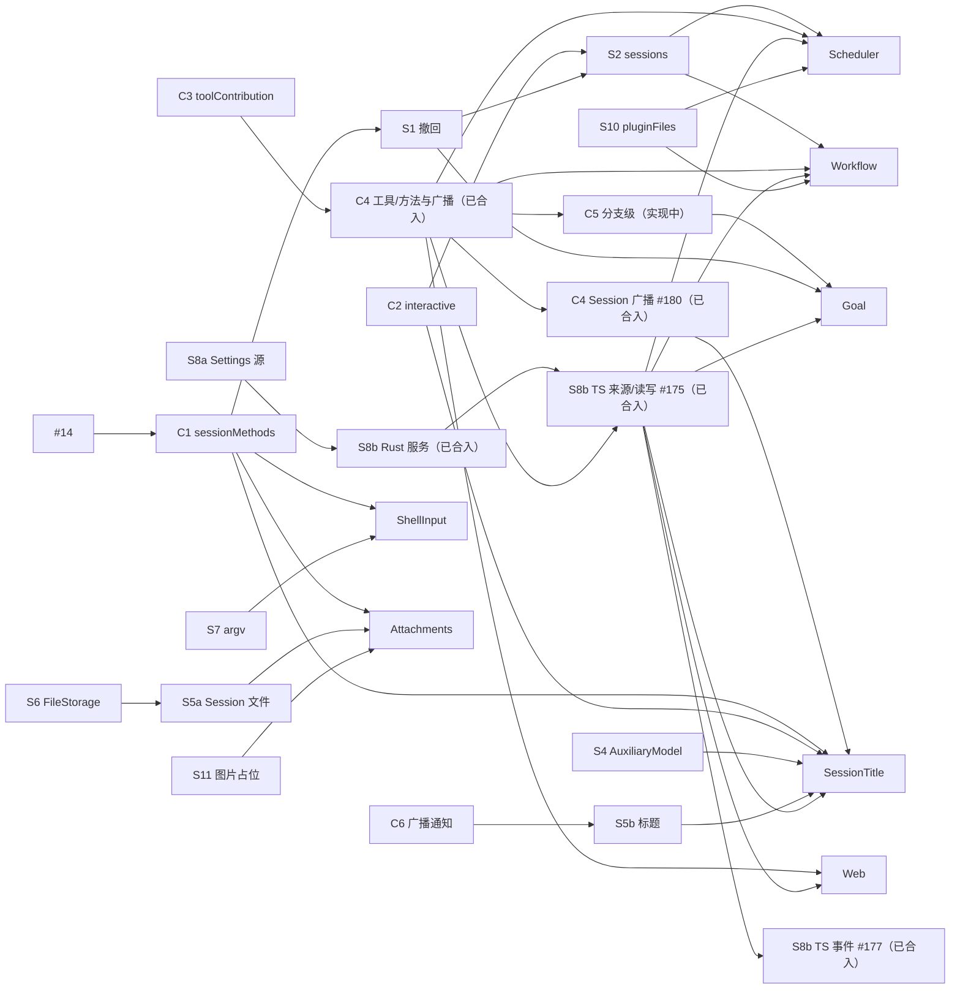

# 开发计划与优先级

Status: Draft. 依据：[总体设计](overview.md) §8 阶段与附录 B/F、[插件设计索引](plugins/README.md)、[ADR 001](../adr/001-harness-foundation.md) 实现状态，以及 [#21–#30](https://github.com/arcships/dim/issues/31) 的讨论结论。交付基线：`main` @ `c044140`（2026-10-17）；PR 的实时状态见 [#114](https://github.com/arcships/dim/issues/114)。

跟踪 issue：[#114](https://github.com/arcships/dim/issues/114)，每个工作项一个 issue 和一个 draft PR，各有唯一的负责人。

本文只排顺序、依赖和优先级，不重复设计内容。设计文档仍是权威；本文与设计冲突时以设计为准，并回来更新本文。

## 1. 现状

本轮大部分 Rust 前置机制已合入，包括 C1/C2/C3、S1/S2、S4、S5a/S5c、S6/S7、S8a、S10/S11、R1 和 E1/E2；C7、S3 已确认无需新增机制。C4 工具/方法、原生 Session 广播、rutis 0.11 升级，以及 S8b Rust 服务、C4 行来源声明、TypeScript owner 读写和 Settings 事件已合入。C5 实现进行中；产品凭据边界的调整提案 #185 尚未合入。插件按自己需要的接口推进，设计、spike、研究合入不表示产品实现完成。已有、可直接扩展的基础：

| 已有 | 位置 | 对应工作项 |
| --- | --- | --- |
| 同步 `Timeline::before`（一个草稿进、一个草稿出，失败提交原草稿） | `dim-agent-runtime/src/core/timeline.rs` | 不变（[原则 §4 第 3 条](../architecture/rust-agent/principles.md)） |
| `ToolContribution` / `SessionToolSource`，分支初始化时按名接入已 Active 的提供方 | `dim-agent-capabilities/src/tool_registry.rs` | C3（#82 已合入） |
| Session 门面的 `history(branch, through)`：上限是已发布的头部，只读已发布的事件（内部 `Timeline::history` 才以已分配的头部为上限） | `dim-agent-runtime/src/agent.rs` | 不需要新接口：先取已发布的 head（`sequence`），再 `history(Some(head))`（#50） |
| `PluginFilesPlugin`（UTF-8、锁、显式 v1 格式） | `dim-app-server/src/plugin_files.rs` | S10（#91、#135 已合入） |
| Settings Rust 业务来源、C4 行声明的 JSON 来源、TypeScript owner 读写、owner/client 写入边界和 `credentials` 合同；变更经既有 rutis 事件及 TypeScript leaf 事件通知 | `dim-app-server/src/settings.rs`、`settings_methods.rs`、`session_typescript.rs`、`credentials.rs`；事件合同在 `dim-agent-capabilities/src/settings.rs` | S8a、S8b 来源、读写与事件（#90、#166、#175、#177 已合入） |
| 自动压缩事实、生产压缩宿主、`/compact` 和用量查询；显式 `--models` 配置无能力快照时不启用压缩 | `context_preparation.rs`、App Server `main.rs` | F1（#108 已合入） |

当前交付范围：

| 工作项 | 已合入 | 剩余范围 |
| --- | --- | --- |
| P1 ShellInput | 服务端 #101、CLI `!` / `!!` #155 | 本轮交付完成 |
| P2 Attachments | 服务端 #102、CLI 设计 #154、headless 图片 #160、多行/大段粘贴与提交时上传 #163、原生文件/剪贴板输入 #164 | 本轮输入链路已合入；平台支持和原生交互验收范围见各 PR |
| F6 CLI | 设计 #113、实现 #149、编码请求上限 #153 | 本轮交付完成 |
| F3 模型参数 | 设计 #110、`/effort`、`/fast`、`/agent` 实现 #148 | 本轮交付完成 |
| F4 MCP OAuth | 服务端 #111、CLI 登录与状态 #151 | 本轮交付完成 |
| F5 OS 隔离 | spike #112、设计 #152 | 产品执行集成尚未合入；持久 shell 输出策略待确认，用户 `!` / `!!` 不在隔离范围内 |
| C4 Session 级 TS | spike #99、装配前置 #137、工具/方法设计 #141、实现 #150、rutis 0.11 升级 #173、广播设计 #174、实现 #180 | C4 完成，#63/#168 已关闭；慢 leaf 的积压策略作为非阻塞问题跟进。#156 已关闭且不采用 |
| C5 分支级 TS | 设计 #100 | 原行绑定、公开服务读取及三个真实 Node 流程已验证；创建取消参数的合同调整待确认，保持实现中，不标记 inreview |
| S8b Settings | 设计 #119、Rust 实现 #166；#175 的 C4 行 `settings` 声明、TypeScript owner 读写及真实 Node 验收（§11 第 1–3 项）；TypeScript 事件 #177 | 不新增 manifest；产品凭据存储提供方与 TypeScript 凭据验收（§11 第 6 项）仍待完成，#118 保持打开 |
| F1 跟进 | 压缩研究 #165、死区/截断修复 #172、运行时规则与流程更新 #183 | #128 已关闭；摘要提示词/思考评估 #170 属于 M2 |
| P5 Goal | 设计 #105 | 等待 C4/C5/S8b 等自身前置，产品实现未完成 |
| 插件作者指南 #140 | 指南与类型 #167 | C4 广播/C5 增补随对应实现；来源声明与事件沿用 #175/#177 |

S10 后续 #135、S2 删除及评审后续 #159、App Server 真实配置流程测试修正 #157、CLI 私有 socket 启动修复 #158、共享中断监听修复 #162 和 CI fixture 修正 #161 已合入。CLI 修复不属于 F5 隔离或 P1 ShellInput 策略。以上记录交付范围；CI 和评审是否允许合并，以各 PR 当前提交的实时状态为准。

相关 PR：

| PR | 状态 | 内容 | 对计划的影响 |
| --- | --- | --- | --- |
| [#14](https://github.com/arcships/dim/pull/14) | 已合入 | Session 持有 MCP；`ManagementMethods` 由业务 owner 提供；`SessionLifecycle`；移除 `mcp.approve`/`mcp.revoke`，项目源条目默认禁用（ADR 003 D3、ADR 004） | C1、S8a、F4 的前置已满足 |
| [#16](https://github.com/arcships/dim/pull/16) | 已关闭 | 移除 `mcp.approve`/`mcp.revoke` | 已由 #14 完成 |
| [#17](https://github.com/arcships/dim/pull/17) | 已合入 | 实验性 Pursuit 设计 | 决策 D3 |
| [#20](https://github.com/arcships/dim/pull/20) | 已合入 | `managementMethods` 按调用查找，不依赖其所有者 | 已反映在总体设计 B.2 |

## 2. 排期原则

1. **契约先行。** 多个插件共用的契约先定稿（只改文档），再开工：`sessionMethods`（4 个插件和 InputQueue 撤回用）、Settings 业务源（5 个插件用）、`SessionConfig.interactive`（2 个插件读）。契约定稿后再改，所有使用方都要跟着改。
2. **依赖从扩展指向核心。** 核心部件（Session 装配、ToolRegistry、Rpc、Mcp、SkillsCatalog）不硬依赖可选插件，按调用查找，或在自己装载时接入当时可用的（ADR 002 D3）。这是架构级的依赖规则，所有契约和插件设计都按它复核。
3. **core 按项拆 PR。** 每个工作项单独一个 PR。集中修改的文件（Rpc、装配、`agents.rs`、存储）各由一个负责人依次合入（§3.4）。
4. **插件按自己的依赖开工。** 一个插件依赖的工作项全部合入，它就开工，不等无关的 core 工作。第一个真实使用者负责验收对应的机制。
5. **core 项要有已 Ready 的使用者才开工。** 暂时没有使用者的项推迟，例如 #2 动态事件（Questions 的 #178 重设计不新增事件）。
6. **TypeScript first 的插件用 TypeScript 开发。** 用 TypeScript 是为了在业务规则还没验证时缩短验证和迭代周期（总体设计附录 C），所以按名访问运行时服务的 [#4](https://github.com/arcships/dim/issues/4) 要尽早做，分两段：C4（Session 级）和 C5（分支级）。安全边界、准入、输入和 Session 方法边界仍用 Rust。
7. **远期设计晚绑定。** 只细化即将开工的设计；P3 的设计等前置机制落地后再细化。

## 3. 工作清单

规模：S（几天）、M（1–2 周）、L（数周或需要 spike）。

### 3.1 立即做（文档与对齐）

1. ~~合入 #14、#16 并补 ADR 003 D3~~：已由 #14 完成（#16 关闭）。
2. ~~契约定稿：C1 `sessionMethods`、C2 `SessionConfig.interactive`、S8a Settings 业务源~~：#79、#83、#84、#90 已合入。核心部件不硬依赖可选插件的约束继续适用（#34、ADR 002 D3）。
3. ShellInput、Attachments 服务端与 CLI 输入链路已合入。Web、Scheduler、Workflow 的工具/方法、Settings owner 读写与事件前置已满足，可按 §5.2 复核 Ready 决策；凭据边界按 #185 的评审结果处理。SessionTitle 仍等 C6/S5b 与自身 Ready 决策；Goal 仍等 C5 等自身前置。
4. ~~决定 Goal 还是 Pursuit（D3）~~：已决定先做 Goal（#44）。
5. 确认可能不需要的工作：~~Permission 新类别~~（已确认不需要，现有 `Unclassified` 行为已符合，#45）、~~S3 活动句柄~~（已确认不需要：App Server 不自动卸载空闲 Session，#57）。
6. 为确定要做的运行时需求开 issue（总体设计附录 F）。rutis 是外部依赖，不向它提需求。

归下一个里程碑 [M2](https://github.com/arcships/dim/milestone/1)：Questions（#144 的重设计 #178 已合入，文档状态仍为 Draft，待 Ready 确认与实现）、Hooks 设计（#143，作为第三方插件兼容机制单独设计）、ExternalAgent 重新设计（#145）、Pursuit 设计（#146）、压缩后的历史查询工具（#129）、摘要提示词/思考与目标长度评估（#170）。#2 动态事件暂缓：Questions 用待完成的工具调用与工具结果，不新增事件，当前没有 Ready 使用者；未来落地时再迁移 F1、S1 临时加入 `EventKind` 的 4 个事件。F1 的研究 #165 和 #169 的修复 #172 已合入；#128 的运行时调参留在当前计划，不扩大基础设施。

已撤回：Notifications。提醒归客户端，定时任务结果通知归 Scheduler，对外沟通渠道由各平台各自的插件和工具负责。

### 3.2 core 工作项

每项一个 PR。"负责线"表示改动集中的文件，同一条线上的项依次合入，不同线可以并行。

| ID | 内容 | 规模 | 负责线 | 前置 | 使用者 |
| --- | --- | --- | --- | --- | --- |
| C1 | `sessionMethods`：Session 门面按 namespace 查找，Rpc 经 Session 分发，含 Session 方法的每次调用进度（session-boundary A.2 只做 `progress`：方法声明 `progress` 后，Rpc 把调用期间的进度以 `management.progress` 只发给调用方连接，先于回复，断开后丢弃；`notify`、`closed`、`takeFinalReply` 不在内） | M | Rpc | #14 | ShellInput、Attachments、SessionTitle、Goal、S1 |
| C2 | `SessionConfig.interactive` 与 `session.create` 参数（只做这一个字段；存储保持 v13，旧记录缺省为交互） | S | Rpc | — | SessionTitle、S2、Questions（重设计 #178 已合入、实现待办） |
| C6 | Session 广播通知记录，Rpc 原样转发 | S | Rpc | — | S5b |
| ~~C7~~ | ~~固定前缀读~~：不需要新接口，现有门面组合即可（#50，session-access §9.2） | — | — | — | — |
| C3 | `toolContribution` 按名收集；不硬依赖可选插件：在分支初始化首次读取 ToolRegistry 时同步接入当时已 Active 的提供方，并沿既有 BranchOpening 在 Session 接受输入前完成采用，之后起来的在下次重载时接入；`SessionConfig.tools` 里提供方没起来的工具直接省略（#34） | S | 装配 | — | Web、Goal、Scheduler、Workflow |
| C4 | #4 Session 级：TypeScript 部件提供 `toolContribution`、`sessionMethods`，订阅 Session 广播，随 Session 装配和卸载；Session 装配不等可选插件的部件（#34，装配实现由 #132 跟踪，完整 C4 验收以其落地为前提） | L，先 spike | 装配 | C3、#132（验收） | 所有 TypeScript 插件 |
| C5 | #4 分支级：TypeScript 部件按名使用 `Dispatcher`、`Branch::input`、`TreeCommands` | M | 装配 | C4 | Goal |
| S1 | InputQueue 撤回：`input/withdraw`、`input/deleted`、`session.input.withdraw`（新事件需做格式决定） | M | 事件类型 | C1 | `Ctrl+S`/`/queue`、Goal、S2 |
| S2 | Agents `sessions` 服务：`launch`、`input`、`idle`、`withdraw` | L | `agents.rs` | C2、S1 | Scheduler、Workflow |
| S3 | ~~Session 活动句柄~~：不需要，App Server 不自动卸载空闲 Session（#57） | S | `agents.rs` | — | — |
| S4 | Provider `AuxiliaryModel`：会话外单次模型调用（[设计](appserver/auxiliary-model.md)；用途策略已撤回） | S | Provider | — | SessionTitle |
| S5a | SessionStore：Session 文件 | M | 存储 | S6 | Attachments |
| S5b | SessionStore：标题元数据与 `setTitle` | S | 存储 | C6 | SessionTitle |
| S5c | SessionStore：删除、清理、fork | M | 存储 | S5a | fork 功能 |
| S6 | FileStorage 列目录与删除 | S | 独立 | — | S5a |
| S7 | HostPlatform argv 辅助、每次启动时读 shell 配置 | S | 独立 | — | ShellInput |
| S8a | Settings 业务源（Rust）：每个所有者一个或多个源、两个作用域的变更通知、入口统一校验；目录形式的项目文件由所有者自己读 | M | Settings | A2 | Rust 所有者、S8b |
| S8b | Settings 语言中立服务、`settings.read/update`、统一的凭据引用解析；#166 Rust 服务、#175 C4 行来源声明/TypeScript owner 读写及 #177 事件已合入；产品凭据存储待交付 | M | Settings | Rust 部分依赖 S8a；TypeScript 来源、读写与事件依赖已合入的 C4 绑定 | Web、SessionTitle、Goal、Scheduler、Workflow |
| R1 | Rpc：管理插件处于 Failed 或 Unresolved 时返回不可重试的 `service_unavailable`（#116） | S | Rpc | — | 客户端 |
| S10 | `pluginFiles` 格式版本（二进制留给 P3） | S | 独立 | — | Scheduler、Workflow |
| S11 | ModelProvider：模型不支持图片时换成文本占位 | S | 独立 | — | Attachments |

### 3.3 插件开工顺序

按依赖从少到多排列。依赖全部合入即可开工，不必等前一个插件做完。

| 顺序 | 插件 | 语言 | 依赖 |
| --- | --- | --- | --- |
| 1 | ShellInput | Rust | C1、S7 |
| 2 | Attachments | Rust | C1、S5a、S6、S11 |
| 3 | Web | TypeScript | C3、C4、S8b |
| 4 | SessionTitle | TypeScript | C1、C2、C4、C6、S4、S5b、S8b |
| 5 | Goal | TypeScript | C1、C3、C4、C5、S1、S8b |
| 6 | Scheduler | TypeScript | C4、S2、S8b、S10 |
| 7 | Workflow | TypeScript | C4、S2、S8b、S10 |

不被其他插件依赖、随时可以单独做的功能：生产压缩宿主与 `/compact`、用量查询（走现有的 `ResolveContextModel` 端口，不依赖 S4）；Session 删除和 fork（S5c）；Permission 命令规则；模型参数 effort/fast 与 `/agent`；MCP OAuth；HostPlatform OS 隔离（L，先 spike）；CLI 子命令、`/export`、`exec --json`。

P3（AcpGateway、RemoteGateway、Modality、PluginManager）等 P1/P2 落地后，开工前集中复核设计；按 rutis 现有能力设计，不向 rutis 提需求；`ConnectionEntry`、`EntryHost` 到时再排。

### 3.4 合入顺序与冲突点

| 负责线 | 依次合入 | 说明 |
| --- | --- | --- |
| Rpc（`connection.rs`、`protocol.rs`、`methods.rs`），yyhhyyyyyy | R1 → C1 → C2 → C6 → S5b/S5c 的 Session 方法 | 冲突最多的地方 |
| 装配（`assembly.rs`、App Server `lib.rs`），zerob13 | C3 → C4 → C5；每个新插件的登记在这之后追加 | 新插件登记只加几行，按合入顺序 rebase |
| `agents.rs`，yyhhyyyyyy | S2 | |
| 存储（`storage/timeline.rs`），yyhhyyyyyy | S5a → S5b → S5c →（#32） | 存储格式的改动依次做，每次单独做格式决定 |
| 事件类型（`events.rs` 与冻结样本） | S1 | 单独做格式决定 |
| 插件自己的 crate 或包 | 无冲突 | |

契约层面的冲突比文件冲突更要紧：C1、C2、S8a 一旦改动，所有使用者都要跟着改，所以放在 §3.1 先定稿。

### 3.5 按人按批次

每条串行负责线只由一个人负责，避免同一批文件在人之间来回交接。"批"只表示先后：前置一到就进下一批，不等整批结束。

| 批次 | eric8810（核心机制与契约） | yyhhyyyyyy（Rpc、Agents、存储、MCP） | zerob13（装配、TS 桥接、TS 插件、CLI、平台） |
| --- | --- | --- | --- |
| 1 | ~~A2 契约定稿~~ #79、~~A3 Goal 决策~~ #80、~~A4 权限类别~~ #81 | ~~S6 FileStorage~~ #87、~~R1 Failed 错误码~~ #117 | ~~C3 工具接入~~ #82、~~C4~~ #150/#180、~~S7 argv 辅助~~ #88、~~S10 pluginFiles~~ #91/#135 |
| 2 | ~~S8a Settings 源~~ #90、~~S4 AuxiliaryModel~~ #89 | ~~C1 sessionMethods~~ #83、~~C2 interactive~~ #84、~~S5a Session 文件~~ #95 | ~~装配前置~~ #137；F5 spike #112、设计 #152 已合入，产品实现未合入 |
| 3 | ~~S1 InputQueue 撤回~~ #94、S8b #119/#166/#175/#177 已合入（凭据调整 #185 待评审）、~~S11 图片占位~~ #92、~~F2 权限命令规则~~ #109 | C6 #85 inreview、S5b #96 实现中；~~P1 ShellInput 服务端~~ #101；~~S3 活动句柄~~（不需要） | C5 设计 #100 已合入，实现与取消合同确认中；~~P1 CLI~~ #155、~~F6 CLI~~ #149/#153、~~F3 模型参数~~ #148；~~C4 广播~~ #180 |
| 4 | ~~F1 压缩宿主~~ #108、研究 #165、修复 #172、运行时 #183；P5 Goal 设计 #105 已合入（实现等自身前置） | ~~S2 sessions~~ #98/#159、~~P2 Attachments 服务端~~ #102、~~S5c 删除和 fork~~ #97、~~F4 MCP OAuth 服务端~~ #111 | ~~F4 CLI~~ #151、~~CLI Attachments~~ #154/#160/#163/#164；~~作者指南~~ #167；P3 Web #103 inreview，凭据合同依赖 #185；P4 设计 #104 已合入，C6/S5b 与 Ready 决策待完成 |
| 5 | — | — | P6 设计 #106、P7 设计 #107 已合入；Ready 业务决策仍待完成，不因设计合入直接实施 |

跨人的交接（都不在同一批文件上）：

| 交付 | 交付方 | 等它的 |
| --- | --- | --- |
| A2 契约定稿 | eric8810 | C1、C2（yyhhyyyyyy） |
| C1 sessionMethods | yyhhyyyyyy | S1（eric8810） |
| S1 撤回 | eric8810 | S2（yyhhyyyyyy） |
| S4 AuxiliaryModel | eric8810 | P4（zerob13） |
| S8b C4 行来源声明与 TypeScript owner 读写 #175、事件 #177（已合入） | eric8810 | P3、P4、P6、P7（zerob13）；凭据引用按产品存储提供方的交付推进 |
| C4 工具/方法绑定（已合入） | zerob13 | S8b 来源与读写（eric8810，已合入）及各 TS 插件 |
| C4 Session 广播 #168 | zerob13 | P4 SessionTitle（zerob13）；其他插件按自身接口推进，不等待该广播 |
| C6 广播通知、S5b 标题 | yyhhyyyyyy | P4（zerob13） |
| S11 图片占位 | eric8810 | P2（yyhhyyyyyy） |
| S7 argv 辅助 | zerob13 | P1（yyhhyyyyyy） |
| S2 sessions | yyhhyyyyyy | P6、P7（zerob13） |
| C4、C5 TS 桥接 | zerob13 | P5（eric8810） |

第 2、4 批的服务端交付、Attachments CLI 与 C4 广播均已合入；Web、Scheduler、Workflow 可使用已交付的工具/方法、Settings owner 读写与事件复核 Ready 决策。C6/S5b 和凭据合同决策只阻塞实际需要它们的功能，不设新的全局阶段屏障。

### 3.6 并发规则

- `docs/architecture/rust-agent/generated/` 下的生成文件不手工解冲突：rebase 后重跑 `xtask graph`。
- 不给还没落地的接口打桩，等接口合入再开工。
- 同时进行的工作数不超过维护者能确认的设计 PR 和实现 PR 数量。

## 4. 依赖图

ShellInput 与 Attachments 的服务端及 CLI 输入链路已合入。C4 工具/方法 #150、rutis 0.11 升级 #173、广播设计 #174 与实现 #180 已合入，#63/#168 已关闭；#156 不采用。S8b #166/#175/#177 已合入；凭据边界调整 #185 仍是提案。原生 Session 广播目前只由 SessionTitle 使用，其他插件不因 #168 增加前置。S1 → S2 已合入；Web #103 与已合入的 Scheduler #106、Workflow #107 仍需各自的 Ready 决策。Goal 的 C5 与 C6 → S5b → SessionTitle 仍未完成。

## 5. 设计变更空间

开发中一定会出现插件设计的细化和变更。以下流程让变更有固定入口，不打断排期。

### 5.1 设计状态

| 状态 | 含义 | 何时进入 |
| --- | --- | --- |
| Draft | 当前插件设计（Questions 重设计 #178 已合入、仍待 Ready 确认；ExternalAgent 需要重新设计，Hooks 待设计） | — |
| Ready | 已按代码现状复核，开放问题已决定或明确推迟，维护者已确认 | 开工前的设计细化 PR 合入 |
| Implemented | 代码与设计一致；能力页移入或链接到 `architecture/rust-agent/plugins/`，由 `xtask check` 校验 | 实现 PR 合入 |

只有 Ready 的设计可以开工。

### 5.2 开工前的设计细化

每个插件和每份共享契约开工前，先提一个只改文档的小 PR：

1. 按当前代码复核依赖：前置项是否已按设计落地；有偏差的，以代码和已合入契约为准。
2. 决定或推迟附录里的开放问题，推迟的写明不影响本次实现的理由。
3. 列出需要改的共享契约（[session-boundary](contracts/session-boundary.md)、[session-access](contracts/session-access.md)、总体设计附录 B/F），一起改。
4. 按现行[原则](../architecture/rust-agent/principles.md)重新回答"Rule check"中受影响的行，特别是 §4 第 3、5、8 条。
5. 维护者确认后合入，状态改为 Ready。

### 5.3 实现中发现的变更

- **只影响本插件**：在实现 PR 里同步改设计文档，PR 描述单列"设计变更"一节。
- **影响共享契约或其它插件**：先停在该点，提契约变更 PR（列出受影响的插件文档），确认后再继续。
- **需要改基础设施**：按原则 §4 第 8 条，需求必须来自基础设施自身并在其内闭环，否则是插件自己的设计问题。插件不自己改 core，需求交给对应负责线的负责人。
- **中文译文**：`docs/zh/` 可以在一批工作完成后统一同步。

### 5.4 容量与重排

- 预留 20–30% 容量给 5.2/5.3 的工作。L 级项（C4、S2、OS 隔离）先做 spike，spike 结论可能改变设计和本文顺序。
- 每批工作完成后回顾：更新 §1 现状和 §3 工作清单。

## 6. 决策

| # | 问题 | 结论 | 影响 |
| --- | --- | --- | --- |
| D1 | #2 的上下文边界 | 已决定：插件事件只通过已采纳的输入和工具结果进入上下文；#2 已修订为同一口径 | #2 只剩运行时注册事件类型、写入时检查类型已注册 |
| D2 | #4 是否尽早做，按 Session 级和分支级分段 | 是（§2 第 6 条） | TypeScript 插件何时能进入快速迭代 |
| D3 | Goal 与 Pursuit | 已决定：先做 Goal。Pursuit 暂缓：用评审分支判断完成的方案需要更大的设计，不在本轮排期 | C5 的使用者是 Goal；插件顺序 5 |
| D4 | 是否先做完全部 core 再做插件 | 已决定：不设全局阶段屏障；契约先行、core 按项拆 PR、插件按自己的依赖开工（§2） | 整体顺序 |
