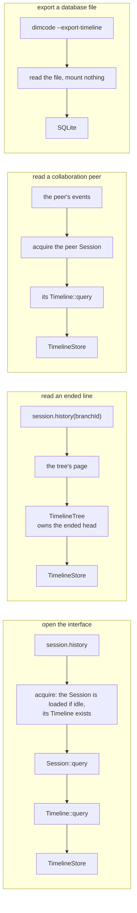

# Timeline read ownership

Status: Draft. Delivery status is tracked in the issue, not here.

Scope: Session and branch.
Issue: #1039.
Rules: [design rules](../architecture/rust-agent/principles.md), [ADR 002](../adr/002-plugin-scope.md), [ADR 021](../adr/021-reads-follow-the-state-owner.md).

## 1. Scope and non-goals

This document states who reads a line's facts, which object serves each read, and which dependencies are allowed. It covers the client history read, the ended line's page, the collaboration read of a peer Session, the restore reads of `TimelineTree` and the database export.

It does not restate the query contract ([plugin contract §5.4](plugin-contract.md#54-the-event-query)), the page shape of the client protocol ([session history window](appserver/session-history-window.md)), or the storage layout ([request delta storage](appserver/request-delta-storage.md)). It adds no event, service, state or format change.

## 2. Owners and their reads

| Read | Served by | Reads |
| --- | --- | --- |
| A live line's facts | `Timeline::query`, the checkpoint selection, the segments | its own hot window and the store, to the published head, plus the branch's not-yet-published facts when the request asks for them |
| An ended line's page | `TimelineTree`, through the tree's service | the stored facts of a line whose `Timeline` is gone, at the fixed head the tree owns |
| A collaboration peer's facts | the peer Session's `Timeline`; the read acquires the peer first | the same as any live line |
| Branches and their metadata | the store port's branch listing and head; titles from `session.summaries` | branch records and title metadata, not events |
| Session files, titles, grants, fork, delete | `SessionStore` | not events; today it also exposes the store's event reads, which the target removes from the client path |
| A database file | `dimcode --export-timeline` | the database, with nothing mounted |

A caller does not choose a read because it is cheaper; it reads through the object that owns the state. When no such object exists, the read is the ended line's row or the export, and says so.

This table is the target. Today `AgentIndex::history_page` and `AgentIndex::read_page` still fall to `SessionStore` whenever a store exists (`crates/dim-app-server/src/agents.rs`), so the ended line and the peer read reach the store through the App Server. The implementation on `dim/1039-read-ownership` removes those fallbacks; until it lands, the table describes where these reads are going, not where they go.

## 3. Read paths



## 4. State and lifecycle

A branch's `Timeline` exists from the moment its Session is loaded until the line ends or the Session unloads. Loading is what builds the runtime objects; it does not read the branch's facts into memory, and the facts are still read in pages.

`session.history` and the in-process `sessions.history` acquire the Session, so a client read and the scheduler's run tracking both work on a loaded Session. `session.attach` is not a prerequisite and does not change which read serves the page.

A line that ended keeps its identity in `TimelineTree`: the ended head, the end record and the creation source. That state outlives the line's `Timeline`, which is why the tree, not the App Server, serves its page.

A read fetches from storage one page at a time: a page is consumed and dropped before the next is fetched, and the page size belongs to the caller. This bounds what a read takes from the store, not what a consumer keeps. The query contract lets a consumer fold a prefix from pages (plugin contract §5.4), and an export materializes what it writes.

Three readers accumulate beyond one page today: the opening copy ([#1063](https://github.com/arcships/dim/issues/1063)), `dim export` (`crates/dim-cli/src/export.rs`) and `chain_through` for the fork check (`crates/dim-app-server/src/agents.rs`), the last two in [#1065](https://github.com/arcships/dim/issues/1065). A copy shared by readers exists only while the readers and the branch's opening are alive together (ADR 021 D6).

## 5. Dependencies

Allowed:

| From | To |
| --- | --- |
| `Timeline` | `TimelineStore` |
| `TimelineTree` | `TimelineStore` |
| `TimelineTree` | `TimelineFactory` (branch creation) |
| `Branch`, `Session` | `Timeline` |
| App Server | runtime `Session`, the tree's services, `TimelineStore` as the implementation it registers |

Not allowed:

| From | To |
| --- | --- |
| a capability part other than `TimelineTree` | `TimelineStore` |
| `Session`, `Branch` | `TimelineStore` |
| App Server's client path | a method of `SqliteTimelineStore` that the port does not declare |
| any client | `Timeline`, `TimelineStore` |

## 6. Cross-module requirements

- **Runtime (opening):** remove the shared decoded copy of a branch's opening, which kept `1..=head` in memory for replay and now has no regular reader ([#1063](https://github.com/arcships/dim/issues/1063)).
- **Runtime (TimelineStore owner):** the ended line's page and the port's other reads are composed from `query` and `batch_end`; where the tree needs a selection the port cannot express, the port gains it in its own contract.
- **App Server (session history owner):** `session.history` acquires the Session and never falls to `SessionStore` for a Session the process does not hold; an ended line is served by the tree whether or not the host keeps a store. Acceptance: the client path has no call to `SessionStore`'s event reads, and a flow test reads the history of an idle Session and observes the acquire rather than a store read. `idle-unload.md` acceptance 1 and 2 are rewritten: `summaries` reads metadata, and a history read acquires the Session.
- **TimelineTree owner:** the restore reads of `branch/ended`, `branch/end`, `branch/create` and the creation check move to the port's query, so the tree reads selections instead of ranges and decodes only the events it selects ([#1064](https://github.com/arcships/dim/issues/1064)).
- **CLI (export owner):** `dim export` collects every page of the Session today; it writes each page as it arrives instead, and `chain_through` folds its prefix page by page ([#1065](https://github.com/arcships/dim/issues/1065)).

## 7. Rule check

- §4 rule 2 (facts and handlers): this document adds no behavior and no handler; it changes which object serves an existing read.
- §4 rule 4 (state belongs to the part that owns it): the read surface follows the owner. The Timeline owns a live line's facts, `TimelineTree` owns an ended line's state, and the database export owns nothing.
- §4 rule 9 (publication): the client path never reads a fact above the published head.
- §4 rule 10 (context path): no model context is involved.
- ADR 002 D1 (one owner per state): each row of section 2 names one owner.
- Other rules do not apply: this document adds no plugin, no event and no configuration.

## 8. Binding appendix

Current Rust spelling of the reads this document assigns:

```rust
// live line
Timeline::query(TimelineQuery) -> Result<TimelineQueryReply>
Session::query(...) / Branch::query(...)   // forward, published bound

// ended line
TreeCommands::page(id: String, after: u64, limit: u64) -> Result<Vec<Arc<AgentEvent>>>

// branches and metadata
TimelineStore::branches(session_id) -> Result<Vec<StoredBranch>>
TimelineStore::head(key) -> Result<u64>
Session::branches() -> Vec<TimelineInfo>   // id, parent, branch_point, create_anchor, source

// database file
storage::export_timeline(path, session, out) -> Result<()>
```
