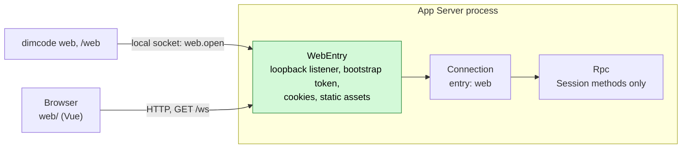

# Web workspace (phase 1)

Status: Accepted for phase 1. Related: [RemoteGateway](plugins/RemoteGateway.md) (the target design), [overview §6.3 multiple nodes](overview.md#63-multiple-nodes), [App Server README](../../crates/dim-app-server/README.md).

The Web workspace is a browser frontend for the App Server, started by `dimcode web` or `/web`. It replaces the TypeScript `dim web` host (Bun server, RCP v2) with the existing App Server protocol v3. Phase 1 ships a **local web entry**: a loopback-only subset of RemoteGateway that does not wait for its prerequisites (PluginManager #3, rutis call-scoped requests #5, extended `pluginFiles`, Settings business sources). When RemoteGateway lands it absorbs this entry; the browser side does not change because it speaks the same Session methods either way.

## 1. Structure



| Part | Where | Purpose |
| --- | --- | --- |
| `WebEntry` | `crates/dim-app-server/src/web_entry.rs`, process scope | Owns the loopback listener, the bootstrap and access tokens (memory only), static assets and the `web.*` management methods |
| `Connection` change | `connection.rs` | A connection accepted by WebEntry carries `entry: Web`; Rpc serves it Session methods (including the execution Session methods, decision E3 of RemoteGateway) and never management methods or `daemon.shutdown` |
| `dimcode web`, `/web` | `crates/dim-cli` | Thin client: calls `web.open` over the local socket and opens the browser; no HTTP stack in the CLI |
| Frontend | `web/` at the repository root | Vue 3 + Vite app ported from the TypeScript `packages/cli-web`, with its transport rewritten for protocol v3 |

## 2. Local web entry

### 2.1 Lifecycle

The daemon is shared and normally spawned with `--no-ws`, so the entry is opened at runtime by a management method on the local socket rather than by a daemon flag.

| Method | Params | Result |
| --- | --- | --- |
| `web.open` | `{port?}` | `{url, address}`; idempotent: an open entry returns its existing address. `url` is `http://127.0.0.1:<port>/#bootstrap=<token>` |
| `web.status` | `{}` | `{open, address?, connections}` |
| `web.close` | `{}` | `{}` after the listener and every web connection closed (detach) |

All three are management methods (local transport only, protocol v3). Without `port` the entry binds the first free port from 43201 upward; an explicit `port` that is taken fails with `address_in_use`. The entry stays open until `web.close` or daemon exit; it is not persisted, so after a daemon restart the user runs `dimcode web` again. `web.open` fails with `web_assets_missing` when the daemon was started without an assets directory (§2.4).

### 2.2 Authentication

| Item | Rule |
| --- | --- |
| Bootstrap token | 32 random bytes, base64url, generated when the entry opens, valid until it closes; delivered only in the URL fragment, so it never reaches server logs or `Referer` |
| Exchange | `POST /api/auth/exchange {token}` → 204 and `Set-Cookie: dim_web=<access>; HttpOnly; SameSite=Strict; Path=/`. The bootstrap token can be exchanged more than once (several tabs) |
| Access token | 32 random bytes per exchange, held as SHA-256 hashes in memory, compared in constant time; dropped when the entry closes |
| Throttle | 5 failed exchanges free, then exponential backoff up to 60 s per entry → 429 with `Retry-After` |
| Origin and Host | Every `POST` and the `/ws` upgrade require `Origin` equal to `http://<Host>`, and `Host` must be the bound address (`127.0.0.1:<port>` or `localhost:<port>`), which blocks DNS rebinding |
| Bind | Loopback only in phase 1. No `Secure` cookie flag because the entry is plaintext loopback |

Tokens never appear in logs, diagnostics, the Timeline or protocol replies other than `web.open`'s `url`.

### 2.3 HTTP surface

| Path | Auth | Behavior |
| --- | --- | --- |
| `GET /api/health` | None | `{ok, serverVersion}` |
| `POST /api/auth/exchange` | Bootstrap token, Origin | §2.2 |
| `GET /api/auth/session` | Cookie | 204 while the cookie is valid, else 401; lets the page tell a revoked sign-in from an entry that is down |
| `POST /api/auth/logout` | Cookie, Origin | 204, clears the cookie and drops that access token |
| `GET /ws` | Cookie, Origin | WebSocket upgrade into an ordinary App Server connection (`entry: Web`), same framing and admission limits as the existing `/ws`; 401 without a valid cookie |
| other `/api/*` | — | 404 `{error:{code,message}}` |
| `GET /assets/*` | None | Static files confined to the assets directory; `Cache-Control: max-age=31536000, immutable` |
| other `GET` | None | `index.html` (SPA fallback), `Cache-Control: no-store` |

Every response carries `Content-Security-Policy: default-src 'self'; style-src 'self' 'unsafe-inline'; img-src 'self' data: blob:; connect-src 'self'; frame-ancestors 'none'`, plus `X-Content-Type-Options: nosniff` and `Referrer-Policy: no-referrer`.

### 2.4 Assets

The release tree gains `web/` next to `runtime/` and `plugins/`. The CLI passes `--web-assets <root>/web` when spawning the daemon, the same way it passes `plugins/dim-oauth`; for development, `DIMCODE_WEB_ASSETS=<dir>` overrides the path the CLI passes. The daemon serves files only from that directory and canonicalizes request paths before opening them.

### 2.5 Protocol on the entry

| Item | Rule |
| --- | --- |
| Version | `hello` v3 with `clientKind: "web"`; v1/v2 → `protocol_version` |
| Methods | Rpc Session built-ins and the execution Session methods (`session.permission.*`, `session.exec.stop`, `session.skills`, `session.model.update`, `session.prompt.refresh`, `session.mcp*`), on every Session of the host. All other management methods and `daemon.shutdown` → `-32601 unknown_method` |
| Model list | The read-only management methods `provider.list`, `provider.catalog` and `provider.selection` are also served (decision Q1); their replies carry no credentials (`provider.list` reports only `credentialConfigured` and header names). Switching uses the Session method `session.model.update` |

Compatibility: the bare `/ws` keeps today's rules (`hello` and `daemon.ping` only in protected profiles). Execution Session methods become reachable from the web entry; this is the same widening RemoteGateway records as E3, limited here to loopback connections authenticated by the local user's token.

### 2.6 Differences from RemoteGateway

| RemoteGateway | Phase 1 web entry |
| --- | --- |
| `entryHost` on Transport, call-scoped `authenticate`/`handle` | WebEntry owns its own listener and authenticates in process |
| Pairing codes, per-device tokens in `remote-devices.json`, rotation, revocation | One bootstrap token per open entry, access tokens in memory; `web.close` revokes everything |
| `plugin.set_enabled` and Settings source `remote` | `web.open` / `web.close` management methods; no persisted state |
| Loopback by default, TLS or explicit plaintext for other addresses | Loopback only |
| `ConnectionEntry {name, deviceId}` | `entry: Web` on the connection |

## 3. CLI

`dimcode web [--port N] [--no-open]` connects to (or spawns) the daemon, calls `web.open`, prints the address and opens the sign-in URL with `browser::open`. With `--no-open`, `DIMCODE_OAUTH_MANUAL=1` or no browser, it prints the full sign-in URL instead; it is the local user's own terminal. It then exits; the entry lives in the daemon. `dimcode web --close` calls `web.close`. `/web` in the TUI does the same and opens `/chat/<sessionId>` for the current Session (the home page before the first message).

```
$ dimcode web
Web workspace  http://127.0.0.1:43201/
Opened in your browser.
The workspace stays available until the daemon stops or you run `dimcode web --close`.

$ dimcode web --no-open
Web workspace  http://127.0.0.1:43201/
Open this link to sign in: http://127.0.0.1:43201/#bootstrap=…
The workspace stays available until the daemon stops or you run `dimcode web --close`.
```

The CLI passes `--web-assets` when it spawns the daemon (§2.4). A daemon started before the assets were installed answers `web_assets_missing` until it is restarted with `dimcode daemon stop`.

## 4. Frontend

`web/` is a Vue 3 + Vite + Pinia + vue-router project built with npm (Node from `.node-version`). It is ported from `packages/cli-web` in the TypeScript repository; components, styles and i18n move with minimal change, while the transport and data model are rewritten.

| Layer | Phase 1 |
| --- | --- |
| `rpc/client.ts` | JSON-RPC over `/ws`: `hello` v3 (`clientKind: "web"`), request timeout, heartbeat with `daemon.ping`, reconnect with backoff and re-attach. Strict readers at this boundary; the rest of the app uses typed data |
| `rpc/protocol.ts` | Hand-written types for the v3 methods and notifications the UI uses (`session.*`, `approval.*`, `session.event`, `session.state`, `session.model.progress`) |
| `projection.ts` | Folds `session.history` pages, `session.event` and `session.model.progress` into timeline rows (user, assistant text, thinking, tool call and result, approval), following `crates/dim-cli/src/projection.rs` |
| Sidebar | Workspaces are Session summaries grouped by `cwd`; new Session by `session.create {cwd}` with a typed path or a known workspace |
| Chat | Timeline (markdown, Shiki), composer (submit, stop, model menu), approval prompt (`approval.request` → `approval.respond`) |
| i18n | `en` and `zh-CN` |

Features of the TypeScript UI with no v3 backend yet are left out rather than stubbed: follow-up queue, attachments and file previews, file-history rewind, fork, archive, rename, goal, workflows, subagent panes, settings pages, directory picker, git branch menu. Each returns when its backend method exists (Attachments, SessionTitle, Goal, Workflow, ShellInput and so on).

## 5. Build and release

The release workflow builds `web/` once per target job (`npm ci --ignore-scripts && npm run build`) and passes the output to `scripts/stage-release.mjs` as `DIM_WEB_DIST`; staging requires it and copies it to `<root>/web`, which the release manifest and npm package include. The PR check builds `web/` (type check plus bundle). `cargo build` does not depend on the frontend; development points the CLI at a local build with `DIMCODE_WEB_ASSETS=web/dist`.

## 6. Open questions

| # | Question | Proposal |
| --- | --- | --- |
| Q1 | Model selection needs the model list, which only management methods return | Decided: serve `provider.list`, `provider.catalog` and `provider.selection` read-only on the web entry (§2.5) |
| Q2 | Settings pages (providers, MCP, skills) are management | Phase 2: decide whether a loopback web entry may carry management methods; RemoteGateway currently says never |

## 7. Rule check

| Rule | How this document complies |
| --- | --- |
| §1 Capability and App Server boundary | WebEntry is App Server process code, not a Capability; Transport, Connection and Rpc gain only the `entry: Web` record and its method filter |
| §4.1, §4.9 Timeline writes | WebEntry writes no Timeline event; web calls reach Session owners exactly like local calls |
| §4.3 Before callbacks | No check at a Session entry; only the HTTP upgrade is authenticated |
| §4.7 Public events and services | The browser uses only protocol v3 Session methods and notifications |
| ADR 002 D1 Scope | Process-scoped: one entry per daemon |
| ADR 002 D4 Configuration | No configuration is persisted in phase 1; the port is a `web.open` parameter |
| ADR 002 D5 Language-neutral contracts | The HTTP surface and `web.*` methods are given in neutral form above |

## 8. Requirements raised to mechanism owners

None. Phase 1 exists so that the Web workspace does not wait for RemoteGateway's requirements (RemoteGateway §9).
