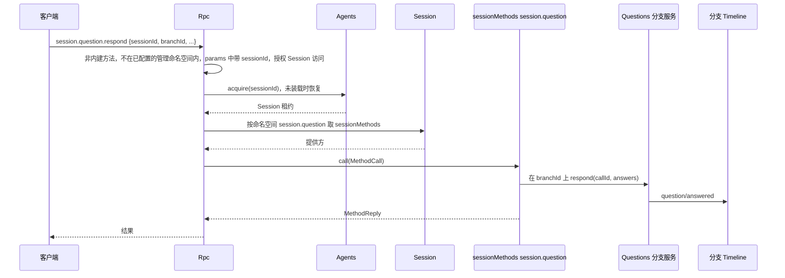
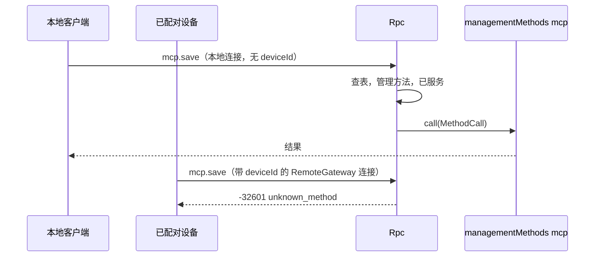

# 方法与工具贡献

状态：草案。总体设计：[总览 §3 集成](../overview.md#3-基于现有机制的集成)、[附录 B Rpc 与 ToolRegistry](../overview.md#附录-b-现有插件的补充)；规则：[ADR 002](../../adr/002-plugin-scope.md) D2、D3、D5。阶段：P0。语言：语言中立合同；Rust 绑定见[附录 F](#附录-f-rust-绑定)。

本合同以 ADR 002 D5 的语言中立形式定义三个具名服务。每个服务由服务名、作用域和实例 key 标识；其方法接收并返回可序列化数据；错误是数据；取消是一个协议动作。任何语言的插件都可以通过在其 `provides`（loader 行）中声明来提供它们，消费方按名称和作用域收集。它们建立在运行时已有的机制之上：按作用域收集的具名服务，以及 Rpc 现有的经 Session 分发（与如今的 `approval.respond` 相同）。实现状态：只有 `managementMethods` 已实现，形式是附录 F 中的 Rust 子集（#14）。`sessionMethods`（C1）、`toolContribution` 的接入规则（C3）、`callChannel` 以及基于 `provides` 的注册（#4）都未实现，`ConnectionEntry {name, deviceId}`、按 `deviceId` 路由和导出的 rutis 链接也未实现（提议在 P3 随 RemoteGateway 实现）。

| 服务 | 作用域 | Key | 提供方 | 收集方 |
| --- | --- | --- | --- | --- |
| `sessionMethods` | Session | 命名空间 | Session 级插件部分（Questions、Goal、SessionTitle、Attachments、ShellInput；Hooks 待设计）和 InputQueue（`session.input`） | Rpc，经 Session 分发 |
| `managementMethods` | 进程 | 命名空间 | 只有进程插件（Mcp、Provider、Scheduler 等；Settings 目前还没有命名空间） | Rpc，按调用查找 |
| `toolContribution` | Session | 工具名 | Session 级插件部分（Questions、Goal、Web、Scheduler、Workflow） | ToolRegistry（补充：具名工具服务） |

**管理方法**是关于宿主而不是某个 Session 的客户端 RPC 方法：`account.*`、`provider.*`、`mcp.*`、`skills.*`，以及新进程插件的方法（设置方法是后续工作，Settings 目前不发布任何方法）。`daemon.shutdown` 仍是 Rpc 内建方法，同样从不提供给已配对设备。#14 之前，Rpc 直接注入这些服务（[connection.rs](../../../../crates/dim-app-server/src/connection.rs) 中的 `ProductServices` 与 `ExecutionServices`）；#14 删除了它们，Rpc 现在通过 `managementMethods` 按调用查找这些方法，不依赖其提供方。只有进程插件提供管理方法，已配对的远程设备从不获得它们。Session 方法没有级别；唯一的区分是 `sessionMethods`（经 Session 分发）与 `managementMethods`。

提议（P3，随 RemoteGateway；未实现）：Rpc 依据连接的 `ConnectionEntry {name, deviceId}` 决定为它服务什么：本地连接获得 Session 方法和管理方法，带 `deviceId` 的连接（经 RemoteGateway 的已配对设备）从不获得管理方法，导出的 rutis 链接只在导出时获得管理方法。目前 Rpc 按现有的传输 profile 规则（A.3）为每个连接服务。没有注册表、没有端口，也没有 Management 插件。提供方是只在启用时安装的可选插件。Rpc 在每次调用时查找 `managementMethods` 提供方，不依赖它们，因此未启用、Pending、Failed 或正在重载的提供方只影响自己的命名空间（§3.2）。ToolRegistry 同样不依赖 `toolContribution` 提供方：接入哪些提供方在 Session 准备阶段、分支打开前决定，之后才激活的提供方在下次 Session 重载时接入（A.5）。

在工具调用或输入提交前对其作出处理不是本合同的服务。Approval 和 Session 输入路径不变；InputQueue 的撤回是其所有者的变更（[总览附录 B](../overview.md#附录-b-现有插件的补充)）。

## 1. 结构


| 服务 | 缺失时 |
| --- | --- |
| `sessionMethods` | 该 Session 未列出此命名空间时返回 `unknown_method`；已列出但提供方未激活时返回 `service_reloading`（A.1） |
| `managementMethods` | 没有已配置的命名空间拥有该名称，或其所有者行已禁用或不存在时返回 `unknown_method`（§3.2） |
| `toolContribution` | 省略该工具，并在诊断中报告（A.5） |

本文定义的合同：这三个服务、`MethodDecl`、`MethodCall`、`MethodReply`、`MethodError`、列出方法的 `session.methods`、配套服务 `callChannel`（未实现）、`ToolDeclaration`、`ToolCall`、`ToolResult`、各入口获得的服务范围、命名、保留名、现有管理方法的迁移以及兼容性表。使用的合同：`SessionConfig`（[session-access](session-access.md#a3-sessionconfig-字段)）、来源输入约定（[session-access A.2](session-access.md#a2-来源输入约定)）、Rpc 命令信封以及 `appError` 码。

## 2. 数据与状态

没有任何服务拥有 Timeline 事件或持久化状态。Session 的方法表在 Session 装载时重建；管理方法提供方在每次调用时查找。装配把已配置的管理方法 `(namespace, row)` 对（`Owners`）交给 Rpc；C1 之后，装配还记录每个 Session 的已知命名空间（A.1）。提议（P3，未实现）：每个连接在被接受时记录 `ConnectionEntry {name, deviceId}`；它获得的服务范围由这条记录决定（§3.2），从不由用户身份推导。链接的管理方法导出是宿主本地的结构性配置。

## 3. 流程

### 3.1 Session 方法



未实现（C1）。命名空间按装配为该 Session 记录的命名空间中的最长前缀解析（A.1）。如果该 Session 没有列出此命名空间（例如其插件未对该 Session 启用），结果为 `unknown_method`；如果已列出但提供方未激活，结果为 `service_reloading`。Session 方法没有级别：获得 Session 方法的连接获得全部 Session 方法，包括 `shell.*`。

### 3.2 管理方法



连接的入口记录是唯一的检查。获得管理方法即授予宿主管理员权限。

装配在 [lib.rs](../../../../crates/dim-app-server/src/lib.rs) 中构建一组固定的已配置 `(namespace, row)` 对并交给 Rpc；Rpc 的 `apply`（[connection.rs](../../../../crates/dim-app-server/src/connection.rs)）拒绝 loader 不认识其行的对，并用它们构建 `Owners`（[methods.rs](../../../../crates/dim-app-server/src/methods.rs)）。一个名称属于作为其前缀或与其相等的最长已配置命名空间，即使该命名空间的所有者已禁用；父命名空间从不应答它。Rpc 在每次调用时按 key 读取该命名空间的提供方（`TypeKey::keyed_dynamic::<ManagementMethods>(ns)`，附录 F），不依赖它。没有已激活的提供方时，Rpc 用 `loader.get(row)` 读取所有者行的状态：已启用且处于 Pending 或重载时新旧两代之间的行，返回可重试的 `service_reloading`；处于 Failed 或 Unresolved 的行，返回不可重试的 `service_unavailable`；已禁用或不存在的行，或没有任何已配置命名空间拥有的名称，返回 `unknown_method`。目前的代码（methods.rs）对 Failed 和 Unresolved 的行仍返回 `service_reloading`；issue #116 会修改这一点。Rpc、已打开的连接和其他命名空间都不受影响。提供方卸载前已受理的调用属于该提供方，由它按方法的 `interruption` 回复（A.1）：`report` 调用以 `operation_interrupted` 结束，`drain` 调用回复自己的结果，提供方的卸载等待它受理的每个调用。

## 4. 时序与冲突

| 场景 | 顺序 | 结果 | 所有者 |
| --- | --- | --- | --- |
| Session 级提供方在调用中途重载 | call < reload | `report`：`operation_interrupted`；`drain`：调用自己的结果；提供方的卸载等待每个已受理的调用（AGENTS.md 规则 8） | 提供方 |
| Session 的 Capability 重载期间调用 Session 方法 | — | `service_reloading` | Rpc |
| 对未列出该命名空间的 Session 调用 Session 方法 | — | `unknown_method` | Rpc |
| 管理方法所有者重载 | — | 新一代激活前，调用其命名空间返回 `service_reloading`；处于 Failed 或 Unresolved 的所有者返回 `service_unavailable`（§3.2）；已受理的调用属于提供方，按 `interruption` 处理；Rpc 不重载，连接保持打开 | Rpc |
| 在带 `deviceId` 的连接上调用管理方法或 `daemon.shutdown` | — | `unknown_method` | Rpc |
| 两个提供方声明同一命名空间或工具名 | 装配 | 装配失败；key 在每个作用域内唯一 | 装配 |
| Session 命名空间与已配置的管理命名空间重叠 | 装配 | 装配失败（A.1） | 装配 |
| 工具贡献提供方在 turn 期间重载 | call < reload | 在途调用失败；该提供方的工具在 Session 下次重载前不可用；ToolRegistry 与 Loop 照常运行（D3） | ToolRegistry |

完整表格：[附录 B](#附录-b-完整冲突表)。

## 5. 上下文映射

方法没有模型可见的效果。改变模型上下文的方法通过其所有者的输入或 Timeline 事实来做到，适用这些所有者的映射。`toolContribution` 与任何工具一样，只通过其声明和 `ToolResult` 到达模型。

## 6. 接口（摘要）

| 服务与方法 | 模式 | 用途 |
| --- | --- | --- |
| `sessionMethods[namespace].describe() -> MethodDecl[]` | async | Session 级方法声明 |
| `sessionMethods[namespace].call(MethodCall) -> MethodReply` | async | 执行 Session 级方法 |
| `managementMethods[namespace].describe / call` | async | 相同结构，进程作用域，管理方法；目前只以附录 F 中的 Rust 子集实现 |
| `session.methods {sessionId}`（线上方法，Rpc 内建） | async | 列出某个 Session 的方法（C1，未实现） |
| `callChannel.progress / notify / closed`（Rpc） | sync / async | 逐次调用的进度与绑定连接的通知（未实现） |
| `toolContribution[tool].declaration() -> ToolDeclaration` | sync | 工具声明 |
| `toolContribution[tool].execute(ToolCall) -> ToolResult` | async | 工具执行 |

## 7. 安全

提议（P3，随 RemoteGateway；未实现）：连接的 `ConnectionEntry {name, deviceId}` 是其服务范围的唯一权威：本地 RPC 获得 Session 方法和管理方法，带 `deviceId` 的连接（RemoteGateway）只获得 Session 方法（已配对设备可调用所有 Session 方法，包括 `shell.*`，决定 E3），rutis 链接只在宿主本地链接配置中显式导出时才服务管理方法。Rpc 只做外部边界校验：对每个 Session 级方法校验参数格式并授权 `sessionId`，与其内建方法完全相同。功能检查（内容嗅探、大小限制、模型能力）归方法的所有者。`toolContribution` 与每个工具一样，按其声明的风险由 Approval 与 Permission 准入。没有宿主本地批准：Approval 与 Permission 只管 agent 决策引起的动作，按用户或项目配置运行的命令由该配置自己负责，启用即运行（[总览 §6.4](../overview.md#64-约定)）。原有的 `mcp.approve`/`mcp.revoke` 已删除（A.4）。

## 8. 规则检查

| 规则 | 本文如何遵守 |
| --- | --- |
| §4 第 1 条（指令事件） | 不适用：这些服务自身不写 Timeline 事件；改变分支状态的方法调用状态所有者，由所有者写入（例如 `question/answered`）。 |
| §4 第 2 条（交接） | 不适用：方法与工具贡献不交接任何对象；工具调用按现有 `step/tool-call` 合同交给 ToolExecutor。 |
| §4 第 3 条（只用 before 回调） | Rpc 只校验参数格式和 `sessionId` 授权；功能检查归方法所有者，提交前的处理只用 Timeline before 回调。 |
| §4 第 4 条（核心不带业务含义） | Rpc 与 ToolRegistry 按名称收集服务，从不点名提供方，也不解释方法。 |
| §4 第 5 条（批次） | 不适用：本文没有依据 Timeline 事件做的决定；所有者依据自己的事实决定。 |
| §4 第 6 条（模型上下文） | 方法对模型不可见，`toolContribution` 只通过其声明和 `ToolResult` 到达模型（§5）。 |
| §4 第 7 条（公开事件与服务） | 提供方只通过分支的公开服务到达分支，Rpc 只经 Session 的 `sessionMethods` 分发。 |
| §4 第 8 条（需求） | 按名称对 Session 服务做带 key 的读取在 §9.1 提出；C3 的启动准备需求见 [Session 启动就绪 §9](../../../design/contracts/session-readiness.md#9-requirements-raised-to-mechanism-owners)。卸载时等待 drain、列出已激活提供方已撤回（rutis 是外部依赖）。 |
| §4 第 9 条（只有决定用的事实进 Timeline） | 方法表与入口服务范围是装配数据，从不是 Timeline 事实（§2）。 |
| §1（Capability 与 App Server 边界） | Rpc 只收集和分发；每个方法的业务代码在其提供方插件中。 |
| ADR 002 D1 | `sessionMethods` 与 `toolContribution` 是 Session 级，`managementMethods` 是进程级，与其所有者一致。 |
| ADR 002 D2 | 没有注册表、端口或 Management 插件；Rpc 与 ToolRegistry 按名称收集。 |
| ADR 002 D3 | 提供方只依赖自身或外层作用域。ToolRegistry 接入 Session 准备阶段已激活的 `toolContribution` 提供方，不依赖它们（A.5）；Rpc 既不依赖管理方法提供方（§3.2），也不依赖 Session 方法提供方（A.1），因此它们的重载只影响自己的命名空间。 |
| ADR 002 D4 | 链接的管理方法导出是宿主本地的结构性配置；本文不定义业务配置。 |
| ADR 002 D5 | 每个服务都有名称、作用域、key 和纯数据方法；Rust 类型只出现在附录 F。已实现的 `managementMethods` Rust 绑定是一个子集，尚未满足 D5（附录 F）。 |

## 9. 向机制所有者提出的需求

### 9.1 按名称查找带 key 的 Session 服务

| 项 | 内容 |
| --- | --- |
| 被什么挡住 | Rpc 分发 Session 方法时不能点名提供方（§4 第 4 条、ADR 002 D2 与 D5）；Session 门面目前只返回不带名称的类型化服务。 |
| 考虑过的现有机制 | `Session::session_service::<T>()` 每种类型只读取一个不带名称的服务，无法做到每个命名空间一个服务。`SessionScope::named_key` 能构造所需的 key，但只有 Session 装配内部的代码能用它读取。列举提供方的 Session 服务：属于接线模块（D2）。 |
| 需要的通用能力 | Session 门面上一个通用的按名称带 key 读取，例如 `Session::session_named_service::<T>(name)`，基于 `SessionScope::named_key::<T>(name)`，key 缺失时返回与 `session_service` 相同的 `Reloading` 错误。区分不存在的命名空间与正在重载的命名空间，用的是装配记录的已知命名空间（A.1），而不是这个读取。 |
| 对序号、批次、中断、重载的影响 | 对序号与批次无影响；Session 重载期间读取失败，对已列出的命名空间 Rpc 回复 `service_reloading`。 |
| 由谁实现、对应 issue | 运行时（Session 门面）；issue 待开。 |

### 9.2 卸载时等待 `drain` 调用

已撤回：rutis 是外部依赖，不向它提需求。Rpc 卸载前本来就会等它已接受的命令处理完。

### 9.3 列出进程级服务的已激活提供方

已撤回：rutis 是外部依赖，不向它提需求。Rpc 用 rutis 现有的能力（按 key 读取、已配置的 `Owners` 和 `loader.get(row)`，§3.2）分发管理方法；`hello.features` 怎么列出它们，是 Rpc 自己的设计。

非 Rust 插件提供的具名服务依赖 #4，其五项说明见 [Session 访问 §9](session-access.md#9-向机制所有者提出的需求)。

## 附录 A. 接口细节

结构为 camelCase 字段的 JSON；字段名后的 `?` 表示可选，`|` 分隔备选项。这些结构是规范形式：插件文档使用这些字段名（Rust 绑定把它们映射为 snake_case）。每个错误都是 `MethodError` 数据。

### A.1 方法贡献

`sessionMethods`（Session，key 为命名空间）与 `managementMethods`（进程，key 为命名空间）具有相同的两个方法。这一语言中立形式尚未实现；已实现的 `managementMethods` Rust 绑定见附录 F。

| 方法 | 模式 | 请求 | 回复 |
| --- | --- | --- | --- |
| `describe` | async | — | `MethodDecl[]` |
| `call` | async | `MethodCall` | `MethodReply`，或 `MethodError` |

```text
// MethodDecl
{ "name": "session.goal.set",          // 命名空间内的完整线上名称
  "mutating": true,
  "interruption": "report" | "drain",  // 卸载时由提供方回复：report → operation_interrupted；drain → 调用自己的结果
  "progress": false,
  "notifications": ["session.goal.changed"], // 位于命名空间内
  "reply": "direct" | "handoff" }      // handoff：daemon.shutdown
// MethodCall
{ "callId": "string", "method": "session.goal.set",
  "params": {},                        // 原样传入；Session 方法的 sessionId（以及 branchId）留在这里
  "origin": { "entry?": { "name": "string", "deviceId?": "string" }, // 连接的 ConnectionEntry
              "connectionId?": "string", "peer?": "string" } } // peer：rutis 链接；仅用于诊断
// MethodReply
{ "kind": "value", "value": {} } | { "kind": "handedOff" }
// MethodError
{ "code": -32000, "appError": "string", "message": "string" }
```

目前已实现（附录 F）：`MethodDecl.name`、`MethodDecl.mutating`，以及作为仅 Rust 字段的 `interruption`。`progress`、`notifications`、`reply`、`callId`、`origin` 和 `handedOff` 未实现。

取消与中断：调用由提供方自己回复，不由 Rpc 回复。有两种情况会中断已受理的调用：提供方这一代卸载，以及受理该调用的 Rpc 装载卸载。任一发生时，处理函数的取消令牌都会触发，`drain` 调用也不例外。随后 `report` 调用立即回复 `operation_interrupted`（操作可能已经提交），之后再结算；`drain` 调用回复自己的结果。提供方的卸载等待它受理的每个调用，包括 `report` 调用。调用方断开不会取消任何东西。

| 规则 | 内容 |
| --- | --- |
| 命名空间 | `<segment>(.<segment>)*`，段为 `[a-z][a-z0-9_]*`，最多 128 字节，由提供方拥有；命名空间本身可以是一个方法（`session.rename`）。不符合该语法的名称不做任何查找，直接为 `unknown_method` |
| 所有权 | 管理方法名称属于作为其前缀或与其相等的最长已配置管理命名空间（`Owners`），即使该命名空间的所有者已禁用。Session 方法名称属于该 Session 列出的最长命名空间（C1） |
| 保留名 | 分两部分。精确内建名：`is_builtin_method` 接受的每个名称（[protocol.rs](../../../../crates/dim-app-server/src/protocol.rs)）；贡献的命名空间、命名空间的任何前缀以及声明的方法都不能等于其中之一，精确内建名也不能落在贡献的命名空间之内。对管理命名空间，最后这一条目前成立只是因为每个精确内建名都位于某个保留根之下；`provide` 并不检查它。Session 命名空间可以位于 `session` 之下，C1 必须检查这一条（例如 `session.mcp` 是精确内建名，因此 Session 命名空间 `session.mcp` 或包含它的命名空间会被拒绝）。保留根：`hello`、`daemon`、`agent`、`approval` 和 `session`；管理命名空间不能位于其中任何一个之内（`ManagementMethods::provide` 会拒绝）。Session 命名空间可以位于 `session` 之下（`session.goal`、`session.input`），但不能是单独的 `session` 根。`session.input` 不保留：InputQueue 通过 `sessionMethods` 提供 `session.input.withdraw`（提议中），因此 Rpc 不点名任何所属服务 |
| 优先级与路由 | 内建方法；否则已配置的管理命名空间；否则走 Session 路径，仅限协议 v3+，且仅当连接的入口获得 Session 方法时。共用一个线上名称空间 |
| 命名空间冲突 | Session 命名空间与已配置的管理命名空间相等、包含它或位于它之内时，装配失败，因此没有名称会同时有管理所有者和 Session 所有者（C1） |
| Session 级调用（C1，未实现） | 既不是内建方法、也不在已配置管理命名空间内的名称，是 Session 方法候选。Rpc 从原始 params 读取 `sessionId`；缺少时结果为 `-32602`。Rpc 对其授权，并通过 `index.acquire` 获取该 Session，未装载的 Session 会被恢复（不同于 `approval.respond`：对未装载的 Session 它返回 `session_closed`）。然后 Rpc 解析该 Session 列出的最长命名空间：没有 → `unknown_method`；已列出但未激活 → `service_reloading`。Rpc 在调用期间一直持有该 Session 的使用权。`sessionId` 与 `branchId` 留在 `params` 中；Rpc 读取 `sessionId` 只为授权和解析。提供方通过该分支的服务到达某个分支。对不在任何已配置管理命名空间内的名称，这一顺序先返回 `-32602` 再判断 `unknown_method`，与[管理方法](../../../design/appserver/management-methods.md)不同（那里未知方法无论 params 如何都是 `-32601`）；此处以本合同为准，因为这类名称只能通过 Session 解析，而 Session 的 id 是 params 的一部分。在已配置命名空间之内仍以 management-methods.md 为准 |
| 调用归属 | Session 级提供方这一代拥有它受理的调用，与 `ManagementMethods` 相同：由它回复，它的卸载按 `interruption` 中断这些调用并等待它们（见上文取消与中断） |
| 已知命名空间（C1，未实现） | 运行时的 `Session::session_service` 对任何缺失的 key 都返回 `Reloading`，因此单靠读取分不清不存在的命名空间与正在重载的命名空间。C1 让装配用 `AgentBuilder::session_methods(ns)` 记录每个 Session 的已知命名空间，作为 `Owners` 的对应物：不在列表中的命名空间 → `unknown_method`；在列表中但提供方未激活 → `service_reloading` |
| 共享类型（C1） | `MethodDecl`、`Interruption`、`Handler` 与 `RpcError` 目前位于 dim-app-server，而 dim-agent-capabilities 中的 Session Capability 不能依赖它。C1 把共享的声明、处理函数与错误类型移到 dim-agent-types |
| 不分发 | 没有已配置命名空间拥有该名称且它不是 Session 方法候选、所有者行已禁用或不存在、该 Session 未列出此命名空间、提供方未声明该名称、在带 `deviceId` 的连接或未导出的链接上调用管理方法，或 v1/v2 → `-32601 unknown_method`。Session 正在重载、已列出的 Session 命名空间的提供方未激活，或管理方法所有者行处于 Pending 或新旧两代之间 → `-32000 service_reloading`（可重试）。管理方法所有者行处于 Failed 或 Unresolved → `-32000 service_unavailable`（不可重试；#116 之前代码返回 `service_reloading`）。已开始的 `report` 调用被中断 → `operation_interrupted` |
| `hello.features`（v3） | 内建方法；连接获得管理方法时（本地 v3），再加上已配置命名空间中已激活提供方的方法，每个方法只列在拥有它的命名空间下。从 loader 行的 `provides` 发现命名空间是后续工作（[ADR 004](../../../adr/004-loader-plugin-management.md)）。Session 级方法不在这里列出，由 `session.methods` 按 Session 列出 |
| `session.methods`（C1，未实现） | 新的公开接口，Rpc 内建方法：`session.methods {sessionId}` → `{ "methods": [ { "name": "string", "mutating": true } ] }`，即该 Session 列出且提供方已激活的命名空间所声明的方法。它与其他 Session 级内建方法一样授权和解析，并增加一个精确内建名 |
| 就绪闩 | 在 loader 的初始装载结算后打开，因此进程提供方在第一个 `hello` 时已存在 |

已知的 Session 级命名空间：`session.question`（Questions）、`session.goal`（Goal）、`session.rename`（SessionTitle）、`session.input`（InputQueue）、`attachment`（Attachments）、`shell`（ShellInput）；`hooks`（Hooks）待设计。各插件文档对其方法具有权威性。

### A.2 调用通道

未实现。Rpc 向方法提供方提供进程服务 `callChannel`。

| 方法 | 模式 | 请求 | 回复 |
| --- | --- | --- | --- |
| `progress` | sync | `{callId, data}` | —（除非方法声明了 `progress`，否则丢弃） |
| `notify` | async | `{connectionId, method, params}` | `{}`，或错误 `unsupported`（链接）、`undeclared`、`gone` |
| `closed` | async | `{connectionId}` | 连接关闭时完成 |
| `takeFinalReply` | async | `{callId}` | 最终回复写出后返回 `{}`；仅限 `handoff` 方法 |

进度对 Session 方法和管理方法都以通知 `management.progress {id, method, data}` 发送，排在响应之前，断开后丢弃。通知名必须声明且位于命名空间内。`connectionId` 在连接关闭前对 `notify` 一直有效。

### A.3 入口与导出

| 入口 | 获得的服务 | 说明 |
| --- | --- | --- |
| 本地受保护传输 | Session 方法与管理方法 | 如今的受保护 profile 规则不变 |
| 裸 WebSocket，受保护 profile | 与如今相同 | 除 `hello`/`daemon.ping` 外都是 `local_transport_required` |
| RemoteGateway（设置了 `deviceId`） | 只有 Session 方法 | 提议（P3，未实现）；[RemoteGateway](../plugins/RemoteGateway.md) |
| 导出的 rutis 链接 | 管理方法 | 提议（P3，未实现）。仅在宿主本地链接配置中导出时。没有调用方接收端时，进度被丢弃，`notify` 返回 `unsupported` |

### A.4 迁移与兼容性

来源（#14 之前）：[protocol.rs](../../../../crates/dim-app-server/src/protocol.rs) 中的 `MANAGEMENT_METHODS`、`MCP_METHODS` 与 `Call::is_management`，已由 #14 移除；该文件中的 `LOCAL_EXECUTION_METHODS` 与 [connection.rs](../../../../crates/dim-app-server/src/connection.rs) 中的 `validate_call` 仍在。

| 方法 | 去向 | 提供方（命名空间） |
| --- | --- | --- |
| `account.providers/status/recover/logout`、`account.login.*` | `managementMethods` | ManagedProviders（`account`） |
| `account.codex.*`、`account.grok.*` | `managementMethods` | OpenAI Codex OAuth（`account.codex`）、Grok OAuth（`account.grok`） |
| `provider.*` | `managementMethods` | Provider（`provider`） |
| `skills.catalog/set_enabled/refresh` | `managementMethods` | SkillsCatalog（`skills`） |
| `mcp.catalog/set_enabled/save/remove/disconnect` | `managementMethods` | Mcp（`mcp`） |
| `mcp.approve/revoke` | 已删除，返回 `unknown_method`（没有宿主本地批准；启用即运行；项目条目默认关闭；[ADR 003](../../../adr/003-approval-scope.md)） | — |
| `daemon.shutdown` | Rpc 内建方法，回复 handoff；从不提供给带 `deviceId` 的连接 | — |
| `hello`、`daemon.ping`、`agent.*`、现有 `session.*`、`approval.respond` | Rpc 内建方法 | — |
| 新的 `session.input.withdraw` | `sessionMethods` | InputQueue（`session.input`） |
| 新的 Session 方法 | `sessionMethods` | 各所有者（A.1） |

中断行为与如今一致：`mcp.*` 与 `skills.*` 为 `report`，`account.*` 与 `provider.*` 为 `drain`。Rpc 的 `When<ProductServices>` 与 `When<ExecutionServices>` 已由 #14 删除，没有改用收集：Rpc 按调用查找 `managementMethods`（§3.2），不再点名或依赖任何所属服务。读取管理服务的内建方法（`session.create` 与 `session.model.update` 的模型选择、`session.mcp` 读取的 Mcp）每次调用时读取，服务未激活时返回可重试的错误（[管理方法](../../../design/appserver/management-methods.md)）。

| 客户端 | 之前 | 之后 |
| --- | --- | --- |
| v1、v2 | 管理方法 `unknown_method` | 相同 |
| v3 本地，product profile | `hello.features` 含 33 个 product 名称 | 名称相同；参数、结果、错误码和 `appError` 不变 |
| v3 本地，execution | `LOCAL_EXECUTION_METHODS` + `MCP_METHODS` | 名称相同 |
| v3 裸 WebSocket，受保护 profile | `local_transport_required` | 相同 |
| v3 RemoteGateway（新） | 不存在；execution Session 方法（`session.permission.get/update`、`session.exec.stop`、`session.skills`、`session.model.update`、`session.prompt.refresh`、`session.mcp`、`session.mcp.refresh`）仅限本地 | **兼容性变更（E3）：** 对已配对设备可用；管理名称 `unknown_method` |
| v3，MCP 已禁用 | `mcp.*` `unknown_method` | 相同，使用 Rpc 的消息 |
| v3，Mcp 正在重载 | `service_reloading` | 不变：Mcp 重新激活前 `mcp.*` 返回 `service_reloading`；Rpc 不重载，连接保持打开 |

不增加协议版本，持久化格式不变。

### A.5 工具贡献

ToolRegistry 补充（C3，未实现；[Session 启动就绪合同](../../../design/contracts/session-readiness.md) 为 Proposed）：除如今已注册的工具外，ToolRegistry 接受具名工具服务，不对其提供方形成硬依赖。创建或恢复 Session 时，ToolRegistry 在必需 Session 部件全部 Active 且审计完成后、分支打开前，通过 `SessionOpening` 准备完整固定表，取样接入此时 Active 的已登记提供方。`SessionConfig.tools` 中列出、但提供方缺失或未激活的工具被省略，并记录诊断，不使 Session 失败。取样后才 Active 的提供方在下次 Session 重载时接入（ADR 002 D3，#34），不自动热接入。

分支随后通过已有的打开流程采用准备好的工具表：Prompt 与 ToolBinding 完成 `context/configured` 的工具部分（`Prompt::adopt_tools`），`BranchOpening` 等待完成回执及已提交事件的派发 fence。没有已采用的模型配置时，沿用 `PrepareModelHost` / `bind_current` 读取同一张准备好的表。分支打开完成后，Agent 才发布 Session 并触发 `SessionLifecycle::activated()`；创建或恢复返回后，第一个输入即可使用已接入工具。动态来源变化和单独的注册表重载保持现有 `changed()` / ToolBinding 采用与请求快照行为，不重开首次准备阶段。

目前 ToolRegistry 注入 `Contributions<ToolContribution>`，属于硬依赖，并且已启用工具没有提供方时会使 Session 失败（[tool_registry.rs](../../../../crates/dim-agent-capabilities/src/tool_registry.rs)）；C3 修改这两点。在 #4 提供基于 `provides` 的注册之前，工具名来自宿主侧的 `AgentBuilder::session_tool`。名称唯一性、与宿主工具冲突以及通过 `SessionConfig.tools` 启用的其他规则不变（[工具贡献](../../../architecture/rust-agent/tool-contributions.md)）。

| 方法 | 模式 | 请求 | 回复 |
| --- | --- | --- | --- |
| `declaration` | sync | — | `ToolDeclaration` |
| `execute` | async | `ToolCall` | `ToolResult` |

```text
// ToolDeclaration
{ "name": "web_fetch",           // 等于 key
  "description": "string",
  "inputSchema": { /* JSON Schema */ },
  "source": "static" | "builtin" | "extension" | "dynamic", // 必填，ToolDefinition 要求它
  "risk": "network" }            // Permission 类别；新工具必填
// ToolCall
{ "sessionId": "string", "branchId": "string", "turnId": "string", "callId": "string",
  "arguments": {}, "config": { /* SessionConfig 数据 */ } }
// ToolResult
{ "content": [ { "type": "text", "text": "..." } | { "type": "image", "...": "..." } ],
  "structuredContent?": {}, "isError": false }
```

取消：turn 中断时针对 `callId` 发送取消请求（或丢弃调用）；ToolExecutor 把该调用按中断结算。提供方错误以 `isError: true` 的 `ToolResult` 返回。声明可以取决于该 Session 的配置。ToolRegistry 为本次装载准备固定表时读取一次；之后的提供方代次在下次 Session 重载时接入，届时读取其声明。

## 附录 B. 完整冲突表

| 场景 | 序号顺序 | 结果 | 决定所有者 |
| --- | --- | --- | --- |
| 分支 `stop/interrupt` 期间的 Session 方法 | 按所有者的事实 | 由所有者的 Timeline 顺序决定（例如，中断之后的 Questions 回答是 `question/cancelled`） | 所属插件 |
| 对已关闭分支调用 Session 方法 | — | 所有者的 `BranchMissing` 错误 | 所属插件 |
| 对未装载 Session 调用 Session 方法 | — | Rpc 通过 `index.acquire` 恢复后再分发（不同于 `approval.respond`，它返回 `session_closed`） | Rpc |
| Session 级提供方在调用中途重载 | admitted < reload | `report`：`operation_interrupted`；`drain`：调用自己的结果；卸载等待两者 | 提供方 |
| 进程所有者重载 | — | Pending 或新旧两代之间：重新激活前返回 `service_reloading`；Failed 或 Unresolved：`service_unavailable`（§3.2）；已受理的调用属于提供方，按 `interruption` 处理；Rpc 不重载 | Rpc |
| 有在途调用时 Rpc 重载 | — | 处理函数的取消令牌触发：`report` 回复 `operation_interrupted`，`drain` 回复自己的结果；Rpc 卸载时等待它应发出的回复以及每个被中断操作结算；`closed` 完成（`callChannel`，未实现） | Rpc |
| 在带 `deviceId` 的连接上调用管理方法 | — | `unknown_method` | Rpc |
| 客户端在调用中途 detach | — | 调用继续；回复被丢弃 | Rpc |
| Session 命名空间与已配置的管理命名空间重叠 | 装配 | 装配失败 | 装配 |
| 两个客户端修改同一配置 | 存储修订号 | 后者得到提供方的冲突错误 | 提供方 |
| `daemon.shutdown` 与另一调用并发 | 准入 | 停止准入，然后已准入的调用按 `interruption` 结算 | 进程协调者 |
| turn `stop/interrupt` 期间调用工具贡献 | interrupt < result | 针对 `callId` 发送取消请求；ToolExecutor 把该调用按中断结算 | ToolExecutor |
| 未结算的工具批次、压缩、切出子分支、`input/withdraw`、`input/deleted` | — | 对方法无影响 | — |
| 调用中途进程重启 | — | 回复丢失；结果取决于提供方的持久化；从不重放 | 提供方 |

## 附录 C. 错误与恢复

| 情况 | 线上结果 |
| --- | --- |
| 没有所有者（管理方法所有者行已禁用或不存在、该 Session 未列出此命名空间、提供方未声明该名称）、不向该连接提供，或 v1/v2 | `-32601`，`unknown_method` |
| Session 方法候选缺少 `sessionId` | `-32602` |
| Session 正在重载、已列出的 Session 命名空间未激活，或管理方法所有者行处于 Pending 或新旧两代之间 | `-32000`，`service_reloading`（可重试） |
| 管理方法所有者行处于 Failed 或 Unresolved | `-32000`，`service_unavailable`（不可重试；#116 之前代码返回 `service_reloading`） |
| `report` 调用被中断 | `-32000`，`operation_interrupted` |
| 提供方错误 | `-32000`，提供方的 `appError` |

## 附录 D. 验收

1. Session 级方法经其指定的 Session 分发。在未列出该命名空间的 Session 上返回 `unknown_method`，在已列出但提供方未激活的 Session 上返回 `service_reloading`，且 Rpc 从不点名提供方。
2. 管理方法在本地入口上可达，在 RemoteGateway 上返回 `unknown_method`，只在导出时经链接可达。`shell.*` Session 方法与所有 Session 方法一样可在 RemoteGateway 上调用。
3. 每个迁移后的管理方法的录制记录与迁移前的记录一致，且 v3 本地 profile 的 `hello.features` 不变。
4. 在 RemoteGateway 测试入口上，`session.permission.update` 与 `session.exec.stop` 成功。
5. 由非 Rust 插件以 `toolContribution` 提供的工具，会像 Rust 工具一样被声明给模型，并经 ToolExecutor 执行。`SessionConfig.tools` 中提供方缺失的工具被省略并在诊断中报告，Session 照常启动。
6. 进度先于响应，断开后 `notify` 报告 `gone`。
7. 某个已启用的管理方法提供方处于 Pending 时，`hello` 成功，其他命名空间都正常，该提供方的命名空间返回 `service_reloading`；处于 Failed 或 Unresolved 时返回 `service_unavailable`（目前为 `service_reloading`，#116）；已禁用时返回 `unknown_method`。PluginManager 提供 `plugin.set_enabled`（未实现）之后，除非该提供方就是 PluginManager 本身，否则可以用它禁用该提供方。管理方法提供方重载既不会让 Rpc 重载，也不会关闭连接。

## 附录 E. 假设

| # | 假设 | 依据 | 若被否决的影响 |
| --- | --- | --- | --- |
| A1 | Session 级命名空间可以使用 `session` 以外的根（`attachment`、`shell`） | 现有线上名称 | 全部移到 `session.` 之下 |
| A2 | Session 能为 Rpc 按名称查找带 key 的 Session 服务 | 现有带 key 的 Session 服务；作为 §9.1 提出 | Rpc 通过一个 Session 服务枚举提供方 |
| A3 | Session 级方法按 Session 列出，而不在 `hello.features` 中 | 它们因 Session 而异 | 一个全局列表加上按 Session 的可用性 |
| A4 | Rpc 在每次调用时对已激活的提供方做带 key 的读取（`Ctx::get_as`）来分发管理方法 | 已由 #14 实现（[methods.rs](../../../../crates/dim-app-server/src/methods.rs) 中的 `Owners::dispatch`）；Mcp 也是这样读取其 loader 行服务的（[publication.rs](../../../../crates/dim-app-server/src/mcp/publication.rs)） | Rpc 依赖每一个提供方，一个未激活的提供方就会挡住全部 RPC |

## 附录 F. Rust 绑定

上述语言中立服务映射到 Rust 如下。只有 `managementMethods` 的绑定已实现（#14），它是一个子集，尚未满足 ADR 002 D5：语言中立的 `describe`/`call` 形式、`MethodCall`/`MethodReply` 和 `callChannel` 都未实现，也只有 Rust 插件能提供它。#4 落地后，非 Rust 插件将通过 rutis-bridge（`TypeKey::named`、配合 `dyn HostDispatch` 的 `host_key(name)`）按名称提供服务。

| 语言中立服务 | Rust 类型与 key | Rust 装配中的注册 | 收集 | 状态 |
| --- | --- | --- | --- | --- |
| `managementMethods[ns]` | `ManagementMethods`，进程作用域，key 为 `TypeKey::keyed_dynamic::<ManagementMethods>(ns)` | 在所有者的 `apply` 中调用 `ManagementMethods::provide(ctx, ns, Vec<MethodDecl>, Handler)`；装配把 `(ns, row)` 对加入 `Owners` | 按调用经 `Owners`：用 `Ctx::get_as` 按 key 读取，行状态来自 `loader.get(row)`；不在 Rpc 的 `Deps` 中 | 已实现（#14） |
| `sessionMethods[ns]` | 用 dim-agent-types 中的共享类型构建的、`ManagementMethods` 的 Session 级对应物，key 为 `SessionScope::named_key::<T>(ns)` | `AgentBuilder::session_methods(ns)`，同时记录该 Session 的已知命名空间 | `Session::session_named_service::<T>(ns)`（§9.1） | 未实现（C1） |
| `toolContribution[tool]` | `ToolContribution {definition, handler}`，`SessionScope::named_key::<ToolContribution>(tool)` | `AgentBuilder::session_tool(tool)`（已有） | 目前是 `Contributions<ToolContribution>`，属于硬依赖；已启用工具缺少提供方会使 Session 失败。C3：在分支打开前的 `SessionOpening` 中按 key 读取，缺失或未激活的提供方被省略并在诊断中报告 | 由 C3 修改 |
| `callChannel` | — | — | — | 未实现 |

```rust
// crates/dim-app-server/src/methods.rs（已实现，#14）
pub type Handler = Arc<
    dyn Fn(String, Value, CancellationToken) -> BoxFuture<'static, Result<Value, RpcError>>
        + Send + Sync,
>; // (method, params, 取消令牌)
pub enum Interruption { Report, Drain }
pub struct MethodDecl {
    pub name: String,
    pub mutating: bool,
    #[serde(skip)]
    pub interruption: Interruption, // 仅 Rust；不序列化
}
impl ManagementMethods {
    pub fn provide(ctx: &Ctx, namespace: &str, declarations: Vec<MethodDecl>, handler: Handler)
        -> Result<Arc<Self>, CordisError>;
}
```

`provide` 拒绝无效的声明（A.1 保留名），注册中断并等待已受理调用的卸载 effect，并以 `TypeKey::keyed_dynamic::<ManagementMethods>(namespace)` 提供服务。处理函数接收方法名、原始 params，以及在任一卸载时触发的取消令牌（A.1）。C1 把 `MethodDecl`、`Interruption`、`Handler` 和错误类型移到 dim-agent-types，使 dim-agent-capabilities 中的 Session Capability 可以使用它们；`ManagementMethods` 与 `Owners` 留在 dim-app-server。

未实现：语言中立的 `describe`/`call` 绑定（接收 `MethodCall`、返回 `MethodReply` 或 `MethodError` 的提供方）、`callChannel`（进度、连接通知、最终回复交接），以及声明字段 `progress`、`notifications` 和 `reply`。它们的结构见 A.1 与 A.2；Rust 名称在实现时确定。

`ToolContribution` 与 `ToolHandler` 是 `dim-agent-capabilities/src/tool_registry.rs` 中的现有类型；#4 落地后，生成的绑定把来自其他语言的具名工具服务包装为 `ToolHandler`。
