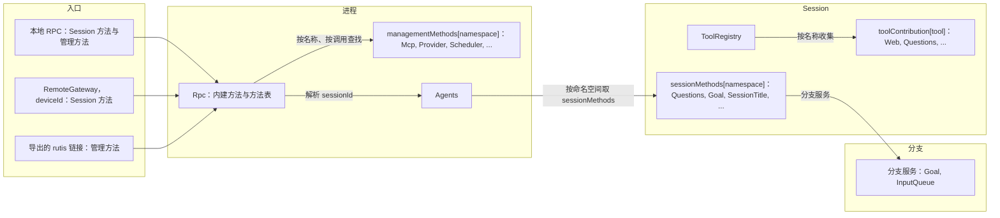
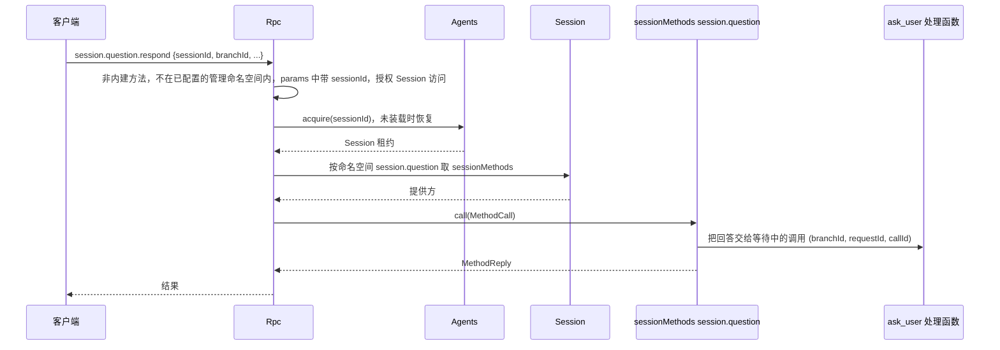
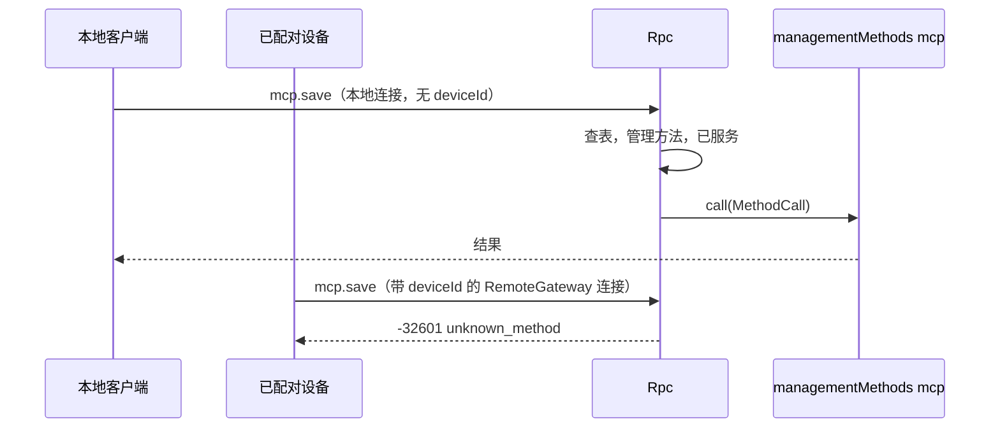

# 方法与工具贡献

状态：草案。总体设计：[总览 §3 集成](../overview.md#3-基于现有机制的集成)、[附录 B Rpc 与 ToolRegistry](../overview.md#附录-b-现有插件的补充)；规则：[ADR 002](../../adr/002-plugin-scope.md) D2、D3、D5。阶段：P0。语言：语言中立合同；Rust 绑定见[附录 F](#附录-f-rust-绑定)。[C4 绑定](../../../design/session-typescript.md) 已实现非 Rust Session 工具和方法子集；原生广播仍待定。

本合同以 ADR 002 D5 的语言中立形式定义三个具名服务。每个服务由服务名、作用域和实例 key 标识；其方法接收并返回可序列化数据；错误是数据；取消是一个协议动作。任何语言的插件都可以通过在其 `provides`（loader 行）中声明来提供它们，消费方按名称和作用域收集。它们建立在运行时已有的机制之上：按作用域收集的具名服务，以及 Rpc 现有的经 Session 分发（与如今的 `approval.respond` 相同）。实现状态：`managementMethods`（#14）、`sessionMethods`（C1）与 `toolContribution` 接入规则（C3）已通过附录 F 的 Rust 绑定实现；`callChannel` 只实现了逐次调用的 `progress`（C1）。C4 嵌入入口还从 `provides` 推导 Session 工具和命名空间，并绑定中立 DTO 子集。`callChannel` 的其余部分及通用插件安装尚未实现，`ConnectionEntry {name, deviceId}`、按 `deviceId` 路由和导出的 rutis 链接也未实现（提议在 P3 随 RemoteGateway 实现）。

| 服务 | 作用域 | Key | 提供方 | 收集方 |
| --- | --- | --- | --- | --- |
| `sessionMethods` | Session | 命名空间 | Session 级插件部分（Questions、Goal、SessionTitle、Attachments、ShellInput；Hooks 待设计）和 InputQueue（`session.input`） | Rpc，经 Session 分发 |
| `managementMethods` | 进程 | 命名空间 | 只有进程插件（Mcp、Provider、Scheduler 等；Settings 目前还没有命名空间） | Rpc，按调用查找 |
| `toolContribution` | Session | 工具名 | Session 级插件部分（Questions、Goal、Web、Scheduler、Workflow） | ToolRegistry（补充：具名工具服务） |

**管理方法**是关于宿主而不是某个 Session 的客户端 RPC 方法：`account.*`、`provider.*`、`mcp.*`、`skills.*`，以及新进程插件的方法（设置方法是后续工作，Settings 目前不发布任何方法）。`daemon.shutdown` 仍是 Rpc 内建方法，同样从不提供给已配对设备。#14 之前，Rpc 直接注入这些服务（[connection.rs](../../../../crates/dim-app-server/src/connection.rs) 中的 `ProductServices` 与 `ExecutionServices`）；#14 删除了它们，Rpc 现在通过 `managementMethods` 按调用查找这些方法，不依赖其提供方。只有进程插件提供管理方法，已配对的远程设备从不获得它们。Session 方法没有级别；唯一的区分是 `sessionMethods`（经 Session 分发）与 `managementMethods`。

提议（P3，随 RemoteGateway；未实现）：Rpc 依据连接的 `ConnectionEntry {name, deviceId}` 决定为它服务什么：本地连接获得 Session 方法和管理方法，带 `deviceId` 的连接（经 RemoteGateway 的已配对设备）从不获得管理方法，导出的 rutis 链接只在导出时获得管理方法。目前 Rpc 按现有的传输 profile 规则（A.3）为每个连接服务。没有注册表、没有端口，也没有 Management 插件。提供方是只在启用时安装的可选插件。Rpc 在每次调用时查找 `managementMethods` 提供方，不依赖它们，因此未启用、Pending、Failed 或正在重载的提供方只影响自己的命名空间（§3.2）。ToolRegistry 同样不依赖 `toolContribution` 提供方：接入哪些提供方在分支初始化首次读取 ToolRegistry 时决定，之后才激活的提供方在下次 Session 重载时接入（A.5）。#241 提议（A.5.1）：工具表跟随提供方代次，之后才激活的提供方无需重载即被采用。

在工具调用或输入提交前对其作出处理不是本合同的服务。Approval 和 Session 输入路径不变；InputQueue 的撤回是其所有者的变更（[总览附录 B](../overview.md#附录-b-现有插件的补充)）。

## 1. 结构



| 服务 | 缺失时 |
| --- | --- |
| `sessionMethods` | 该 Session 未列出此命名空间时返回 `unknown_method`；已列出但提供方未激活时，提供它的部分正在启动或重载则返回 `service_reloading`，已失败或无法运行则返回 `service_unavailable`（A.1） |
| `managementMethods` | 没有已配置的命名空间拥有该名称，或其所有者行已禁用或不存在时返回 `unknown_method`（§3.2） |
| `toolContribution` | 省略该工具，并在诊断中报告（A.5） |

本文定义的合同：这三个服务、`MethodDecl`、`MethodCall`、`MethodReply`、`MethodError`、列出方法的 `session.methods`、配套服务 `callChannel`（只实现了 `progress`）、`ToolDeclaration`、`ToolCall`、`ToolResult`、各入口获得的服务范围、命名、保留名、现有管理方法的迁移以及兼容性表。使用的合同：`SessionConfig`（[session-access](session-access.md#a3-sessionconfig-字段)）、来源输入约定（[session-access A.2](session-access.md#a2-来源输入约定)）、Rpc 命令信封以及 `appError` 码。

## 2. 数据与状态

没有任何服务拥有 Timeline 事件或持久化状态。Session 的方法表在 Session 装载时重建；管理方法提供方在每次调用时查找。装配把已配置的管理方法 `(namespace, row)` 对（`Owners`）交给 Rpc，并记录每个 Session 的已知命名空间（A.1）。提议（P3，未实现）：每个连接在被接受时记录 `ConnectionEntry {name, deviceId}`；它获得的服务范围由这条记录决定（§3.2），从不由用户身份推导。链接的管理方法导出是宿主本地的结构性配置。

## 3. 流程

### 3.1 Session 方法



命名空间按装配为该 Session 记录的命名空间中的最长前缀解析（A.1）。如果该 Session 没有列出此命名空间（例如其插件未对该 Session 启用），结果为 `unknown_method`；如果已列出但提供方未激活，提供它的部分正在启动或重载时结果为 `service_reloading`，该部分已失败或无法运行时结果为 `service_unavailable`（A.1）。Session 方法没有级别：获得 Session 方法的连接获得全部 Session 方法，包括 `shell.*`。

### 3.2 管理方法



连接的入口记录是唯一的检查。获得管理方法即授予宿主管理员权限。

装配在 [lib.rs](../../../../crates/dim-app-server/src/lib.rs) 中构建一组固定的已配置 `(namespace, row)` 对并交给 Rpc；Rpc 的 `apply`（[connection.rs](../../../../crates/dim-app-server/src/connection.rs)）拒绝 loader 不认识其行的对，并用它们构建 `Owners`（[methods.rs](../../../../crates/dim-app-server/src/methods.rs)）。一个名称属于作为其前缀或与其相等的最长已配置命名空间，即使该命名空间的所有者已禁用；父命名空间从不应答它。Rpc 在每次调用时按 key 读取该命名空间的提供方（`TypeKey::keyed_dynamic::<ManagementMethods>(ns)`，附录 F），不依赖它。没有已激活的提供方时，Rpc 用 `loader.get(row)` 读取所有者行的状态：未运行且未失败的行（Pending、尚未启动，或新旧两代之间）返回可重试的 `service_reloading`；修复或重启之前无法再运行的行（Failed、Unresolved，或 Disposed：已移除且不能重启）返回不可重试的 `service_unavailable`；已禁用或不存在的行，或没有任何已配置命名空间拥有的名称，返回 `unknown_method`。Rpc、已打开的连接和其他命名空间都不受影响。提供方卸载前已受理的调用属于该提供方，由它按方法的 `interruption` 回复（A.1）：`report` 调用以 `operation_interrupted` 结束，`drain` 调用回复自己的结果，提供方的卸载等待它受理的每个调用。

## 4. 时序与冲突

| 场景 | 顺序 | 结果 | 所有者 |
| --- | --- | --- | --- |
| Session 级提供方在调用中途重载 | call < reload | `report`：`operation_interrupted`；`drain`：调用自己的结果；提供方的卸载等待每个已受理的调用（AGENTS.md 规则 8） | 提供方 |
| Session 的 Capability 重载期间调用 Session 方法 | — | `service_reloading` | Rpc |
| 提供该命名空间的 Session 部分已失败或无法运行时调用 Session 方法 | — | 该部分修复前返回 `service_unavailable`（A.1） | Rpc |
| 对未列出该命名空间的 Session 调用 Session 方法 | — | `unknown_method` | Rpc |
| 管理方法所有者重载 | — | 新一代激活前，调用其命名空间返回 `service_reloading`；处于 Failed、Unresolved 或 Disposed 的所有者返回 `service_unavailable`（§3.2）；已受理的调用属于提供方，按 `interruption` 处理；Rpc 不重载，连接保持打开 | Rpc |
| 在带 `deviceId` 的连接上调用管理方法或 `daemon.shutdown` | — | `unknown_method` | Rpc |
| 两个提供方声明同一命名空间或工具名 | 装配 | 装配失败；key 在每个作用域内唯一 | 装配 |
| Session 命名空间与已配置的管理命名空间重叠 | 装配 | 装配失败（A.1） | 装配 |
| 工具贡献提供方在 turn 期间重载 | call < reload | 在途调用失败；该提供方的工具被撤下，下一代 Active 后以新版本重新提供；ToolRegistry 与 Loop 照常运行（D3） | ToolRegistry |

完整表格：[附录 B](#附录-b-完整冲突表)。

## 5. 上下文映射

方法没有模型可见的效果。改变模型上下文的方法通过其所有者的输入或 Timeline 事实来做到，适用这些所有者的映射。`toolContribution` 与任何工具一样，只通过其声明和 `ToolResult` 到达模型。

## 6. 接口（摘要）

| 服务与方法 | 模式 | 用途 |
| --- | --- | --- |
| `sessionMethods[namespace].describe() -> MethodDecl[]` | async | Session 级方法声明 |
| `sessionMethods[namespace].call(MethodCall) -> MethodReply` | async | 执行 Session 级方法 |
| `managementMethods[namespace].describe / call` | async | 相同结构，进程作用域，管理方法；目前只以附录 F 中的 Rust 子集实现 |
| `session.methods {sessionId}`（线上方法，Rpc 内建） | async | 列出某个 Session 的方法（协议 v3） |
| `callChannel.progress / notify / closed`（Rpc） | sync / async | 逐次调用的进度（已实现，附录 F）与绑定连接的通知（未实现） |
| `toolContribution[tool].declaration() -> ToolDeclaration` | sync | 工具声明 |
| `toolContribution[tool].execute(ToolCall) -> ToolResult` | async | 工具执行 |

## 7. 安全

提议（P3，随 RemoteGateway；未实现）：连接的 `ConnectionEntry {name, deviceId}` 是其服务范围的唯一权威：本地 RPC 获得 Session 方法和管理方法，带 `deviceId` 的连接（RemoteGateway）只获得 Session 方法（已配对设备可调用所有 Session 方法，包括 `shell.*`，决定 E3），rutis 链接只在宿主本地链接配置中显式导出时才服务管理方法。Rpc 只做外部边界校验：对每个 Session 级方法校验参数格式并授权 `sessionId`，与其内建方法完全相同。功能检查（内容嗅探、大小限制、模型能力）归方法的所有者。`toolContribution` 与每个工具一样，按其声明的风险由 Approval 与 Permission 准入。没有宿主本地批准：Approval 与 Permission 只管 agent 决策引起的动作，按用户或项目配置运行的命令由该配置自己负责，启用即运行（[总览 §6.4](../overview.md#64-约定)）。原有的 `mcp.approve`/`mcp.revoke` 已删除（A.4）。

## 8. 规则检查

| 规则 | 本文如何遵守 |
| --- | --- |
| §4 第 1 条（指令事件） | 不适用：这些服务自身不写 Timeline 事件；改变分支状态的方法调用状态所有者，由所有者写入（例如 InputQueue 为 `session.input.withdraw` 写入的 `input/deleted`）。 |
| §4 第 2 条（交接） | 不适用：方法与工具贡献不交接任何对象；工具调用按现有 `step/tool-call` 合同交给 ToolExecutor。 |
| §4 第 3 条（只用 before 回调） | Rpc 只校验参数格式和 `sessionId` 授权；功能检查归方法所有者，提交前的处理只用 Timeline before 回调。 |
| §4 第 4 条（核心不带业务含义） | Rpc 与 ToolRegistry 按名称收集服务，从不点名提供方，也不解释方法。 |
| §4 第 5 条（批次） | 不适用：本文没有依据 Timeline 事件做的决定；所有者依据自己的事实决定。 |
| §4 第 6 条（模型上下文） | 方法对模型不可见，`toolContribution` 只通过其声明和 `ToolResult` 到达模型（§5）。 |
| §4 第 7 条（公开事件与服务） | 提供方只通过分支的公开服务到达分支，Rpc 只经 Session 的 `sessionMethods` 分发。 |
| §4 第 8 条（需求） | 按名称对 Session 服务做带 key 的读取在 §9.1 提出；卸载时等待 drain、列出已激活提供方已撤回（rutis 是外部依赖）。 |
| §4 第 9 条（只有决定用的事实进 Timeline） | 方法表与入口服务范围是装配数据，从不是 Timeline 事实（§2）。 |
| §1（Capability 与 App Server 边界） | Rpc 只收集和分发；每个方法的业务代码在其提供方插件中。 |
| ADR 002 D1 | `sessionMethods` 与 `toolContribution` 是 Session 级，`managementMethods` 是进程级，与其所有者一致。 |
| ADR 002 D2 | 没有注册表、端口或 Management 插件；Rpc 与 ToolRegistry 按名称收集。 |
| ADR 002 D3 | 提供方只依赖自身或外层作用域。ToolRegistry 提供当前已激活的 `toolContribution` 提供方，跟随其激活与退役，不依赖它们（A.5）；Rpc 既不依赖管理方法提供方（§3.2），也不依赖 Session 方法提供方（A.1），因此它们的重载只影响自己的命名空间。 |
| ADR 002 D4 | 链接的管理方法导出是宿主本地的结构性配置；本文不定义业务配置。 |
| ADR 002 D5 | 每个服务都有名称、作用域、key 和纯数据方法；Rust 类型只出现在附录 F。已实现的 `managementMethods` Rust 绑定是一个子集，尚未满足 D5（附录 F）。 |

## 9. 向机制所有者提出的需求

### 9.1 按名称查找带 key 的 Session 服务

| 项 | 内容 |
| --- | --- |
| 被什么挡住 | Rpc 分发 Session 方法时不能点名提供方（§4 第 4 条、ADR 002 D2 与 D5）；Session 门面目前只返回不带名称的类型化服务。 |
| 考虑过的现有机制 | `Session::session_service::<T>()` 每种类型只读取一个不带名称的服务，无法做到每个命名空间一个服务。`SessionScope::named_key` 能构造所需的 key，但只有 Session 装配内部的代码能用它读取。列举提供方的 Session 服务：属于接线模块（D2）。 |
| 需要的通用能力 | Session 门面上一个通用的按名称带 key 读取，例如 `Session::session_named_service::<T>(name)`，基于 `SessionScope::named_key::<T>(name)`，key 缺失时返回与 `session_service` 相同的 `Reloading` 错误。区分不存在的命名空间与正在重载的命名空间，用的是装配记录的已知命名空间（A.1），而不是这个读取。 |
| 对序号、批次、中断、重载的影响 | 对序号与批次无影响；Session 重载期间读取失败，对已列出的命名空间 Rpc 按提供它的行作答（A.1）。 |
| 由谁实现、对应 issue | 运行时（Session 门面）；已在 C1（#47）中实现。 |

### 9.2 卸载时等待 `drain` 调用

已撤回：rutis 是外部依赖，不向它提需求。Rpc 卸载前本来就会等它已接受的命令处理完。

### 9.3 列出进程级服务的已激活提供方

已撤回：rutis 是外部依赖，不向它提需求。Rpc 用 rutis 现有的能力（按 key 读取、已配置的 `Owners` 和 `loader.get(row)`，§3.2）分发管理方法；`hello.features` 怎么列出它们，是 Rpc 自己的设计。

### 9.4 Session 门面上的 Session 作用域

| 项 | 内容 |
| --- | --- |
| 被什么挡住 | 已列出的 Session 命名空间的提供方未激活时，Rpc 按提供它的行在该 Session 实例中的副本作答（A.1）。Rpc 手里只有 `Session` 句柄，它不说明自己的行运行在哪个实例中。 |
| 考虑过的现有机制 | `Session::diagnostics` 每次这样的调用都要遍历 Session 的插件树。由一个 Session 部分把自己的作用域作为公开服务提供，会给每个 Session 增加一个部分，只为重新发布门面已经持有的信息。 |
| 需要的通用能力 | `Session::scope()`，读取插件工厂本来就会拿到的 `SessionScope`。其下的 key 只能在该 Session 内部读取（rutis 拒绝在实例之外读取实例 key），因此它不会开放 `PublicService` 之外的任何服务。 |
| 对序号、批次、中断、重载的影响 | 无。Session 作用域插件拒绝重载，因此 Session 装载期间作用域不变；对已关闭的 Session，读取像其他门面读取一样以 `Closed` 失败。 |
| 由谁实现、对应 issue | 运行时（Session 门面）；为 [#207](https://github.com/arcships/dim/issues/207) 实现。 |

外来 Session 服务的已实现子集见 [C4](../../../design/session-typescript.md)；通用插件安装仍由其所有者推进。

## 附录 A. 接口细节

结构为 camelCase 字段的 JSON；字段名后的 `?` 表示可选，`|` 分隔备选项。这些结构是规范形式：插件文档使用这些字段名（Rust 绑定把它们映射为 snake_case）。每个错误都是 `MethodError` 数据。

### A.1 方法贡献

`sessionMethods`（Session，key 为命名空间）与 `managementMethods`（进程，key 为命名空间）具有相同的两个方法。C4 已实现附录 F 所述的 Session 子集；管理方法通过进程行绑定复用原生调用所有者。

| 方法 | 模式 | 请求 | 回复 |
| --- | --- | --- | --- |
| `describe` | async | — | `MethodDecl[]` |
| `call` | async | `MethodCall` | `MethodReply`，或 `MethodError` |

```text
// MethodDecl
{ "name": "session.goal.set",          // 命名空间内的完整线上名称
  "mutating": true,
  "interruption": "report" | "drain",  // 卸载时由提供方回复：report → operation_interrupted；drain → 调用自己的结果
  "progress": false,
  "notifications": ["session.goal.changed"], // 位于命名空间内
  "reply": "direct" | "handoff" }      // handoff：daemon.shutdown
// MethodCall
{ "callId": "string", "method": "session.goal.set",
  "params": {},                        // 原样传入；Session 方法的 sessionId（以及 branchId）留在这里
  "origin": { "entry?": { "name": "string", "deviceId?": "string" }, // 连接的 ConnectionEntry
              "connectionId?": "string", "peer?": "string" } } // peer：rutis 链接；仅用于诊断
// MethodReply
{ "kind": "value", "value": {} } | { "kind": "handedOff" }
// MethodError
{ "code": -32000, "appError": "string", "message": "string" }
```

目前已实现（附录 F）：`MethodDecl.name`、`MethodDecl.mutating`、`interruption` 与 `progress`；C4 从外来 Session 声明解码这些字段，并提供新的 `callId`。`notifications`、`reply`、`origin` 和 `handedOff` 未实现。

取消与中断：调用由提供方自己回复，不由 Rpc 回复。有两种情况会中断已受理的调用：提供方这一代卸载，以及受理该调用的 Rpc 装载卸载。任一发生时，处理函数的取消令牌都会触发，`drain` 调用也不例外。随后 `report` 调用立即回复 `operation_interrupted`（操作可能已经提交），之后再结算；`drain` 调用回复自己的结果。提供方的卸载等待它受理的每个调用，包括 `report` 调用。调用方断开不会取消任何东西。

| 规则 | 内容 |
| --- | --- |
| 命名空间 | `<segment>(.<segment>)*`，段为 `[a-z][a-z0-9_]*`，最多 128 字节，由提供方拥有；命名空间本身可以是一个方法（`session.rename`）。不符合该语法的名称不做任何查找，直接为 `unknown_method` |
| 所有权 | 管理方法名称属于作为其前缀或与其相等的最长已配置管理命名空间（`Owners`），即使该命名空间的所有者已禁用。Session 方法名称属于该 Session 列出的最长命名空间 |
| 保留名 | 分两部分。精确内建名：`is_builtin_method` 接受的每个名称（[protocol.rs](../../../../crates/dim-app-server/src/protocol.rs)）；贡献的命名空间、命名空间的任何前缀以及声明的方法都不能等于其中之一，精确内建名也不能落在贡献的命名空间之内。对管理命名空间，最后这一条目前成立只是因为每个精确内建名都位于某个保留根之下；`provide` 并不检查它。Session 命名空间可以位于 `session` 之下，Rpc 在装载时检查这一条（例如 `session.mcp` 是精确内建名，因此 Session 命名空间 `session.mcp` 或包含它的命名空间会被拒绝）。保留根：`hello`、`daemon`、`agent`、`approval` 和 `session`；管理命名空间不能位于其中任何一个之内（`ManagementMethods::provide` 会拒绝）。Session 命名空间可以位于 `session` 之下（`session.goal`、`session.input`），但不能是单独的 `session` 根。`session.input` 不保留：InputQueue 通过 `sessionMethods` 提供 `session.input.withdraw`（提议中），因此 Rpc 不点名任何所属服务 |
| 优先级与路由 | 内建方法；否则已配置的管理命名空间；否则，仅限协议 v3+ 且仅当连接的入口获得 Session 方法时，装配时记录的 Session 命名空间（见已知命名空间）；否则 `unknown_method`。共用一个线上名称空间 |
| 命名空间冲突 | Session 命名空间与已配置的管理命名空间相等、包含它或位于它之内时，装配失败，因此没有名称会同时有管理所有者和 Session 所有者 |
| Session 级调用 | 既不是内建方法、也不在已配置管理命名空间内，且位于装配时记录的某个 Session 命名空间之内的名称，是 Session 方法候选；其他名称无论 params 如何都是 `unknown_method`，与[管理方法](../../../design/appserver/management-methods.md)一致。Rpc 从候选的原始 params 读取 `sessionId`；缺少时结果为 `-32602`。Rpc 对其授权，并通过 `index.acquire` 获取该 Session，未装载的 Session 会被恢复（不同于 `approval.respond`：对未装载的 Session 它返回 `session_closed`）。然后 Rpc 解析该 Session 列出的最长命名空间：没有 → `unknown_method`；已列出但未激活 → 读取提供它的行在本 Session 中的副本状态，按管理方法所有者的对照表作答（§3.2）：该副本尚未启动、处于 Pending、Loading 或新旧两代之间时返回 `service_reloading`，处于 Failed、Unresolved、Disposed 或 Stopped 时返回 `service_unavailable`；装配没有为该命名空间记录行，或副本已随 Session 实例离开时，返回 `service_reloading`。Rpc 一直持有该 Session 的使用权，直到调用的操作结算。`sessionId` 与 `branchId` 留在 `params` 中；Rpc 读取 `sessionId` 只为授权和解析。提供方通过该分支的服务到达某个分支。不可能属于任何 Session 命名空间的名称，既不读取 params，也不恢复 Session |
| 调用归属 | Session 级提供方这一代拥有它受理的调用，与 `ManagementMethods` 相同：由它回复，它的卸载按 `interruption` 中断这些调用并等待它们（见上文取消与中断） |
| 已知命名空间 | 运行时的 `Session::session_service` 对任何缺失的 key 都返回 `Reloading`，因此单靠读取分不清不存在的命名空间与正在重载的命名空间。装配用 `AgentBuilder::session_methods(ns)` 记录每个 Session 的已知命名空间，作为 `Owners` 的对应物：不在列表中的命名空间 → `unknown_method`；在列表中但提供方未激活 → 按提供它的行作答（见上文 Session 级调用）。装配还为 TypeScript Session 部分在 `RowSchema.provides` 中声明的每个命名空间记录其行，Rpc 通过 `Session::scope`（§9.4）在该 Session 的实例中找到这一行的副本。构建器注册的 Rust Session 部分没有记录行：它们都必须在其 Session 发布前激活。Rpc 拿到的是整个装配记录的命名空间，因此在读取任何 Session 之前，它们也决定一个名称是否为 Session 方法候选（见上文 Session 级调用）。进程中的每个 Agent 都由这同一个装配构建，因此每个 Session 都列出每个已记录的命名空间，提供方必须在每个 Session 中提供它记录的命名空间 |
| 共享类型 | `MethodDecl`、`Interruption`、`Handler`、`Progress` 与 `RpcError`，连同两个服务共用的调用受理逻辑，位于 dim-agent-capabilities 的 `methods` 模块，因为那里的 Session Capability 不能依赖 dim-app-server。它们与 Session 级对应物 `SessionMethods` 放在一起（附录 F），如同 `ToolContribution` 与同样接收 `CancellationToken` 的 `ToolHandler` 和 ToolRegistry 放在一起。不放在 dim-agent-types：它只允许依赖 serde 与 serde_json（`xtask check`；[架构](../../../architecture/README.md)：不依赖 Tokio 或 rutis），而 `Handler` 接收 tokio-util 的 `CancellationToken` 并返回 rutis 的 `BoxFuture`；并且 `RpcError` 放在那里时，`From<AgentError> for RpcError` 只能在 dim-agent-runtime 中实现（孤儿规则）。放在 dim-agent-capabilities 时，这个转换与 `RpcError` 放在一起，Rpc 与 Session 提供方仍可对运行时错误使用 `?` |
| 不分发 | 没有已配置命名空间拥有该名称且它不是 Session 方法候选、所有者行已禁用或不存在、该 Session 未列出此命名空间、提供方未声明该名称、在带 `deviceId` 的连接或未导出的链接上调用管理方法，或 v1/v2 → `-32601 unknown_method`。Session 正在重载、已列出的 Session 命名空间的提供方未激活且提供它的行未记录或未失败，或管理方法所有者行未运行且未失败（Pending、尚未启动，或新旧两代之间）→ `-32000 service_reloading`（可重试）。管理方法所有者行，或提供已列出 Session 命名空间的行的副本，处于 Failed、Unresolved 或 Disposed（副本还包括 Stopped）→ `-32000 service_unavailable`（不可重试）。已开始的 `report` 调用被中断 → `operation_interrupted` |
| `hello.features`（v3） | 内建方法；连接获得管理方法时（本地 v3），再加上已配置命名空间中已激活提供方的方法，每个方法只列在拥有它的命名空间下。从 loader 行的 `provides` 发现命名空间是后续工作（[ADR 004](../../../adr/004-loader-plugin-management.md)）。Session 级方法不在这里列出，由 `session.methods` 按 Session 列出 |
| `session.methods` | 公开接口，Rpc 内建方法，与它列出的方法一样仅限协议 v3：`session.methods {sessionId}` → `{ "methods": [ { "name": "string", "mutating": true } ] }`，即该 Session 列出且提供方已激活的命名空间所声明的方法。它与其他 Session 级内建方法一样授权和解析（未装载的 Session 会被恢复），每个方法只列在拥有它的命名空间下并按名称排序，并增加一个精确内建名。在提供 Session 操作的连接上，v3 的 `hello.features` 列出它 |
| 就绪闩 | 原生绑定在首个 `hello` 前等待必需进程提供方；[TS 进程绑定](../../../design/process-typescript.md#21-startup-and-availability) 不把可选扩展行纳入宿主启动/重启就绪条件。`hello.features` 只列出调用时 Active 的可选提供方，后来启动的在下次 `hello` 出现。 |

连接的入口接纳调用后，Rpc 如何路由：

```text
调用
  |
  内建方法？ ---------------------------------- 是 --> 内建处理
  | 否
  在已配置的管理命名空间内？ ------------------- 是 --> managementMethods（§3.2）
  | 否
  v3+、入口获得 Session 方法，且位于装配时
  记录的某个 Session 命名空间内？ -------------- 否 --> -32601 unknown_method
  | 是
  params 中有 sessionId？ ---------------------- 否 --> -32602
  | 是
  授权；index.acquire（恢复未装载的 Session）
  |
  该 Session 列出的最长命名空间？ -------------- 没有 -> -32601 unknown_method
  |
  Session::session_named_service（§9.1） ------- 未激活 -> 提供它的行在本 Session 中的副本状态（§3.2）：
  |                                                 启动中、重载中或未记录行
  |                                                   -> -32000 service_reloading
  |                                                 Failed、Unresolved、Disposed 或 Stopped
  |                                                   -> -32000 service_unavailable
  |
  SessionMethods 调用 --> 回复（未声明的名称：-32601 unknown_method）
```

已知的 Session 级命名空间：`session.question`（Questions）、`session.goal`（Goal）、`session.rename`（SessionTitle）、`session.input`（InputQueue）、`attachment`（Attachments）、`shell`（ShellInput）；`hooks`（Hooks）待设计。各插件文档对其方法具有权威性。

### A.2 调用通道

只实现了 `progress`（C1）；`notify`、`closed` 与 `takeFinalReply` 未实现。Rpc 向方法提供方提供进程服务 `callChannel`；`progress` 的 Rust 绑定是处理函数按调用获得的 `Progress`（附录 F）。

| 方法 | 模式 | 请求 | 回复 |
| --- | --- | --- | --- |
| `progress` | sync | `{callId, data}` | —（除非方法声明了 `progress`，否则丢弃） |
| `notify` | async | `{connectionId, method, params}` | `{}`，或错误 `unsupported`（链接）、`undeclared`、`gone` |
| `closed` | async | `{connectionId}` | 连接关闭时完成 |
| `takeFinalReply` | async | `{callId}` | 最终回复写出后返回 `{}`；仅限 `handoff` 方法 |

进度对 Session 方法和管理方法都以通知 `management.progress {id, method, data}` 发送，排在响应之前，尽力送达（见下文），断开后丢弃。通知名必须声明且位于命名空间内。`connectionId` 在连接关闭前对 `notify` 一直有效。

一次调用的进度如何到达调用方：

```text
Client A               Rpc                        call admission              provider handler
  | x.run {..} id 7 -->|                              |                            |
  |                    |-- accept(.., sink of A) ---->|-- handler(.., progress) -->|
  |                    |                              |    (sink only if declared) |
  |<-- management.progress {id: 7, method: "x.run", data} ------- progress.send -->|
  |                    |                              |<-- result -----------------|
  |                    |                              | close progress, then reply |
  |<-- result id 7 ----|<-- reply --------------------|                            |
  |                    |              a later progress.send is dropped             |
```

只有发起调用的连接收到进度；该 Session 的其他客户端收不到。A 断开后它的发送端已关闭，进度与回复都被丢弃，调用继续执行。

进度尽力送达：客户端读得太慢，或单条进度过大，发起调用的连接收不下这条进度时，它被丢弃，连接保持。回复不受影响，并且总排在所有已送达的进度之后。回复和持久通知跟不上的客户端，仍像任何慢消费者一样被断开。进度应当小，每条单独有意义；调用方必须拿到的内容放在回复里。

```text
                    发起调用连接的发送队列
progress.send --> 进度额度 ----------------------+
                  已满，或单条过大：             |
                  丢弃，连接保持                 +--> 同一个 FIFO 队列 --> 客户端 A
reply ----------> 回复与通知额度 ----------------+
                  已满：慢消费者，关闭连接
```

### A.3 入口与导出

| 入口 | 获得的服务 | 说明 |
| --- | --- | --- |
| 本地受保护传输 | Session 方法与管理方法 | 如今的受保护 profile 规则不变 |
| 裸 WebSocket，受保护 profile | 与如今相同 | 除 `hello`/`daemon.ping` 外都是 `local_transport_required` |
| RemoteGateway（设置了 `deviceId`） | 只有 Session 方法 | 提议（P3，未实现）；[RemoteGateway](../plugins/RemoteGateway.md) |
| 导出的 rutis 链接 | 管理方法 | 提议（P3，未实现）。仅在宿主本地链接配置中导出时。没有调用方接收端时，进度被丢弃，`notify` 返回 `unsupported` |

### A.4 迁移与兼容性

来源（#14 之前）：[protocol.rs](../../../../crates/dim-app-server/src/protocol.rs) 中的 `MANAGEMENT_METHODS`、`MCP_METHODS` 与 `Call::is_management`，已由 #14 移除；该文件中的 `LOCAL_EXECUTION_METHODS` 与 [connection.rs](../../../../crates/dim-app-server/src/connection.rs) 中的 `validate_call` 仍在。

| 方法 | 去向 | 提供方（命名空间） |
| --- | --- | --- |
| `account.providers/status/recover/logout`、`account.login.*` | `managementMethods` | ManagedProviders（`account`） |
| `account.codex.*`、`account.grok.*` | `managementMethods` | OpenAI Codex OAuth（`account.codex`）、Grok OAuth（`account.grok`） |
| `provider.*` | `managementMethods` | Provider（`provider`） |
| `skills.catalog/set_enabled/refresh` | `managementMethods` | SkillsCatalog（`skills`） |
| `mcp.catalog/set_enabled/save/remove/disconnect`、`mcp.auth.start/complete/logout` | `managementMethods` | Mcp（`mcp`） |
| `mcp.approve/revoke` | 已删除，返回 `unknown_method`（没有宿主本地批准；启用即运行；项目条目默认关闭；[ADR 003](../../../adr/003-approval-scope.md)） | — |
| `daemon.shutdown` | Rpc 内建方法，回复 handoff；从不提供给带 `deviceId` 的连接 | — |
| `hello`、`daemon.ping`、`agent.*`、现有 `session.*`、`approval.respond` | Rpc 内建方法 | — |
| 新的 `session.input.withdraw` | `sessionMethods` | InputQueue（`session.input`） |
| 新的 Session 方法 | `sessionMethods` | 各所有者（A.1） |

中断行为与如今一致：`mcp.*` 与 `skills.*` 为 `report`，`account.*` 与 `provider.*` 为 `drain`。Rpc 的 `When<ProductServices>` 与 `When<ExecutionServices>` 已由 #14 删除，没有改用收集：Rpc 按调用查找 `managementMethods`（§3.2），不再点名或依赖任何所属服务。读取管理服务的内建方法（`session.create` 与 `session.model.update` 的模型选择、`session.mcp` 读取的 Mcp）每次调用时读取，服务未激活时返回可重试的错误（[管理方法](../../../design/appserver/management-methods.md)）。

| 客户端 | 之前 | 之后 |
| --- | --- | --- |
| v1、v2 | 管理方法 `unknown_method` | 相同 |
| v3 本地，product profile | `hello.features` 含 33 个 product 名称 | 名称相同；参数、结果、错误码和 `appError` 不变 |
| v3 本地，execution | `LOCAL_EXECUTION_METHODS` + `MCP_METHODS` | 名称相同 |
| v3 裸 WebSocket，受保护 profile | `local_transport_required` | 相同 |
| v3 RemoteGateway（新） | 不存在；execution Session 方法（`session.permission.get/update`、`session.exec.stop`、`session.skills`、`session.model.update`、`session.prompt.refresh`、`session.mcp`、`session.mcp.refresh`）仅限本地 | **兼容性变更（E3）：** 对已配对设备可用；管理名称 `unknown_method` |
| v3，MCP 已禁用 | `mcp.*` `unknown_method` | 相同，使用 Rpc 的消息 |
| v3，Mcp 正在重载 | `service_reloading` | 不变：Mcp 重新激活前 `mcp.*` 返回 `service_reloading`；Rpc 不重载，连接保持打开 |

不增加协议版本，持久化格式不变。

### A.5 工具贡献

ToolRegistry 接受具名工具服务，不硬依赖其提供方（C3，ADR 002 D3，#34）。固定表只含配置的宿主工具。每个配置的贡献工具是注册表自有的带版本集合，键为 `contributed:<tool>`（#241）：提供方 Active 时提供；提供方缺失或其代次正在卸载时撤下；新一代 Active 后以从不复用的新版本替换。注册表在分支 ToolBinding 初始化首次读取时读取贡献方（它在自身 apply 期间不能读取未声明的服务），之后每当有提供方进入或离开 Active、或服务绑定变化时，在自己的任务中再次读取。尚未激活的贡献方被省略并记录诊断；它 Active 之后的下一个请求起即被提供，不需要重载 Session。必需依赖的等待规则不变，可选提供方仍不阻塞 Session 就绪（#132）。

ToolBinding 沿既有 Prompt / BranchOpening 流程完成匹配与必要的采用，随后 Session 才接受输入。已有模型配置的分支在工具部分不匹配时使用 `Prompt::adopt_tools`；配置不含工具部分的分支在每个请求经 PrepareModelHost / `bind_current` 声明并绑定注册表当前的宿主与贡献工具，因此贡献工具的变化在这里无需采用。不新增 core 就绪阶段。来源变化，包括带工具部分的配置中的贡献工具，沿既有注册表通知和 Prompt 采用路径传播（带 `tool_sources` 的 `context/configured`），请求保留其前缀选定的处理器。在 #4 提供基于 `provides` 的登记之前，工具名来自宿主侧 `AgentBuilder::session_tool`。名称唯一性、与宿主工具冲突以及通过 `SessionConfig.tools` 启用的规则不变（[工具贡献](../../../architecture/rust-agent/tool-contributions.md)）。

| 方法 | 模式 | 请求 | 回复 |
| --- | --- | --- | --- |
| `declaration` | sync | — | `ToolDeclaration` |
| `execute` | async | `ToolCall` | `ToolResult` |

```text
// ToolDeclaration
{ "name": "web_fetch",           // 等于 key
  "description": "string",
  "inputSchema": { /* JSON Schema */ },
  "source": "static" | "builtin" | "extension" | "dynamic", // 必填，ToolDefinition 要求它
  "risk": "network" }            // Permission 类别；新工具必填
// ToolCall
{ "sessionId": "string", "branchId": "string", "turnId": "string", "callId": "string",
  "arguments": {}, "config": { /* SessionConfig 数据 */ } }
// ToolResult
{ "content": [ { "type": "text", "text": "..." } | { "type": "image", "...": "..." } ],
  "structuredContent?": {}, "isError": false }
```

取消：turn 中断时针对 `callId` 发送取消请求（或丢弃调用）；ToolExecutor 把该调用按中断结算。提供方错误以 `isError: true` 的 `ToolResult` 返回。声明可以取决于该 Session 的配置。ToolRegistry 在接入某个提供方代次时读取：分支初始化时 ToolBinding 的首次读取，或该代次之后 Active 时；下一个请求即提供，不需要重载 Session（A.5）。

### A.5.1 提议：工具表跟随提供方代次（#241）

状态：为 [#241](https://github.com/arcships/dim/issues/241) 提议；未实现。在被接受之前，上面的 A.5、[Session TypeScript](../../../design/session-typescript.md#tools) 与 [进程 TypeScript §5.1](../../../design/process-typescript.md#51-p6p7-access-through-declared-feature-dependencies) 仍是已实现的合同。

**问题。** A.5 只在分支初始化首次读取 ToolRegistry 时对可选 `toolContribution` 提供方取样一次。稍晚一点才 Active 的提供方（即使早于 Session 发布）在这次 Session 装载期间一直缺席；退出后又回来的提供方（#237 接受的 C3 代次可用性下的所有者重载）要等 Session 重载才可用，而 Session 没有单独的重载路径。可选行不能阻塞就绪（ADR 002 D3、#132），所以任何等待都消除不了这个竞争：#223 在 CI 中用 Goal 复现过，`goal_update` 在那个 Session 中从未被声明。

**决定。** 启动、重载与退出遵循同一条规则：

> Session 的工具表是提供方当前处于 Active 的已配置工具。每当某个提供方代次进入或离开 Active，ToolRegistry 重新求值。每个分支经 Prompt 把每次变化采用为一条 `context/configured` 事实，与现在采用动态工具来源完全相同。每个模型请求在绑定时按其前缀采用的工具部分固定。

Session 生命周期中没有哪个时点固定工具表。分支初始化、就绪、发布和首个请求都不特殊：首次读取只是规则的第一次求值，唯一被固定的是单个请求的声明与处理器，而这正是现有 ToolBinding 快照已经做的事。

#### 备选方案

| 固定时点 | 不采用的原因 |
| --- | --- |
| 分支初始化（A.5 现状，测试等待该行） | 生产环境的竞争仍在；退出的提供方需要一次无人能触发的 Session 重载。 |
| 就绪（可选行阻塞就绪直到 Active 或 Failed） | 违反 ADR 002 D3 与 #132：因缺失依赖而 Pending 的行会阻塞原生使用或超时。也不覆盖之后的重载与退出。 |
| 发布（发布时再取样一次） | 仍是一次性快照：发布后才启动或重载的提供方同样需要重载，还为工具问题增加了一个 core 阶段。 |
| 首个模型请求（延迟取样） | 只是移动了竞争：首个请求的工具取决于调度，之后的代次仍需重载。 |
| 每个请求直接读注册表，不采用 | 模型可见的声明会在没有 Timeline 事实的情况下变化（§4 规则 6、AGENTS.md 规则 10）；历史回放以及 ToolBinding 对来源保证的声明与处理器配对都会被破坏。 |
| 把每个贡献变成带版本的 `SessionToolSource` 集合 | 可行，但会改变声明顺序（提示缓存抖动），把每个固定工具加入 `tool_sources`，并重复按名绑定已经提供的东西：贡献的声明由结构装配与 Session 不可变配置决定，同一工具的各代声明相同。 |
| **跟随提供方代次，经既有路径采用（推荐）** | 用一条规则消除启动与重载的竞争；复用 ToolRegistry 的 `tools.changed`、ToolBinding 采用、Prompt 串行队列与请求快照；没有任何等待。 |

#### ToolRegistry

| 项 | 规则 |
| --- | --- |
| 宿主工具 | 不变：每代注册表固定（`ToolHost` 是真实依赖）。 |
| 已配置贡献 | 对 `SessionConfig.tools` 中每个已登记的贡献名，执行首次读取已经在做的查找：原生 `ToolContribution` 键，否则外部 `toolContribution:<name>` 服务及其行的代次令牌。找到即表示该提供方代次 Active。 |
| 触发 | 注册表在首次读取前订阅现有 rutis `FiberStatusChanged`（进程总线，App Server 的 MCP 可用性跟随者在 [connection/mcp.rs](../../../../crates/dim-app-server/src/connection/mcp.rs) 中就是这样做的），在每次进入或离开 Active 的迁移时重新求值。绑定只在其提供方 Active 后可见、离开 Active 时不再可见，因此这些迁移覆盖了每次变化。贡献方不通知注册表，也不注入它。 |
| 求值 | 与现有来源刷新共用串行锁（`refreshing`）。逐个名称比较找到的代次标识（原生 `ToolContribution` 的 `Arc`，或外部行的代次令牌）与已持有的标识。相同：不做任何事。新代次：读取一次声明（既有的同步原生读取或外部解码）并持有。未找到：该工具离开声明。格式错误的外部声明只省略该工具，并记录既有的 `invalid-declaration` 诊断。Session 范围内不变：名称唯一、与宿主工具冲突、`SessionConfig.tools` 启用与顺序。 |
| 声明 | `definitions()`/`snapshot()` 列出宿主工具与当前找到的贡献（按 `SessionConfig.tools` 顺序），之后照旧是来源工具。 |
| 按名绑定 | `fixed(name)` 返回该名称最后接入的代次，无论当前是否找到。前缀仍声明刚退出的工具的请求因此绑定到已退出的处理器，调用以工具错误被拒（既有的退出代次保护），而不是让 turn 失败。更新的代次会替换它。 |
| 通知 | 声明集合变化时注册表发出既有的 `tools.changed`；没有变化的求值不发任何通知。已配置贡献在首次求值时缺席、或每次离开时，记录一次 `unavailable:<name>`；之后仍缺席的求值不再重复记录。 |

#### 分支与请求

ToolBinding 不变。它在 `apply` 与 BranchOpening 中的 `reconcile` 已经把完整声明列表（宿主、固定与来源工具）与前缀已采用的工具部分比较；它的 `tools.changed` 任务在 `activated()` 之后运行并保留更早的唤醒，已经会经 `Prompt::adopt_tools` 采用任何差异。Loop 的 `bind` 按前缀固定每个请求；ToolExecutor 只读该快照。没有已采用模型配置的分支保留既有的 `bind_current` 路径，每个请求声明注册表当前的表。

```text
provider row Active ──FiberStatusChanged──> ToolRegistry re-evaluates
    ──tools.changed──> each branch's ToolBinding (after activated())
    ──Prompt::adopt_tools──> context/configured {tools}
Loop.start_preparation(through) ──> bind(prefix tool part) ──> request snapshot
```

#### 时序

| 场景 | 顺序 | 结果 |
| --- | --- | --- |
| 提供方在首次读取前 Active | Active < 首次读取 | 进入初始表；创建或恢复后的首个请求声明它（A.5 验收不变）。 |
| 提供方在首次读取后 Active（发布前或发布后） | 首次读取 < Active | 在分支 `activated()` 之后采用；前缀包含该采用事实的每个请求都声明它。更早准备的请求不声明。不需要 Session 重载。 |
| 提供方 Pending、Failed 或未启用 | — | 从不声明；Session 不受影响（D3）。未启用的行仍是已知名称，与现在相同。 |
| 提供方退出（行卸载、所有者重载传播到它） | 退出 < 采用 | 下一次采用移除该工具。在采用之前绑定的请求得到已退出的处理器：调用以退出代次错误失败。在途调用照旧经其代次结算。 |
| 替换代次 Active | 退出 < Active | 重新接入并采用；之后的请求到达新代次。已接受的工作从不转移给它。 |
| 两次迁移相距很近 | — | 每次求值在刷新锁下读当前状态；最后一次为准；只有声明不同时才写采用事实。 |
| 注册表、`ToolHost` 或 Prompt 重载 | — | 不变（[工具贡献](../../../architecture/rust-agent/tool-contributions.md) §7.6）；新注册表从当前状态开始。 |
| 恢复 | — | 与创建相同：首次求值看到当时 Active 的提供方，之后的代次按同一规则接入。 |

#### 模型与用户看到什么

| 情形 | 模型 | 用户与恢复 |
| --- | --- | --- |
| 工具缺席 | 不被声明，模型不会依赖它。按记忆的名称调用得到既有的 `Unknown tool: <name>` 工具错误。 | 提供方行的既有状态与诊断（`tool.attach`）说明原因。修复或启用提供方；一旦 Active，每个已装载 Session 的分支都会采用该工具。不需要 Session 重载。 |
| 工具出现或消失 | 声明在请求边界经 `context/configured` 事实变化，与 MCP 服务器连接或断开走同一路径。不额外注入提示输入。 | 历史中可见配置变化。 |
| 调用到达已退出的代次 | 工具错误结果；文本从“直到 Session 重载”改为：`tool provider generation is unloading; this tool is unavailable until its provider is active again, and it will be declared again then. Retrying now will not help.` | 恢复方式同上。 |
| 调用发出后代次退出 | `tool provider generation is unloading; this call may already have taken effect. This tool is unavailable until its provider is active again. Check the operation's state before repeating it.` | 不变：已接受的工作不会撤销或重放。 |

对 Goal（#69）而言，`goal_update` 从 Goal 的采用事实之后的首个请求起被声明；目标不再取决于 Goal 是否赢了与分支初始化的竞争。

#### 影响

| 范围 | 变化 |
| --- | --- |
| ToolRegistry（[tool_registry.rs](../../../../crates/dim-agent-capabilities/src/tool_registry.rs)） | `LazyLock` 固定表改为宿主工具加上已持有的贡献代次，由 `FiberStatusChanged` 监听器重新求值；上面两条退出代次文本。 |
| ToolBinding、Prompt、Loop、ToolExecutor | 无。 |
| 持久化 | 无：`context/configured` 已携带完整工具部分。 |
| 实现时需更新的文档 | A.5、§4、附录 F、[工具贡献](../../../architecture/rust-agent/tool-contributions.md) §1–§6、[Session TypeScript](../../../design/session-typescript.md#tools)、[进程 TypeScript §5.1](../../../design/process-typescript.md#51-p6p7-access-through-declared-feature-dependencies)（可用性代价与恢复）、Scheduler/Workflow 的可用性行。 |
| 测试 | 断言“之后才 Active 的工具在重载前一直省略”和“旧取样工具持续拒绝”的流程改为下面的验收；#223 的夹具等待仍然有效。 |

#### 验收

1. 分支初始化后（包括发布前）才 Active 的行，其工具无需 Session 重载，就在前缀包含采用事实的首个请求中被声明，并经 ToolExecutor 执行。
2. 行卸载后，之后的请求不再声明该工具；在该采用之前绑定的请求得到退出代次工具错误，而不是 turn 失败。
3. 所有者重载传播到 Session 工具行后，已有 Session 在之后的请求中到达替换代次；旧代次上已接受的调用经旧代次结算。
4. Pending、Failed 或未启用的行从不延迟创建、恢复或原生工具使用；进程中其他地方的 fiber 迁移不会写配置事实。
5. 创建与恢复后立即提交的首个请求仍声明分支初始化时已 Active 的工具。

#### 消融

- 没有就绪等待、发布钩子、重试循环或单个 Session 的重载命令：变化通知与采用路径已经存在。
- 没有新事件、服务、端口或持久化字段；ToolBinding 与 Prompt 不变。
- 贡献方不发通知：rutis 已经报告改变可见性的迁移。不需要再订阅 `ServiceChanged`，因为贡献方在 `apply` 中为整个代次提供工具。
- 求值先比较代次标识再读取声明，因此无关的 fiber 迁移只花几次按键查找，从不调用外部 `declaration()`。
- 保留每个名称最后接入的代次：正是它让与退出竞争的请求以工具错误结束而不是 turn 失败；现在的固定表本来就保留其代次。
- 把贡献改为带版本的来源已在纸面上尝试并移除（见备选方案）。

#### 规则检查

| 规则 | 应用 |
| --- | --- |
| §4 规则 1 | ToolRegistry 拥有自己的表；分支经 Prompt 既有采用修改自己的配置。提供方不写任何东西。 |
| §4 规则 2 | 交接不变；已绑定的请求保留快照，已接受的调用留在其代次。 |
| §4 规则 3 | 没有 before 回调。 |
| §4 规则 4 | 注册表响应通用的 fiber 迁移，不点名任何提供方。 |
| §4 规则 5 | 没有新批次；采用事实是 Prompt 既有的单次写入。 |
| §4 规则 6 | 声明只经已采用的 `context/configured` 事实进入模型。 |
| §4 规则 7 | 注册表按公开键读取服务，不读提供方状态。 |
| §4 规则 8 | 使用现有 rutis 事件与按键读取；基础设施不变。 |
| §4 规则 9 | 工具表是 Session 内存状态；只有后续请求要用的分支采用事实进入 Timeline。 |
| §1 | App Server 与 core 不变；ToolRegistry 仍是唯一的收集者。 |
| ADR 002 D1 | 作用域不变：Session 级注册表，分支级绑定。 |
| ADR 002 D2 | 没有接线模块或注册表服务。 |
| ADR 002 D3 | 注册表仍不依赖可选提供方；它改为在每次迁移时接入 Active 的提供方，而不只在自身装载时，D3 本就允许。 |
| ADR 002 D4 | 配置不变。 |
| ADR 002 D5 | 语言中立的 `toolContribution` 合同不变。 |

#### 向机制所有者提出的需求

无。`FiberStatusChanged`、按键读取与 Prompt 采用都已存在；不向 rutis 提任何需求。

## 附录 B. 完整冲突表

| 场景 | 序号顺序 | 结果 | 决定所有者 |
| --- | --- | --- | --- |
| 分支 `stop/interrupt` 期间的 Session 方法 | 按所有者的事实 | 由所有者决定（例如，ToolExecutor 已取消调用之后的 Questions 回答回复 `question_not_pending`） | 所属插件 |
| 对已关闭分支调用 Session 方法 | — | 所有者的 `BranchMissing` 错误 | 所属插件 |
| 对未装载 Session 调用 Session 方法 | — | Rpc 通过 `index.acquire` 恢复后再分发（不同于 `approval.respond`，它返回 `session_closed`） | Rpc |
| Session 级提供方在调用中途重载 | admitted < reload | `report`：`operation_interrupted`；`drain`：调用自己的结果；卸载等待两者 | 提供方 |
| 进程所有者重载 | — | Pending、尚未启动，或新旧两代之间：重新激活前返回 `service_reloading`；Failed、Unresolved 或 Disposed：`service_unavailable`（§3.2）；已受理的调用属于提供方，按 `interruption` 处理；Rpc 不重载 | Rpc |
| 有在途调用时 Rpc 重载 | — | 处理函数的取消令牌触发：`report` 回复 `operation_interrupted`，`drain` 回复自己的结果；Rpc 卸载时等待它应发出的回复以及每个被中断操作结算；`closed` 完成（`callChannel`，未实现） | Rpc |
| 在带 `deviceId` 的连接上调用管理方法 | — | `unknown_method` | Rpc |
| 客户端在调用中途 detach | — | 调用继续；回复被丢弃 | Rpc |
| Session 命名空间与已配置的管理命名空间重叠 | 装配 | 装配失败 | 装配 |
| 两个客户端修改同一配置 | 存储修订号 | 后者得到提供方的冲突错误 | 提供方 |
| `daemon.shutdown` 与另一调用并发 | 准入 | 停止准入，然后已准入的调用按 `interruption` 结算 | 进程协调者 |
| turn `stop/interrupt` 期间调用工具贡献 | interrupt < result | 针对 `callId` 发送取消请求；ToolExecutor 把该调用按中断结算 | ToolExecutor |
| 未结算的工具批次、压缩、切出子分支、`input/withdraw`、`input/deleted` | — | 对方法无影响 | — |
| 调用中途进程重启 | — | 回复丢失；结果取决于提供方的持久化；从不重放 | 提供方 |

## 附录 C. 错误与恢复

| 情况 | 线上结果 |
| --- | --- |
| 没有所有者（管理方法所有者行已禁用或不存在、该 Session 未列出此命名空间、提供方未声明该名称）、不向该连接提供，或 v1/v2 | `-32601`，`unknown_method` |
| Session 方法候选缺少 `sessionId` | `-32602` |
| Session 正在重载、已列出的 Session 命名空间未激活且提供它的行未记录或未失败，或管理方法所有者行未运行且未失败（Pending、尚未启动，或新旧两代之间） | `-32000`，`service_reloading`（可重试） |
| 管理方法所有者行，或提供已列出 Session 命名空间的行的副本，处于 Failed、Unresolved 或 Disposed（副本还包括 Stopped） | `-32000`，`service_unavailable`（不可重试） |
| `report` 调用被中断 | `-32000`，`operation_interrupted` |
| 提供方错误 | `-32000`，提供方的 `appError` |

## 附录 D. 验收

1. Session 级方法经其指定的 Session 分发。在未列出该命名空间的 Session 上返回 `unknown_method`，在已列出但提供方未激活的 Session 上，提供它的部分正在启动或重载时返回 `service_reloading`，该部分处于 Failed 或 Unresolved 时返回 `service_unavailable`，且 Rpc 从不点名提供方。
2. 管理方法在本地入口上可达，在 RemoteGateway 上返回 `unknown_method`，只在导出时经链接可达。`shell.*` Session 方法与所有 Session 方法一样可在 RemoteGateway 上调用。
3. 每个迁移后的管理方法的录制记录与迁移前的记录一致，且 v3 本地 profile 的 `hello.features` 不变。
4. 在 RemoteGateway 测试入口上，`session.permission.update` 与 `session.exec.stop` 成功。
5. 由非 Rust 插件以 `toolContribution` 提供的工具，会像 Rust 工具一样被声明给模型，并经 ToolExecutor 执行。`SessionConfig.tools` 中提供方缺失的工具被省略并在诊断中报告，Session 照常启动。
6. 进度先于响应；连接收不下的进度被丢弃，不关闭连接，也不丢失响应；断开后 `notify` 报告 `gone`。
7. 某个已启用的管理方法提供方处于 Pending 时，`hello` 成功，其他命名空间都正常，该提供方的命名空间返回 `service_reloading`；处于 Failed 或 Unresolved 时返回 `service_unavailable`；已禁用时返回 `unknown_method`。PluginManager 提供 `plugin.set_enabled`（未实现）之后，除非该提供方就是 PluginManager 本身，否则可以用它禁用该提供方。管理方法提供方重载既不会让 Rpc 重载，也不会关闭连接。

## 附录 E. 假设

| # | 假设 | 依据 | 若被否决的影响 |
| --- | --- | --- | --- |
| A1 | Session 级命名空间可以使用 `session` 以外的根（`attachment`、`shell`） | 现有线上名称 | 全部移到 `session.` 之下 |
| A2 | Session 能为 Rpc 按名称查找带 key 的 Session 服务 | 现有带 key 的 Session 服务；作为 §9.1 提出 | Rpc 通过一个 Session 服务枚举提供方 |
| A3 | Session 级方法按 Session 列出，而不在 `hello.features` 中 | 它们因 Session 而异 | 一个全局列表加上按 Session 的可用性 |
| A4 | Rpc 在每次调用时对已激活的提供方做带 key 的读取（`Ctx::get_as`）来分发管理方法 | 已由 #14 实现（[methods.rs](../../../../crates/dim-app-server/src/methods.rs) 中的 `Owners::dispatch`）；Mcp 也是这样读取其 loader 行服务的（[publication.rs](../../../../crates/dim-app-server/src/mcp/publication.rs)） | Rpc 依赖每一个提供方，一个未激活的提供方就会挡住全部 RPC |

## 附录 F. Rust 绑定

[TypeScript 进程绑定](../../../design/process-typescript.md)在原进程行内投影既有
`managementMethods` 子集，复用原生调用准入及结算，不改变入口准入。

上述服务映射到下列既有原生所有者。C3 随提供方变为 Active 按名称接入工具（A.5）。[C4 绑定](../../../design/session-typescript.md) 在 `host_key_in("toolContribution:<tool>", session_instance)` 和 `host_key_in("sessionMethods:<namespace>", session_instance)` 接受 Session 的 `dyn HostDispatch` 服务。ToolRegistry 对每个接入的代次只解码一次声明，并保留该代处理器。原 loader 行将中立方法 DTO 绑定到 C1 的受理、进度、Report/Drain，先结束已受理调用再清理外来行。宿主从该行的 `RowSchema.provides` 推导名称，不向 Session facade 增加任意服务查找。管理方法由进程行绑定复用同一原生调用所有者。连接通知、交接、origin 和原生 Session 广播不在已实现的 C4 子集内。

| 语言中立服务 | Rust 类型与 key | Rust 装配中的注册 | 收集 | 状态 |
| --- | --- | --- | --- | --- |
| `managementMethods[ns]` | `ManagementMethods`，进程作用域，key 为 `TypeKey::keyed_dynamic::<ManagementMethods>(ns)` | 在所有者的 `apply` 中调用 `ManagementMethods::provide(ctx, ns, Vec<MethodDecl>, Handler)`；装配把 `(ns, row)` 对加入 `Owners` | 按调用经 `Owners`：用 `Ctx::get_as` 按 key 读取，行状态来自 `loader.get(row)`；不在 Rpc 的 `Deps` 中 | 已实现（#14） |
| `sessionMethods[ns]` | `SessionMethods`，`ManagementMethods` 的 Session 级对应物，与共享类型一起位于 dim-agent-capabilities 的 `methods`（A.1），key 为 `SessionScope::named_key::<SessionMethods>(ns)` | `AgentBuilder::session_methods(ns)`，同时记录该 Session 的已知命名空间 | 每次调用：在 `sessionId` 指定、经 `index.acquire` 获取的 Session 上调用 `Session::session_named_service::<SessionMethods>(ns)`（§9.1）；不在 Rpc 的 `Deps` 中 | 已实现（C1） |
| `toolContribution[tool]` | `ToolContribution {definition, handler}`，`SessionScope::named_key::<ToolContribution>(tool)` | `AgentBuilder::session_tool(tool)`（已有） | ToolBinding 首次读取时按 key 读取，提供方变为 Active 或退役时再读；缺失或未激活的提供方被省略并记录诊断；每一代是注册表自有的带版本集合（A.5，#241） | C3 已实现 |
| `callChannel` | `progress`：处理函数的 `Progress` 参数，每次调用一个 | — | Rpc 为每个已受理调用提供一个通向发起调用连接的 sink | `progress` 已实现（C1）；`notify`、`closed`、`takeFinalReply` 未实现 |

```rust
// crates/dim-agent-capabilities/src/methods.rs（C1），两个服务共用
pub type Handler = Arc<
    dyn Fn(String, Value, CancellationToken, Progress)
        -> BoxFuture<'static, Result<Value, RpcError>> + Send + Sync,
>; // (method, params, 取消令牌, 进度)
impl Progress {
    pub fn send(&self, data: Value); // 尽力送达；未声明时、或回复交出之后丢弃
}
pub enum Interruption { Report, Drain }
pub struct MethodDecl {
    pub name: String,
    pub mutating: bool,
    #[serde(skip_serializing)]
    pub interruption: Interruption, // 外来声明必填
    #[serde(skip_serializing)]
    pub progress: bool,             // 外来声明必填
}
impl MethodProvider { // 一代提供方：声明、处理函数、已受理的调用
    pub fn new(ctx: &Ctx, namespace: &str, declarations: Vec<MethodDecl>, handler: Handler)
        -> Result<Arc<Self>, CordisError>;
    pub fn accept(&self, method: String, params: Value, entry_stopping: CancellationToken,
        progress: impl Fn(Value) + Send + Sync + 'static) -> Result<Accepted, RpcError>;
}
impl SessionMethods { // Deref<Target = MethodProvider>
    pub fn provide(ctx: &Ctx, scope: &SessionScope, namespace: &str,
        declarations: Vec<MethodDecl>, handler: Handler) -> Result<Arc<Self>, CordisError>;
}
// crates/dim-app-server/src/methods.rs（#14）
impl ManagementMethods { // Deref<Target = MethodProvider>
    pub fn provide(ctx: &Ctx, namespace: &str, declarations: Vec<MethodDecl>, handler: Handler)
        -> Result<Arc<Self>, CordisError>;
}
```

`MethodProvider::new` 拒绝无效的声明（A.1 的语法；至少一个方法，每个方法唯一且位于命名空间内），并注册卸载 effect：任一卸载时中断已受理的 `Report` 调用，并等待每个已受理调用，因此 `SessionMethods` 与 `ManagementMethods` 不会分叉。`ManagementMethods::provide` 另加 A.1 保留名检查，并以 `TypeKey::keyed_dynamic::<ManagementMethods>(namespace)` 提供服务。`SessionMethods::provide` 以 `SessionScope::named_key::<SessionMethods>(namespace)` 提供服务；Rpc 在装载时用保留名和管理命名空间检查用 `AgentBuilder::session_methods` 记录的命名空间。处理函数接收方法名、原始 params、在任一卸载时触发的取消令牌（A.1），以及该调用的 `Progress`。`RpcError`（连同它的 `From<AgentError>`）位于同一模块（A.1 共享类型）；`ManagementMethods`、它的保留名检查与 `Owners` 留在 dim-app-server。

`Progress` 按调用绑定 A.2 的 `progress`，而不是通过 `callChannel` 进程服务：Rpc 给每个已受理调用一个 sink，把 `management.progress {id, method, data}` 写到发起调用的连接；受理逻辑只在方法声明了 `progress` 时把它交给处理函数，并在交出回复之前关闭它。sink 在连接上按进度自己的额度排队，所以进度不会占用回复和持久通知的空间。管理方法走同一路径；目前没有管理方法声明 `progress`。

C4 的 Session `describe`/`call` 绑定接受上列必填声明字段、`{callId, method, params}`、取消 Promise 及逐次调用的进度回调；解码 `{kind:"value", value}` 或拥有自身字符串的 `{code, appError, message}` 错误。不支持的声明/回复字段及损坏数据在此边界失败。尚未实现：对应的外来管理方法绑定、`callChannel` 的连接通知/最终回复交接、`origin`、`notifications` 与 `reply` 声明字段。

`ToolContribution` 与 `ToolHandler` 保留原生类型。C4 在 ToolRegistry 接入其代次时解码外来同步声明，并将其异步 execute 服务包装为 `ToolHandler`。每次执行派生自己的子取消令牌，单个工具正常完成不会取消同批其他工具。
