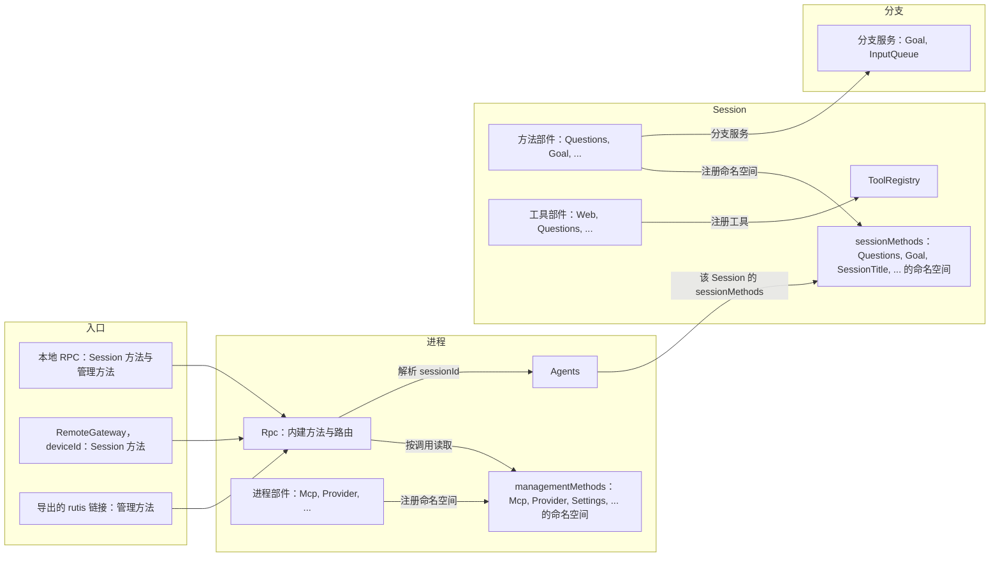
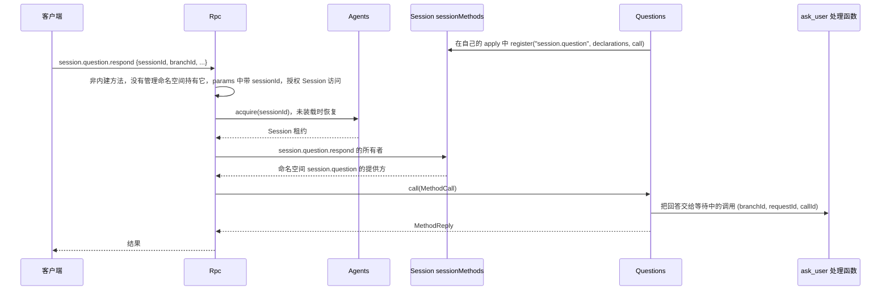
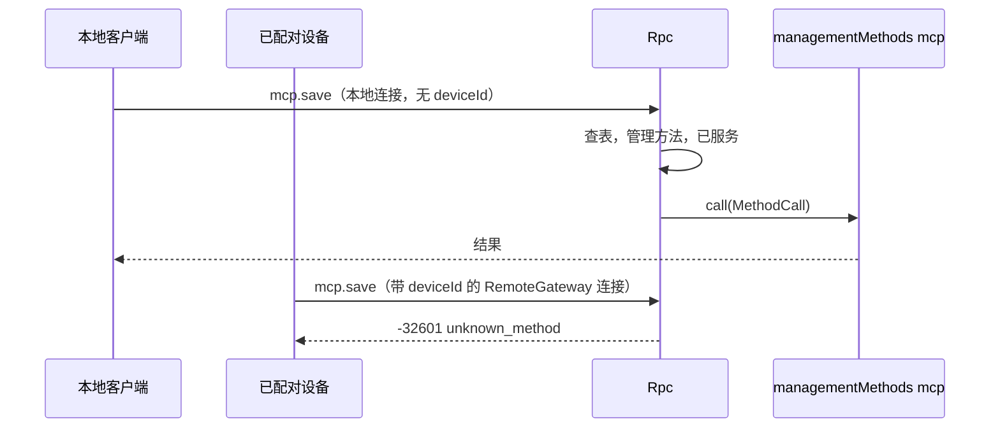

# 方法与工具贡献

状态：草案。总体设计：[总览 §3 集成](../overview.md#3-基于现有机制的集成)、[附录 B Rpc 与 ToolRegistry](../overview.md#附录-b-现有插件的补充)；规则：[ADR 002](../../adr/002-plugin-scope.md) D2、D3、D5。阶段：P0。语言：语言中立合同；Rust 绑定见[附录 F](#附录-f-rust-绑定)。[C4 绑定](../../../design/session-typescript.md) 已实现非 Rust Session 工具和方法子集；原生广播仍待定。

本合同以 ADR 002 D5 的语言中立形式定义三种注册服务：Session 的 `sessionMethods` 与 `toolRegistry`，以及进程的 `managementMethods`。每个服务由服务名和作用域标识；其方法接收并返回可序列化数据；错误是数据；取消是一个协议动作。任何语言的部件都依赖其作用域的服务，并在自己的 `apply` 中注册：方法命名空间注册到 `sessionMethods` 或 `managementMethods`，工具注册到 `toolRegistry`。注册属于发起它的部件，在该部件卸载时撤回。Rpc 在每次调用时读取这两张方法表，不依赖任何提供方。它们建立在运行时已有的机制之上：按作用域的具名服务、Rpc 现有的经 Session 分发（与如今的 `approval.respond` 相同），以及作为调用方 effect 的注册。实现状态：方法命名空间（#14、C1、#382）与工具（#382）通过附录 F 的 Rust 绑定注册，其他语言的部件通过同样的服务注册（[C4](../../../design/session-typescript.md)、[进程行](../../../design/process-typescript.md)）；`callChannel` 只实现了逐次调用的 `progress`（C1）。`callChannel` 的其余部分及通用插件安装尚未实现，`ConnectionEntry {name, deviceId}`、按 `deviceId` 路由和导出的 rutis 链接也未实现（提议在 P3 随 RemoteGateway 实现）。

| 服务 | 作用域 | 注册什么 | 注册方 | 读取方 |
| --- | --- | --- | --- | --- |
| `sessionMethods` | Session | 方法命名空间 | Session 部件（Questions、Goal、SessionTitle、Attachments、ShellInput、InputQueue 的 `session.input` 等） | Rpc，经 Session，按调用 |
| `managementMethods` | 进程 | 方法命名空间 | 只有进程部件（Mcp、Provider、SkillsCatalog、Settings 等） | Rpc，按调用 |
| `toolRegistry` | Session | 工具 | Session 部件（Questions、Goal、Web、Scheduler、Workflow），各自注册自己的工具 | ToolRegistry，`toolRegistry` 的所有者（补充：工具注册） |

**管理方法**是关于宿主而不是某个 Session 的客户端 RPC 方法：`account.*`、`provider.*`、`mcp.*`、`skills.*`、`settings.*` 与 `permission.*`，以及新进程插件的方法。`daemon.shutdown` 仍是 Rpc 内建方法，同样从不提供给已配对设备。Rpc 每次调用时在 `managementMethods` 中查找管理方法，不点名任何所属服务（A.4）。只有进程部件注册管理方法，已配对的远程设备从不获得它们。Session 方法没有级别；唯一的区分是 `sessionMethods`（经 Session 分发）与 `managementMethods`。

提议（P3，随 RemoteGateway；未实现）：Rpc 依据连接的 `ConnectionEntry {name, deviceId}` 决定为它服务什么：本地连接获得 Session 方法和管理方法，带 `deviceId` 的连接（经 RemoteGateway 的已配对设备）从不获得管理方法，导出的 rutis 链接只在导出时获得管理方法。目前 Rpc 按现有的传输 profile 规则（A.3）为每个连接服务。没有端口，也没有 Management 插件。提供方是只在启用时安装的可选插件。Rpc 在每次调用时读取 `managementMethods`，不依赖任何提供方，因此未启用、Pending、Failed 或正在重载的提供方只影响自己的命名空间（§3.2）。方法表与 ToolRegistry 都不依赖向它们注册的部件，而是这些部件依赖它们。之后才注册的工具从下一个请求起提供，撤回的工具不再提供，都不需要重载 Session（A.5）。

在工具调用或输入提交前对其作出处理不是本合同的服务。Approval 和 Session 输入路径不变；InputQueue 的撤回是其所有者的变更（[总览附录 B](../overview.md#附录-b-现有插件的补充)）。

## 1. 结构



| 服务 | 缺失时 |
| --- | --- |
| `sessionMethods` | 该 Session 从没有命名空间持有过此名称时返回 `unknown_method`；持有它的命名空间已撤回时，注册它的部件正在启动或重载则返回 `service_reloading`，已失败或无法运行则返回 `service_unavailable`（A.1） |
| `managementMethods` | 从没有命名空间持有过该名称，或注册它的行已禁用或不存在时返回 `unknown_method`；其他情况下，已撤回的命名空间按该行的状态作答（§3.2） |
| 工具注册 | Session 挂载列表列出但没有部件注册的工具不声明，并在诊断中报告；有部件注册后从下一个请求起声明（A.5） |

本文定义的合同：这两张方法表及其注册、工具注册、`MethodDecl`、`MethodCall`、`MethodReply`、`MethodError`、列出方法的 `session.methods`、配套服务 `callChannel`（只实现了 `progress`）、`ToolDeclaration`、`ToolCall`、`ToolResult` 及其效果声明、各入口获得的服务范围、命名、保留名、现有管理方法的迁移以及兼容性表。使用的合同：`SessionConfig`（[session-access](session-access.md#a3-sessionconfig-字段)）、来源输入约定（[session-access A.2](session-access.md#a2-来源输入约定)）、Rpc 命令信封以及 `appError` 码。

## 2. 数据与状态

没有任何服务拥有 Timeline 事件或持久化状态。每张方法表都是其所有者的运行时状态：Session 的 `sessionMethods` 在 Session 装载时为空，进程的 `managementMethods` 在 App Server 启动时为空，随部件注册而填充。对每个注册过又已撤回的命名空间，方法表记住注册它的行，因此对它的调用按该行的状态作答（A.1、§3.2）。装配不记录任何命名空间。提议（P3，未实现）：每个连接在被接受时记录 `ConnectionEntry {name, deviceId}`；它获得的服务范围由这条记录决定（§3.2），从不由用户身份推导。链接的管理方法导出是宿主本地的结构性配置。

## 3. 流程

### 3.1 Session 方法



名称属于该 Session 中持有它的最长已注册命名空间（A.1）。如果该 Session 从没有命名空间持有过此名称（例如其插件未对该 Session 启用），结果为 `unknown_method`；如果持有它的命名空间已撤回，注册它的部件正在启动或重载时结果为 `service_reloading`，该部件已失败或无法运行时结果为 `service_unavailable`（A.1）。Session 方法没有级别：获得 Session 方法的连接获得全部 Session 方法，包括 `shell.*`。

### 3.2 管理方法



连接的入口记录是唯一的检查。获得管理方法即授予宿主管理员权限。

每个提供管理方法的进程部件都依赖 `managementMethods`，并在自己的 `apply` 中注册它的命名空间（[methods.rs](../../../../crates/dim-app-server/src/methods.rs)）。方法表在注册时检查命名空间（A.1 保留名），并拒绝已被注册的命名空间；被拒绝的注册使发起注册的部件失败。一个名称属于作为其前缀或与其相等的最长命名空间。已撤回的命名空间仍持有它的名称：方法表记住注册它的行，父命名空间从不应答这些名称。Rpc 依赖方法表而不依赖任何提供方，每次调用时读取它（[connection.rs](../../../../crates/dim-app-server/src/connection.rs)）。命名空间已撤回的名称，按注册它的行的状态作答，用 `loader.get(row)` 读取：未运行且未失败的行（尚未启动、Pending、Loading，或新旧两代之间）返回可重试的 `service_reloading`；修复或重启之前无法再运行的行（Failed、Unresolved、Stopped，或 Disposed：已移除且不能重启）返回不可重试的 `service_unavailable`；已禁用或不存在的行，或处于 Active 但没有重新注册该命名空间的行，返回 `unknown_method`。从没有命名空间持有过的名称返回 `unknown_method`，因此仍处于 Pending、或在注册前就已失败的提供方，其名称都是 `unknown_method`。Rpc、已打开的连接和其他命名空间都不受影响。提供方卸载前已受理的调用属于该提供方，由它按方法的 `interruption` 回复（A.1）：`report` 调用以 `operation_interrupted` 结束，`drain` 调用回复自己的结果，提供方的卸载等待它受理的每个调用。

## 4. 时序与冲突

| 场景 | 顺序 | 结果 | 所有者 |
| --- | --- | --- | --- |
| Session 级提供方在调用中途重载 | call < reload | `report`：`operation_interrupted`；`drain`：调用自己的结果；提供方的卸载等待每个已受理的调用（AGENTS.md 规则 8） | 提供方 |
| Session 的 Capability 重载期间调用 Session 方法 | — | `service_reloading` | Rpc |
| 命名空间已撤回、且注册它的部件已失败或无法运行时调用 Session 方法 | — | 该部件修复前返回 `service_unavailable`（A.1） | Rpc |
| 调用该 Session 从没有命名空间持有过的 Session 方法 | — | `unknown_method` | Rpc |
| 管理方法所有者重载 | — | 新一代重新注册前，调用其已撤回的命名空间返回 `service_reloading`；处于 Failed、Unresolved、Stopped 或 Disposed 的所有者返回 `service_unavailable`（§3.2）；已受理的调用属于提供方，按 `interruption` 处理；Rpc 不重载，连接保持打开 | Rpc |
| 在带 `deviceId` 的连接上调用管理方法或 `daemon.shutdown` | — | `unknown_method` | Rpc |
| 两个部件在同一张表中注册同一命名空间 | 注册 | 第二次注册被拒绝（`<ns> is registered already`），发起它的部件失败 | 方法表 |
| 部件注册无效的命名空间（语法、保留根或内建方法，A.1） | 注册 | 其注册被拒绝，该部件失败 | 方法表 |
| 部件注册的工具名已被注册，或是宿主工具名 | 注册 | 拒绝该注册 | ToolRegistry |
| Session 命名空间与某个管理命名空间相等、包含它或位于它之内 | 路由 | 照常注册，但管理命名空间（已注册或已撤回）持有的名称路由到管理方法，从不到达该 Session（A.1） | Rpc |
| 注册了工具的部件在 turn 期间重载 | call < reload | 其注册在它卸载时撤回。外部在途调用以错误结束，错误提示该调用可能已经生效；经保留的处理器发起的后续调用不会发出；原生工具按自己的重载规则结算。该部件的下一代重新注册，其工具以新版本从下一个请求起提供；ToolRegistry 与 Loop 照常运行（D3） | ToolRegistry |
| ToolRegistry 重载 | — | 注册到它的部件随之重载并重新注册 | ToolRegistry |

完整表格：[附录 B](#附录-b-完整冲突表)。

## 5. 上下文映射

方法没有模型可见的效果。改变模型上下文的方法通过其所有者的输入或 Timeline 事实来做到，适用这些所有者的映射。注册的工具与任何工具一样，只通过其声明和 `ToolResult` 到达模型。工具的效果声明本身没有模型可见的效果：它们随结果携带，只有压缩清单把它们投影进上下文（[ContextCompaction §5.10](../plugins/ContextCompaction.md#510-第-3a-类清单)）。

## 6. 接口（摘要）

| 服务与方法 | 模式 | 用途 |
| --- | --- | --- |
| `sessionMethods.register(namespace, MethodDecl[], call)` | async | 注册一个 Session 方法命名空间，直到调用方部件卸载 |
| `managementMethods.register(namespace, MethodDecl[], call)` | async | 注册一个管理命名空间，直到调用方部件卸载 |
| `call(MethodCall, cancelled, progress) -> MethodReply`（注册部件自己的函数） | async | 执行该命名空间的方法 |
| `session.methods {sessionId}`（线上方法，Rpc 内建） | async | 列出某个 Session 的方法（协议 v3） |
| `callChannel.progress / notify / closed`（Rpc） | sync / async | 逐次调用的进度（已实现，附录 F）与绑定连接的通知（未实现） |
| `toolRegistry.register(ToolDeclaration, execute)` | async | 注册一个工具，直到调用方部件卸载 |
| `execute(ToolCall, cancelled) -> ToolResult`（注册部件自己的函数） | async | 工具执行 |

## 7. 安全

提议（P3，随 RemoteGateway；未实现）：连接的 `ConnectionEntry {name, deviceId}` 是其服务范围的唯一权威：本地 RPC 获得 Session 方法和管理方法，带 `deviceId` 的连接（RemoteGateway）只获得 Session 方法（已配对设备可调用所有 Session 方法，包括 `shell.*`，决定 E3），rutis 链接只在宿主本地链接配置中显式导出时才服务管理方法。Rpc 只做外部边界校验：对每个 Session 级方法校验参数格式并授权 `sessionId`，与其内建方法完全相同。功能检查（内容嗅探、大小限制、模型能力）归方法的所有者。注册的工具与每个工具一样，按其声明的风险由 Approval 与 Permission 准入。没有宿主本地批准：Approval 与 Permission 只管 agent 决策引起的动作，按用户或项目配置运行的命令由该配置自己负责，启用即运行（[总览 §6.4](../overview.md#64-约定)）。原有的 `mcp.approve`/`mcp.revoke` 已删除（A.4）。

## 8. 规则检查

| 规则 | 本文如何遵守 |
| --- | --- |
| §4 第 1 条（指令事件） | 不适用：这些服务自身不写 Timeline 事件；改变分支状态的方法调用状态所有者，由所有者写入（例如 InputQueue 为 `session.input.withdraw` 写入的 `input/deleted`）。 |
| §4 第 2 条（交接） | 不适用：方法与工具贡献不交接任何对象；工具调用按现有 `step/tool-call` 合同交给 ToolExecutor。 |
| §4 第 3 条（只用 before 回调） | Rpc 只校验参数格式和 `sessionId` 授权；功能检查归方法所有者，提交前的处理只用 Timeline before 回调。 |
| §4 第 4 条（核心不带业务含义） | 方法表与 ToolRegistry 保存部件注册的内容，Rpc 读取方法表；它们都不点名提供方，也不解释方法。效果声明随结果原样携带，核心没有任何部分认识它的类型（A.6）。 |
| §4 第 5 条（批次） | 不适用：本文没有依据 Timeline 事件做的决定；所有者依据自己的事实决定。 |
| §4 第 6 条（模型上下文） | 方法对模型不可见，注册的工具只通过其声明和 `ToolResult` 到达模型（§5）。 |
| §4 第 7 条（公开事件与服务） | 提供方只通过分支的公开服务到达分支，Rpc 只经 Session 的 `sessionMethods` 分发。 |
| §4 第 8 条（需求） | Session 门面上的 Session 作用域在 §9.4 提出；按名称带 key 的读取、卸载时等待 drain、列出已激活提供方已撤回（§9.1 至 §9.3）。 |
| §4 第 9 条（只有决定用的事实进 Timeline） | 方法表与入口服务范围是运行时状态，从不是 Timeline 事实（§2）。效果声明也不新增事实：它是执行器写在 `step/tool-result` 上的结果的可选字段，唯一读取它的是压缩清单（A.6）。 |
| §1（Capability 与 App Server 边界） | Rpc 只路由和分发；每个方法的业务代码在其提供方插件中。 |
| ADR 002 D1 | `sessionMethods` 与工具注册是 Session 级，`managementMethods` 是进程级，与其所有者一致。 |
| ADR 002 D2 | 不新增端口或 Management 插件；方法命名空间注册到其作用域的方法表，工具注册到拥有本 Session 工具的 ToolRegistry。 |
| ADR 002 D3 | 提供方只依赖自身或外层作用域，包括它注册时用的方法表。方法表与 ToolRegistry 跟随注册与撤回，不依赖注册的部件（A.1、A.5）；Rpc 既不依赖管理方法提供方（§3.2），也不依赖 Session 方法提供方（A.1），因此它们的重载只影响自己的命名空间。 |
| ADR 002 D4 | 链接的管理方法导出是宿主本地的结构性配置；本文不定义业务配置。 |
| ADR 002 D5 | 每个服务都有名称、作用域和纯数据方法，任何语言的部件都用同样的数据和自己的函数（`call`、`execute`）注册方法命名空间或工具；Rust 类型只出现在附录 F。已实现的绑定是这些结构的一个子集（A.1、附录 F）。 |

## 9. 向机制所有者提出的需求

### 9.1 按名称查找带 key 的 Session 服务

已撤回：Session 只有一张方法表，即 Session 服务 `sessionMethods`；命名空间是部件在其中注册的条目，而不是带 key 的服务。Rpc 用门面已有的类型化读取 `Session::session_service` 读这张表，方法表本身就能区分从没有命名空间持有过的名称与命名空间已撤回的名称（A.1）。

### 9.2 卸载时等待 `drain` 调用

已撤回：rutis 是外部依赖，不向它提需求。Rpc 卸载前本来就会等它已接受的命令处理完。

### 9.3 列出进程级服务的已激活提供方

已撤回：rutis 是外部依赖，不向它提需求。Rpc 用部件向其注册的 `managementMethods` 表和 `loader.get(row)`（§3.2）分发管理方法；`hello.features` 怎么列出它们，是 Rpc 自己的设计。

### 9.4 Session 门面上的 Session 作用域

| 项 | 内容 |
| --- | --- |
| 被什么挡住 | Session 命名空间已撤回时，Rpc 按注册它的行在该 Session 实例中的副本作答（A.1）。Rpc 手里只有 `Session` 句柄，它不说明自己的行运行在哪个实例中。 |
| 考虑过的现有机制 | `Session::diagnostics` 每次这样的调用都要遍历 Session 的插件树。由一个 Session 部分把自己的作用域作为公开服务提供，会给每个 Session 增加一个部分，只为重新发布门面已经持有的信息。 |
| 需要的通用能力 | `Session::instance()`，即 Session 的 `InstanceId`，也就是它的部件解析名字时所在的实例（`Names::instance`）。其下的 key 只能在该 Session 内部读取（rutis 拒绝在实例之外读取实例 key），因此它不会开放 `PublicService` 之外的任何服务。 |
| 对序号、批次、中断、重载的影响 | 无。Session 作用域插件拒绝重载，因此 Session 装载期间实例不变；对已关闭的 Session，读取像其他门面读取一样以 `Closed` 失败。 |
| 由谁实现、对应 issue | 运行时（Session 门面）；为 [#207](https://github.com/arcships/dim/issues/207) 实现。 |

外来 Session 服务的已实现子集见 [C4](../../../design/session-typescript.md)；通用插件安装仍由其所有者推进。

## 附录 A. 接口细节

结构为 camelCase 字段的 JSON；字段名后的 `?` 表示可选，`|` 分隔备选项。这些结构是规范形式：插件文档使用这些字段名（Rust 绑定把它们映射为 snake_case）。每个错误都是 `MethodError` 数据。

### A.1 方法贡献

`sessionMethods`（Session）与 `managementMethods`（进程）是方法表，具有同一个方法 `register`。部件把它提供的每个命名空间注册到其作用域的方法表，方法表回调该部件自己的 `call`。其他语言的部件通过同样的服务注册（[C4](../../../design/session-typescript.md)、[进程行](../../../design/process-typescript.md)），并进入附录 F 的原生调用受理。

| 方法 | 模式 | 请求 | 回复 |
| --- | --- | --- | --- |
| `register`（方法表的） | async | `namespace`、`MethodDecl[]`、`call` | 注册完成时无返回值；被拒绝时返回错误 |
| `call`（注册部件自己的函数） | async | `MethodCall`、`cancelled`、`progress` | `MethodReply`，或 `MethodError` |

```text
// MethodDecl
{ "name": "session.goal.set",          // 命名空间内的完整线上名称
  "mutating": true,
  "interruption": "report" | "drain",  // 卸载时由提供方回复：report → operation_interrupted；drain → 调用自己的结果
  "progress": false,
  "notifications": ["session.goal.changed"], // 位于命名空间内
  "reply": "direct" | "handoff" }      // handoff：daemon.shutdown
// MethodCall
{ "callId": "string", "method": "session.goal.set",
  "params": {},                        // 原样传入；Session 方法的 sessionId（以及 branchId）留在这里
  "origin": { "entry?": { "name": "string", "deviceId?": "string" }, // 连接的 ConnectionEntry
              "connectionId?": "string", "peer?": "string" } } // peer：rutis 链接；仅用于诊断
// MethodReply
{ "kind": "value", "value": {} } | { "kind": "handedOff" }
// MethodError
{ "code": -32000, "appError": "string", "message": "string" }
```

目前已实现（附录 F）：`MethodDecl.name`、`MethodDecl.mutating`、`interruption` 与 `progress`；外来 `register` 从外来部件的声明解码这些字段，并为每次调用提供新的 `callId`。`notifications`、`reply`、`origin` 和 `handedOff` 未实现。

取消与中断：调用由提供方自己回复，不由 Rpc 回复。有两种情况会中断已受理的调用：提供方这一代卸载，以及受理该调用的 Rpc 装载卸载。任一发生时，处理函数的取消令牌都会触发，`drain` 调用也不例外。随后 `report` 调用立即回复 `operation_interrupted`（操作可能已经提交），之后再结算；`drain` 调用回复自己的结果。提供方的卸载等待它受理的每个调用，包括 `report` 调用。调用方断开不会取消任何东西。

| 规则 | 内容 |
| --- | --- |
| 命名空间 | `<segment>(.<segment>)*`，段为 `[a-z][a-z0-9_]*`，最多 128 字节，由注册它的部件拥有；命名空间本身可以是一个方法（`session.rename`）。不符合该语法的命名空间在注册时被拒绝，被调用的名称不符合该语法时不做任何查找，直接为 `unknown_method` |
| 注册 | 部件在自己的 `apply` 中把命名空间连同其声明（至少一个方法，每个方法唯一且位于命名空间内）和它的 `call` 注册到其作用域的方法表。Rust 部件传入自己的 ctx；其他语言由桥把注册绑定到调用方行，`call` 是该行的函数，经桥回调。注册属于该部件，在它卸载时撤回。在同一张表中再次注册同一命名空间会失败（`<ns> is registered already`）。方法表在注册时检查命名空间与声明（见下文保留名）；被拒绝的注册使发起注册的部件失败 |
| 所有权 | 名称属于该表中作为其前缀或与其相等的最长已注册命名空间。已撤回的命名空间仍持有它的名称：方法表记住注册它的行，调用按该行的状态作答（§3.2；见下文 Session 级调用）。该表从没有命名空间持有过的名称没有所有者 |
| 保留名 | 在命名空间注册时检查。精确内建名是 `is_builtin_method` 接受的名称（[protocol.rs](../../../../crates/dim-app-server/src/protocol.rs)）。管理方法：命名空间须符合语法，不能位于保留根（`hello`、`daemon`、`agent`、`approval`、`session`）之内，任何前缀都不能等于精确内建名，声明的方法也不能等于精确内建名（"Invalid management namespace"、"Invalid management contribution"）；精确内建名不会落在管理命名空间之内，因为每个精确内建名都位于某个保留根之下。Session：App Server 提供进程值 `ReservedMethods`，每个 Session 的方法表都用它检查；不符合语法、位于根 `hello`、`daemon`、`agent` 或 `approval` 之内，或者与精确内建名相等、包含它或位于它之内的命名空间被拒绝（"invalid Session namespace <ns>"）。例如 `session.mcp` 是精确内建名，因此 `session.mcp`、`session.mcp.extra` 以及包含它的单独 `session` 根都被拒绝。Session 命名空间可以位于 `session` 之下（`session.goal`、`session.input`）。`session.input` 不保留：InputQueue 把它注册到 `sessionMethods`，因此 Rpc 不点名任何所属服务 |
| 优先级与路由 | 内建方法；否则，管理命名空间（已注册或已撤回）持有的名称交给管理方法（§3.2）；否则，对协议 v3+，符合语法且 params 对象带 `sessionId` 字段的名称是 Session 方法候选（见下文 Session 级调用）；否则交给管理方法，没有命名空间持有的名称为 `unknown_method`。共用一个线上名称空间。params 中没有 `sessionId` 的名称从不是 Session 方法候选：没有 Session，Rpc 就不知道它的命名空间，因此只有 Session 命名空间持有的名称在没有 `sessionId` 时为 `unknown_method` |
| 命名空间冲突 | 没有装配检查，由路由优先级决定。与某个管理命名空间相等、包含它或位于它之内的 Session 命名空间照常注册，但管理命名空间持有的名称路由到管理方法，从不到达该 Session |
| Session 级调用 | Rpc 从候选的原始 params 读取 `sessionId`；不是非空字符串时结果为 `-32602`（空字符串为 `invalid_params`，"sessionId must not be empty"）。Rpc 对其授权，并通过 `index.acquire` 获取该 Session，未装载的 Session 会被恢复（不同于 `approval.respond`：对未装载的 Session 它返回 `session_closed`）；非空但不对应任何 Session 的 id 为 `session_closed`。然后 Rpc 在该 Session 的 `sessionMethods` 中读取该名称的所有者：已注册的命名空间 → 其提供方；已撤回的命名空间 → 读取注册它的行在本 Session 中的副本状态（§9.4），按管理方法的对照表作答（§3.2）：该副本尚未启动、处于 Pending、Loading 或新旧两代之间时返回 `service_reloading`，处于 Failed、Unresolved、Disposed 或 Stopped 时返回 `service_unavailable`，副本处于 Active（该行的子插件正在重载）或没有副本（部件处于新旧两代之间）时返回 `service_reloading`；本 Session 从没有命名空间持有过的名称 → `unknown_method`。Rpc 一直持有该 Session 的使用权，直到调用的操作结算。`sessionId` 与 `branchId` 留在 `params` 中；Rpc 读取 `sessionId` 只为授权和解析。提供方通过该分支的服务到达某个分支。管理命名空间持有的名称，或 params 中没有 `sessionId` 的名称，从不恢复 Session |
| 调用归属 | Session 级提供方这一代拥有它受理的调用，与管理方法提供方相同：由它回复，它的卸载按 `interruption` 中断这些调用并等待它们（见上文取消与中断） |
| 共享类型 | `MethodDecl`、`Interruption`、`Handler`、`Progress`、`RpcError` 与 `MethodTable`，连同两张方法表共用的调用受理逻辑，位于 dim-agent-capabilities 的 `methods` 模块，因为那里的 Session Capability 不能依赖 dim-app-server。它们与 Session 方法表 `SessionMethods` 放在一起（附录 F），如同 `ToolContribution` 与同样接收 `CancellationToken` 的 `ToolHandler` 和 ToolRegistry 放在一起。不放在 dim-agent-types：它只允许依赖 serde 与 serde_json（`xtask check`；[架构](../../../architecture/README.md)：不依赖 Tokio 或 rutis），而 `Handler` 接收 tokio-util 的 `CancellationToken` 并返回 rutis 的 `BoxFuture`；并且 `RpcError` 放在那里时，`From<AgentError> for RpcError` 只能在 dim-agent-runtime 中实现（孤儿规则）。放在 dim-agent-capabilities 时，这个转换与 `RpcError` 放在一起，Rpc 与 Session 提供方仍可对运行时错误使用 `?` |
| 不分发 | 该表从没有命名空间持有过该名称、注册其已撤回命名空间的行已禁用或不存在（对管理方法，还包括处于 Active 但没有重新注册的行）、提供方未声明该名称、只有 Session 命名空间持有的名称在 params 中没有 `sessionId`、在带 `deviceId` 的连接、未导出的链接或裸 WebSocket 上调用管理方法，或 v1/v2 → `-32601 unknown_method`。Session 正在重载，或已撤回命名空间的注册行（对 Session 命名空间，是该行在该 Session 中的副本）尚未启动、处于 Pending、Loading 或新旧两代之间，或已撤回 Session 命名空间的副本处于 Active 或不存在 → `-32000 service_reloading`（可重试）。已撤回命名空间的注册行或其在该 Session 中的副本处于 Failed、Unresolved、Disposed 或 Stopped → `-32000 service_unavailable`（不可重试）。不对应任何 Session 的 Session id → `session_closed`。已开始的 `report` 调用被中断 → `operation_interrupted` |
| `hello.features`（v3） | 内建方法；连接获得管理方法时（本地 v3），再加上调用时已注册的管理命名空间的方法，每个方法只列在拥有它的命名空间下。Session 级方法不在这里列出，由 `session.methods` 按 Session 列出 |
| `session.methods` | 公开接口，Rpc 内建方法，与它列出的方法一样仅限协议 v3：`session.methods {sessionId}` → `{ "methods": [ { "name": "string", "mutating": true } ] }`，即该 Session 中此刻已注册的命名空间所声明的方法，但不含管理命名空间持有的名字：这些名字即使调用中带有 Session 也会路由到管理。它与其他 Session 级内建方法一样授权和解析（未装载的 Session 会被恢复），每个方法只列在拥有它的命名空间下并按名称排序，并增加一个精确内建名。在提供 Session 操作的连接上，v3 的 `hello.features` 列出它 |
| 就绪闩 | 原生绑定在首个 `hello` 前等待必需进程提供方；[TS 进程绑定](../../../design/process-typescript.md#21-startup-and-availability) 不把可选扩展行纳入宿主启动/重启就绪条件。`hello.features` 只列出调用时已注册的命名空间，后来注册的在下次 `hello` 出现。 |

连接的入口接纳调用后，Rpc 如何路由：

```text
调用
  |
  内建方法？ ----------------------------------- 是 --> 内建处理
  | 否
  有管理命名空间（已注册或已撤回）持有它？ ----- 是 --> managementMethods（§3.2）
  | 否
  v3+、符合语法，且 params 带 sessionId
  字段？ --------------------------------------- 否 --> managementMethods（§3.2）：
  | 是                                                 没有命名空间持有它，因此
  |                                                    -32601 unknown_method
  sessionId 是非空字符串？ --------------------- 否 --> -32602
  | 是
  授权；index.acquire（恢复未装载的 Session；
  |                    未知 id -> session_closed）
  |
  该 Session 的 sessionMethods 中的所有者？ ---- 没有 -----> -32601 unknown_method
  |                                              已撤回 ---> 注册它的行在本 Session 中的副本
  |                                                （§9.4、§3.2）：
  |                                                启动中或重载中、Active 或没有副本
  |                                                  -> -32000 service_reloading
  |                                                Failed、Unresolved、Disposed 或 Stopped
  |                                                  -> -32000 service_unavailable
  | 已注册
  提供方调用 --> 回复（未声明的名称：-32601 unknown_method）
```

目前注册的 Session 命名空间：`session.question`（Questions）、`session.goal`（Goal）、`session.rename`（SessionTitle）、`session.input`（InputQueue）、`session.context`（ContextCompaction）、`session.exec.output`（WorkspaceTools，[后台任务输出](../../../design/background-task-output.md)）、`session.agent`（[模型配置](../../../design/model-configuration.md)）、`attachment`（Attachments）、`shell`（ShellInput）。Hooks 不注册 Session 命名空间：它的 `hooks.*` 方法是管理方法（[Hooks A.7](../plugins/Hooks.md#a7-管理方法)）。各插件文档对其方法具有权威性。

### A.2 调用通道

只实现了 `progress`（C1）；`notify`、`closed` 与 `takeFinalReply` 未实现。Rpc 向方法提供方提供进程服务 `callChannel`；`progress` 的 Rust 绑定是处理函数按调用获得的 `Progress`（附录 F）。

| 方法 | 模式 | 请求 | 回复 |
| --- | --- | --- | --- |
| `progress` | sync | `{callId, data}` | —（除非方法声明了 `progress`，否则丢弃） |
| `notify` | async | `{connectionId, method, params}` | `{}`，或错误 `unsupported`（链接）、`undeclared`、`gone` |
| `closed` | async | `{connectionId}` | 连接关闭时完成 |
| `takeFinalReply` | async | `{callId}` | 最终回复写出后返回 `{}`；仅限 `handoff` 方法 |

进度对 Session 方法和管理方法都以通知 `management.progress {id, method, data}` 发送，排在响应之前，尽力送达（见下文），断开后丢弃。通知名必须声明且位于命名空间内。`connectionId` 在连接关闭前对 `notify` 一直有效。

一次调用的进度如何到达调用方：

```text
Client A               Rpc                        call admission              provider handler
  | x.run {..} id 7 -->|                              |                            |
  |                    |-- accept(.., sink of A) ---->|-- handler(.., progress) -->|
  |                    |                              |    (sink only if declared) |
  |<-- management.progress {id: 7, method: "x.run", data} ------- progress.send -->|
  |                    |                              |<-- result -----------------|
  |                    |                              | close progress, then reply |
  |<-- result id 7 ----|<-- reply --------------------|                            |
  |                    |              a later progress.send is dropped             |
```

只有发起调用的连接收到进度；该 Session 的其他客户端收不到。A 断开后它的发送端已关闭，进度与回复都被丢弃，调用继续执行。

进度尽力送达：客户端读得太慢，或单条进度过大，发起调用的连接收不下这条进度时，它被丢弃，连接保持。回复不受影响，并且总排在所有已送达的进度之后。回复和持久通知跟不上的客户端，仍像任何慢消费者一样被断开。进度应当小，每条单独有意义；调用方必须拿到的内容放在回复里。

```text
                    发起调用连接的发送队列
progress.send --> 进度额度 ----------------------+
                  已满，或单条过大：             |
                  丢弃，连接保持                 +--> 同一个 FIFO 队列 --> 客户端 A
reply ----------> 回复与通知额度 ----------------+
                  已满：慢消费者，关闭连接
```

### A.3 入口与导出

| 入口 | 获得的服务 | 说明 |
| --- | --- | --- |
| 本地受保护传输 | Session 方法与管理方法 | 如今的受保护 profile 规则不变 |
| 裸 WebSocket，受保护 profile | 与如今相同 | 除 `hello`/`daemon.ping` 外都是 `local_transport_required` |
| RemoteGateway（设置了 `deviceId`） | 只有 Session 方法 | 提议（P3，未实现）；[RemoteGateway](../plugins/RemoteGateway.md) |
| 导出的 rutis 链接 | 管理方法 | 提议（P3，未实现）。仅在宿主本地链接配置中导出时。没有调用方接收端时，进度被丢弃，`notify` 返回 `unsupported` |

### A.4 迁移与兼容性

来源（#14 之前）：[protocol.rs](../../../../crates/dim-app-server/src/protocol.rs) 中的 `MANAGEMENT_METHODS`、`MCP_METHODS` 与 `Call::is_management`，已由 #14 移除；该文件中的 `LOCAL_EXECUTION_METHODS` 与 [connection.rs](../../../../crates/dim-app-server/src/connection.rs) 中的 `validate_call` 仍在。

| 方法 | 去向 | 提供方（命名空间） |
| --- | --- | --- |
| `account.providers/status/recover/logout`、`account.login.*` | `managementMethods` | ManagedProviderMethods（`account`） |
| `account.codex.*`、`account.grok.*` | `managementMethods` | OpenAI Codex OAuth（`account.codex`）、Grok OAuth（`account.grok`） |
| `provider.*` | `managementMethods` | Provider（`provider`） |
| `skills.catalog/set_enabled/refresh` | `managementMethods` | SkillsCatalog（`skills`） |
| `mcp.catalog/set_enabled/save/remove/disconnect`、`mcp.auth.start/complete/logout` | `managementMethods` | Mcp（`mcp`） |
| `mcp.approve/revoke` | 已删除，返回 `unknown_method`（没有宿主本地批准；启用即运行；项目条目默认关闭；[ADR 003](../../../adr/003-approval-scope.md)） | — |
| `daemon.shutdown` | Rpc 内建方法，回复 handoff；从不提供给带 `deviceId` 的连接 | — |
| `hello`、`daemon.ping`、`agent.*`、现有 `session.*`、`approval.respond` | Rpc 内建方法 | — |
| 新的 `session.input.withdraw` | `sessionMethods` | InputQueue（`session.input`） |
| 新的 Session 方法 | `sessionMethods` | 各所有者（A.1） |

中断行为与如今一致：`mcp.*` 与 `skills.*` 为 `report`，`account.*` 与 `provider.*` 为 `drain`。Rpc 的 `When<ProductServices>` 与 `When<ExecutionServices>` 已由 #14 删除：Rpc 按调用读取 `managementMethods`（§3.2），不点名也不依赖任何所属服务。读取管理服务的内建方法（`session.create` 与 `session.model.update` 的模型选择、`session.mcp` 读取的 Mcp）每次调用时读取，服务未激活时返回可重试的错误（[管理方法](../../../design/appserver/management-methods.md)）。

| 客户端 | 之前 | 之后 |
| --- | --- | --- |
| v1、v2 | 管理方法 `unknown_method` | 相同 |
| v3 本地，product profile | `hello.features` 含 33 个 product 名称 | 名称相同；参数、结果、错误码和 `appError` 不变 |
| v3 本地，execution | `LOCAL_EXECUTION_METHODS` + `MCP_METHODS` | 名称相同 |
| v3 裸 WebSocket，受保护 profile | `local_transport_required` | 相同 |
| v3 RemoteGateway（新） | 不存在；execution Session 方法（`session.permission.get/update`、`session.exec.stop`、`session.skills`、`session.model.update`、`session.prompt.refresh`、`session.mcp`、`session.mcp.refresh`）仅限本地 | **兼容性变更（E3）：** 对已配对设备可用；管理名称 `unknown_method` |
| v3，MCP 已禁用 | `mcp.*` `unknown_method` | 相同，使用 Rpc 的消息 |
| v3，Mcp 正在重载 | `service_reloading` | 不变：Mcp 重新激活前 `mcp.*` 返回 `service_reloading`；Rpc 不重载，连接保持打开 |

不增加协议版本，持久化格式不变。

### A.5 工具贡献

Session 部件把工具注册到本 Session 的 `toolRegistry` 来贡献它，任何语言都一样。注册属于发起它的部件，在该部件卸载时撤回（ADR 002 D3、D5）。ToolRegistry 不依赖注册的部件，而是它们依赖 ToolRegistry，因此 ToolRegistry 重载时，注册到它的部件随之重载并重新注册。`SessionConfig.tools` 是 Session 可选的挂载列表，创建时确定（[session-access A.3](session-access.md#a3-sessionconfig-字段)）。没有挂载列表时，Session 按宿主的顺序声明全部宿主工具，再按名称声明全部注册的工具，因此插件的部件注册工具后即可使用，不需要修改配置（#364）；有挂载列表时，按列表顺序声明其中列出的宿主工具与注册工具，`[]` 不声明任何宿主工具或注册工具。两种情况下其他来源的工具都排在其后，由来源自己的配置决定，不受挂载列表影响。每个挂载的注册工具是注册表自有的带版本集合，键为 `#contributed:<tool>`（#241）：有部件注册时声明，随注册撤回而撤下，再次注册时以新版本声明。版本是新的 UUID，跨注册表实例与进程也不复用，因此 `tool_sources` 中持久化的版本只指一个代次。每次读取都纳入当时已注册的内容；Session 发布后，注册表自己的任务还在每次注册与撤回后重读，直到 Session 开始关闭。挂载列表列出但没有部件注册的工具不声明，并记录诊断，Session 照常启动；有部件注册之后的下一个请求起即声明，不需要重载 Session。必需依赖的等待规则不变；Session 打开时已登记的可选部件在发布前加载结束，处于 Pending 或 Failed 的可选部件不会让 Session 就绪失败（#132、#207、ADR 006 D3）。

ToolBinding 沿既有 Prompt / BranchOpening 流程完成匹配与必要的采用，随后 Session 才接受输入。已有模型配置的分支在工具部分不匹配时使用 `Prompt::adopt_tools`。请求尚无已采用配置时，ToolBinding 先取得注册表快照，PrepareModelHost 从传入的声明中选择工具，再由 ToolBinding 按同一快照保留的处理器绑定。已有已采用配置但不含工具部分时，每个请求经 `bind_current` 声明并绑定注册表当前的工具。这两条请求路径中，注册的变化都无需采用。不新增 core 就绪阶段。来源变化，包括带工具部分的配置中的注册工具，沿既有注册表通知和 Prompt 采用路径传播（带 `tool_sources` 的 `context/configured`），请求保留其前缀选定的处理器。工具名须满足 `[A-Za-z0-9_-]{1,64}`；已被注册的名称或宿主工具名会被拒绝。声明什么由挂载列表决定，只有列表中的重复名称使 Session 失败（[工具贡献](../../../architecture/rust-agent/tool-contributions.md)）。已声明工具的调用是否执行由 Permission 决定：其预设与 `allowedTools`/`disallowedTools` 可经 `session.permission.update` 实时修改，从不改变工具声明，而声明属于提示词前缀。要在保持上下文稳定的同时阻止某个工具，就保留挂载并在 Permission 中拒绝它；要改变模型看到的工具，就用另一个挂载列表创建 Session。

| 方法 | 模式 | 请求 | 回复 |
| --- | --- | --- | --- |
| `toolRegistry.register` | async | `ToolDeclaration`、`execute` | 注册完成时无返回值；被拒绝时返回错误 |
| `execute`（注册部件自己的函数） | async | `ToolCall`、`cancelled` | `ToolResult` |

`inputSchema` 节点可以省略 `type`，例如由 `oneOf` 表达约束时。保留提供的关键字和
`type` 是否存在；工具注册和模型请求准备都不为这类节点补造类型。
持久化声明遵守[原生 v22 格式决定](../../../design/appserver/native-storage-format.md#580-v22-格式决定)；
v21 读取器无法解码省略 `type` 的节点。

```text
// ToolDeclaration
{ "name": "web_fetch",           // 注册的名称
  "description": "string",
  "inputSchema": { /* JSON Schema */ },
  "source": "static" | "builtin" | "extension" | "dynamic", // 必填，ToolDefinition 要求它
  "risk": "network" }            // Permission 类别；必填
// ToolCall
{ "sessionId": "string", "branchId": "string", "turnId": "string", "callId": "string",
  "arguments": {}, "config": { /* SessionConfig 数据 */ } }
// ToolResult
{ "content": [ { "type": "text", "text": "..." } | { "type": "image", "...": "..." } ],
  "structuredContent?": {}, "isError": false,
  "effects?": [ /* A.6 */ ] }
```

取消：turn 中断时针对 `callId` 结算 `cancelled`（或丢弃调用）；ToolExecutor 把该调用按中断结算。提供方错误以 `isError: true` 的 `ToolResult` 返回。声明可以取决于该 Session 的配置：部件在注册时构造它。注册了工具的其他语言行开始卸载后，经先前请求保留的处理器发起的调用不会发出，在途调用以错误结束，错误提示它可能已经生效；原生工具按自己的重载规则结算。该部件的下一代重新注册，从下一个请求起提供。

### A.6 工具效果

工具可以在它返回的 `ToolResult` 上设置 `effects`，声明这次调用做了什么。声明本身不带任何业务含义：它是结果上的数据，由执行路径和 Loop 原样携带，什么都不声明的工具什么都不贡献。

```text
// ToolResult
{ "content": [ { "type": "text", "text": "..." } | { "type": "image", "...": "..." } ],
  "structuredContent?": {}, "isError": false,
  "effects?": [
    { "kind": "fileWritten", "path": "/work/dim/src/lib.rs" },
    { "kind": "commandRun", "command": "cargo test", "exitCode": 0 },
    { "kind": "commandRun", "command": "npm run dev" } ] }
```

词汇是封闭的，只有两种：

| 类型 | 数据 | 含义 |
| --- | --- | --- |
| `fileWritten` | `path` | 这次调用写了该路径的文件。每写一个文件声明一次；`path` 是结果报告的绝对已解析路径，与 `write`、`edit` 已经报告的唯一形式一致（已解析调用的 `path`，以及 `Wrote <路径>` / `Edited <路径>` 的结果文本）。 |
| `commandRun` | `command`、`exitCode?`、`signal?` | 这次调用跑了该命令。`exitCode` 与 `signal` 至多出现一个，是工具观察到的退出状态：进程退出时的码，或终止它的信号名。两者都缺省表示工具没有观察到退出状态：记录结果时命令仍在运行，或命令已结束但没有观察到它的状态。 |

其余内容——时长、输出、工作目录、次数——不在词汇内，增加它们需要改需求（[压缩需求 §7.4](../compaction-quality.md#74-toolregistry工具合同)）。

**记录。** 执行器原样记录工具返回的结果，所以声明与它所描述的结果同处一条事实，即 `step/tool-result`。这是声明唯一会被写上的事实，读者也从它取一次调用的声明。把工作留在后台继续的工具，声明的是记录它的结果时已知的内容；它之后观察到的结果不会被记成声明，模型像了解任何后来的输入一样了解它。

**失败与取消。** 声明陈述调用做了什么，而不是被要求做什么。返回自身错误结果的工具，声明它在出错之前已完成的效果。执行器不经工具结果就结算的调用——宿主错误、panic、工具尚未返回结果时的取消——不带任何声明；已经开始做事的工具返回它自己的结果，好让它声明，包括它以取消结束的调用。

**谁可以声明。** 任何工具：宿主工具、部件用 Rust 注册的工具，或其他语言部件经桥注册的工具；桥随 `ToolResult` 的其余部分一起解码 `effects`，遇到未知类型即拒绝。MCP 工具的结果在自己的协议里没有这个字段，所以 MCP 工具在其映射提供该字段之前不声明任何效果。

**格式决定：原生存储升级到 v21，不新增协议版本。** `effects` 是 `ToolResult` 的可选字段，而 `ToolResult` 的 serde 形式拒绝未知字段（[tool.rs](../../../../crates/dim-agent-types/src/tool.rs)）。存储那一步归存储合同：升级到 v21、只动标记，因为 v20 的 daemon 解不了带该字段的结果，同一步也覆盖已完成 `context/compaction` 的 `digest_entries`（[#527 v21 格式决定](../../../design/appserver/native-storage-format.md#527-v21-格式决定)）。本合同不加第二步。协议侧独立于存储版本：

| 连接 | 收到什么 |
| --- | --- |
| v1 | 什么也收不到：v1 的事件形状已冻结，经 `ToolResultRef` 投影 `ToolResult`，其中没有 `effects` |
| v2 | 已派发的调用收到 `step/tool-result`，原生事件整条发出 |
| v3 | 每条 `step/tool-result` 都收到，原生事件整条发出 |
| 用旧共享类型构建的客户端 | 拒绝那条通知：载荷用共享类型解码，而 `ToolResult` 拒绝未知字段；内置客户端的会话宿主随之以解码错误结束那个窗口 |

协议侧的决定被接受：v2/v3 的载荷就是共享的事件类型，客户端随 daemon 一起构建和发布，声明也只能随它所描述的结果携带，并且 v1 冻结的形状不变。

## 附录 B. 完整冲突表

| 场景 | 序号顺序 | 结果 | 决定所有者 |
| --- | --- | --- | --- |
| 分支 `stop/interrupt` 期间的 Session 方法 | 按所有者的事实 | 由所有者决定（例如，ToolExecutor 已取消调用之后的 Questions 回答回复 `question_not_pending`） | 所属插件 |
| 对已关闭分支调用 Session 方法 | — | 所有者的 `BranchMissing` 错误 | 所属插件 |
| 对未装载 Session 调用 Session 方法 | — | Rpc 通过 `index.acquire` 恢复后再分发（不同于 `approval.respond`，它返回 `session_closed`） | Rpc |
| Session 级提供方在调用中途重载 | admitted < reload | `report`：`operation_interrupted`；`drain`：调用自己的结果；卸载等待两者 | 提供方 |
| 进程所有者重载 | — | 其已撤回的命名空间按它的行作答：尚未启动、Pending、Loading 或新旧两代之间：重新注册前返回 `service_reloading`；Failed、Unresolved、Stopped 或 Disposed：`service_unavailable`（§3.2）；已受理的调用属于提供方，按 `interruption` 处理；Rpc 不重载 | Rpc |
| 有在途调用时 Rpc 重载 | — | 处理函数的取消令牌触发：`report` 回复 `operation_interrupted`，`drain` 回复自己的结果；Rpc 卸载时等待它应发出的回复以及每个被中断操作结算；`closed` 完成（`callChannel`，未实现） | Rpc |
| 在带 `deviceId` 的连接上调用管理方法 | — | `unknown_method` | Rpc |
| 客户端在调用中途 detach | — | 调用继续；回复被丢弃 | Rpc |
| 两个部件在同一张表中注册同一命名空间 | 注册 | 第二次注册被拒绝，其部件失败 | 方法表 |
| 部件注册的命名空间不符合语法或保留名 | 注册 | 注册被拒绝，该部件失败（A.1） | 方法表 |
| Session 命名空间与某个管理命名空间相等、包含它或位于它之内 | 路由 | 照常注册；管理命名空间持有的名称路由到管理方法（A.1 优先级与路由） | Rpc |
| 两个客户端修改同一配置 | 存储修订号 | 后者得到提供方的冲突错误 | 提供方 |
| `daemon.shutdown` 与另一调用并发 | 准入 | 停止准入，然后已准入的调用按 `interruption` 结算 | 进程协调者 |
| turn `stop/interrupt` 期间调用注册的工具 | interrupt < result | 针对 `callId` 发送取消请求；ToolExecutor 把该调用按中断结算 | ToolExecutor |
| 未结算的工具批次、压缩、切出子分支、`input/withdraw`、`input/deleted` | — | 对方法无影响 | — |
| 调用中途进程重启 | — | 回复丢失；结果取决于提供方的持久化；从不重放 | 提供方 |

## 附录 C. 错误与恢复

| 情况 | 线上结果 |
| --- | --- |
| 没有所有者（该表从没有命名空间持有过该名称、注册其已撤回命名空间的行已禁用或不存在、提供方未声明该名称）、只有 Session 命名空间持有的名称在 params 中没有 `sessionId`、不向该连接提供，或 v1/v2 | `-32601`，`unknown_method` |
| Session 方法候选的 `sessionId` 不是字符串 | `-32602` |
| Session 方法候选的 `sessionId` 为空 | `-32602`，`invalid_params`（"sessionId must not be empty"） |
| Session 方法候选的 `sessionId` 不对应任何 Session | `-32000`，`session_closed` |
| Session 正在重载，或已撤回命名空间的注册行（或其在该 Session 中的副本）未运行且未失败（尚未启动、Pending、Loading，或新旧两代之间），或已撤回 Session 命名空间的副本处于 Active 或不存在 | `-32000`，`service_reloading`（可重试） |
| 已撤回命名空间的注册行，或该行在该 Session 中的副本，处于 Failed、Unresolved、Disposed 或 Stopped | `-32000`，`service_unavailable`（不可重试） |
| `report` 调用被中断 | `-32000`，`operation_interrupted` |
| 提供方错误 | `-32000`，提供方的 `appError` |

## 附录 D. 验收

1. Session 级方法经其指定的 Session 分发。该 Session 从没有命名空间持有过的名称返回 `unknown_method`；命名空间已撤回时，注册它的部件正在启动或重载则返回 `service_reloading`，该部件处于 Failed 或 Unresolved 则返回 `service_unavailable`；Rpc 从不点名提供方。与内建方法重叠或位于保留根之内的 Session 命名空间在注册时被拒绝，位于管理命名空间之内的 Session 命名空间从收不到该管理命名空间持有的名称。
2. 管理方法在本地入口上可达，在 RemoteGateway 上返回 `unknown_method`，只在导出时经链接可达。`shell.*` Session 方法与所有 Session 方法一样可在 RemoteGateway 上调用。
3. 每个迁移后的管理方法的录制记录与迁移前的记录一致，且 v3 本地 profile 的 `hello.features` 不变。
4. 在 RemoteGateway 测试入口上，`session.permission.update` 与 `session.exec.stop` 成功。
5. 非 Rust 插件经 `toolRegistry` 注册的工具，会像 Rust 工具一样被声明给模型，并经 ToolExecutor 执行；没有挂载列表的 Session 不需要修改配置即声明它。Session 挂载列表列出但没有部件注册的工具被省略并在诊断中报告，Session 照常启动；有部件注册后从下一个请求起声明。
6. 进度先于响应；连接收不下的进度被丢弃，不关闭连接，也不丢失响应；断开后 `notify` 报告 `gone`。
7. 某个已启用的管理方法提供方处于 Pending 时，`hello` 成功，其他命名空间都正常。它首次注册之前，其名称返回 `unknown_method`；其命名空间撤回后，它的行正在启动或重载时返回 `service_reloading`，该行处于 Failed 或 Unresolved 时返回 `service_unavailable`；行已禁用时返回 `unknown_method`。PluginManager 提供 `plugin.disable`（未实现）之后，可以用它关闭该提供方，除非它的名字是锁定的（PluginManager 自己的名字就是锁定的）。管理方法提供方重载既不会让 Rpc 重载，也不会关闭连接。
8. 工具的效果声明随执行器记录在 `step/tool-result` 上的结果原样携带；不声明任何效果的工具，其结果不带该字段。未知类型或形状非法的声明在解码它的边界被拒绝。`ToolResult` 严格解码，所以在此字段之前构建的读者会拒绝该结果，而不是忽略它；各类读者各自会怎样，见 A.6 的格式决定。

## 附录 E. 假设

| # | 假设 | 依据 | 若被否决的影响 |
| --- | --- | --- | --- |
| A1 | Session 级命名空间可以使用 `session` 以外的根（`attachment`、`shell`） | 现有线上名称 | 全部移到 `session.` 之下 |
| A2 | Session 的部件把命名空间注册到同一个 Session 服务 `sessionMethods`，Rpc 经 Session 门面读取它 | ToolRegistry 对工具采用的注册方式（A.5）；`Session::session_service` | 每个命名空间是一个带 key 的 Session 服务，装配记录每个 Session 的命名空间 |
| A3 | Session 级方法按 Session 列出，而不在 `hello.features` 中 | 它们因 Session 而异 | 一个全局列表加上按 Session 的可用性 |
| A4 | Rpc 在每次调用时读取 `managementMethods` 表来分发管理方法 | 已实现（[methods.rs](../../../../crates/dim-app-server/src/methods.rs) 中的 `management_provider`）；Rpc 依赖这张表，而它不依赖任何东西 | Rpc 依赖每一个提供方，一个未激活的提供方就会挡住全部 RPC |

## 附录 F. Rust 绑定

上述服务映射到下列原生所有者。工具注册到 ToolRegistry（A.5）。每张方法表也经自己的分发器服务其他语言：`SessionMethods` 部件在 `host_key_in("sessionMethods", session_instance)`，App Server 的 `ManagementMethods` 行在 `host_key("managementMethods")`。其他语言的 Session 部件（[C4](../../../design/session-typescript.md)）或进程行（[TypeScript 进程绑定](../../../design/process-typescript.md)）注入方法表并调用 `register(namespace, declarations, call)`，它返回一个 Promise。注册属于调用方（桥的调用方行），`call` 经桥回调，并使用 C1 的受理、进度与 `report`/`drain`；已受理的调用在调用方清理之前结束。不向 Session facade 增加按名称的服务查找，入口准入不变。Session 部件从 `sessionIdentity`、`sessionConfig` 与 `sessionLifecycle` 服务读取 Session 标识、配置与 closing；每个部件自己监听其 Session 的 `session/{sessionId}` 通道。它不增加公开 facade 查找或关键分支输入路径。连接通知、交接和 origin 不在已实现的子集内。

| 语言中立服务 | Rust 类型 | Rust 中的注册 | 收集 | 状态 |
| --- | --- | --- | --- | --- |
| `managementMethods` | `ManagementMethods`，持有一个 `MethodTable` 的进程服务，由 App Server 的 `ManagementMethodsPlugin` 行提供 | 进程部件依赖 `Keyed<ManagementMethods>`，在其 `apply` 中调用 `methods.register(ctx, ns, Vec<MethodDecl>, Handler)` | Rpc 依赖这张表并按调用读取（`management_provider`，§3.2），行状态来自 `loader.get(row)`；没有提供方在 Rpc 的 `Deps` 中 | 已实现（#14、#382） |
| `sessionMethods` | `SessionMethods`，持有一个 `MethodTable` 的 Session 服务，由 `SessionMethodsPlugin` Session 部件提供；其检查是 App Server 提供的进程值 `ReservedMethods` | Session 部件依赖 `Keyed<SessionMethods>`，在其 `apply` 中调用 `methods.register(ctx, ns, Vec<MethodDecl>, Handler)` | 每次调用：在 `sessionId` 指定、经 `index.acquire` 获取的 Session 上调用 `Session::session_service::<SessionMethods>()`，再经 `session_provider`（A.1）；没有提供方在 Rpc 的 `Deps` 中 | 已实现（C1、#382） |
| 工具注册 | `ToolContribution {definition, handler}`，注册到本 Session 的 `ToolRegistry`（`Keyed<ToolRegistry>`） | 在部件的 `apply` 中调用 `tools.register(ctx, ToolContribution)`；动态来源用 `tools.register_source(ctx, name, provider)` | 每次读取纳入已注册的内容；挂载列表中没有注册的名称被省略并记录诊断；每次注册是注册表自有的带版本集合（A.5，#241） | 已实现（#382） |
| `callChannel` | `progress`：处理函数的 `Progress` 参数，每次调用一个 | — | Rpc 为每个已受理调用提供一个通向发起调用连接的 sink | `progress` 已实现（C1）；`notify`、`closed`、`takeFinalReply` 未实现 |

```rust
// crates/dim-agent-capabilities/src/methods.rs（C1），两个服务共用
pub type Handler = Arc<
    dyn Fn(String, Value, CancellationToken, Progress)
        -> BoxFuture<'static, Result<Value, RpcError>> + Send + Sync,
>; // (method, params, 取消令牌, 进度)
impl Progress {
    pub fn send(&self, data: Value); // 尽力送达；未声明时、或回复交出之后丢弃
}
pub enum Interruption { Report, Drain }
pub struct MethodDecl {
    pub name: String,
    pub mutating: bool,
    #[serde(skip_serializing)]
    pub interruption: Interruption, // 外来声明必填
    #[serde(skip_serializing)]
    pub progress: bool,             // 外来声明必填
}
impl MethodProvider { // 一代提供方：声明、处理函数、已受理的调用
    pub fn new(ctx: &Ctx, namespace: &str, declarations: Vec<MethodDecl>, handler: Handler)
        -> Result<Arc<Self>, CordisError>;
    pub fn accept(&self, method: String, params: Value, entry_stopping: CancellationToken,
        progress: impl Fn(Value) + Send + Sync + 'static) -> Result<Accepted, RpcError>;
}
// 方法表在命名空间及其声明注册之前对它们的检查。
pub type Check = Arc<dyn Fn(&str, &[MethodDecl]) -> Result<(), CordisError> + Send + Sync>;
pub enum Owner { Active(Arc<MethodProvider>), Left { row: Option<String> }, None }
impl MethodTable { // 已注册的命名空间，以及已撤回的命名空间与其最后的行
    pub fn new(check: Check) -> Self;
    pub fn register(&self, ctx: &Ctx, namespace: &str, declarations: Vec<MethodDecl>,
        handler: Handler) -> Result<(), CordisError>; // 直到拥有 ctx 的部件卸载
    pub fn owner(&self, name: &str) -> Owner;          // 持有 name 的最长命名空间
    pub fn listed(&self) -> Vec<MethodDecl>;           // 已注册命名空间的方法
}
pub struct SessionMethods(pub Arc<MethodTable>); // Deref<Target = MethodTable>
pub struct ReservedMethods(pub Check);           // 进程值：Session 方法表的检查
// crates/dim-app-server/src/methods.rs
pub struct ManagementMethods(pub Arc<MethodTable>); // Deref<Target = MethodTable>
```

`MethodProvider::new` 拒绝无效的声明（A.1 的语法；至少一个方法，每个方法唯一且位于命名空间内），并把提供方绑定到注册它的部件的这一代：这一代被取消时（这是卸载的第一步，早于它的任何 effect），提供方停止受理，并中断已受理的 `Report` 调用；它的卸载 effect 等待每个已受理调用，因此两张方法表不会分叉。其他语言的行在其 apply 返回的 effect 里卸载插件，这个 effect 先于 apply 期间注册的 effect 运行，所以它已受理的调用在插件仍在运行时就收到结束信号。`MethodTable::register` 先运行方法表的 `Check`，再构造提供方，并代表拥有 `ctx` 的部件注册该命名空间；已被注册的命名空间会失败。该部件卸载时，方法表把它的行与命名空间一起记下，之后的调用按该行作答（`Owner::Left`）。`ManagementMethods` 的检查是 A.1 保留名中的管理规则；Session 方法表的检查是 App Server 的 `ReservedMethods`，装配登记了这个名字时方法表依赖它；宿主不登记它时不保留任何名字，只检查语法。处理函数接收方法名、原始 params、在任一卸载时触发的取消令牌（A.1），以及该调用的 `Progress`。`RpcError`（连同它的 `From<AgentError>`）位于同一模块（A.1 共享类型）；`ManagementMethods`、保留名检查与 Rpc 的查找（`management_provider`、`session_provider`）留在 dim-app-server。

`Progress` 按调用绑定 A.2 的 `progress`，而不是通过 `callChannel` 进程服务：Rpc 给每个已受理调用一个 sink，把 `management.progress {id, method, data}` 写到发起调用的连接；受理逻辑只在方法声明了 `progress` 时把它交给处理函数，并在交出回复之前关闭它。sink 在连接上按进度自己的额度排队，所以进度不会占用回复和持久通知的空间。管理方法走同一路径；目前没有管理方法声明 `progress`。

外来 `register`（`ForeignMethods`，两张方法表共用）一次性解码声明，要求上列必填字段。它以 `{callId, method, params}`、取消 Promise 及逐次调用的进度回调调用 `call`，并解码 `{kind:"value", value}` 或 `{code, message}` 错误，其中 `code` 即 `appError`；省略的 `value`（包括 JSON 序列化时省略的 JavaScript `undefined`）成为 JSON `null`。方法也可以重新抛出它收到的服务错误。不支持的声明/回复字段及损坏数据在此边界失败。尚未实现：`callChannel` 的连接通知/最终回复交接、`origin`、`notifications` 与 `reply` 声明字段。

`ToolContribution` 与 `ToolHandler` 是 `dim-agent-capabilities/src/tool_registry.rs` 中的原生类型。`ToolRegistry::register(ctx, ToolContribution)` 代表拥有 `ctx` 的部件注册，直到该部件卸载；它拒绝不满足 `[A-Za-z0-9_-]{1,64}` 的名称、宿主工具名和已被注册的名称。其他语言经 ToolRegistry 的分发器访问 `toolRegistry`：`register(declaration, execute)` 把声明解码为 `ToolDefinition` 一次，要求 `risk` 非空，并代表调用方行（桥的 `caller_row`）注册一个经桥回调 `execute` 的 `ToolHandler`。该处理器持有调用方行的代次令牌：行开始卸载后，经保留的处理器发起的调用不会发出，在途调用以错误结束，错误提示它可能已经生效，不会改绑到新的代次；外部所有者仍负责结算其 JavaScript 工作。每次执行派生自己的子取消令牌，单个工具正常完成不会取消同批其他工具。
