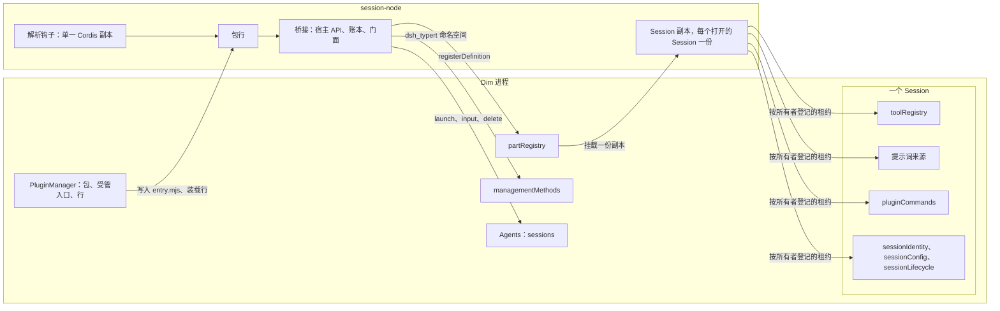
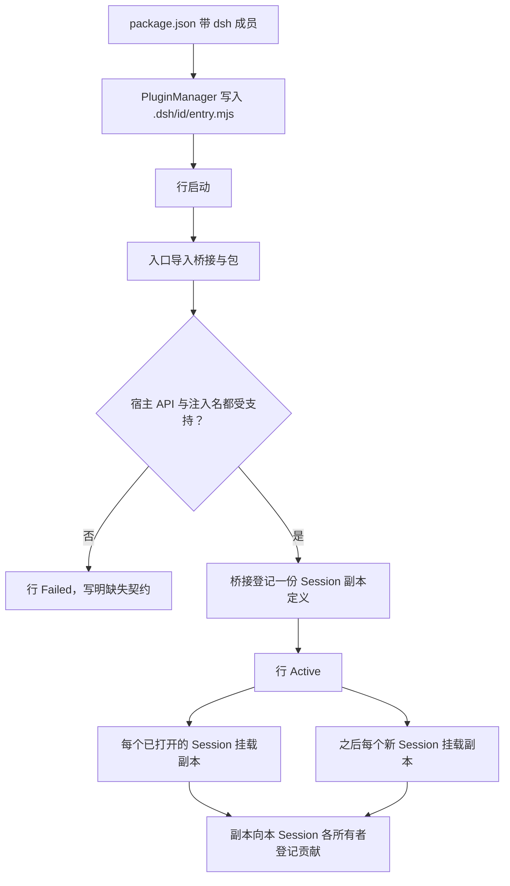
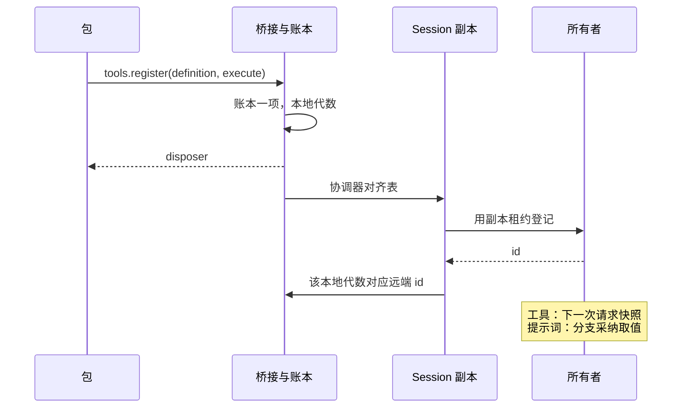
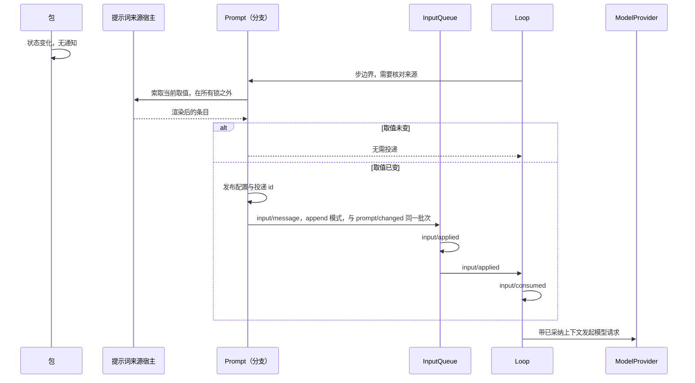
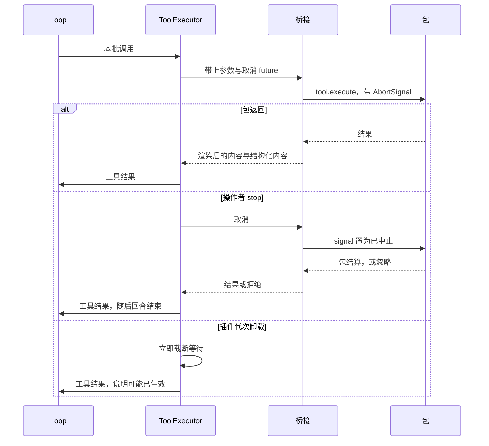
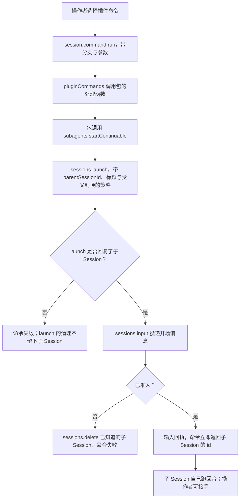

# DSH 包

状态：草案（[#1753](https://github.com/arcships/dim/issues/1753)）。规则：[设计规则](../../../architecture/rust-agent/principles.md) 第 1、4 节、[ADR 002](../../adr/002-plugin-scope.md)、[插件契约](../plugin-contract.md)（[ADR 006](../../adr/006-plugin-contract.md)）。作用域：进程与 Session。语言：Dim 侧 Rust，桥接层 TypeScript。English: [English](../../../design/plugins/DshPackages.md)。

DSH 是本设计要运行的插件包所属的 harness。DSH 包是一个 Cordis 4 插件包，Dim 已经能把它作为一个 Node loader 行装载（[Dim 如何使用 rutis](../rutis-usage.md)）。它缺的不是装载，而是它编程所对的宿主 API：工具、系统提示词段落、斜杠命令、子 Session、本地管理动作，以及它要响应的 Session 生命周期通知。本设计只补齐这套宿主 API，其余一概不加，因此一个为 DSH 发布的包在只使用 [§2.2](#22-宿主-api) 所列宿主 API 时，可以在 Dim 中原样运行，自己的文件、依赖与持久化都保持原样。

首期由两个真实包界定范围：`dsh-mysql` 注册四个工具、贡献一段会静默变化的表结构提示上下文、向同进程伙伴包导出一个 `mysql` 服务、响应 Session 生命周期，并暴露七个本地连接动作；`dsh-side-session` 注册一个斜杠命令，并创建一个带父 Session、受父策略封顶、可回滚取消的子 Session。另外三个包 `dsh-memory-recall`、`dsh-trellis`、`dsh-auto-retry` 在装载时失败并指明缺失的契约（[§11](#11-本设计之外)）。

**包仍然是一个进程行。** 没有包装行、没有第二套业务逻辑、没有针对某个包的 Dim 代码：每个包一个受管入口、随运行时发布的一份桥接库，每个贡献都由包自己的行登记到它的 Dim 所有者。

## 1. 结构



| 部件 | 作用域 | 持有 |
| --- | --- | --- |
| 包行 | 进程，每包一个 | 包自己的模块状态、它的伙伴服务，以及经桥接维护的贡献期望态 |
| 桥接 | 在该行内部，不是名字也不是行 | 它交给包的宿主 API 对象、贡献账本、Agent 门面、一份 Session 副本定义 |
| Session 副本 | Session，每个打开的 Session 一份 | 副本自己的 Cordis fiber，以及它调用各所有者所用的服务租约 |
| 受管入口 | 进程，每包一个文件 | 运行期不持有任何东西：它指明包的真实入口并交给桥接 |

**不是接线模块。** 桥接是包自己那一行导入的库：它不向进程提供名字，也不适配别的插件的接口。它把包自己的贡献登记到这些贡献所属的所有者，这正是任何贡献部件都要做的事（[ADR 002 D2](../../adr/002-plugin-scope.md#d2-不设接线模块)），且它不持有进程状态。

**Agent 不是 Dim 的 Session。** Dim 的 Session、它的内存实例与分支是 Rust 核心状态。包所称的 agent 是桥接在 `agent/created` 中交给它的对象（[§2.4](#24-agent-门面)），每个已挂载的 Session 一个。包的模型中没有任何东西是分支：包不贡献分支部件，在一个 Session 上开十条分支也不会多挂副本。

**运行时只解析一份 Cordis。** DSH 包在模块顶层 import 它的 harness 所用的 Cordis 包，而一个进程里两份 Cordis 无法共享上下文。Node 运行时以解析钩子启动（`node --import`，运行时锁定的 Node 24 支持）：把所有包的 Cordis import 指向运行时已有的那一份，并从桥接自己的依赖解析 harness 的纯辅助包（工具定义、schema 辅助）。启动命令归 RuntimeManager，因此该钩子作为需求提给它（[§10.9](#109-runtimemanagernode-启动携带桥接的解析钩子)）。运行时那一份是 Cordis 4.0.4（`runtime/package-lock.json`）；若包的 `peerDependencies` 对 Cordis 的区间不被该副本满足，装载时以 `cordis_range` 拒绝（[附录 B](#附录-b-错误与恢复)）。自己解析出另一份 Cordis 的包同样被拒，运行时已会对「入口解析到不同副本」的情况报错。

## 2. 入口与桥接

### 2.1 受管入口

DSH 包不是 Dim 插件：它不带 `dim-plugin.json`，其 `package.json` 是写给它自己的 harness 的。两个首期包唯一相关差别在于：数据库包以可选方式声明对 Cordis `~4.0.4` 的 peer 依赖，旁会话包完全不声明 Cordis 依赖；两者都声明了 `dsh` 成员，其 `bundle.patch` 指向 harness 自己的 bundle patch。标记一个包的是 `dsh` 成员，而那个 bundle patch 不被读取：本设计的受管入口取代它。

识别这样的包、记录它并写出它的入口归 PluginManager（[§10.8](#108-pluginmanager识别-dsh-包记录它写受管入口)）。本设计固定入口的位置与内容：位于插件文件根下 `.dsh/<插件 id>/entry.mjs`，三行，从运行时的单一副本导入桥接，再导出 `dshPackageRow(<包的真实入口>)`。包目录全程只读，包括从本地路径安装的情况，所以升级 Dim 只换桥接，不动任何包。

运行时给行模块 URL 打上文件的修改时间与大小，所以重载变化的行导入的是文件而不是缓存中的模块。这条规则属于运行时包，不属于本仓库：它在 `rutis-runtime` 包中，版本见 [`runtime/package.json`](../../../../runtime/package.json)，而入口与其他任何行模块无异（[PluginManager §3.4](PluginManager.md#34-重新加载)：宿主不监听文件，重载调用才是信号）。入口属于 PluginManager 对该插件的记录，每次解析行时重写；它不持有状态，除运行时外无人读取。

### 2.2 宿主 API

桥接在该行自己的隔离作用域内提供下列对象，两个包互相看不到。每一项就是包眼中的整个 Dim。

| 包调用的东西 | 包用它做什么 | Dim 收到什么 |
| --- | --- | --- |
| `tools.register(tool)`，一个对象携带 `parameters`、`output` 与 `execute` | 声明一个工具、它的输入 schema、渲染后的输出与执行 | 在 Session 的 `toolRegistry` 登记一项，处理器就是包的 `execute`（[附录 A](#附录-a-桥接的宿主-api)） |
| `systemPrompt.section({name, order, text})`、`.context({name, order, text, required?})` | 贡献系统文字，以及每次请求的状态文字（可以是装配上下文的函数） | 每个贡献一个提示词来源，`delivery` 为 `system` 或 `state`，每一步之前重新读取（[§3.5](#35-请求准入顺序)、[§10.1](#101-prompt-与-loop一步之前重读动态来源并等它们被准入)） |
| `commands.register({name, description, input?, handler})` | 登记斜杠命令，其 handler 收到 `{commandId, agent, rawInput, attachments, signal}` 并返回 `{kind, text}` | `pluginCommands` 中的一项；handler 的回复就是这次运行的回复（[§6](#6-终端-ui)、[§10.3](#103-插件命令session-命令表与固定方法命名空间)） |
| `subagents.startContinuable({provider, label, request: {parent, prompt}, signal})` | 在调用方 agent 下创建子 Session 并读其 id | 带父的 `sessions.launch`，随后 `sessions.input`（[§3.7](#37-命令与子-session)、[§10.4](#104-agentssessionslaunch-接受父-session)） |
| `./typert` 动作（读自包的 `exports`） | 把本地配置动作暴露给客户端 | `dsh_typert.<package>` 下的 `managementMethods`（[§6](#6-终端-ui)、[§10.6](#106-客户端stop-提示以及插件命令与动作所需的界面)） |
| `ctx.on('agent/created' \| 'agent/disposed')` | 每个 Session 的建立与拆除 | 桥接自己的门面事件（[§2.4](#24-agent-门面)） |
| `ctx.provide(name, service)` | 向伙伴包提供服务 | Dim 不参与：它留在共享的 Node 进程里，由运行时解析 |

附录 A 给出每个形状在 harness 中的定义及其映射。包调用的任何其他东西，以及它注入的、本表未覆盖的任何名字，都会让该行在装载时失败并写明缺失项（[§3.4](#34-失败)）：harness 有而 Dim 不提供的拦截点（步前钩子、工具执行前守卫、请求错误处理器、HTTP 路由、同步全量历史读取）同样失败，`systemPrompt.variable`、`systemPrompt.suppressRuntimeContext`、`agent.getHistory`、`agent.ctx` 以及 harness 后来的 `subagents.startActivation` 也如此（[§11](#11-本设计之外)）。包不会在宿主 API 缺一块的状态下被装载。

### 2.3 贡献账本

包的注册 API 是同步的（登记工具立即返回 disposer），而每个 Dim 所有者都要跨进程调用。桥接为每个包行维护一份账本填补这个差：每个贡献一项，带本地代数；每个 Session 副本一个串行协调器，把各所有者的表对齐到该期望态。

| 情况 | 协调器做什么 |
| --- | --- |
| 已登记、未发出、已撤回 | 什么都不发，账本项删除 |
| 已登记、在途、已撤回 | 等返回登记 id 的回复，再用该 id 撤回，不留孤儿项 |
| Session 正在关闭时撤回 | 什么都不发；副本卸载时一次撤回它登记过的全部项 |
| 同名重复登记 | 在包的调用中同步拒绝，与 harness 一致 |
| 某个登记失败 | 记入该 Session 副本的诊断；其余贡献照常 |

账本每行一份，绝不跨包共享。它是桥接为贡献保留的唯一状态，存在的原因是包的 API 不能等待、而所有者的表是异步的。

### 2.4 Agent 门面

包在 `agent/created` 中拿到的对象，是它作为 map 键使用的身份，也是它保存每个 Session 私有状态的载体。因此它在进程存活期内每个 Session 恒为同一对象，且它是一个薄壳：持有 Session id 和一个指向当前 Session 副本服务句柄的槽位。空闲卸载清空槽位，恢复时填入新副本的句柄。

```text
agent/created             session.close / Session 删除          daemon 重启
  agent = facade(id)        agent/disposed(agent)               首次装载该 Session
  包保存该对象              门面身份不变                           agent/created 一次，
  空闲卸载：槽位置空                                              Session 为恢复时
  恢复：    槽位重绑                                              source: 'resume'
```

桥接能发出这两类通知，只因为 Session 作用域告诉了它自己为何结束，并且删除会同时通知进程与 Session 自身的副本。无论业务关闭还是空闲卸载，Session 作用域都会结束（[插件契约 §2](../plugin-contract.md#2-实例树)；运行时对两者取消同一个 closing 令牌，`crates/dim-agent-runtime/src/agent.rs:804-808`，`finish(unloading)`）。而 `sessionLifecycle` 只提供 `activated`、`closing`、`hold` 与 `release`，没有任何一项能区分二者（[插件契约 §4](../plugin-contract.md#4-dim-的服务)，`crates/dim-agent-runtime/src/config.rs:403-408`）。在 `closing` 时发 `agent/disposed` 的副本，实现的正是本设计拒绝的空闲卸载通知。空闲卸载之后再删除，已经没有任何副本可以告知：删除会移除一个未装载 Session 的存储行（`crates/dim-app-server/src/agents.rs:1519-1534`，只对已装载的 Session 执行关闭），而包的每 Session 状态与门面活在行里，不在副本里。创建还是恢复这一半已经是数据：`sessionIdentity.get()` 给出 `{sessionId, restored}`（`crates/dim-agent-runtime/src/config.rs:234-249`），而 `restored` 恰为 `SessionInitialization::Restore`（`crates/dim-agent-runtime/src/assembly.rs:1749`，在 `crates/dim-agent-runtime/src/agent.rs:169-183` 选定）。业务删除则只在进程根上发 `agent/session-deleted`，那是宿主内部总线事件，不是行可读的服务面（[插件契约 §5.3](../plugin-contract.md#53-总线事件)）。

因此这两类通知依赖 Session 所有者的一项需求（[§10.7](#107-agents-与-session-生命周期作用域为何结束以及它如何开始)）：副本能得知自己作用域结束的原因（业务关闭、删除还是空闲卸载），进程作用域中的部件能得知某个 Session 已经消失（无论是否装载），两者都能得知本次装载是创建还是恢复。有了它，`agent/disposed` 跟随业务关闭与删除，无论当时已装载还是此前已被空闲卸载，绝不跟随空闲卸载；`agent/created` 跟随本进程内的首次挂载，`source` 指明是否为恢复。空闲卸载之后被删除的 Session 也只发一次，随后桥接丢弃该 Session 的门面与包为其保留的状态，所以以 agent 为键的 `Map` 不会活得比 Session 久。

门面身份永不变化，包以 agent 为键的 `WeakMap`、`WeakSet` 跨空闲卸载仍然正确，`session.close` 时的 `agent/disposed` 也命中了包当初登记状态的那个对象。槽位重绑前包通过旧句柄发起的调用会以服务不可用失败，不会打到另一个 Session 的副本。

### 2.5 登记状态

某个包的一个贡献，从包的调用到它在 Dim 中的生效。状态按 Session 区分：同一贡献在某个 Session 已发布、在另一个 Session 被拒，都是正常的。

| 状态 | 所有者的表 | 模型看到什么 | 何时结束 |
| --- | --- | --- | --- |
| 期望 | 不变 | 无 | 协调器取走，或 disposer 先执行 |
| 登记中 | 不变 | 无 | 所有者回复，或副本卸载 |
| 已登记 | 表中有该项 | 工具尚无；提示词取值在下一次采纳时 | 撤回，或副本卸载 |
| 已采纳 | 不变 | 工具进入下一次请求的快照；提示词取值作为 Append 块 | 下一次变化，或撤回 |
| 撤回中 | 正在移除 | 当前请求保留它已绑定的内容 | 所有者确认 |
| 已撤回 | 表中已无该项 | 无新增；取值被采纳时写的块留在历史中，Revoke 追加一个 `<dim-state cleared="true">` 块结束它 | 无：再次撤回是空操作，因为 id 已不匹配 |

变更表中已有名字的登记是一次撤回加一次登记，顺序固定，第二次不会与第一次抢成同名拒绝。同一名字的两代是两个独立项、两个独立 id：按旧 id 撤回不会删掉新项。

### 2.6 桥接不保留什么

不排队、不重试、不定时器，不建第二套注册表。它实际持有的状态只有：每行一份账本、每行见过的每个 Session 一个门面、每行一份副本定义。被所有者拒绝的登记报告给包的调用或记入副本诊断后不再保存。它没有 Session 历史缓存、没有 Timeline 的影子、没有上下文的副本。

## 3. 流程

### 3.1 装载一个包



行只有在定义交出、服务宣告完成后才 `Active`，与其他 Node 行一致。已经打开的 Session 在定义登记时挂载副本；之后打开的 Session 在打开过程中、发布之前挂载副本。因此凡是先装载包、后使用 Session 的情形，包对第一次请求就已生效，不需要追赶步骤。

### 3.2 登记与发布



工具经 Session 的工具来源集到达请求，而请求在 ToolBinding 处取快照，因此请求运行期间的登记或撤回只影响后续请求。提示词取值经采纳进入请求（[§3.5](#35-请求准入顺序)），这也是包的文本进入模型上下文的唯一通道。

### 3.3 撤回单个贡献

disposer 在包自己的调用栈中运行：删掉账本项并唤醒协调器，协调器按所有者分配的 id 撤回，且只针对登记过它的那些 Session 副本。撤回对已绑定该贡献的请求不可见：该请求保留自己的快照，也不关心它离开了。提示词状态取值的撤回是一次 Revoke，它会写一个 `<dim-state source="…" cleared="true"></dim-state>` 块：此前的块留在历史中，这个块为之后的内容结束它（`crates/dim-agent-capabilities/src/prompt.rs:1163-1197`）。Revoke 不重写已经发生的历史，也不是对模型此前读到内容的抹除。

除 disposer、Session 副本卸载、包行卸载之外，没有任何东西撤回贡献。Session 关闭通过卸载副本来撤回它的全部贡献，不需要为每项各调一次。

### 3.4 失败

| 失败 | 判定处 | 效果 |
| --- | --- | --- |
| 包注入了本设计不提供的名字 | 桥接，行变为 Active 之前 | 行 Failed，消息写明缺失的名字 |
| 包登记了 harness 有、Dim 不提供的钩子 | 桥接，该次登记调用中 | 行 Failed：半装载的包会在作者以为有守卫的情况下运行 |
| 包导入了自己的 Cordis 副本 | 运行时，模块解析时：它已有的拒绝 | 行 Failed，写明入口与副本 |
| 包的 Cordis peer 区间排除运行时那份 4.0.4 | 桥接，行变为 Active 之前 | 行 Failed，`cordis_range`，写明该区间 |
| 包模块装载时抛错 | 运行时 | 行 Failed，带模块错误 |
| 某个 Session 副本构建失败 | 部件登记处，针对该 Session | 只有该副本标记 Failed，行与其他 Session 正常 |
| 某个贡献与宿主工具或其他插件同名 | 所有者，在登记回复中 | 该贡献被拒，且只在该 Session 中被拒；该副本记录这次拒绝，账本的期望项保留，其他 Session 的副本照常发布它 |
| 包的 `dispose` 抛错 | 运行时，卸载期间 | 记为该行的清理错误，其他行不受影响 |

被拒的贡献不会被静默重试：包在发起它的那次调用中看到拒绝，或在调用已返回后于副本诊断中看到。拒绝按 Session 而非按行：账本保留期望项，所以某个 Session 的表已占用的名字只在该 Session 被拒，其他 Session 的副本依然发布它。每个副本记录自己的拒绝，操作者能看到是哪个 Session 丢了哪项贡献。

### 3.5 请求准入顺序

包的动态上下文没有通知：`dsh-mysql` 在 harness 组装该步时从自己模块的闭包里读当前选中的库，harness 因此每一步都重读一次。Dim 的提示词来源登记一次、由分支在打开时采纳，若不重读，包变化后的取值要等到下次打开 Session 才到模型。重读需要提示词所有者提供两件事，本设计提出这两项需求（[§10](#10-向机制所有者提出的需求)）：分支在一步之前向来源索取当前取值；该步在为其写出的输入被 Loop 准入之前不发起模型请求。



| 步骤 | 谁执行 | 让该步继续的事实 | 此处的中断或重载 |
| --- | --- | --- | --- |
| 1 | 包改变自己的状态 | 无：取值在被索取时才读 | 无可取消项 |
| 2 | Loop 到达步边界 | 回合开始、工具结果批次、压缩结果或请求替换 | 中断使回合以取消结束 |
| 3 | Prompt 读取需要的取值 | 在所有锁之外，带分支取消 | 中断立即结束回合，不等读取返回 |
| 4 | Prompt 比较并发布 | 一个原子批次：`prompt/changed` 与 Append 输入 | 分支关闭或该步已取消时，批次在提交锁内自我拒绝 |
| 5 | InputQueue 准入 Append 输入 | 队列自己的顺序 | 若回合已先结束，输入留给下一回合 |
| 6 | Loop 准入该投递 | 发布者写入的输入 id | 该回合已不再等待的 id 被忽略 |
| 7 | Loop 发起请求 | 本步的投递全部准入 | 已发起的请求按被 steer 的请求替换 |

这条链依赖三个性质。读取在提交锁之外，包在自己的代码里阻塞只拖慢它所在的那些 Session 的步骤，不拖慢它未挂载的 Session。Append 输入不会开启回合：空闲 Session 上被采纳的取值等操作者的下一条消息，而不是自己开一轮。取值未变则不写任何东西，因此每步都核对一遍的包只花一次边界调用，不写 Timeline。

包在自己的代码里阻塞会阻塞该 Node 运行时里的所有行，因为这些包共享该运行时的事件循环（`rutis-runtime` 包每个运行时一个 Node 进程，把每个行都装进去）。本设计能约束的是它对 Dim 的影响：读取在提交锁之外，所以一个阻塞的包只拖慢它被挂载的 Session 的步骤，不拖慢它未挂载的 Session，也没有锁、批或别的插件的调用在等它（[附录 C](#附录-c-静态成本)）。操作者的出路与 stop 提示指出的相同：重载或停用该插件。

如果进程在步骤 4 与 7 之间停止，该回合有开始和已采纳配置却没有模型请求。现有重建规则会把这种回合结算为失败，并把 Append 输入留在队列里供下一回合消费，因此包的上下文既不会被重放，也不会丢。

### 3.6 工具调用与 stop



stop 是协作式的，对所有外语工具都是如此：把取消传进包，等这次调用结算。只有卸载插件代次才截断等待，此时结果写明「可能已生效」，因为 Dim 无法观测外部写入是否落地。忽略信号的包会被一直等待，操作者通过重载或禁用该插件结束等待（[§6](#6-终端-ui)）。

桥接由那个取消 future 构造工具的 `AbortSignal`：future 结算时置为已中止。宿主传的是 future，不是标志（`crates/dim-agent-capabilities/src/tool_registry.rs:767-772`），因此包把信号理解为「触发即已中止」；本设计不承诺包第一次同步读时它已为 aborted。派发前就被取消的调用，包根本不会收到：执行器在它到达提供方之前就拒绝并回复 `Tool cancelled before execution`（`crates/dim-agent-capabilities/src/tool_executor.rs:408-415`、`:447-456`）。

### 3.7 命令与子 Session



命令在子 Session 的首条消息入队时返回，而不是等它回答，这正是 harness 的可继续子 agent 契约对处理函数的承诺。子 Session 是普通 Session：持久保存、以操作者启动的 Session 的身份列出并带父、空闲时与其他 Session 一样卸载，删除父时经已存的父子关系级联删除（[§10.4](#104-agentssessionslaunch-接受父-session)）。父的 Timeline 不受影响：命令不向父写输入、也不写事实。

开场输入按任何调用者构造输入的方式构造（`crates/dim-app-server/src/agents/sessions.rs:126-136`）：submission id 为 `dsh-side-session:<commandId>`，所以同一条命令重试只是一条输入，分支只接受一次；`mode` 为 `queue`，因为子 Session 还没有可 steer 的回合；`rawBlocks` 按顺序持有包的 `prompt` 块，第一块是调用方的标记；`content` 为空，所以输入只携带包自己写的内容。子 Session 的分支拒绝的 `prompt`（包括其中的空块）会让命令带包自己的错误文本失败，且不会留下 Session：launch 已经回复，所以由桥接在命令返回错误之前按 id 删除它持有的子 Session（[附录 B](#附录-b-错误与恢复)）。取消是另一种情形，归 launch：在拿到回复前就不再等待的调用方，其 launch 会自己移除它创建的 Session（[§10.4](#104-agentssessionslaunch-接受父-session)）。

## 4. 寿命

一个 Session 在各种事件中的样子。包的每 Session 状态指的是包模块闭包里的 `Map`。

| 事件 | Dim Session | 内存实例 | 包在该 Session 的副本 | 包在行内的状态 | 外部工作 |
| --- | --- | --- | --- | --- | --- |
| 稳态 | 已存 | 已装载 | 已挂载，贡献已登记 | 存活 | 无 |
| 空闲卸载 | 已存，不变 | 卸载，不写任何事件 | 卸载；其贡献消失；租约归还 | 存活；门面槽位置空；不发 `agent/disposed` | 无：卸载从不取消已受理的工作 |
| 空闲卸载后恢复 | 已存，不变 | 重新装载，分支以 `branch/resume` 打开 | 重新挂载：包的贡献随副本的 `apply` 重新登记 | 存活；槽位重绑；不发 `agent/created` | 无 |
| `session.close` | 已存，本进程内为 closed | 卸载 | 卸载 | 存活；为该 Session 发 `agent/disposed` | 无：关闭会等待自己受理的工作 |
| Session 删除 | 记录删除 | 卸载 | 已装载的已卸载；已被空闲卸载的本来没有副本 | 存活；为该 Session 发 `agent/disposed`，无论当时已装载还是此前已被卸载；门面与该 Session 的保留状态被丢弃 | 无 |
| 插件重载或禁用 | 已存 | 已装载 | 随行卸载；新代再挂载 | 全新模块：包内存在所有 Session 上清空 | 在途调用被截断为「可能已生效」 |
| daemon 重启 | 已存 | 被 acquire 时装载 | 首次装载时挂载 | 全新进程：包内存清空；`agent/created` 一次，Session 为恢复时带 `source: 'resume'` | 旧进程的套接字随进程关闭；写入是否落地未知 |

第四、五行正是 Session 所有者必须变得可观测的部分：空闲卸载与业务关闭结束同一个作用域，单靠 `sessionLifecycle.closing` 副本无法区分二者（[§10.7](#107-agents-与-session-生命周期作用域为何结束以及它如何开始)）。最后一行的 `source` 来自 `sessionIdentity.restored`：恢复已存 Session 的装载为 `true`，新建的为 `false`（`crates/dim-agent-runtime/src/config.rs:234-249`、`crates/dim-agent-runtime/src/assembly.rs:1749`）。

被访问过但未关闭的 Session，其条目在包自己的每 Session `Map` 里保留到进程结束，因此这部分内存与「包见过且未关闭的 Session」成正比，而不是与「当前装载的 Session」成正比。daemon 重启会清空它，这与重启 harness 本身一致。

## 5. 上下文映射

| 位置 | 模型看到什么 | 形式 | 存续 |
| --- | --- | --- | --- |
| 该 Session 的任意分支 | 包声明的工具，含其声明中的描述与 schema | 请求快照中的工具声明 | 贡献它的副本挂载期间 |
| 该 Session 的任意分支 | 包渲染后的工具结果 | `ToolResult.content`；包的结构化返回值不进模型视野 | 与普通工具结果相同 |
| 该 Session 的任意分支 | 包的系统段（若声明） | 已采纳系统提示词的一部分 | 取值变化时重发 |
| 该 Session 的任意分支 | 包的动态上下文 | 一个 `<dim-state>` 块，与其他捕获型状态来源一样被采纳，并由下一个取值取代 | 下一个取值是新块；撤回追加一个 `<dim-state cleared="true">` 块结束它（[§3.3](#33-撤回单个贡献)） |
| 子 Session | 它自己的回合，从开场消息开始 | 普通 Session 上下文 | 它自己的 |
| 父 Session | 命令没有写入任何内容；操作者只看到命令回复的文字 | 不是模型上下文 | 不适用 |

包不写 Timeline 事实、不接触 `dispatcher`、不给请求追加文字。它对模型可见的每一个字节都经工具结果或经采纳到达。

## 6. 终端 UI

四处界面都在客户端。各类按键与布局归终端 UI 所有者（[cli-commands](../cli-commands.md)）；下面只说明本设计要求它们显示什么，`r` 键只是出路的一个示例，不是本设计设定的绑定。四处都在 [§10.6](#106-客户端stop-提示以及插件命令与动作所需的界面) 中提出。

**命令菜单。** 一个 Session 的插件命令列在 `/` 菜单中内置命令之后、Skills 之前，这是[命令菜单契约](../cli-commands.md#命令菜单)留给动态组的唯一位置。每行写明命令、描述与它来自哪个插件。

```text
+----------------------------------------------------------------------+
| > /side                                                              |
+----------------------------------------------------------------------+
|  /side-chat    开一个独立的旁会话，自己保留一整段对话                |
|                [plugin: dsh-side-session]                            |
+----------------------------------------------------------------------+
  Enter 执行 session.command.run("side-chat") · Tab 补全 · Esc 关闭
```

**子 Session。** 子 Session 与其他 Session 一样列出，带父与来源，操作者是接手它，而不是通过父驱动它。launch 记录来源 `client`，与操作者启动的 Session 相同，所以列表不需按类别筛选就能显示它，`/resume` 选择器也像列任何对话一样列出它（[§10.4](#104-agentssessionslaunch-接受父-session)）。列表的父字段是 `SessionInfo.parentSessionId`，已存 Session 本就上报它。`/resume` 选择器就是该列表（[cli-commands](../cli-commands.md#resume-选择面板)）；按某个 Session 的子会话筛选是 [§10.6](#106-客户端stop-提示以及插件命令与动作所需的界面) 提出的 catalog 参数。

```text
+--------------------- /sessions  (Tab: 全部 | 本会话的子会话 [1]) ---------------------+
| > 旁会话 14:32    [client · parent 8f3a..c1]      "已就绪，请提出第一个问题"          |
|   本会话          [client   · 8f3a..c1]           "排查订单表慢查询"            2m 前 |
+--------------------------------------------------------------------------------------+
  Enter 接手子会话 · d 删除 · Esc 关闭
```

**插件动作。** 导出本地动作的包在 `/plugins` 中得到一个面板，对任何包通用：动作列表、某个动作的 JSON 参数（动作涉及 Session 时自动填入当前 Session id）、以及结构化回复。该面板与其动作在 [§10.6](#106-客户端stop-提示以及插件命令与动作所需的界面) 中提出。

```text
+------------------ /plugins -> dsh-mysql -> 动作（本地动作）---------------------------+
| 动作: [ selectConnection ]   listConnections | saveConnection | testConnection        |
| 参数（已填入当前 Session id）:                                                        |
|   { "sessionId": "8f3a9c10-…", "connectionId": "orders-ro" }                          |
| 结果: { "ok": true, "connectionId": "orders-ro", "connectionIds": ["orders-ro"] }     |
+--------------------------------------------------------------------------------------+
  Ctrl+Enter 执行 dsh_typert.dsh_mysql.selectConnection · Esc 返回
```

**等待中的 stop。** stop 在等某个插件工具时，运行中的回合带一行说明，写明插件与出路。这是客户端全局提示，不针对 DSH：所有尚未结算的外语工具都适用。

```text
  正在停止。dsh-mysql 尚未返回。
  r 重载该插件以结束等待；此后它影响每一个会话，且其内存状态被重置。
  Esc 让 stop 继续等待。
```

## 7. 接口

下表每一行要么是本设计使用的现有服务面，要么是本设计向其所有者提出的服务面。所有者文档才是契约；本表只说明本设计如何使用它。

| 名字 | 作用域 | 服务面 | 所有者契约 | 本设计 |
| --- | --- | --- | --- | --- |
| `partRegistry` | 进程 | data（`registerDefinition`） | [Dim 如何使用 rutis §2](../rutis-usage.md#2-插件是一行实例挂载它的部件)、[插件契约 §4](../plugin-contract.md#4-dim-的服务) | 每个包行登记一份 Session 副本定义 |
| `managementMethods` | 进程 | data（`register`） | [Session 边界 §3.2](../contracts/session-boundary.md#32-管理方法) | 每个包的本地动作，命名空间 `dsh_typert.<包>`，包名中的 `-` 写作 `_`（所以 `dsh-mysql` 为 `dsh_typert.dsh_mysql`） |
| `toolRegistry` | Session | data（`register`） | [插件契约 §4](../plugin-contract.md#4-dim-的服务)、[ToolRegistry](../../../architecture/rust-agent/plugins/ToolRegistry.md) | 每个副本登记该包的工具 |
| `promptRegistry`、`promptHost`、`initialPromptConfiguration` | Session | 提示词数据面（[PromptSources](PromptSources.md)、[Prompt](Prompt.md)） | 同上 | 每个贡献是一个提示词来源；其他语言的来源经 [§10.1](#101-prompt-与-loop一步之前重读动态来源并等它们被准入) 提出的路由登记 |
| `pluginCommands` | Session | data，在 [§10.3](#103-插件命令session-命令表与固定方法命名空间) 中向所有者提出 | `dim-agent-capabilities`，拥有命令表的 Session 部件；菜单归[命令菜单](../cli-commands.md#命令菜单) | 每个副本登记该包的命令 |
| `session.command.list`、`session.command.run` | Session，位于 `sessionMethods` | data | [Session 边界 §3.1](../contracts/session-boundary.md#31-session-方法)、[cli-commands](../cli-commands.md#命令菜单) | 客户端读取并执行插件命令 |
| `sessions` | 进程 | data（`launch`、`input`、`delete`、`stop`） | [Session access A.1](../contracts/session-access.md#a1-sessions-服务) | 子 Session 及其开场输入 |
| `sessionIdentity`、`sessionConfig` | Session | data | [插件契约 §4](../plugin-contract.md#4-dim-的服务) | 副本读取自己 Session 的身份（含 `restored`）与配置 |
| `sessionLifecycle` | Session | data | [插件契约 §4](../plugin-contract.md#4-dim-的服务) | 副本等 `activated`，在 `closing` 时停手；作用域结束的原因在 [§10.7](#107-agents-与-session-生命周期作用域为何结束以及它如何开始) 中向 Session 所有者提出 |
| Session 的结束原因 | Session | data，在 [§10.7](#107-agents-与-session-生命周期作用域为何结束以及它如何开始) 中向 Session 所有者提出 | [插件契约 §4](../plugin-contract.md#4-dim-的服务) | 区分业务关闭、删除与空闲卸载，`agent/disposed` 依赖它 |
| 任意 Session 的删除 | 进程 | data，在 [§10.7](#107-agents-与-session-生命周期作用域为何结束以及它如何开始) 中向 Session 所有者提出 | [插件契约 §4](../plugin-contract.md#4-dim-的服务) | 被删 Session 已无副本时仍能到达该行，即空闲卸载之后再删除的情形 |
| `agent/session-deleted` | 进程，总线事件 | 宿主内部，不是本设计使用的服务面 | [插件契约 §5.3](../plugin-contract.md#53-总线事件) | 桥接不读它：删除的原因经 [§10.7](#107-agents-与-session-生命周期作用域为何结束以及它如何开始) 的 Session 面到达 |

本设计拥有的名字：受管入口路径 `<插件文件根>/.dsh/<插件 id>/entry.mjs`、管理命名空间 `dsh_typert.<包>`（`-` 写作 `_`），以及桥接自己的包名。后者不是 Dim 的服务名，不进目录。

桥接对包作者提供的宿主 API 是契约，写在生成的 TypeScript 声明里，与 Dim 服务声明并列，因此包作者可以像对着 `npm/plugin.d.ts` 那样对它做类型检查。

## 8. 安全

- **包是受信任的宿主代码。** 已装载的行以用户权限运行在运行时进程内，与其他 Node 行相同；受信任的进程内部件不因声明而被隔离（[AGENTS.md](../../../../AGENTS.md) 第 11 条、[ADR 003](../../adr/003-approval-scope.md)），本设计不对它做沙箱。包的工具调用仍受该 Session 策略下的 Approval 与 Permission 约束，与 Dim 自带的工具相同。
- **每个 DSH 工具的风险类由桥接给出，且取最窄的。** Dim 拒收不带风险声明外语工具（`crates/dim-agent-capabilities/src/tool_registry.rs:685-698`），而 harness 没有可供包声明的风险类，所以桥接为每个 DSH 工具填 `network`：这类工具用自己的方式访问 Dim 文件树之外的系统，Dim 无法划分得更窄。预设按网络工具对待它（[Permission](../../../architecture/rust-agent/plugins/Permission.md)；`crates/dim-agent-capabilities/src/permission.rs:678-750`）：完全访问下允许，工作区写入下询问，只读下拒绝。信任某个具名工具的操作者把它加入 `allowedTools`。桥接绝不会为了让包装载而挑一个更宽的分类。
- **硬依赖不受支持的名字即拒绝装载，而非降级。** 需要 HTTP 路由或步前钩子的包在装载时失败，因此模型不会运行在一个自以为有守卫、其实没有的包之下。
- **秘密留在包里。** Dim 没有 secret store（[Settings 服务 §1.2](../appserver/settings-service.md)），本设计也不新增：持久化凭据的包自己管文件，动作回复也由它自己决定。到达客户端的只是包返回的内容；返回密码是包自身的缺陷，面板照原样显示它返回的文档。
- **管理动作仅限本地。** `managementMethods` 只对受保护的本地连接提供，从不提供给配对设备，因此包的配置动作属于宿主管理员面。
- **Session id 不是授权。** `sessions`、`pluginCommands` 与提示词来源都把 Session id 当数据，各所有者文档已如此约定。包可以指名任意 Session；操作者的审批仍决定它的工具在该 Session 中能做什么。
- **入口不写入包内。** 受管入口位于插件文件根下，包目录只读；向自己目录写文件的包仍会在与 harness 中相同的位置失败。

## 9. 规则检查

| 规则 | 本设计如何满足 |
| --- | --- |
| §4 规则 1 改他处状态写指令事件 | 包不写其他所有者的状态。动态上下文变化由 `Prompt` 经既有发布器写出，子 Session 由 `sessions.launch` 创建，两者都在所有者自己的流程里 |
| §4 规则 2 交接后不可撤回 | 已采纳的 Append 输入属 InputQueue 与 Loop；包无法撤回它，之后的取值是一次新的采纳。工具结果是执行器的事实 |
| §4 规则 3 `before` 回调 | 不适用：桥接不注册任何 `before`，需要它的拦截点在装载时即被拒 |
| §4 规则 4 核心不带业务含义 | Timeline、Dispatcher、InputQueue、Loop 都没有包特有的处理。步前重读与准入屏障用所有者自己的术语表述，服务任何提示词来源 |
| §4 规则 5 原子批次、按序派发 | 配置与其投递输入同批；该步等到投递输入被准入，因此一个请求不会看到取值而没有对应输入 |
| §4 规则 6 上下文只来自已交接事件 | 模型可见的每个字节都以工具结果或采纳形式到达；不向请求注入任何内容，桥接也无法追加文字 |
| §4 规则 7 仅经公开事件与服务交互 | 包经 `partRegistry`、`toolRegistry`、提示词来源、`pluginCommands`、`managementMethods`、`sessions` 与 Session 生命周期面接触 Dim，本表已逐项注明所有者，另加 [§10.7](#107-agents-与-session-生命周期作用域为何结束以及它如何开始) 的进程作用域删除面；它不读其他插件的状态，尤其不读宿主内部总线事件 |
| §4 规则 8 基础设施默认不变 | 桥接不改 rutis 与 loader；它按现有行、定义与租约契约使用它们。它对其他所有者的需求均在 [§10](#10-向机制所有者提出的需求) 中以所有者自己的术语提出：Prompt 与 Loop（10.1）、登记所有者（10.2）、Session 命令表（10.3）、Agents（10.4）、ToolExecution（10.5）、客户端与会话目录（10.6）、Session 生命周期（10.7）、PluginManager（10.8）与 RuntimeManager（10.9） |
| §4 规则 9 只有后续决策需要的事实进 Timeline | 不新增 Timeline 事件。账本、门面、副本定义都是进程与 Session 内存，没有一项是后续决策要读的事实 |
| §1 Capability 与 App Server 边界 | 本设计没有部件是 Capability：没有部件折叠分支事实或写事实。桥接是行内的库，App Server 中不新增业务代码 |
| ADR 002 D1 作用域随所有者 | 包行与它的伙伴服务是跨 Session 的进程状态；贡献属于 Session，因此登记它们的副本在 Session 作用域；没有分支部件 |
| ADR 002 D2 不设接线模块 | 桥接不向进程提供名字、不适配其他插件接口：它不拥有独立服务。它把包自己的贡献登记到所有者，这正是每个贡献部件都做的事；它保留的状态是每行账本、门面与一份副本定义 |
| ADR 002 D3 依赖随作用域 | 桥接依赖进程与 Session 所有者，并经 `sessions` 写其他 Session；核心不依赖它，某个包的失败只影响它自己的贡献 |
| ADR 002 D4 结构与业务配置分离 | 行的启用与包的安装归 PluginManager；包的业务配置留在它自己的文件与动作里，不新增 Settings 来源 |
| ADR 002 D5 契约语言中立 | 上表每个面都以操作、数据与错误码表述；桥接的 TypeScript API 是同一套操作的一种绑定 |
| ADR 008 D2、D3 不写状态、只写自己作用域 | 本文只写设计、它提出的需求与它使用的东西；每项需求都注明所有者并留给该所有者的文档去写改动，本页不描述其他模块的内部实现 |

## 10. 向机制所有者提出的需求

### 10.1 Prompt 与 Loop：一步之前重读动态来源，并等它们被准入

- **受阻功能与规则：** 包的上下文会静默变化。`initialPromptConfiguration` 只在分支打开时读取，来源取值也在那时采纳，因此之后变化的取值到不了任何请求（[PromptSources](PromptSources.md)、[Prompt §3.4](Prompt.md#34-在写入者装载时采用)）。发布器确认批次已发布，并不能告诉分支它写的输入已被 Loop 准入，只凭该确认发起请求，可能恰好漏掉刚采纳的取值。
- **已排查的现有机制：** 指令来源使用的周期性分支检查会把变化延迟到一个检查间隔，而且按计划写事件，无法服务「下一步模型必须看到」的取值；把包的文本登记为 `System` 来源会把这个每步变化的值放进可缓存前缀；由包自己写输入则是在写别的所有者的状态（规则 1）。
- **所需通用能力：** 用提示词所有者的术语：分支在一步之前可以判断自己的动态来源是否需要重读，在所有锁之外读取它们，用既有原子批次采纳变化，并把写出的投递 id 交给 Loop；Loop 在这些输入被准入之后才发起请求，等待期间收到中断则以取消结束回合。取值未变则不写、不等。
- **另一语言来源所需的能力：** 一个外语行可以从自己的 `apply` 调用的登记路由。包的系统文字与动态上下文都是提示词来源，而登记表今天只收 Rust 的 `Arc<dyn LoadPrompt>` 与 Rust `Ctx`（`crates/dim-agent-capabilities/src/prompt_registry.rs:18-38`、`host.rs:177-183`；[插件契约 §4](../plugin-contract.md#4-dim-的服务) 约定在外语部件需要前提示词来源保持 Rust 专属）。路由为 `promptSources.register({name, delivery, order}, read)` 与 `promptSources.withdraw({name})`，绑定到调用行，因此项在该行卸载时结束，与它其他登记一致。`read` 每步回调进该行并回答当前取值，正是上一段需要的那次读取。它不能永久阻塞一步，也不能让一步静默失败：调用携带该步的取消，拒绝或抛错的读取记入副本诊断、该步不带该取值继续，下一 步再次读取，超出该步的读取在该步结束时被放弃，所以永不返回的包只拖慢它自己的步骤。撤回一个来源是一次登记撤回，不是重载行；行重载会连旧代的所有来源一起撤回，所以中间的一步看到的是旧值或新值，不会是混合。
- **对序号、批次、中断、重载的影响：** 不新增事件类型，批次仍然原子；中断不等忽略取消的包即结束回合；批次与请求之间崩溃时，该回路由既有重建规则结算为失败，Append 输入留给下一回合。
- **实现归属与验证：** `dim-agent-capabilities`（`prompt`、`prompt_registry`、`agent_loop`）以及 `dim-agent-runtime`（把外语登记绑定到调用行），由其自己的文档（[Prompt](Prompt.md)、[PromptSources](PromptSources.md) 与 Loop 架构页）写明改动。用流测试验证：两轮之间取值变化的来源在第二次请求中以一个 `<dim-state>` 块到达；取值未变不写任何事件；读取期间中断则以取消结束回合且不发起请求；外语来源可登记并到达下一次请求；它的读取拒绝会被记录且该步继续；它的行卸载会撤回它登记的所有来源。

### 10.2 运行期登记：按所有者校验的单条撤回

- **受阻功能与规则：** 包的 disposer 要在该行仍在运行时撤回单个贡献。登记表只在所属行卸载时移除条目，因此包想替换一个工具就得重载整行，而那会清空它在所有 Session 上的每 Session 状态。
- **已排查的现有机制：** 卸载并重载整行（正确，但代价是所有 Session 的包状态与其他贡献一起被清掉）；在桥接里再建一张隐藏已撤回项的表（影子注册表，规则 8 禁止，且所有者那张表仍是错的）。
- **所需通用能力：** 登记表记录每项的所属者与每个属主代次的一次性清理；登记回复带回该项 id；一次撤回只移除 id 与所属者都匹配的条目，不匹配时拒绝而不是删别的所有者的项。对 `toolRegistry`、提示词来源与 `pluginCommands` 一致适用。
- **对序号、批次、中断、重载的影响：** Timeline 无影响；撤回只改变下一次请求快照的内容，已绑定的请求不变。行卸载仍一次移除它登记的全部内容。
- **实现归属与验证：** `dim-agent-runtime`（登记表）与 `dim-agent-capabilities`（三个所有者的服务面）。用流测试验证：同一个工具登记加撤回五百次后所有者的清理项仍为一项；另一行按同名撤回被拒；撤回前已绑定的请求仍返回旧处理器结果，而下一请求不再声明该工具。

### 10.3 插件命令：Session 命令表与固定方法命名空间

- **受阻功能与规则：** 命令名含连字符（`/side-chat`），而 Session 方法与命名空间的每一段只能是 `[a-z][a-z0-9_]*`（`crates/dim-agent-capabilities/src/methods.rs:205-213`，[Session 边界 §3.1](../contracts/session-boundary.md#31-session-方法)）。按命令逐条建方法，对合法命令名根本不可行；一命令一方法也会让命令列表对未逐个订阅的客户端不可读。
- **已排查的现有机制：** 把命令名清洗成方法名（客户端与包对操作者所敲的名字会不一致）；用工具代替命令（斜杠命令不是模型动作，不该消耗一次请求）；在 `sessionMethods` 用共享命名空间加名字参数（这正是下面的形态，但需要后面那张表）。
- **所需通用能力：** 一个拥有命令表的 Session 部件 `pluginCommands`，其 `register`、`withdraw`、`list` 是数据操作，条目属于调用方副本；以及固定 Session 方法命名空间 `session.command`，含 `list` 与 `run {name, branchId?, args?}`。一次 run 属于受理它的那个 Rpc 代次：它在那个代次或提供方卸载时结束；停止等待或断开的客户端不取消它，因为断开不会把取消传给提供方。`run` 按 handler 返回的口径回复 `{kind, text}`。命令名为 `[a-z][a-z0-9_-]*`。与内置斜杠命令同名的由菜单的客户端侧拒绝，因为内置命令列表就是那个客户端的契约；`pluginCommands` 只拒绝与同一 Session 内另一副本条目同名。
- **对序号、批次、中断、重载的影响：** 不写 Timeline 事实；该表是 Session 内存，副本挂载时重建。包重载会中断已受理的 run，客户端看到的是中断。撤回后新调用返回 `unknown_command`，而不是 reloading 错误。
- **实现归属与验证：** 部件归 `dim-agent-capabilities`，菜单槽位归[命令菜单](../cli-commands.md#命令菜单)所有者（[§10.6](#106-客户端stop-提示以及插件命令与动作所需的界面)）。用流测试验证：含连字符的命令可登记，`session.command.list` 能列出，`session.command.run` 能执行；运行中提供方卸载会中断该 run 而断开不会；菜单里与内置命令同名的由客户端拒绝；撤回后再次运行为 `unknown_command`。

### 10.4 Agents：`sessions.launch` 接受父 Session

- **受阻功能与规则：** 包的子 Session 必须是父的子会话，而且必须出现在包声称的位置。`sessions.launch` 创建 Session 时不传 leader（`crates/dim-app-server/src/agents/sessions.rs:456-475`），因此没有父被存下，子会话不会被按父列出，删除父也不会级联到它：删除路径只删 `led_members` 返回的 Session，而该读取只选已存配置标为协作成员的 Session（`crates/dim-app-server/src/agent_records.rs:159-178`，调用处 `crates/dim-app-server/src/agents.rs:1531-1533`）。本设计创建的子会话不是协作成员，因此该级联不会到达它。可见性也有同样的缺口：除非调用方声明 `automation`，launch 记录 `origin: internal`（`sessions.rs:100-115`、`:466`），而 internal Session 在客户端列表与 `/resume` 选择器中不会出现，除非客户端主动要求该类（`docs/design/appserver/session-catalog.md` §3.1 的 `withInternal`；`crates/dim-app-server/src/storage/catalog.rs:268`）；而 harness 的子会话是操作者可以打开的普通对话。`parentSessionId` 已随每行上报（`crates/dim-app-server/src/protocol.rs:1306-1308`、`crates/dim-app-server/src/storage/catalog.rs:305-308`），但会话目录没有按它过滤的参数。
- **已排查的现有机制：** 包自己调 `session.create` 并在标题里写父（标题是文字不是关系，级联仍然漏掉它）；另开一个创建入口（重复了所有者那一个方法）；让选择器列出全部 internal Session 使子会话出现（也把无人要求的工作显示了）；在客户端对一页结果过滤子会话（页是一个窗口，过滤后的一页会漏掉窗口之外的子会话）。
- **所需通用能力：** launch 请求上一个可选 `parentSessionId`，经既有列存为该子会话的 leader；删除路径的级联扩展到所有 leader 为被删 Session 的已存 Session，而不只是协作成员。Collaboration 自己的读取保留成员过滤：`led_members`（`crates/dim-app-server/src/agent_records.rs:159-178`）与 `members`（`:215-236`，使用于 `crates/dim-app-server/src/collaboration.rs:510`）仍排除非成员子会话，因此包的子会话是带父的 Session，而不是委派成员。请求另带一个记录 `client` 的 `origin`，即人启动的 Session 的来源（`crates/dim-app-server/src/connection.rs:1811`、`crates/dim-app-server/src/storage/timeline.rs:2584-2596` 处的 fork），因此子会话能被列出并被操作者到达；`LaunchOrigin` 在 `automation` 之外新增该值，仍是 App Server 拥有的封闭枚举。`starter` 封顶子会话策略，`parentSessionId` 只记录关系，所以桥接两者都传。以 `interactive: false` 创建的子会话对 `ask_user` 回答已声明的「无人可答」结果，它的审批仍在询问侧持有回合（`crates/dim-agent-questions/src/lib.rs:335-345`；`docs/design/appserver/sessions-service.md` D10），所以让子会话可用的不是该标志而是操作者能到达它，也就是上面的可见性。
- **对序号、批次、中断、重载的影响：** Timeline 不变；父的 Timeline 不受影响。launch 在 spawn 出来的任务里创建 Session（`crates/dim-app-server/src/agents/sessions.rs:457-476`），所以丢下调用取消的是等待而不是创建。在拿到回复之前就不再等待的调用方，其 launch 会自己移除它创建的 Session：这项需求落在 `launch` 上，对所有调用方成立，不只是桥接，因此不论调用方怎么做都不留半成品子会话。
- **实现归属与验证：** Agents（`crates/dim-app-server`），由 sessions 服务文档写明字段与清理。用流测试验证：创建的子会话记录父、以 client 来源列出、首条消息被执行、随父删除；在拿到回复前丢下 launch 的调用方不留下 Session，该情形直接经 `launch` 测试，而不是经桥接。

### 10.5 工具执行：崩溃恢复不得声称调用未执行

- **受阻功能与规则：** 被崩溃或能力重载打断的工具调用在分支重建时结算。重建选出所有已提交、无结果、且没有子结果的工具调用批次，把其中每个调用结算为「Tool did not finish before Capability reload; an effect may have happened」，或在该批次完全没有子结果时结算为「Tool was not executed: capability reloading」（`crates/dim-agent-capabilities/src/tool_executor.rs:1020-1060,1146-1159`）。第二种措辞取决于批次，而不是某个调用是否被派发。一个已经到达包、随后崩溃的单个调用写工具批次因此被结算成「未执行」，模型据此认为写入没有发生，而这是假的。
- **已排查的现有机制：** 为每次调用写执行器 progress 事实，使批次级区分变成调用级（内置装配下是关闭的，而且它把每次工具调用都变成一次额外的 Timeline 写入）；让包自己上报进度（包正是结果未知的一方，它来源的 harness 也不要求它这样做）。
- **所需通用能力：** 对无法排除已派发的调用，恢复文案必须说「该调用未完成、可能已发生效果」，而不是「未执行」；能确定从未派发的批次保留未执行的措辞。外语工具卸载时已有的 may already have taken effect 措辞即是先例。
- **对序号、批次、中断、重载的影响：** 同一个结果事件，改一个字符串；重载仍使该回合失败。
- **实现归属与验证：** `dim-agent-capabilities`（`tool_executor`），由 [ToolExecution](../../../architecture/rust-agent/plugins/ToolExecution.md) 写明结算。用流测试打开一个含未配对工具调用的库，断言恢复出的结果说明效果可能已发生。

### 10.6 客户端：stop 提示，以及插件命令与动作所需的界面

- **受阻功能与规则：** 本设计需要四处不归它所有的客户端界面。stop 可能等在忽略取消的外语工具上，而操作者对此一无所知；`/` 菜单是固定策展顺序，没有给 Session 插件命令的位置（[cli-commands](../cli-commands.md#命令菜单)）；`/plugins` 面板是 PluginManager 方法之上的一个管理区，没有渲染或执行包自己的本地动作的途径（[management surfaces](../cli-commands.md#管理界面)）；Session 列表也无法选出某个 Session 的子会话：每行已上报 `parentSessionId`（`crates/dim-app-server/src/protocol.rs:1306-1308`），但 `session.catalog` 没有对应参数（`docs/design/appserver/session-catalog.md` §3.1），所以客户端侧过滤会漏掉页外子会话。
- **所需通用能力：** 运行中的回合在 stop 等待外语工具时显示一行，写明插件与出路（[§6](#6-终端-ui)），对所有外语工具生效而不只是这些包；`/` 菜单中内置命令之后、Skills 之前的动态组，行来自 `session.command.list`，执行走 `session.command.run`；`/plugins` 中一个对任何提供 `dsh_typert.<包>` 命名空间的插件通用的动作面板，列出其动作，编辑某个动作的 JSON 参数（动作涉及 Session 时填入当前 Session id），并显示结构化回复；以及 Session 列表上的父过滤。过滤属于会话目录而不是客户端：`session.catalog` 增加可选 `parentSessionId`，在分页边界之前作用于查询，并像其他过滤一样进入游标的过滤集，因此一页子会话就是一页完整的子会话。它归 Agents 与 [Session 目录](../appserver/session-catalog.md#31-sessioncatalog)，由后者在 `withInternal` 旁边写明该参数。
- **对序号、批次、中断、重载的影响：** Timeline 无影响；四项都是读取路径加相应的一次既有方法调用。面板不读包自己的设置：它只渲染命名空间声明的动作与包返回的回复。
- **实现归属与验证：** 四处界面归终端 UI 所有者，由命令菜单契约写明该组、由 management surfaces 契约写明面板的动作类；父过滤归 Agents 与会话目录。用 CLI 流测试验证：登记了命令的 Session 在菜单中列出并可执行；stop 等待插件工具时显示提示；包的命名空间在 `/plugins` 中渲染且能执行一个动作；子会话能经该过滤找到，且在一页之后的子会话不会被漏掉。

### 10.7 Agents 与 Session 生命周期：作用域为何结束，以及它如何开始

- **受阻功能与规则：** 桥接在业务关闭与 Session 删除时发 `agent/disposed`，空闲卸载时绝不发；daemon 重启后首次装载某 Session 时发 `agent/created` 并带 `source: 'resume'`。Session 旁边没有任何服务面告诉它这些。无论业务关闭还是空闲卸载，Session 作用域都会结束（[插件契约 §2](../plugin-contract.md#2-实例树)），而运行时对两者取消同一个 closing 令牌（`crates/dim-agent-runtime/src/agent.rs:804-808`，`finish(unloading)`，由 `:754-764` 的 `unload_if_idle` 与 `:801-803` 的 `close` 进入），所以 `sessionLifecycle.closing` 无法区分二者（`crates/dim-agent-runtime/src/config.rs:403-408`；[插件契约 §4](../plugin-contract.md#4-dim-的服务) 中该行只列 `activated`、`closing`、`hold`、`release`）。删除只以 `agent/session-deleted` 宣告，那是宿主内部总线事件（[插件契约 §5.3](../plugin-contract.md#53-总线事件)）。创建还是恢复这一半已经是数据：`sessionIdentity.get()` 是 `{sessionId, restored}`（`crates/dim-agent-runtime/src/config.rs:234-249`），`restored` 即 `SessionInitialization::Restore`（`crates/dim-agent-runtime/src/assembly.rs:1749`，在 `crates/dim-agent-runtime/src/agent.rs:169-183` 选定）。
- **已排查的现有机制：** 在桥接里直接监听 `agent/session-deleted`（宿主内部事件而非服务面，而且行分不清它与同一 Session 的空闲卸载）；在每个 `closing` 时都发 `agent/disposed`（这正是本设计拒绝的空闲卸载通知，会在包本应存活的卸载中丢弃它的每 Session 选择）；对包见过的每个 Session 各持一个 `hold`（让包碰过的每个 Session 都无法空闲卸载，这是本设计拒绝支付的代价）。
- **所需通用能力：** 由 Session 所有者提供一个公开数据面，用该所有者自己的术语，让 Session 作用域的部件得知两件事：自己的作用域为何结束或已经结束，按所有者已经知道的区分，即业务关闭、删除与空闲卸载；以及本次装载是创建还是恢复。该面在副本首次 `apply` 返回前就可读，使 `agent/created` 首次挂载就能带对的 `source`。所有者没有含义的原因不编造：该面报告所有者自己已经决定的东西。删除无论 Session 是否装载都可观测：删除会移除一个已被空闲卸载的 Session 的存储行，而包保留的进程行仍持有该 Session 的门面与状态，所以删除事实也必须到达进程作用域中的部件，不只是 Session 作用域的副本。`agent/session-deleted` 已经宣告每一次移除了行的删除，无论装载与否（`crates/dim-app-server/src/agents.rs:1588-1600`），所以该需求是给这个事实一个公开服务面，而不是造一个新事实。
- **对序号、批次、中断、重载的影响：** 不新增 Timeline 事实，也不新增事件类型；结束原因是 Session 的运行期状态，空闲卸载对 Timeline 仍与今天一样不可见（`crates/dim-agent-runtime/src/agent.rs:754-764` 不写任何事件）。插件重载仍然什么都不发：副本随其行卸载，既不是关闭也不是删除。
- **实现归属与验证：** Agents 与运行时的 Session 生命周期（`crates/dim-agent-runtime`、`crates/dim-app-server`），由 [插件契约 §4](../plugin-contract.md#4-dim-的服务) 与 §2 的 Session 行写明该面。用流测试验证：同一 Session 的空闲卸载与业务关闭以不同原因报告；删除对已装载与已空闲卸载的 Session 都报告为删除；daemon 重启后的装载报告 `restored: true` 而新 Session 为 `false`；且包的每 Session 选择跨卸载与恢复保留（[附录 D](#附录-d-验收) 第 7、8、11 项）。

### 10.8 PluginManager：识别 DSH 包、记录它、写受管入口

- **受阻功能与规则：** DSH 包不带 `dim-plugin.json`，PluginManager 找不到它的候选，其行从不创建。它的 `package.json` 是写给它自己的 harness 的，其 `dsh` 成员是该 harness 的 bundle 声明，不是 Dim 清单（[§2.1](#21-受管入口)）。
- **已排查的现有机制：** 要求用户给每个包加一个 `dim-plugin.json`（包目录只读，需要改动的包也不再是原样）；在 PluginManager 之外另设安装流程（重复了所有者那一个的获取、记录与清理）。
- **所需通用能力：** 一条识别规则、一份不经清单得出的行记录，以及一个受管入口。

识别规则是 `package.json` 的 `dsh` 成员，两个首期包都有，其中 `dsh.bundle.patch` 指向 harness 的 bundle patch，`dsh.client` 在有客户端半边时指向它。Cordis 依赖不是规则：旁会话包完全不声明，数据库包只声明可选的 `peerDependencies` `~4.0.4`。harness 的 bundle patch 不读不应用；受管入口取代它。

行记录也由同一批文件得出，因为 `Manifest::read` 要求 `dim-plugin.json`，而 DSH 包没有（`crates/dim-app-server/src/plugin_manager/record.rs:14`、`:353`），这正是安装、启动对账、重载、列举、更新与移除今天全部止步的地方。每个字段只有一个来源：

| 字段 | DSH 包的来源 |
| --- | --- |
| `id` | `package.json` 的 `name`，去掉 npm scope 前缀、转小写并保留 `-`，经现有 id 规则 `[a-z0-9_-]{1,64}` 校验；不符合或已安装的名字按普通插件的方式拒绝 |
| `name` | `package.json` 的 `name` 原文，即 `plugin.list` 显示、`names` 条目可选的名字 |
| `version` | `package.json` 的 `version` |
| `code.entry` | `package.json` 的 `exports["."]`（字符串或其 `default`），按现有 `code.entry` 规则在包目录内解析，指向包的真实入口，使受管入口是 Dim 唯一写的模块 |
| `code.inject` | 空。两个包的 `package.json` 都没有 `inject`，它们各自从模块导出 `inject`（`dsh-side-session` `src/index.ts:31`），行在装载时应用该导出，与其他任何 Cordis 插件一样，这也是 Dim 的 loader 对 Node 行已有的做法 |
| `code.provides` | 空：DSH 包向它自己的 Node 上下文提供服务，不向 Dim 提供（§2.2） |
| `code.instanceNames` | 空：DSH 包通过副本向一个 Session 贡献，没有任何字段指明组 |
| `code.config` | 空，宿主的同名补丁按普通插件那样深合并上去 |
| `kinds` | 只有 `code`。`dsh.client` 声明的是 harness 渲染的浏览器半边，它不是本 PluginManager 的 `ui` 类（后者是带自己清单的 Dim UI 扩展包），所以不记录它的任何内容 |

安装与其他插件完全一样地获取并重命名目录，并在记录之后写入口（§2.1）。启动对账用每个已装载插件的 `package.json` 代替清单，并对每个在用的插件再写一次入口；无法读取 `package.json` 或没有 `dsh` 成员的包记日志并跳过，保留其记录而不删除。重载重新读取记录并再写一次入口，这就是升级后的 `dsh-mysql` 被拾取的途径。`plugin.list` 与其他插件一样报告记录的 `name`、`version` 与 `kinds`；`update` 对路径或 Git 源与其他插件一样可用，并在获取后重新读取 `package.json`；`remove` 删除记录与入口，从不碰包目录。这里不读 harness 的 bundle patch，也不读 `dsh.profile`。
- **对序号、批次、中断、重载的影响：** Timeline 无影响。包自己的入口变化后，`plugin.reload` 导入的是变化后的文件，因为运行时给行模块 URL 打上文件的修改时间与大小（[§2.1](#21-受管入口)）。
- **实现归属与验证：** PluginManager（`crates/dim-app-server/src/plugin_manager`），由 [PluginManager](PluginManager.md) §2.1、§2.2 与 §3.2 写明识别规则、导出的记录、入口路径与移除。用流测试验证：两个首期包从目录安装、获得带导出字段的记录与入口、作为行装载，且其目录全部文件与修改时间不变；重启后 `plugin.list` 能列出它们，重载能拾取变化的 `lib/index.js`，禁用并移除插件后不残留入口或记录。

### 10.9 RuntimeManager：Node 启动携带桥接的解析钩子

- **受阻功能与规则：** 包对 Cordis 的 import 若解析到第二份，就无法与运行时共享上下文，因此桥接必须把这些 import 指向运行时装载的那一份（[§1](#1-结构)）。Node 运行时的启动命令归 RuntimeManager，它是 `node --import tsx src/runner.mjs`（`docs/design/plugins/RuntimeManager.md:114`，构造于 `crates/dim-app-server/src/session_typescript.rs:393-406`），自身没有钩子。
- **已排查的现有机制：** 在 `runner.mjs` 外包一层脚本（在所有者那条启动路径旁再开一条，并改变 `--import` 的相对解析）；包侧 import map（包文件只读，需要它的包也不再是原样）；依赖 Node 自身解析去选运行时那份（运行时的拒绝只能抓到解析自己副本的包，而 harness 的辅助包不是 Cordis）。
- **所需通用能力：** Node 启动在 `tsx` 之前增加一个桥接解析钩子的 `--import`，使 `registerHooks` 覆盖每个包的模块图。Node 按给定顺序应用 `--import`，`registerHooks` 与其可组合；运行时锁定的 Node 24.21.0 接受重复的 `--import` 标志。钩子自身的规则、它的 Cordis 目标与它解析的辅助包归桥接，写在 [§1](#1-结构)。
- **对序号、批次、中断、重载的影响：** Timeline 无影响。钩子在该运行时进程内对所有行生效，不只这些包，因此它必须不改动任何其他模块的解析；若包的 Cordis 区间不被运行时副本满足，以 `cordis_range` 拒绝（[附录 B](#附录-b-错误与恢复)），自己解析副本的以 `cordis_duplicate` 拒绝。
- **实现归属与验证：** RuntimeManager（`crates/dim-app-server/src/runtime_manager.rs`、`session_typescript.rs`），由 [RuntimeManager](RuntimeManager.md) §2.3 写明命令。用流测试验证：在顶层 import Cordis 的包按运行时的单一副本装载；自己解析副本的包仍以 `cordis_duplicate` 失败；其他语言的行不受影响。

除上述之外不向其他所有者提需求：受管入口的路径与内容、桥接的宿主 API 与 `dsh_typert` 命名空间都是本设计自己的，插件的动作使用现有的 `managementMethods`（[§7](#7-接口)）。

## 11. 本设计之外

- **需要 harness 自己的 HTTP 路由、同步全量历史读取或拦截点的包。** `dsh-memory-recall` 注入 harness 的 web server 并同步读取全量历史；`dsh-trellis` 拦截模型请求前的步与工具执行前的调用；`dsh-auto-retry` 处理模型请求错误，会成为重试的第二个所有者。三者都在装载时失败并指明缺失的契约。装载其中一部分比拒绝更糟：一个被静默省略的工作流守卫，是模型自以为存在的守卫。
- **同步历史读取与单次请求上下文视图。** 两者都是通用能力，放到二期与另一套 harness 的扩展面一起设计。那项工作不承诺支持上面三个包，它们各自还需要一项自己的机制。
- **首期不提供的 harness 面与需要它的包。** 五个名字在装载时被拒，属于二期，各自附上它需要的契约：`systemPrompt.variable` 是跨包共享的文字路径，对“两个包读的变量由谁设”没有归属规则；`systemPrompt.suppressRuntimeContext` 会让包移除 Dim 自己的运行时上下文，需要一条它可压制的规则；`subagents.startActivation` 是 harness 当前的子会话启动形状，返回带 `result` 与 `dispose` 的 activation，需要 Dim 为它拥有回滚或调用方交付的契约（[附录 A](#附录-a-桥接的宿主-api)）；`agent.getHistory` 是同步全量历史读取，即上一条；`agent.ctx` 是 harness 的每 agent Cordis 上下文，会让包直接登记进别的所有者的表，而不是经 [§7](#7-接口) 的服务面。
- **对包进程内遇到的依赖显示 Pending。** 当一个包注入另一个包在同一运行时提供的服务时，等待由运行时自己的上下文持有，Dim 的 loader 此时把消费者行显示为 `Active`。桥接可以把它观测到的等待报告出来，本设计用它做诊断。loader 侧的这类名字显示是上游改进，这里不需要，也不是首期任何内容的前置条件。
- **在其他运行时中运行包。** 只有 Node 运行时携带桥接；为其他语言运行时编写的包不在范围内。
- **按包划分 Session 或第二套 Session 存储。** 子 Session 就是带父的普通 Session。
- **为包自己的视图提供客户端 UI。** 为 harness 客户端提供网页 UI 代码的包，在本设计中不渲染任何东西；它支持的界面是命令、工具与动作。
- **包市场、安装流程或更新策略。** PluginManager 的安装流程已覆盖包目录；本设计只新增对包的识别、记录与它运行的受管入口（[§10.8](#108-pluginmanager识别-dsh-包记录它写受管入口)）。

## 附录 A. 桥接的宿主 API

这套 API 不是本设计的发明，它就是 harness 自己的 API，按每个首期包所调用的形状：`dsh-mysql` 0.3.3（`lib/index.js:302-700`，commit `b200ed5`）登记四个工具、一个动态上下文与七个动作；`dsh-side-session` 0.1.0（`src/index.ts:34-70`，commit `39443eb`）注入 `commands` 与 `subagents` 并登记一个命令。两者都只读，不改动。

有一个形状需要说明版本。`39163dd30f` 的 harness 没有 `subagents.startContinuable`：那里叫 `startActivation`（`packages/subagent/subagent/src/index.ts:252-267`），是个不同的形状，返回带 `result` 与 `dispose` 的 activation。旁会话包调用的 `startContinuable` 是 harness 在该重命名之前的定义（tag `dsh-v0.2.1-alpha.1`：`packages/subagent/subagent/src/index.ts:262`、`packages/subagent/subagent/src/types.ts:32-58`），所以首期提供的是那个名字，而 `startActivation` 在装载时被拒并列入二期（[§11](#11-本设计之外)）。

| harness 形状与定义位置 | 包传入什么 | 桥接如何映射 |
| --- | --- | --- |
| `tools.register(definition, options?) -> () => void`（`packages/core/tools/src/index.ts:128-153`） | 一个对象：`name`、`description`、`parameters`（JSON Schema 对象，`packages/llm/llm/src/types.ts:517-528`）、`output`（`{schema, render}`，`packages/core/tools/src/contracts.ts:17-24`）、`timeoutMs?`、`execute(args, exec)` | 用 `{name, description, inputSchema: parameters}` 调 `toolRegistry.register`，处理器就是包的 `execute`。`output.schema` 留在桥接：返回值不满足它时变成指名该声明的工具错误。`output.render(args, value)` 生成结果文字，规范值本身是 `structuredContent`（`crates/dim-agent-types/src/tool.rs:483-496`） |
| `execute(args, exec)`，`exec` 为 `ToolRunContext`（`contracts.ts:245-262`） | `exec.agent`（本次调用所属 agent，`:188`）、`exec.signal`、`exec.callId`、`exec.arguments` | `exec.agent` 是这个 Session 的门面（[§2.4](#24-agent-门面)）；`exec.signal` 是桥接的 `AbortSignal`；其余是调用自己的值。不向包要 `risk`：由桥接给出（[§8](#8-安全)） |
| `timeoutMs?: number`（`contracts.ts:63-70`） | 一个协作式截止时间：工具转发 `exec.signal`，并在中止后能达到静止 | 桥接在同一 signal 上到点中止。Dim 仍等调用结算，与 stop 一样（[§3.6](#36-工具调用与-stop)）；超时不是第二条取消路径 |
| `systemPrompt.section(section) -> () => void`（`packages/core/system-prompt/src/index.ts:485-492`） | `{name, order, text, interpolate?, complete?}`，`text` 是字符串或 `(assemble) => string`（`:53-76`） | 一个提示词来源，`delivery: system`，每一步之前重读文字 |
| `systemPrompt.context(context) -> () => void`（`:520-527`） | `{name, order, text, interpolate?, required?}`，`text` 是字符串或 `AssembleContext` 的函数（`:79-90`） | 一个提示词来源，`delivery: state`：每个取值一个 `<dim-state>` 块（[§5](#5-上下文映射)） |
| `AssembleContext`（`:42-50`，另由 `packages/core/agent/src/runtime-types.ts:19-25` 合入 `agent?` 与 `modelSelection?`） | `assemble.agent` 是正在装配该步的 agent；另有 `scope` 与 `signal` | `assemble.agent` 是门面，所以函数式文字读的是它自己 Session 的状态；`scope` 与 `signal` 是分支自己的 |
| `commands.register(definition) -> () => void`（`packages/interaction/commands/src/index.ts:285-291`） | `{name, description, input?, recordInput?, handler}`（`:61-78`） | 一项 `pluginCommands`。`name` 为 `[a-z][a-z0-9_-]*`（`:32`），所以 `/side-chat` 合法 |
| `handler(invocation)`（`:41-58`） | `{commandId, agent, rawInput, attachments, signal}`，回答 `{kind: 'success', text?}` 或 `{kind: 'error', text}`（`types.ts:34-41`） | `agent` 是门面，`rawInput` 是命令名之后的文字，`attachments` 是输入的块，`signal` 是该次运行的取消。回复的 `{kind, text}` 就是 `session.command.run` 的回复（[§10.3](#103-插件命令session-命令表与固定方法命名空间)） |
| `subagents.startContinuable(spec)`（tag `dsh-v0.2.1-alpha.1`：`packages/subagent/subagent/src/index.ts:262`、`types.ts:32-58`） | `{provider, label, request: {parent, prompt, cwd?, agentOptions?, ...}, signal}`，回答 `{childId, messageId}` | 以门面为父、`label` 为 `title` 调 `sessions.launch`，再用 `sessions.input` 投递 `prompt`：`childId` 即启动的 Session，`messageId` 是它的输入 id。`provider` 在 harness 里指定后端，而 Dim 只有一个，所以接受 `spawn` 与 `fork`，其他名字在启动前被拒（[§3.7](#37-命令与子-session)） |
| `ctx.provide(name, service)` | 向伙伴包提供服务 | 运行时自己的共享上下文；Dim 不参与 |
| `ctx.on('agent/created')` 与 `ctx.on('agent/disposed')`（`packages/core/agent/src/runtime-types.ts:291-300`） | `{agent, source, signal?}` 与 `{agent}` | 桥接的门面事件，`source` 由 `sessionIdentity.restored` 映射（[§2.4](#24-agent-门面)） |
| `exports["./typert"]` 带 `TYPERT` 清单（`packages/typert/loader/src/index.ts:39-145`；`dsh-mysql` `lib/typert.host.js:40-114`） | `package`、`face: 'host'`、`invocations[{id, service, namespace, method, invocation, parameters, result}]`、`model.services[].members[]` | 一个 `managementMethods` 命名空间 `dsh_typert.<package>`，其中 `-` 写作 `_`，因为 Dim 命名空间的每一段是 `[a-z][a-z0-9_]*`（`crates/dim-agent-capabilities/src/methods.rs:203-213`）。每个 invocation 对应一个 `MethodDecl`：`mutating` 取自 member，`interruption` 为 `Drain`，`progress` 为 false（`crates/dim-agent-capabilities/src/methods.rs:566-599`） |

这些形状共同遵循四条规则。登记返回 harness 自己的 disposer，调两次是空操作。`signal` 是 `AbortSignal`，在调用取消触发时中止；派发前就被取消的调用不会传给包（`crates/dim-agent-capabilities/src/tool_executor.rs:408-415`、`:447-456`）。拒绝以携带所有者错误码的类型化错误抛出，绝不用字符串。本表未列出的字段不予提供，需要它的包在装载时失败。

## 附录 B. 错误与恢复

| 错误码 | 出现处 | 含义 |
| --- | --- | --- |
| `unsupported_host_api` | 行装载 | 包注入了本设计不提供的名字，或登记了不提供的拦截；消息写明是哪一个 |
| `package_loading` | 行装载 | 入口不可读或模块抛错；消息即模块错误 |
| `cordis_duplicate` | 行装载 | 包解析出了自己的 Cordis 副本 |
| `cordis_range` | 行装载 | 包对 Cordis 的 `peerDependencies` 区间排除了运行时那份 4.0.4；消息写明该区间 |
| `invalid_tool` | `tools.register` | 字段越界、名字已被占用，或缺风险类 |
| `invalid_command` | `commands.register` | 名字不在 `[a-z][a-z0-9_-]*`、描述为空，或与内置命令同名 |
| `duplicate_name` | `tools.register`、`commands.register`、`systemPrompt.*` | 本 Session 的另一个贡献已占该名字 |
| `session_closed` | 任何登记、`subagents.*` | Session 正在关闭或已消失；未登记任何内容 |
| `reloading` | 任何登记 | 所有者正在重载；该副本失败并随行重新挂载 |
| `rejected` | 任何 launch 或 input | 请求被拒，带原因 |
| `unknown_command` | `session.command.run` | 本 Session 没有该命令，包括刚被撤回的 |
| `interrupted` | `session.command.run`、运行中卸载 | 包代次已卸载；调用可能已产生效果 |

恢复说明：

- **登记回复丢失**的结果是贡献未登记并报告给副本；副本下次挂载会按行内状态重新登记，无需操作者干预。
- **行装载失败**不影响任何 Session，`/plugins` 中该插件状态写明缺失的契约。升级 Dim 后重载它即为恢复。
- **已采纳但在崩溃前未用上的取值**连同其输入一起在 Timeline 中排队，下一回合消费。
- **开场输入失败的子 Session** 由桥接在命令返回错误前删除，不留空 Session。
- **始终不结算的 stop** 通过重载插件结束，调用被截断为「可能已生效」；操作者动手前已被告知。

## 附录 C. 静态成本

本节不给测量值，每一行都是代码路径的性质。

| 路径 | 成本 |
| --- | --- |
| 装载一个包行 | 每个包一次模块导入、一次受管入口读取、一次定义登记。在 Session 打开之前没有任何每 Session 工作 |
| 在包已装载时打开 Session | 构建并挂载一份定义副本、一次为该副本键控的 Node 行、副本注入的每个 Session 服务一份租约（每份租约是所有者上的一个作用域内登记），以及每个贡献一次登记。全部是既有运行时操作，且都不写 Timeline |
| 包未装载时打开 Session | 无：注册表没有对应条目 |
| 包已挂载且取值未变的请求 | 对该 Session 提示词来源的一次边界调用，逐字节比较回复；无 Timeline 写入、无输入、无额外任务 |
| 取值变化的请求 | 同一次调用，加一个含配置与 Append 输入的原子批次、一个 InputQueue 批次，以及等待该输入被准入。提交锁绝不跨越包调用 |
| 一次工具调用 | 一次跨进程调用并等待；参数与渲染结果各单向序列化一次。并发调用只在外部等待上重叠：包内同步计算会阻塞它所在运行时的事件循环 |
| 一次命令执行 | 一次边界调用、可能一次 Session 创建、一次输入 |
| 一次空闲卸载 | 卸载副本：一次行卸载、每个注入服务一次租约归还、一份账本丢弃 |
| 每个被访问过的 Session 的内存 | 一个门面对象、每个包 `Map` 中一项；Session 卸载后其余皆无。副本的 fiber 与租约只在 Session 装载期间存在 |
| 包重载 | 旧代副本卸载，新代定义交出；成本是每个打开的 Session 一次卸载加一次挂载，不是每条分支 |

## 附录 D. 验收

实现的流测试覆盖以下各项，对象是两个首期包以及它们旁边的 fixture：

1. 从目录安装的包原样装载：目录内容与修改时间不变，工具声明进入请求，调用返回包渲染后的内容。
2. 两轮之间状态变化的包把新的 `<dim-state>` 块恰好在第二次请求中投递一次；取值未变不写任何东西；读取期间中断则以取消结束回合且不发起请求。
3. 忽略取消的包工具在 stop 下保持回合运行，重载插件后以「可能已生效」结算；等待期间显示提示。
4. 含连字符的命令可登记，`session.command.list` 列出它，带操作者取消执行它，disposer 之后返回 `unknown_command`。
5. 子 Session 记录父、按子会话列出、收到开场消息，并随父删除；被取消的 launch 不留 Session。
6. 数据库包的七个本地动作可由受保护本地连接调用，配对远端被拒，回复是包自己的内容。
7. Session 的空闲卸载与恢复保留包的每 Session 选择：操作者清空的选择在卸载后仍为空，卸载不发 `agent/disposed`，`agent/created` 不重复发送；结束原因与 `restored` 的验证归 [§10.7](#107-agents-与-session-生命周期作用域为何结束以及它如何开始)。
8. `session.close` 与 Session 删除各发一次 `agent/disposed`，且正是 [§10.7](#107-agents-与-session-生命周期作用域为何结束以及它如何开始) 的 Session 面告诉副本它处于两者中的哪一种、哪一次卸载；daemon 重启后首次装载发送 `agent/created`，带 `source: 'resume'`，读自 `sessionIdentity.restored`。
9. 每个被排除的包都在装载时失败并写明缺失的契约，没有任何一部分处于生效状态。
10. 重载包影响它挂载过的每个 Session，每个 Session 的下一次请求携带新代的声明。
