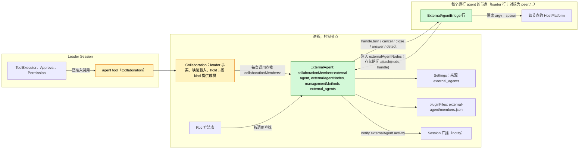
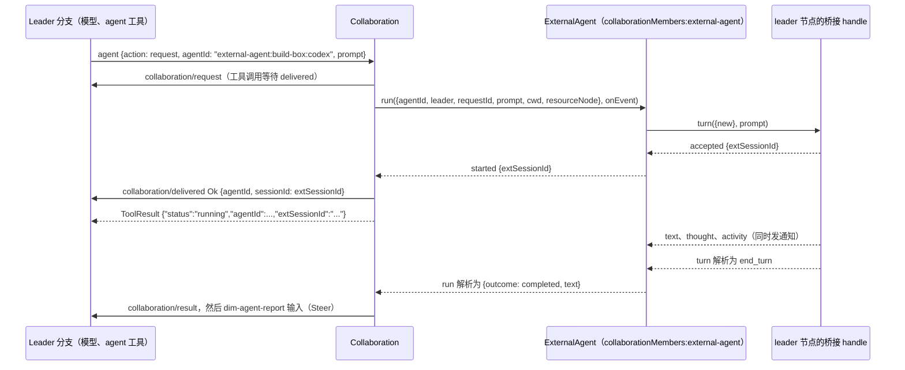
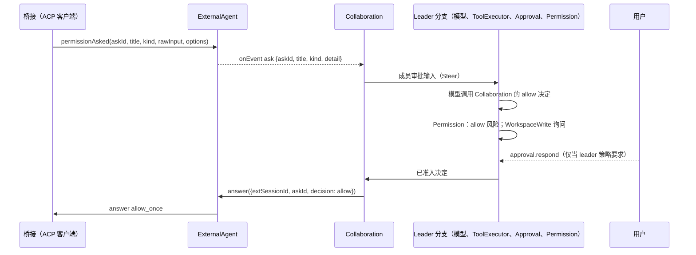
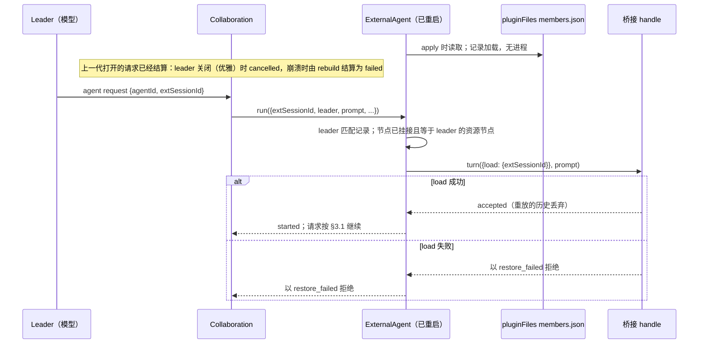

# ExternalAgent

Status: Draft（第二次重设计，[#145](https://github.com/arcships/dim/issues/145)）。它取代 [#182](https://github.com/arcships/dim/pull/182) 的模型框架。维护者的决定记录在[附录 F](#附录-f-已记录的决定)；Ready 前仍缺的内容列在 [§10](#10-ready-状态)。总体设计：[overview §4](../overview.md#4-插件目录)；范围：[ADR 002](../../adr/002-plugin-scope.md)（进程，每节点一个桥接行）。阶段：P3。语言：TypeScript 优先（[overview 附录 C](../overview.md#附录-c-实现语言)）。

ExternalAgent 让 Session 的模型把工作委派给本机安装的编码 agent（Claude Code、Codex、Cursor、OpenCode、ZCode 等），方式与委派给子 agent 相同。外部 agent 是**子 agent，不是模型**：委派的 Session 保留自己的模型，通过 Collaboration 的 `agent` 工具把任务交给外部 agent，之后以成员结果的形式收到它的最终报告。外部 agent 在自己的对话和自己的工具中工作；dim 从不把它的输出当作 dim 的模型输出。

ExternalAgent 是 Collaboration（dim 既有的子 agent 机制，[collaboration.rs](../../../../crates/dim-app-server/src/collaboration.rs)）的又一种**成员 kind**，不是并行的另一套机制。Collaboration 继续拥有委派：`agent` 工具、leader 的 `collaboration/*` 事实、`dim-agent-report` 唤醒输入、取消、重载结算和 leader 的 Session hold。ExternalAgent 提供成员：启动外部对话、把任务和消息带给它、上报活动和权限询问、返回最终文本，并拥有保存外部 session id 的成员记录。外部 agent 为自己的动作请求权限时，询问走 Collaboration 的成员审批路径（[#29](https://github.com/arcships/dim/issues/29)，由 #19 决定）到达 leader 的模型；leader 的决定是一次普通工具调用，受 leader 自己的 Approval 和 Permission 约束。Agent 进程位于 loader 管理的每节点桥接行中。所有契约都是语言中立的命名服务（[ADR 002 D5](../../adr/002-plugin-scope.md#d5-合同语言中立)）；Rust 形式见[附录 G](#附录-g-rust-绑定)。

## 0. 为什么是 Collaboration 成员

| 形态 | 需要什么 | 结论 |
| --- | --- | --- |
| **外部 agent 作为又一种 Collaboration 成员 kind**（本设计） | Collaboration 每次调用按 kind 查找成员提供方，把既有操作路由给它；ExternalAgent 实现该提供方 | 选定（D1）：模型只看到一个委派入口，detached work 只保留一个所有者，其契约已经覆盖投递、结果、唤醒、取消、关闭、重载和重启（[事件驱动流程 §3](../../../architecture/rust-agent/event-driven-flows.md)）。持久化的 `collaboration/*` 数据不变 |
| 由 ExternalAgent 拥有、带自己的 detached-work 事件的 `external_agent` 工具 | 第二个 request/result/wake/cancel 所有者和第二个子 agent 工具 | 拒绝：重复 Collaboration 的所有者规则 |
| 由外部 agent 运行其轮次的成员 Session（#182 框架） | Provider 条目、model kind 以及 ModelHost/ModelProvider 改动，使 agent 的工作表现为 dim 模型输出 | 维护者拒绝：外部 agent 是子 agent，不是模型 |

相对 #182 的变化（本设计取代它）：

| #182（模型框架） | 本设计 |
| --- | --- |
| Provider 条目 `external-agent:<node>:<agent>`、`modelKind:external-agent`、`ModelConnection::Kind`、`ModelCallScope`、ModelHost 查找 | 删除。没有 Provider、Aimux、ModelProvider 或 chunk 映射补充 |
| 由 ExternalAgent 写入的、带外部模型的 Agents profile | 删除。Collaboration 从 ExternalAgent 的目录列出外部 agent |
| 从调用分支 Timeline 做投递决定（记录、cursor、对话初始化） | 删除。成员只收到自己的任务和团队消息，与 dim 成员相同 |
| `external_agent_allow` / `external_agent_reject` 工具、Session 部分和客户端路径 | 删除。询问走 Collaboration 的成员审批路径（§3.2）；ExternalAgent 没有 Session 部分 |
| SessionTitle 和 AuxiliaryModel 对 `external-agent:*` 模型的排除 | 删除，设计和 SessionTitle 包中都已删除 |
| 仅内存的对话记录 | 成员只持久化 `{leaderSessionId, agentId, extSessionId, cwd}`，在 ExternalAgent 重载或 dim 重启后用 ACP `session/load` 或 CLI resume 重新打开（§2、§3.5、D5）。对话内容属于外部 agent |
| 保留 | 挂接到 ExternalAgent 的每节点桥接 loader 行、ExternalAgent 自己发出的通知、Settings 中的业务配置、共享 ACP schema |

## 1. 结构



外部 agent 的连接和活动对话是共享宿主资源，所以 ExternalAgent 是进程插件（ADR 002 D1）。Agent 进程是节点的宿主资源，所以属于该节点上的插件：`ExternalAgentBridge` 是进程插件，每个运行 agent 的节点一个 loader 行。启用 ExternalAgent 时，控制节点的行属于产品 profile。对端节点的行是 `peer:<node>/external-agent-bridge`，只由 PluginManager 的结构操作添加或删除（ADR 002 D4、D6）。节点或其链路不可用时，对端行等待，恢复后重新加载。桥接资源在行卸载时由它自己的 `ctx.effect` 释放。

桥接行注入 `externalAgentNodes`（对端通过链路导入），并在 `apply` 中按引用挂接该节点的 handle；它的 effect 解除挂接，链路断开或运行时退出会关闭引用，ExternalAgent 将其视为已分离。Loader 按顺序运行一行的各代，所以一个节点最多只有一个挂接。这是 #37 接受的注册形式。TypeScript 行不能每次调用查找服务（[sessions-service D1](../appserver/sessions-service.md)、[process TypeScript §5.1](../../../design/process-typescript.md#51-p6p7-access-through-declared-feature-dependencies)），所以 ExternalAgent 从不查找桥接。

Collaboration 是原生实现，每次调用按名称查找 `collaborationMembers:<kind>`，不持有依赖，方式与 Rpc 查找管理方法提供方相同。没有任何核心部分或 Session 依赖 ExternalAgent；它只注入 `settings`、`pluginFiles` 和 `managementMethods`，它们从不重载。ExternalAgent 没有 Session 部分：委派工具和决定工具都属于 Collaboration。

| 部分 | 作用域 | 依赖（`inject`） | 提供 |
| --- | --- | --- | --- |
| `ExternalAgent` | 进程行，控制节点 | `settings`、`pluginFiles`、`managementMethods` | `collaborationMembers:external-agent`；`externalAgentNodes`；把 `external_agents` 注册到 `managementMethods`；Settings 来源 `external_agents`；`externalAgent.activity` 通知 |
| `ExternalAgentBridge` | 进程行，每个运行 agent 的节点一个 | `externalAgentNodes`；该节点的 HostPlatform exec-argv 辅助 | 不按名称提供；通过 `attach` 按引用提供 `BridgeHandle` |
| Collaboration（变更，§9.2） | 既有进程、Session 和分支部分 | 每次调用查找成员提供方 | 把非 Session 成员的操作路由到其 kind 的提供方 |

**依赖的契约。** [`pluginFiles`](../../../../crates/dim-app-server/README.md#trusted-plugin-storage)（存储信封版本 1，安装器预置目录 `external-agent/` 下的一个文件）；Collaboration 的 `agent` 工具、`collaboration/*` 事件和 detached-work 行为，以及 §9.2 的变更和 §9.3 的成员审批路径；Settings 的类型化写入和 `settings.changed`；Session 广播通知及 §9.1 的 TypeScript 绑定；通过 #4 提供的进程行和管理方法（[process TypeScript](../../../design/process-typescript.md)）；每个节点的 HostPlatform exec-argv 辅助和隔离（overview 附录 B，P3）；`SessionConfig.resourceNode`（P3）；向链接节点导出 `externalAgentNodes` 的 rutis 链路。

**这里定义的契约。** 成员提供方契约 `collaborationMembers:<kind>`（与 Collaboration 共同定义，§9.2）及其 `external-agent` 实现；成员存储 payload 格式 1（§2）；`externalAgentNodes` 和 `BridgeHandle`；`externalAgent.activity` 通知；业务配置和方法 `external_agents.*`；与 [AcpGateway](AcpGateway.md) 共享的 ACP schema 和一致性套件（客户端侧）。

Provider、Aimux、ModelProvider、Approval 和 Permission 从不提及本插件。Collaboration 和 Agents 只把成员 kind 和 Session 当作数据。

## 2. 数据与状态

**业务配置**（[ADR 002](../../adr/002-plugin-scope.md) D4）是 Settings 来源 `external_agents` 中的一个用户作用域文档，由 ExternalAgent 的进程行声明：`{ nodes: { <node>: { <agent>: { enabled, description?, executable?, args?, env?, reasoning? } } } }`。Settings 校验并填默认值；ExternalAgent 在使用时读取，并把条目随每次桥接调用传入。它只通过 ExternalAgent 的管理方法写入（A.1）。`env` 值可能保存 agent 的凭据；ExternalAgent 拥有它们（[settings-service §1.2](../appserver/settings-service.md#12-决定密钥归其所有者)），该来源没有项目作用域。变更是一次数据更新加 `settings.changed`，从不触发重载。

**Loader 行。** 每个节点的 `external-agent-bridge` 行是结构性的：它说明哪些节点可以运行 agent，而不是哪些 agent 在那里运行。

**挂接的桥接。** ExternalAgent 内存中的 `node -> handle`，从 `attach` 到 `detach` 或引用关闭。

**成员记录。** 每个外部成员一条。持久部分只是映射；对话内容属于外部 agent：

```text
StoredMember {                  // 持久，成员存储 payload 格式 1
  leaderSessionId: String,      // leader-member 关系：唯一可以寻址它的 Session
  agentId: "external-agent:<node>:<agent>",
  extSessionId: String,         // ACP sessionId 或 CLI conversation id
  cwd: String,
}
LiveMember {                    // 仅内存，进程存在期间
  state: idle | running { requestId },
  activity: [Entry],            // 当前或最近一次请求；供 read 和通知使用
  asks: { askId -> {title, kind, detail} },
}
```

成员只在显式 `close` 时结束。Session 关闭不意味着关闭关联 Session；leader 的关闭、删除、空闲卸载、优雅关机和重启都不关闭、不删除、不清理它的成员。ExternalAgent 不观察 leader Session 生命周期。打开的 run 是 Collaboration 的 detached work，由 Collaboration 既有规则结算；ExternalAgent 只处理收到的 `cancel`。Agent 进程是桥接资源：桥接行的 effect、桥接可选的空闲超时或 `close` 结束它们。记录保留。

删除 leader 也不级联（[Session 删除与 fork](../appserver/session-deletion-and-fork.md)：删除不清理其他所有者的记录）。记录留在存储中。由于每次记录调用都由 `leaderSessionId` 授权，已经没有 Session 能再寻址它；没有专门的清理入口，真有需要时可以以后再加。

**成员存储。** 一个 `pluginFiles` 文件 `external-agent/members.json`，其信封文本是 payload `{"format": 1, "members": [StoredMember]}`。与 Scheduler 的 `scheduler/` 和 Workflow 的 `workflow/` 一样，`external-agent/` 目录由安装 ExternalAgent 的一方在启用前预置：目前是提供行的嵌入宿主，以后是 PluginManager（[process TypeScript §5.2](../../../design/process-typescript.md#52-public-pluginfiles-binding)）；文件 API 不创建父目录。`pluginFiles` 没有 delete 或 list 操作，所以所有记录共用一个文件。ExternalAgent 在每次变更时用一个 `withLock` 租约（读取、修改自己的记录、`replace`）重写它；它是唯一写入者，因此该租约是所有者对自己的状态做串行化。格式决定（AGENTS.md）：payload 格式 1 是新的；不兼容变更提升 `format`。ExternalAgent 在 `apply` 时读取一次。目录缺失（`io`）、文件不可读、`format` 未知或 payload 无效都会使存储进入 `unavailable` 状态：不重写、不重置、不迁移文件，不提供任何已存成员，每个新 `request` 在 spawn 前被拒绝（`member_create_failed: external agent storage is unavailable (<code>)`），状态通过 `external_agents.list` 报告，直到运维修复并重载 ExternalAgent。没有仅内存的退路。凭据从不存于此处。

| 变更 | 写入 | 进程中途死亡 |
| --- | --- | --- |
| 新成员到达 `accepted` | 添加记录，然后发出 `started` | 记录已写、`started` 未发：Collaboration 把操作结算为已关闭；重启后该记录列为 `not_running`，leader 可以给它任务或关闭它 |
| `close` | 删除记录 | 删除未写入：下一次 `close` 删除它 |
| Restore 失败 | 不写 | 记录保留；下一次 `run` 重试 restore |

追加的消息只在内存中。如果进程在下一个 prompt 前死亡，消息丢失；它不会被持久化。

如果 `accepted` 后的写入失败，ExternalAgent 取消该轮，`run` 以存储错误码拒绝 `member_create_failed`；不存在成员。`started` sink 调用本身失败（Collaboration 丢弃了调用）时同样处理：ExternalAgent 取消该轮并删除新记录。

**Timeline。** ExternalAgent 不写任何 Timeline，也不声明事件。Leader 分支只得到 Collaboration 的普通事实：`collaboration/request`、`collaboration/delivered`、`collaboration/message`、`collaboration/cancel`、`collaboration/close`、`collaboration/result`、`dim-agent-report` 输入，以及询问所需的成员审批路径的输入、工具调用和审批事实。它们的数据格式不变：外部成员创建时是 `CollaborationTarget::Agent { agent_id: "external-agent:<node>:<agent>" }`，之后是 `Member { agent_id, session_id: <extSessionId> }`。

**不在 Timeline 中**（原则 §4 规则 9）：配置、挂接、成员记录（在成员存储中）、活动、进程。客户端通过通知看到活动。

## 3. 流程

### 3.1 委派



1. Leader 的模型用外部 `agentId` 调用 `agent` `request`（新成员），或用已有外部成员的 `agentId` + `extSessionId`（下一个任务）。Collaboration 照旧写 `collaboration/request`。
2. Collaboration 按 agent id 的 kind 查找提供方并调用 `run`，一直等待它结算。ExternalAgent 检查条目（已启用、节点已挂接、节点等于 leader 的资源节点、存储可用），创建或复用成员，并用任务文本启动外部轮次。收到 `accepted` 后写记录并发 `started {extSessionId}`，Collaboration 写 `collaboration/delivered`；工具调用返回。`started` 前的拒绝变成 `collaboration/delivered Error`，携带 Collaboration 的错误码和 ExternalAgent 的 detail。`started` 前的停止调用 `cancel {requestId}`；ExternalAgent 停止启动，不写记录。
3. 请求是 Collaboration 拥有的 detached work：它持有 leader Session，leader 的轮次中断不会停止它，它的结果会唤醒 leader。
4. 运行期间，`append` 消息保存在内存中，当前 prompt 结束时作为同一对话的后续 prompt 发送；`steer` 消息让 ExternalAgent 调用 handle 的 `cancel`，等该轮结束后再用消息重新 prompt。prompt 结束且没有待发消息时，请求完成。
5. `run` 以 outcome 和最终文本解析（A3）。Collaboration 完全按 Session 成员的方式写 `collaboration/result` 和 `dim-agent-report` 输入。

成员在 leader 的 cwd 和 leader 的资源节点上工作，与 Collaboration 的 Session 成员相同。一个成员同一时间只做一个任务：对运行中的成员调用 `run` 会以 `busy` 拒绝。

### 3.2 权限询问

Agent 自己的动作不是 dim 工具调用，所以 dim 的 Approval 不接纳它（[ADR 003](../../adr/003-approval-scope.md) D1）。它是成员的工作，#19 已决定成员审批去向：作为输入进入 leader 分支，由 leader 的模型用 Collaboration 工具决定，该调用经过 leader 自己的 Approval 和 Permission（[overview 附录 B](../overview.md#附录-b-现有插件的补充)，Collaboration）。外部成员的询问使用同一路径（D2）。



- ExternalAgent 提供 `title`、粗略的 `kind`（A5）和 `detail`（agent 的原始输入）。Collaboration 拥有输入文本、决定工具及其结果。
- Allow 选择 `allow_once` 选项，reject 选择 `reject_once`；缺少所需选项时回答 agent `cancelled`。从不选择 `*_always`。
- 询问无回答结束时（run 被取消或结束、agent 撤回、桥接分离、ExternalAgent 卸载），ExternalAgent 若仍在等待就回答 agent `cancelled` 并发 `askEnded`；Collaboration 撤回未应用的输入，之后的决定得到 `not_pending`。
- 总是存在委派分支。它被停止或关闭时，Collaboration 取消 run，从而结束询问。ExternalAgent 没有自己的客户端路径：用户通过 leader 的 Approval 参与，前提是 leader 策略询问。
- `agent` 工具保持现有风险分类；不新增风险类别。不能调用 `agent` 的 leader 不能委派。调用被允许后，leader 的 Permission 约束它决定的询问，不约束 agent 未询问就执行的动作。适配器以 agent 最常询问的模式启动（A6）；节点的 HostPlatform 隔离是执行边界。
- 非交互 CLI 适配器没有请求通道。它们以 agent 自己的非自动批准模式启动，因此 agent 拒绝它无法询问的动作（A6）。

### 3.3 取消、关闭、中断

取消是显式调用，从不依赖 abort：rutis-bridge 会连同迟到回复一起丢弃被 abort 的调用。因此 `run` 和 `turn` 一直被 await 到结算；例外是 Collaboration 自己的重载和 leader 关闭，它们调用 `cancel`、自行结算并丢弃调用。每个触发点一行：

| 操作 | 效果 |
| --- | --- |
| `agent` `cancel` | Collaboration 调用提供方的 `cancel` 并继续 await `run`；ExternalAgent 调用 handle 的 `cancel`，发送 ACP `session/cancel`（或向 CLI 发信号），并把待处理询问回答为 `cancelled`；agent 以 stop reason `cancelled` 结束 prompt（或 CLI 退出）时该轮结束，这是 agent 自己的终态事实；随后 `run` 解析为 `cancelled`，报告写 `cancelled by leader`。成员保留，可以接下一个任务 |
| Agent 忽略取消 | `run` 保持打开，直到 agent 结束 prompt；leader 可以 `close` 该成员，`close` 调用 handle 的 `close` 并结束进程 |
| `agent` `close` | 提供方 `close`：运行中先如上取消，然后 `BridgeHandle.close`，删除记录 |
| Leader 轮次 `stop/interrupt` | `delivered` 前：Collaboration 既有规则抑制操作并调用 `cancel {requestId}`；`run` 以 `cancelled` 拒绝，`delivered` 是 `interrupted` 错误。`delivered` 后：不影响运行中的任务（detached-work 契约） |
| Leader 分支停止（分支作用域中断） | Collaboration 调用 `cancel`，await `run`，并按它为 Session 成员预设的结果结算 |
| Leader 关闭：业务 close、delete 前的 close、优雅关机 | ExternalAgent 不观察它。Collaboration 按既有 detached-work 规则取消打开的 run，结算为 `cancelled (leader closed)` 并丢弃调用，不等待外部进程。记录和进程保留；进程由桥接行、桥接空闲超时或显式 `close` 结束 |
| Leader 空闲卸载 | 打开的请求持有 leader，所以没有打开的 `run`；ExternalAgent 不做任何事 |
| Collaboration 带打开的 run 重载 | Collaboration 调用 `cancel`，不等待就结算为 `failed (reloading)` 并丢弃调用；ExternalAgent 不清理 |
| Leader Session 删除 | 不级联；记录保留但不可寻址（§2）；ExternalAgent 不做任何事 |

### 3.4 桥接生命周期

| 事件 | 谁行动 | 效果 |
| --- | --- | --- |
| 产品 profile 启用 ExternalAgent | Loader | 控制节点桥接行在 ExternalAgent 之后加载并挂接 |
| PluginManager 在对端节点 `n` 启用桥接 | Loader | 添加 `peer:n/external-agent-bridge`；链路可用后该行在 `n` 加载，导入 `externalAgentNodes` 并挂接 `n`；ExternalAgent 对它运行 `detect` |
| 到 `n` 的链路断开 | Loader（对端行行为） | 行停止：其 effect 取消轮次并杀死进程；引用关闭，所以 `n` 上打开的 `run` 以 `external_agent_exited` 拒绝。记录保留，但没有进程。直到该行再次挂接，`n` 的新成员以 `member_create_failed` 拒绝，已有成员以不可用拒绝（A.2） |
| 节点上启用或禁用 agent | ExternalAgent（业务配置） | 不改变行、不重载；目录变化；被禁用 agent 的请求被拒绝；运行中的成员完成 |
| 桥接崩溃或重载 | Loader | 与链路断开相同，局限于该节点 |
| ExternalAgent 重载 | Loader | 桥接随之重载；每个打开的 `run` 以 `provider_unavailable` 拒绝；记录从存储加载且没有进程，下次使用时重开（§3.5） |

每个成员一个 ACP 进程，从首次使用到成员关闭、桥接行卸载或桥接空闲超时结束它。Leader 关闭或空闲卸载不会结束它。

### 3.5 重载或重启后的恢复



- **结算属于其所有者。** 此时打开的请求只由 Collaboration 结算一次：ExternalAgent 重载使 `run` 以 `provider_unavailable` 拒绝（结算为 `failed`）；优雅重启按 Collaboration 既有 close 规则结算为 `cancelled (leader closed)`；崩溃留给 Collaboration 的 rebuild，结算为 `failed`。ExternalAgent 从不为上一代的 run 报告结果，也从不恢复它。Restore 只带回对话；成员把下一个请求当作新请求。
- **记录加载后没有进程。** 在请求需要对话前不 spawn。`message` 返回 `member_not_running`；`read` 返回空页；`close` 不 spawn 就删除记录。
- **ACP。** 桥接 spawn agent 并发送 `session/load {sessionId: extSessionId, cwd, mcpServers: []}`。它不检查能力标志；每个受支持的接入都必须实现 `session/load`。load 重放的更新被丢弃。随后用 `session/prompt` 发送任务。
- **CLI。** 每个受支持的 CLI 适配器都有 resume 形式（例如 `--resume <id>`）；桥接在下次 spawn 时用 `extSessionId` 调用它。
- **失败是明确的错误，绝不静默新建对话。** `session/load` 或 resume 失败使 `run` 在 `started` 前以 `restore_failed` 和 detail 拒绝；记录保留，下一次请求重试。节点未挂接属于不可用，不是 restore 失败：`node_unavailable`，记录保留。
- **所有权跨重启保留。** 存储的 `leaderSessionId` 授权每次操作（§9.2），所以不需要向 Collaboration 重新注册。

## 4. 时序与冲突

Collaboration 的事实决定到达 leader 的一切顺序；ExternalAgent 的内存和存储只决定自己成员的顺序。

| 场景 | 顺序 | 结果 | 所有者 |
| --- | --- | --- | --- |
| Leader 轮次中断，请求尚未投递 | interrupt < `delivered` | Collaboration 既有规则：抑制操作并取消 run | Collaboration |
| 询问等待 leader 决定时取消 | — | 询问以 `cancelled` 结束；未应用的询问输入撤回；之后的决定 `not_pending`；报告 `cancelled` | ExternalAgent、Collaboration |
| 决定在取消前已准入 | — | 先投递给 agent，再取消 | ExternalAgent |
| Leader 处于 ReadOnly | — | `agent` 工具未分类，ReadOnly 不能调用；不能委派 | Permission |
| 询问长时间待决 | — | 没有 dim 超时；leader 可以取消（A7） | Leader |
| 运行时追加消息 | `collaboration/message` | 保存在内存；作为同一请求的下一个 prompt 发送 | ExternalAgent |
| 运行时 steer 消息 | `collaboration/message` steer | 调用 handle `cancel`；轮次结束后该消息作为下一个 prompt；已产生的文本留在 activity 中 | ExternalAgent |
| `cancel {requestId}` 在 steer 等待重新 prompt 时到达 | cancel < re-prompt | `run` 解析为 `cancelled`；持有的 steer 消息丢弃 | ExternalAgent |
| 给没有进程的成员发消息 | — | `member_not_running` | ExternalAgent |
| 请求运行中的成员 | — | `busy` | ExternalAgent |
| ExternalAgent 在 run 中重载 | — | `run` 以 `provider_unavailable` 拒绝；Collaboration 写 `collaboration/result` failed；记录重载且无进程（§3.5） | Collaboration、ExternalAgent |
| Collaboration（leader）在 run 中重载 | — | Collaboration 取消并不等待地结算为 `failed (reloading)`；成员保留 | Collaboration |
| Leader 在 run 中关闭 | leader close | Collaboration 取消、结算为 `cancelled (leader closed)` 并丢弃调用；ExternalAgent 不做任何事；记录和进程保留 | Collaboration |
| 优雅重启发生在 run 中 | shutdown 关闭 leader | 同 leader close；重启后记录加载且无进程，下一次请求 restore | Collaboration、ExternalAgent |
| 崩溃发生在 run 中 | — | 桥接进程随旧进程结束；Collaboration 的 rebuild 写打开的请求为 `failed`；记录加载且无进程 | Collaboration、ExternalAgent |
| Leader 被删除 | delete 的 close < delete | 不级联：记录保留，没有 Session 能寻址它（§2） | ExternalAgent |
| 桥接行在 run 中停止 | — | `run` 以 `external_agent_exited` 拒绝；结果 failed；记录保留 | 桥接、Collaboration |
| Leader Session 被 fork | — | fork 有另一个 Session id，按 not in the team 拒绝，与 Collaboration 的 fork 规则一致（[#127](https://github.com/arcships/dim/issues/127)） | ExternalAgent |

其余行见[附录 B](#附录-b-完整冲突表)。

## 5. 模型看到什么

全部通过 Collaboration 既有工具结果和输入到达（`ToolResult.content` 是模型读到的内容）：

| 时机 | Leader 模型读到 |
| --- | --- |
| `list` | `agents` 中的外部 agent：`{"agentId": "external-agent:build-box:codex", "name": "Codex (build-box)", "description": "..."}`；`participants` 中的外部成员及其 `extSessionId` 和状态 |
| `inspect` | `{"agentId": ..., "profile": {"name", "description", "kind": "external-agent", "node", "agent", "version"}}` |
| `request` 被接受 | `{"status": "running", "agentId": "external-agent:build-box:codex", "extSessionId": "..."}`；工作 detached 继续 |
| `request` 被拒绝 | Collaboration 的拒绝文本，例如 `member_create_failed: codex is not enabled on build-box`、`member_create_failed: node build-box is unavailable`、`member_create_failed: codex needs its own login (run "codex login" on build-box)`、`busy: ...`、`team_member_not_found: ...` |
| 进度 | 不推入上下文。`read` 返回成员当前或最近一次请求的 activity，`{entries: [{seq, kind: "text" \| "thought" \| "tool" \| "ask", ...}], nextCursor}`；进程结束后，更早的活动不保留 |
| 权限询问 | Collaboration 的成员审批输入（§3.2），包含 agent、成员、动作 title、kind 和 detail |
| 最终报告 | `dim-agent-report` 输入：`Status: completed\|failed\|cancelled.`、最终文本预览，以及如何用 `result` 读取完整结果 |
| `result` | 来自 leader 自己的 `collaboration/result` 的 `{"resultId", "result": {agentId, extSessionId, text, outcome}}` |
| 取消 | 工具返回 `{"status": "cancelled", ...}`，然后 `cancelled` 报告 |
| 启动后的错误 | `failed` 报告，原因写明（`external agent exited`、`node build-box disconnected`、`external agent reloaded; the member can take a new task`、`refusal`、`max_turn_requests`） |
| Restore 失败 | `restore_failed: could not restore the conversation of Codex (build-box): ...; the member record is kept` |
| Provider 或节点不可用 | `closed: member provider external-agent is unavailable; try again later`（Collaboration 的通用文本）或 `closed: node build-box is unavailable; try again later`（提供方的 detail） |

外部 agent 只看到自己的任务文本、团队消息（每条带发送者前缀：leader，或按名字的队友，§9.2）和自己的对话。它从不看到 leader 的历史、dim prompt、工具声明或其他插件数据。Leader 的上下文只在报告和询问输入被应用后持有它们，撤回的询问输入从不进入。

## 6. 接口（摘要）

| 接口 | 类型 | 用途 |
| --- | --- | --- |
| `collaborationMembers:external-agent` | 进程服务，Collaboration 每次调用查找 | 目录、成员和成员操作（[A.2](#a2-成员提供方)） |
| `externalAgentNodes` | 进程服务，由桥接行注入 | 节点 `BridgeHandle` 的 `attach` / `detach`（[A.3](#a3-桥接与适配器)） |
| `BridgeHandle` | 一个桥接行的按引用对象 | 节点上的 `detect`、`turn`、`cancel`、`close`、`answer`（[A.3](#a3-桥接与适配器)） |
| `externalAgent.activity` | Leader Session 上的 Session 广播通知，来源 `ExternalAgent` | 客户端实时进度（[A.4](#a4-活动与通知)） |
| `external_agents.list` / `set_enabled` / `configure` | `managementMethods`，命名空间 `external_agents` | 检测、启用、配置（[A.1](#a1-管理方法)） |
| ACP schema 和一致性套件 | 与 AcpGateway 共享 | 客户端侧（[A.5](#a5-共享-acp-schema)） |

**流式调用。** `run` 和 `BridgeHandle.turn` 产生项目序列。在 rutis-bridge 0.16.0 上，它们是 `async` 方法，请求按引用携带 sink 函数（`onEvent`、`onUpdate`）：被调方每个项目调用一次 sink，并在下一次前 await 每次调用；序列结束时调用解析，出错时以结束它的错误拒绝。它们不接受 AbortSignal：abort 会连同迟到回复一起丢弃调用，所以取消是单独的 `cancel` 方法，调用一直 await 到结束。已关闭的引用使调用失败。

**客户端。** `agentId` 含 `:` 的成员是提供方成员（`<kind>:<rest>`）；Agents 的 id 是 UUID（[agents.rs](../../../../crates/dim-app-server/src/agents.rs) `create`），从不含 `:`。dim 成员的 id 是它的 `sessionId`；外部成员的 id 是 `extSessionId`，它不是 dim Session。Collaboration 持久化的 `sessionId` 字段承载外部 `extSessionId`；`agent` 工具结果把它命名为 `extSessionId`。客户端不用 `extSessionId` 调用 `session.attach`、`session.history` 或 `session.stop`。它的视图是 leader 自己的 `collaboration/*` 事实，加上客户端挂接 leader 时收到的 `externalAgent.activity` 通知。与任何 detached work 一样，用户没有按成员停止的操作：`session.stop` 是轮次作用域，已投递的 Collaboration 工作会存活。用户的选择是在 leader 打开时让 leader 的模型 `cancel` 或 `close` 该成员。关闭 leader 不会关闭它的成员。

## 7. 安全

- 外部 agent 用自己的账号和工具运行。`agent` 工具保持现有风险分类；不新增风险类别。不能调用它的 leader 不能委派。委派被允许后，leader 的 Permission 约束它决定的询问，不约束 agent 未询问就执行的动作（§3.2）。节点的 HostPlatform 隔离是执行边界；适配器以 agent 最常询问的模式启动（A6）。
- 询问的权限属于 leader：决定是 leader 的工具调用，需要 leader 预设和规则要求的任何条件。从不选择 `*_always`。
- 凭据是 `env` 值，ExternalAgent 在轮次时从自己的用户作用域文档读取，并通过已认证链路传给桥接。它们从不写入 Timeline、通知、诊断、activity、回复或成员存储。
- 启用 agent 是业务配置，不是审批（[ADR 003](../../adr/003-approval-scope.md) D2），只通过管理方法修改，管理方法从不提供给配对设备。模型不能启用 agent。向节点添加桥接是 PluginManager 的结构操作。可执行文件在节点上解析，从不来自项目文件。
- `externalAgentNodes` 只通过已认证链路导出；桥接只挂接自己的节点，挂接不运行任何东西。

## 8. 规则检查

规则：[原则 §1 和 §4](../../../architecture/rust-agent/principles.md)、[ADR 002](../../adr/002-plugin-scope.md) D1–D5。

| 规则 | 本文如何遵守 |
| --- | --- |
| §4.1 他人状态的命令事件 | ExternalAgent 不写事件。Leader 事实属于 Collaboration；决定是 leader 的工具调用，由 leader 的 Approval 和 Permission 决定；询问输入的撤回是 Collaboration 的 `input/withdraw` 命令。 |
| §4.2 交付后不收回 | 交给 agent 的任务只取消，不收回；已应用的询问输入从不撤回，迟到的决定得到 `not_pending`。 |
| §4.3 before 回调 | 不适用。 |
| §4.4 核心机制不带业务含义 | Collaboration 按 kind 查找提供方，不提及任何插件；Session 关闭或删除不增加生命周期后果。`agent` 工具不新增风险类别。 |
| §4.5 读取整个批次 | ExternalAgent 不读 Timeline。 |
| §4.6 模型上下文只持有已交付事件 | Leader 只通过已应用的报告、询问输入和工具结果看到外部工作（§5）。 |
| §4.7 只用公开事件和服务 | ExternalAgent 通过 `collaborationMembers` 和管理方法被访问；它通过挂接的 handle 访问桥接，通过 `notify` 访问客户端。 |
| §4.8 默认不改基础设施 | Timeline、Dispatcher、信封、loader 和门面不变。请求的是通知绑定（§9.1）和成员提供方族的原生投影（§9.5）；Collaboration 项是插件变更。 |
| §4.9 只有后续决定要用的事实进 Timeline | 请求、投递、结果和决定是 Collaboration 的事实；成员记录在 ExternalAgent 自己的存储中。配置、activity 和进程不在 Timeline。 |
| §1 Capability 与 App Server 边界 | 只有进程行；agent 进程是桥接行资源，由其 effect 释放；挂接与行同寿；服务图无环（桥接 → ExternalAgent → Settings、pluginFiles；Collaboration 每次调用查找）。 |
| ADR 002 D1 | 活动对话和成员记录是共享宿主状态（进程）；agent 进程属于节点（每节点桥接行）。按 Session 的工作仍属于 Collaboration。 |
| ADR 002 D2 | 没有 wiring 模块：Collaboration 和 Rpc 每次按名称查找；桥接通过注入的服务挂接。 |
| ADR 002 D3 | ExternalAgent 只注入从不重载的服务；除自己的桥接外没有东西依赖 ExternalAgent，所以它缺失时只影响外部委派。 |
| ADR 002 D4 | Agent 条目是业务配置；桥接行是结构性的，由 PluginManager 修改。 |
| ADR 002 D5 | `collaborationMembers`、`externalAgentNodes`、`BridgeHandle`、通知、方法和存储格式都是命名服务和数据。 |

## 9. 向机制所有者提出的需求

请求两个绑定：TypeScript 通知绑定（§9.1）和成员提供方族的装配投影（§9.5）。其余是 Collaboration（一个插件）的变更，列出来供其所有者接受。

### 9.1 Session 通知的 TypeScript 绑定

| 项 | 内容 |
| --- | --- |
| 受阻于 | ExternalAgent 拥有成员 activity，必须在自己的变更后发 `externalAgent.activity`（[Session 通知 §4](../appserver/session-notices.md#4-发出)：所有者发出）。它的进程行是 TypeScript，没有绑定 |
| 考虑过的机制 | Collaboration 转发 activity：它不拥有状态；Timeline 事件：只用于显示的数据，被原则 §4 规则 9 禁止；只有 `read`：客户端没有实时显示 |
| 需要 | 供 TypeScript 进程行使用的 `notify(sessionId, {source, kind, data})`，原生契约不变：同步、无依赖、无人监听时丢弃、不重放 |
| 对顺序、批次、中断、重载的影响 | 无：通知不是事件 |
| 所有者 | Session 通知 / #4 TypeScript 绑定（dim runtime） |

### 9.2 Collaboration 成员提供方

Collaboration 的成员目前是 dim Session：每个操作都经过成员的 `Session`（input、idle、stop、history）。变更增加由其他插件提供的成员，按 kind 区分：

- 形如 `<kind>:<rest>` 的 `agentId`，其 kind 有提供方（`collaborationMembers:<kind>`，每次调用按名称查找，无依赖）时，是提供方成员。Agents 的 id 是 UUID，从不含 `:`。
- `list` / `inspect` 增加提供方的 `catalog()` 和 `members()` 条目；`request`、`message`、`cancel`、`close` 和 `read` 调用提供方（A.2）；`result` 不变（读 leader 自己的事实）。
- `collaboration/delivered` 在提供方的 `started` 时写；`collaboration/result` 在 `run` 解析或拒绝时写。Collaboration 停止或中断 Session 成员的地方改为作用于提供方：`delivered` 前的轮次中断、`cancel` 和分支停止都调用 `cancel`，按传给 `run` 的 `requestId` 寻址，所以 run 可以在 `started` 前取消；重载调用 `cancel` 并不等待地结算为 `failed (reloading)`。Leader 关闭、空闲卸载或删除不调用提供方清理：Collaboration 按既有 detached-work 规则结算打开的 run，并保留成员记录和进程。Leader hold、唤醒输入和 rebuild 结算不变。覆盖新成员操作且在 `started` 前的停止调用 `cancel {requestId}`；ExternalAgent 停止启动，不写记录。
- **记录所有者持有关系。** Collaboration 不为提供方成员保留关系。ExternalAgent 存储的 `leaderSessionId` 就是关系，每次提供方调用都携带 Collaboration 为调用方解析出的 leader：调用方自己领导时就是它，dim 成员联系外部队友（`message`、`read`）时是该成员团队的 leader，`from` 标明发送者。提供方按该 leader id 回答；另一个 leader、fork 或未知 id 得到 `not_in_team`，报告为 Collaboration 既有的 `team_member_not_found`，不泄露成员是否存在。这足够了，因为授权和枚举是提供方已经拥有并持久化的记录的纯函数；注册或对账协议会把这些记录复制到第二个所有者，并在每次重启后需要重建。
- **Kinds。** Collaboration 从装配获得配置的 kinds：装配读取各行声明的 `collaborationMembers:<kind>` 服务，并把名称传给 Collaboration。Collaboration 不提及任何插件。`list` 对每个找到提供方的已配置 kind 调用 `catalog` 和 `members`。这需要 §9.5 的装配项。
- **提供方不可用。** 某个 kind 没有找到提供方时，对它的操作以 Collaboration 既有的 `closed` 和通用 detail `member provider <kind> is unavailable; try again later` 拒绝；不写任何东西，`list` 省略该 kind，提供方恢复后同一个 `extSessionId` 又可工作。
- **不新增风险类别。** `agent` 工具保持现有分类，不能调用它的 leader 不能委派。本设计不包含 Workflow 变更。Leader 关闭不调用提供方清理：Collaboration 结算打开的 run 并丢弃调用；记录和进程保留。
- 事件和持久格式不变：target 和成员 id 已经是字符串。

### 9.3 成员审批路径接受提供方的询问

leader 侧的转交、决策工具和用户展示要求见 [Collaboration 成员审批设计](../../../design/subagent-tool-approval.md)。对于提供方成员，该路径从提供方 `run` 的事件（`ask`、`askEnded`）接收询问，并通过提供方的 `answer` 按 `extSessionId` 返回决定。允许和拒绝使用该路径定义的工具与风险分类；本文仅定义提供方的询问和回答如何接入。

### 9.4 链路断开期间导入的服务保持登记（#5）

撤回：rutis 是外部依赖，所以不向它提需求。离线节点遵循 rutis 既有行为与 [overview §6.3](../overview.md#63-多节点)：链路断开会停止对端桥接行，其 effect 结束进程并关闭 handle 引用（§3.4）。其他文档链接到 §9 以引用该决定。

### 9.5 成员提供方的原生投影（装配）

| 项 | 内容 |
| --- | --- |
| 受阻于 | Collaboration（原生）每次调用 `MemberProvider`，并需要配置的 kinds。ExternalAgent 的进程行是 TypeScript。装配不把 TypeScript 行声明的任何服务投影为原生类型：工具和方法命名空间注册到各自的所有者（`toolRegistry`、`sessionMethods`、`managementMethods`；[session_typescript.rs](../../../../crates/dim-app-server/src/session_typescript.rs)），其他声明服务只注册为裸共享 `HostDispatch`，而 `CollaborationPlugin::new` 不接收 kinds |
| 考虑过的机制 | 从 Collaboration 调用裸 `HostDispatch`：没有类型化契约、没有 method-mode 检查，流式 `run` 需要按引用传入原生 sink；用 Collaboration 的 Settings 来源列出 kinds：重复行已声明的内容，且可能与行漂移 |
| 需要 | 装配在进程行（TypeScript 或原生）上接受 `collaborationMembers:<kind>` 族：在配置边界检查声明的方法模式，把 TypeScript 提供方投影为原生 `MemberProvider`（附录 G；`run` 按引用传 sink，其他方法 `async`），并把配置的 kinds 传给 `CollaborationPlugin::new` |
| 对顺序、批次、中断、重载的影响 | 对 Timeline 无影响。提供方行的重载按可选提供方的常规方式逐调用处理：Collaboration 找不到提供方并以 `closed` 拒绝 |
| 所有者 | App Server 装配 / #4 TypeScript 绑定 |

## 10. Ready 状态

| 项 | 需要谁 |
| --- | --- |
| 接受 §9.2：成员提供方、提供方侧关系、按 `requestId` 取消、配置的 kinds；leader 关闭不做提供方清理 | Collaboration 所有者 |
| 接受 §9.5：把 TypeScript 进程行的 `collaborationMembers:*` 原生投影，并把配置的 kinds 传给 Collaboration | App Server 装配所有者（#4 绑定） |
| 按 §9.3 接入[成员审批路径](../../../design/subagent-tool-approval.md)（#19）；原生成员的权限继承不配置外部提供方 | Collaboration 所有者 |
| 接受 §9.1（TypeScript `notify` 绑定） | Session 通知所有者（dim runtime） |
| 客户端按 `agentId` 识别外部成员，只在提供方视图中使用 `extSessionId`，绝不把它当 dim Session（[§6](#6-接口摘要)，“客户端”） | 客户端所有者 |
| 每个受支持的接入都实现 ACP `session/load` 或 CLI resume；不做运行时能力检查 | ExternalAgent 接入所有者 |
| P3 前置：`SessionConfig.resourceNode`、HostPlatform exec-argv 辅助和隔离、`externalAgentNodes` 的链路导出 | P3 所有者 |

[#241](https://github.com/arcships/dim/issues/241) 不再适用：ExternalAgent 不贡献工具。

## 附录 A. 接口细节

### A.1 管理方法

ExternalAgent 进程行注册到 `managementMethods` 的命名空间 `external_agents`：

| 方法 | 参数 | 结果 | `mutating` |
| --- | --- | --- | --- |
| `external_agents.list` | `refresh?` | `revision`，即 `external_agents` 文档的 Settings revision，`set_enabled` 与 `configure` 把它作为 `expectedRevision` 传回；存储状态（`available`、带错误码的 `unavailable`）；每个已配置或已挂接节点：`attached` 或 `unavailable`；每个 agent：executable、version、protocol（ACP 或 CLI）、enabled、description、配置（仅引用） | 否 |
| `external_agents.set_enabled` | `node`、`agent`、`enabled`、`expectedRevision?` | 新状态 | 是 |
| `external_agents.configure` | `node`、`agent`、`description?`、`executable?`、`args?`、`env?: {name: value}`、`reasoning?`、`expectedRevision?` | 新配置 | 是 |

检测在桥接挂接时和 `refresh` 时调用其 `detect`（A1）。检测到的 agent 在启用前保持禁用（A2）。写入通过 Settings 的类型化写入和读取到的 revision 进行（CAS）；调用方把上次读到的 `revision` 作为 `expectedRevision` 传回，过期即 `settings_conflict`（[Settings 服务 §6](../appserver/settings-service.md#6-错误)）且不写入任何内容，不传时由所有者自行读取后 CAS。ExternalAgent 应用 `settings.changed`，不重载。启用不写其他内容：目录由该文档派生。

### A.2 成员提供方

`collaborationMembers:<kind>`，进程作用域；ExternalAgent 提供 kind `external-agent`。每次调用携带 `leader: {sessionId}`，即 Collaboration 为调用方解析出的 leader。寻址成员记录的调用（带 `extSessionId` 的 `run`、`message`、`answer`、`read`、`close`）由存储的 `leaderSessionId` 授权；`catalog` 是该 leader 对节点已启用 agent 的读取，不带 `extSessionId` 的 `run` 创建由它拥有的记录，`cancel` 按 `(leader, requestId)` 寻址该 leader 自己的 run，`members` 按它选择记录。

| 方法 | 模式 | 请求 | 回复 |
| --- | --- | --- | --- |
| `catalog` | async | `{leader, resourceNode}` | `[{agentId, name, description, profile}]`：该节点已启用的 agent |
| `members` | async | `{leader}` | 该 leader 的 `[{agentId, extSessionId, name, status: running \| idle \| not_running}]` |
| `run` | async，流式（§6） | `{agentId, extSessionId?, leader: {sessionId, branchId}, requestId, prompt, cwd, resourceNode}`，`onEvent` | 事件 `{started: {extSessionId}}`、`{activity: Entry}`、`{ask: {askId, title, kind, detail}}`、`{askEnded: {askId, outcome}}`；解析 `{outcome: completed \| failed \| cancelled, reason?, text}`；拒绝 `{code, detail}` |
| `cancel` | async | `{leader, requestId}` | `{}`；该 `requestId` 的待决 `run` 在 agent 结束 prompt 时解析为 `cancelled`；`started` 前停止启动，`run` 以 `{code: cancelled}` 拒绝 |
| `message` | async | `{extSessionId, leader, from: {role: leader \| member, name}, content, mode: append \| steer}` | `{}` 或 `member_not_running` |
| `answer` | async | `{extSessionId, leader, askId, decision: allow \| reject}` | `{outcome: allowed \| rejected}` 或 `{code: not_pending}` |
| `read` | async | `{extSessionId, leader, after, limit}` | `{entries, nextCursor}`；成员没有进程时为空 |
| `close` | async | `{extSessionId, leader}` | `{}` |

错误码映射到 Collaboration 的拒绝：

| 提供方错误码 | 何时 | Collaboration |
| --- | --- | --- |
| `not_enabled`、`wrong_node`、`not_installed`、`auth_required`、`launch_failed`、`storage_unavailable` | 新成员，`started` 前 | `member_create_failed` 加 detail |
| `node_unavailable` | 新成员 | `member_create_failed` 加 detail |
| `node_unavailable` | 已有成员（记录保留） | `closed`，detail 为 `node <node> is unavailable; try again later` |
| `busy` | 请求运行中的成员 | `busy` |
| `cancelled` | `started` 前取消 | `delivered` 错误 `interrupted`（或 leader 关闭时的 `closed`），按 Collaboration 既有规则 |
| `not_in_team` | 该 leader 没有记录（另一个 leader、fork、未知 id） | `team_member_not_found` |
| `restore_failed` | 重开失败（记录保留） | `restore_failed` 加 detail |
| `member_not_running` | 无进程时发消息 | `member_not_running` |

对没有进程的记录调用 `run` 会先重开它（§3.5）。`text` 是请求最后一个 prompt 中最后一次工具活动之后的 agent 消息文本；如果该 prompt 没有使用工具，则是该 prompt 的全部消息文本（A3）。ExternalAgent 给每条发送的消息加发送者前缀（`Message from your team leader:` 或 `Message from teammate <name>:`）。

### A.3 桥接与适配器

`externalAgentNodes`，进程作用域，由 ExternalAgent 提供并导出到链接节点：

| 方法 | 模式 | 请求 | 回复 |
| --- | --- | --- | --- |
| `attach` | async | `{node, handle: BridgeHandle}` | `{}` |
| `detach` | async | `{node}` | `{}` |

`BridgeHandle`，按引用，每个桥接行一个：

| 方法 | 模式 | 请求 | 回复 |
| --- | --- | --- | --- |
| `detect` | async | `{adapters}` | `[{agent, executable, version, protocol: acp \| cli}]` |
| `turn` | async，流式 | `TurnSpec {turnId, agent, config（条目及其 env）, cwd, conversation: {new} \| {continue: {extSessionId}} \| {load: {extSessionId}}, prompt: text}`，`onUpdate` | `{accepted: {extSessionId}}`、`{text}`、`{thought}`、`{activity: {id, title, status}}`、`{permissionAsked: {askId, title, kind, rawInput?, options}}`、`{permissionWithdrawn: {askId}}`；解析 `{end: end_turn \| max_tokens \| max_turn_requests \| refusal \| cancelled}`；拒绝 `{code}`（`{load}` 在 `accepted` 前为 `restore_failed`） |
| `cancel` | async | `{turnId}` | `{}`；agent 结束 prompt 时待决 `turn` 解析为 `{end: cancelled}` |
| `close` | async | `{extSessionId}` | `{}`；幂等；杀死该对话的进程；其上待决的 `turn` 以 `external_agent_exited` 拒绝 |
| `answer` | async | `{turnId, askId, answer: allow \| reject \| cancelled}` | `{}` |

| 适配器 | 打开 | 轮次 | 取消 |
| --- | --- | --- | --- |
| ACP 客户端 | 用节点的 HostPlatform exec-argv 辅助 spawn（cwd、隔离）；`initialize` 关闭 fs 和 terminal 客户端能力；`session/new {cwd, mcpServers: []}`，或对 `{load}` 发送 `session/load {sessionId: extSessionId, cwd, mcpServers: []}`（丢弃重放的更新） | `session/prompt`；`session/update` → text、thought、activity；`session/request_permission` → `permissionAsked` | `session/cancel`，把待处理请求回答为 `cancelled`；prompt 响应结束该轮，之后的 prompt 只在其后发送 |
| 非交互 CLI | 每个 prompt spawn；continue 和 `{load}` 都用适配器的 resume 形式加 `extSessionId` | prompt 走 stdin，结构化输出按适配器解析；限制性权限标志（A6） | 中断信号；退出结束该轮 |

每个成员一个 ACP 进程，从首次使用到成员关闭、桥接行卸载或桥接空闲超时。Leader 关闭或空闲卸载不会结束它。适配器定义是桥接包内的数据。

结果映射：`end_turn` → `completed`；`max_tokens`、`max_turn_requests`、`refusal`、CLI 非零退出 → `failed` 加原因；`cancelled` → `cancelled`。

### A.4 活动与通知

每个 `text`、`thought`（按块折叠）、`activity` 和询问成为成员当前或最近一次请求的 activity 条目 `{seq, kind, ...}`（下一个请求开始时清空），并在 leader Session 上成为 `externalAgent.activity {extSessionId, agentId, entry}` 通知（来源 `ExternalAgent`，§9.1）。通知不重放；之后挂接的客户端只看到新活动，leader 的模型用 `read` 读取当前请求的 activity。

### A.5 共享 ACP schema

固定协议版本、各语言生成类型，以及与 AcpGateway 共享的基于 transcript 的一致性套件：initialize、new/load、prompt、流式更新、prompt 中取消、allow/reject/cancelled 的权限请求、取消期间的权限请求、prompt 中途进程退出。不共享运行时代码。

## 附录 B. 完整冲突表

| 场景 | 顺序 | 结果 | 所有者 |
| --- | --- | --- | --- |
| `started` 前取消 | — | 提供方 `cancel`；若已启动则该轮结束；`delivered` 按 Collaboration 的 interrupted/closed 规则 | Collaboration |
| `started` 后取消 | — | 轮次取消；询问结束；结果 `cancelled` | ExternalAgent、Collaboration |
| Agent 忽略取消 | — | `run` 保持打开；`close` 调用 `BridgeHandle.close` 结束进程 | Leader、桥接 |
| 一次 run 中多个询问 | — | 独立，按到达顺序路由 | ExternalAgent、Collaboration |
| 取消期间的权限请求 | — | 桥接回答 `cancelled` | 桥接 |
| Agent 撤回请求 | `permissionWithdrawn` | `askEnded`；路径撤回输入 | ExternalAgent、Collaboration |
| Leader 的 allow 被 Approval 拒绝或驳回 | — | 不回答；询问等待；模型可以 reject | Approval、Permission |
| 一个询问有两个决定 | 到达 ExternalAgent 的顺序 | 第一个胜出；第二个 `not_pending` | ExternalAgent |
| 运行中 `read` | — | 到当前为止的条目；`nextCursor` 继续 | ExternalAgent |
| 请求的 agent 与 leader 资源节点不同 | — | `member_create_failed`（`wrong_node`） | ExternalAgent |
| 成员运行中 agent 被禁用 | `settings.changed` | 运行中的任务完成；新请求拒绝 | ExternalAgent |
| Agent 需要登录 | `started` 前 | `member_create_failed`，写明登录命令 | ExternalAgent |
| 重复 `set_enabled` | — | 幂等 | ExternalAgent |
| 给没有进程的成员发消息 | — | `member_not_running` | ExternalAgent |
| `close` 没有进程的成员 | — | 删除记录；不 spawn | ExternalAgent |
| dim 成员给外部队友发消息 | — | 投递，`from` 写明队友 | Collaboration、ExternalAgent |
| 被 fork 的 leader 或其他 Session 寻址成员 | — | `team_member_not_found` | ExternalAgent |
| 没有加载提供方时操作 | — | `closed` 加通用 detail；记录不动；提供方恢复后可工作 | Collaboration |
| Leader 关闭（业务 close 或 delete 的 close） | leader close | Collaboration 取消、结算打开的 run 为 `cancelled (leader closed)` 并丢弃调用；ExternalAgent 不做任何事；记录和进程保留 | Collaboration |
| 服务器优雅关机 | shutdown 关闭每个 leader | 同 leader close；重启后记录加载且无进程，下一次请求 restore | Collaboration、ExternalAgent |
| Leader 空闲卸载 | idle unload | 没有打开的 run；ExternalAgent 不做任何事；记录和进程保留 | — |
| 停止覆盖 `started` 前的新成员 | stop < `started` | `cancel {requestId}`；停止启动；无记录 | Collaboration、ExternalAgent |
| `started` sink 调用失败（调用被丢弃） | — | ExternalAgent 取消该轮并删除新记录 | ExternalAgent |
| `cancel {requestId}` 在 steer 等待重新 prompt 时到达 | — | `run` 解析为 `cancelled`；持有的 steer 消息丢弃 | ExternalAgent |
| Leader 被删除 | delete 的 close < delete | 不级联；记录保留但不可寻址 | ExternalAgent |
| 节点分离时 restore | — | `closed`（节点不可用）；记录保留，等待节点回来 | ExternalAgent |
| `external-agent/` 未预置或存储格式未知 | 加载 | 存储 `unavailable`：不提供已存成员，新请求以 `member_create_failed` 拒绝，不 spawn，文件不动 | ExternalAgent |
| `accepted` 后记录写入失败 | — | 取消该轮；`member_create_failed`；无成员 | ExternalAgent |
| 客户端分离 | — | 无影响 | — |

## 附录 C. 错误

| 错误码 | 何时 | 模型看到 |
| --- | --- | --- |
| `not_enabled`、`not_installed`、`auth_required`、`launch_failed`、`wrong_node`、`storage_unavailable` | `started` 前 | `member_create_failed: <detail>` |
| `node_unavailable` | `started` 前 | 新成员：`member_create_failed: <detail>`；已有成员：`closed: node <node> is unavailable; try again later` |
| `busy` | 请求运行中的成员 | `busy` |
| `cancelled` | `started` 前取消 | `interrupted`（或 `closed`），作为 Collaboration 的 `delivered` 错误 |
| `not_in_team` | 该 leader 没有记录 | `team_member_not_found` |
| `restore_failed` | 重开失败；记录保留 | `restore_failed: <detail>` |
| `member_not_running` | 无进程时发消息 | `member_not_running` |
| （无提供方） | 提供方未加载 | `closed: member provider <kind> is unavailable; try again later` |
| `external_agent_exited` | `started` 后进程退出或 handle 关闭 | 报告 `failed` |
| `provider_unavailable` | ExternalAgent 卸载中 | 报告 `failed`；成员保留 |
| `refusal`、`max_tokens`、`max_turn_requests` | Agent 以此结束 prompt | 报告 `failed` 加原因 |

## 附录 D. 验收

在真实 Node 运行时中通过公开接口、用脚本化 ACP agent 和脚本化 CLI，在一次性 home 中执行流程测试：

1. `list` 显示 leader 节点已启用的外部 agent；`request` 返回 `running` 和 `extSessionId`；最终文本作为一条 `dim-agent-report` 输入到达，`result` 返回它。
2. 对同一成员的第二个 `request` 继续其对话；对运行中成员的请求是 `busy`。
3. Append 和 steer 消息按 §3.1 第 4 步工作；dim 成员发给外部队友的消息带发送者到达；给没有进程的成员发消息是 `member_not_running`。
4. `started` 前（慢启动）和之后的取消，通过提供方按 `requestId` 寻址的 `cancel`（不是 aborted call）只结算一次；`close` 删除成员并结束其进程；leader 轮次中断不停止任务；leader 分支停止会停止。
5. 权限询问通过 Collaboration 的成员审批路径到达 leader；WorkspaceWrite 询问用户；allow → `allow_once`；reject → `reject_once`；等待期间取消会撤回未应用输入，之后的决定是 `not_pending`；没有 `allow_once` 选项 → `cancelled`。ReadOnly 不能调用未分类的 `agent` 工具。
6. `started` 前的拒绝（禁用、未安装、错误节点、节点不可用）产生带 detail 的 `member_create_failed`；`started` 后的失败产生 `failed` 报告。
7. ExternalAgent 在 run 中重载写入一条 failed 结果，Collaboration、Provider、ModelProvider 和 Session 保持加载；桥接重新挂接；对该成员的下一次请求用 `session/load` 重开，并正常收到最终文本。
8. 在 leader 已加载且成员运行中发生优雅重启：打开的请求结算为 `cancelled`（leader closed），记录加载且无进程，下一次请求重开对话；崩溃时，打开的请求由 Collaboration 的 rebuild 结算为 `failed`，成员以同样方式重开。
9. `session/load` 或 CLI resume 失败时，下一次请求以 `restore_failed` 拒绝并保留记录；fork 的 leader 得到 `team_member_not_found`；没有加载提供方时操作以 `closed` 拒绝，加载后恢复；未预置的 `external-agent/` 拒绝新请求且不 spawn。
10. Leader 生命周期：关闭已加载的 leader 不关闭也不删除其成员；Collaboration 取消打开的 run 并结算为 `cancelled (leader closed)`；记录和任何空闲进程保留；显式 `close` 结束成员及其进程；空闲卸载的 leader 对成员不做任何事；删除 leader 后记录留在存储中，没有 Session 能寻址它。
11. 未知的成员存储 `format` 不修改文件，也不提供任何已存成员。
12. 停止对端桥接行只使该节点运行中的成员失败，并保留其记录；它恢复后重新挂接。
13. 客户端按 `agentId` 和 `extSessionId` 识别外部成员，绝不用 `extSessionId` 发送 `session.attach`、`session.history` 或 `session.stop`。
14. 外部 agent 不存在 Provider 条目、Agents profile 或 model kind；leader 的模型和请求不变。
15. 共享 ACP 一致性套件在客户端侧通过，包括 `session/load`。

## 附录 E. 假设

| # | 假设 | 依据 | 被拒绝时的效果 |
| --- | --- | --- | --- |
| A1 | 挂接时检测并显式 refresh | 判断 | 后台轮询 |
| A2 | 检测到的 agent 在启用前禁用 | 它们使用用户账号 | 默认启用 |
| A3 | 结果文本是最后一个 prompt 中最后一次工具活动后的 agent 最终消息 | 与 Collaboration 对 Session 成员的“最后一轮文本”一致 | 整个 transcript |
| A5 | ACP 工具 kind 作为粗略类别展示；决定的 risk 固定 | Permission risk 是每工具静态的 | 按 kind 的决定 |
| A6 | Agent 以自己的最常询问模式启动；CLI 适配器不能询问 dim，改为拒绝 | CLI 没有请求通道 | 每 CLI 的权限桥 |
| A7 | 询问无超时 | Approval 没有超时 | 超时回答 reject |
| A8 | 成员只在显式 `close` 时结束；被删除 leader 的记录保留；leader 关闭不结束进程或记录；restore 失败保留记录 | 维护者决定：Session 关闭不意味着关闭关联 Session | 成员会随 leader 结束，违背决定 |
| A9 | 每个受支持的接入都实现 ACP `session/load` 或 CLI resume；dim 不做能力检测 | 维护者对接入外部 agent 的要求 | 不能 restore 的 agent 不能受支持 |

## 附录 F. 已记录的决定

维护者于 2026-10-22 决定，2026-10-23 收窄：

| # | 决定 | 记录 |
| --- | --- | --- |
| D1 | 形态 | Collaboration 的又一种成员 kind（§0） |
| D2 | 审批面 | Collaboration 的成员审批路径（#19，§3.2）；ExternalAgent 没有决定工具 |
| D3 | 成员 id 字段 | 外部成员的 id 是其 `extSessionId`（ACP session id 或 CLI conversation id）。Collaboration 的 `sessionId` 字段承载它；没有单独的 id 字段；schema 不变 |
| D4 | 委派风险 | 不新增风险类别。`agent` 工具保持现有分类，不能调用它的 leader 不能委派 |
| D5 | 持久成员 | 在 ExternalAgent 的 `pluginFiles` 存储中持久化 `{leaderSessionId, agentId, extSessionId, cwd}`，在 ExternalAgent 重载或 dim 重启后用 ACP `session/load` 或 CLI resume 重开。Restore 失败保留记录并返回 `restore_failed`。成员只在显式 `close` 时结束；leader 关闭、空闲卸载或删除不级联、不清理 |
| D6 | 桥接行 | 结构性行，由 PluginManager 修改（ADR 002 D4） |
| D7 | Restore 支持 | 每个受支持的接入必须恢复自己的 session；dim 不检查能力标志。失败是错误，绝不新建对话 |

**非目标：并发成员的工作区隔离。** 外部成员在 leader 的 cwd 中工作，与 Collaboration 的 Session 成员相同，所以两个成员（外部或非外部）可能编辑同一批文件。隔离它们（例如每个成员一个 worktree）不属于本设计：那是影响 dim 成员在内的 Collaboration 全局变更，需要自己的结果合并决定。

## 附录 G. Rust 绑定

| 中立 | Rust |
| --- | --- |
| `collaborationMembers:<kind>` | Collaboration 每次调用按 `TypeKey::named` 查找的命名进程服务，无 `Deps` 条目；TypeScript 提供方由装配投影为该 trait（§9.5），装配也把配置的 kinds 传给 `CollaborationPlugin::new` |
| 成员存储 | `pluginFiles` 文件 `external-agent/members.json`，payload `{format: 1, members: [StoredMember]}` |
| `externalAgentNodes` | 每个桥接 `Deps` 中的进程服务；桥接在其 effect 中 detach |
| 通知 | `session_broadcast::notify(ctx, leader_session_id, Notice { source: "ExternalAgent", kind: "activity", data })` |
| 注册到 `managementMethods` 的命名空间 `external_agents` | 由 Rpc 每次调用查找 |

```rust
trait MemberProvider { // collaborationMembers:<kind>
    async fn catalog(&self, leader: &str, node: &str) -> Vec<CatalogEntry>;
    async fn members(&self, leader: &str) -> Vec<MemberEntry>;
    async fn run(&self, request: RunRequest, events: mpsc::Sender<MemberEvent>) -> Result<RunOutcome, MemberError>;
    async fn cancel(&self, leader: &str, request_id: &str) -> Result<(), MemberError>;
    async fn message(&self, ext_session_id: &str, leader: &str, from: Sender, content: String, mode: MessageMode) -> Result<(), MemberError>;
    async fn answer(&self, ext_session_id: &str, leader: &str, ask: &str, decision: Decision) -> Result<AskOutcome, MemberError>;
    async fn read(&self, ext_session_id: &str, leader: &str, after: u64, limit: usize) -> Result<ActivityPage, MemberError>;
    async fn close(&self, ext_session_id: &str, leader: &str) -> Result<(), MemberError>;
}
enum MemberEvent { Started { ext_session_id: String }, Activity(Entry),
                   Ask { ask_id: String, title: String, kind: String, detail: Option<JsonObject> },
                   AskEnded { ask_id: String, outcome: AskOutcome } }
```

`BridgeHandle` 另外暴露 `close(ext_session_id)`，杀死该对话的进程，并使待决的 `turn` 以 `external_agent_exited` 拒绝。
