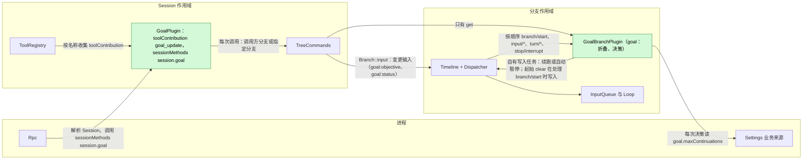
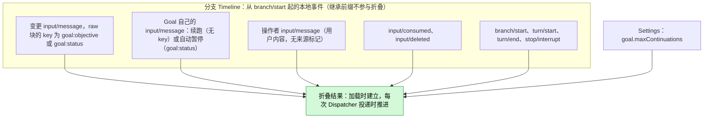
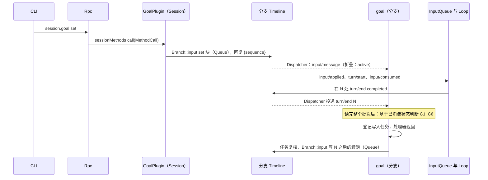
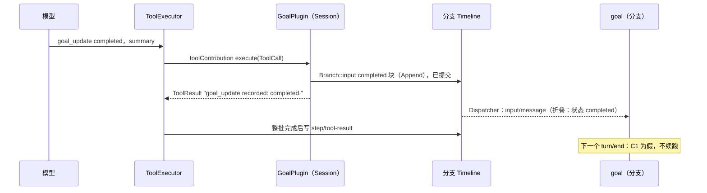
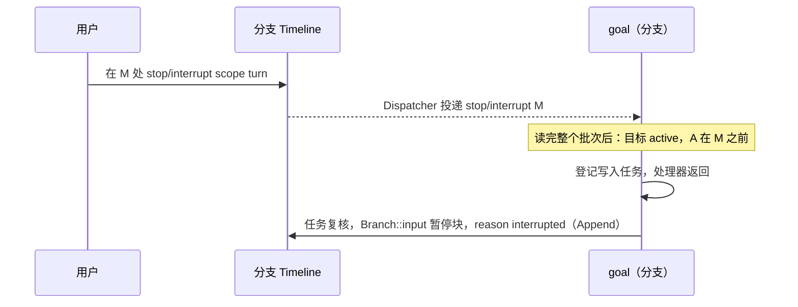
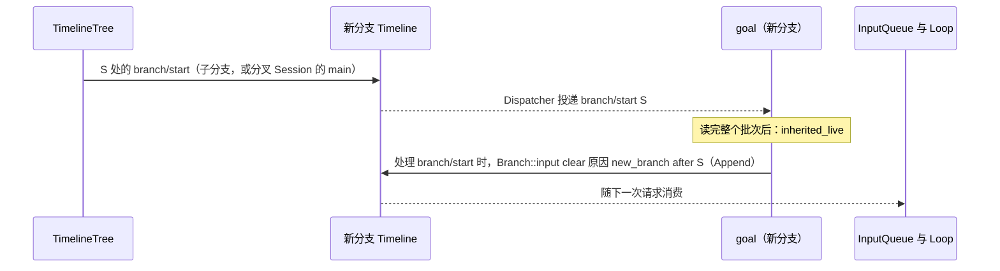
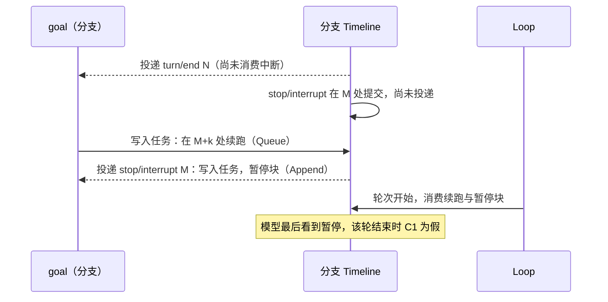

# Goal

状态：草案。总体设计：[overview §4](../overview.md)。阶段：P2。语言：优先 TypeScript（[overview 附录 C](../overview.md)）。作用域：Session + 分支（[ADR 002](../../adr/002-plugin-scope.md)）。

需求（[功能列表](../../../feature-list.md)，BranchScope Agent 行为）：`/goal` 设置、编辑、暂停、恢复和清除目标（"切换 Goal 模式"）；Goal 续跑朝明确的目标继续工作，并记录完成或受阻。

Goal 在分支上保持一个常驻目标，并自动续跑该分支，直到模型报告目标已完成或受阻、用户暂停、清除或中断，或达到续跑上限。Goal 是分支上的事件驱动状态机。**每次变更都是分支上的一条 `input/message`**，其 raw 块带两个 key 之一：`goal:objective` 承载目标文本，由 `set` 和 `edit` 写入；`goal:status` 承载状态，由用户的 `set`、`pause`、`resume`，模型经 `goal_update` 工具报告的 `completed` 或 `blocked`，以及 Goal 自己的自动暂停写入；`clear` 退役两个 key。**一个目标只属于一个分支**：Goal 对分支 `B` 的折叠只使用写在 `B` 自身上的事件（从 `B` 的 `branch/start` 起的本地后缀），从不使用继承的前缀，因此子分支和分叉 Session 的 `main` 都从没有目标开始；若新分支继承的前缀中仍有存活的目标 key，Goal 在处理该分支的 `branch/start` 时写入一次 `clear`，退役两个 key（[§3.4](#34-新分支清除继承的目标)）。续跑不带 key，也不是变更。工具和方法只写这条事件；它们不读 Goal 的状态，也不判断变更是否允许。**Goal 的状态是 Goal 已消费事件的折叠结果**，按序号顺序，用固定规则计算（[§2](#2-数据与状态)）。**分支部分**拥有这个折叠结果；它的 Dispatcher 处理器消费 `turn/end`、`stop/interrupt` 或 `input/deleted` 时，读完整个批次后只依据已消费的状态自己决定是否续跑；决定需要写入（续跑或自动暂停）时，处理器把写入登记为自己拥有的工作，然后返回。**Session 部分**以 `toolContribution` 服务（Session 作用域，key `goal_update`）提供 `goal_update` 工具，并通过 `sessionMethods` 服务（Session 作用域，key `session.goal`）提供 `session.goal.*` 方法（[session-boundary](../contracts/session-boundary.md)）；每次调用解析调用方分支或指定分支，经分支的公开输入入口 `Branch::input` 写入，只有 `session.goal.get` 向分支部分查询折叠结果。Goal 不写自己类型的事件，也没有单独的"Goal 模式"：目标的存在与状态可通过 `session.goal.get` 和目标块看到，覆盖了功能列表中"切换 Goal 模式"的说法。本文的每个契约都是语言中立的（服务名、作用域、key、带数据形状的方法），因此 TypeScript 实现无需手写 Rust 绑定即可满足；Rust 形式见[附录 G](#附录-g-rust-绑定)。Goal 还使用运行时的类型化服务（`S:TreeCommands`、`B:Timeline`、`B:Dispatcher`）；把它们按名称暴露给非 Rust 的 Capability 部分是 [#4](https://github.com/arcships/dim/issues/4) 的工作（需求见 [session access](../contracts/session-access.md) §9），在此之前 Goal 先用 Rust 实现。

## 1. 结构

所有模型可见的效果都是由现有 InputQueue 和 Loop 消费的 `input/message` 事实。

| 部分 | 作用域 | 依赖 | 提供 |
| --- | --- | --- | --- |
| `GoalPlugin` | Session | `S:TreeCommands` | `toolContribution` key `goal_update`；`sessionMethods` key `session.goal`；经 `Branch::input` 写变更输入 |
| `GoalBranchPlugin` | 分支 | `B:Timeline`、`B:Dispatcher`、Settings 业务来源（外层作用域） | `goal`（分支作用域；只有 `get`），仅供 Session 部分使用；折叠结果、续跑决策和 Goal 自己的写入 |

两个部分都在插件的 `provides` 中声明各自的服务，且只安装在启用了 Goal 的 Session 中；ToolRegistry 和 Rpc 按名称和作用域收集它们。`goal.maxContinuations` 是 Settings 业务来源中的业务配置（[ADR 002](../../adr/002-plugin-scope.md) D4）：每次决策时读取，通过数据更新改变，从不重载。Goal 只读取 `branch/start`、`input/message`、`input/consumed`、`input/deleted`、`turn/start`、`turn/end` 和 `stop/interrupt` 的公开数据契约；从不读取其他插件的状态。

## 2. 数据与状态

Goal 不拥有持久状态。分支 `B` 的目标是 `B` 从自己的 `branch/start` 起至今已消费的本地事件的纯函数；继承的祖先前缀（子分支）或复制来的事实（分叉 Session 的 `main`，A11）位于该 `branch/start` 之前，从不贡献目标。分支部分在加载时折叠本地事件，并在每次 Dispatcher 投递时推进折叠结果。压缩不会改变它，因为折叠结果由事件而非模型上下文构建。

变更在其 `input/message` 的序号处生效。之后被 InputQueue 删除（`input/deleted`）的变更被移除，折叠结果去掉它重新计算，因为被删除的输入从不生效（[session access](../contracts/session-access.md)）。固定折叠规则按序号顺序应用于 `B` 的本地事件，没有例外：当前目标文本是最新的存活本地 `goal:objective` 块，当前状态是最新的存活本地 `goal:status` 块，新分支的继承 key 被其起始 `clear` 退役后（§3.4），这正是压缩重放的那些块（[§5](#5-上下文映射)），因此重放与折叠结果一致（A16）。只有 `goal:objective` 存活时目标才存在。没有存活目标文本时写入的状态块仍成为当前状态，但 `session.goal.get` 报告没有目标，C1 不成立，直到目标文本再次存活：

| 变更（标记中的 `op`） | 写入方 | Key | 对折叠结果的影响 |
| --- | --- | --- | --- |
| `set {objective}` | `session.goal.set` | `goal:objective`、`goal:status`（active） | 目标文本与状态存活：`objective`，`status = active`；计数重新开始 |
| `edit {objective}` | `session.goal.edit` | `goal:objective` | 目标文本存活：替换 `objective`；状态仍是最新的存活 `goal:status` 块（没有存活状态时为 `none`，例如 `clear` 之后） |
| `pause`（原因 `user`） | `session.goal.pause` | `goal:status` | `status = paused (user)`，无论之前是什么 |
| `resume` | `session.goal.resume` | `goal:status` | `status = active`，无论之前是什么（`completed` 或 `blocked` 的目标重新打开）；计数重新开始；这条 Queue 输入驱动一轮 |
| `clear` | `session.goal.clear` | 两者都退役 | 没有目标，也没有状态 |
| `clear`（原因 `new_branch`） | Goal 自己，在新分支上（§3.4） | 两者都退役 | 没有目标，也没有状态；在模型上下文中退役继承来的 key |
| `completed` / `blocked {summary}` | `goal_update` | `goal:status` | `status = completed` / `blocked`，带 `summary`，无论之前是什么；重复报告只是重述。只改变写入所在分支的折叠结果 |
| `pause`（原因 `interrupted`、`limit`、`turn_failed`） | Goal 自己 | `goal:status` | `status = paused (reason)`；Goal 只在 C1 成立后写它（A.4） |
| 续跑（不是变更） | Goal 自己 | 无 | 只计数：计数加 1 |

基于已消费事件的推导值：

| 字段 | 推导 |
| --- | --- |
| `goal` | 本地 `goal:objective` 块存活时为 `{objective, status, reason?, summary?}`，否则不存在；没有存活的本地 `goal:status` 块时 `status` 为 `none` |
| `A` | 最近一次设置 `status = active` 的变更（`set` 或 `resume`）的序号 |
| `interrupted` | `B` 本地事件中序号大于 `A` 的 `stop/interrupt {scope: turn}` |
| `inherited_live` | `B` 的 `branch/start` 之前的前缀中有存活的 `goal:objective` 或 `goal:status` 块（§3.4） |
| `last_operator` | 最新的操作者输入：带 `user` 内容且未被来源标记的 `input/message`（A5） |
| `count` | 序号大于 `max(A, last_operator)` 的 Goal 续跑输入（标记 `kind="continuation"`，无 key） |
| `decided` | 对每个 `turn/end` 序号 `N`，是否存在标有 `after="N"` 的 Goal 写入（续跑或自动暂停） |
| `pending_driving` | 有效模式为 Queue 或 Steer、且既无 `input/consumed` 也无 `input/deleted` 的本地 `input/message`（session access §2 待处理规则）。Goal 不解读 InputQueue 的指令 `input/withdraw`；只有 InputQueue 的结果 `input/deleted` 才移除输入 |
| `turn_open` | 最新 `turn/end` 之后存在 `turn/start` |

仅运行时：折叠结果，以及在途的写入任务集合，按做出决定的事件序号为键。Dispatcher 处理器推进折叠结果、做决定、需要时登记写入任务，然后返回；它只等待起始 `clear`，该写入在处理 `branch/start` 时完成（§3.4）。没有 worker，没有与调用共享的锁，也不等待某个序号。两者都由加载折叠重建；新一代从不继承在途任务（旧一代的任务随其卸载结束）。

## 3. 流程

### 3.1 设置与续跑

方法不读折叠结果；它写入后以自己输入的序号回复。续跑由 Goal 拥有的任务写入；InputQueue 和 Loop 通过各自的订阅消费它。

### 3.2 通过 `goal_update` 完成

该块在批次的 `step/tool-result` 之前提交，因此压缩后重放的状态是 `completed`，与折叠结果相同，直到之后的状态块替换它。工具确认写入；按折叠规则，该块成为当前状态，可通过目标块和 `session.goal.get` 看到。

### 3.3 中断暂停目标

`scope: branch` 的中断被忽略：分支正在关闭。

### 3.4 新分支清除继承的目标

所用的运行时事实是 `branch/start`，即每个新分支的第一条本地事件：子分支的 Timeline 以它开始（[event-driven flows](../../../architecture/rust-agent/event-driven-flows.md)），新 Session 的根分支（包括分叉 Session 的 `main`）在复制来的事实之后以它开始（A11）。Goal 处理位于 `S` 的 `branch/start` 且 `inherited_live` 成立时，立即写入一条 `clear` 输入（两个 key 都退役，Append，`reason="new_branch" after="S"`），作为处理 `branch/start` 的一部分，与 Prompt 在处理它时写入初始配置相同（[prompt](../../../architecture/rust-agent/prompt.md)）；没有延后任务，也没有复核。没有任何写入能先于它：子分支要在其 `branch/start` 处理完后才出现在公共分支列表与操作入口中（[lifecycle](../../../architecture/rust-agent/lifecycle.md)），因此任何客户端或用户都无法在 `clear` 之前向它写入。此后压缩不再重放父分支的目标，新分支上的模型也不会把它当作自己的目标。重启时 `clear` 已在该分支自己的事件中，折叠结果能看到它。

## 4. 时序与冲突

### 4.1 中断在续跑之前提交（最多多一轮）

按序号决定：决策和任务的复核只使用了直到 `N` 的已消费事件，因此续跑成立，之后的暂停块结束目标。这多出的一轮是可接受的（决定 E18）；Goal 不撤回其续跑。

### 4.2 重载

任一部分的重载都发生在罕见的结构性操作之后。Session 部分的重载像任何贡献重载一样传播到 ToolRegistry，可能使在途轮次失败；这是可接受的代价（[ADR 002](../../adr/002-plugin-scope.md) D3）。分支部分的重载重新折叠；其卸载结束在途写入任务。若最新的 `turn/end` 不是 `decided` 且目标为 active，新一代执行该决策一次（C4 和 C5 去重）。重载前已提交的变更保持有效，因为它是 Timeline 上的事实。

### 4.3 其他关键行

| 场景 | 序号顺序 | 结果 | 归属 |
| --- | --- | --- | --- |
| 决策时有用户 Queue/Steer 输入待处理 | 输入 < `turn/end` N，未消费 | C5 不成立：不续跑；由用户那一轮的结束来决策，计数重置 | Goal |
| 驱动输入被删除 | 输入 < `input/deleted` < N | 不算待处理；续跑继续 | InputQueue；Goal |
| 驱动输入在 N 之后被删除（例如在自身批次中被 Hook 撤回的提示） | 输入 < N < `input/deleted` | N 的决策在 C5 停止；消费 `input/deleted` 时重新做 N 的决策；C1–C6 成立则续跑 | InputQueue；Goal |
| 一个批次中两个 `goal_update` 调用 | 两个块都在 `step/tool-result` 之前 | 都写入，两个结果都确认写入；折叠按顺序应用两者，第二个是当前状态 | Goal |
| `completed` 或 `blocked` 之后 `resume` | 终态块 < resume | 目标重新打开：`active`，计数重新开始，这条 Queue 输入驱动一轮 | Goal |
| 变更在被持有时被撤回 | 变更 < `input/deleted` | 从折叠中移除；最新未决策或已停止的决策重新进行 | InputQueue；Goal |
| 子分支在目标块之后切出 | 已消费 < 切点 < `branch/start` | 子分支的折叠结果没有目标；Goal 写入起始 `clear`（§3.4）；不续跑；在那里的 `goal_update` 或任何变更只影响子分支 | Goal |

完整表格：[附录 B](#附录-b-完整冲突表)。

## 5. 上下文映射

| 模型看到的内容 | 形式 | 位置 |
| --- | --- | --- |
| 每次变更 | 一条没有 `user` 内容的 `input/message`，其第一个 raw 块为 `<dim-goal kind="goal" op=... branch=...>`；`edit` 给它 key `goal:objective`，状态变更给它 key `goal:status`，`set` 再加一个 key 为 `goal:status` 的块，`clear` 用两个块退役两个 key（A.5） | 在其 `input/consumed` 位置；Queue 块开启它所驱动的轮次，Append 块加入下一个请求 |
| 续跑 | `input/message`，Queue，`<dim-goal kind="continuation" count=k limit=L after=N branch=...>`，无 key；不重述目标 | 它所驱动轮次的开头 |
| `goal_update` | 已采用的 `context/configured` 中的固定工具声明；结果在 `ToolResult.content` 中 | 其批次的工具结果位置 |

| 方面 | 规则 |
| --- | --- |
| 压缩 | 基线原样重放每个 key 最新的存活块，因此模型看到当前目标（`goal:objective`）和当前状态（`goal:status`）；已退役的 key 不重放；续跑和更早的块只通过摘要保留 |
| 子分支与分叉 Session | 继承切点之前的块，块中写明所属分支，并告诉委派工作不要调用 `goal_update`；Goal 在处理新分支的 `branch/start` 时用一次 `clear`（原因 `new_branch`）退役继承来的 key（§3.4），因此新分支从没有目标开始（A3） |
| 非交互 Session | 映射相同；续跑在没有用户在场时驱动轮次 |
| 始终不可见 | `submissionId`、模式、操作者输入计数、折叠结果、诊断、其他插件的事件 |

确切文本：[附录 A.5](#a5-模型可见文本)。

## 6. 接口（摘要）

| 接口 | 类型 | 用途 |
| --- | --- | --- |
| `goal_update {status, summary}` | `toolContribution`（Session，key `goal_update`），风险 `session` | 模型报告完成或受阻；写入一条变更输入并确认写入 |
| `session.goal.set/edit/pause/resume/clear` | `sessionMethods`（Session，key `session.goal`） | 用户变更目标；每个方法写一条变更输入，并以其序号回复 |
| `session.goal.get` | 同一服务 | 分支的折叠结果及其覆盖到的序号；替代任何"模式"查询（A8） |
| `goal` | 分支服务，Goal 内部使用 | 读取折叠结果的 `get` |
| `goal.maxContinuations` | 业务配置（Settings） | 续跑上限，每次决策时读取 |

细节：[附录 A](#附录-a-接口细节)。

## 7. 安全

Goal 只在它服务的分支上以来源 `goal` 写入 `input/message`；由此产生的轮次在 Session 的 Permission 与 Approval 策略下运行，目标不授予任何权限。用户无法伪造目标块：`session.submit` 不接受 raw 块，且标记渲染器会转义目标文本和 summary。`goal_update` 在 `session` 下准入。诊断记录 Session id、分支 id、决策与原因，从不记录目标文本。

## 8. 规则检查

规则：[principles §1 与 §4](../../../architecture/rust-agent/principles.md)，[ADR 002](../../adr/002-plugin-scope.md) D1–D5。

| 规则 | 本文如何符合 |
| --- | --- |
| §4.1 改别的模块拥有的状态时写指令事件 | 每次变更都是 Goal 自己消费的输入；Goal 从不删除或应用输入，它依据 InputQueue 的 `input/deleted`，不读 `input/withdraw`。 |
| §4.2 交接后不能撤回 | Goal 从不撤回自己的续跑；中断后才被应用的续跑多跑一轮，之后的暂停块结束目标。 |
| §4.3 只用 before 回调在写入前干预 | 不适用：Goal 不注册 before 回调，其工具和方法也不加入口检查（它们只写不判断）。 |
| §4.4 核心机制不带业务含义 | Goal 不要求 Timeline、Dispatcher、InputQueue 或 Loop 改动；其标记是两个普通 key 下的普通 raw 块。 |
| §4.5 决定前读完整个批次 | 折叠结果随每条事件推进；对 `branch/start`、`turn/end`、`stop/interrupt` 与 `input/deleted` 的决定在读完整个批次后只依据已消费状态做出；自有写入任务写入前的复核也只用已消费状态。 |
| §4.6 模型上下文只含交接后被读取的事件 | 目标块与续跑只在被采用后进入模型；被删除的输入从不进入，并从折叠中移除。 |
| §4.7 插件之间只通过公开事件和服务交互 | Goal 只读公开的 `branch/start`、`input/*`、`turn/*` 与 `stop/interrupt` 契约，并经 `Branch::input` 写入。 |
| §4.8 向机制所有者提通用需求 | 唯一的需求 #4 见 [session access](../contracts/session-access.md) §9。 |
| §4.9 只有后续决定要用的事实进入 Timeline | 每条变更输入既是模型上下文，也是折叠的输入；Goal 自己的写入驱动轮次或结束续跑；折叠结果就是每个 key 最新的存活块，也就是压缩重放的内容（A16）；折叠结果、在途任务和诊断不进入 Timeline。 |
| §1 Capability 与 App Server 边界 | 两个部分都是各自包中的 Capability；Rpc 只分派 `sessionMethods`。 |
| ADR 002 D1 作用域跟随状态所有者 | 工具与方法是 Session 服务；目标、其折叠结果与决策是分支状态。 |
| ADR 002 D2 不设接线模块 | ToolRegistry 与 Rpc 按名字和作用域收集 Goal 的服务；没有模块指名 Goal。 |
| ADR 002 D3 依赖跟随作用域 | 分支部分依赖分支服务与外层的 Settings 来源；重载重新折叠，可接受。 |
| ADR 002 D4 结构性配置与业务配置分离 | `goal.maxContinuations` 是每次决策时读取的业务配置。 |
| ADR 002 D5 合同语言中立 | 工具、方法、分支服务与块格式以中立形式给出；附录 G 只是一种绑定。 |

## 9. 向机制所有者提出的需求

| 需求 | 所有者 | 五项内容 |
| --- | --- | --- |
| 运行时服务按名字暴露给非 Rust 的 Capability 部分 | 运行时，[#4](https://github.com/arcships/dim/issues/4) | 见 [session access](../contracts/session-access.md) §9；Goal 的 TypeScript 实现需要 `S:TreeCommands`、`B:Timeline`、`B:Dispatcher` 与 `Branch::input`，在此之前先用 Rust 实现 |

## 附录 A. 接口细节

### A.1 工具 `goal_update`

服务 `toolContribution`，Session 作用域，key `goal_update`：`declaration(): sync -> ToolDeclaration`（名称、A.5 中的描述、下列参数 schema、风险 `session`）；`execute(ToolCall): async -> ToolResult`；取消就是对调用发出取消请求。

| 项 | 值 |
| --- | --- |
| 参数 | `{status: "completed" \| "blocked", summary: string}`；`summary` 1..=2000 个字符（A10） |
| 结果 | `ToolResult.content`：`goal_update recorded: completed.` 或 `goal_update recorded: blocked.` 结果只确认写入；按折叠规则，该块成为当前状态（A15）。错误只有参数错误 |
| 风险类别 | `session`（只写分支输入）（A9） |
| 提供范围 | 启用了 Goal 的每个 Session，所有角色（A9） |
| 处理器 | 校验参数，经 `S:TreeCommands` 在调用方分支上用 `Branch::input` 写一条变更输入（`op` 为 status，Append），等待提交后返回。它不读折叠结果。在追加之前取消则不写任何内容；一旦追加，写入保持有效 |

### A.2 Session 方法

服务 `sessionMethods`，Session 作用域，key `session.goal`。`describe()` 为每一行返回一个 `MethodDecl`，其中 `interruption: report`、`progress: false`、`notifications: []`、`reply: direct`，除 `get` 外 `mutating: true`。`call(MethodCall)` 接受下列参数，并以 `MethodReply` 回复结果；错误为 `MethodError` 数据（附录 C）。

| 方法 | 参数 | 结果 | 写入 |
| --- | --- | --- | --- |
| `session.goal.set` | `{sessionId, branchId?, objective}` | `{sequence}` | `set`，Queue |
| `session.goal.edit` | `{sessionId, branchId?, objective}` | `{sequence}` | `edit`，Append（A1） |
| `session.goal.pause` | `{sessionId, branchId?}` | `{sequence}` | `pause`（原因 `user`），Append |
| `session.goal.resume` | `{sessionId, branchId?}` | `{sequence}` | `resume`，Queue（A12） |
| `session.goal.clear` | `{sessionId, branchId?}` | `{sequence}` | `clear`（退役 key），Append |
| `session.goal.get` | `{sessionId, branchId?}` | `{goal: GoalView \| null, through}` | 无（A8） |

`branchId` 默认为 `main`（A13）。`GoalView = {status, objective, reason?, summary?, count, limit, sequence}`；`through` 是折叠结果已消费到的最后序号，因此 `through >= sequence` 时客户端就能看到自己写入的效果。写入类方法只校验自己的参数；变更起什么作用由 §2 的折叠规则决定（每个块成为其 key 的当前值），从不由方法决定。Rpc 解析 Session（若已卸载则恢复）并发送调用；处理器通过 `S:TreeCommands` 解析指定分支。

### A.3 分支服务 `goal`

分支作用域，无 key，由 `GoalBranchPlugin` 提供，只由其 Session 部分调用。

| 方法 | 请求 | 回复 | 错误 |
| --- | --- | --- | --- |
| `get` | `{}` | `{goal: GoalView \| null, through}` | — |

卸载期间 `get` 以 `service_reloading` 失败。

### A.4 续跑决策

分支 `B` 上序号 `N` 处的 `turn/end` 所在的整个原子批次被消费后，基于直到该批次的折叠结果：

| # | 条件 | 若为假 |
| --- | --- | --- |
| C1 | 目标存在（本地 `goal:objective` 块存活）、`status = active` | 停止 |
| C2 | `!interrupted` | 写暂停（`interrupted`）并停止 |
| C3 | `N` 处的 `turn/end` 为 `completed` | `failed`：写暂停（`turn_failed`）（A6）；`cancelled`：由 C2 处理 |
| C4 | `N` 是最新的 `turn/end`、`!turn_open`，且 `N` 不是 `decided` | 停止（更新一轮的结束会触发） |
| C5 | `!pending_driving`（包括 Goal 自己未消费的续跑；不包括已删除的输入） | 停止 |
| C6 | `count < maxContinuations` | 写暂停（`limit`）并停止 |
| — | 全部成立 | 写入续跑（Queue），计数为 `count + 1` |

投递 `M` 处的 `stop/interrupt`（`scope: turn`）并读完其批次后：若 C1 成立且 `A < M`，写暂停（`interrupted`）。

投递 `input/deleted` 并读完其批次后：去掉被删除的输入重新折叠；若最新的 `turn/end` 不是 `decided`，重新做它的决策（C4 与 C5 去重）。

除起始 `clear`（§3.4）外，每次写入都是自有工作：处理器登记一个以做出决定的序号为键的任务，然后返回。同一序号的任务已在途时，不再登记。写入前，任务基于此刻已消费的折叠结果复核同样的条件（[time-bus](../../../architecture/rust-agent/time-bus.md) §4），条件不再成立就不写；已提交但尚未消费的事实不读，由其消费方按序号处理（§4.1）。Goal 的写入带 `after="N"`（或 `after="M"`），因此折叠结果记录了该决定，重载不会重复它。

投递位于 `S` 的 `branch/start` 时，读完整个批次后：若 `inherited_live`，在处理它时写入起始 `clear`（原因 `new_branch`，`after="S"`），不登记任务，也不复核（§3.4）。

### A.5 模型可见文本

每次写入都是一条没有 `user` 内容的 `input/message`。其第一个 raw 块为标记 `<dim-goal kind="..." ...>`、换行、转义后的正文、换行、`</dim-goal>`（A2）；`set` 和 `clear` 再加一个同样形式的块。一条 `InputWrite` 可携带任意多个 `RawBlock`，每个块有自己的 key（[session access A.1](../contracts/session-access.md#a1-sessions-服务)），因此每次变更仍是一条输入。无 key 的续跑不是变更。

| 写入 | 块（key 用法） | 模式 | 文本 |
| --- | --- | --- | --- |
| `set` | 1：`goal:objective` live；2：`goal:status` live | Queue | 1：`<dim-goal kind="goal" op="set" branch="B">` / `Objective:` / `<objective>` / 空行 / `This is the user's standing goal for branch B. If you are working on a delegated sub-task started from branch B, treat this goal as background and do not call goal_update.` / `</dim-goal>`；2：`<dim-goal kind="status" status="active" branch="B">` / `The goal for branch B is active. Keep working toward it across turns. When it is fully achieved, call goal_update with status "completed". If you cannot make progress without the user, call goal_update with status "blocked" and explain why.` / `</dim-goal>` |
| `edit` | `goal:objective` live | Append | `op="edit"`；`Objective:` / `<objective>` / 空行 / `The user set the objective of the goal for branch B. This does not change its status.` |
| `pause`（用户） | `goal:status` live | Append | `op="pause" reason="user"`；`The user set the goal status for branch B to paused. Do not continue working toward a goal for branch B on your own; respond only to the user's latest input.` |
| `resume` | `goal:status` live | Queue | `op="resume"`；`The user set the goal status for branch B to active. If branch B has a goal objective, keep working toward it across turns; when it is completed or blocked, call goal_update.` |
| `completed` / `blocked` | `goal:status` live | Append | `op="completed"` 或 `op="blocked"`；`Result:` 或 `Blocker:` / `
` / 空行 / `goal_update set the goal status for branch B to completed.` 或 `... to blocked.` + ` Do not continue working toward a goal for branch B on your own.` |
| `clear` | 1：`goal:objective` retire；2：`goal:status` retire | Append | 1：`op="clear"`；`The previous goal was cleared by the user. Disregard it.`；2：`<dim-goal kind="status" status="cleared" branch="B">` / `The goal for branch B has no status.` / `</dim-goal>` |
| `clear`（Goal，新分支） | 同 `clear` | Append | 1：`op="clear" reason="new_branch" after="S"`；`Any goal above belongs to another branch, not to branch B. Disregard it; branch B has no goal.`；2：同 `clear` |
| 暂停（Goal） | `goal:status` live | Append | `op="pause" reason="interrupted\|limit\|turn_failed" after="N"`；`The goal is paused (<reason phrase>). Do not continue working toward it on your own; respond only to the user's latest input.` |
| 续跑 | 无 | Queue | `<dim-goal kind="continuation" count="k" limit="L" after="N" branch="B">` / `Continue working toward the active goal for branch B. If it is completed or blocked, call goal_update. If you are working on a delegated sub-task started from branch B, do not call goal_update.` |

状态块只陈述状态，目标文本是单独的块，因此没有存活目标文本时被重放的状态块不声称存在目标；`set` 与 Goal 的暂停只会与存活的目标文本一起写入或在其存活时写入。原因短语：`interrupted` "the user interrupted the turn"，`limit` "the automatic continuation limit was reached"，`turn_failed` "the last turn failed"。工具声明描述："Report that the current goal is completed or blocked."

### A.6 Timeline 机制

| 步骤 | 路径 |
| --- | --- |
| 加载 | 订阅 Dispatcher（`"Goal"`），在闸门下固定 `S = committed()`，折叠直到 `S` 的本地事件，设置 `rebuilt = S`，提供 `goal`。若最新的 `turn/end` 不是 `decided` 且目标为 active，执行其决策一次 |
| 消费 | Dispatcher 处理器跳过 `sequence <= rebuilt`，推进折叠结果，并在每个批次读完后对 `branch/start`、`turn/end`、`stop/interrupt` 与 `input/deleted` 决策（A.4）；处理 `branch/start` 时写入起始 `clear`，其余情况需要时登记写入任务，不等待即返回 |
| 写入 | 来源为 `goal` 的 `input/message`，`submissionId: "goal:<uuid>"`，带标记和模式，经分支的公开输入入口 `Branch::input` 写入，由它在边界校验并追加 `input/message`（[interrupt](../../../architecture/rust-agent/interrupt.md)）。Session 部分的调用以同样方式写入，从不查询折叠结果 |
| 消费路径 | InputQueue 追加 `input/applied`；Loop 追加 `input/consumed`。Goal 从不写 Steer |
| 复核 | 写入任务只依据已消费状态复核（[time-bus](../../../architecture/rust-agent/time-bus.md) §4）；之后的事实在序号上先于写入，由 InputQueue、Loop 和折叠结果处理 |
| 卸载 | 卸载清理函数结束订阅和在途写入任务；在追加前被取消的任务不写任何内容 |
| 重启、Session 恢复 | 与加载相同；已提交但未消费的续跑随 Session 一起恢复 |

## 附录 B. 完整冲突表

| 场景 | 序号顺序 | 结果 | 归属 |
| --- | --- | --- | --- |
| 目标轮次运行时的用户 Queue 输入 | 输入 < `turn/end` N，未消费 | C5 不成立；用户的轮次运行；其结束时以重置后的计数续跑 | Goal、InputQueue |
| 用户输入在 N 之后、续跑之前提交 | N < 输入 < 续跑 | 两者按顺序运行：先用户轮次，再续跑轮次；计数重置 | InputQueue、Loop |
| 续跑之后的用户输入 | 续跑 < 输入 | 先运行续跑轮次；Queue 接着运行；Steer 加入续跑轮次 | InputQueue、Loop |
| 目标轮次中的 Steer | 在轮次中消费 | 同一轮次；若为操作者输入则重置计数（A5） | Loop；Goal |
| `turn/end` 之后、投递给 Goal 之前的 Steer | `turn/end` < steer | Steer 开启一轮；之后的决策中 C4 或 C5 不成立；由那一轮的结束来决策 | Goal |
| 空闲时的 Append 输入 | — | 不驱动；续跑继续；Append 随其第一个请求被消费 | Loop |
| 驱动输入在 N 之前被删除 | 输入 < `input/deleted` < N | 不计入 `pending_driving`；续跑继续 | InputQueue；Goal |
| 驱动输入在 N 之后被删除 | N < `input/deleted` | N 的决策在 C5 停止；消费 `input/deleted` 时重新做 N 的决策：C1–C6 成立则续跑 | Goal |
| 在自身批次中被 Hook 撤回的提示，`input/deleted` 在 N 之后 | 输入 + `input/withdraw` < N < `input/deleted` | 同上：Goal 不理会指令，依据 InputQueue 的 `input/deleted` 重新决策 | InputQueue；Goal |
| Goal 自己的续跑在被持有时被用户撤回 | 续跑 < `input/deleted` | 从未被应用或消费，不算待处理，从折叠中移除（N 不再是 `decided`）；下一次决策可以再次续跑 | Goal |
| 变更在被持有时被用户撤回（如 `pause`） | 变更 < `input/deleted` | 去掉它重新折叠；最新的 `turn/end` 若不是 `decided` 则重新决策 | InputQueue；Goal |
| 同一 `turn/end` 之后另一来源的 Queue 后续输入（如 Hooks） | 都在 N 之后 | 按顺序两轮；每个 `turn/end` 最多一次续跑；该输入除非是操作者输入，否则不重置计数 | InputQueue；Goal |
| N 之前中断 | 中断 < N | C2：暂停（`interrupted`），不续跑 | Goal |
| N 与续跑之间中断 | N < 中断 < 续跑 | 多一轮；然后暂停（E18） | Loop；Goal |
| 续跑开始其轮次后中断 | 已消费 < 中断 | 轮次取消；暂停 | Loop；Goal |
| 应用之后、消费之前中断 | 已应用 < 中断 | 续跑待处理；其后为暂停；下一个驱动输入一并消费两者，模型最后看到暂停 | Loop；Goal |
| `goal_update` 写入之后中断 | 块 < 中断 | 折叠为 `completed`/`blocked`；中断时没有 active 目标：不暂停 | Goal |
| `goal_update` 写入之前中断 | 中断 < 处理器写入 | 处理器被取消，不写入；目标因中断暂停 | ToolExecutor；Goal |
| resume 与更晚投递的中断 | 中断 M < resume | `A > M`：不算 `interrupted`，不暂停 | Goal |
| 分支级中断或分支关闭 | 关闭 < 写入 | 不写任何内容；分支部分结束 | 运行时门面 |
| 工具批次未结算 | 终态块 < `step/tool-result` | 块在批次结果之后被消费；`turn/end` 看到非 active 目标 | ToolExecutor、Loop |
| 一个批次中两个 `goal_update` 调用 | 第一个 < 第二个 | 都写入，都确认写入；折叠按顺序应用两者，所以第二个是当前状态 | Goal |
| 目标不是 active 时的 `goal_update` | — | 写入；该块成为当前状态（`paused` 的目标变为 `completed` 或 `blocked`）；没有存活目标文本时 `get` 报告没有目标；结果确认写入 | Goal |
| `blocked` 之后 `completed`、反之，或两者之后 `pause` | 第一个 < 第二个 | 最新的胜出；重复报告以新的 summary 重述状态 | Goal |
| `completed` 或 `blocked` 之后 `resume` | 终态块 < resume | 重新打开：`active`，计数重新开始，这条 Queue 输入驱动一轮；压缩重放 resume 块 | Goal |
| `goal_update` 与 `edit`/`clear`/`pause` | 序号顺序 | 折叠按序号应用；后来的变更覆盖先前的 | Goal |
| 没有目标时的 `pause` 或 `resume` | — | 写入；状态 key 变为存活，压缩会重放它，但 `get` 报告没有目标，C1 不成立；`resume` 仍驱动一轮，不续跑 | Goal |
| 没有目标时的 `edit` | — | 目标文本变为存活，因此目标存在，状态为最新的存活状态（`clear` 之后为 `none`）；只有该状态为 `active` 时才续跑 | Goal |
| 目标写入与其消费之间压缩 | 写入 < 压缩 < 已消费 | 块在摘要之后的消费位置送达；之后的基线重放它 | 历史投影 |
| 多个目标块之后压缩 | — | 只重放最新的 `goal:objective` 块和最新的 `goal:status` 块；续跑不重放；折叠读取事件 | 历史投影；Goal |
| 子分支在目标写入与其消费之间切出 | 写入 < 切点 < 已消费 | 子分支不采纳它；子分支的折叠结果没有目标；若其前缀中有存活的目标 key，Goal 写入起始 `clear`（§3.4） | InputQueue（子分支）；Goal |
| 子分支在消费之后切出 | 已消费 < 切点 < `branch/start` | 子分支的折叠结果没有目标；Goal 写入起始 `clear`；不续跑；在那里的 `goal_update` 只影响子分支（A3） | Goal |
| 在子分支上设置目标 | — | 子分支自己的 key 与折叠结果；父分支不受影响 | Goal |
| 本地变更先于起始 `clear` 提交 | — | 不会发生：子分支要在其 `branch/start` 处理完后才发布，而 Goal 在处理它时写入 `clear` | 分支生命周期；Goal |
| 子分支上的任何变更（`edit`、`pause`、`goal_update`） | — | 只影响子分支的折叠结果，它从没有目标开始；父分支不受影响（A3） | Goal |
| Session 分叉 | 复制的事实 < `branch/start` | 分叉的 `main` 从没有目标开始；若复制来的目标 key 存活，Goal 写入起始 `clear`（A11） | Goal |
| `branch/start` 之后分支部分重载或重启 | — | 不会再写 `clear`：它已在该分支自己的事件中，折叠结果能看到它 | Goal |
| 未决策的 `turn/end` 之后分支部分重载或重启 | — | 加载时执行一次决策；`decided`、C4、C5 去重 | Goal |
| 写入任务在途时分支部分卸载 | — | 任务结束；若尚未追加，新一代在加载时重新决策 | Goal |
| `goal_update` 或目标轮次期间 Session 部分重载 | — | 像任何贡献重载一样传播；在途轮次可能失败（结束时暂停 `turn_failed`）；已提交的变更保持有效（D3） | ToolRegistry；Goal |
| Session 空闲卸载 | — | 各部分随 Session 卸载；方法调用会恢复它；恢复时重新折叠 | AgentIndex；Goal |
| Session 关闭 | — | 方法返回 `session_closed` | Rpc |
| 重复 `resume` | — | 两条 Queue 输入，两轮；每条都设置 `active` 并重新开始计数 | Goal（A12） |
| 重复 `set` | — | 每次都设置新目标；计数重新开始 | Goal（A12） |
| 轮次失败 | `turn/end {failed}` | 暂停（`turn_failed`）（A6） | Goal |
| 达到上限 | count = limit | 暂停（`limit`） | Goal |
| 资源节点离线 | 节点上的调用失败 | Goal 不使用节点服务：输入照常提交，轮次照常运行；工作区工具调用以 `node_unavailable` 作为工具错误失败；不重载，也不进入 Pending（[overview §6.3](../overview.md)） | Goal；WorkspaceTools |
| 客户端断开 | — | 无影响 | — |

## 附录 C. 错误与恢复

| 错误码 | 原因 |
| --- | --- |
| `invalid_params` | 目标文本或 summary 为空或超长（A10），分支 id 格式错误 |
| `session_closed`、`branch_missing` | Session 或分支已不存在 |
| `service_reloading` | Goal 正在重载；写入未发生，或已提交并可通过 `get` 看到效果 |
| `unknown_method` | 此 Session 未启用 Goal |

不存在"没有目标""不是 active"这类状态错误：每次变更都会写入并成为其 key 的当前值；没有存活目标文本时写入的状态让 `get` 仍报告没有目标。Goal 从不自行重试写入。进程退出只留下已提交的事实；下次加载重新折叠它们。

## 附录 D. 验收

通过 Session 方法、`goal_update` 工具和 Timeline 事件进行的流程测试（假模型）：

1. 在空闲分支上设置目标会开启一轮；正常结束写入续跑；`goal_update completed` 结束续跑；completed 块位于该批次的 `step/tool-result` 之前。
2. 上限：`maxContinuations = 2` 时，第三次决策写入暂停（`limit`）；操作者输入重置计数；来自其他来源的带标记输入不重置。
3. 中断各行：`turn/end` 之前、在 `turn/end` 与续跑之间提交（最多多一轮）、开始之后、应用之后；`goal_update` 写入之前与之后。
4. 待处理的 Queue/Steer 输入抑制续跑；Append 不抑制；已删除的输入不抑制；在其抑制的 `turn/end` 之后被删除的输入会重新触发该决策；被撤回的 `pause` 从折叠中移除。
5. 未决策的 `turn/end` 之后分支部分重载和重启：恰好一次决策；写入任务在途时重载，恰好一次写入。
6. `completed` 之后压缩：基线包含 `completed`，而非 `active`，且 `get` 报告 `completed`。压缩之后，基线包含最新的 `goal:objective` 块和最新的 `goal:status` 块；续跑不重放。
7. 父分支设置目标后创建的子分支：子分支的 `get` 从第一条事件起报告没有目标，Goal 恰好写一次起始 `clear`，其后子分支的上下文中没有被当作自身目标的父目标，也不续跑；子分支重载或重启不写第二次 `clear`；在子分支上的 `goal_update` 或 `set` 只改变子分支的 `get`，从不改变父分支的。分叉 Session 的 `main`：相同，没有目标，一次起始 `clear`。
8. 已卸载的 Session：`session.goal.pause` 恢复它并写入。未启用 Goal：`unknown_method`。修改 `goal.maxContinuations` 在下一次决策时生效，无需重载 Goal。
9. 一个批次中的两个 `goal_update` 调用都返回确认，折叠结果显示第二个状态；没有目标时 `pause` 与 `resume` 写入的块会被压缩重放，而 `get` 报告没有目标；没有目标时 `edit` 使目标存在，状态为最新的存活状态；工具和方法从不读折叠结果（在分支部分重载期间写入来验证）。
10. `edit`（只改变 `goal:objective`）、`clear`（两个退役的 key 都不重放）、目标文本或 summary 中伪造的 `</dim-goal>` 被转义；`session.goal.get` 反映每种状态，`through` 会达到每次写入的 `sequence`。
11. 设置 → `completed` → `resume`：目标重新打开（`active`，计数重新开始），resume 输入驱动一轮，其正常结束写入续跑；resume 之后压缩，重放 resume 块，`get` 报告 `active`。
12. 设置 → `completed` → `blocked`：`get` 报告 `blocked` 及第二个 summary；每次状态变更之后压缩，重放的状态与 `get` 报告的相同。

## 附录 E. 假设

| # | 假设 | 依据 | 若被否决的影响 |
| --- | --- | --- | --- |
| A1 | `set`、`resume` 和续跑使用 Queue；`edit`、`pause`、`clear`、`goal_update` 和 Goal 的暂停使用 Append | 判断（总体设计只为续跑固定了 Queue）；方法无法知道状态，所以 `edit` 从不开启一轮 | 设置不会在空闲分支上开始工作，或暂停会开启一轮 |
| A2 | 附录 A.5 中的确切块格式与文本；目标与状态是分开的 key（`goal:objective`、`goal:status`），`set` 和 `clear` 在一条输入中写两者，续跑不带 key | 判断；[session access A.1](../contracts/session-access.md#a1-sessions-服务) 允许一条输入携带多个带 key 的 raw 块 | 文本与解析一起改变；若只有一个 key，压缩只重放最新的变更，状态变更后会丢失目标 |
| A3 | 一个目标只属于一个分支：折叠只使用该分支的本地事件，新分支用一次起始 `clear` 退役存活的继承目标 key | 用户决定 | 子分支会续跑或完成父分支的目标，或那里的模型会把父目标当作自己的 |
| A4 | `goal.maxContinuations` 默认 20，范围 1..=1000 | 判断 | 不同的默认值 |
| A5 | 计数只在 `set`、`resume` 和操作者输入时重新开始：带 `user` 内容且第一个 raw 块不是来源标记 | 判断 | 其他插件的自动输入会重置上限 |
| A6 | 失败的轮次暂停目标（`turn_failed`） | 判断（避免因提供方错误进入重试循环） | 失败轮次会继续并消耗上限 |
| A7 | 暂停不中断正在运行的轮次 | 判断 | 暂停也会调用 `stop` |
| A8 | `session.goal.get` 是替代"Goal 模式"的状态查询 | 决定 E18；决定 §3（无 Goal 模式） | CLI 通过解析 Goal 的块推导状态 |
| A9 | `goal_update` 风险为 `session`，提供给所有角色 | 判断 | 工具对某些角色隐藏，或在其他类别下准入 |
| A10 | 目标文本 ≤ 4000 个字符，summary ≤ 2000 | 判断 | 其他限制 |
| A11 | 分叉 Session 的 `main` 从没有目标开始；它的 `branch/start` 位于复制来的事实之后，与任何新 Session 的根分支相同（[prompt](../../../architecture/rust-agent/prompt.md)） | 用户决定；`branch/start` 位于复制事实之后是判断，因为分叉复制尚未规定 | 复制来的目标块会被当作分叉自己的事件，分叉会保留源 Session 的目标 |
| A12 | `resume` 总是驱动一轮（重新打开 completed 或 blocked 的目标，或使 active 的空闲目标重新开始工作）；重复的 `set` 和 `resume` 不去重 | 判断；方法看不到 `turn_open` 或待处理输入 | 重新开始的目标需要再次 `set`，或重复 resume 需要读取状态 |
| A13 | `branchId` 默认为 `main`；任何分支都可以持有自己的目标 | 判断 | Goal 限于 `main` |
| A14 | 变更在其 `input/message` 序号处生效，被 InputQueue 删除时从折叠中移除 | 判断：轮次中写入的暂停必须在 Append 被应用之前就阻止该轮的续跑 | 变更改为在 `input/applied` 处生效，轮次中写入的暂停将无法阻止该轮的续跑 |
| A15 | 第二次 `goal_update`，或没有 active 目标时的 `goal_update`，返回写入确认而不是错误，其块成为当前状态（A16） | 决定 G1（行为变化；去掉调用方的判断，以此回应 PR 评审"Goal 调用要看到之前已提交的写入"） | 工具需要读取并等待折叠结果，重新引入调用方判断 |
| A16 | 折叠没有例外：每个 key 最新的存活本地块就是当前目标文本与状态，只有本地 `goal:objective` 块存活时目标才存在 | 用户决定（回应 PR 评审"Keep replayed Goal status consistent with the fold"） | 压缩后重放的状态可能与 `get` 不一致 |

## 附录 F. 待对齐问题

| 问题 | 说明 |
| --- | --- |
| 对 active 的空闲目标 `edit` | `edit` 是 Append（A1），在空闲分支上不开始工作；用户用 resume 重新开始。如果用户需要，可以加一条规则：Goal 消费 `edit` 时开始续跑 |

## 附录 G. Rust 绑定

Goal 优先使用 TypeScript；Rust 实现（或在 #4 之前先用 Rust 起步）按如下方式绑定中立契约。

| 中立契约 | Rust 绑定 |
| --- | --- |
| `toolContribution` key `goal_update` | `S:ToolContribution`，由 ToolRegistry 作为 `Contributions<ToolContribution>` 的条目 `goal_update` 收集；取消请求 = 批次 `CancellationToken`；`cancelled` = `HostError::Cancelled` |
| `sessionMethods` key `session.goal` | `SessionMethodContribution(Arc<dyn MethodProvider>)`，key `SessionScope::named_key::<SessionMethodContribution>("session.goal")`；`describe` = `methods()`，`call` = `call(MethodCall, CallChannel, CancellationToken)` |
| `goal` | `B:Goal`，key `BranchScope::key::<Goal>()`，`get` 返回折叠结果 |
| Key | `const OBJECTIVE_KEY: &str = "objective"` 与 `const STATUS_KEY: &str = "status"`，以 `KeyUse::Live(name)` / `KeyUse::Retire(name)` 写入，存为 `goal:objective` / `goal:status`；续跑不带 `KeyUse` |
| 卸载清理函数 | `ctx.effect` |
| 写入任务 | Dispatcher 处理器在分支部分的 `ctx` 上登记的任务，以做出决定的序号为键；随卸载结束 |
| 写入 | 经 `S:TreeCommands` 调用 `Branch::input`，来自 Session 部分的调用和写入任务 |
