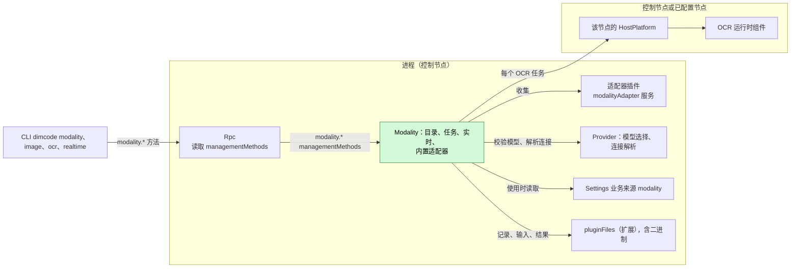
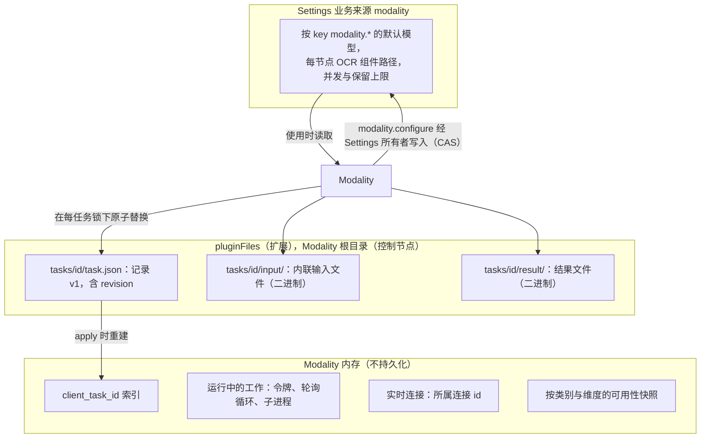
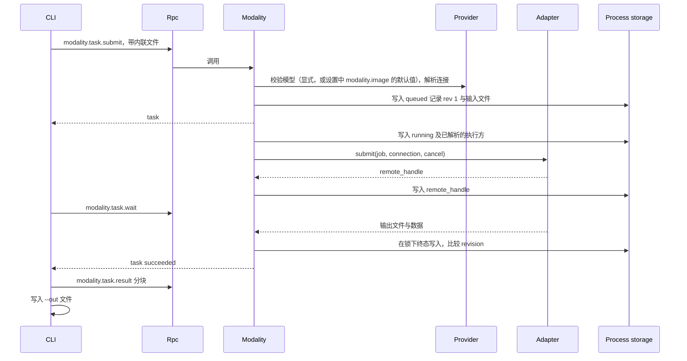
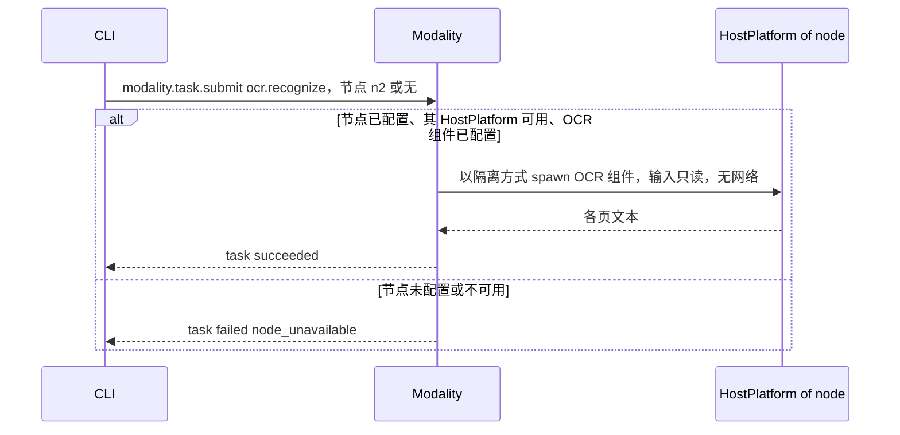
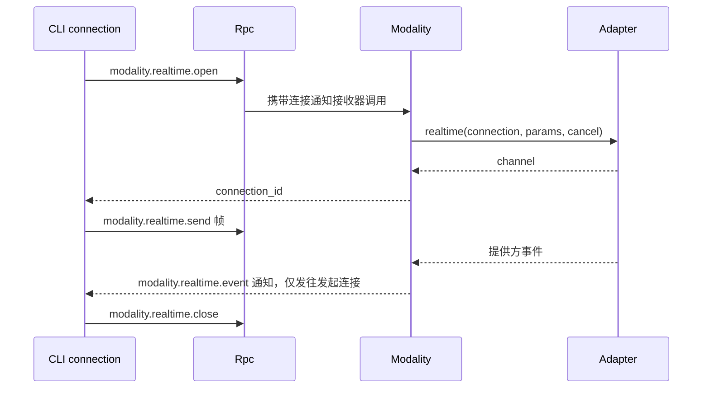
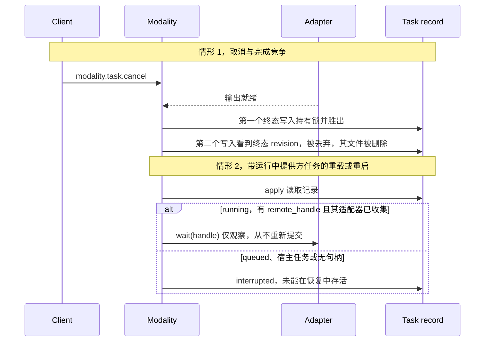

# Modality

状态：草案。总体设计：[overview §4 插件目录](../overview.md)，[ADR 002](../../adr/002-plugin-scope.md)。阶段：P3。语言：由提供方执行的类别优先使用 TypeScript；OCR 依赖 OCR 运行时组件（[overview 附录 C](../overview.md)）。

> **按任务查找适配器（[#40](https://github.com/arcships/dim/issues/40)）。** Modality 在任务需要时查找该类别的适配器，而不是把所有适配器都作为依赖收集；缺少某个适配器只让该类别不可用。

> **P3：按 rutis 现有能力重新设计。** rutis 是外部依赖，本文向 rutis 提出的需求已撤回（[原则 §4 第 8 条](../../../architecture/rust-agent/principles.md)）。

Modality 是一个进程插件（[ADR 002](../../adr/002-plugin-scope.md)：任务与提供方连接在各 Session 间共享），是九个类别非对话式多模态工作的唯一入口：图像、视频、语音、音乐、音频、3D 资产、动作、实时和 OCR。它按类别报告可用性及原因，按它自己的 `modality` 设置文档解析默认模型，运行异步任务（提交、状态、等待、取消）并通过 `pluginFiles`（扩展）保存，并持有绑定到发起客户端连接的实时连接。提供方适配器内置于 Modality，或由适配器插件（任意语言）以命名进程服务 `modalityAdapter` 提供；OCR 通过控制节点或某个已配置节点的 HostPlatform 运行。它的方法是它注册到 `managementMethods` 的命名空间 `modality`：关于宿主的进程插件方法，由 Rpc 分发，从不提供给已配对的远程设备。Modality 的设置（含每节点 OCR 组件路径）是业务配置，存放在它自己的 Settings 业务来源中，经 Settings 类型化操作写入，在使用时读取。它没有 Session 或分支部分：不写任何 Timeline 事件，也不提供模型可见的工具。

## 1. 结构



所有依赖都是同一作用域的进程服务（[ADR 002 D3](../../adr/002-plugin-scope.md)）。Modality 按名称收集每个进程作用域的 `modalityAdapter` 服务，因此适配器重载会重载 Modality。Rpc 按调用在 `managementMethods` 中查找 Modality 的 `modality` 命名空间，不随它重载（[方法 §3.2](../contracts/session-boundary.md#32-管理方法)）。适配器重载是少见的结构性事件；其传播是可接受的代价，任务恢复（§4）使其影响有界：存有句柄的提供方任务通过轮询恢复，其余变为 `interrupted`。没有 Session 或分支插件依赖 Modality。

| 部分 | 作用域 | 依赖 | 提供 |
| --- | --- | --- | --- |
| `Modality` | 进程（控制节点） | Provider 的模型选择（`ModelSelectionHost`）与非对话连接解析；`pluginFiles`（扩展：UTF-8 与二进制）；Settings 业务来源 `modality`；全部 `modalityAdapter` 服务；控制节点及每个已配置 OCR 节点的 HostPlatform；诊断 | `modalityTasks` 进程服务；把 `modality`（`modality.*`）注册到 `managementMethods` |
| 适配器插件 | 进程 | 各自的提供方依赖 | `modalityAdapter` 服务，key 为适配器名，在插件的 `provides` 中声明 |

**依赖的契约：**[方法](../contracts/session-boundary.md)契约（注册到 `managementMethods` 的命名空间、每次调用的进度接收器、绑定连接的通知）；Provider 的模型选择（`ResolveModelSelection::resolve`，拒绝不可选的显式模型；[AuxiliaryModel](../appserver/auxiliary-model.md)）与非对话连接解析（[overview 附录 B.2](../overview.md)）；`pluginFiles`（扩展），含二进制原子替换与格式版本（[App Server README](../../../../crates/dim-app-server/README.md#trusted-plugin-storage)）；带隔离的 HostPlatform spawn（[HostPlatform](../../../architecture/rust-agent/plugins/HostPlatform.md)，隔离补充见 [overview 附录 B.1](../overview.md)）。
**此处定义的契约：**类别与操作标识符；`modality` 设置文档中的默认值 key `modality.<category>` 与 `modality.<category>.<operation>`（Modality 自有；Provider 不持有任何 key）；`modalityAdapter` 与 `modalityTasks` 服务（[语言中立](../../adr/002-plugin-scope.md)，A.2 与 A.3；Rust 绑定见附录 G）；`modality` 设置文档及其 schema；任务记录与结果格式（格式版本 1）；`modality.*` 方法与 `modality.realtime.event` 通知。Provider 对模态一无所知；Modality 在内置适配器之外不了解任何提供方特有语义。

## 2. 数据与状态



任务记录是唯一的持久状态；索引在 `apply` 时从记录重建，非终态记录由启动规则（§4）结算。运行中的工作与实时连接从不重建。Modality 设置（含按 key 的默认模型与每节点 OCR 组件路径）是业务配置（[ADR 002 D4](../../adr/002-plugin-scope.md)），按 Modality 声明的 schema 经 Settings 类型化操作写入业务来源 `modality`：变更是带通知的数据更新，下次使用时读取，从不触发重载（A16）。适配器插件集合是 loader 行中的结构性配置；“已配置节点”指宿主已经通过 rutis 链路导入的对端节点（链路配置，结构性，不属于 Modality），OCR 用哪个节点由调用方按任务指定。没有 Timeline 状态，没有 `StateCell`；竞争写入的顺序由每任务锁下的记录 `revision` 决定。

## 3. 流程

### 3.1 提交、等待与取回（`dimcode image generate`）



CLI 自行读取输入并写出输出；Modality 只在其存储根目录内写入（A7）。

### 3.2 在控制节点或已配置节点上运行 OCR



Modality 没有 Session，因此 OCR 在控制节点上运行，除非调用方指定一个已配置节点（A15）。对端节点的 HostPlatform 是经 rutis 链路导入的那个（[overview 多节点](../overview.md)）。该节点离线时，发往它的 OCR 任务以 `node_unavailable` 失败；Modality 不重载，也没有导入变为 Pending。这要求导入的 HostPlatform 在链路断开期间保持注册并使调用失败（对 [#5](https://github.com/arcships/dim/issues/5) 的要求，见 [§9](#9-向机制所有者提出的需求)）。

### 3.3 实时连接



连接在以下情况关闭：`close`、发起它的客户端连接结束、空闲 10 分钟后（A9）、Modality 重载、进程退出。它没有任务记录，也从不恢复。

### 3.4 Capability 列表与默认模型

`dimcode modality` 调用 `modality.capabilities` 并列出全部九个类别。每个不可用的类别或操作都按维度显示原因，例如“not in this build”“OCR component not installed”“no adapter”“not configured”“no adapter for the configured model”（决策 E16）。最后一项由 Modality 已采纳的业务配置（`modality` 设置文档中的默认值或显式模型，及其 Provider 连接）对照其收集到的适配器得出。不隐藏任何内容，也没有 `--all`。`dimcode modality set-default image <provider>/<model>` 调用 `modality.configure`，它先校验该模型可经 Provider 选择、且有适配器为该操作提供该模型，再经所有者写入（Settings CAS）把 `modality.image` 写入 Modality 自己的 `modality` 设置文档。

## 4. 时序与冲突

Modality 不是分支工作：轮次与分支事实从不影响任务。竞争由每任务锁下的任务记录 `revision` 裁决。



| 场景 | 结果 | 负责方 |
| --- | --- | --- |
| 适配器插件重载 | Modality 随之重载（D3）；适用启动规则：有句柄的任务通过轮询恢复，其余 `interrupted`；实时连接关闭 | Modality |
| Modality 重载 | Modality 重新激活前 `modality.*` 返回 `unknown_method`，Rpc 不重载；在途调用遵循[方法](../contracts/session-boundary.md)契约；disposer 取消本地工作，终止 OCR 进程，关闭实时连接，为宿主任务和无句柄任务写入 `interrupted` | Rpc、Modality |
| 设置变更 | 下次使用时读取；重新计算可用性；已有任务保留其已解析的执行方；不重载 | Modality |
| 以相同 `client_task_id` 重复 `submit` | 返回已有任务 | Modality |
| 等待期间客户端脱离 | 任务继续；该客户端的实时连接关闭 | Modality |

完整表格见附录 B。

## 5. 上下文映射

无模型可见效果。Modality 不提供工具、提示词来源、输入或 Timeline 事实（决策 E16、A13）。结果只有在用户以常规方式（`@` 文件引用、附件、粘贴文本）将其放入 Session 时才会到达模型，这些是由各自插件拥有的输入事实。模型从不看到任务记录、可用性、默认值、进度或诊断。因此压缩、子分支和非交互 Session 均不受影响。

## 6. 接口（摘要）

| 接口 | 类型 | 用途 |
| --- | --- | --- |
| `modality.capabilities` | 管理方法 | 每个类别与操作，含可用性原因和默认模型 |
| `modality.configure` | 管理方法 | 先校验，再在 Modality 的 `modality` 设置文档中设置或清除默认值（所有者写入，Settings CAS） |
| `modality.task.submit/status/list/wait/cancel/result` | 管理方法 | 任务生命周期；分块二进制结果取回 |
| `modality.realtime.open/send/close`、`modality.realtime.event` | 管理方法及绑定连接的通知 | 实时连接 |
| `modalityTasks` | 进程服务，无 key | 与任务方法相同的操作，供其他进程插件使用 |
| `modalityAdapter` | 进程服务，key 为适配器名，由 Modality 收集 | 由提供方执行的类别 |
| `modality` 设置文档 | 业务配置（Settings 来源，schema 由 Modality 声明，经 Settings 类型化操作写入） | 按 key 的默认模型、每节点 OCR 组件路径、上限；使用时读取 |
| `dimcode modality`、`image`、`video`、`speech`、`music`、`audio`、`asset`、`motion`、`ocr`、`realtime` | CLI | 方法的薄客户端 |

详见附录 A。

## 7. 安全

- 所有 `modality.*` 方法都是管理方法（它们消耗提供方额度并运行宿主进程）：只由进程插件提供，从不提供给已配对的远程设备（[方法](../contracts/session-boundary.md)）；RemoteGateway 从不提供它们。
- 凭据由 Provider 每次调用时解析；从不出现在记录、结果、诊断或错误中。
- OCR 组件是已安装的可执行文件，而非项目内容；通过执行节点的 HostPlatform 以该节点的隔离启动，仅有输入读权限，无网络（A14）。其路径来自 `modality` 设置文档，从不来自请求数据。
- 内联输入经过大小检查，存放在任务目录下；`node_path` 由组件在其节点上以该节点的权限读取。Modality 从不在其存储根目录之外写入；文件仅所有者可访问。
- 实时事件只发往发起连接。

## 8. 规则检查

规则：[principles §1 与 §4](../../../architecture/rust-agent/principles.md)，[ADR 002](../../adr/002-plugin-scope.md) D1–D5。

| 规则 | 本文如何符合 |
| --- | --- |
| §4.1 改别的模块拥有的状态时写指令事件 | Modality 只改自己的任务记录；默认模型是 Modality 自己的业务配置，经 Settings 对其 `modality` 来源的类型化所有者写入（CAS）设置，不涉及 Timeline。 |
| §4.2 交接后不能撤回 | 不适用：Modality 不向其他模块交接 Timeline 对象；任务终态在其锁下只决定一次。 |
| §4.3 只用 before 回调在写入前干预 | 不适用：Modality 不注册 before 回调，也不在 Session 或 RPC 入口加检查；它只校验自己方法的参数。 |
| §4.4 核心机制不带业务含义 | Modality 不要求 Timeline、Dispatcher 或 Rpc 做任何改动；Provider 不持有任何按使用方划分的 key；Modality 显式传入模型。 |
| §4.5 决定前读完整个批次 | 不适用：Modality 不读任何 Timeline 事件。 |
| §4.6 模型上下文只含交接后被读取的事件 | Modality 不写任何模型可见内容；结果只作为其他插件拥有的普通输入进入模型。 |
| §4.7 插件之间只通过公开事件和服务交互 | Modality 只通过公开服务使用 Provider、Settings、`pluginFiles`、HostPlatform 与 `modalityAdapter`。 |
| §4.8 向机制所有者提通用需求 | 节点离线的需求已作为 [#5](https://github.com/arcships/dim/issues/5) 向 rutis 提出（§9）。 |
| §4.9 只有后续决定要用的事实才进 Timeline | Modality 不写 Timeline 事件；任务记录留在 `pluginFiles`，默认模型与其他设置在它的 Settings 业务来源中。 |
| §1 Capability 与 App Server 边界 | Modality 是进程插件，不是 Capability；业务代码在它自己的包中，App Server 只分发它注册到 `managementMethods` 的命名空间。 |
| ADR 002 D1 作用域跟随状态所有者 | 任务与提供方连接在各 Session 间共享，因此 Modality 是进程作用域。 |
| ADR 002 D2 不设接线模块 | 适配器按服务名与作用域收集；没有接线模块。 |
| ADR 002 D3 依赖跟随作用域 | 所有依赖都是进程服务；适配器与 Modality 的重载传播是可接受的少见结构性事件。 |
| ADR 002 D4 结构性配置与业务配置分离 | 适配器插件是 loader 行，对端节点来自宿主的链路配置；每节点 OCR 组件路径与上限是 `modality` 来源中的业务配置，经 Settings 写入，使用时读取。 |
| ADR 002 D5 合同语言中立 | `modalityAdapter`、`modalityTasks` 与各方法以中立形式给出；附录 G 只是绑定。 |

## 9. 向机制所有者提出的需求

| 需求 | 所有者 | 五项内容 |
| --- | --- | --- |
| 从对端节点导入的服务在链路断开期间保持登记，调用以 `node_unavailable` 直接失败 | rutis，[#5](https://github.com/arcships/dim/issues/5) | 见 [ExternalAgent](ExternalAgent.md) §9；Modality 需要它，使离线的 OCR 节点只让自己的任务失败，不重载 Modality，也不使其变为 Pending |
| 运行时服务按名字暴露给非 Rust 插件 | 运行时，[#4](https://github.com/arcships/dim/issues/4) | 见 [session access](../contracts/session-access.md) §9；只有 Modality 的 TypeScript 实现需要它 |

Provider 补充（非对话连接）、Settings 业务来源和 `pluginFiles` 补充是对其他插件的改动，列在 [overview 附录 B.2](../overview.md)。

## 附录 A. 接口细节

### A.1 类别与操作

| 类别 | CLI | 操作 | 输入 | 结果 | 执行方 | 默认值 key |
| --- | --- | --- | --- | --- | --- | --- |
| `image` | `image` | `generate`、`edit`（图像，可选 mask）、`enhance`（`upscale`、`restore`、`denoise`、`sharpen`、`remove_background`、`colorize`） | 提示词、文件 | 图像文件 | Provider | `modality.image` |
| `video` | `video` | `generate`、`edit`、`enhance` | 提示词、文件 | 视频文件 | Provider | `modality.video` |
| `speech` | `speech` | `synthesize`、`transcribe` | 文本或音频 | 音频文件；或 `data: { text, segments: [{ start_ms, end_ms, text }] }` 加 `transcript.txt` | Provider | `modality.speech.synthesize`、`modality.speech.transcribe` |
| `music` | `music` | `generate` | 提示词 | 音频文件 | Provider | `modality.music` |
| `audio` | `audio` | `generate` | 提示词 | 音频文件 | Provider | `modality.audio` |
| `asset` | `asset` | `generate` | 提示词、可选图像 | 3D 文件 | Provider | `modality.asset` |
| `motion` | `motion` | `generate` | 提示词 | 动作数据文件 | Provider | `modality.motion` |
| `realtime` | `realtime` | `connect` | — | 连接 | Provider | `modality.realtime` |
| `ocr` | `ocr` | `recognize` | 图像或 PDF | `data: { pages: [{ index, text }] }` 加 `text.txt` | 宿主运行时组件 | 无；每节点组件路径在 `modality` 设置文档中 |

图像理解不属于 Modality（视觉模型通过 `read` 读取，见 [WorkspaceTools §read results and images](../../../architecture/rust-agent/plugins/WorkspaceTools.md#read-results-and-images)）。按操作的 key 先于按类别的 key 解析（A3）。输入之外的操作参数由各适配器声明，并在提交时校验（A4）。

### A.2 适配器与 OCR 节点

服务 `modalityAdapter`，作用域为进程，key 为适配器名，在适配器插件的 `provides` 中声明；内置适配器注册同一服务。Modality 按名称和作用域收集全部这些服务。取消是一个协议动作：Modality 丢弃该调用（或发送绑定的取消请求）；适配器停止本地工作。错误是数据 `{ code, message }`，`code` 为 `invalid_input`、`unavailable`、`provider_error` 之一。

| 方法 | 类型 | 请求 | 回复 |
| --- | --- | --- | --- |
| `available` | 同步 | `{}` | `{ available: bool, reason? }`；每次使用时读取，变化时不重载 |
| `connectionKinds` | 同步 | `{}` | `string[]`（所服务的 Provider 连接类型） |
| `operations` | 同步 | `{ model: "<provider>/<model>" }` | `[{ category, operation, params_schema }]` |
| `submit` | 异步 | `{ job: Job, connection: ResolvedConnection }` | `{ remote_handle? }` |
| `wait` | 异步 | `{ remote_handle?, connection }`；进度以该调用上的 `{ fraction?, message? }` 通知送达 | `{ files: [{ name, media_type, path }], data? }`；`path` 位于作业的工作目录内 |
| `cancelRemote` | 异步 | `{ remote_handle, connection }` | `{ outcome: "cancelled" \| "unsupported" \| "already_finished" }` |
| `realtimeOpen` | 异步 | `{ connection, params }`；提供方事件以该调用上的 `{ channel_id, event }` 通知送达，直到关闭 | `{ channel_id } \| null`（不支持） |
| `realtimeSend` | 异步 | `{ channel_id, frame }` | `{}` |
| `realtimeClose` | 异步 | `{ channel_id }` | `{}` |

`Job` 为 `{ task_id, category, operation, model, params, files: [{ name, media_type, path }], work_dir }`。`ResolvedConnection` 是 Provider 非对话连接解析返回的数据形态（`kind`、`provider_id`、`model`、端点与凭据材料），每次调用传入，从不存储或记录日志。

`available` 在不重载的情况下报告运行时可用性（例如提供方端点不可达）。若已配置的默认值（或显式模型）对应的 Provider 连接类型没有任何已收集的适配器提供，则报告为“no adapter for the configured model”，其提交以 `unavailable` 失败。OCR 不是适配器：对每个任务，Modality 使用目标节点的 HostPlatform（缺失或不可用：`node_unavailable`），探测 `modality` 设置文档为该节点给出的 OCR 组件路径，并在那里 spawn 它；离线的对端节点使调用以 `node_unavailable` 失败，且不发生任何重载（§3.2）。带已存储 `remote_handle` 的 `wait` 必须能在新一代中工作；不返回句柄的适配器无法恢复。

### A.3 方法

命名空间 `modality`，注册到进程的 `managementMethods`（声明与 `call` 遵循[方法](../contracts/session-boundary.md)契约），每个方法都是管理方法。`modalityTasks`（进程，无 key）提供 `submit`、`status`、`list`、`wait`、`cancel` 与 `result`，请求与回复同下方的 `modality.task.*` 方法。`wait` 使用每次调用的进度接收器；实时使用绑定连接的通知（[方法](../contracts/session-boundary.md)）。

| 方法 | 参数 | 结果 |
| --- | --- | --- |
| `modality.capabilities` | `{}` | `{ categories: [{ category, available, reasons, operations: [{ operation, available, reasons: [{ dimension: "build" \| "platform" \| "runtime" \| "adapter" \| "configuration", detail }], params_schema?, default_model? }] }] }`；每个类别都出现 |
| `modality.configure` | `{ category, operation?, model: "<provider>/<model>" \| null }` | 校验该模型可经 Provider 选择且有可用适配器提供，然后在 `modality` 设置文档中为该 key 写入或清除默认值（所有者写入，Settings CAS） |
| `modality.task.submit` | `{ category, operation, params, files?: [{ name, media_type, data_base64 } \| { node_path }], model?, node?, client_task_id? }` | `{ task }`；已存在的 `client_task_id` 返回已有任务 |
| `modality.task.status` | `{ task_id }` | `{ task }` |
| `modality.task.list` | `{ state?, category?, limit? (≤100), after? }` | `{ tasks, next? }`，最新在前 |
| `modality.task.wait` | `{ task_id, timeout_ms? (≤600000, default 600000) }` | 终态时或超时时返回 `{ task }`（超时不是错误）；进度通过该调用的进度接收器 |
| `modality.task.cancel` | `{ task_id }` | `{ task }`；幂等 |
| `modality.task.result` | `{ task_id, name, offset, length (≤4 MiB) }` | `{ data_base64, eof }` |
| `modality.realtime.open` | `{ model?, params }` | `{ connection_id }` |
| `modality.realtime.send` | `{ connection_id, frame: { type: "text" \| "audio" \| "control", data } }` | `{}` |
| `modality.realtime.close` | `{ connection_id }` | `{}` |
| `modality.realtime.event` | 通知 `{ connection_id, event }` | 仅发往发起连接 |

边界校验：每次提交文件至多 100 MiB，每个内联文件至多 25 MiB（A5）；按操作检查媒体类型；`node_path` 仅用于宿主执行的操作；`node` 仅用于宿主执行的类别，默认控制节点（A15）。模型选择：显式 `model`，否则 `modality` 设置文档中的默认值，否则 `no_default_model`；解析出的模型固定在记录中。每个类别至多 4 个运行中任务；其余按提交顺序保持 `queued`（A6）。

### A.4 任务记录（`pluginFiles`（扩展），格式版本 1）

| 字段 | 类型 |
| --- | --- |
| `version` | `1` |
| `task_id` | `mt_<uuid>` |
| `client_task_id` | 字符串或 null |
| `revision` | 整数，每次写入递增 |
| `category`、`operation` | A.1 中的标识符 |
| `executor` | `{ kind: "provider", provider_id, model, adapter }` 或 `{ kind: "host", node }` |
| `params` | 已校验的对象；输入文件替换为 `{ name, media_type, bytes, sha256 }`，存放在 `input/` 下 |
| `state` | `queued`、`running`、`succeeded`、`failed`、`cancelled`、`interrupted` |
| `remote_handle` | 字符串或 null；在报告 `running` 进度之前写入 |
| `progress` | `{ fraction?, message? }` 或 null；每秒至多写入一次（A10） |
| `result` | `{ files: [{ name, media_type, bytes, sha256 }], data? }` 或 null |
| `error` | `{ code, message }` 或 null |
| `remote_cancel` | `"cancelled"`、`"unsupported"`、`"already_finished"` 或 null |
| `created_at`、`updated_at`、`finished_at` | RFC 3339 |

记录与结果文件使用 `pluginFiles`（扩展）：每插件根目录、UTF-8 与二进制原子替换、锁、格式版本。保留：终态任务在 30 天后或超出 200 个终态任务时连同文件删除，最旧的先删（A2）；非终态任务从不删除。

### A.5 CLI

| 命令 | 行为 |
| --- | --- |
| `dimcode modality` | 全部类别与操作的表格；不可用项标注其原因；默认模型 |
| `dimcode modality set-default <category>[.<operation>] <provider>/<model>` / `--clear` | `modality.configure` |
| `dimcode modality settings [<key> [<value>]]` | 经 Settings 对该业务来源的类型化操作读取或写入 `modality` 设置文档（每节点 OCR 组件路径、上限）（Settings 补充）；不是 `modality.*` 方法 |
| `dimcode modality task list\|status\|wait\|cancel` | 任务方法；`wait --out <path>` 取回结果 |
| `dimcode image generate\|edit\|enhance`、`video`、`speech synthesize\|transcribe`、`music`、`audio`、`asset`、`motion` | 提交；默认等待并将结果写到 `--out` 或当前目录；`--no-wait` 打印 id；`--json` 打印记录 |
| `dimcode ocr <file> [--node <id>]` | 提交 `ocr.recognize`；打印文本 |
| `dimcode realtime` | 打开连接，将 stdin 行作为文本帧转发，打印事件 |

调用不可用的类别时打印与列表相同的原因。前台等待期间第一次 Ctrl+C 停止等待并打印任务 id；任务继续（A8）。

### A.6 任务机制

| 步骤 | 机制 |
| --- | --- |
| 提交 | 在边界校验；写入 `queued`（revision 1）与输入文件；返回。通过 `ctx.effect` 注册的调度任务在有空闲槽位时启动它 |
| 启动 | 写入 `running` 及已解析的执行方；调用 `submit`；一旦得知即写入 `remote_handle` |
| 终态 | 在每任务锁下一次写入并比较 `revision`；第一个终态写入胜出；之后的结果被丢弃，其文件被删除 |
| 取消 | 标记已请求；取消本地令牌（中止 HTTP，或通过 HostPlatform 终止组件的进程树）；有句柄时调用 `cancel_remote`；释放资源；然后写入 `cancelled`（含 `remote_cancel`） |
| 卸载（自身重载、适配器重载、Provider 重载） | disposer 取消本地工作，终止 OCR 进程，关闭实时连接，为宿主任务和无句柄的提供方任务写入 `interrupted`；有句柄的任务保持 `running` |
| 启动（每次 `apply`） | `queued` → `interrupted`（之后从不启动，A11）；`running` 宿主任务 → `interrupted`；有句柄且其适配器已收集的 `running` 提供方任务 → 继续 `wait`（仅观察，A12）；否则 `interrupted`“did not survive recovery” |
| 配置变更 | `modality` 设置变更（含默认值）：数据更新与通知，下次使用时读取；重新计算可用性；已有任务保留其已解析的执行方；不重载 |

## 附录 B. 完整冲突表

| 场景 | 顺序 | 结果 | 负责方 |
| --- | --- | --- | --- |
| 任一 Session 中的轮次 `stop/interrupt` 或分支关闭 | — | 无影响；任务不是分支工作 | — |
| Session 卸载、恢复、关闭；压缩；子分支；Steer/Queue/Append；`input/withdraw`、`input/deleted` | — | 无影响；无模型可见输出 | — |
| 启动前取消 | `queued` < 取消 | `cancelled`，不联系执行方 | Modality |
| 取消与完成竞争 | 锁顺序 | 第一个终态写入胜出 | Modality（revision） |
| 对终态任务取消 | 终态 < 取消 | 返回未改变的记录 | Modality |
| 以相同 `client_task_id` 重复 `submit` | 第二次在第一次之后 | 返回已有任务 | Modality |
| 重复 `cancel` | — | 幂等 | Modality |
| Modality 重载期间的 `wait` | wait 挂起 | 按方法契约中断；客户端重连后再次调用 `wait` | Rpc、客户端 |
| 适配器插件重载或被移除 | 结构性变更 | Modality 重载（D3）；按 A.6；被移除适配器的带句柄任务 `interrupted` | Modality |
| 适配器在运行时报告不可用 | 标志为 false | 对它的新提交 `unavailable`；运行中任务继续 | Modality |
| 任务中途进程重启 | `running` 记录 | 启动规则；从不重新提交 | Modality |
| 保留策略删除了客户端仍在引用的任务 | — | 仅限终态任务；`result` 以 `not_found` 失败 | Modality |
| 启动前 OCR 节点不可用 | — | 任务 `failed` `node_unavailable`；其他节点不受影响 | Modality |
| 运行中 OCR 节点丢失 | 进程丢失 | 任务 `interrupted`；Modality 不重载（对 [#5](https://github.com/arcships/dim/issues/5) 的要求） | Modality |
| 等待期间客户端脱离 | — | 任务继续；该客户端的实时连接关闭 | Modality |
| 任务中途 Provider 凭据被移除 | — | 适配器调用失败；`failed` `provider_error` | Modality |
| 提交后默认模型变更 | — | 任务保留其记录的模型 | Modality |
| 所属连接关闭后的实时 send | 关闭 < send | `not_found` | Modality |

## 附录 C. 错误与恢复

| 代码 | 含义 |
| --- | --- |
| `invalid_input` | 未知类别或操作、参数或文件违规 |
| `unavailable` | 类别或操作不可用；附带来自 `modality.capabilities` 的 `reasons` |
| `no_default_model` | 无显式模型，且 `modality` 设置文档中该 key 无默认值 |
| `node_unavailable` | 请求的节点未配置或其 HostPlatform 不可用 |
| `provider_error` | 适配器或提供方失败；消息已去除秘密 |
| `executor_error` | OCR 组件失败或产生无效输出 |
| `not_found` | 未知或已删除的任务、结果文件或连接 |
| `storage_error` | 记录或文件写入失败；尽可能将任务标为 `failed`，否则在下次启动时结算 |
| `unknown_method`、`service_reloading` | Modality 缺失或正在重载（[方法](../contracts/session-boundary.md)） |

已提交后又被中断的提供方作业的计费副作用不会撤销；记录注明 `interrupted`，以及已知的 `remote_handle`。

## 附录 D. 验收

通过 `modality.*` 方法进行流程测试，使用一个假适配器插件（可控的句柄、延迟、取消支持）和两个节点上的假 OCR 组件：

1. `modality.capabilities` 列出全部九个类别，并按维度给出原因；CLI 显示每个类别，不可用项附原因；没有 `--all`。
2. `configure` 经 Settings 所有者写入写入 `modality` 设置文档；不带 `model` 的提交使用它；默认值变更后任务保留其模型。
3. 提交、状态、列表、等待（终态与超时，收到进度）、分块二进制结果且 `sha256` 匹配。
4. 并发上限使某类别的第五个任务排队。
5. 启动前、运行中（本地中止、远端取消、不支持）以及对终态任务的取消；取消与完成竞争只产生一个终态。
6. 重复 `client_task_id` 返回同一任务。
7. 重启：宿主任务 `interrupted`；有句柄的提供方任务恢复且不发生第二次 `submit`；无句柄的 `interrupted`；`queued` 的 `interrupted`。
8. 重载适配器插件会重载 Modality；其带句柄任务通过轮询恢复；移除该适配器且已配置的默认值指向其模型时，`modality.capabilities` 报告“no adapter for the configured model”。
9. 在控制节点和第二个节点上运行 OCR；该节点离线时只有其任务以 `node_unavailable` 失败，且不重载 Modality 或 Rpc。
10. 实时：事件只到达发起连接；断开连接和空闲超时时关闭。
11. 任何 Session 中都不出现 Timeline 事件、工具声明或输入。
12. 修改 `modality` 设置文档（默认模型、OCR 路径、上限）在下次使用时生效，无需重载 Modality。

## 附录 E. 假设

| # | 假设 | 依据 | 若被否决的影响 |
| --- | --- | --- | --- |
| A2 | 保留 30 天或 200 个终态任务 | 判断 | 磁盘占用不同 |
| A3 | 默认值 key 按类别划分，speech 按操作划分，并支持按操作覆盖 | Overview §4；判断 | 合成与转写共用一个默认值 |
| A4 | 操作参数由适配器声明，在提交时校验 | 判断 | 每个操作固定 schema |
| A5 | 每个内联文件 25 MiB，每次提交 100 MiB | 判断 | 上限改变 |
| A6 | 每个类别至多 4 个运行中任务 | 判断 | 采用其他并发度 |
| A7 | CLI 以内联方式发送输入并写出输出；Modality 只写其存储根目录 | Overview §4；判断 | Modality 需要对调用方路径的写权限 |
| A8 | CLI 等待期间的 Ctrl+C 是脱离而非取消 | 判断 | Ctrl+C 会取消高成本任务 |
| A9 | 实时空闲超时 10 分钟 | 判断 | 连接比客户端存活更久 |
| A10 | 进度每秒至多写入一次 | 判断 | 存储写入更多 |
| A11 | `queued` 任务在重启或重载后不再启动 | Overview §6.2 约束 4，扩展 | 排队任务在重启后启动 |
| A12 | 存有句柄的运行中提供方任务通过轮询恢复（观察，而非重新执行） | 决策 E16 | 重启时所有运行中任务 `interrupted` |
| A13 | 无模型可见工具 | 决策 E16；功能清单只定义了 CLI 命令 | 必须设计 Session 级工具贡献 |
| A14 | OCR 组件以输入读权限且无网络的方式运行 | 判断；overview 隔离补充 | 隔离更弱 |
| A15 | OCR 在控制节点上运行，除非调用方指定已配置节点 | Modality 没有 Session | 由 Session 派生的默认节点需要 Session 参数 |
| A16 | Modality 设置（按 key 的默认模型、每节点 OCR 组件路径、并发与保留上限）是 Settings 业务来源 `modality` 中的业务配置 | ADR 002 D4；该路径按任务读取，不改变已装载的行 | 路径变更会作为结构性 loader 字段重载 Modality |
| A17 | 适配器是由 Modality 收集的命名进程服务 `modalityAdapter`；适配器重载会重载 Modality；Rpc 按调用查找 Modality，不随之重载 | ADR 002 D2、D3、D5 | 适配器只能内置于 Modality |

## 附录 F. 待对齐问题

| 问题 | 描述 |
| --- | --- |
| 按类别的 Provider 目录 | Provider 是否按类别标记非对话模型，还是适配器仍是“哪个模型服务哪个操作”的唯一来源 |
| 构建与功能清单 | 功能清单将七个类别置于独立 CLI 的默认范围之外；本设计将其保留在范围内，并报告为因构建不可用 |

对 [#5](https://github.com/arcships/dim/issues/5) 的要求：见 [§9](#9-向机制所有者提出的需求)。

## 附录 G. Rust 绑定

Rust 适配器插件可以实现生成的绑定，而不直接处理命名服务；A.2 中的中立形式是规范性的。

```rust
/// Binding for service `modalityAdapter` (process, key adapter name).
pub trait ModalityAdapter: Send + Sync + 'static {
    fn available(&self) -> Availability;
    fn connection_kinds(&self) -> Vec<String>;
    fn operations(&self, model: &ModelRef) -> Vec<OperationSpec>;
    fn submit(&self, job: Job, conn: ResolvedConnection, cancel: CancellationToken)
        -> HostFuture<'_, Result<Submitted, AdapterError>>;
    fn wait(&self, handle: Option<&str>, conn: ResolvedConnection, progress: ProgressSink,
        cancel: CancellationToken) -> HostFuture<'_, Result<AdapterOutput, AdapterError>>;
    fn cancel_remote(&self, handle: &str, conn: ResolvedConnection) -> HostFuture<'_, RemoteCancel>;
    fn realtime(&self, conn: ResolvedConnection, params: JsonObject, cancel: CancellationToken)
        -> HostFuture<'_, Option<RealtimeChannel>>;   // maps realtimeOpen/Send/Close
}
pub enum RemoteCancel { Cancelled, Unsupported, AlreadyFinished }
```

在 Rust 中注册使用 `TypeKey::named("modalityAdapter")`，以适配器名作为实例 key；Modality 自身的 `managementMethods` 与 `modalityTasks` 使用[方法](../contracts/session-boundary.md)契约的绑定，以及一个具有相同操作的 `ModalityTasks` 句柄。
