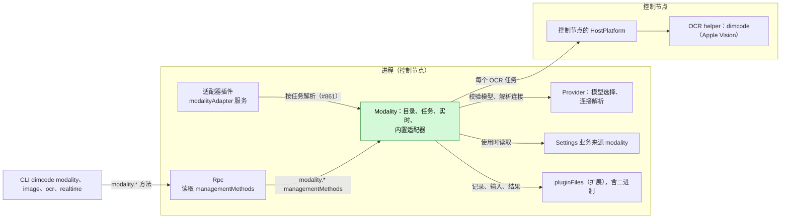
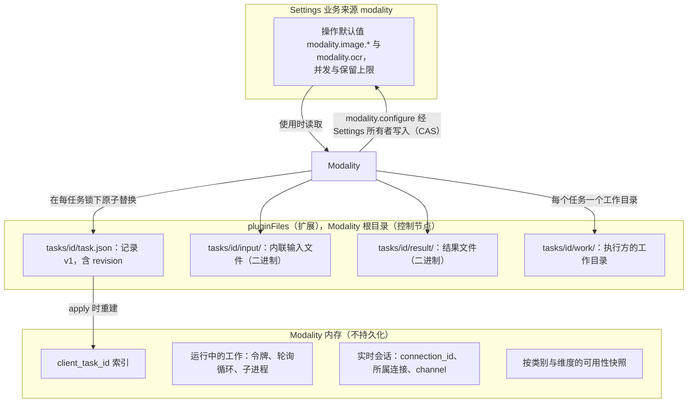
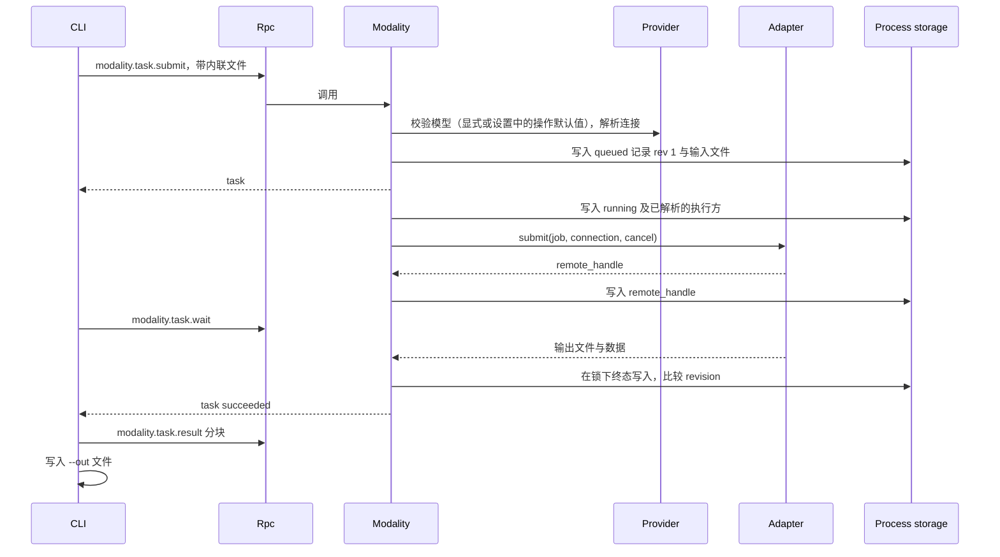
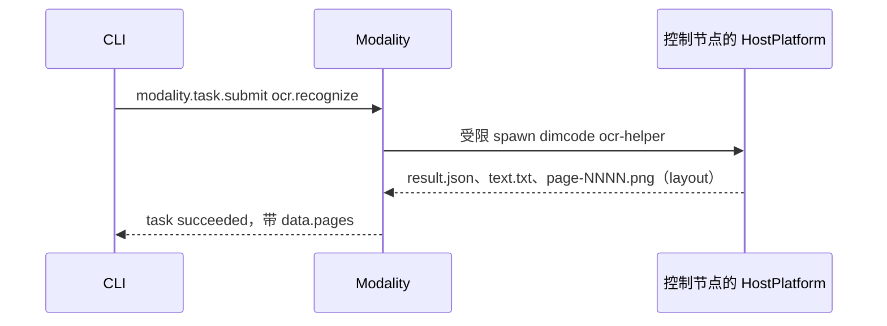
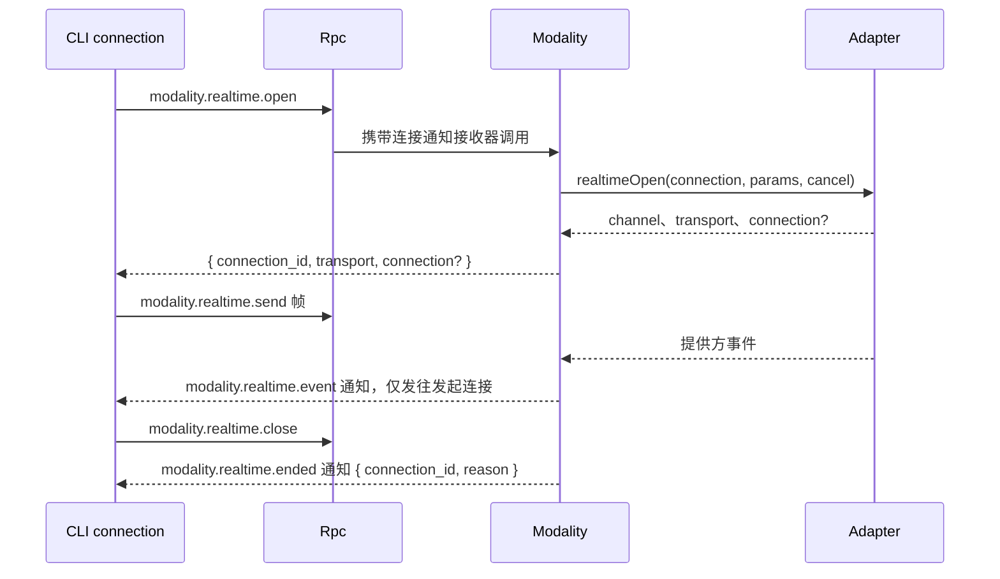
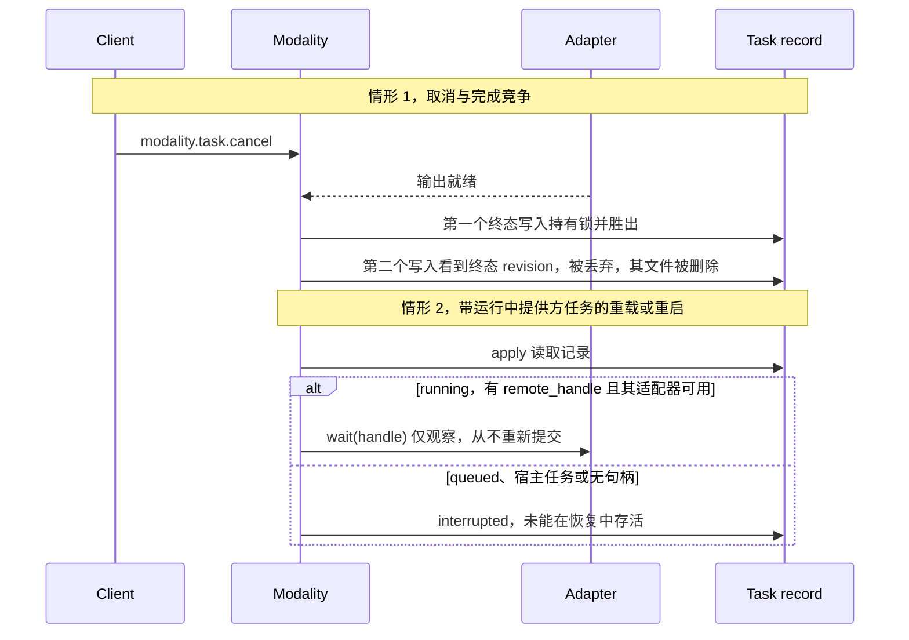

# Modality

状态：草案。总体设计：[overview §4 插件目录](../overview.md#4-插件目录)、[ADR 002](../../adr/002-plugin-scope.md)。阶段：P3。语言：由提供方执行的类别优先使用 TypeScript（[overview 附录 C](../overview.md#附录-c-实现语言)）。

> **运行时查找落地后，适配器按任务解析（[#40](https://github.com/arcships/dim/issues/40)、[#861](https://github.com/arcships/dim/issues/861)）。** [#40](https://github.com/arcships/dim/issues/40) 在 [#19](https://github.com/arcships/dim/issues/19) 中决定：Modality 在任务需要时解析该类别的适配器，而不是把所有适配器都作为依赖收集；该查找所需的运行时机制由 [#861](https://github.com/arcships/dim/issues/861) 跟踪。本设计依赖该查找，不重复定义适配器如何注册与发现。在它落地之前，图像切片每次调用读取单个进程 `modalityAdapter` 服务，缺少适配器只让其操作不可用；§1 说明当前形态与目标形态。

> **P3：按 rutis 现有能力重新设计。** rutis 是外部依赖，本文向 rutis 提出的需求已撤回（[原则 §4 第 8 条](../../../architecture/rust-agent/principles.md)）。

Modality 是一个进程插件（[ADR 002](../../adr/002-plugin-scope.md)：任务与提供方连接在各 Session 间共享），是九个类别非对话式多模态工作的唯一入口：图像、视频、语音、音乐、音频、3D 资产、动作、实时和 OCR。它按类别报告可用性及原因，按操作从它自己的 `modality` 设置文档解析默认模型（显式 → 配置的默认值 → 经 Provider 选择自动解析），运行异步任务（提交、状态、等待、取消）并通过 `pluginFiles`（扩展）保存，并持有绑定到发起客户端连接的实时连接。提供方适配器内置于 Modality，或由适配器插件（任意语言）以命名进程服务 `modalityAdapter` 提供；OCR 作为控制节点上的宿主任务运行，由 Modality 经 HostPlatform 的受限 spawn 启动产品自带的 `dimcode` helper。它的方法是它注册到 `managementMethods` 的命名空间 `modality`：关于宿主的进程插件方法，由 Rpc 分发，从不提供给已配对的远程设备。Modality 的设置（含其操作默认值）是业务配置，存放在它自己的 Settings 业务来源中，经 Settings 类型化操作写入，在使用时读取。它没有 Session 或分支部分：不写任何 Timeline 事件，也不提供模型可见的工具。Rust 实现位于 `dim-modality` crate，它依赖 App Server 提供 Settings 服务与管理方法；OCR helper 的契约与 Apple Vision 引擎位于 `dim-ocr` crate；产品的安装器把它们与执行 aimux 媒体操作（A.2）的内置 `dim-modality-aimux` 适配器一起加入进程装配。

## 1. 结构



所有依赖都是同一作用域的进程服务（[ADR 002 D3](../../adr/002-plugin-scope.md)）。适配器查找是 [#40](https://github.com/arcships/dim/issues/40) 在 [#19](https://github.com/arcships/dim/issues/19) 中决定的按任务解析；它所需的运行时机制尚未交付（[#861](https://github.com/arcships/dim/issues/861)）。本设计依赖该查找，不重复定义适配器如何注册与发现。**在它落地之前**，图像切片每次调用读取单个进程 `modalityAdapter` 服务，不声明依赖：它缺失时只有适配器操作不可用，重载由下一次调用看到，既不门控也不重载 Modality；该形态不按适配器名区分适配器。**在它落地之后**，Modality 按适配器名按任务解析操作所需的适配器，并能无需重载枚举当前可用的适配器，因此多个适配器可以各自独立服务不同操作。§4 的表、附录 B 与流程测试 8 同时说明两种形态；本页其余陈述今天即成立。Rpc 按调用在 `managementMethods` 中查找 Modality 的 `modality` 命名空间，不随它重载（[方法 §3.2](../contracts/session-boundary.md#32-管理方法)）。没有 Session 或分支插件依赖 Modality。

| 部分 | 作用域 | 依赖 | 提供 |
| --- | --- | --- | --- |
| `Modality` | 进程（控制节点） | Provider 的模型选择（`ModelSelectionHost`）与非对话连接解析；`pluginFiles`（扩展：UTF-8 与二进制）；Settings 业务来源 `modality`；[#40](https://github.com/arcships/dim/issues/40) 决定、[#861](https://github.com/arcships/dim/issues/861) 跟踪的按任务适配器查找（尚未交付；落地前每次调用读取单个进程服务）；控制节点的 HostPlatform（OCR）；诊断 | `modalityTasks` 进程服务；把 `modality`（`modality.*`）注册到 `managementMethods` |
| 适配器插件 | 进程 | 各自的提供方依赖 | `modalityAdapter` 服务，key 为适配器名，在插件的 `provides` 中声明；[#861](https://github.com/arcships/dim/issues/861) 落地后按任务解析 |

**依赖的契约：**[方法](../contracts/session-boundary.md)契约（注册到 `managementMethods` 的命名空间、每次调用的进度接收器、绑定连接的通知）；按任务适配器查找（[#861](https://github.com/arcships/dim/issues/861)，§9.1）；Provider 的模型选择（`ResolveModelSelection::resolve`，拒绝不可选的显式模型；[AuxiliaryModel](../appserver/auxiliary-model.md)）、用于选项列表的可选模型读取（§9.2），以及每个适配器操作与实时会话所需的非对话连接解析（[overview 附录 B.2](../overview.md#b2-app-server-进程插件)，§9.3）；`pluginFiles`（扩展），含二进制原子替换与格式版本（[App Server README](../../../../crates/dim-app-server/README.md#trusted-plugin-storage)）；带隔离的 HostPlatform spawn（[HostPlatform](../../../architecture/rust-agent/plugins/HostPlatform.md)，隔离补充见 [overview 附录 B.1](../overview.md#b1-session-与分支-capability)）。
**此处定义的契约：**类别与操作标识符；`modality` 设置文档中的默认值 key `modality.<category>` 与 `modality.<category>.<operation>`（Modality 自有；Provider 不持有任何 key）；`modalityAdapter` 与 `modalityTasks` 服务（[语言中立](../../adr/002-plugin-scope.md#d5-合同语言中立)，A.2 与 A.3；Rust 绑定见附录 G）；`modality` 设置文档及其 schema；任务记录与结果格式（格式版本 1）；`modality.*` 方法与 `modality.realtime.event`、`modality.realtime.ended` 通知。Provider 对模态一无所知；Modality 在适配器之外不了解任何提供方特有语义。

## 2. 数据与状态



任务记录是唯一的持久状态；索引在 `apply` 时从记录重建，非终态记录由启动规则（§4）结算。运行中的工作与实时连接从不重建。Modality 设置（含操作默认值）是业务配置（[ADR 002 D4](../../adr/002-plugin-scope.md)），按 Modality 声明的 schema 经 Settings 类型化操作写入业务来源 `modality`：变更是带通知的数据更新，下次使用时读取，从不触发重载（A16）。适配器插件集合是 loader 行中的结构性配置。Modality 如何找到它们的 `modalityAdapter` 服务，是 [#40](https://github.com/arcships/dim/issues/40) 决定的按任务查找；其运行时机制是 [#861](https://github.com/arcships/dim/issues/861)。在它落地之前，Modality 每次调用读取这一个进程 `modalityAdapter` 服务（见 §1 与 §9.1）。任务的 `node` 指明其执行方所在的节点（A15）；OCR 在控制节点上运行，指明其他节点的任务以 `node_unavailable` 失败，因为没有别的节点的 HostPlatform 可达。没有 Timeline 状态，没有 `StateCell`；竞争写入的顺序由每任务锁下的记录 `revision` 决定。

`defaults` 成员按操作 key 每项一条，每项是一个 Provider 模型引用。图像操作使用按操作的 key，本设计中不设类别回退；`modality.` 前缀是设置名，不是又一层嵌套：

```json
{
  "defaults": {
    "modality.image.generate": {"providerId": "openai", "modelId": "gpt-image-2"},
    "modality.image.edit": {"providerId": "openai", "modelId": "gpt-image-2"}
  }
}
```

## 3. 流程

### 3.1 提交、等待与取回（`dimcode image generate`）



CLI 自行读取输入并写出输出；Modality 只在其存储根目录内写入（A7）。

### 3.2 在控制节点上运行 OCR



Modality 没有 Session，因此 OCR 在控制节点上运行。`node` 参数与 `node_unavailable` 保留在契约中：指明控制节点以外节点的任务以 `node_unavailable` 失败，因为没有别的节点的 HostPlatform 可达。helper 是产品自带的可执行文件，由 Modality 经 HostPlatform 的受限 spawn 启动（§7、A.14）；其产物与参数见 A.1 与 A.2。

### 3.3 实时连接



会话在以下情况结束：`close`；发起它的客户端连接结束，此时静默结束，因为已无处可写；提供方结束它；`direct` 连接的 `expires_at` 到期；连续 10 分钟既无 `send` 也无提供方事件（A9）；Modality 卸载，尽力以 `unloaded` 上报；以及进程退出。慢客户端会被传输的持有额度断开，其会话随之结束。会话没有任务记录、从不持久化，也不会在守护进程重启后恢复。帧有上限：`send` 的数据解码后超过 1 MiB 以 `invalid_input` 失败且会话保持打开，而提供方消息超过适配器的上限时会话以 `ended {reason: "error"}` 结束。每个进程至多四个会话；超过时 `open` 在任何提供方调用之前以 `realtime_limit` 失败。来自非发起连接的 `send` 与 `close` 以 `not_found` 拒绝。

### 3.4 Capability 列表与默认模型

`dimcode modality` 和 Web 设置页调用 `modality.capabilities`，返回每个类别与操作及其可用性原因、可选选项、已持久化的默认值，以及任务或使用方现在会使用的模型。不隐藏任何内容，也没有 `--all`。每个不可用的类别或操作都按维度显示原因，例如“not in this build”“Apple Vision needs macOS 12 or later on Apple Silicon”“No OCR helper in this build”“no adapter”“not configured”“no adapter for the configured model”（决策 E16）。最后一项由 Modality 已采纳的业务配置（`modality` 设置文档中的默认值或显式模型，及其 Provider 连接）对照 Modality 能解析到的适配器得出（§9.1）。

图像操作是第一个实现切片，产品构建现在为该切片的一部分内置了适配器：内置 `dim-modality-aimux` 适配器（A.2）经 aimux 服务 `generate`，并在提供方的包读取编辑输入文件时服务 `edit`，而 `enhance` 仍是没有任何构建服务的适配器操作，因此以 `adapter` 原因报告 `unavailable`。可用性是运行时的属性，并按模型回答：安装后 `available` 即为 true，具体服务什么由 `operations` 针对任务所指的模型决定。适配器绑定 A.2 列出的内建目录提供方，因此以规范 UUID 标识、不匹配任何绑定的自建提供方，对其声明的任何媒体模型报 `adapter` 原因，其模型在 `configure` 时也以该原因被拒绝。已收集的适配器若不为 Provider 列出的任何模型服务，不算缺少适配器，并如实说明：图像操作仍用 `adapter` 维度，报“the adapter serves no image model Provider lists”，其选项是已声明的模型——与任何没有适配器服务的操作相同。`understand` 能解析并显示其默认值，但在 §9.4 落地前没有运行时使用方。可配置性是设置的属性：只要模型在该操作的可选选项中，`configure` 就接受任何有默认 key 的 A.1 操作的默认值，因此默认值可以在运行时落地之前持久化；本构建不能运行的操作仍保持 `available: false` 及其 `build` 或 `adapter` 原因。流程测试配置 fixture 适配器服务它们所覆盖的适配器操作，端到端流程则让内置适配器对着桩提供方运行。

`dimcode modality set-default image.generate <provider>/<model>` 和 Web 页调用 `modality.configure`：它先校验该模型属于该操作的选项——适配器操作要求有可用适配器服务它；`image.understand` 要求它是可选的视觉模型；没有适配器服务的操作要求该模型在 Provider 的 modality 读取中、且其目录条目声明了 `<category>.<operation>`，这样的模型可能是执行不能选择的（非 chat 模型，或未声明文本上限的模型）——再经所有者写入（Settings CAS）把该操作 key 写入 Modality 自己的 `modality` 设置文档。`model: null` 清除该 key。回复与 `modality.capabilities` 返回的是同一个快照，含新的 `revision`，客户端无需再读一次。

任务按此顺序解析模型：请求中的显式 `model`；该操作 key 已持久化的默认值；自动解析——当 Provider 的全局默认选择可选且服务该操作时用它，否则用 Provider 可选模型读取顺序中第一个可选的、服务该操作的模型。显式模型或已持久化的默认值不再可选时任务失败（`model_unavailable` 或 `default_unavailable`）；解析出的模型没有可用适配器服务时以 `unavailable` 失败。Modality 从不替换成别的模型。只有默认值缺失时才进入自动解析，因此清除默认值即恢复自动解析。解析出的模型写入任务记录，之后默认值变化不影响它。

`image.understand` 使用同样的解析但没有任务：Modality 解析其默认值并在 `modality.capabilities` 中暴露，Session 的图像理解路径（附件与 `read`）是使用方。该路径尚未读取该默认值；§9.4 中 Agent/Prompt 的需求必须先落地，默认值才会改变运行时使用的模型。在此之前，理解这一行只解析与显示。

`modality` 来源只有用户作用域：操作默认值属于用户，不属于项目。来源缺失时读为空默认值。这些方法是对 protocol-v3 的增量管理方法；旧 daemon 返回 `unknown_method`，客户端把该类别显示为不可用。旧产品的 `modality-settings.json` 不导入；将来的迁移是另一项改动。Provider 记录、模型描述符与聊天默认选择不变；Modality 不存 Provider 或 Session 状态，也不写 Timeline 事件。

## 4. 时序与冲突

Modality 不是分支工作：轮次与分支事实从不影响任务。竞争由每任务锁下的任务记录 `revision` 裁决。



适配器那一行描述的是 [#861](https://github.com/arcships/dim/issues/861) 落地后的目标设计及落地前的当前形态；其余各行今天即成立。

| 场景 | 结果 | 负责方 |
| --- | --- | --- |
| 适配器插件重载 | Modality 从不随适配器重载。运行中的适配器调用可能被中断；其任务变为 `interrupted`，从不重新提交。在 [#861](https://github.com/arcships/dim/issues/861) 之前，切片每次调用读取单个进程服务，下一个任务会重新解析它；落地后按适配器名解析，重载只影响该适配器服务的操作。两种形态下有句柄的任务都通过轮询恢复，实时连接都关闭 | Modality、运行时（[#861](https://github.com/arcships/dim/issues/861)） |
| Modality 重载 | Modality 重新激活前 `modality.*` 返回 `unknown_method`，Rpc 不重载；在途调用遵循[方法](../contracts/session-boundary.md)契约；disposer 取消本地工作，终止运行中的 OCR helper，关闭实时连接，为宿主任务和无句柄任务写入 `interrupted` | Rpc、Modality |
| 设置变更 | 下次使用时读取；重新计算可用性；已有任务保留其已解析的执行方；不重载 | Modality |
| 以相同 `client_task_id` 重复 `submit` | 返回已有任务 | Modality |
| 等待期间客户端脱离 | 任务继续；该客户端的实时连接关闭 | Modality |

完整表格见附录 B。

## 5. 上下文映射

无模型可见效果。Modality 不提供工具、提示词来源、输入或 Timeline 事实（决策 E16、A13）。结果只有在用户以常规方式（`@` 文件引用、附件、粘贴文本）将其放入 Session 时才会到达模型，这些是由各自插件拥有的输入事实。模型从不看到任务记录、可用性、默认值、进度或诊断。因此压缩、子分支和非交互 Session 均不受影响。

## 6. 接口（摘要）

| 接口 | 类型 | 用途 |
| --- | --- | --- |
| `modality.capabilities` | 管理方法 | 每个类别与操作，含可用性原因、可选选项、已持久化的默认值、生效模型与设置 revision |
| `modality.configure` | 管理方法 | 先校验，再在 Modality 的 `modality` 设置文档中设置或清除一个操作默认值（所有者写入，Settings CAS）；返回新快照 |
| `modality.task.submit/status/list/wait/cancel/result` | 管理方法 | 任务生命周期；分块二进制结果取回 |
| `modality.realtime.open/send/close`、`modality.realtime.event`、`modality.realtime.ended` | 管理方法及绑定连接的通知 | 实时会话 |
| `modalityTasks` | 进程服务，无 key | 与任务方法相同的操作，供其他进程插件使用 |
| `modalityAdapter` | 进程服务，key 为适配器名；[#861](https://github.com/arcships/dim/issues/861) 落地后按任务按名解析，图像切片在此之前每次调用读取单个进程服务（§9.1） | 由提供方执行的类别 |
| `modality` 设置文档 | 业务配置（Settings 来源，schema 由 Modality 声明，经 Settings 类型化操作写入） | 操作默认值、上限；使用时读取 |
| `dimcode modality`、`image`、`video`、`speech`、`music`、`audio`、`asset`、`motion`、`ocr`、`realtime` | CLI | 方法的薄客户端 |

详见附录 A。

## 7. 安全

- 所有 `modality.*` 方法都是管理方法（它们消耗提供方额度并运行宿主进程）：只由进程插件提供，从不提供给已配对的远程设备（[方法](../contracts/session-boundary.md)）；RemoteGateway 从不提供它们。
- 经认证的 loopback Web 入口只被提供 `modality.capabilities` 与 `modality.configure`；任务、实时与结果方法对浏览器客户端保持不可用。回复包含模型标识、可用性原因与设置 revision，从不包含凭据、任务记录或结果。
- 凭据由 Provider 每次调用时解析；从不出现在记录、结果、诊断或错误中。
- OCR helper 是产品自带的 `dimcode` 可执行文件，由 Modality 经 HostPlatform 的受限 spawn 启动：输入可读；任务的工作与临时目录以及 OCR 缓存可写；无网络；有超时与输出上限（A14）。其路径是正在运行的二进制，从不来自请求数据。
- 内联输入经过大小检查，存放在任务目录下；`node_path` 由控制节点上的 OCR helper 读取，或由提供方任务的适配器在控制节点进程中就地读取。Modality 从不在其存储根目录之外写入；文件仅所有者可访问。
- 实时事件只发往发起连接。

## 8. 规则检查

规则：[principles §1 与 §4](../../../architecture/rust-agent/principles.md)，[ADR 002](../../adr/002-plugin-scope.md) D1–D5。

| 规则 | 本文如何符合 |
| --- | --- |
| §4.1 改别的模块拥有的状态时写指令事件 | Modality 只改自己的任务记录；操作默认值是 Modality 自己的业务配置，经 Settings 对其 `modality` 来源的类型化所有者写入（CAS）设置，不涉及 Timeline。 |
| §4.2 交接后不能撤回 | 不适用：Modality 不向其他模块交接 Timeline 对象；任务终态在其锁下只决定一次。 |
| §4.3 只用 before 回调在写入前干预 | 不适用：Modality 不注册 before 回调，也不在 Session 或 RPC 入口加检查；它只校验自己方法的参数。 |
| §4.4 核心机制不带业务含义 | Modality 不要求 Timeline、Dispatcher 或 Rpc 做任何改动；Provider 不持有任何按使用方划分的 key；Modality 显式传入模型。 |
| §4.5 决定前读完整个批次 | 不适用：Modality 不读任何 Timeline 事件。 |
| §4.6 模型上下文只含交接后被读取的事件 | Modality 不写任何模型可见内容；结果只作为其他插件拥有的普通输入进入模型。 |
| §4.7 插件之间只通过公开事件和服务交互 | Modality 只通过公开服务使用 Provider、Settings、`pluginFiles`、HostPlatform 以及它能解析到的 `modalityAdapter` 服务（§9.1）。 |
| §4.8 向机制所有者提通用需求 | 按任务适配器查找、Provider 的可选模型读取与 Provider 的非对话连接在 §9 中提出。 |
| §4.9 只有后续决定要用的事实才进 Timeline | Modality 不写 Timeline 事件；任务记录留在 `pluginFiles`，操作默认值与其他设置在它的 Settings 业务来源中。 |
| §1 Capability 与 App Server 边界 | Modality 是进程插件，不是 Capability；业务代码在它自己的包中，App Server 只分发它注册到 `managementMethods` 的命名空间。 |
| ADR 002 D1 作用域跟随状态所有者 | 任务与提供方连接在各 Session 间共享，因此 Modality 是进程作用域。 |
| ADR 002 D2 不设接线模块 | 适配器查找是由 [#861](https://github.com/arcships/dim/issues/861) 跟踪的运行时工作；本设计不设接线模块。 |
| ADR 002 D3 依赖跟随作用域 | 所有依赖都是进程服务。适配器按调用读取，因此在 [#861](https://github.com/arcships/dim/issues/861) 前后，缺少某个适配器都只影响其操作；落地后按适配器名解析每个适配器。 |
| ADR 002 D4 结构性配置与业务配置分离 | 适配器插件是 loader 行；操作默认值与上限是 `modality` 来源中的业务配置，经 Settings 写入，使用时读取。 |
| ADR 002 D5 合同语言中立 | `modalityAdapter`、`modalityTasks` 与各方法以中立形式给出；附录 G 只是绑定。 |

## 9. 向机制所有者提出的需求

规则：[principles §4 第 8 条](../../../architecture/rust-agent/principles.md)。每项给出问题、考虑过的现有机制、通用能力、对顺序与重载的影响，以及所有者和 issue。

| 需求 | 所有者 | 五项内容 |
| --- | --- | --- |
| 从对端节点导入的服务在链路断开期间保持登记，调用以 `node_unavailable` 直接失败 | rutis，[#5](https://github.com/arcships/dim/issues/5) | 见 [ExternalAgent §9](ExternalAgent.md#9-向机制所有者提出的需求) |
| 运行时服务按名字暴露给非 Rust 插件 | 运行时，[#4](https://github.com/arcships/dim/issues/4) | 见 [session access §9](../contracts/session-access.md#9-向机制所有者提出的需求)；只有 Modality 的 TypeScript 实现需要它 |
| 不门控 Modality 的按任务适配器查找 | 运行时/装配，[#861](https://github.com/arcships/dim/issues/861) | [§9.1](#91-按任务适配器查找) |
| Provider 提供可选模型及其声明能力的只读契约 | Provider，[#790](https://github.com/arcships/dim/issues/790) | [§9.2](#92-provider-只读契约) |
| Provider 的非对话连接 | Provider，[#799](https://github.com/arcships/dim/issues/799) | [§9.3](#93-provider-非对话连接) |
| `modality.image.understand` 的 Session 图像理解使用方 | Agent/Prompt 所有者，[#798](https://github.com/arcships/dim/issues/798) | [§9.4](#94-session-图像理解使用方) |

Settings 业务来源与 `pluginFiles` 补充是对其他插件的改动，列在 [overview 附录 B.2](../overview.md#b2-app-server-进程插件)。

### 9.1 按任务适配器查找

- **问题。** 缺失、Pending、Failed 或正在重载的适配器不得让 Modality Pending 或重载它；只有该适配器服务的操作可以变为不可用。依赖每个 `modalityAdapter` 服务的做法正好相反。
- **现有机制。** 用 `Keyed` 声明每个适配器会在每个提供方 Active 之前门控使用方；按名称收集服务同样如此。可选的按调用读取（`Ctx::get`、`Ctx::get_at`）不门控，Rpc 与 `AgentIndex` 就以这种方式读取 `managementMethods`、`sessions` 与 `auxiliaryModel`；但目录把一个名字映射到每个副本的一个 key，桥接插件的 `provides` 条目也不带按提供方的实例 key，因此同一名字的多个提供方无法按各自的适配器名解析，使用方也无法枚举当前哪些可用。注册表（`managementMethods`、`toolRegistry`）把贡献交给所有者，但它们不是服务：适配器将不得不依赖一个表所有者并注册回调，这颠倒了声明依赖，也重复了 `modalityAdapter` 契约。
- **需要的能力。** 按提供方标识（适配器名）对进程作用域提供方做按调用解析，既不门控使用方，也不在两个方向上建立重载关系：缺失、Pending、Failed 或正在重载的提供方在当次调用中就是解析不到，下一次调用在它回来时看到它。等价形态也可以接受，例如每个已配置提供方使用一个单独登记的名字、由所有者按调用可选读取，只要所有者能在提供方出现或消失时无需重载就枚举当前可用的提供方。
- **顺序影响。** 适配器的卸载/重载只影响它的操作；Modality 不重载，也没有 Timeline 或批次改动；在途任务按 A.6 结算。
- **首个切片。** 在该能力落地之前，图像切片每次调用读取单个进程 `modalityAdapter` 服务（`Ctx::get`），不声明适配器依赖：缺失时只有适配器操作不可用，不产生门控与重载关系。这是单个适配器的目标解析形态；按适配器名枚举多个适配器并按任务解析仍需本 issue。
- **所有者/issue。** 运行时/装配，[#861](https://github.com/arcships/dim/issues/861)。[#40](https://github.com/arcships/dim/issues/40) 已在 [#19](https://github.com/arcships/dim/issues/19) 中决定使用方一侧并已关闭；Modality 只声明该依赖。

### 9.2 Provider 只读契约

- **问题。** `modality.capabilities` 必须从 Provider 能选择的模型中计算 `options` 与自动解析。Provider 的模型选择端口只解析单个模型，而目录读取是客户端管理方法，因此进程所有者无法枚举可选集合及其声明能力。
- **现有机制。** 单模型选择端口无法按操作能力过滤。新增客户端方法会把管理面暴露给所有者并重复目录。Provider 侧的只读契约由 [#790](https://github.com/arcships/dim/issues/790) 单独跟踪。已交付：`dim-agent-capabilities` 中的进程 host 端口 `SelectableModelsHost`，由 Provider 与配置式模型配置提供，其 `selectableModels` 读取枚举执行时接受的模型及其声明能力。
- **需要的能力。** 该读取是按执行形态定制的：未声明 `text` modality 的模型、非 chat 模型以及未声明文本上限的模型都不会出现，因此 Modality 路由到的图像、视频、语音、音乐、音频、资产、动作与实时模型全部缺失。Provider 在同一端口上新增一次读取 `selectableForModality`，返回它为非对话用途会选择的每个模型，以及该模型目录条目声明的 `<category>.<operation>` id。它应用与 `selectableModels` 相同的 provider、账号、模型、路由、凭据与状态规则，但去掉上述三项对话要求。
- **顺序影响。** 每次 `capabilities` 调用和任务提交时读取；不重载，不涉及 Timeline。
- **所有者/issue。** Provider，[#790](https://github.com/arcships/dim/issues/790) 与本次改动。

### 9.3 Provider 非对话连接

- **问题。** 图像生成与编辑适配器需要按调用取得模型的端点、协议与凭据材料。Provider 只为 `ModelRequest` 解析连接。
- **现有机制。** `ProviderConnectionResolver` 绑定 `ModelRequest`；适配器不能拥有 Provider 凭据，Modality 也不能存储它们。
- **需要的能力。** 由 Provider 拥有的、按调用解析模型非对话连接的能力，只用于该次调用，从不持久化，也不返回给客户端。Provider 在其自己的页面上定义该合同（[provider management §3.6](../appserver/provider-management.md#36-供进程-owner-读取的可选模型)）：输入、回复、可选性与凭据规则以及生命周期。端口是 `dim-agent-capabilities` 中的 `ResolveModalityConnection` 与 `ModalityConnectionHost`，`ModalityTarget` 携带模型标识与操作；Modality 按适配器调用（`submit`、`wait`、`cancel_remote`）解析它并把连接传给适配器。适配器调用它，不持有凭据。
- **顺序影响。** 提交时解析；不重载；凭据从不进入任务记录、结果、诊断或错误。
- **所有者/issue。** Provider，[#799](https://github.com/arcships/dim/issues/799)。

### 9.4 Session 图像理解使用方

- **问题。** Modality 解析 `modality.image.understand`，但 Session 的图像理解路径（附件与 `read`）把图像发给 Session 采纳的模型；没有任何东西读取 Modality 的默认值。在该需求落地前，理解这一行只能解析与显示。
- **现有机制。** `read` 把图像块返回给 Session 模型，`session.model.update` 与 Prompt 采纳的配置选择该模型。Session 路径到进程所有者默认值之间没有输入路径或类型化查找。在浏览器里选择正是该需求要排除的仅浏览器默认值。
- **需要的能力。** Session 图像理解路径经 Modality 的 `modality.image.understand` 默认值（显式 → 默认值 → 自动）解析其模型，或等价的类型化交接。机制属于 Agent/Prompt。
- **顺序影响。** 每次读取或附件时；无 Timeline 事件；在该需求落地前已有 Session 保持其行为；不重载。
- **所有者/issue。** Agent/Prompt 所有者，[#798](https://github.com/arcships/dim/issues/798)。

## 附录 A. 接口细节

### A.1 类别与操作

| 类别 | CLI | 操作 | 输入 | 结果 | 执行方 | 默认值 key |
| --- | --- | --- | --- | --- | --- | --- |
| `image` | `image` | `generate`、`edit`（图像，可选 mask）、`enhance`（`upscale`、`restore`、`denoise`、`sharpen`、`remove_background`、`colorize`）、`understand`（图像；只做选择，使用方是 Session 图像理解路径） | 提示词、文件；`understand` 为图像 | 图像文件；`understand` 为文本 | Provider | `modality.image.generate`、`modality.image.edit`、`modality.image.enhance`、`modality.image.understand` |
| `video` | `video` | `generate`、`edit`、`enhance` | 提示词、文件 | 视频文件 | Provider | `modality.video` |
| `speech` | `speech` | `synthesize`、`transcribe` | 文本或音频 | 音频文件；或 `data: { text, segments: [{ start_ms, end_ms, text }] }` 加 `transcript.txt` | Provider | `modality.speech.synthesize`、`modality.speech.transcribe` |
| `music` | `music` | `generate` | 提示词 | 音频文件 | Provider | `modality.music` |
| `audio` | `audio` | `generate` | 提示词 | 音频文件 | Provider | `modality.audio` |
| `asset` | `asset` | `generate` | 提示词、可选图像 | 3D 文件 | Provider | `modality.asset` |
| `motion` | `motion` | `generate` | 提示词 | 动作数据文件 | Provider | `modality.motion` |
| `realtime` | `realtime` | `voice`、`transcribe`、`avatar` | — | 会话 | Provider | `modality.realtime` |
| `ocr` | `ocr` | `recognize` | 图像或 PDF | `data: { pages: [{ page, text? }], textTruncated? }`，页文本合计不超过 1 MiB，超出的页面只带 `page`；`result.json`；`text.txt`；`layout` 模式下每个栅格化页面一个 `page-NNNN.png` | 宿主 helper（`dimcode ocr-helper`） | `modality.ocr` |

图像理解是图像类别中的一个操作，其默认值由 Modality 解析（`modality.image.understand`）。它的使用方是 Session 图像理解路径（附件与 `read`，见 [WorkspaceTools §read results and images](../../../architecture/rust-agent/plugins/WorkspaceTools.md#read-results-and-images)）；该路径尚未读取该默认值，因此 §9.4 中 Agent/Prompt 的需求必须先落地，默认值才会改变运行时使用的模型。在此之前，理解这一行只解析与显示。图像操作使用按操作的 key，本设计中不设类别回退；其他类别先解析按操作的 key，再解析类别 key（A3）。输入之外的操作参数由各适配器声明，并在提交时校验（A4）；宿主操作自行声明其参数：`ocr.recognize` 接受 `params.outputMode`，取值为 `"text"`（默认）或 `"layout"`（A.2）。CLI 只为 A.1 声明的输入提供具名参数——提示词或文本、输入文件、`image edit --mask`（一个输入文件，其名称写入 `params.mask`）以及 `image enhance MODE`（`params.mode`）——其余参数一律走 `--param KEY=VALUE`。

操作的规范能力 id 是 `<category>.<operation>`，例如 `image.generate` 与 `realtime.voice`；Provider 的 `modalityCapabilities` 声明使用同一组字符串，快照携带这两个字段而不再重复 id。不存在别名（`image.read` 不是别名），实时子调用也没有 id：`open`、`send`、`close` 与 `event` 是方法，`realtime.voice`、`realtime.transcribe` 与 `realtime.avatar` 是实时能力。本构建通过内置适配器服务 `realtime.voice`；另外两个以 `adapter` 维度上报，其 detail 指名该操作，例如 “No available adapter serves realtime.transcribe”。

### A.2 适配器与 OCR

服务 `modalityAdapter`，作用域为进程，key 为适配器名，在适配器插件的 `provides` 中声明；内置适配器提供同一服务。适配器如何注册与发现，是 [#40](https://github.com/arcships/dim/issues/40) 决定、[#861](https://github.com/arcships/dim/issues/861) 跟踪的按任务查找（§9.1）；本设计依赖它，不重复定义。在它落地之前，Modality 每次调用读取单个进程 `modalityAdapter` 服务，因此缺失或正在重载的适配器只影响其操作。落地后，Modality 在任务需要时按适配器名解析该操作的适配器。取消是一个协议动作：Modality 丢弃该调用（或发送绑定的取消请求）；适配器停止本地工作。错误是数据 `{ code, message }`，`code` 为 `invalid_input`、`unavailable`、`provider_error` 之一。

| 方法 | 类型 | 请求 | 回复 |
| --- | --- | --- | --- |
| `available` | 同步 | `{}` | `{ available: bool, reason? }`；每次使用时读取，变化时不重载 |
| `operations` | 同步 | `{ model: {providerId, modelId} }` | `[{ category, operation, params_schema }]` |
| `submit` | 异步 | `{ job: Job, connection: ResolvedConnection }` | `{ remote_handle? }` |
| `wait` | 异步 | `{ task_id, remote_handle?, connection }`；进度以该调用上的 `{ fraction?, message? }` 通知送达 | `{ files: [{ name, media_type, path }], data? }`；`path` 位于作业的工作目录内 |
| `cancelRemote` | 异步 | `{ remote_handle, connection }` | `{ outcome: "cancelled" \| "unsupported" \| "already_finished" }` |
| `realtimeOpen` | 异步 | `{ connection, params }`；提供方事件以该调用上的 `{ channel_id, event }` 通知送达，直到关闭 | `{ channel_id, transport, connection? }`；`transport` 为 `relay` 或 `direct`，`connection` 是 `direct` 会话的短期提供方材料 `{ kind, url?, token?, offer?, ice_servers?, expires_at? }` |
| `realtimeSend` | 异步 | `{ channel_id, frame: { kind: "text" \| "audio" \| "control", data } }` | `{}` |
| `realtimeClose` | 异步 | `{ channel_id }` | `{}` |

`Job` 为 `{ task_id, category, operation, model: {providerId, modelId}, params, files: [{ name, media_type, path }], work_dir }`。内联输入的 `path` 是 Modality 存放在 `modality/tasks/<task_id>/input/<name>` 的文件的绝对路径；通过 `node_path` 给出的输入记录 Modality 得到的规范路径（最后一个组件不得是链接；更早的链接会被解析），Modality 只读取一次以取得 `bytes` 与 `sha256`，从不复制，执行方就地读取。`work_dir` 是任务的 `modality/tasks/<task_id>/work` 目录，调用前创建；每个结果文件解析为其中的普通文件。`ResolvedConnection` 是 Provider 非对话连接解析返回的数据形态（`kind`、`provider_id`、`model`、端点与凭据材料，以及 `realtime.*` 用途下目录条目的 `realtime: { protocol, path }` 声明），每次调用传入，从不存储或记录日志。该声明是 Provider 对条目 `metadata.raw.realtime` 的读取；条目未声明的模型，以及从不携带它的配置模型 profile，会在适配器被调用之前以 `unavailable` 拒绝，消息为 “The model declares no realtime transport”。中继从连接的 base URL、声明的 `path` 与模型 id 组合出套接字地址，因此路径由目录条目声明，从不推导。

产品内置适配器是 `dim-modality-aimux` crate：aimux 的词汇留在适配器内部。它服务 `image.generate`、`image.edit`、`video.generate`、`speech.synthesize` 与 `speech.transcribe`，按目录提供方 id 绑定；并对任何条目声明了 openai-realtime 传输的模型服务 `realtime.voice`，因为实时会话由连接构建，而不是由厂商行决定。中继以连接的 base URL 加声明的路径和作为查询的模型 id 连接，`http` 与 `https` 变为 `ws` 与 `wss`；它发送连接的头部与 bearer、经连接的代理连接、在套接字处以 1 MiB 限制一条提供方消息、把文本帧写成 JSON 并把音频帧写成解码后的字节，并在提供方关闭、套接字失败或十秒内写不出一帧时结束会话。它不承载控制帧——控制帧属于 `direct` 传输。凡是其媒体模型由某个 aimux 厂商包执行的内建目录提供方都有一行（openai、google、xai、grok-build、elevenlabs、fal、deepgram、assemblyai、cartesia、gladia、groq、replicate、stability-ai、recraft、black-forest-labs、luma-ai、runway、kling、hume-ai、mistral-ai、rev-ai），每行只服务其包实际实现的操作。`image.edit` 只由读取编辑输入字节的包服务：openai、google、fal、replicate、black-forest-labs 会读取；stability-ai、recraft、luma-ai 只服务 `image.generate`；包对某个模型报告不接受文件输入时，该模型也不提供 edit。xAI 的图像模型因该包回答 `NoSuchModel` 而报 `adapter`，其转录与合成模型则被服务。自建提供方的 id 是规范 UUID，不匹配任何行，因此其媒体操作报 `adapter` 原因，`configure` 也以该原因拒绝其模型。其他 A.1 类别（音乐、音频、3D 资产、动作）没有对应行，保持 `build` 原因。内建目录没有为 Amazon Bedrock 声明任何媒体模型，因此 Bedrock 连接不服务媒体操作。安装后 `available` 即为 true；服务范围按模型由 `operations` 回答，端点不可达是某次调用的失败，而不是能力。视频是唯一可恢复的操作：`submit` 把提供方的操作引用存为句柄，`wait` 轮询它并把结果流式写入文件，因此重启恢复同一作业而不会重新发起；开始后一小时仍未结束的作业以 `provider_error` 失败，避免永不结束的作业一直占用调度槽位。该上限同样约束在途的状态请求与两次轮询之间的等待，因此挂起的请求会在截止时失败，而不是跑满连接更长的超时。aimux 对已启动的视频作业不提供取消，因此 `cancelRemote` 回答 `unsupported`，提供方作业会在其一侧跑完并计费。输出文件的媒体类型从返回字节读取，提供方返回与请求不同的格式时，按实际返回记录。

`available` 在不重载的情况下报告运行时可用性（例如提供方端点不可达）。若某个操作的可用适配器都不服务已配置或显式指定的模型，则报告为“no adapter for the configured model”，其提交以 `unavailable` 失败。`image.understand` 不是适配器操作：它由一个可选的视觉模型服务，且只做选择。OCR 不是适配器：它是宿主任务，其目标是本构建自带的 `local`/`apple-vision` 模型。该目标是该操作唯一的选项，`modality.ocr` 把它持久化为默认值；显式指定该目标之外的模型以 `model_unavailable` 失败。任务在控制节点上经 HostPlatform 的受限 spawn 运行产品自带的 helper：输入可读；任务的工作与临时目录以及 OCR 缓存可写；无网络；超时 30 分钟；stdout 与 stderr 上限各 64 KiB（§3.2、§7、A.14）。该目标仅在 Apple Silicon 的 macOS 12 或更高版本上提供；Intel Mac 以 `platform` 原因报告其缺席，因为识别路径需要 Apple Silicon 的 I/O 客户端。指明控制节点以外节点的任务以 `node_unavailable` 失败。`wait` 以 `task_id` 指名它等待的作业；当 `submit` 返回了 `remote_handle` 时，适配器可以改用它。带已存储 `remote_handle` 的 `wait` 必须能在新一代中工作；不返回句柄的适配器以 `task_id` 记录自己进行中的工作，且仅限同一代内，因此无法恢复。

helper 的调用形式是 `dimcode ocr-helper --input <path> --artifacts <dir> --output-mode <text|layout>`。它打印一行 JSON：成功时打印 `{"ok": true, "pageCount": N}` 并以 0 退出，类型化拒绝时打印 `{"ok": false, "error": {"code", "message"}}` 并以 2 退出；其他退出码表示失败。其产物是 `result.json`、`text.txt`（即文档的 `text`），以及仅 `layout` 模式下每个栅格化页面一个 `page-NNNN.png`。所有名字都是单个组件，`settle_output` 因此无需例外。`result.json` 为 `{ text, pageCount, pages: [{ page, text, width, height, imagePath?, regions: [{ text, confidence, polygon }] }] }`：`page` 从 1 开始，与 `data.pages` 是同一字段、同一编号；`imagePath` 指出该页的图片文件，`text` 模式下缺席（栅格化页面的图片被丢弃）；`regions` 两种模式都有，`confidence` 在 [0, 1] 内，每个多边形都在页面边界内。错误码为 `invalid_input`、`encrypted_pdf`、`resource_limit_exceeded`、`local_runtime_unavailable` 与 `local_runtime_failed`。输入类型从字节嗅探，从不取自声明的媒体类型。上限为 500 页、每页 25,000,000 像素、每任务 1 GiB 产物、输入 100 MiB；产物上限在写入每个文件时计入，因此目录持有量从不超过该上限。Modality 通过对 `result.json` 的一次流式解析构建 `data.pages`，从不解码文档的 `text` 成员，页文本合计至多 `MAX_DATA_TEXT_BYTES`（1 MiB）；文本会越过该预算的页面只保留编号而不带 `text`，`data.textTruncated: true` 告知客户端到 `text.txt` 读取全文。守护进程通过插件文件存储打开每个产物：其遍历从不跟随链接且只接受普通文件，因此产物名上的 FIFO 或链接会被拒绝而不会被读取；打开的产物合计超过 1 GiB 上限时，在读取任何字节之前拒绝该任务，且每次读取都不超过打开时固定的文件长度。

### A.3 方法

命名空间 `modality`，注册到进程的 `managementMethods`（声明与 `call` 遵循[方法](../contracts/session-boundary.md)契约），每个方法都是管理方法。`modalityTasks`（进程，无 key）提供 `submit`、`status`、`list`、`wait`、`cancel` 与 `result`，请求与回复同下方的 `modality.task.*` 方法。`wait` 使用每次调用的进度接收器；实时使用绑定连接的通知（[方法](../contracts/session-boundary.md)）。

| 方法 | 参数 | 结果 |
| --- | --- | --- |
| `modality.capabilities` | `{}` | 下方默认快照；每个类别都出现 |
| `modality.configure` | `{ expectedRevision, category, operation?, model: {providerId, modelId} \| null }`（`model` 必填；`null` 表示清除） | 写入后的同一快照；失败时为 `modality_conflict`、`modality_invalid_selection`、`modality_unknown_operation` 或 `modality_failed` |
| `modality.task.submit` | `{ category, operation, params, files?: [{ name, media_type, data_base64 } \| { node_path }], model?, node?, client_task_id? }` | `{ task }`；已存在的 `client_task_id` 返回已有任务。`image.understand` 只做选择，没有任务；其使用方是 Session 图像理解路径（§9.4） |
| `modality.task.status` | `{ task_id }` | `{ task }` |
| `modality.task.list` | `{ state?, category?, limit? (≤100), after? }` | `{ tasks, next? }`，最新在前 |
| `modality.task.wait` | `{ task_id, timeout_ms? (≤600000, default 600000) }` | 终态时或超时时返回 `{ task }`（超时不是错误）；进度通过该调用的进度接收器 |
| `modality.task.cancel` | `{ task_id }` | `{ task }`；幂等 |
| `modality.task.result` | `{ task_id, name, offset, length (≤4 MiB) }` | `{ data_base64, eof }` |
| `modality.realtime.open` | `{ operation, model?, params }`；`params` 按适配器的 schema 校验，中继的 schema 不接受任何字段 | `{ connectionId, transport, connection? }`；仅 `direct` 带 `connection` |
| `modality.realtime.send` | `{ connectionId, frame: { kind: "text" \| "audio" \| "control", data } }` | `{}` |
| `modality.realtime.close` | `{ connectionId }` | `{}` |
| `modality.realtime.event` | 通知 `{ connectionId, event }` | 仅发往发起连接 |
| `modality.realtime.ended` | 通知 `{ connectionId, reason: "closed" \| "provider" \| "expired" \| "idle" \| "unloaded" \| "error" }` | 仅发往发起连接 |

`open` 像任务一样解析模型（显式 → `modality.realtime` 默认值 → 自动），要求有可用适配器为该模型服务该操作，计入进程的会话数，解析连接并拒绝没有 `realtime` 声明的模型，之后才调用适配器。会话属于发起它的连接：来自其他连接的 `send` 与 `close`，以及二者对未知 id 的调用，都以 `not_found` 答复。对已结束会话的 `close` 同样以 `not_found` 答复。每个 `realtime.*` 操作都不是任务：`modality.task.submit` 以 `modality_unknown_operation` 答复，因为会话没有可存储的记录。

默认快照是两个方法共同返回的唯一形态。模型引用是 `{providerId, modelId}`；原因是 `{dimension: "build" | "platform" | "runtime" | "adapter" | "configuration" | "provider", detail}`，`detail` 是所有者提供的英文展示文本，客户端从不解析、也不翻译。

```json
{
  "revision": "native:user/modality:7",
  "categories": [{
    "category": "image",
    "available": true,
    "reasons": [],
    "operations": [{
      "operation": "generate",
      "key": "modality.image.generate",
      "available": true,
      "reasons": [],
      "default": {"providerId": "p", "modelId": "m", "available": true},
      "effective": {"providerId": "p", "modelId": "m", "source": "default"},
      "options": [{"providerId": "p", "modelId": "m", "available": true}]
    }]
  }, {
    "category": "ocr",
    "available": true,
    "reasons": [],
    "operations": [{
      "operation": "recognize",
      "key": "modality.ocr",
      "available": true,
      "reasons": [],
      "default": null,
      "effective": {"providerId": "local", "modelId": "apple-vision", "source": "automatic"},
      "options": [{"providerId": "local", "modelId": "apple-vision", "available": true}]
    }]
  }]
}
```

- `revision` 是 `modality` 设置文档的 revision；一次 CAS 覆盖该文档中的全部操作 key，因此对某个操作的 `configure` 也会让持有其他操作草稿的客户端失效。只有 `configure` 使用它。
- `default` 是已持久化的选择或 `null`。模型不再可选、或没有可用适配器服务它时（对 `image.understand`，是它不是可选的视觉模型时），`available` 为 `false`，`reason` 说明原因。
- `effective` 是该操作能运行之后，任务或使用方现在会使用的模型：即使操作本身 `available: false`（本构建没有适配器），它仍从选项解析，客户端因此无需分辨哪部分属于设置、哪部分属于运行时。默认值可用时就是默认值。`default` 为 `null` 时它是自动解析：Provider 的全局默认选择可选且服务该操作时用它，否则用 Provider 可选模型读取顺序中第一个可选的、服务该操作的模型；`source` 为 `"automatic"`。不可用的默认值给出 `effective: null`，从不替换成别的模型。
- `options` 列出服务该操作的模型。候选来自 Provider 的非会话读取（`selectableForModality`，§9.2），因此被执行拒绝的媒体模型——非 chat 模型，或未声明文本上限的模型——只要其目录条目声明了该操作就是候选。对 `generate`、`edit` 与 `enhance`，由可用适配器决定哪些候选服务哪个操作：选项是 Provider 两次读取的去重并集，先执行可选的模型、后已声明的模型，各自按读取顺序，并保留适配器的 `operations` 为该操作服务的那些。对 `image.understand`，改由可选的视觉模型服务，取自 Provider 的 `vision` 能力。对实时操作，选项是其条目声明了该 `<category>.<operation>` id 的模型，按 Provider 的顺序：会话适配器收到的正是条目声明的传输，因此条目本身就是逐模型答案；声明了操作但没有传输的模型由 `open` 以 `unavailable` 拒绝。当没有适配器服务该操作的类别时，适配器不收窄任何候选，选项是其 Provider 目录条目声明了该 `<category>.<operation>` id 的模型，按 Provider 的顺序；没有任何声明的操作选项为空。所有者从 Provider 的已声明能力计算候选，客户端不自行推导。当前默认值不再是选项时也会列出，并标注原因。所有者读取时从 Provider 的只读契约（§9.2）与可用适配器计算它们。选项只带 `{providerId, modelId, available, reason?}`：读取返回 id 与能力，不返回展示名，因此客户端按 `{providerId, modelId}` 从它已有的 Provider 列表或目录读取中并入名字，取不到名字时显示 id。
- `configure` 先校验操作以及模型在该操作的可选选项中（对 `image.understand`，可选视觉支持；对 `ocr.recognize`，本构建的宿主目标），再经 Settings 的所有者写入以 CAS 写入或清除该操作 key。它接受任何有默认 key 的 A.1 操作，且从不答复 `modality_unavailable`：配置是设置写入，不是运行时断言。未知类别或操作答复 `modality_unknown_operation`；操作有自己的 key 时（image、speech、OCR）`operation` 必填，只有按类别划分 key 的类别可以省略。`model: null` 清除该 key（对 OCR 即 `modality.ocr`）；清除即恢复自动解析；缺少 `model` 为 `invalid_params`。写入在回复发出之前完成，因此成功即表示默认值已持久化，且该回复与紧随其后的 `modality.capabilities` 读到的一致（除非 Provider 在此期间变化）。
- 可配置性与可用性是两个不同的属性：前者属于设置，后者属于运行时。已持久化的默认值可以指向本构建不能运行的操作的模型；快照通过保持该操作的 `available: false` 及其 `build` 或 `adapter` 原因保持诚实，而 `effective` 仍在选项上解析（默认值可用时用默认值，否则自动解析），客户端因此无需自行实现解析。

边界校验：每次提交的内联输入合计至多 8 MiB，更大的输入使用 `node_path`——控制节点上已存在普通文件的绝对路径，最后一个组件不得是链接（更早的链接会被解析）；读取前先将其长度与 100 MiB 提交预算的剩余量比较，记录的是规范路径，执行方在该路径读取，Modality 从不复制；每次提交的输入文件合计至多 100 MiB（A5）。媒体类型遵循 A.1 的输入列：图像操作接受 `image/*`，视频操作接受 `image/*` 与 `video/*`，`speech.transcribe` 接受 `audio/*`，`asset` 接受 `image/*`；输入不指名文件的操作拒绝文件。每个文件名是单个组件、合法的 pluginFiles 名称，且在提交内互不相同。`node` 对提供方类别以 `invalid_input` 拒绝，对宿主类别则指明执行节点，即控制节点（A15）。参数在提交时按适配器的 `params_schema` 校验；非法参数以 `invalid_input` 失败且不写入任何内容。可用性检查先于模型解析：本构建无法运行的操作会带着 `modality.capabilities` 中该操作的原因失败（附录 C），因此缺失适配器不会被报成缺失模型。模型选择：显式 `model`；否则操作默认值；否则自动解析；否则 `no_default_model`。不可选的显式模型以 `model_unavailable` 失败，不可用的默认值以 `default_unavailable` 失败，解析出的模型没有可用适配器服务时以 `unavailable` 失败；都不回退到其他模型。解析出的模型固定在记录中。`image.understand` 与每个 `realtime.*` 操作都不是任务：为它们提交会以 `modality_unknown_operation` 失败。`ocr.recognize` 是宿主任务（§3.2）：只接受一个输入文件，`image/*` 或 `application/pdf`，接受 `params.outputMode` `"text"`（默认）或 `"layout"`，不校验适配器 schema。其选项是宿主目标，其默认值是 `modality.ocr`；显式指定 `local`/`apple-vision` 之外的模型以 `model_unavailable` 失败，本宿主无法运行该目标时 `submit` 以 `unavailable` 失败并带该操作的 `platform` 或 `build` 原因。指明控制节点以外节点的任务以 `node_unavailable` 失败。每个类别至多 4 个运行中任务；其余按提交顺序保持 `queued`（A6）。

### A.4 任务记录（`pluginFiles`（扩展），格式版本 1）

| 字段 | 类型 |
| --- | --- |
| `version` | `1` |
| `task_id` | `mt_<uuid>` |
| `client_task_id` | 字符串或 null |
| `revision` | 整数，每次写入递增 |
| `category`、`operation` | A.1 中的标识符 |
| `executor` | `{ kind: "provider", provider, adapter }`，其中 `provider` 为 `{providerId, modelId}`；或 `{ kind: "host", node, target }`，其中 `node` 为请求的节点或 null，`target` 为 `{providerId, modelId}` |
| `params` | 已校验的对象；输入文件替换为 `{ name, media_type, bytes, sha256 }`（存放在 `input/` 下）或 `{ name, media_type, bytes, sha256, node_path }`（规范路径，就地读取） |
| `state` | `queued`、`running`、`succeeded`、`failed`、`cancelled`、`interrupted` |
| `remote_handle` | 字符串或 null；在报告 `running` 进度之前写入 |
| `progress` | `{ fraction?, message? }` 或 null；每秒至多写入一次（A10） |
| `result` | `{ files: [{ name, media_type, bytes, sha256 }], data? }` 或 null |
| `error` | `{ code, message }` 或 null |
| `remote_cancel` | `"cancelled"`、`"unsupported"`、`"already_finished"` 或 null |
| `created_at`、`updated_at`、`finished_at` | RFC 3339 |

记录与结果文件使用 `pluginFiles`（扩展）：每插件根目录、UTF-8 与二进制原子替换、锁、格式版本。保留：每次 `apply` 时以及每次终态写入之后，早于 30 天或超出最新 200 个的终态任务连同文件删除，最旧的先删（A2）；非终态任务从不删除。

记录是 `modality/tasks/<task_id>/task.json`，采用宿主的版本 1 文本信封。每次写入都持有该文件的锁并比较 `revision`：第一个终态写入获胜，较晚的终态结果连同它写出的结果文件一起丢弃。`params` 以 `files` 数组携带输入文件的元数据；内联文件存放在 `input/` 下，调用方的 `node_path` 只记录路径并就地读取。`files` 键是保留的：调用方的 `params.files` 以 `invalid_input` 拒绝；记录总是携带已校验的元数据，提交没有文件时为空数组。`wait` 把适配器返回的文件从任务的工作目录流式写入 `result/<name>`，同时计算 `bytes` 与 `sha256`，随后删除工作目录。

### A.5 CLI

| 命令 | 行为 |
| --- | --- |
| `dimcode modality [--json]` | 全部类别与操作的表格：可用性、以 `dimension: detail` 行给出的原因、默认模型与实际生效模型；`--json` 原样打印 `modality.capabilities` 的应答。未提供该方法的守护进程回答说它不提供 Modality |
| `dimcode modality set-default <category>[.<operation>] <provider>/<model>` / `--clear` | 以紧接读取的 revision 调用 `modality.configure`；遇到 `modality_conflict` 时重新读取并重试一次；打印该操作的行，`--json` 时打印应答 |
| `dimcode modality task list [--state S] [--category C] [--limit N] [--after ID]`、`task status ID`、`task wait ID [--out DIR]`、`task cancel ID` | 任务方法（A.3）。`list` 按 `ID STATE OPERATION MODEL CREATED` 打印一页，最新在前，还有下一页时在 stderr 打印 `More: --after <id>`；`status` 打印该行、进度、错误，以及每个结果文件一行；`wait` 与提交时同一套等待，只有 `--out` 给出目录时才写结果；`cancel` 报告所有者返回的状态，已是终态的任务据此说明未改变。`--json` 原样打印应答 |
| `dimcode image generate\|edit PROMPT [FILE...]`、`image edit --mask PATH`、`image enhance MODE [FILE...]`、`video generate\|edit\|enhance PROMPT [FILE...]`、`speech synthesize TEXT`、`speech transcribe FILE`、`music\|audio\|motion generate PROMPT`、`asset generate PROMPT [FILE...]` | 提交 `modality.task.submit`：`--model PROVIDER/MODEL` 指定模型，其余适配器参数一律用 `--param KEY=VALUE`（值能解析为 JSON 时按 JSON，否则按字符串，因此本会解析为 JSON 的字符串要写成带引号的形式）；输入（含 mask）整体不超过 8 MiB 时内联发送，否则全部用 `node_path`。默认等待并把结果文件写到 `--out`（目录，默认 `.`）；绝不覆盖已有文件：一个都不写，点名这些文件，并给出 `dimcode modality task wait <id> --out <dir>` 到别处取回。`--no-wait` 打印 id；`--json` 打印记录。退出码：0 成功，1 传输、RPC、不可用、被中断或目标已存在，2 任务失败，130 Ctrl+C 或任务被取消 |
| `dimcode ocr FILE [--output-mode text\|layout] [--out DIR]` | 提交 `ocr.recognize`。text 模式下，`text.txt` 不超过 64 KiB 且不超过 30,000 个 UTF-16 单元时打印，不写任何文件；打印的文本已去除终端控制符，写出的 `text.txt` 与 `--json` 记录保留原始字节。更长的文本会被写出（写到 `--out` 或当前目录），命令打印 2,000 字符的预览和 `Full text: <path>`。给出 `--out` 时在打印文本之外还写出结果集；`--output-mode layout` 写出页面图片并打印每个写出的路径。写入遵循上面的目标已存在规则。`--json` 打印记录，`--no-wait` 打印 id |
| `dimcode realtime [--operation <operation>] [--model <provider>/<model>]` | `realtime.open`，`params` 为 `{}`；将 stdin 行作为 text 帧转发，事件与 `ended` 打印为 JSON 行，EOF 或 Ctrl+C 时关闭；`direct` 回复打印其 connection 并保持（[CLI 命令](../cli-commands.md#realtime-会话)） |

调用不可用的类别时打印与列表相同的原因。前台等待期间第一次 Ctrl+C 停止等待并打印任务 id；任务继续（A8）。结果传输期间的 Ctrl+C 停止传输：移除在写的临时文件，目标名一个都不写，打印 `Stopped; the task keeps its results. Fetch them with: dimcode modality task wait <id> --out <dir>`，并以 130 退出。

### A.6 任务机制

| 步骤 | 机制 |
| --- | --- |
| 提交 | 在边界校验；写入 `queued`（revision 1）与输入文件；返回。通过 `ctx.effect`（Cordis 的 effect 机制，[rutis 生命周期](../rutis-usage.md#4-rutis-提供的生命周期)）注册的调度器在有空闲槽位时启动它；调度器与每个运行中的任务都是 effect 工作，插件卸载时由它清理 |
| 启动 | 写入 `running` 及已解析的执行方；解析该操作的适配器（[#861](https://github.com/arcships/dim/issues/861) 落地后按任务按名解析；在此之前来自单个进程服务）；调用 `submit`；一旦得知即写入 `remote_handle` |
| 终态 | 在每任务锁下一次写入并比较 `revision`；第一个终态写入胜出；之后的结果被丢弃，其文件被删除。保留在写入之后、状态对 `wait`/`status` 可见之前执行 |
| 保留 | 每次 `apply` 时以及每次终态写入之后：早于 30 天或超出最新 200 个的终态任务连同其文件删除，最旧的先删（A.4，A2） |
| 取消 | 标记已请求；取消本地令牌（中止 HTTP，或经 HostPlatform 杀死 OCR helper 的进程树）。取消后 drive 继续等待 `submit`，使执行方已接受的作业交出句柄；取消等待提交阶段结束（两者都以 3 秒为界，低于 rutis 的 10 秒卸载上限）。然后重读记录；有句柄时调用 `cancel_remote`（与调用令牌和本代 stop 竞速，挂起的提供方既拖不住客户端也拖不住卸载）；释放资源；写入 `cancelled`，带执行方的答复或 `null`。执行方回答 `unsupported` 时，提供方作业继续运行并计费；记录保留 `unsupported`，Modality 不再等待它 |
| 卸载（自身重载或 Provider 重载） | disposer 取消本地工作，经 HostPlatform 杀死 OCR helper 的进程树，关闭实时连接，为宿主任务和无句柄的提供方任务写入 `interrupted`；有句柄的任务保持 `running` |
| 启动（每次 `apply`） | `queued` → `interrupted`（之后从不启动，A11）；`running` 宿主任务 → `interrupted`；有句柄且其适配器可用的 `running` 提供方任务 → 继续 `wait`（仅观察，A12）；否则 `interrupted`“did not survive recovery” |
| 配置变更 | `modality` 设置变更（含默认值）：数据更新与通知，下次使用时读取；重新计算可用性；已有任务保留其已解析的执行方；不重载 |

## 附录 B. 完整冲突表

适配器那一行描述的是 [#861](https://github.com/arcships/dim/issues/861) 落地后的目标设计及落地前的当前形态；其余各行今天即成立。

| 场景 | 顺序 | 结果 | 负责方 |
| --- | --- | --- | --- |
| 任一 Session 中的轮次 `stop/interrupt` 或分支关闭 | — | 无影响；任务不是分支工作 | — |
| Session 卸载、恢复、关闭；压缩；子分支；Steer/Queue/Append；`input/withdraw`、`input/deleted` | — | 无影响；无模型可见输出 | — |
| 启动前取消 | `queued` < 取消 | `cancelled`，不联系执行方 | Modality |
| 取消与完成竞争 | 锁顺序 | 第一个终态写入胜出 | Modality（revision） |
| 对终态任务取消 | 终态 < 取消 | 返回未改变的记录 | Modality |
| 以相同 `client_task_id` 重复 `submit` | 第二次在第一次之后 | 返回已有任务 | Modality |
| 重复 `cancel` | — | 幂等 | Modality |
| Modality 重载期间的 `wait` | wait 挂起 | 按方法契约中断；客户端重连后再次调用 `wait` | Rpc、客户端 |
| 适配器插件重载或被移除 | Modality 从不随适配器重载 | 卸载中断的运行中调用使其任务 `interrupted`，从不重新提交；尚未开始的任务在适配器缺失时以 `unavailable` 失败。在 [#861](https://github.com/arcships/dim/issues/861) 之前，切片每次调用读取单个进程服务，重载或移除只影响适配器操作；落地后按适配器名解析，只影响该适配器服务的操作 | Modality、运行时（[#861](https://github.com/arcships/dim/issues/861)） |
| 适配器在运行时报告不可用 | 标志为 false | 对它的新提交 `unavailable`；运行中任务继续 | Modality |
| 任务中途进程重启 | `running` 记录 | 启动规则；从不重新提交 | Modality |
| 保留策略删除了客户端仍在引用的任务 | — | 仅限终态任务；`result` 以 `not_found` 失败 | Modality |
| OCR 任务指明控制节点以外的节点 | — | 任务 `failed` `node_unavailable` | Modality |
| OCR helper 启动失败或不可用 | — | 任务 `failed`，代码为映射后的 `unavailable` 或 `executor_error`（附录 C） | Modality |
| 等待期间客户端脱离 | — | 任务继续；该客户端的实时连接关闭 | Modality |
| 任务中途 Provider 凭据被移除 | — | 适配器调用失败；`failed` `provider_error` | Modality |
| 提交后默认模型变更 | — | 任务保留其记录的模型 | Modality |
| 所属连接关闭后的实时 send | 关闭 < send | `not_found` | Modality |

## 附录 C. 错误与恢复

| 代码 | 含义 |
| --- | --- |
| `invalid_input` | 未知类别或操作、参数或文件违规 |
| `unavailable` | 类别或操作不可用；消息点名该操作，并逐行给出 `modality.capabilities` 中每个原因，形如 `dimension: detail`；客户端只显示、从不解析 |
| `no_default_model` | 无显式模型、无操作默认值，且自动解析没有找到可服务的模型 |
| `default_unavailable` | 已持久化的操作默认值不再可选；清除或替换它 |
| `model_unavailable` | 显式模型不可选 |
| `realtime_limit` | 每个进程至多四个实时会话；关闭一个后重试 |
| `modality_conflict` | 设置 revision 已过期；重新读取后重试 |
| `modality_invalid_selection` | 模型不可经 Provider 选择、没有可用适配器服务该操作，或 `image.understand` 指定的模型没有视觉能力；回复带原因 |
| `modality_unknown_operation` | 未知操作或默认值 key |
| `modality_unavailable` | 由 `modality.task.submit` 对已知但本构建未实现的类别或操作答复：其 `modality.capabilities` 原因中有一个是 `build` 维度，消息点名该操作并逐行给出每个原因，形如 `dimension: detail`（A.3） |
| `modality_failed` | 读写所有者配置时 Settings 或 Provider 的意外失败 |
| `node_unavailable` | 请求的节点不是控制节点，其 HostPlatform 是唯一可达的 |
| `provider_error` | 适配器或提供方失败；消息已去除秘密 |
| `executor_error` | OCR helper 失败或产生无效输出 |
| `not_found` | 未知或已删除的任务、结果文件或连接 |
| `storage_error` | 记录或文件写入失败；尽可能将任务标为 `failed`，否则在下次启动时结算 |
| `unknown_method`、`service_reloading` | Modality 缺失或正在重载（[方法](../contracts/session-boundary.md)） |

已提交后又被中断的提供方作业的计费副作用不会撤销；记录注明 `interrupted`，以及已知的 `remote_handle`。

## 附录 D. 验收

通过 `modality.*` 方法进行流程测试，使用一个假适配器插件（可控的句柄、延迟、取消支持）和一个 fixture OCR helper：

1. `modality.capabilities` 列出全部九个类别，并按维度给出原因；每个图像操作都带其默认值、生效模型、选项与设置 revision；CLI 显示每个类别，不可用项附原因；没有 `--all`。
2. `configure` 经 Settings 所有者写入写入 `modality` 设置文档并返回新快照；不带 `model` 的提交使用该默认值；默认值变更后任务保留其模型；`model: null` 清除它，之后的任务使用自动解析。
3. 提交、状态、列表、等待（终态与超时，收到进度）、分块二进制结果且 `sha256` 匹配。
4. 并发上限使某类别的第五个任务排队。
5. 启动前、运行中（本地中止、远端取消、不支持）以及对终态任务的取消；取消与完成竞争只产生一个终态。
6. 重复 `client_task_id` 返回同一任务。
7. 重启：宿主任务 `interrupted`；有句柄的提供方任务恢复且不发生第二次 `submit`；无句柄的 `interrupted`；`queued` 的 `interrupted`。
8. 适配器重载与移除：Modality 从不随适配器重载。在 [#861](https://github.com/arcships/dim/issues/861) 落地前，单个进程服务按调用读取，因此重载或移除适配器插件只影响适配器操作；卸载中断的运行中调用使其任务 `interrupted`。落地后，按适配器名按任务解析：适配器被移除且已配置的默认值指向其模型时，`modality.capabilities` 报告“no adapter for the configured model”，其他操作保持可用。
9. 在控制节点上运行 OCR：目标出现在快照中，任务经受限 spawn 运行 fixture helper 并发布其产物，取消会杀死它，指明其他节点的任务以 `node_unavailable` 失败；在没有 Apple Vision 的宿主上，目标缺席并带 `platform` 原因，提交以 `unavailable` 失败。
10. 实时：会话以 `{ connectionId, transport }` 打开，把文本、音频与控制帧转发给适配器，并且只向发起连接发送提供方事件；它在 `close`、发起连接结束、提供方结束、`direct` 连接的 `expires_at` 到期、空闲上限与卸载时结束，各有自己的 `ended` 原因；超过上限的帧以 `invalid_input` 拒绝且会话保持打开；第五个会话以 `realtime_limit` 失败；其他连接的 `send` 与 `close` 为 `not_found`；没有声明的模型在适配器被调用之前使 `open` 失败；每个 `realtime.*` 提交都是 `modality_unknown_operation`。
11. 任何 Session 中都不出现 Timeline 事件、工具声明或输入。
12. 修改 `modality` 设置文档（操作默认值、上限）在下次使用时生效，无需重载 Modality。
13. 禁用或删除默认模型、其 Provider 或其适配器会使 `default.available` 为 false 并带原因；对任务操作，提交以 `default_unavailable` 失败；清除默认值恢复自动解析；没有其他操作被禁用。
14. 两次使用同一 revision 的 `configure`：第二次以 `modality_conflict` 失败且不写入；重新读取看到第一个写入者的值。
15. 自动解析：没有默认值时，任务在 Provider 的全局默认选择服务该操作时使用它，否则使用 Provider 可选模型读取顺序中第一个被服务的模型；`effective.source` 为 `"automatic"` 并给出该模型。
16. Web 入口准入：经认证的 loopback Web 入口可调用 `modality.capabilities` 与 `modality.configure`；裸与未认证的 WebSocket 不能；`modality.task.*` 与实时方法不被准入；声明与分发一致。
17. Web 渲染：宽与紧凑布局显示所有者选项、自动生效模型与不可用原因，包括理解“尚未生效”的状态；冲突保留已输入的草稿并提供重新加载；在 Web 会话中所做的 Provider 或模型变更会刷新页面；回复不带凭据。
18. `image.understand` 经 `modality.capabilities`/`modality.configure` 解析并显示默认值。在 §9.4 中 Agent/Prompt 的需求落地前，Session 图像理解路径继续使用 Session 模型，页面如实说明；落地后，fixture 图像理解流程使用已配置的默认值，清除它即恢复自动解析。

## 附录 E. 假设

| # | 假设 | 依据 | 若被否决的影响 |
| --- | --- | --- | --- |
| A2 | 保留 30 天或 200 个终态任务 | 判断 | 磁盘占用不同 |
| A3 | 操作默认值：image 与 speech 使用按操作的 key，其他类别使用类别 key。本设计中图像不设类别回退 | Overview §4；判断 | 图像操作共用一个默认值，或回退掩盖被清除的操作 key |
| A4 | 操作参数由适配器声明，在提交时校验 | 判断 | 每个操作固定 schema |
| A5 | 每次提交内联输入 8 MiB，更大的用 `node_path`，每次提交 100 MiB | 判断 | 上限改变 |
| A6 | 每个类别至多 4 个运行中任务 | 判断 | 采用其他并发度 |
| A7 | CLI 以小输入内联、大输入用 `node_path` 发送并写出输出；Modality 只写其存储根目录 | Overview §4；判断 | Modality 需要对调用方路径的写权限 |
| A8 | CLI 等待期间的 Ctrl+C 是脱离而非取消 | 判断 | Ctrl+C 会取消高成本任务 |
| A9 | 实时空闲超时 10 分钟 | 判断 | 连接比客户端存活更久 |
| A10 | 进度每秒至多写入一次 | 判断 | 存储写入更多 |
| A11 | `queued` 任务在重启或重载后不再启动 | Overview §6.2 约束 4，扩展 | 排队任务在重启后启动 |
| A12 | 存有句柄的运行中提供方任务通过轮询恢复（观察，而非重新执行） | 决策 E16 | 重启时所有运行中任务 `interrupted` |
| A13 | 无模型可见工具 | 决策 E16；功能清单只定义了 CLI 命令 | 必须设计 Session 级工具贡献 |
| A14 | OCR helper 受限运行：输入可读，产物与临时目录可写，无网络 | 判断；overview 隔离补充；HostPlatform 隔离表 | 隔离更弱 |
| A15 | OCR 在控制节点上运行；指明其他节点的任务以 `node_unavailable` 失败 | Modality 没有 Session；没有别的节点的 HostPlatform 可达 | 远程节点需要导入的 HostPlatform，如 ExternalAgent 的桥接 |
| A16 | Modality 设置（操作默认值、并发与保留上限）是 Settings 业务来源 `modality` 中的业务配置 | ADR 002 D4；变更在下次使用时读取，不改变已装载的行 | 设置变更会作为结构性 loader 字段重载 Modality |

## 附录 G. Rust 绑定

Rust 适配器插件可以实现生成的绑定，而不直接处理命名服务；A.2 中的中立形式是规范性的。以下类型位于 `dim-modality`；连接是 Provider 的非对话式解析每次调用返回的那个，传给适配器后不存储、不记录、不返回。

```rust
/// Binding for service `modalityAdapter` (process, key adapter name).
pub type AdapterFuture<'a, T> = Pin<Box<dyn Future<Output = Result<T, AdapterError>> + Send + 'a>>;
pub struct AdapterOperation { pub category: String, pub operation: String, pub params_schema: Value }
pub struct JobFile { pub name: String, pub media_type: String, pub path: PathBuf }
pub struct Job {
    pub task_id: String,
    pub category: String,
    pub operation: String,
    pub model: ModelId,
    pub params: Value,
    pub files: Vec<JobFile>,
    pub work_dir: PathBuf,
}
pub struct Submitted { pub remote_handle: Option<String> }
pub struct AdapterOutput { pub files: Vec<JobFile>, pub data: Option<Value> }
pub struct AdapterError { pub code: AdapterErrorCode, pub message: String }
pub enum AdapterErrorCode { InvalidInput, Unavailable, ProviderError }
pub enum RemoteCancel { Cancelled, Unsupported, AlreadyFinished }
pub struct AdapterProgress { pub fraction: Option<f64>, pub message: Option<String> }
pub struct ProgressSink(Arc<dyn Fn(AdapterProgress) + Send + Sync>);

pub struct RealtimeFrame { pub kind: RealtimeFrameKind, pub data: Value }
pub enum RealtimeFrameKind { Text, Audio, Control }
pub enum RealtimeTransport { Relay, Direct }
pub struct RealtimeConnection {
    pub kind: String,
    pub url: Option<String>,
    pub token: Option<String>,
    pub offer: Option<Value>,
    pub ice_servers: Option<Value>,
    pub expires_at: Option<String>,
}
pub struct RealtimeOpened {
    pub channel_id: String,
    pub transport: RealtimeTransport,
    pub connection: Option<RealtimeConnection>,
}
pub enum RealtimeEvent { Event(Value), Ended(RealtimeEnd) }
pub enum RealtimeEnd { Provider, Error(String) }

pub trait ModalityAdapter: Send + Sync + 'static {
    fn available(&self) -> bool;
    fn operations(&self, model: &ModelId) -> Vec<AdapterOperation>;
    fn submit(&self, job: Job, connection: ModalityConnection, cancel: CancellationToken)
        -> AdapterFuture<'_, Submitted>;
    fn wait(&self, task_id: &str, handle: Option<&str>, connection: ModalityConnection,
        progress: ProgressSink, cancel: CancellationToken) -> AdapterFuture<'_, AdapterOutput>;
    fn cancel_remote(&self, handle: &str, connection: ModalityConnection)
        -> AdapterFuture<'_, RemoteCancel>;
    fn realtime_open(&self, connection: ModalityConnection, params: Value,
        events: mpsc::Sender<RealtimeEvent>, cancel: CancellationToken)
        -> AdapterFuture<'_, RealtimeOpened>;
    fn realtime_send(&self, channel_id: &str, frame: RealtimeFrame, cancel: CancellationToken)
        -> AdapterFuture<'_, ()>;
    fn realtime_close(&self, channel_id: &str) -> AdapterFuture<'_, ()>;
}
```

A.2 中的实时操作映射到实时方法，随它们一起绑定：适配器通过 `events` 上报事件，提供方关闭会话时上报 `Ended(Provider)`，协议失败时上报 `Ended(Error(message))`；该消息只记录日志，从不写入连接。对 Modality 结束的每个会话，Modality 都会调用 `realtime_close`，上限五秒；适配器无法完成时丢弃该会话。在 Rust 中注册以 `TypeKey::named("modalityAdapter")` 提供 `ModalityAdapter`，以适配器名作为实例 key。适配器如何注册与发现，遵循 [#40](https://github.com/arcships/dim/issues/40) 决定并由 [#861](https://github.com/arcships/dim/issues/861) 跟踪的按任务查找；本附录只绑定各操作。

Modality 自身的 `managementMethods` 使用[方法](../contracts/session-boundary.md)契约的绑定。`modalityTasks` 服务由同一实现以 `TypeKey::named("modalityTasks")` 提供，每个 `modality.task.*` 声明对应一个方法，请求与回复类型相同：

```rust
impl ModalityTasks {
    pub async fn submit(&self, params: TaskSubmit, cancel: &CancellationToken)
        -> Result<TaskReply, RpcError>;
    pub async fn status(&self, params: TaskStatus) -> Result<TaskReply, RpcError>;
    pub async fn list(&self, params: TaskList) -> Result<TaskListReply, RpcError>;
    pub async fn wait(&self, params: TaskWait, cancel: &CancellationToken,
        progress: Option<&Progress>) -> Result<TaskReply, RpcError>;
    pub async fn cancel(&self, params: TaskCancel, cancel: &CancellationToken)
        -> Result<TaskReply, RpcError>;
    pub async fn result(&self, params: TaskResultQuery, cancel: &CancellationToken)
        -> Result<TaskResultReply, RpcError>;
}
```

这些类型就是各方法使用的 serde 类型。该绑定仅限 Rust：没有外部形式，因为非 Rust 使用方只能经按名暴露运行时服务的要求（[#4](https://github.com/arcships/dim/issues/4)，§9）访问命名服务。
