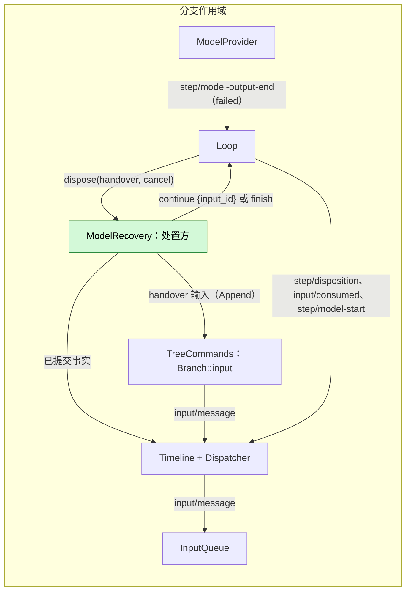

# ModelRecovery

设计：[model-retry-recovery §6](../../../design/research/model-retry-recovery.md#6-跨请求续接modelrecovery-的目标合同)。作用域：分支。所用所有者合同：[Loop](../../../architecture/rust-agent/plugins/Loop.md#a-failed-model-step-and-its-disposer)、[ModelProvider](../../../architecture/rust-agent/plugins/ModelProvider.md#failure-chain) 与 [InputQueue](../../../architecture/rust-agent/plugins/InputQueue.md#handover-inputs)。

需求（[#1210](https://github.com/arcships/dim/issues/1210)）：模型请求在已提交输出之后失败时，同一 turn 用一个新请求续接一次，而不是结束，续接请求共享失败链的预算。

ModelRecovery 是一个分支部分。它把失败模型步骤的处置方注册到 Loop 的端口上，注册是它自己 `apply` 的效果，持续到该部分卸载。它没有设置，也不写自己类型的事件：它唯一的写入是经分支正常输入入口写的 handover 输入。它在默认产品配置中：没有设置，因此默认开启才能让续接到达用户；没有该行的配置走原有失败路径。它从不运行模型或工具，从不写 `turn/end`、`step/model-start` 或 `model/call`，也从不读其他部分的状态：它的决定只使用分支已提交的事实。

## 1. 结构

| 部分 | 作用域 | 依赖 | 提供 |
| --- | --- | --- | --- |
| `ModelRecovery` 分支部分 | 分支 | `B:AgentLoop`（处置方端口）、`B:Timeline`（已提交事实查询）、`S:TreeCommands`（handover 输入） | 一个处置方注册；不提供服务 |

Loop 的端口在每个分支上只接受一个处置方，第二次注册失败。注册是该部分的效果，因此卸载会撤回它；Loop 的任务随后回答 `finish`，打开的交接结束。该部分是分支部分，因此每个分支各有一份。

## 2. 何时续接

处置方只读已提交事实：`failure_sequence` 指向的失败 `step/model-output-end`、该请求的输出事实、本 turn 的 `turn/start`，以及本 turn 的 `context/prepare` 事实。只有以下条件全部成立，它才回答 `continue {input_id}`；否则回答 `finish`。

- **可重试的失败。** `failure.kind` 是 `network`、`rate_limited` 或 `server_error`。其他 kind，包括 `unknown`、`malformed_response`、`output_limit`、`context_too_long` 与凭据类，都不在首批覆盖内。声明了工具调用而一个都没执行的失败输出，只有在本 turn 的一次续接已经用掉时才会到达这个决定：Loop 先自行续接它，不经处置方；handover 续接的消费落地后用的是同一个额度（[Loop](../../../architecture/rust-agent/plugins/Loop.md#a-failed-step-whose-calls-were-announced-and-never-executed)）。
- **已提交输出。** 失败请求提交过 `step/text`、`step/thinking`、`step/tool-use-start`、`step/tool-use` 或 `step/model-content` 事实。已产生但在结算时被丢弃的输出不是已提交输出。`replay_safe` 是 ModelProvider 调用内的标志，不是事实，因此处置方从已提交的输出事实推导这个条件。
- **未禁止重试。** `failure.retryForbidden` 未设置。策略禁止重试的失败仍会打开交接，但处置方会拒绝它，因此禁止覆盖续接。
- **仍有预算。** 失败终态的 `failure` 中 `attempts` 小于 8，`waitedMs` 小于 300 秒。该部分读取 ModelProvider 的[公开上限](../../../architecture/rust-agent/plugins/ModelProvider.md#failure-chain)和失败自身的 `attempts`、`waitedMs`，从不重复这些数字。
- **尚未接受过续接。** 本 turn 的 `turn/start` 之后，没有携带 `failure_chain` 的 `context/prepare`。续接自己的 `context/prepare` 会携带它，因此同一 turn 的第二次失败会拒绝。Loop 在续接「调用已声明但从未执行」的回复时也会用掉本 turn 的一次续接，两者共用同一个额度，一个 turn 只接受其中一次。

工具边界的情形会因两个原因被拒绝：无工具续接请求发出的工具调用以 `failure.kind = unknown` 结算失败，不在覆盖范围内；并且该请求自己的 `context/prepare` 已携带 `failure_chain`，因此本 turn 的一次续接已经用掉。执行器的快照拒绝是第二道防线；按 Loop 的合同，该 turn 以保留已提交文本的方式结束。

## 3. handover 输入

回答 `continue` 时，该部分经分支正常输入入口 `tree.input` 写一条 `input/message`，模式为 Append，带 `handover: {turn_id, request_id}`；随后回答 `continue {input_id}`。内容是一条固定指令，包含三部分：从已提交输出的结尾继续，不重复已完成的工作，本回复不可用工具。它绝不携带提供方错误文本、请求头、响应体或凭据。该指令是一个 raw block，没有 `user`，像 Goal 的自动输入一样。展示操作者话语的客户端从不把该指令显示为操作者消息：v1 的 `Input` 视图只从 `user` 取文本，因此 v1 客户端看到空文本的输入，与它对所有自动输入的处理相同。

InputQueue 从不采用这条输入；Loop 只在启动该交接续接的那个批次中消费它，排在所有待处理 Append 输入之后，因此它的文本是最后一条模型消息。分支历史在对应的 `input/consumed` 处渲染它，与其他输入相同。若 turn 结束仍未消费它，InputQueue 会删除它，它从不驱动 turn，也不会进入之后的请求。

该部分不等待任何东西：读已提交事实、写一条输入、回答。因此处置自身没有计时器；任何退避都属于 ModelProvider，在续接请求内部。

## 4. 取消与重载

- **卸载。** 注册是该部分的效果；卸载会撤回它，Loop 结束打开的交接。已经返回的回答是 Loop 的事实，不受影响。
- **重载。** 旧一代卸载时撤回它的注册，Loop 结束打开的交接。下一代重新注册，没有需要重建的状态。旧一代写下的 handover 输入在 turn 结束时由 InputQueue 删除。
- **stop、steer、分支关闭。** 它们取消 Loop 的处置任务；该部分不再为这个交接写入，而它已经写下的 handover 输入若在 turn 结束时未被消费，会由 InputQueue 删除。

## 5. 观察者

Goal 与 Workflow 观察 turn；续接不写中间 `turn/end`，因此它们只看到该 turn 的一个 `turn/end`，不会把失败的请求当成工作结束。若续接也失败，终态 `turn/end` 携带那次失败，它们读到的是它。

## 6. 规则检查

| 规则 | 应用 |
| --- | --- |
| §1 Capability | 分支 Capability：拥有恢复决定与 handover 输入，不运行模型或工具。 |
| §4 规则 1 | 不写 Loop 的结果；经 Loop 的端口回答，并经分支入口写自己的输入。 |
| §4 规则 2 | Loop 的交接是显式事件；`continue` 之后只有 Loop 的批次消费该输入。 |
| §4 规则 3 | 没有 `before` 回调。 |
| §4 规则 4 | 新 kind 属于 Loop；核心没有 ModelRecovery 特例。 |
| §4 规则 5 | Loop 原子地写续接批次；该部分只写一条输入。 |
| §4 规则 6 | handover 输入只经 `input/consumed` 进入模型上下文。 |
| §4 规则 7 | 只用公开事实与服务；不读其他部分的状态。 |
| §4 规则 8 | 不改基础设施。 |
| §4 规则 9 | handover 输入是模型内容，`step/disposition` 为回答与 stop、steer 排序；没有仅用于展示的事件。 |
| ADR 002 D1 | 分支部分，由其状态的所有者放置。 |
| ADR 002 D2 | 没有接线插件、第二条总线或通知通道。 |
| ADR 002 D3 | 只声明公开服务；没有 Session 部分。 |
| ADR 002 D4 | 没有设置或重载策略。 |
| ADR 002 D5 | 处置方端口是仅 Rust 的操作，与 Permission advice 的先例相同；其数据形状（`handover`、回答、`step/disposition`、handover 输入）以语言中立的方式陈述。 |

## 7. 向机制所有者提出的需求

无。本设计使用的合同都由其所有者陈述：Loop 的处置方端口与 `step/disposition`、ModelProvider 的 `failure_chain`、InputQueue 的 handover 输入。没有基础设施改动：不改 Timeline、Dispatcher、门面或 rutis。该部分增加自己的插件行与功能注册，生成的图与目录随之更新。
