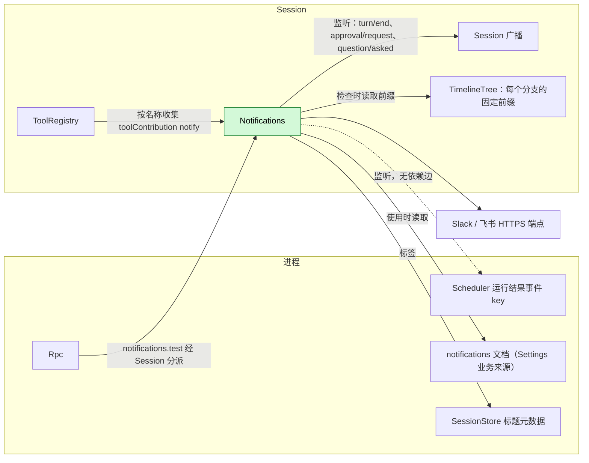
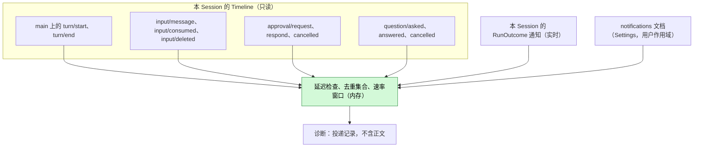
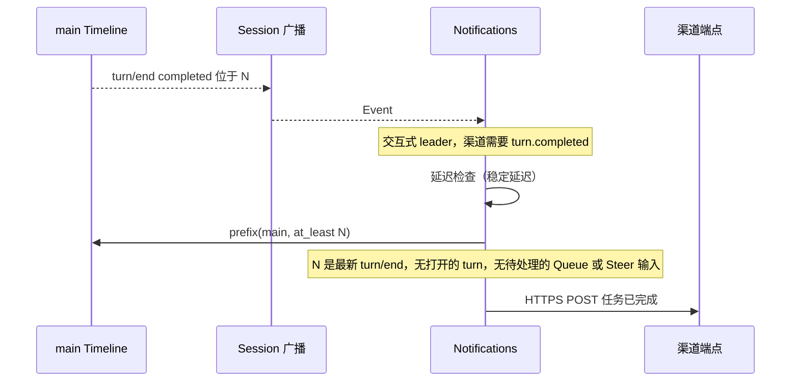
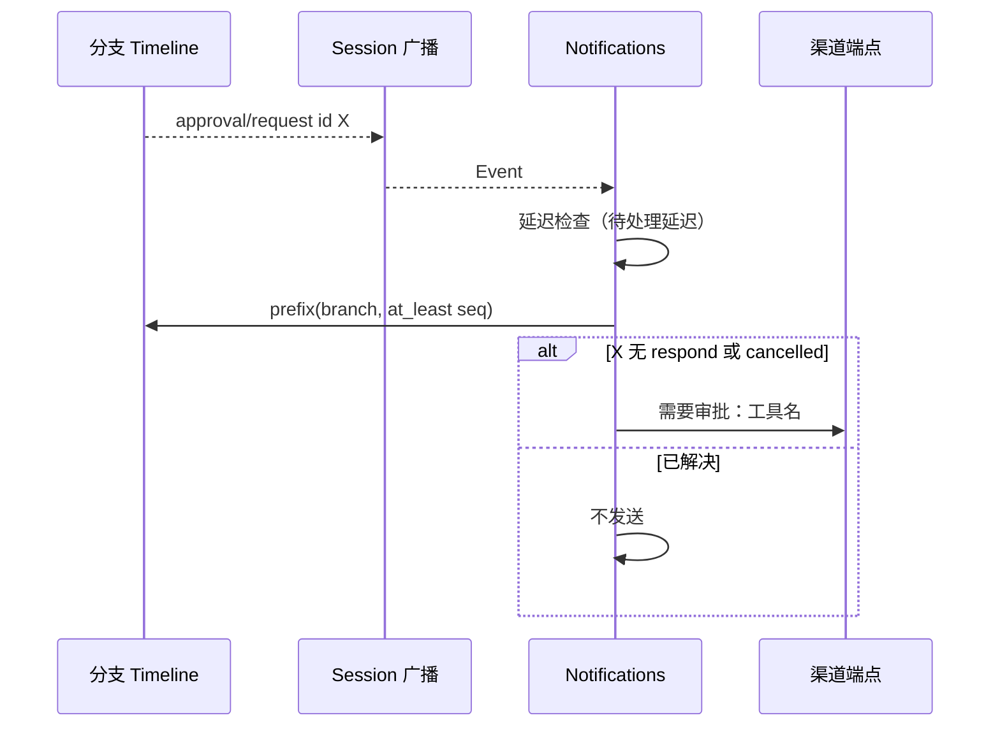
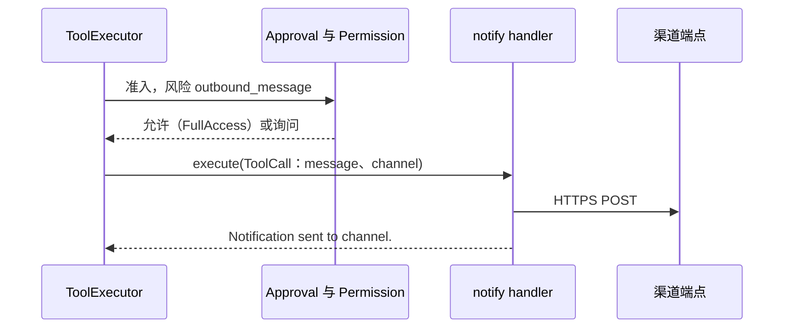
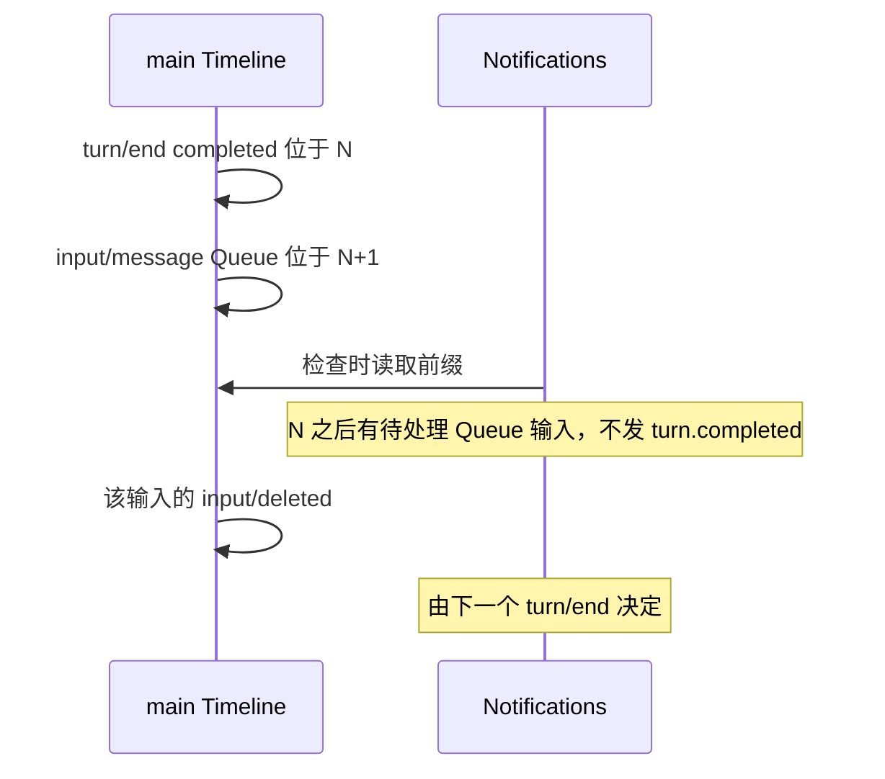

# Notifications

状态：已撤回。总体设计：[overview](../overview.md)（Notifications）。阶段：P2。语言：TypeScript 优先。作用域：[ADR 002](../../adr/002-plugin-scope.md)（Session）。

> **已撤回。** 这个插件没有独立的职责，它的每一项职责都有现成的所有者：用户正在使用的 Session 的提醒（任务结束、审批或问题待处理）归客户端，客户端本来就收得到这些事件；定时任务结果的通知归 Scheduler；对外沟通渠道（Slack、飞书等）由各平台各自的插件和工具负责，没有通用渠道，也没有 `notify` 工具。本文仅作参考保留。

Notifications 是一个 Session 插件。当其交互式 leader Session 上的任务完成或失败、有审批待处理或有问题等待回答时，它向已配置的外部渠道（Slack、飞书）投递消息；它依据 Scheduler 的运行结果事件通知，报告在其 Session 中结束的定时运行；以 key 为 `notify` 的 Session 级 `toolContribution` 服务向模型提供 `notify` 工具；并通过 key 为 `notifications` 的 Session 级 `sessionMethods` 服务提供 `notifications.test`（[session-boundary](../contracts/session-boundary.md)）。它只通过既有的 Session 广播观察其 Session，以分支的固定前缀确认每个触发，不向任何 Timeline 写入。终端内提醒（响铃、聚焦）属于 CLI。契约以语言中立形式给出（[ADR 002 D5](../../adr/002-plugin-scope.md)）；Rust 绑定见附录 G。

## 1. 结构



| 部件 | 作用域 | 依赖 | 提供 |
| --- | --- | --- | --- |
| `Notifications` | Session（仅启用时安装） | 其所在 Session 的 Session 广播、TimelineTree、`SessionConfig`；进程服务 Settings 业务来源、SessionStore 标题元数据；监听（不依赖）Scheduler 的 `scheduled_run_outcomes` 事件 | `toolContribution` key `notify`（风险 `outbound_message`）和 `sessionMethods` key `notifications`（`notifications.test`），在其 `provides` 中声明；触发名 `turn.completed`、`turn.failed`、`approval.pending`、`question.pending`、`schedule.ended`；业务文档 `notifications` |

Session 广播、TimelineTree 和 `SessionConfig` 是既有的类型化服务；Settings 业务来源和 SessionStore 标题元数据是补充（[总体设计附录 B.2](../overview.md#b2-app-server-进程插件)）。把这些服务按名称暴露给 TypeScript 实现属于 issue [#4](https://github.com/arcships/dim/issues/4) 的工作，见 [session-access §9](../contracts/session-access.md#9-向机制所有者提出的需求)；跨语言按名称监听 Scheduler 的事件是对 rutis 的需求，见 [Scheduler §9](Scheduler.md#9-向机制所有者提出的需求)。运行结果以事件通知到达，而非依赖（[ADR 002 D2](../../adr/002-plugin-scope.md)）：没有 Scheduler 时 `schedule.ended` 触发不起作用。Settings 或 SessionStore 重载会重载 Notifications，并经 `notify` 重载 ToolRegistry 及其依赖方；这是可接受的（[D3](../../adr/002-plugin-scope.md)）。`notifications` 文档属于业务配置（[D4](../../adr/002-plugin-scope.md)）：使用时读取，从不触发重载。

## 2. 数据与状态



Notifications 不拥有持久状态：每个触发都以新读取的前缀检查。内存状态（延迟检查、在途投递、去重集合 `(branch, trigger, id)`、速率窗口）与 Session 插件同生命周期；新一代从空开始，事件从不重放，因此不会产生跨代重复。速率窗口按 Session 计（A10）。

## 3. 流程

### 3.1 任务完成



挂钟时间只用于延迟读取；决定依据事实与序号。已删除的输入（`input/deleted`）不算待处理。

### 3.2 审批待处理



`question.pending` 以 `question/asked` 与 `call_id` 同样工作；在没有 Questions 的 Session 中不起作用。

### 3.3 定时运行结束

Scheduler 为每次结束的运行发出一个 `RunOutcome`。运行所在 Session（通知中的 `session_id`）的 Notifications 实例对其格式化并投递；其他 Session 的实例忽略它。无需读取前缀，非交互排除规则也不适用。如果发出通知时运行 Session 未加载，该通知丢失；这是可接受的，`schedule.history` 仍是记录（A16）。

### 3.4 模型发送消息



模型只能在用户配置的渠道中选择，从不能指定 URL。

### 3.5 渠道测试

客户端调用 `notifications.test {sessionId, channel?}`；Rpc 与任何 Session 方法一样经 Session 分派。Notifications 通过正常投递路径（发送时读取用户来源、重试、速率窗口）向该渠道发送固定文本 `[dim <label>] Test notification.`，回复 `{channel, delivered: true}` 或错误（A.5）。不向任何 Timeline 写入。

## 4. 时序与冲突



待处理的驱动输入会抑制 `turn.completed`。在检查前被删除，则不再计入；在检查后被删除，则直到下一个 `turn/end` 都不会发生任何事（A15）。

| 场景 | 顺序 | 结果 | 负责方 |
| --- | --- | --- | --- |
| 成员、workflow 阶段、定时或 ACP Session | 非交互式 leader | 无事件触发的通知；`schedule.ended` 与 `notify` 仍然可用 | Notifications |
| 延迟结束前审批已回应或取消 | request < respond < check | 不发送 | Notifications |
| 发送后 `notify` 期间发生中断 | send < cancel | `Cancelled; delivery may have occurred.` | Notifications |
| `notify` 中途 Notifications 或某个依赖重载 | — | 调用以 reloaded 结算；从不重发（D3） | ToolExecutor |

完整表格：[附录 B](#附录-b-完整冲突表)。

## 5. 上下文映射

事件触发的通知没有模型可见的效果。

| 模型看到的内容 | 形式与位置 |
| --- | --- |
| `notify` 声明 | 名称、描述 `Send a short message to one of the user's configured notification channels.`、`channel` 为字符串的 schema，Notifications Active 期间位于被采用的 `context/configured` 中 |
| `notify` 结果 | `ToolResult.content`，位于其批次的工具结果位置；只经摘要在压缩后保留；子分支继承其切分点之前的结果 |
| 非交互 Session | 相同的声明与结果 |
| 从不可见 | 渠道目标、凭据、投递记录、重试状态、诊断 |

## 6. 接口（摘要）

| 接口 | 类型 | 用途 |
| --- | --- | --- |
| `notify {message, channel?}` | `toolContribution`（Session，key `notify`），风险 `outbound_message` | 模型发起的、发往已配置渠道的消息 |
| `notifications.test {sessionId, channel?}` | `sessionMethods`（Session，key `notifications`） | 向已配置渠道发送一条固定的测试消息 |
| `scheduled_run_outcomes` | 被监听的进程事件（Scheduler 的契约；无依赖） | `schedule.ended` 触发 |
| `notifications` 文档 | 业务配置，Settings 用户作用域，使用时读取 | 渠道、触发、延迟 |

渠道用 `notifications.test` 测试，它是 Session 方法，不是管理方法（A9）。

## 7. 安全

`notify` 在 `outbound_message` 下逐次准入：FullAccess 允许；其他预设询问。渠道只来自 Settings 的用户作用域，从不来自项目文件或插件（A8），因此仓库无法定义外泄目标。凭据是所有者管理的用户来源字段，发送时读取（§9）；本地客户端可经只服务本地连接的 `settings.read` 读回，但凭据从不进入工具结果、事件、诊断或日志。事件触发的消息不携带 Session 内容，除非按渠道启用 `includeContent`。每个实例只看到自己 Session 的事件。`notifications.test` 只向用户配置的渠道发送固定文本；已配对的远程设备可以像调用任何 Session 方法一样调用它。

## 8. 规则检查

| 规则 | 本文如何遵守 |
| --- | --- |
| 原则 §4 第 1 条（改别人的状态写指令） | Notifications 不改其他模块的状态；`notify` 的结果由其所有者 ToolExecutor 写入。 |
| 原则 §4 第 2 条（交接） | 不适用：Notifications 不接手任何对象，只读取事实。 |
| 原则 §4 第 3 条（只用 before 回调） | 不在写入前干预；`notifications.test` 在自己的方法中检查自己的参数。 |
| 原则 §4 第 4 条（核心不带业务含义） | 不改核心；触发是 Notifications 自己对公开事实的解读。 |
| 原则 §4 第 5 条（读完整个批次） | 每次检查在延迟后读取固定前缀，读到触发事件所在批次的末尾。 |
| 原则 §4 第 6 条（上下文只含交接后的事件） | 事件触发的消息不向上下文添加内容；`notify` 的结果只以 `step/tool-result` 事实进入。 |
| 原则 §4 第 7 条（只用公开事件和服务） | 使用 Session 广播、固定前缀读取、Settings、SessionStore 标题元数据和 Scheduler 公开的事件通知。 |
| 原则 §4 第 8 条（向机制所有者提需求） | 没有自己对运行时或 rutis 的需求。#4（按名字获取服务）写在 [session-access §9](../contracts/session-access.md#9-向机制所有者提出的需求)；跨语言的命名进程事件（Scheduler 的事件）写在 [Scheduler §9](Scheduler.md#9-向机制所有者提出的需求)。所用的 Settings 和 SessionStore 补充列在[总体设计附录 B.2](../overview.md#b2-app-server-进程插件)。 |
| 原则 §4 第 9 条（只有后续决定要用的事实才进 Timeline） | Notifications 不写事件；投递记录只是诊断。 |
| 原则 §1（Capability 与 App Server 边界） | Notifications 是放在自己插件包中的 Session Capability；`notifications.test` 是 Session 方法，不是管理方法。 |
| ADR 002 D1（作用域跟随状态） | Session 作用域：触发属于 Session；未加载 Session 的运行结果通知丢失，这是可接受的（A16）。 |
| ADR 002 D2（不设接线模块） | 没有接线模块；Scheduler 的结果通知被监听，不形成依赖。 |
| ADR 002 D3（依赖跟随作用域） | Settings 和 SessionStore 位于外层作用域；它们重载会重载 Notifications，这是可接受的。 |
| ADR 002 D4（结构配置与业务配置分离） | 启用是结构配置；`notifications` 文档是其自己 Settings 来源中的业务配置，使用时读取。 |
| ADR 002 D5（合同语言中立） | 契约语言中立；Rust 形式见附录 G。 |

## 9. 向机制所有者提出的需求

没有自己的需求。#4（运行时类型化服务按名字暴露给非 Rust 部分）写在 [session-access §9](../contracts/session-access.md#9-向机制所有者提出的需求)；监听 `scheduled_run_outcomes` 需要的跨语言命名进程事件写在 [Scheduler §9](Scheduler.md#9-向机制所有者提出的需求)。Settings 业务来源和 SessionStore 标题元数据是补充，列在[总体设计附录 B.2](../overview.md#b2-app-server-进程插件)。

## 附录 A. 接口细节

### A.1 配置（`notifications` 文档，仅用户作用域，A8）

```text
notifications.channels: [{
  name: string,                       // [a-z0-9-]{1,32}, unique
  kind: "slack" | "feishu",
  target: { slack: { webhook } | { botToken, channelId } }
        | { feishu: { webhook, signingSecret? } },
  triggers: ("turn.completed" | "turn.failed" | "approval.pending" | "question.pending" | "schedule.ended")[],
  includeContent: bool,               // default false (A5)
  allowTool: bool,                    // default true; channel usable by `notify`
  enabled: bool                       // default true
}]
notifications.settleDelaySeconds: u32   // default 3, 0..=60 (A2)
notifications.pendingDelaySeconds: u32  // default 10, 0..=3600 (A2)
notifications.defaultChannel: string?   // used by `notify` without `channel`
```

webhook URL、bot token 和签名密钥是 Notifications 自己的凭据（[settings-service §1.2](../appserver/settings-service.md#12-决定密钥归其所有者)）：放在用户文件中并列入 `userOnly`。本地客户端可经只服务本地连接的 `settings.read` 读回；从不返回给远程或配对客户端，也从不放入工具结果、事件、诊断或日志。只通过 Settings 的类型化操作写入 Notifications 的业务来源，其 schema 由 Notifications 声明；在那里校验；每次检查与发送时读取。

### A.2 工具 `notify`

一个 `toolContribution` 服务（Session，key `notify`）：`declaration(): sync -> ToolDeclaration` 与 `execute(ToolCall): async -> ToolResult`，内容为文本。取消是取消请求或消费方丢弃调用；未完成的 HTTP 请求被中止。错误是带下列文本的错误 `ToolResult`。

| 项目 | 值 |
| --- | --- |
| 参数 | `{message: string (1..=4000), channel?: string}`；`channel` 指定一个满足 `allowTool && enabled` 的渠道（A6） |
| 结果 | `Notification sent to <channel>.`；错误：`Unknown channel <name>.`、`No notification channel is configured.`、`Delivery failed: <fixed reason>.`、`Rate limit reached for <channel>.`、`Cancelled; delivery may have occurred.` |
| 风险类别 | `outbound_message` |
| 要求 | `interactive: false`、`roles: None` |

工具发送的消息带前缀 `[dim <session label>] `（A7）。

### A.3 触发规则

| 事件 | 触发 | 规则（事件触发要求 `interactive && collaborationRole = leader`） |
| --- | --- | --- |
| `main` 上的 `turn/end` | `turn.completed` / `turn.failed` | `completed` / `failed`；`cancelled` 不触发（A3）。仅当 `N` 是最新的 `turn/end`、其后无 `turn/start`、且没有既无 `input/consumed` 也无 `input/deleted` 的 Queue/Steer `input/message` 时触发 |
| `approval/request`（任意分支） | `approval.pending` | 延迟后没有相同 `approval_id` 的 `approval/respond` 或 `approval/cancelled` |
| `question/asked`（任意分支） | `question.pending` | 延迟后没有相同 `call_id` 的 `question/answered` 或 `question/cancelled` |
| 运行结果 `{job_id, job_name, run_id, session_id?, state, reason?, ended_at}`，其中 `session_id` = 本 Session | `schedule.ended` | 每个此类通知（A16） |
| `step/text` | 内容 | 该 turn 最后一次请求的可选摘录（`includeContent`） |

模板（仅发往渠道）：`[dim <label>] Task completed.`、`[dim <label>] Task failed.`、`[dim <label>] Approval needed: <tool name>.`、`[dim <label>] The agent is waiting for your answer.`、`[dim schedule <job name>] Run <state>.` 启用 `includeContent` 时：turn 触发追加最后一次请求的 `step/text` 至多 500 个字符；`approval.pending` 追加请求的 `reason`；`question.pending` 追加问题文本至多 500 个字符（A5）。

### A.4 机制

| 步骤 | 路径 |
| --- | --- |
| 监听 | 应用时：为 `turn/end`、`approval/request`、`question/asked` 注册 Session 广播监听器；为 `scheduled_run_outcomes` 注册过滤到本 Session 的监听器；二者在卸载时移除 |
| 触发 | 对匹配的已启用渠道触发且不在去重集合中：启动一个归属插件生命周期的延迟检查 |
| 检查 | 延迟后读取分支的固定前缀，读到触发事件所在批次的末尾；分支已不存在 → 不做任何事 |
| 格式化 | 标签 = 有元数据标题时取标题，否则取 Session id（A7） |
| 投递 | 发送时读取所有者管理的凭据；HTTPS POST；网络错误、429、5xx 时以 1 s、4 s、16 s 重试；其他 4xx 不重试；每个 Session 每个渠道每分钟 20 条消息，超出部分丢弃并记诊断（A10） |
| Timeline | 不写入，不登记 Dispatcher，无 `StateCell` |
| 重载 / Session 卸载 | 延迟检查与投递随插件取消；已发出的请求从不重发（[时间总线](../../../architecture/rust-agent/time-bus.md)）；停机期间错过的事件不重放 |

### A.5 `notifications.test`

经 `sessionMethods`（Session，key `notifications`）提供：`describe()` 返回一个声明 `{name: "notifications.test", mutating: true}`；`call(MethodCall)` 处理它。

| 参数 | 结果 | 错误 |
| --- | --- | --- |
| `{sessionId, channel?: string}`；没有 `channel` 时用 `notifications.defaultChannel` | `{channel, delivered: true}` | `invalid_params`、`unknown_channel`、`no_channel`、`delivery_failed`、`rate_limited`、`service_reloading`；分派错误见 [session-boundary](../contracts/session-boundary.md) |

任何已配置的渠道都可以测试，不论 `allowTool` 和 `enabled` 的值。消息不含 Session 内容。取消请求会中止未完成的请求；投递可能已经发生，从不重发。

## 附录 B. 完整冲突表

| 场景 | 序号顺序 | 结果 | 负责方 |
| --- | --- | --- | --- |
| 检查前出现续接或排队输入 | `turn/end` N < input | 不发 `turn.completed` | Notifications |
| 该输入在检查前被删除 | input < `input/deleted` < check | 不算待处理；发送 | Notifications |
| 该输入在检查后被删除 | check < `input/deleted` | N 不发任何内容；由下一个 `turn/end` 决定（A15） | Notifications |
| 检查后的输入 | check < input | 发送（可接受） | Notifications |
| turn 因中断结束 | `turn/end {cancelled}` | 不发送（A3） | Notifications |
| turn 失败 | `turn/end {failed}` | 若仍是最新 turn 则发 `turn.failed` | Notifications |
| 延迟结束前审批已回应或取消 | request < respond/cancelled < check | 不发送 | Notifications |
| 发送后审批被回应 | check < respond | 保持已发送；无后续消息（A11） | — |
| 延迟结束前问题已回答或取消 | asked < answered/cancelled | 不发送 | Notifications |
| 并发 Steer/Queue/Append | Timeline 顺序 | 未消费且未删除的 Queue/Steer 抑制 `turn.completed`；Append 不抑制 | Notifications |
| 工具批次未结算 | 批次内的审批 | 待处理审批会被通知；`turn/end` 不会先于批次结果 | Loop |
| 压缩 | — | 无影响：检查读取事实 | — |
| 子分支 | 子分支中的审批 | 会被通知；子分支的 `turn/end` 被忽略（A1） | Notifications |
| 定时运行在本 Session 中结束 | 终态记录 < 通知 | 一个 `schedule.ended` | Scheduler；Notifications |
| 无 Session 的运行（`session_id` 缺省）或运行 Session 未加载 | — | 不报告：通知丢失（可接受，A16）；`schedule.history` 仍是记录（A12） | — |
| Scheduler 重载或不存在 | 无依赖 | 通知停止；Notifications 不受影响 | — |
| 延迟期间分支关闭 | — | 不发送 | Notifications |
| 延迟期间 Session 卸载或关闭 | — | 检查随插件取消（A4） | Lifecycle |
| 发送前 `notify` 期间发生中断 | cancel < send | 不发请求；`Cancelled` | Notifications |
| 发送后 `notify` 期间发生中断 | send < cancel | `Cancelled; delivery may have occurred.` | Notifications |
| 投递中途 Notifications 或依赖重载 | — | 取消，从不重发；`notify` 以 reloaded 结算（D3） | ToolExecutor |
| 进程重启 | — | 已提交的 `notify` 调用不重新执行而结算 | ToolExecutor |
| 延迟期间配置变更 | — | 在检查时读取 | Notifications |
| Notifications 重载期间调用 `notifications.test` | — | `service_reloading`；不发送 | Rpc |
| 发送后取消 `notifications.test` | send < cancel | 投递可能已经发生；从不重发 | Notifications |
| 资源节点离线 | — | 无影响 | — |
| 客户端断开 | — | 无影响（A13） | — |

## 附录 C. 错误与恢复

| 情况 | 结果 |
| --- | --- |
| 无效配置 | 由 Settings 在写入边界拒绝；保留最后一个有效文档 |
| 重试后投递失败 | 诊断；`notify` 返回错误结果 |
| 取消（中断、重载、卸载） | 未完成的请求在工具返回前被中止 |
| 进程退出 | 内存中的检查丢失；无持久队列（A12） |

## 附录 D. 验收

使用伪造 HTTP 端点与伪造模型的流程测试：

1. 交互式 leader Session 中已完成的 `main` turn 发送一条 `turn.completed`；检查前的 Queue 输入会抑制它；同一输入在检查前被删除（`input/deleted`）则不抑制；cancelled 不发送；failed 发送 `turn.failed`。
2. 成员 Session 与 `interactive: false` 的 Session 不发送事件触发的通知。
3. 延迟前已回应的审批不发送；未回应的发送一次；已取消的不发送。
4. 有回答与无回答的 `question/asked`；没有 Questions 时不起作用。
5. 完成、失败或超时的定时运行只从其运行 Session 发送一条 `schedule.ended`；运行 Session 未加载时不发送；没有 Scheduler 时该触发不起作用。
6. `notify`：未知渠道或无渠道时报错；发送并返回；FullAccess 允许 `outbound_message`，其他预设询问；投递前与投递期间中断。
7. 5xx 重试，400 不重试，速率限制丢弃，凭据被拒。
8. `includeContent: false` 的消息不含 Session 文本；诊断不含正文或 URL。
9. `notifications.test` 向指定或默认渠道发送一条固定消息；未知渠道返回 `unknown_channel`；已配对的远程设备可以调用它。

## 附录 E. 假设

| # | 假设 | 依据 | 若被否决的影响 |
| --- | --- | --- | --- |
| A1 | turn 触发只针对 `main`；审批与问题触发针对任意分支 | 判断 | 子分支工作会对每个子任务发通知 |
| A2 | 稳定延迟 3 s，待处理延迟 10 s | 判断 | 消息更早或更晚 |
| A3 | 被中断的 turn 不通知 | 判断 | 中断也会通知 |
| A4 | 待处理检查随 Session 插件结束（卸载或关闭） | ADR 002 D1 | 需要一个进程部件 |
| A5 | 除非 `includeContent`，否则不含 Session 内容；摘录 500 个字符 | 判断 | 内容总是或从不包含 |
| A6 | `notify` 参数 | 判断 | 不同的 schema |
| A7 | 标签 = 有元数据标题时取标题，否则取 Session id | 判断 | 其他标签 |
| A8 | 渠道只能在用户作用域配置 | 判断 | 项目配置可以指定渠道；它们默认关闭，直到用户启用（[ADR 003](../../adr/003-approval-scope.md) D3），没有批准步骤 |
| A9 | 渠道测试是 Session 方法 `notifications.test`，不是管理方法 | 维护者决定 | 管理方法需要进程部件 |
| A10 | 重试 3 次（1/4/16 s）；每个 Session 每个渠道每分钟 20 条消息 | 判断 | 其他策略 |
| A11 | 通知后待处理项被解决时不发后续消息 | 判断 | 额外消息 |
| A12 | 尽力而为：无持久发件箱，重启后不恢复 | 判断 | 需要进程存储发件箱 |
| A13 | 不论是否有客户端连接都发送 | 判断 | 需要连接契约 |
| A14 | Slack 经 webhook 或 bot token + channel id；飞书经自定义机器人 webhook，可选签名 | 功能列表；模式为判断 | 其他适配器 |
| A15 | 被抑制的 `turn.completed` 在之后出现 `input/deleted` 时不再重新评估 | 判断 | 撤回需要自己的触发 |
| A16 | `schedule.ended` 由运行 Session 的实例依据 `RunOutcome.session_id` 投递，只含作业名与状态；该 Session 未加载时通知丢失 | Scheduler 通知携带 `session_id`；维护者决定（接受丢失） | 由一个进程部件统一监听所有运行 |

## 附录 F. 待对齐问题

| 问题 | 描述 |
| --- | --- |
| 入站操作 | 从 Slack/飞书回答审批或问题不在范围内 |
| 无 Session 的运行 | 在启动 Session 之前失败的运行不报告（A12） |
| 按名称获取服务 | TypeScript 实现需要 Session 广播、固定前缀读取、SessionStore 元数据、Settings 按名称暴露（[#4](https://github.com/arcships/dim/issues/4)，见 [session-access §9](../contracts/session-access.md#9-向机制所有者提出的需求)），以及按名称获取 Scheduler 的事件（[Scheduler §9](Scheduler.md#9-向机制所有者提出的需求)） |

## 附录 G. Rust 绑定

| 语言中立 | Rust |
| --- | --- |
| `toolContribution` key `notify` | Session `ToolContribution`，以 `AgentBuilder::session_tool("notify")` 注册；ToolRegistry 收集 `Contributions<ToolContribution>`；经 `CancellationToken` 取消 |
| `sessionMethods` key `notifications` | `SessionMethodContribution(Arc<dyn MethodProvider>)`，位于 `SessionScope::named_key::<SessionMethodContribution>("notifications")` |
| Session 广播监听器 | `session_channel(session_id)` 上的监听器，由 `ctx.effect` 移除 |
| `scheduled_run_outcomes` | `on(host_ctx, &scheduled_run_outcomes(), listener)`，使用 `EventKey<RunOutcome>`（[Scheduler](Scheduler.md)） |
| 延迟检查、投递 | `ctx.effect` 下的任务 |
