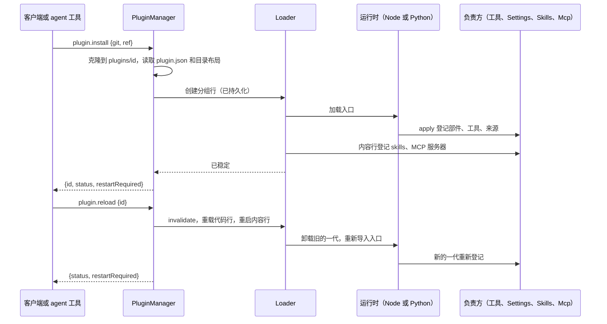

# PluginManager

状态：设计，已于 2026-10-26 与维护者对齐；尚未实现。需求：
[插件管理](../../../design/plugin-management.md)（[#432](https://github.com/arcships/dim/issues/432)）。
Issue：[#3](https://github.com/arcships/dim/issues/3)（加载器的可编辑层）与
[#384](https://github.com/arcships/dim/issues/384)（安装与启用）。规则：
[ADR 002](../../adr/002-plugin-scope.md)、[ADR 003](../../adr/003-approval-scope.md)、
[ADR 006](../../adr/006-plugin-contract.md)、[Dim 如何使用 rutis](../rutis-usage.md)。语言：Rust
（App Server），并改动 Settings、SkillsCatalog、Mcp、dimcode CLI 与启动器，以及仓库中的
TypeScript 插件。
[English](../../../design/plugins/PluginManager.md)

用户或 agent 在一个目录里写插件，从该路径或从 Git 安装，插件立即运行；编辑之后，`reload` 无需重启即可载入新代码。
每个插件，不论内置还是安装的，都是 App Server 加载器的一行；加载器的可编辑层是"安装了哪些插件、启用了哪些插件"的唯一记录。
PluginManager 是一个进程插件，它把安装、启用、停用、移除、重载和更新转换为对该层的编辑，以及应用这些编辑的 rutis-loader 调用。
它不增加任何插件机制：rutis-loader 已经负责组合各层、编辑并持久化可编辑层、拒绝被更高层锁定的编辑，以及重载一行。

## 1. 现有部分与本设计新增的部分

**现状。** App Server 的加载器只有一层 `assembly`，在启动时由代码构建：内置 Rust 插件、Agent builder 的插件和
Agents 分组，再加上 `dim-app-server --session-rows FILE` 中供 TypeScript 和 Python 插件使用的行。没有任何部分可编辑或被持久化。
`dimcode` 启动 App Server 时不带 `--session-rows`，因此默认 CLI 不加载任何 TypeScript 插件，连仓库自己的插件
（Goal、Web、SessionTitle、Workflow、Scheduler）也不加载。

**本设计新增：**

| 部分 | 是什么 | 章节 |
| --- | --- | --- |
| 插件目录 | Dim 的插件格式：一个包含代码、内容（skills、MCP 配置，以后还有 hooks）或两者兼有的目录 | §2 |
| 各层与可编辑层 | 四个加载器层；用户层持久化在 App Server 的 home 中 | §3 |
| 操作 | `plugin.*` 管理方法、`dimcode plugin …` 命令、agent 工具 | §4、§8 |
| 内容登记 | 一个内置内容模块把插件的内容向各负责方登记 | §5 |
| 在代码中登记的 Settings 来源 | 插件在其 `apply` 中向 Settings 登记自己的业务配置来源 | §6 |
| 默认配置文件 | 哪些插件默认开启、哪些内置插件不能被替换；仓库的 TypeScript 插件从它加载 | §7 |

## 2. 插件目录

插件是一个目录。没有任何清单列出它的内容：目录的布局说明它包含什么。

```
my-plugin/
  plugin.json          the plugin's row file; present when the plugin has code
  index.ts             the entry plugin.json names
  node_modules/        the plugin's own dependencies, @arcships/rutis included
  skills/<name>/SKILL.md
  mcp.json             MCP servers, in the format of the user `mcp` source
  hooks.json           Hook documents, once Hooks is implemented (§13)
```

- **代码。** `plugin.json` 存放插件的行今天具有的字段；仓库的插件已经把这些字段放在代码旁的 JSON 文件中
  （`web.json`、`process.json`），它们改名为 `plugin.json`。

  | 字段 | 含义 |
  | --- | --- |
  | `id` | 可选。插件 id，`[a-z][a-z0-9-]{0,63}`；默认为目录名（路径安装）或仓库名（Git 安装） |
  | `entry` | 要加载的模块，相对于该目录：Node 用 `.ts`/`.js` 文件，Python 用 `py:<module>`（该目录是模块的导入根） |
  | `inject`、`provides`、`instanceNames`、`config` | 与今天的行相同（[Dim 如何使用 rutis §2](../rutis-usage.md#2-插件是一行实例挂载它的部件)） |

  入口是一个 rutis 插件：它在自己的 `apply` 中把 Session 部件和分支部件登记到 `partRegistry`，把工具和方法向各自的负责方登记，
  并把业务配置来源向 Settings 登记（§6）。`settings` 不再是行的字段。
- **内容。** `skills/`、`mcp.json` 和（以后的）`hooks.json` 按名字识别。每一项的格式都与其负责方已经从用户自己的来源读取的格式相同。
- **依赖。** 插件自带依赖：本地目录由作者安装好依赖，Git 仓库提交构建后的代码或其依赖。Dim 从不运行包管理器，
  安装时也从不执行插件目录中的任何东西。
- 既没有代码也没有内容的目录不是插件（`invalid_plugin`）。

## 3. 行与层（[#3](https://github.com/arcships/dim/issues/3)）

### 3.1 层

加载器按从低到高的顺序组合以下各层。一次编辑能改变什么，由 rutis-loader 自己的规则决定：较低层插入的行可以从可编辑层停用，
或覆盖其字段，但不能移除；较高层设置的字段不能编辑。

| 层 | 来源 | 可编辑 | 包含 |
| --- | --- | --- | --- |
| `assembly` | App Server 代码 | 否 | 内置行：宿主基础设施、Agent builder 的插件、Agents 分组 |
| `defaults` | 默认配置文件（§7） | 否 | 默认开启的插件（仓库的 TypeScript 插件）；默认关闭的内置插件 |
| `user` | App Server home 中的 `plugins.json` | 是，唯一的可编辑层 | 已安装的插件；对较低层行的停用标记和覆盖 |
| `locked` | 默认配置文件（§7） | 否 | 每个不能停用或替换的行上的 `disabled: false` |

- **持久化。** PluginManager 为 `user` 层实现 rutis-loader 的 `Persist`：一个 JSON 文件 `plugins.json`，位于 App Server 的 home
  （`--home`、`DIMCODE_HOME`）下，以原子方式替换；版本是其字节的 SHA-256。App Server 运行期间的手工编辑，会在下一次保存时成为版本冲突，
  rutis-loader 在文件的新内容上重放排队的编辑。App Server 不监视该文件；手工编辑在下一次启动时生效。
- **唯一来源。** 插件是否已安装、已启用或已锁定，只从组合后的各层读取（`Loader::entries`）。没有其他安装记录。

### 3.2 插件的行

一个已安装的目录是 `user` 层中的一个分组行。它的子行是代码行（目录有代码时）和内容行（目录有内容时）。启用、重载和移除都作用于该分组：
rutis 停用或移除整个子树。对用户来说它是一个插件；对 rutis 来说，它是一个最多包含两行的分组
（[ADR 006 D3](../../adr/006-plugin-contract.md#d3-插件是一行每个实例挂载为它登记的部件)）。

```json
{
  "id": "acme-review",
  "group": true,
  "source": {"git": "https://example.com/acme/review.git", "ref": "main"},
  "config": [
    {"id": "acme-review.code", "name": "/home/u/.dimcode/rust/plugins/acme-review/index.ts",
     "inject": ["partRegistry", "settings"], "provides": {}, "instanceNames": {}, "config": {}},
    {"id": "acme-review.content", "name": "pluginContent",
     "config": {"root": "/home/u/.dimcode/rust/plugins/acme-review"}}
  ]
}
```

- `source` 是 `{"path": "<absolute directory>"}` 或 `{"git", "ref"}`，在创建行时写入，之后不再编辑（rutis-loader
  只编辑行的 config 和开关字段）；Git 插件当前所在的 commit 以克隆本身为准。行的包路径属于结构性配置
  （[ADR 002 D4](../../adr/002-plugin-scope.md#d4-结构性配置与业务配置分离)）。
- 代码行的 `name` 是入口的绝对路径（Node）或 `py:<module>`（Python）。
- 从本地路径安装的插件就地引用；从 Git 安装的插件克隆到 `<home>/plugins/<id>/`，该目录归 PluginManager 所有。

### 3.3 启动

App Server 在构建加载器之前组合这四层。对其中的每个代码行，它像今天处理 `--session-rows` 一样，登记服务目录在各运行时启动前需要的名字
（`instanceNames`，以及跨语言共享的 `provides` 名字），并把每个 Python 插件的目录加入 Python 运行时的 `PYTHONPATH`。
只要 App Server 知道 Node 可执行文件和 rutis 运行时包，就配置 Node 运行时，即使没有 TypeScript 行也如此，因此第一个 TypeScript 插件
无需重启即可安装。`--session-rows` 被移除；`--plugin-defaults FILE` 指定默认配置文件（§7），该文件所在目录是 Node 运行时的锚点。

`locked` 中的行是 App Server 的必需行：其中任何一行失败都会导致启动失败，与今天每个宿主行一样。其他每一行都是可选的，
只影响它自己提供的东西。

## 4. 操作（[#384](https://github.com/arcships/dim/issues/384)）

每个操作都是对运行中 `Loader` 的一次调用；`Loader` 把操作串行化，应用编辑，持久化，并在树稳定后返回。
PluginManager 自己不增加锁、队列或复查。

| 操作 | PluginManager 做什么 | Loader 调用 |
| --- | --- | --- |
| 从路径安装 | 读取 `plugin.json` 和目录布局；构建分组行 | `create` |
| 从 Git 安装 | 克隆到 `<home>/plugins/<id>/`，然后与从路径安装相同；若 `create` 失败则删除克隆 | `create` |
| 启用、停用 | — | 对分组调用 `set_disabled` |
| 重载 | 重新读取 `plugin.json`：变化的行字段成为对代码行的编辑；然后重载代码行并重启内容行 | 有变化时 `update`/`set_inject`；`RuntimeResolver::invalidate` 和 `reload`（代码）；`restart`（内容） |
| 更新（Git） | 拉取 ref，在克隆里检出它的新 commit，然后重载 | 同重载 |
| 移除 | 移除分组；然后删除 Git 插件的克隆。路径插件的目录从不被触碰 | `remove` |
| 列出 | 投影组合后的行：id、来源（Git 插件附带克隆当前的 commit）、类别（内置、默认、已安装）、是否启用、是否锁定、状态 | `entries`、`waiting_for` |

- **安装即启用。** 已安装的插件立即运行。停用后它仍保持已安装。
- **内置插件和默认插件**只能停用，不能移除：rutis 拒绝移除较低层插入的行（`not_removable`）。`locked` 中的行拒绝 `set_disabled`
  （`plugin_locked`）。
- **重载是一次换代。** 旧的一代卸载，rutis 取消它正在运行的调用；新的一代重新登记它的部件、工具、方法、来源和内容；
  实例替换它们挂载的部件；依赖方重载；Capability 从 Timeline 重建
  （[插件契约 §7.2](../plugin-contract.md#72-代次重载与重建)）。TypeScript 或 Python 的重载会重新导入插件的入口模块
  （对于变化了的入口，rutis 运行时绕过其模块缓存）；入口导入的模块不会被重新导入，因此对它们的改动需要重启运行时，或者把代码放在入口中。
  编译进 Dim 的 Rust 插件不能重载；它们被替换（§7）。
- **何时需要重启。** 服务名字的目录在构建加载器时就固定了。若一个插件的 `instanceNames`、跨语言 `provides` 名字或 Python 导入根对运行中的
  App Server 是新的，它会被安装并启用，操作返回 `restartRequired: true`；这些名字从下一次启动起生效。在此之前，在多个 Session 中提供
  这种名字的部件会在那里作为重复的提供方而失败，其状态会显示这一点。业务配置来源从不需要重启（§6）。
- **更新需要用户确认**，这是客户端的事：App Server 只执行 `plugin.update`。没有任何东西会自动更新。
- **遗留的克隆。** `<home>/plugins/` 下没有任何行指向的目录，是被中断的安装留下的；安装该 id 时会替换它。



## 5. 内容登记

内容行是内置 Rust 模块 `pluginContent`，配置为插件的根目录。它在 `apply` 中读取目录的内容文件，把每一项向其负责方登记；
登记是该行的效果，因此在该行卸载（停用、移除、重载）时撤回，与每个贡献一样
（[Dim 如何使用 rutis R6](../rutis-usage.md#r6-贡献向所有者登记)）。重载是对该行的重启，会重新读取这些文件。负责方从不寻找插件。

| 内容 | 负责方 | 登记 |
| --- | --- | --- |
| `skills/` | SkillsCatalog | `register(root)`：用户根和项目根之外的一个 skills 根 |
| `mcp.json` | Mcp | `register(document)`：用户来源和项目来源之外的服务器；插件的服务器 id 以插件 id 为前缀 |
| `hooks.json` | Hooks | `register(document)`，在 Hooks 实现之后 |

插件内容是用户自己的配置：它随插件启用，不受 ADR 003 项目规则的约束（该规则针对工作区内的文件）。未通过负责方校验的文件，
会在该负责方的目录和插件的状态中报告；插件的其他内容仍然登记。

## 6. Settings 来源在代码中登记

插件的业务配置来源过去在其行的 `settings` 成员中声明，由宿主在启动时读取
（[Settings 服务 §3.1](../appserver/settings-service.md#31-来源声明)），因此之后安装的插件无法拥有任何来源。现在它们像任何贡献一样
向 Settings 登记：

- Settings 的进程服务 `settings` 新增 `register(declaration)`，声明字段与 §3.1 相同（`source`、`userFile`、`projectFile`、`schema`、
  `userOnly`），检查也相同，在调用时进行。负责方是调用方的行（bridge 的 `caller_row`；Rust 调用方传入它的 ctx）。
- 登记在调用方的这一代运行期间有效。对同一名字的第二次登记失败，与第二个提供方一样。当负责方的行处于两代之间时，对其来源的
  `settings.read`/`update` 返回可重试的重载中错误，与被撤回的方法命名空间一样；一旦没有任何东西登记它，返回 `unknown_source`。
  文档保留在磁盘上。
- 仓库的五个插件在 `apply` 中用它们今天保留的声明调用 `settings.register`，并从行文件中去掉 `settings`。

## 7. 内置插件与默认配置文件

默认配置文件随产品发布，决定默认值。路径相对于该文件。

```json
{
  "plugins": ["./goal", "./web", "./session-title", "./workflow", "./scheduler"],
  "disabled": [],
  "locked": ["ServerControl", "Transport", "Connection", "ManagementMethods",
             "SqliteStorage", "SessionStore", "Settings", "Agents"]
}
```

- `plugins`：默认安装并启用的插件目录；App Server 像安装时一样读取每个目录的 `plugin.json` 和布局，并把分组行组合进 `defaults`。
- `disabled`：启动时关闭的内置行（例如产品附带但不启用的某个网关）。
- `locked`：不能停用或替换、并且在启动时必需的行。上面的列表只是示例；产品在文件中确定它。

**替换内置插件。** 停用它，然后安装一个提供相同服务名字、或以相同名字登记部件和贡献的插件。行按名字查找服务，因此替换者取代它的位置；
必需部件（`require_part`）由登记它的任何插件满足。`locked` 中的行不能停用，其名字的第二个提供方会作为重复而失败，因此它不能被替换。

**仓库的 TypeScript 插件**以同样的方式从默认配置文件安装。`dimcode` npm 包附带这些插件（各自与依赖打包在一起），以及默认配置文件和
rutis Node 运行时包。启动器本来就在 Node 下运行；它把 Node 的路径、运行时包和默认配置文件传给 CLI，CLI 再传给 App Server
（`--node`、`--js-runtime`、`--plugin-defaults`）。源码检出以同样的方式使用仓库的 `runtime/`。用户用 `dimcode plugin disable goal`
关闭其中一个。

## 8. 接口

### 8.1 管理方法（命名空间 `plugin`）

PluginManager 向 `managementMethods` 登记该命名空间；与每个管理方法一样，它从不向已配对的远程设备提供。

| 方法 | 参数 | 结果 | 错误 |
| --- | --- | --- | --- |
| `plugin.install` | `{source: {path} \| {git, ref?}, id?}` | `{id, status, restartRequired}` | `invalid_plugin`、`plugin_exists`、`source_unavailable` |
| `plugin.list` | `{}` | `[{id, kind, source, enabled, locked, status, waitingFor?, error?}]` | — |
| `plugin.set_enabled` | `{id, enabled}` | `{status}` | `plugin_not_found`、`plugin_locked` |
| `plugin.reload` | `{id}` | `{status, restartRequired}` | `plugin_not_found`、`invalid_plugin`、`not_reloadable`（Rust 内置插件） |
| `plugin.update` | `{id}` | `{commit, status, restartRequired}` | `plugin_not_found`、`source_unavailable`；路径插件按 `reload` 返回 |
| `plugin.remove` | `{id}` | `{cleanupError?}` | `plugin_not_found`、`not_removable` |

`kind` 是 `builtin`、`default` 或 `installed`。`status` 是 `running`、`pending`（带 `waitingFor`，即它等待的名字）、`failed`（带 `error`）、
`disabled` 或 `inactive`，来自加载器的条目状态。操作的结果是其稳定后的状态；想要当前状态的客户端调用 `list`。

### 8.2 CLI

```
dimcode plugin install <path | git-url> [--ref REF] [--id ID]
dimcode plugin list
dimcode plugin enable <id>      dimcode plugin disable <id>
dimcode plugin reload <id>      dimcode plugin update <id>
dimcode plugin remove <id>
```

在 TUI 中，`/plugin` 接受相同的子命令。`update` 显示将要移动到的 commit，并在调用 `plugin.update` 前询问。结果中带 `restartRequired` 时，
CLI 会说明这一点，并提供 `dimcode daemon restart`。

### 8.3 Agent 工具

PluginManager 登记一个 Session 部件 `PluginTools`，其工具调用相同的操作：`plugin_list`、`plugin_install`、`plugin_reload`、
`plugin_set_enabled`、`plugin_update` 和 `plugin_remove`。它们是普通的工具调用：Permission 像决定任何工具一样决定它们，
`plugin_list` 是唯一的只读工具。每个结果的 `content` 说明插件 id、其状态以及是否需要重启。在一个轮次中安装或重载的工具，
按 ToolBinding 现有的规则，从下一次采样起向模型声明。

## 9. 向机制所有者提出的需求

对 rutis 没有需求：这里用到的每个加载器操作在 rutis-loader 0.17.1 中都已存在，§4 的重启规则遵循它固定的服务目录，而不是要求一个可变的目录。
其余都是 Dim 各负责方的工作，每项都随 M1 交付：

| 需求 | 负责方 | 为什么需要 |
| --- | --- | --- |
| skills 根的 `register(root)`，随调用方撤回 | SkillsCatalog | 插件 skills（§5） |
| MCP 服务器的 `register(document)`，随调用方撤回 | Mcp | 插件 MCP 服务器（§5） |
| 业务配置来源的 `register(declaration)`，随调用方撤回 | Settings | 运行期间安装的插件的来源（§6） |
| Hook 文档的 `register(document)` | Hooks | Hooks 实现之后（§13） |

每一项都遵循 R6 对登记的规则：登记属于其调用方，重复登记失败，被撤回的登记不再使用。

## 10. 时序与冲突

| 场景 | 结果 | 由谁决定 |
| --- | --- | --- |
| 两个操作同时发生 | 加载器依次执行 | Loader |
| 同一 id 安装两次 | 第二次 `create` 失败：`plugin_exists` | Loader |
| 运行期间手工编辑 `plugins.json` | 下一次保存冲突；rutis-loader 在新内容上重放编辑 | Loader、`Persist` |
| 部件的调用运行期间停用或重载 | rutis 取消正在卸载的这一代的运行中调用；在途的工具调用报告它可能已经生效 | rutis、ToolRegistry |
| 分支使用插件的 skill 期间停用或重载 | 分支保留它已采用的提示词，直到再次采用 | Skills |
| 插件的 MCP 服务器已连接时停用或重载 | 被撤回条目的各代在每个 Session 中退役，与停用的用户条目相同（[ADR 004](../../../adr/004-loader-plugin-management.md#ownership-and-updates)） | Mcp |
| 插件加载失败 | 它在 `list` 中为 `failed`；除非它的名字被注入，否则不影响其他东西 | Loader |
| 从 Git 安装被中断 | 遗留克隆，没有行；下一次安装该 id 时替换它 | PluginManager |
| Session 关闭 | 对插件没有影响，插件是进程行 | — |

## 11. 安全与上下文

安装、启用和重载属于宿主配置：插件运行是因为用户安装了它，没有批准步骤
（[ADR 003 D2](../../adr/003-approval-scope.md#d2-配置引起的运行不需要本机批准)）。插件是受信任的进程内代码（AGENTS 规则 11）。
插件管理不对插件施加其他约束；约束来自运行中的插件，例如 Permission 决定 agent 的 `plugin_*` 工具调用。安装从不执行插件文件，
运行 `git` 时不启用仓库 hooks。插件的密钥是它自己的业务配置；PluginManager 从不读取。

除了 `plugin_*` 工具调用的结果，插件管理的任何内容都不进入模型上下文。插件内容只经其负责方到达模型（Skill 提示词来源、工具声明）。

## 12. 规则检查

PluginManager 是进程插件，不是 Capability：它不读也不写任何 Timeline。

| 规则 | 本设计如何遵守 |
| --- | --- |
| §4.1 状态归其所有者 | 插件的启用状态归加载器；PluginManager 只通过 `Loader` 操作改变它 |
| §4.2–4.6、§4.9 | 不适用：不涉及 Timeline 对象、`before` 回调、批次或事实 |
| §4.7 通过公开服务交互 | 内容和来源经负责方的 `register` 到达负责方；负责方从不发现插件 |
| §4.8 向机制所有者提出的需求 | §9；对 rutis 没有 |
| §1 Capability 与 App Server 边界 | App Server crate 中的进程插件；App Server 只分派它的命名空间 |
| ADR 002 D1 作用域跟随所有者 | 安装按宿主进行：进程作用域 |
| ADR 002 D2 不设接线模块 | 行按名字查找服务；没有模块把插件接在一起 |
| ADR 002 D3 依赖跟随作用域 | 所有依赖都是进程服务；`PluginTools` 从其 Session 读取 PluginManager |
| ADR 002 D4 结构性配置与业务配置 | 行持有启用状态和路径；业务配置留在插件登记的 Settings 来源中 |
| ADR 002 D5 语言中立的契约 | 目录格式、`plugin.*` 方法和向负责方的登记都是语言中立的 |
| ADR 006 D2 rutis 拥有机制 | 直接使用 rutis-loader 的层、编辑、`Persist`、重载和重启，不加包装 |
| ADR 006 D3 插件是一行 | 一个已安装目录是一个分组行，最多包含一个代码行和一个内容行（§3.2） |

## 13. 交付：M1 及之后

M1（2026-11-01）需要用户和 agent 能安装、启用和热重载插件，并需要默认 CLI 加载仓库的插件。

| 项目 | M1 | M1 之后 |
| --- | --- | --- |
| 四个层、`plugins.json` 持久化、从各层启动（§3） | 是 | |
| `plugin.*` 方法、`dimcode plugin`、`/plugin`（§8.1、§8.2） | 是 | 加载器变化时的进程通知 |
| Agent 工具（§8.3） | 是 | |
| 从路径和 Git 安装；重载；更新（§4） | 是 | |
| Skills 与 MCP 内容（§5） | 是 | Hooks 实现后的 Hooks 内容；作为内容的 Workflow 定义 |
| 在代码中登记的 Settings 来源（§6） | 是 | |
| 默认配置文件；仓库插件随产品发布并默认加载（§7） | 是 | |
| Python 插件 | App Server 有 Python 运行时（`--python`）时 | 默认 CLI 配置的 Python 运行时 |
| 插件市场 | | 是（需求：M1 之后） |

## 14. 验收

通过 `plugin.*` 方法、在隔离的 home 中进行的流程测试：

1. 从路径安装一个 TypeScript 插件：它的工具立即向新 Session 声明；编辑入口、`reload`，下一次调用无需重启 App Server 即运行新代码；
   其他 TypeScript 插件继续运行。
2. 从本地 Git 仓库安装；新 commit 之后 `update` 移动到它；`remove` 删除克隆；移除路径插件时保留其目录。
3. 仅含内容的插件的 skill 和 MCP 服务器出现在其负责方的目录中；停用撤回它们；启用让它们回来。
4. 运行期间安装一个登记 Settings 来源的插件：`settings.read` 提供该来源；重载保留其文档。
5. 停用一个内置插件，并安装一个提供其名字的替换插件：各 Session 使用替换插件。停用 `locked` 行以 `plugin_locked` 失败；
   移除默认插件以 `not_removable` 失败。
6. 重启：已安装、已停用和默认的插件按 `plugins.json` 和默认配置文件恢复原样；曾返回 `restartRequired` 的插件现在在每个 Session 中提供其名字。
7. Agent 通过其工具安装并重载一个插件，每次都由 Permission 决定。
8. 不带任何参数的 `dimcode` 加载仓库的五个插件。
