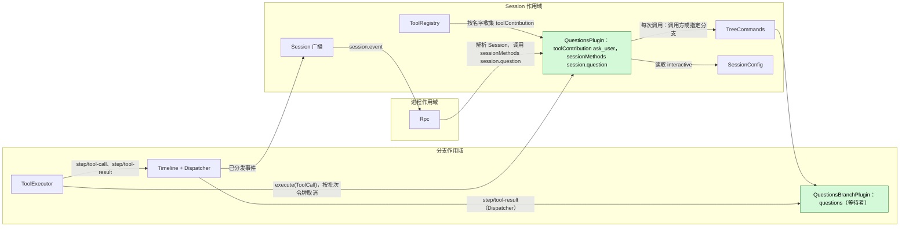
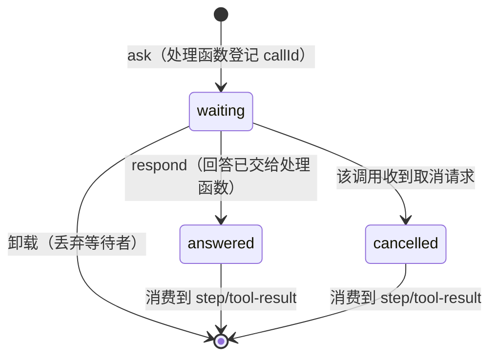
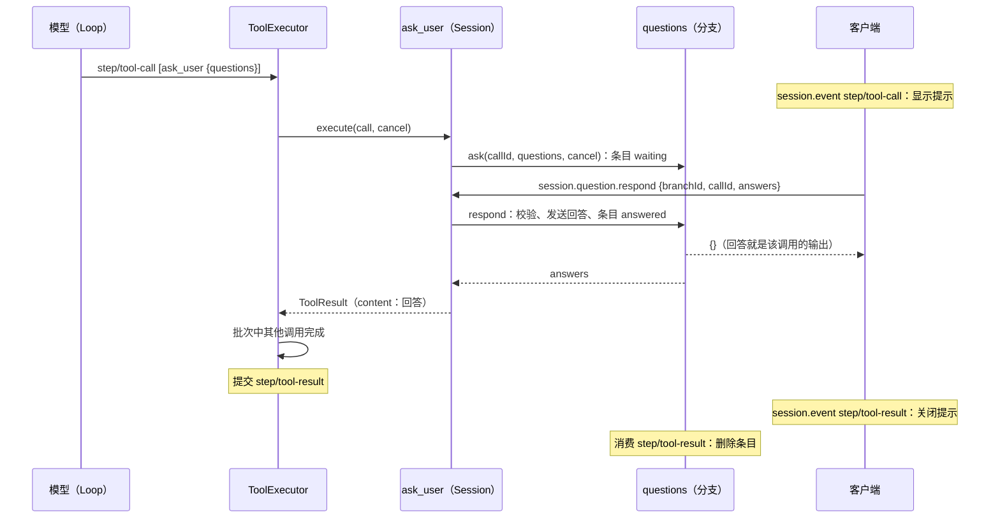
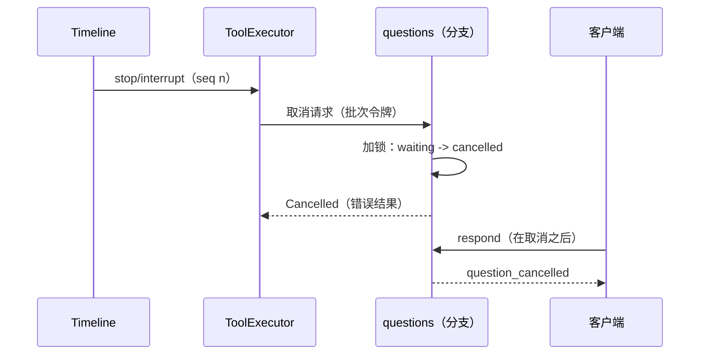

# Questions

状态：Ready，可开始实施。总体设计：[overview §4](../overview.md#4-插件目录)。里程碑：M2。语言：Rust。作用域：Session + 分支（[ADR 002](../../adr/002-plugin-scope.md)）。实现跟踪：[#262](https://github.com/arcships/dim/issues/262)。

**交付边界。** Questions capability 与客户端接入尚未实现。下文采用的工具、Session 方法与分支服务机制已可用；Ready 确认后按附录 D 实施，不增加 Timeline 事件、静态 RPC 分支或 core/rutis 机制。

模型通过 `ask_user` 工具向用户提出一个或多个问题并等待回答：单选、多选、一次调用多个问题、自定义回答或拒绝回答。**问题就是待完成的工具调用，回答就是它的工具结果。** 客户端把已提交、尚无 `step/tool-result` 的 `ask_user` 的 `step/tool-call` 视为问题，用 Session 方法 `session.question.respond` 回答；等待中的处理函数把回答作为自己的 `ToolResult` 返回，ToolExecutor 像发布其他工具输出一样把它写进该批次的 `step/tool-result`。模型只从 `ToolResult.content` 得知用户的选择。

Questions **不定义任何 Timeline 事件**。**Session 部分**提供 `ask_user` 工具（`toolContribution`，key `ask_user`）和方法 `session.question.respond`（`sessionMethods`，key `session.question`）（[session-boundary](../contracts/session-boundary.md)）。**分支部分**在内存中持有本分支正在运行的 `ask_user` 调用的等待者，如同运行中的工具持有自己的 I/O。中断、关闭、重载、重启和 fork 都由 [ToolExecutor](../../../architecture/rust-agent/plugins/ToolExecutor.md) 现有的工具调用生命周期结算。

## 1. 结构



Session 部分不持有状态；每次调用时通过 `S:TreeCommands` 解析调用方分支（工具）或指定分支（方法）的 `questions` 服务，与 [Wait](../../../architecture/rust-agent/plugins/Wait.md) 相同。合同以语言中立形式给出；Rust 形式见[附录 G](#附录-g-rust-绑定)。

| 部分 | 作用域 | 依赖 | 提供 |
| --- | --- | --- | --- |
| `QuestionsPlugin` | Session | `S:TreeCommands`、`S:SessionConfig` | `toolContribution` key `ask_user`；`sessionMethods` key `session.question`（`session.question.respond`） |
| `QuestionsBranchPlugin` | 分支 | `B:Dispatcher` | `questions`（分支作用域；`ask`、`respond`），只由 Session 部分调用 |

安装：两个部分都在插件的 `provides` 中声明，插件启用时安装；安装从不读取 `SessionConfig.interactive`（[Session 访问 §9.4](../contracts/session-access.md#94-按启用状态安装可选部分)），因此每个 Session 都声明 `ask_user`，fork 保持相同的工具集与提示词前缀。

依赖的合同：`toolContribution` 与 ToolExecutor 的单次调用取消请求和批次结算；`step/tool-call`、`step/tool-result` 数据合同及其 v3 `session.event` 转发（[tree_protocol.rs](../../../../crates/dim-app-server/src/tree_protocol.rs)）；[单树装配](../../../architecture/rust-agent/single-tree.md)的 Dispatcher 协议；`SessionConfig.interactive`（[Session 访问 A.3](../contracts/session-access.md#a3-sessionconfig-字段)）；`sessionMethods`（[session-boundary A.1](../contracts/session-boundary.md#a1-方法贡献)）；Permission 风险类别 `session`。

本文定义的合同：`ask_user` 工具（声明、输入 schema、结果文本）、`session.question.respond` 及其错误，以及客户端从历史推导待答问题的规则。`questions` 分支服务是 Questions 私有的。

### 1.1 既有原生绑定与交付顺序

通过 `AgentBuilder::session_tool` 注册 `ask_user`，在 Session 命名 key 提供
`ToolContribution`。通过 `AgentBuilder::session_methods` 注册命名空间
`session.question`，Session 部分用 `SessionMethods::provide` 提供 A.3 的声明与处理函数。
Rpc 已能分派贡献的 Session 方法，并通过 `session.methods` 发现它们；不在
`protocol.rs` 增加 Questions 分支、另一套分派器或静态 `hello` feature。
客户端看到待答 `ask_user` 时调用约定方法；禁用或重载时沿用既有错误合同。

Session 部分像 Wait 一样逐次通过 `TreeCommands` 解析分支；分支部分拥有等待者、
取消和 Dispatcher 订阅，不增 Session 级等待者注册表或可选服务查询。
取消采用既有分支工具 token。

在 main 交付 capability 与协议流程验收；[#262](https://github.com/arcships/dim/issues/262)
的 TUI 接入采用 `rust-tui` 既有 `AskUserPrompt`，行模式与无交互行为遵循 A.5。
各客户端消费相同的工具调用、结果与回答格式；UI 分支实现不代表 main 已提供 capability。

## 2. 数据与状态



分支部分在一个互斥锁下保存一张表 `callId → 条目`（不用 `StateCell`）：条目包含已校验的问题，以及 `waiting {sender}`、`answered`、`cancelled` 之一。所有状态变化都在锁内发生，因此 `respond` 与取消不会同时胜出。已回答和已取消的条目保留到 Questions 消费到该批次的 `step/tool-result` 为止，让第二个客户端得知调用已被回答或已取消，而不是“不在等待”（§4.3）。这张表不跨代保留，也不重建：条目是对人的 I/O 等待，重载或重启时仍在等待的调用由 ToolExecutor 结算（[设计规则](../../../architecture/rust-agent/principles.md) §4 第 9 条；AGENTS.md 第 4 条）。

Timeline 已有的内容，以及为什么不再写其他事实：

| 需要 | 已有事实或通道 | 为什么不需要 Questions 事实 |
| --- | --- | --- |
| 问题存在且待答 | 已提交、含 `ask_user` 调用（其 `input` 即问题）且没有对应 `call_event_id` 的 `step/tool-result` 的 `step/tool-call` | 可从历史与实时 `session.event` 推导；客户端已经收到两者 |
| 回答到达模型 | 处理函数的 `ToolResult`，由 ToolExecutor 写入 `step/tool-result` | `ToolResult.content` 是模型唯一能读的文本；第二份副本不决定任何事 |
| 回答与中断 | ToolExecutor 消费 `stop/interrupt` 并取消批次令牌；Questions 在自己的锁内判定回答与取消谁先到；取消前已完成的结果照常保留，与任何工具一样 | 回答是工具输出，不是发给其他模块的指令：除模型经由结果读取外，没有后续决定读取它（第 1、9 条） |
| 其他客户端关闭提示 | 该批次的 `step/tool-result` | 批次完成前的通知只用于显示；第 9 条规定显示走 Session 广播通知，而这里并不需要（F1） |
| 批次完成前崩溃时保留回答 | — | 重启后该 turn 已经 `Failed`，批次按重载结算（[单树装配](../../../architecture/rust-agent/single-tree.md)重载规则）；持久化的回答不会被任何东西读取。所有工具都有同样的窗口 |
| 中断、关闭、重载、重启的结果 | ToolExecutor 的 `step/tool-result`（取消或重载结算） | 归 ToolExecutor |

**动态事件（#2）：** Questions 不定义事件，也不依赖 #2。

## 3. 流程

### 3.1 提问与回答



`{}` 表示回答已交给等待中的调用，除非批次被重载结算（§4.2），它就是该调用的结果。

### 3.2 客户端、附着与多个客户端

待答问题靠推导，不靠补发：客户端附着（先注册监听），按分支读取 `session.history` 到 head，把每个没有对应 `step/tool-result` 的 `step/tool-call` 中的 `ask_user` 调用视为待答；之后的事件实时到达，按事件身份合并。Rpc 不增加 Questions 专用的补发或通知，这一点不同于 `approval.request`。

```text
历史 + 实时 session.event，单个分支
  seq 41 step/tool-call  {calls: [ask_user c1 {questions}]}   -> 为 c1 显示提示
  seq 42 step/tool-result {call_event_id: 41, results: [c1]}  -> 关闭 c1 的提示
```

多个客户端都可以回答；第一个 `respond` 决定，其他客户端得到 `question_already_answered`。它们的提示在 `step/tool-result` 到达时关闭。

### 3.3 非交互 Session

`ask_user` 与在其他 Session 中一样声明。处理函数读取 `SessionConfig.interactive`；为 `false` 时（`exec`、sessions 服务的 `launch`、Scheduler 与 Workflow 的 Session），调用立即返回错误结果，说明没有人能回答，模型应不经询问继续（A.1）。不登记条目，因此 `respond` 找不到任何问题。非交互 Session 中审批如何处理仍由 Approval 决定（[sessions-service D10](../appserver/sessions-service.md)）；Questions 不做这个决定。

## 4. 时序与冲突

### 4.1 回答与中断



`respond` 与取消请求中恰好有一个看到条目处于 waiting。`respond` 胜出时，即使取消紧随其后，处理函数仍返回回答；ToolExecutor 保留已完成调用的结果，turn 仍以取消结束。取消胜出时，`respond` 回复 `question_cancelled`。两种情况下客户端收到的回复都如实反映该调用的输出，且只有 ToolExecutor 写入调用的终态事实。在批次分发之前到达的停止不会到达处理函数：ToolExecutor 写入 “Tool was not executed”。

### 4.2 重载、重启、关闭、删除

| 场景 | 结果 |
| --- | --- |
| 等待期间分支部分重载 | 卸载丢弃等待者；处理函数以 `capability reloading` 返回 Cancelled；批次按重载结算，turn 失败。不会重新提问 |
| Session 部分重载 | 与任何贡献重载一样传播到 ToolRegistry；在途调用按重载结算（[ADR 002](../../adr/002-plugin-scope.md) D3） |
| 等待期间进程重启 | ToolExecutor 的重建把未完成批次结算为未执行；turn 失败 |
| 已回答、`step/tool-result` 之前重载 | 批次按重载结算，回答随之丢失（接受，与所有工具相同） |
| 分支关闭、`session.close`、删除 Session | 关闭取消批次令牌；等待中的调用在分支移除前以取消结束（[Session 删除](../appserver/session-deletion-and-fork.md)） |
| 等待期间卸载 Session | 不会发生：turn 在运行，Session 不空闲 |

### 4.3 Fork 与分支

Session fork 只在 `main` 的静止点切分，且切点处没有缺少结果的工具提议（[Session 删除与 fork §6.2](../appserver/session-deletion-and-fork.md)），因此 fork 中不会有待答问题。子分支只继承已结算的调用；在结果之前被切断的调用投影为未执行，子分支中没有条目。每个分支的问题用该分支的 `branchId` 回答。

其他关键行（完整表见附录 B）：

| 场景 | 结果 |
| --- | --- |
| 客户端在处理函数登记前回答 | `question_not_pending`；批次尚无结果，客户端保留提示并让用户重发 |
| 两个客户端回答 | 第一个被接受；第二个 `question_already_answered` |
| `-p` CLI 附着到交互 Session | CLI 停止该 turn，退出码 3（A8） |
| 等待期间 Steer、Queue、Append | 不影响问题；照常在批次或 turn 之后消费（A11） |

## 5. 上下文映射

| 模型看到的内容 | 形式 | 位置 |
| --- | --- | --- |
| `ask_user` 名称、描述、schema | 固定工具声明 | 已采用的 `context/configured`，每个 Session |
| 回答或拒绝 | `ToolResult.content`（A.1） | 工具结果位置，在批次中所有调用完成之后 |
| 无人可答（非交互） | 错误的 `ToolResult.content` | 同上 |
| 取消、重载 | ToolExecutor 写入的错误文本 | 同上 |

永远不可见：分支表、`structuredContent`、客户端渲染。压缩保留声明，回答只经由摘要保留。

## 6. 接口（摘要）

| 接口 | 类型 | 用途 |
| --- | --- | --- |
| `ask_user` | `toolContribution`（Session，key `ask_user`），风险 `session` | 提出 1–4 个问题并等待回答 |
| `session.question.respond` | `sessionMethods`（Session，key `session.question`） | 回答或拒绝一个等待中的调用 |
| `questions.ask` / `respond` | 分支服务 `questions`，私有 | 登记并等待；把回答交给等待者 |
| 待答问题规则 | 客户端合同 | 没有 `step/tool-result` 的 `ask_user` 调用 |

## 7. 安全

`ask_user` 不使用宿主资源，风险为 `session`（所有预设下都允许；`disallowed_tools` 仍然适用）。回答是用户内容，成为工具输出并到达模型；客户端不得在其中放入机密。任何有 Session 访问权的客户端都可调用 `session.question.respond`，包括已配对的远程设备（[RemoteGateway](RemoteGateway.md)）；除回答等待中的调用外，它不赋予任何权限。重放永不重新提问。

## 8. 规则检查

规则：[原则 §1 与 §4](../../../architecture/rust-agent/principles.md)、[ADR 002](../../adr/002-plugin-scope.md) D1–D5。

| 规则 | 本文如何遵守 |
| --- | --- |
| §4.1 改他人状态写指令事件 | Questions 不改变其他模块的状态。回答是 Questions 自己工具的输出；调用的终态事实仍是 ToolExecutor 的 `step/tool-result`。找不到等待中调用的 `respond` 什么也不写，由回复说明原因。 |
| §4.2 交接后不能撤回 | 回答在锁内一次性交给等待中的处理函数；不会撤回，之后到达的取消也不会替换它。 |
| §4.3 before 回调只做同步变换 | 不适用：没有 before 回调；`respond` 只按该调用的问题校验自己的参数。 |
| §4.4 核心机制不带业务含义 | Timeline、Dispatcher、ToolExecutor 与 Rpc 不变，没有 Questions 特例；Rpc 通过 `sessionMethods` 分发方法。 |
| §4.5 原子批次、按序派发 | Questions 不写事件。它消费 `step/tool-result` 只为删除条目；结果是单个事件，它支撑的判定（已回答还是不在等待）不需要批次中的其他事件。 |
| §4.6 上下文只含交接后的事件 | 回答只经由 `step/tool-result` 到达模型。 |
| §4.7 只通过公开事件与服务交互 | Questions 响应 ToolExecutor 对自己调用的取消请求（工具合同）和公开的 `step/tool-result`；不读其他插件的状态。 |
| §4.8 基础设施默认不变 | 不改 Timeline、Dispatcher、事件信封、装配或门面；不提出需求（§9）。 |
| §4.9 只有后续决定要用的事实才进 Timeline | 不新增事件；每个被删除的事实都在 §2 说明。批次完成前的显示若需要，走 Session 广播通知，不走 Timeline（F1）。 |
| §1 Capability 与 App Server 边界 | 两个部分都是位于自己 crate 的 Capability；Rpc 不含 Questions 逻辑。 |
| ADR 002 D1 作用域 | 工具与方法是 Session 服务；等待者是绑定在分支 turn 上的工作，因此放在分支部分。 |
| ADR 002 D2 不设接线模块 | ToolRegistry 与 Rpc 按名字收集服务；Session 部分经 `TreeCommands` 访问分支部分，与 Wait 相同。 |
| ADR 002 D3 作用域依赖 | Session 部分只依赖 Session 服务；核心不依赖 Questions；重载结算等待中的调用，这是可接受的。 |
| ADR 002 D4 配置 | 不适用：Questions 没有配置。`interactive` 是调用时读取的 Session 数据，不是 Questions 的配置。 |
| ADR 002 D5 合同语言中立 | 工具、方法和分支服务以中立形式给出（附录 A）；附录 G 是一种绑定。 |

## 9. 向机制所有者提出的需求

无。Questions 使用既有工具、方法和分支服务，按 [Session 访问 §9.4](../contracts/session-access.md#94-按启用状态安装可选部分) 在启用时安装两部分，不在安装时读取 `interactive`。

## 10. 影响面

| 模块或文档 | 改动 | 原因 |
| --- | --- | --- |
| Timeline、Dispatcher、ToolExecutor、Rpc | 无 | 工具调用生命周期已经承载问题与回答 |
| 新增的公开内容 | `ask_user` 工具、`session.question.respond`、待答问题客户端规则 | 本功能自己的入口 |
| [overview](../overview.md)、[插件索引](README.md)、[ADR 002](../../adr/002-plugin-scope.md)、[session-boundary](../contracts/session-boundary.md)、[AcpGateway](AcpGateway.md)、[RemoteGateway](RemoteGateway.md) | 对 `question/*` 的引用改为工具调用及其结果 | 与本文保持一致 |
| [Hooks](Hooks.md)、[Notifications](Notifications.md)（已撤回） | 仍引用 `question/asked`；“问题待答”触发改为 `ask_user` 的 `step/tool-call` | 留给 Hooks 设计（#143） |

## 附录 A. 接口细节

### A.1 工具 `ask_user`

服务 `toolContribution`，Session 作用域，key `ask_user`。`declaration(): sync -> ToolDeclaration` 返回名称、固定描述、下列 schema 与风险 `session`；`execute(ToolCall): async -> ToolResult`。调用方以对该调用的取消请求取消。

| 参数 | 类型 | 规则 |
| --- | --- | --- |
| `questions` | 数组，1..=4（A4） | 必填 |
| `questions[].id` | string | 可选；按位置默认 `"1"`、`"2"`……；在调用内唯一 |
| `questions[].header` | string，最多 40 字符 | 可选的短标签 |
| `questions[].question` | 非空 string | 必填 |
| `questions[].options` | `{label, description?}` 数组，2..=6，label 唯一 | 必填（A4） |
| `questions[].multiSelect` | boolean，默认 false | 多选 |
| `questions[].allowCustom` | boolean，默认 true | “其他”自由文本（A5） |

处理函数校验输入；无效输入返回错误结果，不登记任何东西。结果：

| 结果 | `isError` | `content` |
| --- | --- | --- |
| 已回答 | false | `User answered:`，之后每个问题一行 `<n>. <question>`，再一行 `   -> <label>, <label>` 或 `   -> (custom) <text>` |
| 拒绝回答（A6） | false | `User declined to answer the question(s).` |
| 非交互 Session | true | `No one is available to answer questions in this session. Proceed without asking.` |
| 无效输入 | true | `Invalid ask_user input: <reason>` |
| 取消、重载 | — | `HostError` cancelled；由 ToolExecutor 写入错误文本 |

`structuredContent` 携带 `{answers: Answer[], declined: boolean}`，只供客户端与持久化使用。

| 形状 | 字段 |
| --- | --- |
| `Question` | `{id: string, header?: string, question: string, options: QuestionOption[], multiSelect: boolean, allowCustom: boolean}` |
| `QuestionOption` | `{label: string, description?: string}` |
| `Answer` | `{questionId: string, selected: string[], custom?: string}` |

### A.2 分支服务 `questions`

分支作用域，无 key，由 `QuestionsBranchPlugin` 提供，只由其 Session 部分调用。

| 方法 | 模式 | 请求 | 回复 | 错误 |
| --- | --- | --- | --- | --- |
| `ask` | async | `{callId, questions: Question[]}`，取消请求 | `{answers: Answer[], declined: boolean}` | `cancelled {reason}`、`duplicate` |
| `respond` | sync | `{callId, answers: Answer[], declined: boolean}` | `{}`：已交给等待中的调用 | `not_pending`、`already_answered`、`cancelled`、`invalid {reason}` |

### A.3 Session 方法 `session.question.respond`

服务 `sessionMethods`，Session 作用域，key `session.question`。`describe()` 返回 `{name: "session.question.respond", mutating: true, interruption: "report", progress: false}`。处理函数经 `S:TreeCommands` 解析指定分支的 `questions`。

`params`：`{sessionId, branchId?: "main", callId, answers: [{questionId, selected: [label], custom?}], declined?: false}` → `{}`。RPC 错误通过 `data.appError` 返回下列代码：

| `appError` | 条件 |
| --- | --- |
| `question_not_pending` | 没有条目：处理函数尚未登记，或批次已结算 |
| `question_already_answered` | 已接受另一个 `respond` |
| `question_cancelled` | 调用先被取消 |
| `invalid_params` `<reason>` | 未知问题 id、label 不在选项中、未开 `multiSelect` 却选多个、未开 `allowCustom` 却给 `custom`、未 `declined` 却既没选也没有 `custom` |
| `service_reloading` | 分支部分或方法提供者正在重载，或分支正在关闭 |
| `unknown_method` | 未启用 Questions |
| `session_closed` | Session 已关闭 |

对 `question_not_pending`，客户端按自己历史中是否已有该批次的 `step/tool-result` 区分“尚未开始”与“已结算”。

### A.4 机制

| 步骤 | 机制 |
| --- | --- |
| 工具调用 | 校验输入。`SessionConfig.interactive` 为 false 时返回非交互结果。经 `S:TreeCommands` 解析调用方分支的 `questions`；解析失败时以 `capability reloading` 返回 Cancelled，与 Wait 相同 |
| Ask | 已请求取消或部分已关闭：Cancelled。`callId` 已在表中：错误结果。否则插入 `waiting {sender}` 并等待：`select! biased { answer, cancel }` |
| 取消 | 加锁。`waiting` → `cancelled`，返回 Cancelled。`answered` → 回答已发送，返回它 |
| Respond | 加锁。不存在 → `not_pending`；`answered` → `already_answered`；`cancelled` → `cancelled`；按条目校验 → `invalid`；发送回答，置为 `answered`，回复 `{}` |
| 消费 `step/tool-result` | Dispatcher 订阅 `"Questions"`：删除其调用 id 对应的条目。不重建：每一代的表都从空开始 |
| 卸载 | 置为关闭，丢弃所有 sender（处理函数以 `capability reloading` 返回 Cancelled），清空表 |

### A.5 CLI 合同

CLI 处理所附着 Session 中每个分支的问题（A9）。

```text
[question] Storage
Where should the result be saved?
  1. Project
  2. User directory
  0. Other (type your answer)
Choose 1-2:
```

| 情况 | CLI 行为 |
| --- | --- |
| `step/tool-call` 中有 `ask_user` 调用，没有打开的提示 | 按 A.1 解析输入（无法解析：不提示，处理函数会拒绝）。排队；按到达顺序一次处理一个调用。打印 `[question] <header>`、每个问题及编号选项，`allowCustom` 时加 `0. Other (type your answer)`。提示 `Choose 1-N` 或 `Choose numbers, comma separated`。在第一个问题上输入空行即拒绝回答整个调用（A6） |
| 提示已打开 | 其他问题延后到提示关闭 |
| 收集完所有问题 | `session.question.respond`；`{}` 关闭提示 |
| `question_already_answered` / `question_cancelled` | 关闭；打印 `[question answered elsewhere]` / `[question cancelled]` |
| `question_not_pending`，批次尚无结果 | 保留回答；打印 `[question not ready; press Enter to send again]` |
| 所显示调用的 `step/tool-result` | 关闭；结果是回答时打印 `[question answered elsewhere]`，否则打印 `[question cancelled]` |
| 提示时按 `Ctrl+C` | `session.stop`（turn）；调用以取消结束 |
| EOF | `session.stop`；退出码 130 |
| 无交互输入（`-p`）时出现问题 | `Interactive answer required; stopping`，`session.stop`，退出码 3（A8） |
| 附着或恢复 | 先注册监听，再按分支 `session.history`；推导待答调用；按事件身份合并 |

## 附录 B. 完整冲突表

`T` = 含 `ask_user` 的 `step/tool-call`，`R` = 其批次的 `step/tool-result`，`I` = `stop/interrupt`，`ans` = 被接受的 `respond`（不是 Timeline 事件）。

| 场景 | 顺序 | 结果 | 决定方 |
| --- | --- | --- | --- |
| 批次分发前中断 | I < T 被消费 | 未执行；无条目 | ToolExecutor |
| 处理函数开始时已请求取消 | I 被消费，然后 `ask` | `ask` 返回 Cancelled；无条目 | Questions |
| 先回答，后中断 | ans < I | 回答保留为调用结果；R 之后 turn 以取消结束 | Questions；ToolExecutor |
| 先中断，后回答 | I < ans 尝试 | 条目已取消；`respond` → `question_cancelled` | Questions（锁） |
| 回答与取消同时到达 | — | 锁内恰好一个看到 `waiting` | Questions（锁） |
| 两个客户端回答 | ans1、ans2 | 第二个 `question_already_answered` | Questions（锁） |
| 处理函数登记前回答 | ans 尝试 < `ask` | `question_not_pending`；客户端重发 | 客户端 |
| R 之后的迟到回答 | R < ans 尝试 | `question_not_pending`；R 已在历史中 | 客户端 |
| 已回答，批次中其他调用仍在运行 | ans < R | 回答保存在处理函数结果中直到 R | ToolExecutor |
| 已回答，R 之前重载 | ans < 重载 | 批次按重载结算；turn Failed | ToolExecutor |
| 等待期间分支部分重载 | — | 丢弃等待者；Cancelled `capability reloading`；批次按重载结算 | Questions；ToolExecutor |
| 等待期间 Session 部分重载 | — | 传播到 ToolRegistry；批次按重载结算（D3） | ToolExecutor |
| 等待期间进程重启 | T，无 R | 重建结算批次；turn Failed | ToolExecutor；Loop |
| 分支关闭、`session.close`、删除 | T，无 R | 批次取消；条目取消 | ToolExecutor |
| 一个批次中多个 `ask_user` | T [c1, c2] | 各自独立回答；一个 R | Questions；ToolExecutor |
| 同一 `callId` 提问两次 | — | 第二次 `ask` → 错误结果 | Questions |
| 等待期间 Steer/Queue/Append | T < 输入 | 在 R 或 `turn/end` 之后消费；问题继续（A11） | Loop、InputQueue |
| 等待期间 `input/withdraw` | T < withdraw | 无影响 | InputQueue |
| T 与 R 之间压缩 | — | 不会发生：压缩在请求准备时运行 | ContextPreparation |
| Session fork | — | 只在静止点切分；fork 中不会待答 | Agents |
| 子分支在 T 与 R 之间切分 | — | 投影为未执行；子分支中无条目 | Timeline 投影 |
| Session 卸载 | T 待答 | turn 在运行，不空闲，不卸载 | AgentIndex |
| 从未有客户端附着 | T 待答 | 一直等待，没有超时（A7） | 用户 |
| 非交互 Session | — | 立即返回错误结果；无条目 | Questions |
| 已配对远程设备回答 | — | 与任何客户端一样接受 | Questions |

## 附录 C. 错误与恢复

| 情况 | 结果 |
| --- | --- |
| 无效工具输入 | 错误结果；不登记 |
| 分支服务解析失败 | 以 `capability reloading` Cancelled；ToolExecutor 按重载结算 |
| 中断、关闭 | `execute` 以取消结束；ToolExecutor 写入错误结果 |
| 重载、重启 | ToolExecutor 按重载结算；永不重新提问 |
| 重载期间 `respond` | `service_reloading`；重载后调用已结算，重试返回 `question_not_pending` |

## 附录 D. 验收

通过 RPC、工具调用和事件的流程测试：

1. 单选、多选、多问题、自定义和拒绝回答产生规定的 `content`；无效回答被 `respond` 拒绝，调用继续等待。
2. `interactive: false`（含 `exec` 与 `launch`）：`ask_user` 仍然声明，并立即返回非交互错误；工具集与交互 Session 相同。
3. 先回答后停止：结果含回答，turn 以取消结束。先停止后回答：`question_cancelled`，结果为取消。与取消竞争的 respond 恰好得到两者之一。
4. 两个并发 `respond`：一个 `{}`，一个 `question_already_answered`。
5. 一个批次中两个 `ask_user` 加一个慢工具：回答保留到唯一的 `step/tool-result`；之后的 respond 返回 `question_not_pending`。
6. 等待期间分支部分重载、进程重启：批次按重载结算，turn 失败，不重新提问。
7. 断开与重新附着：历史给出待答调用；重新附着后可以回答；已配对远程设备可以回答。
8. 一次完整的提问与回答的 Timeline 中没有 Questions 事件。
9. CLI：渲染、延后、`Ctrl+C`、EOF、`-p` 退出码 3、`question_not_pending` 重发。

## 附录 E. 假设

| # | 假设 | 依据 | 若被否决的影响 |
| --- | --- | --- | --- |
| A1 | 每个 Session 都声明 `ask_user`，`interactive` 为 false 时拒绝 | [Session 访问 A.3](../contracts/session-access.md#a3-sessionconfig-字段)（装配从不读取 `interactive`，#30） | 工具集不同；fork 丢失提示词前缀 |
| A2 | 缺少 `interactive` 表示交互 | Session 访问 A.3 格式决定 | 已有 Session 不再提问 |
| A4 | 1..=4 个问题，2..=6 个选项 | 判断 | schema 限制变化 |
| A5 | 默认允许自定义回答 | 功能清单“自定义回答” | 模型须主动开启 |
| A6 | 用户可以拒绝回答整个调用 | 维护者决定 | 用户必须回答或停止 |
| A7 | 没有超时 | 维护者决定 | 超时以错误结果结束调用 |
| A8 | 没有输入的 CLI 以退出码 3 停止 | CLI 审批先例 | 不同的退出策略 |
| A9 | 呈现每个分支的问题 | 审批先例 | 子分支的问题需要其他客户端 |
| A11 | Steer 不结束等待中的问题 | 判断 | Steer 取消该调用 |
| A12 | 其他客户端在 `step/tool-result` 时关闭提示，而不是在回答的那一刻 | 第 9 条；`ask_user` 通常单独成批 | F1 增加更早的关闭 |

## 附录 F. 延后范围

| # | 问题 | 说明 |
| --- | --- | --- |
| F1 | 其他客户端更早关闭提示 | 延后；按 A12 在批次 `step/tool-result` 时关闭提示，当前实现不需要更早的显示反馈。 |
| F2 | 非交互 Session 中的审批 | [sessions-service D10](../appserver/sessions-service.md) 把它与 Questions 重新设计关联；Questions 不做这个决定，Approval 的行为不变 |

## 附录 G. Rust 绑定

| 中立合同 | Rust 绑定 |
| --- | --- |
| `toolContribution` key `ask_user` | `ToolContribution {definition, handler: Arc<dyn ToolHandler>}`，key `SessionScope::named_key::<ToolContribution>("ask_user")`；处理函数取得 `ToolExecutionContext` 与批次 `CancellationToken`，取消使用 `HostError::Cancelled` |
| `sessionMethods` key `session.question` | `SessionMethods::provide(ctx, scope, "session.question", declarations, handler)`，key `SessionScope::named_key::<SessionMethods>("session.question")`；错误使用 `RpcError` 的 `data.appError` |
| `S:SessionConfig` | `InSession<SessionConfig>`，每次调用时读取 |
| `questions` | `B:Questions`，key `BranchScope::key::<Questions>()`；Dispatcher 订阅 `"Questions"`，事件 `step/tool-result` |

```rust
pub struct Question { pub id: String, pub header: Option<String>, pub question: String,
    pub options: Vec<QuestionOption>, pub multi_select: bool, pub allow_custom: bool }
pub struct QuestionOption { pub label: String, pub description: Option<String> }
pub struct Answer { pub question_id: String, pub selected: Vec<String>, pub custom: Option<String> }
pub struct Answered { pub answers: Vec<Answer>, pub declined: bool }

impl Questions {
    /// Registers `call_id` and waits for an answer or `cancel`.
    pub async fn ask(&self, call_id: &str, questions: Vec<Question>,
        cancel: CancellationToken) -> Result<Answered, HostError>;
    /// `Ok` means the answer was handed to the waiting call.
    pub fn respond(&self, call_id: &str, answered: Answered) -> Result<(), RespondError>;
}
pub enum RespondError { NotPending, AlreadyAnswered, Cancelled, Invalid(String) }
```

卸载 disposer 通过 `ctx.effect` 注册。
