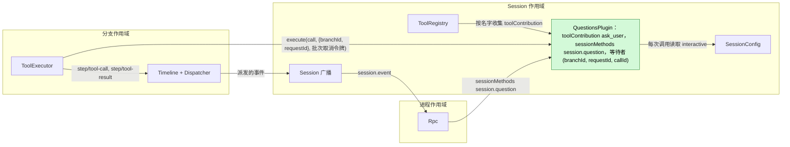
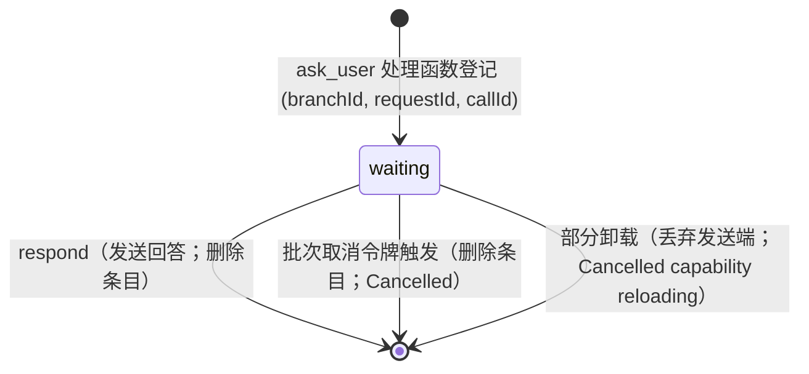
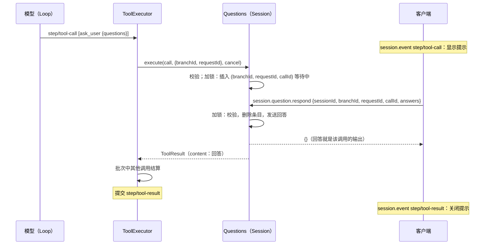
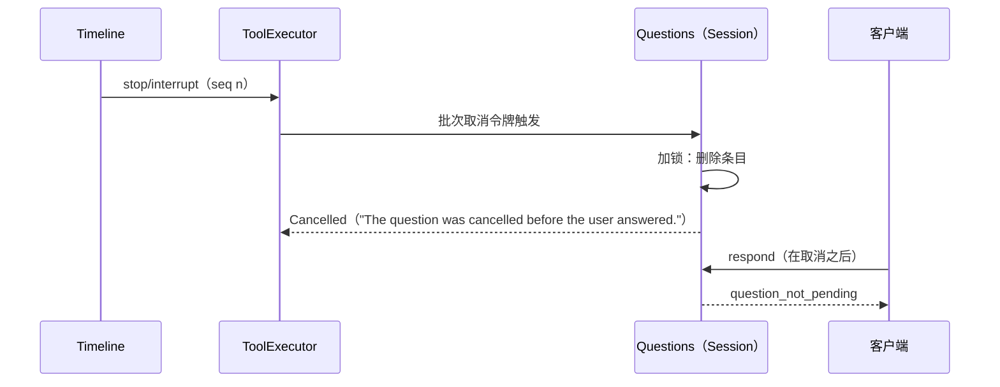

# Questions

状态：Ready（重新设计，[#144](https://github.com/arcships/dim/issues/144)）；维护者的确认记录在 [§12](#12-ready-确认)。总体设计：[overview §4](../overview.md#4-插件目录)。里程碑：M2。语言：Rust。作用域：Session（[ADR 002](../../adr/002-plugin-scope.md)）。

模型通过 `ask_user` 工具向用户提出一个或多个问题并等待回答：单选、多选、一次调用多个问题、自定义回答或拒绝回答。**问题就是待完成的工具调用，回答就是它的工具结果。** 客户端把已提交、尚无 `step/tool-result` 的 `ask_user` 的 `step/tool-call` 视为问题，用 Session 方法 `session.question.respond` 回答；等待中的处理函数把回答作为自己的 `ToolResult` 返回，ToolExecutor 像发布其他工具输出一样把它写进该批次的 `step/tool-result`。模型只从 `ToolResult.content` 得知用户的选择。

Questions **不定义任何 Timeline 事件**，只有**一个部分**，即一个 Session Capability。它提供 `ask_user` 工具（`toolContribution`，key `ask_user`）和方法 `session.question.respond`（`sessionMethods`，命名空间 `session.question`）（[session-boundary](../contracts/session-boundary.md)），并在内存中持有本 Session 正在运行的 `ask_user` 调用的等待者，如同运行中的工具持有自己的 I/O。中断、关闭、重载、重启和 fork 都由 [ToolExecutor](../../../architecture/rust-agent/plugins/ToolExecutor.md) 现有的工具调用生命周期结算。

相对已合入的重新设计（[#178](https://github.com/arcships/dim/pull/178)）的修改，全部来自对照当前 `main` 的核对和消融审查（§11）：

- 删除分支部分。等待者是 `ask_user` 处理函数自己的调用，而处理函数本来就运行在 Session 部分，所以表移到 Session 部分，以 `(branchId, requestId, callId)` 为键。条目的存在时间恰好等于处理函数等待的时间；对 `step/tool-result` 的 Dispatcher 订阅以及 `already_answered`、`cancelled` 两种回复随之删除（§11）。
- 等待中的调用以 `(branchId, requestId, callId)` 命名，其中 `requestId` 是该调用所在 `step/tool-call` 的 `request_id`。调用 id 可能在之后的模型请求中重复出现；没有它，对已结算调用的迟到回答可能成为后一个调用的结果（§4.3）。
- `exec` 的 Session 是交互的（[CLI 命令](../../../design/cli-commands.md#execution-and-jsonl-output)）；只有 `session.create {interactive: false}` 和 `sessions.launch` 创建非交互 Session（§3.3）。
- 明确了中断和关闭时模型读到的文本（A.1），并把正常重启与崩溃或强制关闭区分开（§4.2）。
- Rust 绑定改用已实现的 `SessionMethods` 和 `ToolHandler`（附录 G）。
- 给出带载荷的客户端协议（§3.4）和 CLI 的 ASCII 渲染（A.5）。
- 原 F1 已不需要新机制（C6 通知已实现）；原 F2 归 Approval，且已有决定（[CLI 命令](../../../design/cli-commands.md#execution-and-jsonl-output)、[sessions-service D10](../appserver/sessions-service.md)）。

## 1. 结构



合同以语言中立形式给出；Rust 形式见[附录 G](#附录-g-rust-绑定)。

| 部分 | 作用域 | 依赖 | 提供 |
| --- | --- | --- | --- |
| `QuestionsPlugin` | Session | `S:SessionConfig` | `toolContribution` key `ask_user`；`sessionMethods` 命名空间 `session.question`（`session.question.respond`） |

安装：插件启用时就安装该部分；安装从不读取 `SessionConfig.interactive`（[session access §9.4](../contracts/session-access.md#94-按启用状态安装可选部分)），因此每个 Session 都声明 `ask_user`，fork 后工具集合和提示词前缀不变。

依赖的合同，均已在 `main` 上实现：

| 合同 | 所有者 | 状态 |
| --- | --- | --- |
| `toolContribution`，提供方 Active 时提供（[session-boundary A.5](../contracts/session-boundary.md)） | ToolRegistry | 已实现（C3，#241） |
| 工具调用执行：调用的 `ToolExecutionContext.branchId` 与 `requestId`（其 `step/tool-call` 的 `request_id`）；每个批次一个取消令牌，由 `stop/interrupt` 和 ToolExecutor 卸载触发；取消晚于返回时保留已返回的结果；`HostError::Cancelled(reason)` 写成以 `reason` 为文本的错误结果；重载结算的结果使 turn 失败（[tool_executor.rs](../../../../crates/dim-agent-capabilities/src/tool_executor.rs)） | ToolExecutor | 已实现 |
| `sessionMethods` 与 `MethodDecl {name, mutating, interruption, progress}`（[session-boundary A.1](../contracts/session-boundary.md#a1-方法贡献)） | Rpc、运行时 | 已实现（C1） |
| `SessionConfig.interactive`，缺省为 `true`（[session access A.3](../contracts/session-access.md#a3-sessionconfig-字段)） | Agents | 已实现（C2） |
| `step/tool-call`、`step/tool-result` 数据合同（两者都带 `request_id`）及其 `session.event` 转发（所有分支，v2 和 v3，[tree_protocol.rs](../../../../crates/dim-app-server/src/tree_protocol.rs)）；按分支的 `session.history`；`session.stop {sessionId, branchId}` | Timeline、Rpc | 已实现 |
| Permission 风险类别 `session`（[permission.rs](../../../../crates/dim-agent-capabilities/src/permission.rs)） | Permission | 已实现 |

本文定义的合同：`ask_user` 工具（声明、输入 schema、结果文本）、`session.question.respond` 及其错误，以及客户端从历史推导待答问题的规则。

## 2. 数据与状态



该部分在互斥锁下维护一张表 `(branchId, requestId, callId) → {questions, sender}`（不用 `StateCell`）。`requestId` 是提出该调用的模型请求：`ToolExecutionContext.requestId`，与其 `step/tool-call` 的 `request_id` 是同一个值。调用 id 会跨请求重复，所以键需要它（§4.3）。只有等待中的调用有条目；谁在锁内删除条目，谁就决定该调用的输出，因此 `respond` 和取消不会同时成功。这张表从不跨代携带，也不重建：条目是对人的 I/O 等待，重载或重启留下的等待中调用由 ToolExecutor 结算（[设计规则](../../../architecture/rust-agent/principles.md) §4 第 9 条；AGENTS.md 第 4 条）。

Timeline 已经有什么，以及为什么不再写别的：

| 需要 | 已有事实或通道 | 为什么不需要 Questions 的事实 |
| --- | --- | --- |
| 问题存在且待答 | 已提交、含 `ask_user` 调用的 `step/tool-call`（其 `input` 就是问题；其 `data.request_id` 与调用 id 命名该调用），且没有 `call_event_id` 等于该事件 `id` 的 `step/tool-result` | 可从历史和实时 `session.event` 推导；客户端已收到这两者 |
| 回答到达模型 | 处理函数的 `ToolResult`，由 ToolExecutor 在 `step/tool-result` 中提交 | `ToolResult.content` 是模型唯一能读的文本；第二份副本不决定任何事 |
| 回答与中断 | ToolExecutor 消费 `stop/interrupt` 并取消批次令牌；Questions 在自己的锁内决定回答和取消谁先；取消之前已返回的结果被保留，与任何工具一样 | 回答是工具输出，不是发给另一个模块的指令：除模型通过结果读取外，后续没有决定读它（第 1、9 条） |
| 其他客户端关闭提示 | 该批次的 `step/tool-result` | 批次结算前的通知只用于显示；第 9 条规定显示走 Session 广播通知，且并非必需（F1） |
| 批次结算前崩溃后回答仍在 | — | 重启后 turn 已经 `Failed`，批次被重载结算（[single-tree](../../../architecture/rust-agent/single-tree.md) 重载规则）；持久化的回答没人读。每个工具都有同样的窗口 |
| 中断、关闭、重载、重启的结果 | ToolExecutor 的 `step/tool-result` | 归 ToolExecutor |

**事件声明**（[ADR 001](../../../adr/001-harness-foundation.md#events-and-ownership-issue-2)）：Questions 不写事件，它的状态和决定也不依赖任何事件。它不读历史，没有 Dispatcher 订阅；ToolExecutor 的取消令牌是服务合同，不是读事件。客户端通过待答问题规则（§3.2）依赖 `step/tool-call` 和 `step/tool-result`，这是客户端合同，不是某个能力的合同。

**动态事件（[#2](https://github.com/arcships/dim/issues/2)）：** 已于 2026-10-20 决定（[ADR 001](../../../adr/001-harness-foundation.md#events-and-ownership-issue-2)、[#233](https://github.com/arcships/dim/pull/233)）。Questions 不写事件，既不需要扩展事件类型，也不需要未来的动态协议；上一版草案的 R1 继续撤回。

## 3. 流程

### 3.1 提问与回答



`{}` 表示回答已交给等待中的调用，除非批次被重载结算（§4.2），它就是该调用的结果。

### 3.2 客户端、挂接与多个客户端

待答问题靠推导，不靠重放：客户端先挂监听，再按分支读 `session.history` 到 head，把每个没有对应 `step/tool-result` 的 `step/tool-call` 中的 `ask_user` 调用视为待答；之后的事件实时到达，按事件身份合并。Rpc 不增加 Questions 专用的重放或通知，这一点与 `approval.request` 不同。

```text
历史 + 实时 session.event，一个分支
  seq 41 step/tool-call   id e41 {request_id: r1, calls: [ask_user c1 {questions}]}  -> 为 (r1, c1) 显示提示
  seq 42 step/tool-result {call_event_id: e41, request_id: r1, results: [c1]}      -> 关闭 (r1, c1) 的提示
```

客户端把调用的 `requestId` 与提示一起保存，回答时带回。多个客户端都可以回答；第一个 `respond` 生效，其余收到 `question_not_pending`。收到 `question_not_pending` 的客户端保留提示，直到该批次的 `step/tool-result` 到达，它会在所有客户端上关闭提示（A.3、A12）。

### 3.3 非交互 Session

`ask_user` 与任何 Session 一样被声明。处理函数每次调用读取 `SessionConfig.interactive`；为 `false` 时（由 `session.create {interactive: false}` 或 `sessions.launch` 创建的 Session，Scheduler 和 Workflow 的运行使用后者），调用立即返回错误结果，说明没有人能回答、模型应在不提问的情况下继续（A.1）。不登记条目，所以 `respond` 找不到任何东西。

`dimcode exec` 创建并挂接一个**交互** Session；它是该 Session 的交互客户端，不修改 `interactive`（[CLI 命令](../../../design/cli-commands.md#execution-and-jsonl-output)）。没有终端输入时，它像处理审批一样处理问题：停止 turn，以退出码 3 退出（A.5、A8）。非交互 Session 中的审批保持 Approval 现有的所有者侧策略（[sessions-service D10](../appserver/sessions-service.md)）；Questions 不决定它。

### 3.4 客户端协议

不新增通知，新增一个 Session 方法。所有载荷都是现有连接上的 JSON-RPC。

问题以现有的 `session.event` 通知到达，携带现有线上形式的 `step/tool-call` 事件（有省略）：

```json
{"method": "session.event", "params": {"sessionId": "s1", "branchId": "main",
  "event": {"type": "step", "name": "tool-call", "id": "e41", "sequence": 41,
    "data": {"turn_id": "t1", "request_id": "r1", "calls": [
      {"id": "c1", "name": "ask_user", "input": {"questions": [
        {"header": "Database", "question": "Which database should the service use?",
         "options": [{"label": "PostgreSQL", "description": "managed, relational"},
                     {"label": "SQLite", "description": "single file"}]}]}}]}}}}
```

客户端用 `session.question.respond` 回答：

```json
{"id": 7, "method": "session.question.respond", "params": {"sessionId": "s1", "branchId": "main",
  "requestId": "r1", "callId": "c1", "answers": [{"questionId": "1", "selected": ["PostgreSQL"]}]}}
{"id": 7, "result": {}}
```

`requestId` 是包含该调用的 `step/tool-call` 的 `request_id`。拒绝回答时发送 `"declined": true` 且不带 `answers`。错误使用现有 `MethodError` 形式，带 `error.data.appError`（A.3），例如 `question_not_pending`。`call_event_id` 为 `e41` 的 `step/tool-result` 的 `session.event` 通知到达时关闭提示；其 `results[]` 中 `c1` 的条目携带 `ToolResult`（`content`、`structuredContent`、`isError`）。启用 Questions 的每个 Session 中，`session.methods` 都列出 `session.question.respond`。

## 4. 时序与冲突

### 4.1 回答与中断



`respond` 和取消恰好有一个删除条目。若 `respond` 先，即使取消紧随其后，处理函数也返回回答；ToolExecutor 保留已返回的结果，turn 仍以取消结束。若取消先，`respond` 回复 `question_not_pending`，批次的 `step/tool-result` 显示取消的结果。无论哪种，客户端收到的回复都如实反映调用的输出，而调用的终态事实只由 ToolExecutor 写。批次派发之前到达的 stop 不会到达处理函数：ToolExecutor 写它自己的“未执行”文本（A.1）。

### 4.2 重载、重启、关闭、删除

| 场景 | 结果 |
| --- | --- |
| 等待中 Questions 部分重载 | 卸载丢弃发送端；处理函数返回 Cancelled `capability reloading`；批次被重载结算，turn 失败（[ADR 002](../../adr/002-plugin-scope.md) D3）。ToolRegistry 不随之重载，下一个请求即提供新一代，不需要重载 Session（[session-boundary A.5](../contracts/session-boundary.md#a5-工具贡献)）。不会重新提问 |
| 等待中 ToolExecutor（分支）重载 | 它的卸载取消批次令牌；处理函数删除自己的条目并返回；ToolExecutor 写重载结算的结果，turn 失败 |
| 等待中正常重启（SIGINT、SIGTERM、不带 `force` 的 `daemon.shutdown`） | App Server 像 `session.close` 一样关闭每个已载入的 Session（见下方关闭一行）；重启后该调用已经结算，不会重新提问 |
| 等待中崩溃或强制关闭 | 恢复时 ToolExecutor 重建，把未结束的批次结算为未执行（`capability reloading`）；turn 失败 |
| 已回答，`step/tool-result` 之前重载 | 批次被重载结算；回答随之丢失（接受，与所有工具一样） |
| 分支关闭、`session.close`、删除 Session | 这是业务关闭，不是卸载：关闭先写入 branch 范围的 `stop/interrupt`，ToolExecutor 取消批次令牌，等待中的调用以取消结束（A.1），turn 以 Cancelled 结束，之后才移除分支（[生命周期 §5](../../../architecture/rust-agent/lifecycle.md#5-stop-与-close)、[session 删除](../appserver/session-deletion-and-fork.md)）。关闭时若 Dispatcher 已故障或 Loop 正在重载，则不等待这些事实，未完成的 turn 按重载结算 |
| 等待中 Session 卸载 | 不会发生：turn 正在运行，Session 不空闲 |

### 4.3 Fork 与分支

Session fork 只在没有缺少结果的工具提议的静止点切 `main`（[session 删除与 fork §6.2](../appserver/session-deletion-and-fork.md)），所以 fork 中不会有待答问题。子分支只继承已结算的调用；切在结果之前的调用投影为未执行，子分支没有条目。每个分支的问题用该分支的 `branchId` 回答。

调用 id 来自模型输出，只按惯例在一个批次内唯一：提供方可能在同一分支之后的请求中、或在另一个分支中再次使用 `c1`。因此键还包含该调用所在批次的 `requestId`。Loop 为每次模型请求分配新的 id，每次请求最多提出一个 `step/tool-call`，所以 `(branchId, requestId, callId)` 恰好命名一个调用。respond 只会到达客户端所显示提示对应的调用：

```text
分支 main，两个客户端
  T1 step/tool-call {request_id: r1, calls: [ask_user c1 "Deploy staging?"]}
       客户端 A：      respond {requestId: r1, callId: c1, Yes}       -> {}
  R1 step/tool-result {request_id: r1, results: [c1]}                    turn 1 结束
  T2 step/tool-call {request_id: r2, calls: [ask_user c1 "Delete production data?"]}
       客户端 B，迟到：respond {requestId: r1, callId: c1, Yes}       -> question_not_pending
       客户端 B，迟到：respond {requestId: r1, callId: c1, declined}  -> question_not_pending
       客户端 A：      respond {requestId: r2, callId: c1, No}        -> {}（r2 仍在等待）
  R2 step/tool-result {request_id: r2, results: [c1 "... Delete production data? -> No"]}
```

其他关键行（完整表：附录 B）：

| 场景 | 结果 |
| --- | --- |
| 处理函数登记之前客户端就回答 | `question_not_pending`；批次还没有结果，客户端保留提示，让用户重新发送 |
| 两个客户端回答 | 第一个生效；第二个 `question_not_pending`；两者都在 `step/tool-result` 时关闭 |
| 对已结算调用的迟到回答或拒绝，而后一个调用重用了其调用 id | `question_not_pending`：`requestId` 不同。后一个调用继续等待，并接受它自己的回答 |
| `exec` 没有终端输入 | CLI 停止 turn，退出码 3（A8） |
| 等待中 Steer、Queue、Append | 不影响问题；照常在批次或 turn 之后消费（A11） |

## 5. 上下文映射

| 模型看到什么 | 形式 | 位置 |
| --- | --- | --- |
| `ask_user` 名称、描述、schema | 固定的工具声明 | 已采用的 `context/configured`，每个 Session |
| 回答或拒绝 | `ToolResult.content`（A.1） | 工具结果位置，批次所有调用结算之后 |
| 没人能回答（非交互） | 错误 `ToolResult.content` | 同上 |
| 取消、重载、未执行 | 错误文本（A.1） | 同上 |

永不可见：等待者表、`structuredContent`、客户端渲染。压缩保留声明，回答只通过摘要保留。

## 6. 接口（摘要）

| 接口 | 种类 | 用途 |
| --- | --- | --- |
| `ask_user` | `toolContribution`（Session，key `ask_user`），风险 `session` | 提出 1–4 个问题并等待回答 |
| `session.question.respond` | `sessionMethods`（Session，命名空间 `session.question`） | 回答或拒绝等待中的调用 |
| 待答问题规则 | 客户端合同 | 没有对应 `step/tool-result` 的 `ask_user` 调用 |

## 7. 安全

`ask_user` 不使用主机资源，风险为 `session`（所有预设下都允许；`disallowed_tools` 仍然适用）。作为模型工具调用，它和任何工具一样受 Approval 与 Permission 管理（[ADR 003](../../adr/003-approval-scope.md) D1）。回答是用户内容，会成为工具输出到达模型；客户端不得在其中放入机密。任何有 Session 访问权的客户端都能调用 `session.question.respond`，包括已配对的远程设备（[RemoteGateway](RemoteGateway.md)）；它除了回答等待中的调用外不赋予任何权限，Rpc 只校验形状和 `sessionId` 授权，回答是否符合问题由 Questions 校验。重放从不重新提问。

## 8. 规则检查

规则：[原则 §1 与 §4](../../../architecture/rust-agent/principles.md)、[ADR 002](../../adr/002-plugin-scope.md) D1–D5、[ADR 001 事件](../../../adr/001-harness-foundation.md#events-and-ownership-issue-2)、[ADR 003](../../adr/003-approval-scope.md)。

| 规则 | 本文如何遵守 |
| --- | --- |
| §4.1 改别人的状态用指令事件 | Questions 不改其他模块的状态。回答是 Questions 自己工具的输出；调用的终态事实仍是 ToolExecutor 的 `step/tool-result`。没找到等待中调用的 `respond` 不写任何东西，由回复说明原因。 |
| §4.2 交接后不撤回 | 回答在锁内一次性交给等待中的处理函数；从不撤回，之后到达的取消也不会替换它。 |
| §4.3 before 回调只变换、不阻塞 | 不适用：没有 before 回调。Rpc 只检查形状和授权；`respond` 作为功能所有者校验回答是否符合调用的问题。 |
| §4.4 核心不带业务含义 | Timeline、Dispatcher、ToolExecutor 和 Rpc 不变，没有 Questions 特例；Rpc 通过 `sessionMethods` 分发该方法。 |
| §4.5 原子批次、按序派发 | Questions 不写也不消费事件。回答与批次中其他结果在 ToolExecutor 唯一的 `step/tool-result` 中一起提交。 |
| §4.6 上下文只来自交接后的事件 | 回答只通过 `step/tool-result` 到达模型（AGENTS 第 10 条）。 |
| §4.7 只通过公开事件和服务交互 | Questions 只响应自己调用的取消令牌（工具合同）并读取 `SessionConfig`；不读其他插件的状态。 |
| §4.8 基础设施不变 | 不改 Timeline、Dispatcher、信封、装配或门面；不提需求（§9）。 |
| §4.9 只有后续决定要用的事实才进 Timeline | 不新增事件；每个省略的事实都在 §2 说明理由。批次结算前的显示会走 Session 广播通知，而不是 Timeline（F1）。 |
| §1 Capability 与 App Server 边界 | 该部分是独立 crate 中的 Capability；Rpc 和 CLI 除客户端合同外不含 Questions 逻辑。 |
| ADR 002 D1 作用域 | 工具、方法和等待者都是 Session 服务；等待者是 Session 级工具贡献运行的 `ask_user` 处理函数自己的调用，所有者相同。分支生命周期经 ToolExecutor 的取消令牌到达它。 |
| ADR 002 D2 不设接线模块 | ToolRegistry 和 Rpc 按名字收集服务；没有适配部分。 |
| ADR 002 D3 作用域依赖 | 该部分只依赖 Session 的 `SessionConfig`；核心不依赖 Questions；重载会结算等待中的调用，这是接受的。 |
| ADR 002 D4 配置 | 不适用：Questions 没有配置。`interactive` 是调用时读取的 Session 创建数据，不是 Questions 的配置。 |
| ADR 002 D5 语言中立合同 | 工具和方法以中立形式给出（附录 A）；附录 G 是一种绑定。 |
| ADR 001 事件声明 | 见 §2：不写，不依赖。 |
| ADR 003 审批范围 | `ask_user` 是 agent 的决定，由 Permission 按风险 `session` 放行；Questions 不增加审批，也不运行配置中的任何东西。 |

## 9. 向机制所有者提出的需求

无。Questions 使用的每个机制都已实现（§1）。考虑过但未提出的：

| 候选 | 为什么不提 |
| --- | --- |
| 客户端可见的动态事件（[#2](https://github.com/arcships/dim/issues/2)，原 R1） | Questions 不写事件；#2 已独立决定（[ADR 001](../../../adr/001-harness-foundation.md#events-and-ownership-issue-2)） |
| 按启用的插件安装可选部分（原 R2） | 已写在 [session access §9.4](../contracts/session-access.md#94-按启用状态安装可选部分)；Questions 是其使用者之一 |
| 问题已被回答的通知（F1） | C6 Session 广播通知已实现（[session 通知](../appserver/session-notices.md)）；如需要，Questions 用 `session_broadcast::notify` 发出 `{source: "Questions", kind: "answered", data: {branchId, requestId, callId}}`，不改机制 |
| 问题超时（A7） | 超时是 Questions 自己的计时器在同一把锁下与取消竞争；不需要机制 |

## 10. 影响

| 模块或文档 | 变化 | 原因 |
| --- | --- | --- |
| Timeline、Dispatcher、ToolExecutor、Rpc | 无 | 工具调用生命周期已经承载问题和回答 |
| 新增的公开内容 | `ask_user` 工具、`session.question.respond`、待答问题客户端规则 | 功能自身的入口 |
| `dimcode` CLI | 从 `session.event` 渲染所有分支的问题（目前只显示 `main` 的事件）并回答，把退出码 3 扩展为“需要交互审批或回答”（A.5） | 功能的客户端部分 |
| [Overview](../overview.md)、[插件索引](README.md) | Questions 只有 Session 部分 | §1 |
| [Hooks](Hooks.md)、[Notifications](Notifications.md)（已撤回） | 仍提到 `question/asked`；“问题待答”触发改为 `ask_user` 的 `step/tool-call` | 留给 Hooks 设计（#143） |

## 11. 消融审查

| 元素 | 结果 |
| --- | --- |
| `question/*` 事件、Questions 重放、动态事件 | 已在 #178 删除（§2） |
| 分支部分 `questions`、它对 `step/tool-result` 的 Dispatcher 订阅、保留的已回答/已取消条目、`question_already_answered` 和 `question_cancelled` | 本次删除。等待的处理函数本来就属于 Session 部分，分支关闭（经由它的中断）和重载通过 ToolExecutor 的取消令牌到达它，所以分支部分只多出一次经 `TreeCommands` 的查找和第二个生命周期。保留条目只是让第二个客户端在 `step/tool-result` 之前分辨“别处已回答”和“尚未就绪”；去掉后两者都得到 `question_not_pending`，提示仍在 `step/tool-result` 时正确关闭。已复核：回答、拒绝、中断、重载、关闭、重启和两个客户端（附录 B）的结果不变 |
| `respond` 中 `branchId` 默认 `"main"` | 删除：客户端总能从 `session.event` 得到分支；默认值只会诱发回答错分支 |
| 原 F2（非交互 Session 中的审批） | 删除：归 Approval，已在 [CLI 命令](../../../design/cli-commands.md#execution-and-jsonl-output)和 [sessions-service D10](../appserver/sessions-service.md) 中决定 |
| 用互斥表而不是 `StateCell` | 保留：条目是实时 I/O 等待，不是可从 Timeline 重建的状态 |
| `(branchId, requestId, callId)` 键与重复键错误 | 保留。调用 id 来自模型输出，只按惯例在一个批次内唯一。`requestId` 使对已结算调用的迟到回答或拒绝不会成为重用该 id 的后一个调用的结果（§4.3）。`branchId` 使键不依赖跨分支的请求 id；重复错误使一个批次内的冲突不会把一个回答交给两个调用。该键依赖 Loop 为每次模型请求分配新 id，且每次请求最多一个 `step/tool-call`；若这一点改变，键必须随之改变。考虑过：`step/tool-call` 的事件 id 同样能精确命名调用，但 `ToolExecutionContext` 不携带它，使用它就要修改 ToolExecutor 的工具合同；`requestId` 已同时在上下文和事件中 |
| 处理函数中的 `interactive` 检查 | 保留：这是工具集合不变前提下交互与非交互 Session 唯一不同的行为（A1） |
| Session 部分用锁决定回答与取消 | 保留：没有它，回答和取消可能都向各自调用方报告成功 |

## 12. Ready 确认

没有被机制阻塞的事项。维护者已按推荐确认以下各项（[#251](https://github.com/arcships/dim/pull/251#issuecomment-6316300432)）：

1. 本次修订的单一 Session 部分（§11），取代 #178 的分支部分。
2. A6：用户可以拒绝整个调用，以及拒绝文本（A.1）。
3. A7：没有超时；调用一直等到被回答、中断或结算。
4. A4：每次调用 1–4 个问题，每个问题 2–6 个选项。
5. A8 与 A9：`exec` 没有终端输入时以退出码 3 停止；CLI 显示所挂接 Session 所有分支的问题。
6. F1：不提前关闭提示。

英文与中文文档保持同步。

## 附录 A. 接口细节

### A.1 工具 `ask_user`

服务 `toolContribution`，Session 作用域，key `ask_user`。声明包含名称、固定描述、下列 schema 和风险 `session`；`execute(ToolCall, {branchId, requestId}, cancel)` 返回 `ToolResult`。调用方通过该调用的取消令牌取消。

| 参数 | 类型 | 规则 |
| --- | --- | --- |
| `questions` | 数组，1..=4（A4） | 必填 |
| `questions[].id` | 字符串 | 可选；按位置默认 `"1"`、`"2"`……；调用内唯一 |
| `questions[].header` | 字符串，最多 40 字符 | 可选的短标签 |
| `questions[].question` | 非空字符串 | 必填 |
| `questions[].options` | `{label, description?}` 数组，2..=6，标签唯一 | 必填（A4） |
| `questions[].multiSelect` | 布尔，默认 false | 多选 |
| `questions[].allowCustom` | 布尔，默认 true | “其他”自由文本（A5） |

处理函数校验输入；输入无效时返回错误结果，不登记任何东西。结果（`content` 为一个文本块）：

| 结果 | 写入者 | `isError` | `content` |
| --- | --- | --- | --- |
| 已回答 | Questions | false | `User answered:`，然后每个问题一行 `<n>. <question>` 和 `   -> <label>, <label>`，自定义回答写作 `(custom) <text>` |
| 拒绝（A6） | Questions | false | `User declined to answer. Proceed without these answers.` |
| 非交互 Session | Questions | true | `No one is available to answer questions in this session. Proceed without asking.` |
| 输入无效 | Questions | true | `Invalid ask_user input: <reason>` |
| `(branchId, requestId, callId)` 重复（一个批次内调用 id 重复） | Questions | true | `Invalid ask_user input: duplicate call id <callId>` |
| 等待中被中断 | Questions 以 `Cancelled(reason)` 返回；ToolExecutor 写入 reason | true | `The question was cancelled before the user answered.` |
| 处理函数开始前被中断 | ToolExecutor | true | `Tool cancelled before execution` 或 `Tool was not executed: <中断原因>` |
| 分支关闭、`session.close`、删除、正常重启 | Questions 以 `Cancelled(reason)` 返回；ToolExecutor 写入 reason | true | `The question was cancelled before the user answered.`（关闭先中断分支；turn 以 Cancelled 结束） |
| 重载、卸载 | ToolExecutor | true | `Tool execution cancelled: capability reloading`（重载结算；turn 失败） |
| 崩溃或强制关闭 | 恢复时 ToolExecutor 重建 | true | `Tool was not executed: capability reloading`（重载结算；turn 失败） |
| 超时 | — | — | 不适用：没有超时（A7） |

已回答结果示例：

```text
User answered:
1. Which database should the service use?
   -> PostgreSQL
2. Which features ship first?
   -> Auth, Search, (custom) audit log
```

`structuredContent` 携带 `{answers: Answer[], declined: boolean}`，只用于客户端和持久化。

| 形状 | 字段 |
| --- | --- |
| `Question` | `{id: string, header?: string, question: string, options: QuestionOption[], multiSelect: boolean, allowCustom: boolean}` |
| `QuestionOption` | `{label: string, description?: string}` |
| `Answer` | `{questionId: string, selected: string[], custom?: string}` |

### A.2 等待者表

该部分私有。`(branchId, requestId, callId) → {questions: Question[], sender}`；其他模块不读它。

### A.3 Session 方法 `session.question.respond`

服务 `sessionMethods`，Session 作用域，命名空间 `session.question`。声明 `{name: "session.question.respond", mutating: true, interruption: "report", progress: false}`。

`params`：`{sessionId, branchId, requestId, callId, answers?: [{questionId, selected: [label], custom?}], declined?: false}` → `{}`。`requestId` 是包含该调用的 `step/tool-call` 的 `request_id`；`branchId`、`requestId` 和 `callId` 必填，共同命名等待中的调用。要么 `declined` 为 `true` 且没有 `answers`，要么 `answers` 对每个问题恰好一项。错误是 `MethodError` 数据：

| `appError` | 条件 |
| --- | --- |
| `question_not_pending` | `(branchId, requestId, callId)` 下没有等待中的条目：处理函数尚未登记、另一个 `respond` 已被接受、调用已被取消，或批次已结算。也包括对已结算调用的迟到回答或拒绝，而后一个调用重用了其调用 id；后一个调用的条目不受影响 |
| `invalid_params` `<reason>` | 缺少 `branchId`、`requestId` 或 `callId`；未知或缺少的问题 id、未提供的标签、未设 `multiSelect` 却选了多个标签、未设 `allowCustom` 却带 `custom`、既没选择也没 `custom`、`answers` 与 `declined` 同时出现。条目继续等待 |
| `service_reloading` | 该部分正在启动或重载 |
| `unknown_method` | 该 Session 未启用 Questions |
| `session_closed` | Session 已关闭 |

对 `question_not_pending`，客户端根据历史中是否已有该批次的 `step/tool-result` 区分“尚未”与“已结算”：若已有，提示已经关闭。

### A.4 机制

| 步骤 | 机制 |
| --- | --- |
| 工具调用 | 校验输入。`SessionConfig.interactive` 为 false 时返回非交互结果。取消令牌已触发或该部分已关闭时返回 Cancelled。加锁：键 `(branchId, requestId, callId)` 已存在则返回重复错误；否则插入带一次性发送端的条目。等待：`select! biased { answer, cancel }` |
| 取消触发 | 加锁。条目还在：删除，返回带中断文本的 Cancelled。条目不在：`respond` 已胜出；取出通道中已有的回答并返回 |
| Respond | 加锁。params 的 `(branchId, requestId, callId)` 下没有条目 → `question_not_pending`，不触碰其他条目；按条目校验 → `invalid_params`（条目保留）；删除条目，发送回答，回复 `{}` |
| 卸载 | 置为关闭，清空表并丢弃所有发送端；每个处理函数返回 Cancelled `capability reloading` |

### A.5 CLI 合同

CLI 处理所挂接 Session 所有分支的问题（A9）。它从所有分支的 `session.event` 中读取 `ask_user` 调用，而不只是 `main`。

```text
 assistant text ...
 [question] Database                                  <- 第一个问题的 header，或 "question"
 1. Which database should the service use?
    1. PostgreSQL  managed, relational
    2. SQLite      single file
    0. Other (type your answer)                       <- 仅当 allowCustom
 Choose 1-2, 0 for other, empty to decline: 1
 2. Which features ship first?                        <- multiSelect
    1. Auth
    2. Billing
    3. Search
    0. Other (type your answer)
 Choose numbers, comma separated: 1,3,0
 Other: audit log
 [question answered]
```

| 情况 | CLI 行为 |
| --- | --- |
| `step/tool-call` 中有 `ask_user` 调用，没有打开的提示 | 按 A.1 解析输入（无法解析：不显示提示；处理函数会拒绝它）。排队；按到达顺序一次一个调用。按上图打印。第一个问题输入空行表示拒绝整个调用（A6）；后续问题输入空行或无效内容则重新提示 |
| 提示已打开 | 其他通知延后到提示关闭，与审批相同 |
| 所有问题收集完毕 | 带调用的 `branchId`、`requestId` 和 `callId` 调用 `session.question.respond`；`{}` 打印 `[question answered]` |
| `question_not_pending`，历史中已有批次结果 | 关闭；按下面的结果打印消息 |
| `question_not_pending`，尚无批次结果 | 保留回答；打印 `[question not ready; press Enter to send again]` |
| 当前调用的 `step/tool-result` | 关闭；结果是回答或拒绝时打印 `[question answered elsewhere]`，否则 `[question cancelled]` |
| 提示时 `Ctrl+C` | `session.stop`（turn）；调用以取消结束；退出码 130，与现在相同 |
| EOF | `session.stop`；退出码 130 |
| `exec` 没有终端输入且问题到达 | 打印 `Interactive answer required; stopping. Rerun in a terminal to answer it`，`session.stop`，退出码 3（A8） |
| 挂接或恢复 | 先挂监听，再按分支读 `session.history`；推导待答调用，每个以 `(branchId, requestId, callId)` 命名；按事件身份合并 |

## 附录 B. 完整冲突表

`T` = 含 `ask_user` 的 `step/tool-call`，`R` = 其批次的 `step/tool-result`，`I` = `stop/interrupt`，`ans` = 被接受的 `respond`（不是 Timeline 事件）。

| 场景 | 顺序 | 结果 | 决定者 |
| --- | --- | --- | --- |
| 批次派发前中断 | I < T 被消费 | 未执行；没有条目 | ToolExecutor |
| 处理函数开始时取消已触发 | I 被消费，然后 execute | Cancelled；没有条目 | Questions |
| 先回答后中断 | ans < I | 回答保留为调用结果；R 之后 turn 以取消结束 | Questions；ToolExecutor |
| 先中断后回答 | I < ans 尝试 | 取消删除条目；`respond` → `question_not_pending`；R 显示取消的结果 | Questions（锁） |
| 回答与取消同时 | — | 恰好一个在锁内删除条目 | Questions（锁） |
| 两个客户端回答 | ans1, ans2 | 第二个 `question_not_pending`；两者都在 R 时关闭 | Questions（锁） |
| 处理函数登记前回答 | ans 尝试 < execute | `question_not_pending`；客户端重发 | 客户端 |
| R 之后的迟到回答 | R < ans 尝试 | `question_not_pending`；R 已在历史中 | 客户端 |
| 已回答，批次中其他调用仍在运行 | ans < R | 回答保存在处理函数结果中直到 R | ToolExecutor |
| 已回答，R 之前重载 | ans < reload | 批次重载结算；turn Failed | ToolExecutor |
| 等待中 Questions 部分重载 | — | 丢弃发送端；Cancelled `capability reloading`；批次重载结算（D3） | Questions；ToolExecutor |
| 等待中 ToolExecutor 重载 | T，无 R | 批次令牌取消；条目删除；重载结算的结果 | ToolExecutor |
| 分支关闭、`session.close`、删除、正常重启 | T < I（branch 范围） | 批次令牌取消；条目删除；R 中是取消的结果；turn 以取消结束 | ToolExecutor；Loop |
| 等待中崩溃或强制关闭 | T，无 R | 恢复时重建结算该批次；turn Failed | ToolExecutor；Loop |
| 一个批次中多个 `ask_user` | T [c1, c2] | 各自回答；一个 R | Questions；ToolExecutor |
| 同一批次等待中出现相同 `callId` | — | 第二个调用 → 重复错误结果 | Questions |
| 分支之后的请求重用 `callId`；对前一个调用的迟到回答或拒绝 | R1 < T2 < ans 尝试（r1） | `question_not_pending`；T2 的条目不受影响，用它自己的 `requestId` 回答 | Questions（键） |
| 两个分支中相同 `callId` | — | 独立条目 | Questions |
| 等待中 Steer/Queue/Append | T < input | 在 R 或 `turn/end` 之后消费；问题继续（A11） | Loop、InputQueue |
| 等待中 `input/withdraw` | T < withdraw | 无影响 | InputQueue |
| T 与 R 之间压缩 | — | 不会发生：压缩在请求准备时运行 | ContextPreparation |
| Session fork | — | 只在静止点切分；fork 中从不待答 | Agents |
| 子分支切在 T 与 R 之间 | — | 投影为未执行；子分支没有条目 | Timeline 投影 |
| Session 卸载 | T 待答 | turn 运行中，不空闲，不卸载 | AgentIndex |
| 从未有客户端挂接 | T 待答 | 一直等待，没有超时（A7） | 用户 |
| 非交互 Session | — | 立即返回错误结果；没有条目 | Questions |
| 已配对远程设备回答 | — | 与任何客户端一样接受 | Questions |

## 附录 C. 错误与恢复

| 情况 | 结果 |
| --- | --- |
| 工具输入无效 | 错误结果；不登记 |
| 中断、关闭、正常重启 | `execute` 以 Cancelled 结束；ToolExecutor 写入中断文本 |
| 重载、崩溃或强制关闭 | ToolExecutor 重载结算；从不重新提问 |
| 重载期间 `respond` | `service_reloading`；重载后调用已结算，重试返回 `question_not_pending` |

## 附录 D. 验收

经 RPC、工具调用和事件的流程测试：

1. 单选、多选、多问题、自定义和拒绝回答产生规定的 `content`；无效回答被 `respond` 拒绝，调用继续等待。
2. `interactive: false`（`session.create {interactive: false}` 和 `sessions.launch`）：`ask_user` 被声明，并立即返回非交互错误；工具集合与交互 Session 相同。
3. 先回答后 stop：结果含回答，turn 以取消结束。先 stop 后回答：`question_not_pending`，结果中是中断文本。与取消竞争的 respond 恰好得到两者之一。
4. 两个并发 `respond`：一个 `{}`，一个 `question_not_pending`。
5. 一个批次中两个 `ask_user` 加一个慢工具：回答保留到唯一的 `step/tool-result`；之后的 respond 返回 `question_not_pending`。
6. 等待中 Questions 部分重载，以及崩溃或强制关闭：批次被重载结算，turn 失败，不重新提问。
7. 断开再挂接：历史给出待答调用；重新挂接后可以回答；子分支上的问题用其 `branchId` 回答。
8. 完整提问与回答的 Timeline 中没有 Questions 事件。
9. CLI：渲染、延后、`Ctrl+C`、EOF、`exec` 无终端输入退出码 3、`question_not_pending` 重发、子分支问题。
10. 跨 turn 重用调用 id，两个客户端：客户端 A 回答 turn 1 的 `c1`；turn 2 提出另一个问题，也用 `c1`。客户端 B 对 turn 1 调用（其 `requestId`）的迟到回答和迟到拒绝返回 `question_not_pending`；turn 2 的调用继续等待，接受它自己的回答，模型把该回答读作 turn 2 的工具结果。

## 附录 E. 假设

| # | 假设 | 依据 | 被否决的影响 |
| --- | --- | --- | --- |
| A1 | 每个 Session 都声明 `ask_user`，`interactive` 为 false 时拒答 | [Session access A.3](../contracts/session-access.md#a3-sessionconfig-字段)（装配从不读取 `interactive`，#30） | 工具集合不同；fork 丢失提示词前缀 |
| A2 | 缺少 `interactive` 表示交互 | Session access A.3 格式决定，已实现 | 已有 Session 不再提问 |
| A4 | 1..=4 个问题，2..=6 个选项 | 判断；已确认（§12） | schema 限制改变 |
| A5 | 默认允许自定义回答 | 功能清单“自定义回答” | 模型须显式开启 |
| A6 | 用户可以拒绝整个调用 | 已确认（§12） | 用户必须回答或停止 |
| A7 | 没有超时 | 已确认（§12） | 超时需要确定时长，并在 A.1 增加自己的结果行 |
| A8 | `exec` 没有终端输入时以退出码 3 停止 | CLI 审批先例（[CLI 命令](../../../design/cli-commands.md#execution-and-jsonl-output)） | 不同的退出策略，例如拒绝回答 |
| A9 | 显示所有分支的问题 | 审批先例（所有分支的审批都会提示） | 子分支的问题需要另一个客户端 |
| A11 | Steer 不结束等待中的问题 | 判断 | Steer 取消该调用 |
| A12 | 其他客户端在 `step/tool-result` 时关闭提示，而不是在回答的瞬间 | 第 9 条；`ask_user` 通常单独成批 | F1 增加提前关闭 |

（第一版草案的 A3，即 `question/*` 载荷扩展，已随事件删除。）

## 附录 F. 未决问题

| # | 问题 | 说明 |
| --- | --- | --- |
| F1 | 在其他客户端上提前关闭 | 已在 §12 决定：不需要（A12）。以后如需要，可由 Questions 在 `respond` 胜出后发出 C6 Session 广播通知 `{source: "Questions", kind: "answered", data: {branchId, requestId, callId}}`，以 `session.notice` 转发；或由产品启用 ToolExecutor 现有的逐调用 `step/tool-completed`（目前关闭）。两者都不需要修改机制 |

## 附录 G. Rust 绑定

| 中立合同 | Rust 绑定 |
| --- | --- |
| `toolContribution` key `ask_user` | `AgentBuilder::session_tool("ask_user")`；`ctx.provide_as(scope.named_key::<ToolContribution>("ask_user"), ToolContribution {definition, handler})`，与 Wait 相同；`ToolHandler::execute(call, ToolExecutionContext {branch_id, request_id, ..}, CancellationToken)`；取消 = `HostError::Cancelled(reason)` |
| `sessionMethods` 命名空间 `session.question` | `AgentBuilder::session_methods("session.question")`；`SessionMethods::provide(ctx, &scope, "session.question", vec![MethodDecl::new("session.question.respond", true, Interruption::Report)], handler)`，与 ShellInput 相同 |
| `S:SessionConfig` | `InSession<SessionConfig>`，每次调用读取字段 `interactive` |

```rust
pub struct Question { pub id: String, pub header: Option<String>, pub question: String,
    pub options: Vec<QuestionOption>, pub multi_select: bool, pub allow_custom: bool }
pub struct QuestionOption { pub label: String, pub description: Option<String> }
pub struct Answer { pub question_id: String, pub selected: Vec<String>, pub custom: Option<String> }
pub struct Answered { pub answers: Vec<Answer>, pub declined: bool }

/// (branch_id, request_id, call_id)
struct Waiters { closed: bool,
    table: HashMap<(String, String, String), (Vec<Question>, oneshot::Sender<Answered>)> }
```

卸载清理（置为关闭、清空表）通过 `ctx.effect` 注册。
