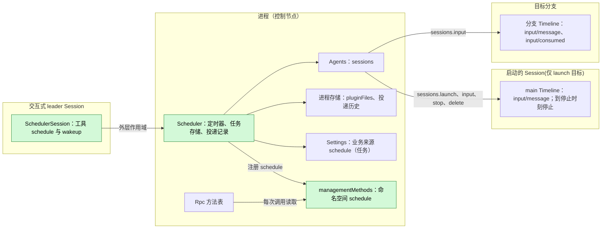
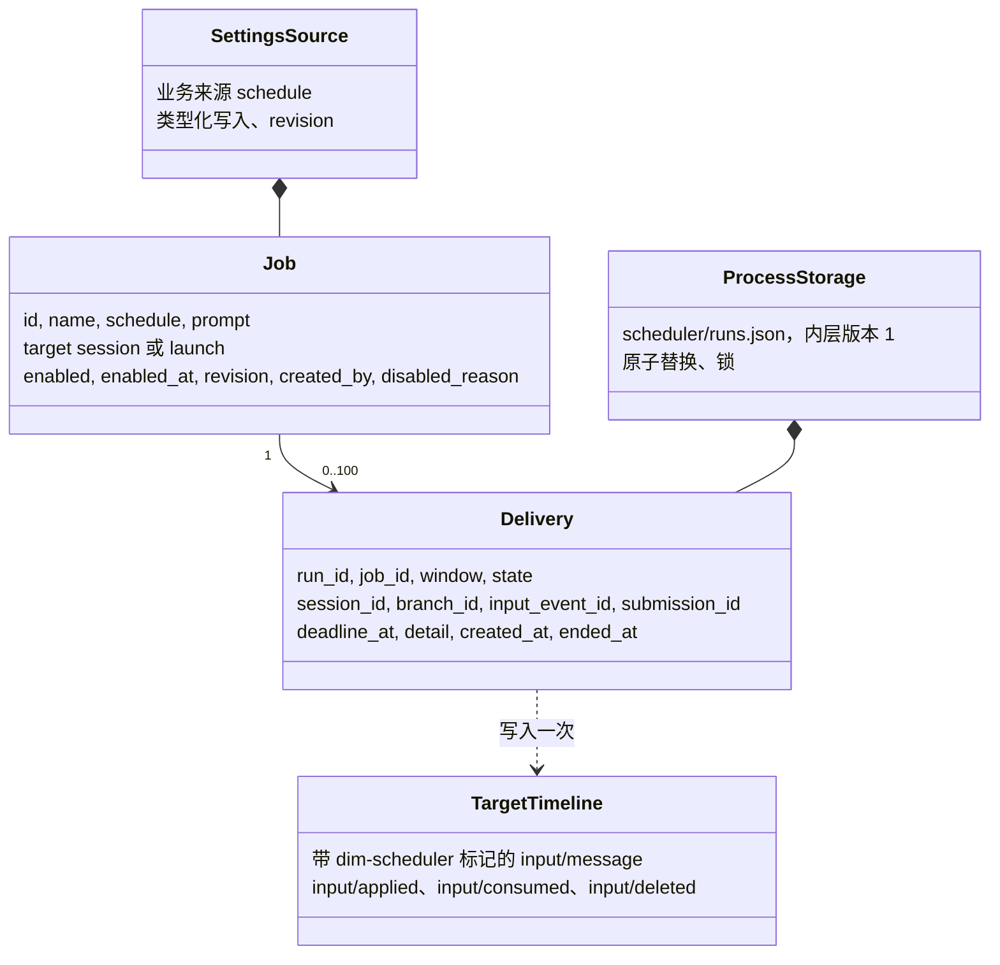
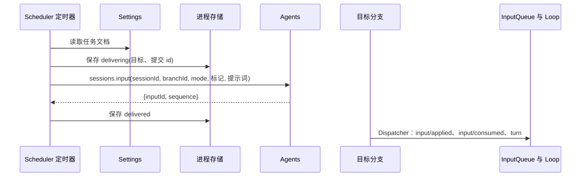
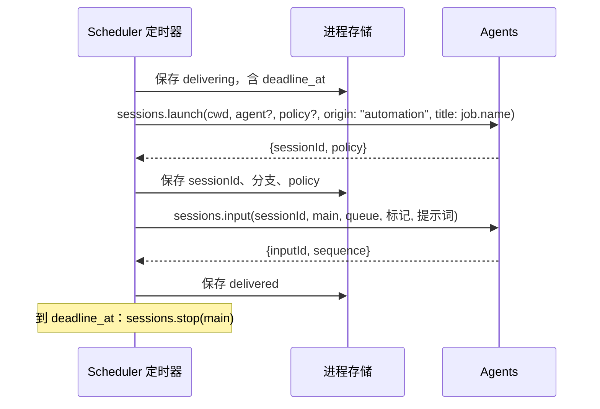
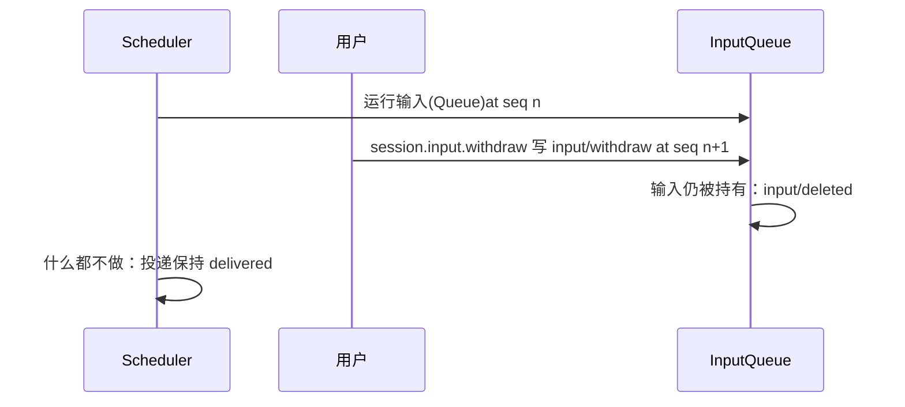

# Scheduler

状态：设计已批准。总体设计：[overview §4](../overview.md#4-插件目录)；作用域：[ADR 002](../../adr/002-plugin-scope.md)(进程 + Session)。阶段：P2。语言：Rust，原生，无 Node 依赖([overview 附录 C](../overview.md#附录-c-实现语言))。TypeScript 包已随迁移移除；[附录 G](#附录-g-rust-绑定) 是 Rust 绑定。

**任务即一次投递。** 任务命名一个目标，并在每个到期窗口把保存的提示词作为一条普通分支输入写到该目标。目标默认是保存该任务的 Session 与分支，或者该任务启动的新 Session——后者只有管理客户端能选。Scheduler 不读 Timeline，也不保留运行结果：它只记录投递了什么、失败了什么，别的什么都不记。进程部分拥有任务、定时器与投递记录；Session 部分提供 `schedule` 工具与 `session.wakeup` 方法。

**运行结果。** Scheduler 拥有自己的投递历史，`schedule.history` 是持久读取入口。一次运行的结果就是它的记录。Scheduler 不向任何 Session 写报告输入，也不需要通知通路(A.6)。

Scheduler 把计划任务(用户书写的配置)存于 Settings 业务来源 `schedule`，把投递记录存于 [`pluginFiles`](../../../../crates/dim-app-server/README.md#trusted-plugin-storage)。每个到期窗口，进程部分经 `sessions.input`([session-access](../contracts/session-access.md))写入一条带自身标记的输入，目标为保存该任务的分支，或该任务启动的 Session。`queue` 是默认接线；任务可以存 `steer` 或 `append`。Session 部分在每个 Session 中声明 `schedule` 与 `wakeup` 工具(风险 `persistent_configuration`)，只有交互式 leader Session 能使用它们。运维方使用本文规定的 `schedule.*` 管理方法。合同语言中立([ADR 002 D5](../../adr/002-plugin-scope.md#d5-合同语言中立))；Rust 绑定限制见[附录 G](#附录-g-rust-绑定)。Scheduler 不写自己的 Timeline 事件：它的投递是写给其他所有者分支的普通输入，记录存放在自己的存储里。

## 1. 结构



任务与窗口跨 Session，所以归进程([ADR 002](../../adr/002-plugin-scope.md) D1)；向 Session 提供工具是 Session 部分的职责(D2)。进程部分声明既有的 `sessions`、`settings`、`pluginFiles` 与 `managementMethods` 服务。Agents 的稳定目录提供 `sessions`，并在每次调用时查找当前索引：索引重载使调用以 `reloading` 失败，而不重载 Scheduler 或任何 Session([S2 D1](../appserver/sessions-service.md#3-决定)、[#35](https://github.com/arcships/dim/issues/35))。Session 工具按已接受的绑定声明其 `scheduleJobs` 依赖(§1.1)；未声明的 `ctx.use` 不是通用的可选原生查找。C3 让核心工具消费者不依赖可选行。不引入从 ToolRegistry、Loop 或 Session 就绪到 Scheduler 的依赖。任务编辑使用 Settings 的所有者写入与变更事件，绝不做结构重载。

| 部分 | 作用域 | 依赖 | 提供 |
| --- | --- | --- | --- |
| `Scheduler` | 进程(控制节点) | 稳定的 `sessions`、`settings`、`pluginFiles`、`managementMethods` | 任务访问、定时器、投递记录；规定的 `scheduleJobs` 与管理命名空间 `schedule` |
| `SchedulerSession` | Session，Scheduler 启用时安装 | 既有 C4 工具合同；创建配置；已声明的 `scheduleJobs` 依赖(§1.1) | 把 `schedule` 与 `wakeup` 注册到 `toolRegistry`，把 `session.wakeup` 注册到 `sessionMethods`；`interactive === false` 或 Session 是 Collaboration 成员时处理函数拒绝 |

**依赖的合同：** [C4 工具](../../../design/session-typescript.md)、[Settings](../appserver/settings-service.md)、[S2 sessions](../appserver/sessions-service.md)、[方法准入](../contracts/session-boundary.md) 与 [pluginFiles](../../../../crates/dim-app-server/README.md#trusted-plugin-storage)。**本文规定的插件自有合同：** 任务与投递数据、`schedule` 与 `wakeup` 工具、`scheduleJobs.call`、管理命名空间 `schedule`、`session.wakeup` 命名空间、来源 `schedule`、标记 `dim-scheduler` 与提交 id `scheduler:<run_id>`。风险 `persistent_configuration` 在 Permission 中仍未分类；不新增类别。

### 1.1 现有绑定与交付要求

[进程装配与管理绑定](../../../design/process-typescript.md)支持显式进程行。宿主启动与重启就绪选择必需的基础设施，而可选进程行保留各自的 Pending/失败状态。功能依赖绑定定义见下文；具体包声明见 §1.3。共享声明闸门仍允许挂起的顶层模块加载使宿主启动超时；进程模块遵循该绑定的作者指南规则。

[已接受的功能依赖绑定](../../../design/process-typescript.md#51-p6p7-access-through-declared-feature-dependencies)把 `scheduleJobs` 与 `toolRegistry` 声明为该可选 Session 工具模块的依赖。提供方激活、退役、重试与恢复遵循该绑定的现行规则；Scheduler 不定义另一套挂接策略，也不复制其错误文案。稳定的进程依赖边界仍然适用。这确定了 #35 的访问选择；包实现该绑定的生命周期合同。

| 表面 | 当前实现与后果 |
| --- | --- |
| Session 工具 | 一个 C4 Session 定义，由进程行经 `partRegistry` 注册，注入 `toolRegistry`，并在其 apply 中注册 `schedule` 与 `wakeup` 及其声明与异步 `execute`。注册不做 I/O。注册与提供方代际变化遵循现行 C4 绑定(§1.1)。 |
| 进程包 / `scheduleJobs` | 一个可选进程行 `Scheduler`，用 `AgentBuilder::optional_plugin` 注册，安装进程所有者；其 `apply` 用 `partRegistry` 注册 `SchedulerSession` 部分。Session 部分经 `names.key()` 读取 `scheduleJobs`(§1.1)。 |
| 管理命名空间 | 进程行在把 `schedule` 注册到 `managementMethods` 并发布 `scheduleJobs` 之前恢复其投递存储。恢复失败保留该故障，仍在行失败前注册命名空间，因此后续调用报告该行的失败状态。原生按调用准入与 `report`/`drain` 遵循注册行的生命周期与状态。 |
| Settings | 只有进程行注册来源 `schedule`，用户文件 `schedule.json`，无 `projectFile`(§7.1)。在使用时读取经校验/带默认值的文档，并按文档修订做 CAS。原生绑定使用类型化所有者读写；客户端经 `schedule.*` 管理任务，而不是通用 `settings.*`。 |
| 存储 | [公开绑定](../../../design/process-typescript.md#52-public-pluginfiles-binding)在经授权的产品根提供 pluginFiles。嵌入宿主在启用该行前准备 `scheduler/`；缺少父目录在事务回调之前返回 `io`。Scheduler 内层 v1(A.7)与宿主外层 v1 不变。 |
| Sessions | 调用使用 `{ok:true,value}` / `{ok:false,error:{code,message,retryable}}`。`launch` 返回 `{sessionId,policy}`，`input` 返回 `{inputId,sequence}`，`lookup` 返回 `accepted`/`unknown`。保持这些既有形状。 |
| 原生生命周期 | 每个 S2 调用持有自己的租约。Agents 的自动空闲卸载由 [#331](https://github.com/arcships/dim/pull/331) 为 [#126](https://github.com/arcships/dim/issues/126) 交付。Scheduler 不把分离变成关闭，也不增加自己的卸载循环。 |

### 1.2 影响面

不提出 facade、loader、事件格式或 rutis 变更；所有新业务行为属于 Scheduler 包。运行时装配增加一个入口 `AgentBuilder::optional_plugin`，使进程行可选(宿主不等待它)，`plugin_rows` 返回 `PluginRows`，携带可选行 id；不改变任何核心就绪路径或机制。上述来源、工具与管理命名空间都有具体消费者(Settings、ToolRegistry 与运维方)；`scheduleJobs` 只服务于该功能的两个作用域。没有额外的注册表、就绪服务、通知总线或 App Server 业务模块。

### 1.3 具体包行

下表是原生绑定保留的依赖、方法种类与 Settings 合同。其 TypeScript 拼写(manifest `code` 字段、`definePlugin`、`ctx.use`)由[附录 G](#附录-g-rust-绑定) 取代。进程部分是由产品入口经 `AgentBuilder::optional_plugin` 注册的可选行，Session 部分由该行的 `apply` 经 `partRegistry` 注册。

| 行字段 | 进程行 |
| --- | --- |
| `id` | `Scheduler` |
| `name` | `Scheduler` |
| `config` | `{}` |
| `inject` | `settings`、`pluginFiles`、`managementMethods`、`partRegistry`、`sessions` |
| `provides` | `scheduleJobs`；apply 把 `schedule` 注册到 `managementMethods`，把 `SchedulerSession` 部分注册到 `partRegistry` |
| `settings` | §7.1 的完整 `schedule` 来源，含其 schema |

`SchedulerSession` 部分注入 `scheduleJobs`、`toolRegistry`、`sessionMethods`、guide 条目、`SessionConfig` 与 `SessionIdentity`，不提供任何东西，并在其 apply 中注册 `schedule`、`wakeup`、`session.wakeup` 与 §5.2 的 guide 条目。

**失败所有者报告。** 统一升级的 [rutis 0.16](../rutis-0.16-upgrade.md) 及其后续版本提供附录 C 与附录 D 要求的 loader 失败报告。不可读或非法的投递存储使进程行失败；此后 `schedule.*` 返回 `service_unavailable`，并保留原始字节。

可选进程行与其注册的 Session 部分在依赖与方法种类上一致；它们是一个功能的两个工作所有者，而不是两套运行时。进程行提供 `scheduleJobs` 并在原上下文上注册其命名空间；没有方法适配器或 Session 转发插件。结构配置不含任务、策略默认值、凭据、定时器设置或运行状态。

Settings 变更使用已声明的来源与既有的变更投递，不重载进程行。所有者在关闭其既有 `pluginFiles` 作用域之前结算已接受的调用与原生 I/O。其清理会等待自己已准入的调用(A.6)，而 [#267](https://github.com/arcships/dim/pull/267) 的 S2 已准入输入生命周期让这类写入跨越索引重载；索引重载期间丢失的桥接回复不是提前清理的边界。

工具使用宿主提供的 `ToolCall.sessionId`、`branchId` 与 `config.cwd` 作为 A.2 的调用方。分发之前，它拒绝 `config.interactive === false` 或 `config.collaborationRole === "member"`。它不信任模型参数中提供的调用方身份。其同步声明在 §5.1 说明投递目标。清理开始后，保留的处理函数遵循 [功能绑定](../../../design/process-typescript.md#51-p6p7-access-through-declared-feature-dependencies) 的当前不可用提供方与重试合同。Scheduler 不硬编码该绑定的错误文案，也不假定某个特定的提供方重连路径。

进程行注册的声明是 A.3 的七个字面方法。`list`、`history` 与 `watch` 是非变更的 `interruption:"report"`；其余四个是变更的 `interruption:"drain"`。除 `watch` 外都用 `progress:false`；`watch` 声明 progress，其项是观察到的变化(§11.2、A.3)。它们的 JSON 值与错误使用既有 `MethodReply`；工具把 A.2 的回复映射到 `ToolResult.content` 与 `isError`。不新增 App Server 方法。

投递不读取任何权限状态。session 目标的任务不携带策略：投递的输入是目标分支的普通输入，其工具按该分支自己的 Permission 状态准入。launch 目标的 Session 收到任务可选的预设，由 `sessions.launch` 按实时宿主上限收拢(§3.3)。两条路径都不在保存时捕获策略，因此包不声明 `sessionPermissions` 依赖，也不保留复用比较。

## 2. 数据与状态



任务只存于 Settings 业务来源，投递只存于进程存储；不从 Timeline 重建任何东西，Scheduler 不拥有 `StateCell`。投递由它自己的写入决定：Scheduler 从不读取目标 Timeline，记录的状态就是写入与查询给出的答案。Session 部分不持有状态。

### 2.1 两种目标

任务的 `target` 只有两种形状，形状决定一个窗口做什么。

| 目标 | 字段 | 到期窗口 |
| --- | --- | --- |
| `session` | `session_id`、`branch_id`(省略时为 `"main"`)、`input_mode?`(`queue` \| `steer` \| `append`；默认 `queue`) | 向该分支写入一条输入。不创建、不配置、不删除任何 Session。 |
| `launch` | `cwd`、`agent_id?`(新 Session 运行的 Agent profile；缺省为默认 profile)、`policy?`(可选预设)、`max_run_minutes?`(默认 60) | 启动一个非交互 Session，向其 `main` 分支写入一条输入，并在停止时刻停止它(§3.2)。 |

`session` 目标是 `schedule` 工具保存的形状，也是工具唯一能保存的形状：调用方的 Session 与分支就是它的目标。`launch` 目标用于必须在没有活动 Session 时运行的工作；只有 `schedule.save` 能设置它(A.2、A.3)，管理端的 create 必须命名目标，因为它没有可作默认的 Session。一个任务只存一个目标，一次保存整体替换它。

投递永不改变目标的名称、分支或身份。任务的目标在被一次保存替换之前固定；保存绝不改写已经记录的投递。

### 2.2 投递

一条投递记录一个窗口。它的状态在写入未结时是 `delivering`，之后是 `delivered`、`failed`、`lost` 或 `missed` 之一。

| 状态 | 含义 | 终态 |
| --- | --- | --- |
| `delivering` | 记录已命名目标，`launch` 在启动回复到达后还命名它创建的 Session；输入可能已被接受也可能没有。重启后由 `sessions.lookup` 结算(A.6)。 | 否 |
| `delivered` | 目标分支已发布该输入；`input_event_id` 是回执。 | 是 |
| `failed` | 该窗口没有写入输入，或要写入的 Session 无法创建。`detail` 携带原因。 | 是 |
| `lost` | 写入结果未在查询上限内确定(A.6)，且该窗口不重试。`detail` 命名最后一次查询回答。 | 是 |
| `missed` | 守护进程没有在宽限内观察到该窗口(A.4)，或该窗口因该任务仍有未结算的投递而被跳过(§3.1)；`detail` 说明是哪一种。 | 是 |

投递到达终态后永不更新，Scheduler 永不重发一个窗口。`session_id` 与 `branch_id` 命名实际使用的目标；对 `launch`，它们命名启动的 Session 及其 `main` 分支，`deadline_at` 是其停止时刻。`session` 目标以及从未启动运行的投递没有 `deadline_at`。

### 2.3 本次变更之前保存的任务与投递

存储形状是增量变化：本次变更之前保存的任务没有 `target`，其旧字段会被读出、映射为目标，并由写入保留。`Job` 把 `mode`、`session_id`、`cwd`、`model`、`agent_id`、`policy`、`policy_cap` 与 `max_run_minutes` 保留为旧字段(A.1)；它们永不被报告，任何保存也不写入其中之一。因此 `policy_cap` 只被读取并由写入保留，没有保存会捕获当时的宿主上限：启动在启动时刻应用当时的上限(§3.3)。

映射是固定的，取决于保存来源，而不是目标的方便：

| 旧任务 | 读作 |
| --- | --- |
| `created_by` 是工具，任何 `mode` | 该工具保存时所在 Session 与分支的 `session` 目标 |
| `created_by` 是用户，`mode: "create"` | 用存储的 `cwd`、`agent_id`、`policy` 与 `max_run_minutes` 组成 `launch` 目标 |
| `created_by` 是用户，`mode: "reuse"`，有存储的 `session_id` | 该 Session `main` 的 `session` 目标 |
| `created_by` 是用户，`mode: "reuse"`，无 `session_id` | 用存储字段组成 `launch` 目标 |

工具保存的任务无论旧 `mode` 是什么都映射到其保存分支：旧形状会启动 Session，而工具保存的任务必须不再这样做。对旧 `reuse` 任务，运行记录区分两种 Session 情形。出现在带 launch 来源的运行里的 Session 是 Scheduler 在首次运行时启动并绑定的：它仍归该任务所有，并随它一起删除(A.7)。任务只是复用的 Session 属于用户，永不被删除。改变该任务目标的保存会释放这份启动所有权。

投递存储保持内层 v1：记录旧的 `state` 名称按写入时原样解码，新记录使用 §2.2 的词表。不重写任何字节，也不改版本(A.7)。记录新增的字段有 `attempts`，即该 `delivering` 投递已进行的查询次数，以及 `released`，标记被改变目标的保存或删除所释放的 launch 记录(A.7)。两者都是可选的：缺少它们的记录读作零次尝试、未释放，内层版本保持 1。

## 3. 流程

### 3.1 窗口到期



`launch` 目标记录窗口、启动一次、记下启动回复给出的 Session 与停止时刻、写一条输入，并起停止定时器：



这就是目标的全部：一次启动、一条输入与停止定时器。Scheduler 不读被启动 Session 的历史，也不订阅其广播，因此投递只由它自己的写入结算，启动之后不再跟随任何东西(A.6)。

启动会声明这个 Session 是做什么用的，以及选择器如何标注它：`origin: "automation"` 给它"已保存的配置在无人在场时运行的工作"这一类，客户端用 `session.catalog` 的 `withAutomationSessions` 就能只列出它们，而不必连带列出所有 Collaboration 成员与 Workflow 阶段；`title: job.name` 是选择器在第一条输入之前显示的标签。标题由 SessionTitle 按其自身的文本规则写入（[SessionTitle](SessionTitle.md)）；任务名属于 Scheduler，App Server 不依赖 Scheduler。`session` 目标两者都不发送：它是用户自己的 Session，来源保持不变（[Session 分类](../appserver/session-classification.md#32-which-creation-entry-writes-which-value)）。

窗口求值遵循 `settings/schedule`、墙钟分钟变化、当前分钟内最早剩余窗口与已接受投递的结算。自有定时器每秒检查这些截止时刻，空闲节拍既不读 Settings 也不读存储。

`delivering` 记录先于任何外部效果持久化，因此重启靠查询结算它，而不是再写一次。`launch` 窗口在第一次写入时记下停止时刻，在启动回复到达时记下 Session，因此在这两者之间崩溃会留下一条不命名任何 Session 的 `delivering` 记录：没有任何查询能到它，它以 `detail: launch_reply_unknown` 结算为 `lost`(附录 F)。一个窗口至多写入一次：分支对每个 `submissionId` 只接受一次([sessions 服务 §6.2](../appserver/sessions-service.md#62-input))，以同一 id 重试返回同一回执。

**重叠。** 该任务只要还有任意一条 `delivering` 记录，窗口就被跳过，因此一个任务同时至多有一条 `delivering` 记录。被跳过的窗口不写输入，并记录一条带 `detail: previous_delivery_unsettled` 的 `missed` 投递(A.6)，它计入保留期(A.7)。这条记录是终态，本身不会放行下一个窗口：条件是该任务的 `delivering` 记录，而不是它前面那一条投递。`schedule.run_now` 遵循同一规则；它为手动窗口记录自己的投递，有它自己的 `run_id` 与 `window`，绝不返回定时器路径的记录，因此被该规则跳过的手动窗口返回那条 `missed` 记录。跳过持续的时间不超过那条 `delivering` 记录保持未结的时间，下面的上限固定了它。

**上限。** 查询回答只有在携带事实时才结算 `delivering` 记录。`accepted` 在任一次尝试都把它结算为 `delivered`，且不写第二条输入。`unknown`、`reloading`、`ambiguous` 与传输失败让它保持 `delivering`；每次回答计入五次上限，且计数在查询之前持久化为 `attempts`(A.1)。第五次这类回答把它结算为 `lost`，`detail` 命名该回答。`unknown` 不能结算记录：它只对查找开始前已返回的写入是最终结果([sessions 服务 §6.3](../appserver/sessions-service.md#63-lookup))，而回复丢失的写入会继续跑到它自己的结果([§6.2](../appserver/sessions-service.md#62-input))，因此 `unknown` 可能意味着尚未提交。因此，写入从未提交的窗口在五次查询后是 `lost` 而不是 `failed`，其间该任务的窗口被跳过。恢复会在不再查询的情况下结算耗尽的预算：存储的 `delivering` 记录若 `attempts` 已达上限，则在发送任何查询之前结算为带 `detail: lookup_budget_exhausted` 的 `lost`。该崩溃无法判断第五次写入是否被接受，因此分支实际已接受的输入会被记为 `lost`；不尝试第二次写入、也不重发，因此代价是一条低估某次投递的记录，绝不是重复。`lost` 是终态且可清理(A.7)，因此没有记录永久未结，跳过规则也不会超过这五次尝试。

**排队的输入。** Scheduler 只约束自己的写入：每个任务每个窗口一条输入，且该任务有未结算投递时不再写。目标分支持有多少输入是该分支 InputQueue 的事，不是 Scheduler 的事。InputQueue 目前没有上限([input_queue.rs](../../../../crates/dim-agent-capabilities/src/input_queue.rs))，因此目标持续繁忙的 `queue` 任务每个窗口都会增加一条排队输入，直到分支消费它们。排队输入的上限会适用于向分支写入的每个生产方，因此它属于 InputQueue 的设计，而不是本设计。

### 3.2 完成与超时

**完成。** 投递在目标分支发布输入时完成；记录变为 `delivered` 并携带回执的 `input_event_id`。此后 Scheduler 不再看它。输入变成什么由目标自己决定：其 InputQueue 与 Loop 决定它起一个回合、排在某个回合之后还是等待，该回合的工具由目标自己的 Permission 状态管辖。Scheduler 不订阅广播、不读历史、不持有租约。

**超时。** 只有 `launch` 目标有超时。`max_run_minutes` 是 Session 的停止时刻，在投递被接受时固化为 `created_at + max_run_minutes`；定时器在到点时停止该 Session：

- `sessions.stop {sessionId, branchId:"main", reason:"scheduled run reached its stop time"}`。投递保持 `delivered`；停止是对启动工作的界，不是运行结果。
- 停止失败时，定时器在记录仍然存在期间至多每分钟重试一次。投递本身不变。
- 在停止时刻被停止的 Session，在其最后一条命名记录离开存储时由保留期删除(A.7)，绝不在停止时刻之前删除。

`session` 目标没有超时：投递属于用户的分支，Scheduler 永不撤回或停止它。

### 3.3 运行的权限

session 目标的投递不携带任何权限。它是目标分支的普通输入([§4 规则 1](../../../architecture/rust-agent/principles.md))；该分支自己的 Permission 状态准入该回合的工具，与用户键入的输入完全相同。任务不存策略，保存也不会改变其他分支的权限，因为没有可接管的东西。

launch 目标的 Session 用任务可选的预设创建，由 `sessions.launch` 按实时宿主上限收拢——即 S2 D4 的 `ServerConfig.session_defaults.permission_policy`([sessions 服务](../appserver/sessions-service.md#3-决定))。没有预设时请求为只读。返回的策略记录在投递上，作为启动时观察到的权限；它是记录，不是授权，之后的 Permission 变化会收窄它。

自动化永不扩大权限(E2)。因为任务不捕获策略也不做比较，没有保存时上限、接管或复用比较：保存只存一个预设，每次启动都应用 S2 的实时上限。高于宿主上限的预设在保存时不被拒绝；启动时收拢它，投递记录 Session 实际收到的策略。

## 4. 时序与冲突



写入之后 Scheduler 什么也不知道。投递与目标后来所做之事的任何差异都属于目标的历史，而不是运行状态。

| 场景 | 顺序 | 结果 | 所有者 |
| --- | --- | --- | --- |
| 目标分支忙 | — | 输入排队；在运行中的回合结束后被消费(A5) | InputQueue、Loop |
| 目标分支空闲卸载 | — | `sessions.input` acquire 并恢复它 | Agents |
| 目标分支有挂起审批 | — | 输入排在该回合之后；Scheduler 不参与 | Approval、InputQueue |
| 用户中断或撤回已投递的输入 | input < interrupt 或 withdraw | 输入被删除或随回合结束；投递保持 `delivered` | Loop、InputQueue |
| 目标 Session 被删除或关闭 | — | 写入失败 `session_closed`；运行为 `failed: session_closed`，任务被禁用(§A.3) | Agents、Scheduler |
| 目标分支已结束 | — | 写入失败 `branch_ended`；运行为 `failed: branch_ended`，任务被禁用 | Agents、Scheduler |
| Agents 索引重载 | — | 写入回答 `reloading`；进行中的投递由查询结算(A.6) | Agents |
| Scheduler 重载或重启 | — | `delivering` 记录由 `sessions.lookup` 结算；窗口不会被写两次 | Scheduler |
| 守护进程跨过窗口停机 | — | `missed`；不补做(E5) | Scheduler |
| 同一时刻两个窗口到期 | — | 每个窗口一条投递；超过宽限或在该任务有未结投递时到期的窗口为 `missed` | Scheduler |
| 任务删除时 launch Session 仍在运行 | — | 投递有效，Session 运行到停止时刻，之后由保留期删除(A14) | Scheduler |
| 任务被保存为新目标 | — | 后续窗口使用新目标；已记录投递不变 | Scheduler |
| 目标 Session 中创建了子分支 | — | 忽略；一条投递只命名一个分支 | Scheduler |

完整表见附录 B。

## 5. 上下文映射

| 何处 | 模型看到什么 | 形式 | 位置与存活 |
| --- | --- | --- | --- |
| 调用方 Session | `schedule` 声明 | 已采用配置中的工具声明(每个 Session；仅交互式 leader 可用) | 配置；跨压缩存活 |
| 调用方 Session | `wakeup` 声明 | 已采用配置中的工具声明(每个 Session；仅交互式 leader 可用) | 配置；跨压缩存活 |
| 调用方 Session | `schedule` 结果 | `ToolResult.content` | 批次结果位置；压缩后只剩摘要 |
| 目标分支 | `<dim-scheduler kind="scheduled-run" job="..." run="...">任务名</dim-scheduler>`，随后是作为用户内容的提示词 | 一条输入的原始标记块 + 用户文本 | 在其 `input/consumed` 位置；无 key，压缩后只能经摘要保留；若在切点前被消费，子分支会继承它 |
| 被唤醒的 Session | `<dim-scheduler kind="wakeup">唤醒 id</dim-scheduler>`，随后是作为用户内容的提示词 | 一条输入的原始标记块 + 用户文本 | 在其 `input/consumed` 位置；无 key(§10) |

启动的 Session 是非交互的：`ask_user`、`schedule` 与 `wakeup` 仍然声明，处理函数以错误结果拒绝。任务与投递记录只经 `ToolResult.content` 到达调用模型；不存在把存储、定时器或诊断自动注入上下文的通路。

### 5.1 面向模型的文本

一段文字是协议还是策略，由 [model-facing prompts §4](../model-prompts.md#4-协议与策略) 判定。按写下的句子逐句分类：`schedule` 声明只含协议，因此对它的改动随其流程测试落地，不需要 §8.1 评估([model-facing prompts §8.2](../model-prompts.md#82-评估装置))。

| 文本 | 类别与句子 |
| --- | --- |
| `schedule` 声明，schema | 协议：动作集合、`job_id`、`enabled`、`limit` 与带字段的 `job` 对象 |
| `schedule` 声明，描述 | 协议："Manage scheduled jobs across this host, including other workspaces." 说明工具的触达范围；"A job delivers its saved prompt to the branch that saved it, on its schedule." 说明投递去向；"A job saved by a client may launch a new Session instead." 说明另一种目标；"A Session may save at most 16 jobs." 说明保存上限。无策略句 |
| `schedule` 结果 | 协议：`schedule: <code>` 首行及其消息、`schedule is available only in interactive leader Sessions.`、`schedule: cancelled before handover` 与两条卸载通知。代码为 `schedule_invalid`、`schedule_not_found`、`schedule_conflict`、`service_unavailable`、`service_reloading` 与 `invalid_data`；模型读取并据此行动 |
| `wakeup` 声明，描述 | 协议："The wakeup fires one turn on the same Session with the given prompt, preserving its history and branch; it can be listed and cancelled from any client, and an expired or cancelled wakeup is never replayed." 说明工具做什么与不重放规则；首句命名动作 |
| `wakeup` 结果 | 协议：`wakeup: created` 首行与错误的 `wakeup: <code>` 首行、`wakeup is available only in interactive leader Sessions.`、`wakeup: cancelled before handover` 与两条卸载通知；记录字段是协议的标识符 |
| 运行标记 | 协议：元素 `dim-scheduler`、其种类 `scheduled-run` 与 `wakeup`、`scheduled-run` 上的 `job` 属性与 `run` 属性，以及各自开启的输入。scheduled-run 的主体是任务名，标记之后的文本是为该任务保存的提示词；wakeup 的主体是唤醒 id，之后的文本是保存唤醒时的提示词 |
| 投递记录 | 协议：状态 `delivering`、`delivered`、`failed`、`lost` 与 `missed`，窗口、目标 Session 与分支，以及 `detail` |

描述是工厂成员：`description` 替换声明的描述(附录 G)；产品不设置任何值，因此内置文本生效。流程测试固定每个协议句。想要策略句的配置自行添加，并承担随之而来的 §8.1 评估；内置文本没有策略句，因此出货的声明永远不会因它本身成为策略变更。

**退役的报告文本。** 退役报告种类会从 guide 条目(§5.2)中删除句子，该删除按 [model-facing prompts §4](../model-prompts.md#4-协议与策略) 逐句判定：

| 被删句子 | 类别 | 理由 |
| --- | --- | --- |
| "`<dim-scheduler kind="report" job="nightly-build" run="run-7f2">`: how that run ended." | 协议 | 命名标记种类与它开启的内容；该标记已不存在 |
| "job names the job, run names the run, in both." | 协议 | 说明两个标记携带的属性，而 "in both" 只在有两个标记时为真 |
| "In the report tag the body states the run's outcome and, when known, the session it ran in: the scheduler's account of how the run ended, information, not a request." | 协议 | 说明报告的主体与其信任类别；该主体已不存在 |
| "The report's last line is not part of that account: it is guidance on what to do next." | 协议 | 说明一个 Scheduler 输入已不再携带的主体的框架，而它所描述的指引行也随 `report_guidance` 一并消失 |

删掉的每一句都在说明运行时写什么、以及怎样读它。没有一句告诉模型该怎么工作，因此这次删除是协议变更：它随断言该条目的流程测试一起落地，不需要 §8.1 评估。声明自身已退役的策略句 "Inspect the old-to-new authority transition in the result." 已在上一次变更中随该过渡一起删除。

### 5.2 guide 条目

一个条目覆盖两种标记，其文本是代码([Prompt §5](Prompt.md#5-复现它的事实))：

```
<dim-scheduler kind="scheduled-run" job="nightly-build" run="run-7f2">: a scheduled job's saved prompt, delivered when the job runs, and <dim-scheduler kind="wakeup">: a wakeup's prompt, delivered once at its set time as one turn on the same Session. job names the job on a scheduled run and run names the run. In the scheduled-run tag the body is the job's name, and the message after the tag is the prompt saved for the job: the request this run carries out, in the operator's channel. The wakeup body is the wakeup id.
```

每句都是协议，各说明模型放置标记所需的一件事：

- "a scheduled job's saved prompt, delivered when the job runs, and … a wakeup's prompt, delivered once at its set time as one turn on the same Session" —— 每个标记是什么。
- "job names the job on a scheduled run and run names the run." —— 属性。
- "In the scheduled-run tag the body is the job's name, and the message after the tag is the prompt saved for the job: the request this run carries out, in the operator's channel." —— scheduled-run 输入的形状与其提示词到达的通道。
- "The wakeup body is the wakeup id." —— wakeup 标记的形状。

它在形式与长度上遵循 exec 通知的条目(`<dim-notification>`，order 10，[WorkspaceTools](../../../architecture/rust-agent/plugins/WorkspaceTools.md#backgroundexec))：一条运行时通知，属性携带运行的标识符。

两种标记都携带该 guide 条目：Scheduler Session 部分在 `apply` 中注册一个 `dim-scheduler` 条目，作用域为 Session，因此 scheduled-run 标记开启的 Session 中的请求与 wakeup 标记开启的被唤醒 Session 中的请求，都携带来自该 Session 部分的条目([Prompt §6.2](Prompt.md#62-写入者))。

Scheduler 不写 `dim-scheduler kind="report"` 输入，因此没有条目描述该种类。在本次变更之前恢复的历史保留写下的任何这类块：没有任何东西重写历史，该标记只是一个没有条目描述的普通元素([model-facing prompts §6.1](../model-prompts.md#61-覆盖什么))。

## 6. 接口（摘要）

| 接口 | 种类 | 用途 |
| --- | --- | --- |
| `schedule` | 注册到 `toolRegistry` 的工具（Session），风险 `persistent_configuration` | 模型管理任务 |
| `wakeup` | 注册到 `toolRegistry` 的工具（Session），风险 `persistent_configuration` | 模型为自己的 Session 安排唤醒（§10） |
| `session.wakeup.create/list/cancel` | `sessionMethods`（Session，命名空间 `session.wakeup`） | 客户端创建、读取与取消一个 Session 的唤醒（§10） |
| `schedule.list/save/delete/set_enabled/run_now/history/watch` | `managementMethods`(进程，命名空间 `schedule`) | 运维方管理任务并读取投递 |
| 投递记录 | `schedule.history`；每个窗口一行；无 Session 通知(A.6) | 运行的持久结果 |
| CLI 入口 | `dimcode scheduled <verb>` 与 `/scheduled` 面板([管理界面](../cli-commands.md#管理界面)) | 运维方在终端经这些方法管理任务：面板每个任务一项，含开关、编辑、添加、删除、运行与历史；子命令是同一适配器，无 Session |
| `sessions` | 依赖(进程) | 向既有分支写输入；launch 目标则是无 starter 的策略、启动非交互 Session、停止与删除 |

## 7. 安全

`schedule` 声明风险 `persistent_configuration`，Permission 将其视为未分类：FullAccess 允许(E1)，WorkspaceWrite 询问，ReadOnly 拒绝。无需 Permission 变更(#45)。投递只写一条输入；目标分支的工具按其自身策略准入，审批不被预先授予。由管理保存的 launch 任务按它存储的预设运行，由 S2 在启动时实时收拢，其审批归它自己。

在宿主内，工具访问对 Scheduler 是全局的：一个被准入的交互式 leader 可以跨 Session/工作区列出/读取任务提示词，并更新另一个分支的任务。更新会为其后续窗口重定向该任务；它不通知原目标分支，也不改变任何已记录的投递。管理访问同样可以读取全部任务提示词。这不是 Session/cwd 隔离。

`schedule` 来源使用既有 [Settings 信任边界](../appserver/settings-service.md#7-安全)：用户拥有的持久配置是可信的。原生客户端使用 `schedule.*`；该 Rust 来源不经通用 `settings.read/update` 暴露。持久化文档可以提供 `target`、`created_by` 与旧字段；Scheduler 用这些声明值处理后继窗口。它们是配置，不是 Scheduler 捕获过分支策略的证明，而且这种形状根本不在保存时捕获策略。写入方负责文档的语义一致性，包括推进被改动任务的 `revision`；复用该修订的编辑不会被 A.5 的修订比较发现。用 `schedule.save` 获得 Scheduler 自己的校验与任务修订行为。

写入用户的完整文档是运维动作，可以改变所有任务及其目标；它比管理 `schedule.save` 更宽。任何项目来源都不能提供该权限。进程内插件仍然可信(AGENTS.md 规则 11)，不被 Settings 沙箱化。已记录的投递保留其目标与结果。不增加来源证明服务、签名、额外元数据存储、Settings 限制或核心协议。

### 7.1 Settings 来源

Scheduler 进程行在其 `apply` 中注册一个来源([Settings §3.1](../appserver/settings-service.md#31-来源登记))；Session 定义不注册它。

| 声明 | 值 |
| --- | --- |
| `source` | `schedule` |
| `userFile` | `schedule.json`；原生 profile 使用 Settings 既有的 `user/schedule` 行 |
| `projectFile` | 缺省：仅用户作用域，无项目作用域、无合并 |
| 文档根 | 含 `jobs`(数组，默认 `[]`)的对象；任务字段与约束见 A.1/A.4 |
| 旧字段 | 存储的任务还可以携带 `mode`、`session_id`、`cwd`、`model`、`agent_id`、`policy`、`policy_cap` 与 `max_run_minutes`；它们按 §2.3 读取并映射，并由写入保留，任何保存都不写入其中之一(§2.3)。`max_concurrent_runs`(整数，最小 1，默认 4)保持可读，并仅因存储文档兼容而被任务写入保留；它不影响投递。无需用户可配置的并发字段或 `userOnly` 声明。 |

Settings 在边界处应用这些默认值并校验外部文档一次。非法文档是错误，不是空任务列表。来源只保存任务；A.7 的内层 v1 投递历史留在 `pluginFiles`。读取或修改该文档绝不结构性地重载包。

## 8. 规则检查

规则：[principles §1 与 §4](../../../architecture/rust-agent/principles.md)，[ADR 002](../../adr/002-plugin-scope.md) D1–D5。

| 规则 | 本文如何遵守 |
| --- | --- |
| §4.1 为他人状态写命令事件 | Scheduler 只经 `sessions.input` 写一条 `input/message` 改变目标分支；输入变成什么由 InputQueue 与 Loop 决定。launch 目标另用 `sessions.launch`、`stop` 与 `delete`，它们属于 Agents。 |
| §4.2 交接之后不收回 | Scheduler 永不撤回或停止已投递的输入。launch Session 只在其自己的停止时刻被停止，那是该 Session 创建的一部分。 |
| §4.3 只经 before 回调介入 | 不适用：Scheduler 不加入口检查、不加 before 回调；任务校验是所有者对其方法与工具的自有边界校验。 |
| §4.4 核心机制不承载业务含义 | Scheduler 使用既有工具、Settings、存储与 sessions 合同；投递策略归 Scheduler。 |
| §4.5 决策前读完整个批次 | 一条投递只依据自己的写入与查询回复决策，没有已发布前缀要读。A.3 的窗口规则每个节拍读一次完整任务文档。 |
| §4.6 模型上下文只持有已交接事件 | 已投递的提示词只作为目标分支已消费的输入到达模型；没有写入任何东西的窗口到达不了任何模型。 |
| §4.7 只用公开事件与服务 | 既有 `sessions`、`settings` 与 `pluginFiles`；规定的 `scheduleJobs` 归功能所有。不假定私有 Permission 读取或内部 AgentIndex 租约。 |
| §4.8 向机制所有者提出的需求 | 无(§9)。公开绑定已规定；实现直接使用。P3 节点另行处理。 |
| §4.9 只有后续决策使用的事实进入 Timeline | 无 Scheduler Timeline 事件；任务留在 Settings，投递留在进程存储。 |
| §1 Capability 与 App Server 边界 | 进程插件拥有任务与投递；Session Capability 提供其工具。存储使用 `pluginFiles`；无 App Server 业务模块。 |
| ADR 002 D1 | 任务跨 Session(进程部分)；工具属于 Session(Session 部分)。 |
| ADR 002 D2 | 既有 Rpc 与 ToolRegistry 消费功能自有的方法/工具；无 wiring 插件或通知总线。进程行把其命名空间注册到 `managementMethods`；Scheduler 在包内实现自己的方法。 |
| ADR 002 D3 | 稳定的 `sessions` 隔离索引重载；C3 让核心不依赖可选行。可选工具行按 §1.1 的可用性约束声明其所有者依赖。 |
| ADR 002 D4 | 任务与任务上限是 Settings 业务来源 `schedule` 中的业务数据，在使用时读取；结构不变。 |
| ADR 002 D5 | 直接使用既有服务名/信封；区分规定的功能合同与绑定限制(§1.1、附录 G)。 |

## 9. 向机制所有者提出的需求

无。绑定使用的运行时装配入口(`AgentBuilder::optional_plugin`、`PluginRows` 与 `PartRegistry::register`)就是 §1.2 记录的既有入口。既有 C3/C4、S2、Settings 与 pluginFiles 机制仍是基线。另有两处命名了 Scheduler 旧归属的句子因本次变更而随之不成立，在同一变更中一并修正：[sessions 服务 §8.7](../appserver/sessions-service.md#87-删除运行用的-session) 与 [EventHub §10](EventHub.md#10-不在本设计内)。不新增 App Server 方法、服务、事件或基础设施需求。

## 10. Session 作用域的一次性唤醒

唤醒（wakeup）是一次性的、按计划投向现有 Session 的 `input/message`：经 `session.wakeup` 方法创建、列出与取消，或在交互式 leader Session 中经 `wakeup` 工具调用。它不是 Job：不捕获策略、不 launch 任何东西、没有截止期，也从不出现于 `schedule.list` 或运行历史。

### 10.1 所有者与记录

唤醒由 Scheduler 进程部分拥有，理由与 §1 给任务的理由相同：触发器是宿主侧定时器，必须在目标 Session 空闲或已卸载、且没有任何客户端连接时仍能触发，记录必须越过客户端退出与守护进程重启而存在。Session 部分不拥有其中任何一项（[ADR 002](../../adr/002-plugin-scope.md) D1）；Session 侧只是经 keyed service 转发到进程所有者的 C1 表面，正如 `SchedulerSession`→`ScheduleJobs` 转发 `schedule` 工具一样（[session-boundary](../contracts/session-boundary.md) D2 的"关于 Session 的客户端方法"行）。

记录存放于 Scheduler 自己的 [`pluginFiles`](../../../../crates/dim-app-server/README.md#trusted-plugin-storage) 作用域下的 `scheduler/wakeups.json`：宿主不变的 `{version: 1, text}` 信封内的、自身的内层 v1 文档，与 `scheduler/runs.json`（A.7）使用同一个 `withLock` 与 `file.replace` 事务写入。`runs.json` 原样不动，不做任何迁移。

| 字段 | 含义 |
| --- | --- |
| `wakeup_id` | 记录身份；工具与方法返回它 |
| `session_id`, `branch_id` | 目标；记录永不改变它们 |
| `at` | 写输入的规范 UTC 时刻（A.1 的时间戳形式） |
| `prompt` | 投递的文本（非空，与任务提示词一样至多 32 KiB） |
| `state` | `scheduled`、`fired`、`cancelled` 或 `expired`；三种终态带 `settled_at` |
| `created_at`, `settled_at?` | 规范 UTC 时间戳 |

文件缺失意味着没有记录。不是合法 v1 的文件——畸形 JSON、未知版本、重复 id 或不一致的记录——与非法运行存储一样使行失败，字节原样保留。

### 10.2 方法与工具

`session.wakeup` 是 Scheduler 的 Session 部件注册的叶子 `sessionMethods` 命名空间（[session-boundary A.1](../contracts/session-boundary.md)）。Rpc 对每个调用恢复已卸载的 Session，因此目标处于冷态时 list 与 cancel 仍可用。

| 方法 | 参数 | 回复 |
| --- | --- | --- |
| `session.wakeup.create` | `{sessionId, branchId, at, prompt}` | `{wakeupId}` |
| `session.wakeup.list` | `{sessionId, branchId?}` | `{wakeups: [{wakeupId, at, prompt, state}]}`，新的在前；`branchId` 缺省为 `main` |
| `session.wakeup.cancel` | `{sessionId, wakeupId}` | 本调用把 `scheduled` 记录置终态时回复 `{}`；记录已到终态时回复 `{state}` |

`at` 是绝对的 RFC 3339 时刻。字段为 camelCase 且 `deny_unknown_fields`，空字符串与相邻 Session 方法一样是 `invalid_params`。错误：`invalid_params` 对应畸形 `at`、空字段、未知字段或超过 32 KiB 的提示词；`wakeup_not_found` 对应 cancel 指定的记录不属于调用方 Session（另一个 Session 的 id 与未知 id 回答相同）；Rpc 自己的 `session_closed` 对应不存在的 Session id；Scheduler 行缺失、重载或失败时，方法表给出 `unknown_method`、`service_reloading` 或 `service_unavailable`。大小界在 wire 边界检查，因此调用方超长的提示词绝不会成为存储数据的 `invalid_data`；记录自身的校验仍作为存储侧守卫。

`wakeup` 工具接受 `{at, prompt}`，Session 与分支缺省为调用方。其声明在 `prompt` 的说明中写明至多 32768 个 UTF-8 字节，处理函数对更长的提示词以 `invalid_params` 拒绝；界以处理函数为唯一权威，因为 JSON Schema 的 `maxLength` 按字符而非字节计数。其处理函数像 `schedule` 工具一样拒绝非交互 Session 与 Collaboration 成员，拒绝时不写任何东西。

### 10.3 触发与取消边界

定时器把唤醒求值与任务窗口放在同一个每秒一趟的通道里；没有第二个调度器，也不经过 Job 引擎路径。`scheduled` 记录的时刻在宽限窗口内被观察到时触发一次：进程所有者经公共 `sessions.input` 写一个 Queue 输入，`submissionId` 为 `wakeup:<wakeup_id>`，首个 raw 块为 `<dim-scheduler kind="wakeup">wakeup id</dim-scheduler>`，提示词作为内容。除此之外什么都不调：没有 `sessions.launch`、没有 `sessions.stop`、没有 `withdraw`、没有截止期。同一趟里多条到期的记录按其时刻（`at`）顺序到达各自的 Session，时刻相同的按记录 id 排序；文件顺序不是契约。

目标自己的 InputQueue 与回合调度器决定输入变成什么：空闲 Session 起一个回合，运行中的在 `turn/end` 后每回合一个地排队，已卸载的 Session 由 `sessions.input` 内部的 acquire 恢复。Session 保持其 id、`main` 分支与整条 Timeline；fork 是不同的 Session id，不继承任何东西。

记录只在输入的写入发布后才置为 `fired`。取消/触发边界就是那次写入：先置终态的 `session.wakeup.cancel` 阻止输入被写，写入之后到达的 cancel 报告 `fired` 且不是错误。通道与 cancel 在记录层面串行，因此这两种结局是穷尽的：`{}` 回复绝不覆盖已写入输入的记录。因此 cancel 可能等待与一次冷 Session 恢复同样长的时间，因为通道在写输入期间持有该锁。同一把锁也覆盖 §10.4 的过期检查：其 `sessions.lookup` 同样 acquire 目标，因此检查一条陈旧记录可能恢复一个空闲卸载的 Session，cancel 也可能要等这次恢复。这是可接受的：要准确回答提示词是否已投递必须读目标的 Timeline，而 `sessions` 服务没有任何跳过 acquire 的读取。代价有界：每条陈旧记录一次查询，且只针对越过宽限的记录；确定答案会落定记录，因此只有暂时性失败使记录无法落定时，后续通道才会重复查询。目标 Session 已不存在（`session_closed`、`branch_missing`，或 `branch_ended`：已结束的支线不接受新输入）的记录置为 `cancelled`，绝不重建 Session。任何其他写失败都让记录保持 `scheduled`：下一趟以同一 submission id 重试，而分支对每个 id 只接受一次，或由宽限窗口将其过期。

### 10.4 重启与过期

记录越过目标空闲卸载与守护进程重启而存在。该规则由定时器的每秒通道（随行启动）强制执行：启动时重新求值每条 `scheduled` 记录。仍在 60 s 宽限（A.4 的窗口规则）内的时刻触发；更早的置为 `expired` 且永不重放；Session 或分支已不存在的记录置为 `cancelled`。输入的写入先于记录的落定发布，因此在两者之间停止的进程会留下一条 `scheduled`、而其提示词已在目标历史中的记录；对这样的记录，通道在过期它之前执行与重启处理不确定运行相同的 `sessions.lookup`（`submissionId` 为 `wakeup:<wakeup_id>`），找到输入即置为 `fired` 且不再写第二份，因此已投递的提示词绝不会被报告为 `expired`，投递仍恰好一次。只有查明确认目标从未接受该 submission 的查询才使记录过期，查明确认 Session 或分支已不存在的则置为 `cancelled`；其他任何失败都让记录保持 `scheduled`，下一趟重复该检查，直到得到确定答案。创建时已超过宽限的时刻立即记为 `expired`。过期检查不 launch、不停止任何东西，也不写任何输入；它对目标的唯一影响是 `sessions.lookup` 内部的 acquire，可能恢复一个空闲卸载的 Session（§10.3）。

**保留。** 终态记录在落定后没有消费者：`list` 是它唯一的读者，而没人列出的记录本就不可恢复，因此这个界并不损失设计承诺的信息。终态记录在落定满七天后被移除——按 `settled_at` 而非 `created_at` 计算，因此创建很久之后才触发的记录不会被提前移除；定时器通道在与本次其他结局相同的一次写入中移除它们，因此文件永无界增长、每秒通道绝不多解析它必须解析的内容，`list` 读到的正是存储中的内容。通道每秒读一次文件、取一次时钟读数、每趟至多写一次。

### 10.5 Goal 与 Collaboration

活跃 Goal 中的唤醒像用户输入一样流入：它是普通 Queue 输入，其 `turn/end` 只是 Goal 的一个决策点，不改变 Goal 状态，也不消耗延续预算——预算只数 Goal 自己的延续输入（[Goal §2](Goal.md#2-数据与状态)）。在 Collaboration 成员 Session 中工具拒绝；经方法创建的唤醒仍是普通输入，与其他输入一样按 sequence 与 leader 的委派交错。

规则检查：定时器只经公共 `sessions` 服务写 `input/message`（§4 规则 1）；唤醒输入只作为已消费的 Queue 输入到达模型（§4 规则 6）；core 中不新增任何结构或业务——记录是 Scheduler 自己的业务存储（D4），表面是指定的 `sessionMethods` 命名空间（D5）；无需 ADR，因为 D1 的作用域规则与 D2 的客户端方法行已决定归属。

## 11. 客户端变更通知

Scheduler 的记录是进程状态，没有 Timeline 事实，因此要展示它们的客户端读取所有者自己的查询——唤醒读 `session.wakeup.list`，任务与投递读 `schedule.list` 与 `schedule.history`——否则只能轮询。已提交的变更以 Session 通知的形式公告([Session 广播通知](../appserver/session-notices.md))：`{source: "Scheduler", kind: "wakeup", data: {branchId, wakeupId, state}}` 发往目标 Session 的通道，在记录写入提交之后由 Scheduler 自己的上下文调用 `session_broadcast::notify` 发出。通知报告记录已经改变；所有者自己的查询才是真相，不认识 `source` 或 `kind` 的客户端直接忽略。

### 11.1 一次性唤醒

| 变更 | 通知 | 时机 |
| --- | --- | --- |
| `create` 存入记录 | `state` 是记录创建时的状态：`scheduled`；时刻已超出宽限期时为 `expired` | 文件写入提交之后 |
| `cancel` 结算一条 `scheduled` 记录 | `cancelled` | 文件写入提交之后；对终态记录的 cancel 不改变任何东西，也不发通知 |
| 定时器通道结算记录 | 每条被结算的记录一条通知：`fired`、`cancelled`（目标 Session 或分支已不存在）或 `expired` | 这一趟的结算写入提交之后 |
| 保留期清理 | 无 | 被清理记录最后一次可读的变化在它结算时就已公告 |

- `fired` 通知是已提交状态的通知。通道先把输入发布到 Timeline，再结算记录，然后在结算写入提交之后公告。它与输入被 Session 分派时发出的 `session.event` 没有顺序关系，两者都可能先到达客户端（[Session 通知 §4](../appserver/session-notices.md#4-发出)；契约的 Order 规则只覆盖通过广播观察到事件后再响应的事件所有者）。客户端用输入的 submission id `wakeup:<wakeup_id>` 把通知与输入对应起来。
- 通知带 `branchId`，因为记录指向一个分支；但它在 Session 的通道上传递：attach 到该 Session 的每个客户端都会收到，与它查看哪个分支无关。
- 不写 Timeline 事件，也不加入 `hello.features`：通知不是后续决策使用的事实，通知也不是方法（[Session 广播通知 §5](../appserver/session-notices.md#5-rpc-转发)）。协议 v3 连接会收到它；v1 与 v2 永远不会。
- 投递遵循通知契约：没有装载、或没有客户端观察的 Session 没有监听者，通知被丢弃，也不会重放。客户端在 attach 之后、以及收到每条通知时读取 `session.wakeup.list`。

### 11.2 任务与运行

管理客户端没有 Session，因此任务与运行这一半是调用连接上的连接绑定变化流，而不是 Session 通知。`schedule.watch {}` 声明 `progress`，在观察期间保持调用打开，并把每一项作为该调用的 progress 发送：`management.progress {id, method: "schedule.watch", data}`，在回复之前写出，绝不会被回复扣住。每个观察从 0 开始编号：

| 项 | 时机 |
| --- | --- |
| `{seq: 0, kind: "watching"}` | 一次，在连接上的观察注册之后、任何变化能发给它之前 |
| `{seq: n, kind: "jobs"}` | `schedule` Settings 文档的一次写入提交：任务保存、删除、暂停/恢复；来自 `schedule` 来源的 `settings.changed` 事件 |
| `{seq: n, kind: "run", jobId, runId, state, terminal}` | 一条投递的记录改变：该次写入中记录经历的每个状态一项，按写入发生的顺序；`terminal` 恰在结束投递的状态上为 true：`delivered`、`failed`、`lost` 或 `missed` |

- 项只发给观察过的连接：没有广播，未观察的连接什么也收不到。
- 每个连接一个观察：同一连接上的第二次 `schedule.watch` 让前一个调用回答 `{}` 并接管，因此一次变化只发一项。前一个调用的 progress 在其回复处结束。
- 观察属于接纳它的那一代。调用按客户端看到的方式以三种之一结束：

  | 事件 | 打开的 `schedule.watch` 调用回答 |
  | --- | --- |
  | Scheduler 这一代卸载（重载、禁用、关闭） | `operation_interrupted`，由现有调用准入发出。客户端再次调用 `schedule.watch`；命名空间重载期间，该调用回答 `service_reloading`，可重试 |
  | 同一连接再次调用 `schedule.watch` | `{}`，新调用接管 |
  | 连接关闭 | `{}`，无人收到。断开本身不取消任何东西，因此处理器在 `caller.closed()` 上结束 |

- 观察以调用的回复结束，而不是以通知结束：被注入行的绑定被撤销时，rutis 取消消费者的代令牌，早于正在停止的这一代任何监听者或任务运行，此后它的 caller 一律回答 `gone`（A.2）。
- progress 是尽力而为：连接承受不了的投递会被丢弃，项可能丢失。每一项都带自己的 `seq`；缺口告诉客户端重新读取。
- 客户端规则：调用 `schedule.watch`，在 `seq: 0` 到达之后用 `schedule.list` 与 `schedule.history` 读取，从而关闭注册与读取之间的竞态；每收到一项就重新读取；遇到 `seq` 缺口就全部重新读取；收到 `operation_interrupted` 后再次调用 `schedule.watch`。`schedule.list` 与 `schedule.history` 才是真相。
- 不声明通知名：`hello.features` 与命名空间的其他方法一起列出 `schedule.watch`，这些项是该调用的 progress，不是通知。

## 附录 A. 接口细节

### A.1 记录

| 记录 | 字段 |
| --- | --- |
| Job | `id`、`name`、`schedule`(A.4)、`prompt`(文本 ≤ 32 KiB)、`target`(`session` \| `launch`，A.2/§2.1)、`enabled`、`enabled_at?`(恰在 enabled 时必需)、`revision`、`created_by`(`user` \| `tool{session_id,branch_id}`；创建来源)、`disabled_reason?`(`{code, at}`；`code` 为 `session_closed`、`branch_missing` 或 `branch_ended`) |
| 任务目标 `session` | `session_id`、`branch_id`(省略时为 `"main"`)、`input_mode?`(`queue` \| `steer` \| `append`；默认 `queue`) |
| 任务目标 `launch` | `cwd`、`agent_id?`(一个 Agent profile；缺省为默认 profile)、`policy?`(可选预设)、`max_run_minutes?`(默认 60，A7) |
| Delivery | `run_id`、`job_id`、`window`(时刻或 `manual`)、`state`(§2.2)、`session_id?`、`branch_id?`、`input_event_id?`、`submission_id`、`deadline_at?`、`created_at`、`ended_at?`、`detail`、`attempts?`、`released?`、`job_revision?`。时间戳使用 UTC `YYYY-MM-DDTHH:mm:ss.sssZ`，恒为三位小数，因此时间顺序与字典顺序一致。 |

投递状态：`delivering`、`delivered`、`failed`、`lost`、`missed`。终态投递带 `ended_at`；`delivering` 记录不带。`delivered` 同时需要 `input_event_id` 与目标身份；`launch` 投递还带 `deadline_at`。`missed` 记录不带目标也不带输入。`session_id` 与 `branch_id` 同时存在或同时缺省。`submission_id` 为 `scheduler:<run_id>`。`delivering` 记录可携带 `attempts`，即已为它进行的 `sessions.lookup` 尝试次数；第一次尝试之前它缺省，读作零。记录可在 launch 来源上携带 `released: true`(A.7)：记录保留其记录的 `session_origin: launch`，不再携带对该 Session 的删除权威。`released` 只在该记录的 `session_origin` 为 `launch` 时有效；来源为其他值或缺省的记录携带它即为非法数据。本次变更写入的投递还会记录 `job_revision`，即它到期时所依据的任务修订号(A.7)。

本次变更之前保存的任务还可能携带 `mode`、`session_id`、`cwd`、`model`、`agent_id`、`policy`、`policy_cap` 与 `max_run_minutes`。它们按 §2.3 读取并映射，由每次写入保留，永不被报告；任何保存都不写入其中之一。因此任务不存储任何被捕获的权限：它命名的唯一预设是 `target.policy`，由 `sessions.launch` 在启动时刻按当时的上限收拢(§3.3)。存储的 `enabled_at` 保持其含义：成功的 Settings CAS 在创建即启用或从禁用转为启用时把它设为该次保存的 UTC 时刻；禁用会移除它。已经启用的保存保留它，包括计划编辑。直接本地配置遵循同一不变量；没有 schema 默认值，也不在加载时以当前时间替换。

投递历史为每个现存任务保留最近 100 条终态投递，另加 `delivering` 记录以及命名 launch 自有 Session 的最后一条记录(A.7)。Settings 来源 `schedule` 保存一份含 §7.1 旧字段说明的任务文档。Settings 在写入时与读取持久数据时应用 Scheduler 的文档默认值与校验；Scheduler 直接使用交付的任务。任务写入是 Scheduler 对那份文档的类型化写入，按其修订做 CAS，因此工具与管理保存绝不会静默互相覆盖；这不对其他客户端/文件写入做认证(§7)。`Job.revision` 是所选任务的修订，由 Scheduler 在每次任务变更时推进。它与 CAS 使用的 Settings 不透明文档修订不同。投递记录使用既有 `pluginFiles` 事务(A.7)。

以下字段携带重启后需要的事实。它们属于那些既有记录；不引入单独的所有权存储或 scheduler 状态文档。

| 字段 | 生产者与不变量 | 消费者 |
| --- | --- | --- |
| `Job.enabled_at` | 成功的 Settings CAS 按上述规则设置。 | A.4 的 `every` 锚点；重载保留其相位。 |
| `Job.disabled_reason` | 投递以目标消失类代码结算为 `failed` 时与 `enabled = false` 一同写入(§A.3)；一次保存或重新启用任务会清除它。 | `schedule.list`，让客户端显示任务为何停止。 |
| `Delivery.deadline_at` | 与 launch 目标的 `delivering` 记录一同设为 `created_at + snapshot.max_run_minutes`；保留在 `delivered` 记录上。 | §3.2 的停止定时器，包括重启之后。启动与准入时间计入该上限。 |
| `Delivery.session_id`/`branch_id` | launch 目标在写入输入之前与启动回复的 `policy` 一同持久化；`session` 目标在接受时持久化。 | A.7 的所有权：只有 Scheduler 自己成功 `sessions.launch` 记录下的 Session 才会被删除。 |
| `Delivery.input_event_id` | 已发布回执，或确认输入的 `lookup` 回复。 | 投递是否为 `delivered`；恢复绝不为其记录再次写入。 |
| `Delivery.attempts` | 查询通道在发送查询之前持久化递增后的计数，遵循“在进行任何 `sessions` 调用之前释放文件事务”的规则；在持久化与查询之间崩溃仍计入该次尝试。 | 下一个查询通道，包括重启之后，读取存储的计数：已达上限的计数在发送任何查询之前把记录结算为带 `detail: lookup_budget_exhausted` 的 `lost`，第五次不带事实的回答把它结算为 `lost`(§3.1)。 |
| `Delivery.released` | 由改变目标的保存、删除或重新推导释放的保留期通道设置在 launch 来源记录上；记录保留其记录的来源。 | A.7 的删除权威：已释放记录不拥有任何 Session，与任何其他记录一样被保留并报告；较早构建把该文件整体拒绝为非法数据。 |
| `Delivery.job_revision` | 记录窗口时写入：产生该投递的那次读取所见的任务 `revision`。 | 目标消失的禁用把它与即将写入的文档比较(A.3)；没有该字段的记录永不禁用其任务。 |

### A.2 工具 `schedule`

`schedule` 工具的注册与交互性无关(#30)。当 `config.interactive === false` 或 Session 具有成员角色时处理函数拒绝(A9)；省略 `interactive` 视为 true。C4 在每次调用中提供原始创建配置，而不是实时 Permission 状态。其 `ToolDeclaration` 无 I/O 构建，并为所有动作声明 `persistent_configuration`(A10)。`execute(ToolCall, cancelled): async -> ToolResult` 使用既有的按引用取消 Promise。处理函数在结算前完成自己的清理；ToolExecutor 拥有终态工具事实。已持久化的保存在取消时保持已提交。

规定的 `scheduleJobs`，进程作用域：`call(JobRequest): async -> JobReply`，其中 `JobRequest = {action, job_id?, job?, enabled?, limit?, caller: {sessionId, branchId, cwd}}`，`JobReply = {content: string, records: JSON}` 或附录 C 的 `{code,message}`。调用方分支是 create 保存的投递目标。其依赖绑定遵循 §1.1；包实现这个插件自有业务服务。

| 参数 | 类型 | 规则 |
| --- | --- | --- |
| `action` | `list` \| `get` \| `create` \| `update` \| `delete` \| `set_enabled` \| `run_now` \| `history` | 必需 |
| `job_id` | string | 除 `list`、`create` 外都需要 |
| `job` | 对象：`name`、`schedule`、`prompt`、`input_mode?` | `create`、`update`(部分) |
| `enabled` | bool | `set_enabled` |
| `limit` | integer ≤ 50 | `history` |

`create` 在调用方 Session 与分支保存一个 `session` 目标：工具不能命名目标、不能设置 `launch` 目标，也不能选择模型、Agent 或策略。一个 Session 通过工具创建的任务至多 16 条(A13)；之后的 create 为 `schedule_invalid`。上限计的是任务条数，且没有最小间隔。保存是持久配置，因此在除 FullAccess 外的每种预设下，用户都批准了该任务、它的调度与提示词；此后每个窗口投递的正是这份已保存的提示词，模型不经另一次获批的保存无法改变它；该任务有未结算的投递时窗口被跳过(§3.1)，因此一个任务永远不会同时有两次未结写入；而每分钟一次的任务是用户有意提出的请求，最小间隔会拒绝它，只是把数字挪个位置。在 FullAccess 下，用户已对所有工具放弃审批，这个工具也不例外(E1)。`update` 只改动 `job` 中的字段并保留存储的目标，因此它可以编辑客户端保存的任务，但不能重定向它。`input_mode` 默认 `queue`。保存时不捕获权限：投递的输入在目标分支自己的 Permission 状态下端运行(§3.3)。

把任务与投递 id、以及模型后续动作所需的全部记录放进 `ToolResult.content`。`structuredContent` 只用于持久化/UI。校验失败返回 `isError`，不把服务/协议失败伪装成成功结果。工具列表省略提示词正文。其他任务结果使用至多 4 KiB 的 UTF-8 提示词预览与显式 `prompt_truncated` 标志；任务名至多 256 字节，运行原因至多 512 字节。任务与投递身份留在 `content`，管理与结构化记录保留完整数据。这些是逐字段上限；列表输出仍随任务数量增长。

### A.3 管理方法

命名空间 `schedule`，用 `managementMethods` 注册：其声明列出下面的方法(除 `list`、`history` 与 `watch` 外都是 `mutating`)；其 `call(MethodCall, cancelled, progress): async -> MethodReply` 分发它们。参数与结果是 JSON 对象；错误是带附录 C 业务代码的 `{code, message}`。Rpc 负责它们的 JSON-RPC 错误映射。`schedule.watch` 声明 `progress` 而不声明通知(§11.2)。

| 方法 | 参数 | 结果 |
| --- | --- | --- |
| `schedule.list` | `{}` | 带 `next_window` 与最近一次投递的任务，使用规范化记录形状 |
| `schedule.save` | `{job, revision?}` | 规范化记录形状的已保存任务；新任务需要 `name`、`schedule`、`prompt` 与 `target`，更新在省略 `target` 时保留存储的目标；可选 `revision` 检查 `Job.revision`，内部写入同时使用 Settings 文档 CAS；任一冲突 → `schedule_conflict`。保存清除 `disabled_reason`。 |
| `schedule.delete` | `{job_id}` | 从 Settings 移除任务；按 A.7 退役其终态投递与 launch 自有 Session。已在运行的 launch Session 运行到其停止时刻(A14)；旧 `reuse` 任务启动的 Session 随任务一起删除，任务只是复用的 Session 永不被删除。 |
| `schedule.set_enabled` | `{job_id, enabled}` | 暂停/恢复。启用会清除 `disabled_reason`。 |
| `schedule.run_now` | `{job_id}` | 它为手动窗口记录的投递：`run_id`、`job_id`、`window`、`state`、`detail`、`created_at`、`ended_at`、`submission_id`，以及 A.1 定义的、该投递实际具有的可选字段。它为手动窗口记录自己的投递，有它自己的 `run_id` 与 `window`，绝不返回定时器路径的记录；被 §3.1 重叠规则跳过的手动窗口返回那条 `missed` 记录 |
| `schedule.history` | `{job_id, limit?}` | 投递，新的在前 |
| `schedule.watch` | `{}` | `{}`。注册调用连接的观察并在观察期间保持打开（§11.2）；同一连接的第二次观察让前一个调用回答 `{}` 并接管 |

`schedule.save` 是唯一能设置 `launch` 目标的入口，也是唯一能设置 `agent_id` 与 `policy` 的入口。`launch` 目标的 `cwd` 必需；`session` 目标的 `session_id` 必需，`branch_id` 缺省为 `main`。`policy` 预设在保存时原样存储；`sessions.launch` 在启动时按实时宿主上限收拢它，投递记录 Session 实际收到的策略。

以 `session_closed`、`branch_missing` 或 `branch_ended` 结算为 `failed` 的投递还会禁用任务：同一次 Settings CAS 设置 `enabled = false`、清除 `enabled_at` 并存入 `disabled_reason = {code, at}`。`schedule.list` 报告它；一次保存或 `set_enabled(true)` 会清除它。因其他原因 `failed` 的投递让任务保持启用。这次禁用是必需的状态，不是尽力而为的备注：输给并发写入的 CAS 会针对当前文档重试，只要任务仍命名该投递的 Session；替换目标的一次保存结束这份依据；读取或写入失败则留给定时通道，由它从任务最新的终态投递读回这份依据。这份依据归属于投递到期时所依据的任务修订号：每条投递记录该修订号，禁用写入在即将改动的文档上判断，且每次尝试(包括 CAS 重试)都判断，只有任务存在、处于启用、仍命名该投递的有效目标且带有该修订号时才禁用。否则依据已被取代：什么都不禁用，终态记录按原样留在 `schedule.history` 中。没有该修订号的记录——本次变更之前写入的记录——无法证明其依据仍然有效，永不禁用任务。当必需的禁用持续写入失败时，这次读回让任务留在窗口路径之外，任务不记录新窗口：任务在意图上已被禁用，向已消失的目标投递只会增加失败。

进程行的 `schedule` 命名空间(§1.3)使用既有方法准入：`list`/`history`/`watch` 是 `report`；变更是 `drain`，因此已接受操作在卸载前结算。Rpc 对 Pending/重载中的所有者返回 `service_reloading`，对 Failed/Unresolved 所有者返回 `service_unavailable`，在禁用/缺失时返回 `unknown_method`。

### A.4 调度格式

| 种类 | 形式 | 规则 |
| --- | --- | --- |
| `cron` | `{cron: "m h dom mon dow", tz?: IANA}` | 五字段，支持列表、区间、步长；`tz` 缺省为控制节点时区；DST 空档时刻跳过，重复时刻只触发一次 |
| `every` | `{every_minutes: n}` | `n` ≥ 1；窗口在 `anchor + k·n`，锚点为 `Job.enabled_at`(A.1) |
| `at` | `{at: RFC 3339 时刻}` | 一个窗口；触发或错过之后任务被禁用 |

粒度一分钟(A1)。间隔之后只考虑最近的到期窗口：在其实刻 60 s 内被观察到就触发(A2)；否则一条 `missed` 记录概括这一段。更早的窗口永不重放。定时器在每次节拍与唤醒时求值墙钟，因此挂起的时间永不补做。

### A.5 Timeline 与 Capability 机制

一条投递只经写入一条输入接触 Timeline 一次；Scheduler 从不读它。下面的步骤就是全部机制，两种目标都适用。

| 步骤 | 路径 |
| --- | --- |
| 触发 | 定时器任务为每个启用任务计算下一个窗口；窗口到期时应用宽限与启用规则，并以新的 `run_id` 持久化 `delivering` |
| Session 目标 | `sessions.input {sessionId, branchId, mode, submissionId:"scheduler:<run_id>", rawBlocks:[{text:"<dim-scheduler …>…</dim-scheduler>"}], content:[{type:"text",text:prompt}]}` → `{inputId,sequence}`。标记文本在 Scheduler 的外部输入边界构造/转义；S2 接受 `RawBlock {text,key?}`，而不是结构化的标记对象。 |
| launch 目标 | `sessions.launch {agent?, cwd, policy?, origin, title}` → `{sessionId,policy}`，其中 `origin` 为 `"automation"`、`title` 为 `job.name`。Agents 选择 profile 的模型并按实时上限收拢策略；Scheduler 不解析这两者。在 `delivering` 记录上持久化 Session 身份与回复中的 `policy`，起它的停止定时器，然后向该 Session 的 `main` 分支写入同一形状的输入。除此之外什么都不调，之后也不跟随该 Session。 |
| 结算 | `{inputId,sequence}` → `delivered` 并带 `input_event_id`。确定性拒绝 → `failed: <code>`；目标消失类代码同时禁用任务(A.3)。 |
| 不确定回复 | `reloading`、`publication_unknown`、`ambiguous` 或传输失败 → `sessions.lookup {sessionId,branchId,submissionId}`(§A.6)。 |
| 错过 | 超过宽限的窗口记为一条 `missed`；不启动、不写输入。 |
| 停止 | launch Session 由记录自己的停止定时器在 `deadline_at` 停止；记录保持 `delivered`(§3.2)。 |

被接受的任务快照是为该窗口从 Settings 读取的 `Job` 值。每个窗口只发生一次写入，因此除了文档读取与分支自己的 `submissionId` 规则之外，没有复核、CAS 或绑定来保护它：在投递期间落地的保存只影响后续窗口。

### A.6 运行结果投递

Scheduler 不向任何 Session 投递运行结果、不写报告输入，也不发送通知。一次投递的结果就是它的记录：`schedule.history` 读取它(A.7)，`schedule.watch` 流式送出它的状态变化(§11.2)。本节定义每条已结算记录的含义，以及不确定写入如何被解决。

| 情况 | 记录 | 它说明什么 |
| --- | --- | --- |
| 输入已发布 | `delivered` | `input_event_id` 是回执；分支只接受过一次该提示词 |
| 目标拒绝 | `failed: <code>` | 没有写入，或没有创建 Session；`detail` 携带代码 |
| 目标已消失 | `failed: session_closed` / `branch_missing` / `branch_ended`，且任务被禁用 | 没有写入；任务需要新目标 |
| 回复丢失而查询找到了输入 | `delivered` | 查询的 `{inputId,sequence}` 确认了那一次写入 |
| 查询回答 `unknown`、`reloading`、`ambiguous` 或传输失败 | 记录保持 `delivering`；该回答计入上限的一次尝试，且计数在查询之前持久化到 `attempts` | 回答不携带事实：`unknown` 可能意味着尚未提交(§3.1)。在记录未结期间不尝试第二次写入 |
| 第五次不带事实的回答 | `lost`，带命名该回答的 `detail` | 结果未在上限内确定；记录是终态且可清理(A.7) |
| 该任务仍有 `delivering` 投递时窗口到期 | `missed: previous_delivery_unsettled` | 不写输入；该窗口不重试，记录可清理(A.7) |
| 守护进程错过了窗口 | `missed` | 不启动、不写输入 |

恢复绝不重写已结算记录，也绝不重发窗口。在持久化 `delivering` 与输入回复之间崩溃，由下次启动时的 `sessions.lookup` 结算；在 launch Session 已创建、其身份尚未记录时崩溃，会留下一条没有记录命名的 Session(附录 F 的已知限制)，而它的记录不命名任何 Session，因此没有查询能到它，它以 `detail: launch_reply_unknown` 结算为 `lost`。查询总是以该趟开始时其记录持有的身份为目标，因此 launch 回复在调用方自己的快照过期之后才到达的投递，会对 launch 出的 Session 对账，而不是凭过期的副本结算为 `lost`。携带其 Session 的 launch 记录以任何状态恢复其停止定时器，`delivered`、`lost` 或 `failed` 皆可：定时器就是记录携带的 `deadline_at`，它属于被 launch 的 Session，直到保留期移除该记录为止(A.7)。每条 `delivering` 记录每个定时器节拍查询一次，总共至多五次，跨重启累计。`accepted` 回答把它结算为 `delivered`；第五次不带事实的回答把它结算为 `lost`(§3.1)。恢复会在查询任何东西之前，把存储的 `attempts` 已达上限的记录结算为带 `detail: lookup_budget_exhausted` 的 `lost`。每个节拍在查询之前持久化递增后的 `attempts`，因此在两次尝试之间崩溃不会重新开始计数。“未结期间永不被清理”因此仍然成立，同时有了上限：目标持续失败的任务，既不会无界增长记录，也不会写两次。

### A.7 运行存储与保留期

进程所有者打开一个 `pluginFiles` 作用域，使用 `scheduler/runs.json`(相对宿主授权根)。其文本是一份 JSON 文档 `{ "version": 1, "runs": [Delivery] }`，`Delivery` 定义见 A.1。宿主的 S10 `{version:1,text}` 信封是另一层：Scheduler 只提供内层 JSON 文本，从不读写该信封本身。任务仍只存于 Settings；一条投递记录任务身份与该窗口做了什么，而不是另一份可编辑的任务配置。

内层 v1 不变并保留旧字节：它解码 `state` 为本文状态之一的投递，也解码本次变更之前写下的状态名——`skipped`、`submitted`、`running`、`completed`、`cancelled`、`timed_out`、`lost`、`launching`——按它们写入时的不变量。新记录使用 §2.2 的词表并省略不再适用的字段。没有迁移过程重写该文件，版本保持 1，因为没有已写记录改变含义。投递还可以携带 `attempts`，即已为它进行的 `sessions.lookup` 尝试次数。该字段是增量且可选的：缺少它的记录读作零，重启后的第一个查询通道就是第一次尝试。本次变更之前写入的状态中没有 `delivering`，因此更早构建的存储记录绝不会缺少该字段。投递还记录它到期时所依据的任务修订号 `job_revision`；没有该字段的记录无法证明其依据仍然有效，永不禁用其任务(A.3)。

文件缺失意味着没有投递历史。在这个持久化边界上，拒绝畸形 JSON、缺失或未知版本、非法记录字段与重复 `run_id`。不自动重置、重写、备份或迁移非法字节。读取时校验一次，之后直接传递类型化记录。已提交格式的变更需要新的内层版本与明确的兼容决定。旧读取方把不认识的字段或状态视为非法数据并拒绝写入([runs.rs](../../../../crates/dim-agent-scheduler/src/runs.rs))；因此本设计写出的文件在降级时以 `invalid_data` 被整体拒绝，绝不会被静默丢弃或重置，`attempts`、`released` 与 `job_revision` 和状态 `delivering`、`delivered` 一样属于这一类。版本保持 1，因为没有已写记录改变含义；降级可读性不在提供范围内。任务文档遵循同一规则：本设计保存的任务携带 `target`，因此不认识该字段的较早版本的读取器会拒绝整个文档，保留其字节，只有 Scheduler 在升级前不可用；不提供任务文档的降级可读性，旧构建拒绝它而不重写。

每次投递转换使用既有 `scope.withLock` 读/改/`file.replace` 事务。`delivering` 记录先于输入或 launch 的输入持久化；在进行任何 `sessions` 调用之前释放文件事务。不增加 JavaScript 互斥、存储服务、日志或会成为另一权威的内存副本。读取或替换失败会停止新的投递并暴露存储失败；它不是空历史，也不是已确认的转换。清理停止新窗口、结算自有操作与待写记录，然后关闭文件作用域。

保留期遵循 [S2 §8.7](../appserver/sessions-service.md#87-删除运行用的-session)。按 `ended_at` 为每个现存任务选择最近 100 条终态投递，以 `run_id` 作为稳定次序，并保留所有 `delivering` 记录；A.6 限制了它保持未结的时长，因此本设计写出的每条记录最终都会成为终态并可被清理，包括在恢复时计数耗尽的那条。本次变更之前写入的非终态记录——`submitted`、`running` 或 `launching`——按原样解码并保留：没有东西结算它，最近 100 条终态选择永远不会选中它，它也永不被清理。这以这类记录的数量为上限，拥有它们的任务是仅草稿期的旧任务(#317)。launch 投递的停止定时器在记录存在的整个期间从 `deadline_at` 运行，因此停止时刻未到的记录不可被清理；这是在线 I/O 所有权，不是持久化的待办状态。

只有来自 Scheduler 自己成功 `sessions.launch` 回复的 Session 身份才会被删除。`session` 目标指向的 Session 永不被删除，投向 `session` 目标的投递所命名的 Session 同样如此。旧 `reuse` 任务启动的 Session 仍归该任务所有：删除任务会删除它，而改变该任务目标的保存会转而释放它。释放是在记录本身上退役所有权：在其可选字段中设置 `released` 标志，记录保留其记录的 `session_origin: launch`，每条记录保留原位置，`schedule.history` 展示相同的投递，已释放记录与任何其他记录一样被保留并报告，较早版本的读取器会把携带 `released` 的文件整体拒绝为 `invalid_data` 且不重写。保留期通道还会从文档重新推导释放——目标已设置且遗留 `reuse` 绑定命名某 Session 的任务会释放该 Session 的 launch 记录——因此自身释放写入失败的保存会在下一趟自愈；删除在任务离开文档之前释放。该规则只覆盖旧 `reuse` 绑定——唯一命名 Session 的遗留字段：旧 `create` 或工具保存的任务没有这种绑定，其 launch 来源记录遵循普通保留规则。运行记录决定是哪一个 Session(§2.3)：记录带 launch 来源的 Session 属于启动方，任务只是复用的 Session 是外来的，永不被删除。fork 与外部提供的 Session 身份永不被删除。在移除最后一条携带该自有 Session 身份的过期记录之前调用既有 `sessions.delete`，且只在 Session 的停止时刻之后。失败或不确定的删除保留该记录并暴露其失败；下一次保留期通道重新读取它，而不是使用单独的清理队列。删除确认后，原子地移除过期记录。因此删除与记录移除之间崩溃会留下可用于对账的身份。失败的清理可能暂时保留超过 100 条终态记录。没有持久化 Session 身份的丢失启动仍是附录 F 的已知限制。

在启动恢复、每次投递结算与 `schedule.delete` 之后运行一次保留期通道。若失败清理后仍有过期记录，经所有者的定时器每分钟重试一次，即使没有剩余任务或新投递。每次通道先读投递快照，再读当前 Settings 任务引用；任一读取失败就跳过删除与清理，保留全部记录并报告失败。不可用的 Settings 文档绝不意味着 reuse 任务已被删除。因读取失败跳过的通道按同一分钟节奏重试。

## 附录 B. 完整冲突表

| 场景 | 顺序 | 结果 | 所有者 |
| --- | --- | --- | --- |
| 窗口投递进行中执行 `run_now` | — | 手动窗口记为 `missed: previous_delivery_unsettled`；不写第二次(A.6) | Scheduler |
| 一个节拍里两个窗口到期 | — | 每个窗口一条投递；超过宽限或在该任务有未结投递时到期的窗口为 `missed` | Scheduler |
| 目标分支忙 | 先前事实 < 运行输入 | 输入排队；在运行中的回合结束后被消费(A5) | InputQueue、Loop |
| `queue` 任务的目标分支持续繁忙 | — | 每个窗口一条排队输入；InputQueue 没有上限(§3.1) | InputQueue |
| 目标分支等待审批 | — | 输入排在该回合之后；Scheduler 不参与 | Approval、InputQueue |
| 用户中断或撤回已投递输入 | input < interrupt 或 withdraw | 输入被删除或随回合结束；投递保持 `delivered` | Loop、InputQueue |
| 写入前目标 Session 被删除 | — | `failed: session_closed`，任务以该原因被禁用 | Agents、Scheduler |
| 写入前目标分支已结束 | — | `failed: branch_ended`，任务以该原因被禁用 | Agents、Scheduler |
| 投递进行中目标 Session 被删除 | — | 写入失败 `session_closed`，或已提交并发布；两种结果都归入记录 | Agents |
| 投递与读取之间目标 Session 空闲卸载 | — | 没有读取会失败：下一个窗口的 `sessions.input` acquire 并恢复它 | Agents |
| Agents 索引重载 | — | `reloading`；`delivering` 记录由查询结算 | Agents |
| `unknown`、`reloading` 或传输失败持续 | — | 查询在五次不带事实的回答后停止并结算 `lost`，计数跨重启保留；其间到期的窗口为 `missed: previous_delivery_unsettled`；本设计写出的每条记录都是终态且可清理 | Scheduler、Agents |
| 第五次尝试已持久化后崩溃 | — | 恢复在不再次查询的情况下把记录结算为 `lost` 并带 `detail: lookup_budget_exhausted`；分支已接受的输入记为 `lost`，且绝不写两次 | Scheduler |
| `submitted`、`running` 或 `launching` 的旧记录 | — | 按原样解码并保留；保留期永不选中也永不清理；以仅草稿期的旧任务(#317)为上限 | Scheduler |
| Scheduler 重载或重启 | — | `delivering` 记录由查询结算；窗口不会被写两次 | Scheduler |
| 守护进程跨过窗口停机 | — | `missed`；不补做 | Scheduler |
| 启动被拒(cwd 缺失、未知 Agent、策略拒绝) | — | `failed: <code>`；无输入 | Agents、Scheduler |
| 启动回复丢失 | — | `lost: launch_reply_unknown`；若有 Session，没有记录命名它(附录 F) | Scheduler |
| 停止定时器在 Session 忙时触发 | — | `sessions.stop` 结束其回合；投递保持 `delivered` | Agents、Scheduler |
| 任务删除时 launch Session 仍在运行 | — | 投递有效；Session 运行到停止时刻，之后由保留期删除(A14) | Scheduler |
| 任务在文档读取与写入之间被编辑 | — | 该窗口使用读取快照；后续窗口使用新任务 | Scheduler |
| 任务被保存为新目标 | — | 后续窗口使用新目标；已记录投递不变 | Scheduler |
| 目标 Session 中创建了子分支 | — | 忽略；一条投递只命名一个分支 | Scheduler |
| 客户端分离 | — | 无影响 | — |

## 附录 C. 错误与恢复

| 情况 | 结果 |
| --- | --- |
| 非法任务(计划、提示词大小、目标、预设形状) | `schedule_invalid` 或错误工具结果 |
| 非法原始 cron | 列表包含该任务的 `schedule_error`；定时器跳过该任务，继续其他任务 |
| 工具 create 超过 16 条上限 | `schedule_invalid`，不写入任何东西 |
| 新任务的保存未指定目标 | `schedule_invalid` |
| 窗口前的 Settings 读取失败 | 该窗口结算为 `failed: settings_read_failed`；其他任务继续 |
| 投递写入失败 `reloading`，或回复丢失 | 记录保持 `delivering`；由查询结算(A.6) |
| 投递写入失败 `session_closed`、`branch_missing` 或 `branch_ended` | `failed: <code>`，任务以该原因被禁用 |
| 投递写入因其他原因失败 | `failed: <code>`；任务保持启用 |
| 查询回答 `unknown` | 记录保持 `delivering`，该回答计入上限；之后的 `accepted` 结算为 `delivered`，绝不写第二条输入 |
| 查询回答 `reloading`、`ambiguous` 或传输失败 | 记录保持 `delivering`，每分钟重试；每次回答都计入，第五次不带事实的回答结算为 `lost` |
| 启动失败 | `failed: <code>`；该窗口不重试 |
| 停止定时器调用失败 | 在记录仍然存在期间每分钟重试；投递不变 |
| 存储不可读或未知格式版本 | Scheduler 应用失败(不静默重置) |
| 进程退出 | 定时器停止；`delivering` 记录在下次启动结算 |

错误代码：`schedule_invalid`、`schedule_conflict`、`schedule_not_found`、`service_reloading`、`service_unavailable`、`invalid_data`。

## 附录 D. 验收

用可控时钟，经管理方法与 `schedule` 工具验证真实流程：

1. 每种调度种类产生预期窗口，包括 DST 空档/重叠与 `at` 自我禁用。重启保留 `enabled_at`；编辑已启用任务保留锚点，而禁用/重新启用会重置它。缺少锚点的启用配置被拒绝且字节不变。
2. 到期的 `session` 任务恰好向保存分支写入一条带标记与提示词的输入，记录读作 `delivered`；不向任何其他 Session 写入，任何地方都不存在报告输入。验证默认 `queue` 以及存储的 `steer` 与 `append`。
3. 工具 create 保存调用方的 Session 与分支，不能设置目标、模型、Agent 或策略；工具 update 保留存储的目标；第 17 条工具创建的任务为 `schedule_invalid`。
4. 管理 `schedule.save` 设置 `launch` 目标；到期窗口用保存的 Agent 与收拢后的预设启动一个非交互 Session，向 `main` 写入一条输入，并记录带启动回复给出的停止时刻的 `delivered`。记录中不再跟随该 Session。验证 Session 在停止时刻被停止且不早于它，以及任务不存储任何被捕获的权限。
5. 超过宽限的窗口记为一条 `missed`，不启动、不写输入。跨窗口重启守护进程得到 `missed`。
6. 触发时目标已消失的投递以对应代码结算 `failed` 并禁用任务；`schedule.list` 显示原因，保存清除它，后续窗口不再触发。
7. 丢失的投递回复由查询结算：任一次尝试回答 `accepted` → `delivered` 且无第二条输入；`unknown`、`reloading`、`ambiguous` 或传输失败保持 `delivering` 并计入上限，不写入(第 9 项)。
8. **未结重叠。** 任务仍有 `delivering` 投递时，它的下一个到期窗口记录 `missed: previous_delivery_unsettled`，不写输入，且该记录计入保留期；同一状态下的 `schedule.run_now` 为手动窗口记录自己的 `missed` 投递并不写入。
9. **有界查询。** 查询持续回答 `unknown`、`reloading`、`ambiguous` 或传输失败的 `delivering` 记录，在第五次这类回答时结算为 `lost`，`detail` 命名该回答；记录可清理，且不再写入任何输入。写入从未提交的窗口是 `lost`，而不是 `failed`。
10. 带 `delivering` 记录重启：无重复输入、无重复启动；启动从未得到回复的记录结算为 `lost: launch_reply_unknown`。带停止时刻已过的 `delivered` launch 记录重启：停止该 Session，绝不在其停止时刻之前删除它。较早构建留在 `launching`、`submitted` 或 `running` 的记录按原样保留。
11. 旧文档：任何旧 `mode` 的工具保存任务投递到其保存 Session 与分支；用户 `create` 任务映射为 launch 目标；有 Session 的用户 `reuse` 任务映射为该 Session 的 `main`；没有的用户 `reuse` 任务映射为 launch。每种都能读取、投递并往返，且不重写旧字节。旧 `reuse` 任务启动的 Session 仍随其任务；任务只是复用的 Session，以及其他所有目标 Session，在任务删除后存活。
12. `schedule.history` 读取新词表，并且仍能解码本次变更之前写下的记录；非法内层字节被保留。
13. 保留期保留未结的 `delivering` 记录与每个任务最近 100 条终态投递；启动的 Session 只在其停止时刻之后被删除；删除失败保留记录并重试。
14. `schedule.watch` 以新运行词表流式送出，每个状态一项，最后一项 `terminal` 为 true。
15. 工具创建的任务在非交互与成员 Session 中被拒绝；`schedule` 在 WorkspaceWrite 下被询问，在 FullAccess 下被允许。
16. 缺失或失败的 Scheduler 行不阻塞原生 Session；管理命名空间回答 `service_unavailable`，工具回答卸载通知。
17. **每个任务一条未结写入。** 窗口 B 到期时投递 R1 仍是 `delivering`，窗口 C 到期时 R1 仍是 `delivering`。B 与 C 各记录一条 `missed: previous_delivery_unsettled`，且都不写输入；R1 在查询结算它之前保持 `delivering`。
18. **尝试次数跨重启保留。** 存储的 `attempts` 为二的 `delivering` 记录，在重启后的下一个通道进行第三次查询尝试；在持久化一次尝试与发送其查询之间崩溃，仍计入该次尝试。
19. **缺少 attempts 读作零。** 存储的 `delivering` 记录没有 `attempts` 时读作零次尝试，重启后的第一个查询通道就是第一次尝试。
20. **在途写入不会被 `unknown` 结算。** 查询回答 `unknown`，记录保持 `delivering` 且该次尝试计入；之后的查询回答 `accepted`，记录结算为 `delivered`，且没有写入第二条输入。
21. **查询预算耗尽。** 存储的 `delivering` 记录 `attempts` 已达上限，在重启后读取时结算为带 `detail: lookup_budget_exhausted` 的 `lost`；不为其发送任何查询，也不写输入。

## 附录 E. 假设

| # | 假设 | 依据 | 被拒后的影响 |
| --- | --- | --- | --- |
| A1 | 格式 `cron`、`every`、`at`；一分钟粒度 | 功能列表("recurrence")；判断 | 格式改变 |
| A2 | 窗口 60 s 宽限 | 判断 | 其他错过检测 |
| A4 | 每个窗口一条投递；超过宽限才被观察到的窗口记为 missed，永不重放 | 判断 | 排队或补做投递 |
| A5 | 目标分支忙时投递排队，在运行中的回合结束后被消费 | 判断 | 忙目标丢窗口 |
| A6 | 失败或不确定的投递不为该窗口重试，也不回退到其他目标 | 判断 | 回退策略 |
| A7 | `max_run_minutes` 默认 60，作为 launch 目标的停止时刻 | 判断 | 启动工作无界 |
| A8 | 每个现存任务最近 100 条终态投递 | 数量为判断；所有权/顺序遵循 S2 §8.7 | 其他保留期 |
| A9 | 工具只在交互式 leader Session 可用；其他处处理函数拒绝 | [Overview §6.2](../overview.md#62-约束) 约束 15；判断 | 启动的 Session 也能创建任务 |
| A10 | 所有动作一个风险类别 | [Overview §6.2](../overview.md#62-约束) 约束 7 | 拆分只读工具 |
| A11 | 工具创建的任务使用调用方的资源节点 | 判断（overview §6.3） | 允许其他节点 |
| A13 | 每个 Session 通过工具保存的任务至多 16 条，且工具保存的任务没有最小间隔 | 判断；条数限制的是 agent 能留下多少任务，而每次保存都是获批的持久变更、其提示词模型无法改动，且一个任务永远不会同时有两次未结写入(A.2、§3.1) | 工具创建任务无上限 |
| A14 | 删除任务不停止正在运行的 launch Session | 判断 | 删除即停止 Session |

已定：投递是任务的唯一效果；一个任务一个目标；工具不能设置 launch 目标，也不能设置任何模型、Agent 或策略；`queue` 为默认模式；目标消失会禁用任务；§2.3 的旧记录映射；运行历史存于 `pluginFiles`；不投递运行结果；启动的 Session 权限是经实时收拢的预设(E2)；FullAccess 允许 `persistent_configuration`(E1)；守护进程存活(E5)；作用域([ADR 002](../../adr/002-plugin-scope.md))。

## 附录 F. 就绪与交付边界

首个版本的业务选择与公开绑定已规定。剩余的是交付，不是未决的设计选择。

| 表面 | 状态 |
| --- | --- |
| 受闸门行的失败报告 | 固定版本的 rutis 提供失败所有者诊断与 `service_unavailable`。附录 D 第 10、14 项检查不完整 v1 拒绝、已知失败所有者与非法内层版本，依赖与断言不变。 |
| 公开运行存储 | process-typescript §5.2 提供既有 pluginFiles 提供方与真实的公开存储验收。包必须在效果之前持久化 `delivering`；不使用私有托管插件槽位或直接文件系统访问。 |
| Sessions | `sessions.input`、`launch`、`stop` 与 `delete` 是已交付的 S2 方法；§1.1 保持其信封。 |
| 原生输入生命周期 | 已准入的输入跨卸载与索引重载继续运行；记录的结算等待它。 |
| 启动停止定时器 | 由进程部分在其任务跟踪器中拥有；通过 `deadline_at` 跨越重启，本进程继承的 launch 记录以任何状态恢复它。较早构建留在 `launching`、`submitted` 或 `running` 的记录在这里没有停止定时器：它按原样保留(A.7)。 |
| 记录 | A.1 定义任务与投递字段，A.7 定义内层 v1 存储；附录 D 演练重启、不确定回复、停止定时器与保留期。无需核心或协议需求。 |
| 原生空闲生命周期 | [#126](https://github.com/arcships/dim/issues/126) 由已合入的 #331 交付。Scheduler 使用既有 S2 持有，不实现宿主卸载。 |

本次变更按四个拉取请求交付。第一个即本文档与两处随附修正(§9)。其后三个是后续工作：

| PR | 范围 |
| --- | --- |
| 2 | `session` 目标端到端：任务记录、工具的 schema 与描述、`scheduleJobs` 的目标与 16 条上限、定时器的投递路径、投递记录与 `schedule.history`，同时保留 launch 目标的旧行为；以及所有客户端对它所改形状的读写，使在它之后切出的版本仍可工作 |
| 3 | `launch` 目标收敛为一次启动、一条输入与停止定时器；退役运行追踪器、报告、`report_guidance`、guide 条目的 report 种类与保存时策略捕获 |
| 4 | PR 3 所改形状的客户端读写：launch 路线退役的字段及其报告 |

客户端跟进不是对另一所有者的要求：本仓库内的客户端随形状一起改变；桌面客户端在其自己的仓库中采纳 A.3 的形状。App Server 对这些形状移除的字段不保留兼容窗口或闸门。

已知限制：一次 `launch` 可能在调用方消失、其身份尚未持久化时完成。没有该身份的投递记为 `lost`，永不重启；Scheduler 无法识别由此产生的 Session 用于停止定时器或保留期。为后续统一恢复设计保留这一限制的明确说明，不在此增加幂等、注册表或基础设施闸门。

## 附录 G. Rust 绑定

Scheduler 是原生 Rust，无 TypeScript 包、Node 进程或回退。上面的合同不变；只有它的绑定在移动。

放置：一个专用业务 crate `crates/dim-agent-scheduler`，不是 App Server 代码(principles §1)。产品入口经 App Server 的原生 profile 安装器(`process_entry(args, provider, install)`)安装它，因此 App Server crate 不依赖它；未安装它的宿主没有 `schedule.*` 方法或 `schedule` 工具。进程部分用 `AgentBuilder::optional_plugin` 加入，并从其 `apply` 经 `partRegistry` 注册 `SchedulerSession` 部分。两个部分都使用今天已有的 Rust 名称：`Names::key`、`Key<T>`、`require_at`、`provide_as` 与 `PartRegistry::register`。

| 中立 | Rust |
| --- | --- |
| 注册到 `toolRegistry` 的工具 `schedule` | Session 部分经 `names.key()` 取得 `ToolRegistry`，并在 `apply` 中调用 `tools.register(ctx, ToolContribution {definition, handler})`，与 `dim-agent-questions` 相同 |
| 注册到 `managementMethods` 的命名空间 `schedule` | 进程部分取得 `ManagementMethods` 并调用 `methods.register(ctx, "schedule", declarations, handler)`；Rpc 每次调用查找它，不持有对 Scheduler 的依赖 |
| `scheduleJobs` | 用 `names::register::<ScheduleJobs>(catalog, None)` 注册的进程组名称；Session 部分用 `names.key()` 读取它，因此没有 wiring 部分或转发插件 |
| `settings`、`pluginFiles` | 用 `names.key()` 键入的 App Server 类型化服务(`SettingsService`、`PluginFileTransactions`)；该 crate 依赖 `dim-app-server`，`xtask check` 允许 |
| `sessions` | 共享的宿主分发名称，以其 JSON 信封调用；其原生请求类型对 App Server 私有 |
| 进程存储 | App Server 的类型化 `PluginFileTransactions` 服务([可信插件存储](../../../../crates/dim-app-server/README.md#trusted-plugin-storage))。宿主写入 `{version: 1, text}` 信封；Scheduler 提供内层 v1 文本，即 TypeScript 版本写下的同一批字节。 |
| 定时器、投递写入与停止定时器 | 由进程部分拥有：定时器、投递任务与保留期在其任务跟踪器中运行，并在其方法与服务注册之后启动。卸载时(`ctx.cancellation_token()`)，新工作停止、等待结束，清理在关闭存储作用域之前等待跟踪器；已准入的 `sessions` 调用先结算。仍为 `delivering` 的记录留在文件中，交给下一代的恢复。Session 工具返回 §1.3 的卸载结果及其自己的 `schedule: cancelled before handover` 或 `wakeup: cancelled before handover`。 |
| 策略文本 | `install_with(builder, SchedulerTexts {description})`；`install` 使用内置文本。描述只含协议，因此不携带评估成员，也不需要校验。 |
| guide 条目 | Session 部分取得 `GuideEntries` 并注册 §5.2 的条目，作用域为 Session，order 110 |
| 可选行 | `AgentBuilder::optional_plugin`：宿主不等待该行，因此缺失依赖或不可读的投递存储只使 Scheduler 失败(附录 D 第 14 项) |
| cron 与时区 | `croner` 与 `chrono-tz`，由 `deny.toml` 检查。Scheduler 跳过墙钟落在 DST 空档的发生，并把重复的秋季回溯时刻在较早的那一刻触发一次 |
| 测试 | 经管理方法、`schedule` 工具与 CLI 线上测试的公开流程，使用能保持回合的脚本化模型；不新增私有辅助单元测试(AGENTS.md Testing) |
