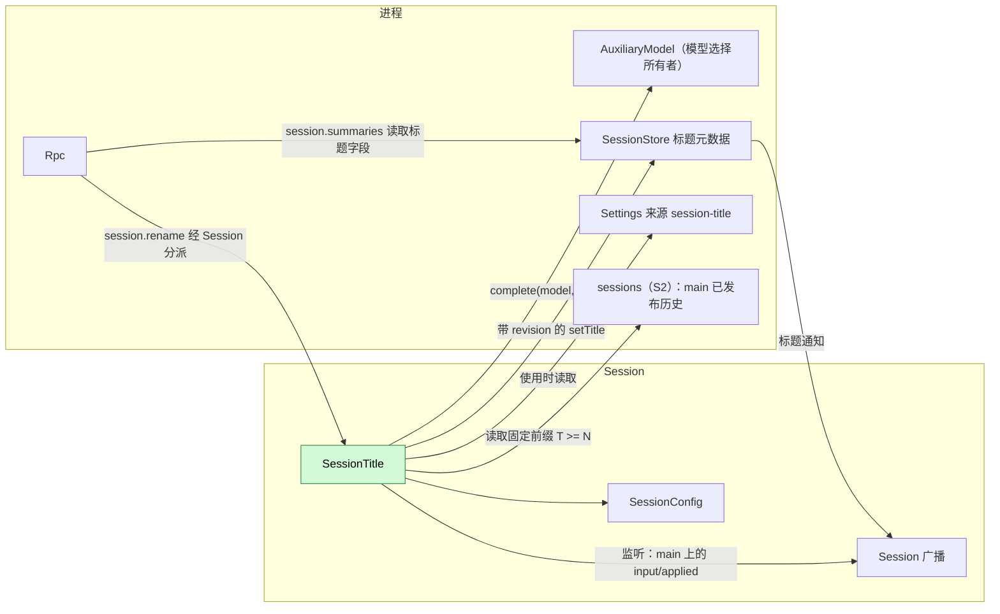
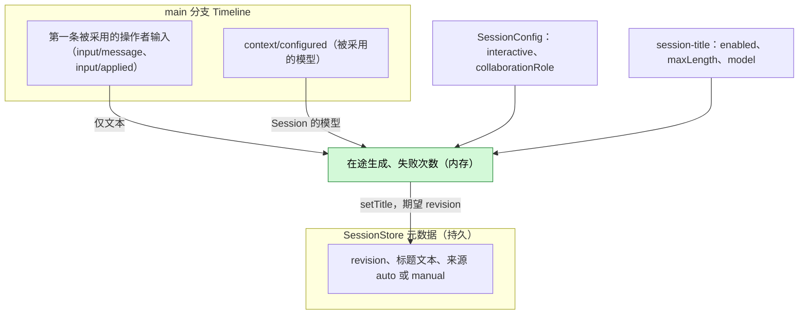
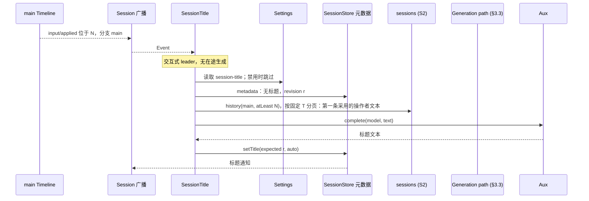
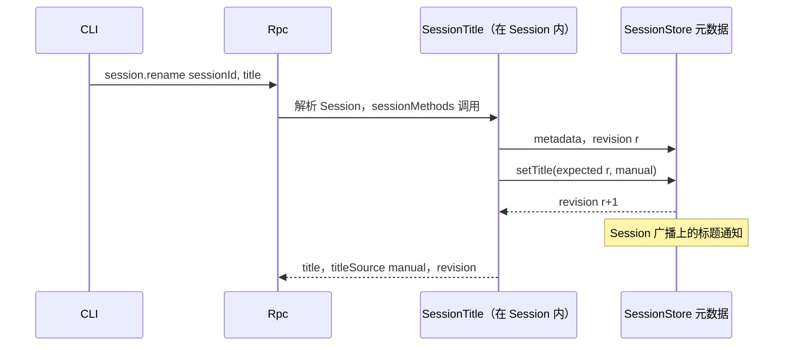
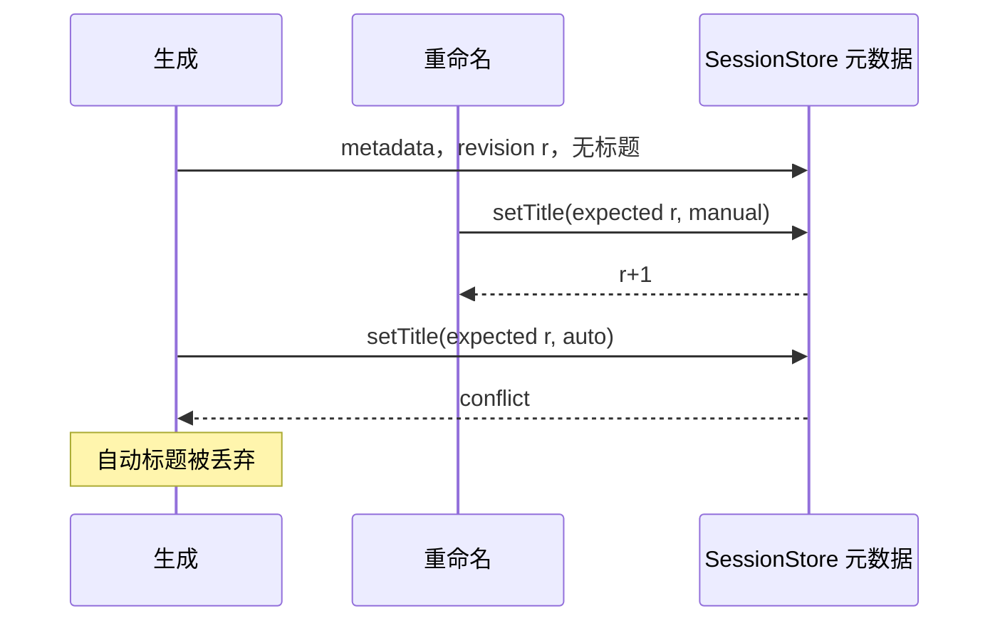

# SessionTitle

总体设计：[overview](../overview.md)（SessionTitle）。作用域：[ADR 002](../../adr/002-plugin-scope.md)（Session）。

SessionTitle 是一个 Session 插件，为交互式 leader Session 提供经 SessionStore 元数据保存的标题。它通过既有的 Session 广播观察自己的 Session；当 `main` 上的第一条操作者输入被采用时（`input/applied`），它仅凭该输入的文本，按 §3.3 的分流策略生成标题。标题是 SessionStore 的状态：SessionTitle 只通过 SessionStore 的类型化操作 `setTitle` 写入，SessionStore 在每次变更后发出一条 Session 广播通知，由客户端消费（已交付的 C6 通知记录见 [§9](#9-向机制所有者提出的需求)；SessionStore 标题元数据和 Rpc 转发是补充，见[总体设计附录 B.2](../overview.md#b2-app-server-进程插件)）。它把命名空间 `session.rename` 注册到本 Session 的 `sessionMethods`，以此提供 `session.rename`（[方法与工具贡献](../contracts/session-boundary.md)）。它不写任何 Timeline 事件，也没有模型可见的效果。契约以语言中立形式给出（[ADR 002 D5](../../adr/002-plugin-scope.md)）；Rust 绑定见附录 G。

## 0. 实施边界

基础 CLI 从独立的 `dim-session-title` Rust crate 安装 `session-title`。
`dimcode` 产品 profile 经 AgentBuilder 安装插件；App Server 仅提供通用 CLI profile 回调和既有所有者服务。
生成契约由独立插件 crate 公开，DimOAuth 从该 crate 引用契约。进程行通过既有部件注册表注册 Settings 来源和
Session 部分，每个 Session 挂载一份副本。其可用性不依赖 `--defaults`、打包的 TypeScript 包、
Node/Python 安装或语言运行时获取。辅助调用和标题元数据仍分别归该配置的模型选择所有者与存储所有者管理。

内置插件保留 `session-title` 标识、Settings 文档和元数据格式。由 PluginManager 的来源选择
负责原默认包向内置实现的过渡，保留显式禁用和已安装替代实现的选择。
只有选中的实现可以注册 Settings 来源与 `session.rename`。

公开行为测试归插件 crate，通过 `dim-client` 和 App Server 的公开 API 驱动，测试显式安装插件。
App Server 测试不依赖 SessionTitle，仅覆盖通用宿主行为。验证使用无需语言运行时的原生
[native_flow.rs](../../../../crates/dim-session-title/tests/native_flow.rs) 流程，
覆盖固定前缀历史、Settings 校验、RPC、HTTP 辅助调用、Unicode 上限、并发采纳、标题通知、
手工与自动标题冲突、恢复、fork 和关闭结算。依赖 Node 的
[scheduler_flow.rs](../../../../crates/dim-session-title/tests/scheduler_flow.rs)
覆盖调度报告的输入来源，确保报告不会提供标题文本。诊断仅记录结果与时长。

| 边界 | 当前合同与 Ready 决策 |
| --- | --- |
| 观察 | 从 `sessionIdentity` 读取 Session id，从 `sessionConfig` 读取创建配置，从 `sessionLifecycle` 读取 closing（[插件契约](../plugin-contract.md#9-向机制所有者提出的需求) R2），然后读取自身 Session 的 `session/{sessionId}` 通道记录。C4 广播 #180 已交付；#63/#168 已关闭。 |
| 历史 | 使用已实现的进程 sessions.history，不读取私有 TimelineTree，也不使用分支（C5）绑定。 |
| 配置 | 沿用具名 Settings 和原行来源声明，仅用户作用域（A.3/A12）。每次决定读取 settings.read({source:"session-title",scope:"user"})，直接使用已校验并补默认值的文档。 |
| 元数据/通知 | S5b #60/#96 定义进程服务 `sessionMetadata`（`read` 与 `setTitle`，都是异步）、它的错误 `conflict`/`not_found`/`storage`、交接点，以及 v3 列表字段 `title`/`titleSource`/`titleRevision`（[标题元数据](../appserver/session-title-metadata.md)）；A.2 复述该合同。每次提交后 SessionStore 调用 `session_broadcast::notify`，Rpc 把记录以 `session.notice {sessionId, source, kind, data}` 转发给已附加的 v3 客户端（C6 #49/#85，[Session 广播通知](../appserver/session-notices.md)）。名称、模式、交接和错误遵循 S5b。 |
| 辅助请求 | 该配置中模型选择的所有者已实现 AuxiliaryModelHost 及具名 `auxiliaryModel.complete` HostDispatch/catalog 绑定：产品配置里是 Provider，model-config 配置里是 ConfiguredModels。通过普通 C4 依赖注入；凭据仍归该所有者（[S4 §4.3](../appserver/auxiliary-model.md#43-具名绑定)）。 |
| 策略 | A1–A12 定义首版实现。附录 D 要求公开流程验收；文档 CI 不表示运行时验收。 |

C7 #50 已确认无需新增机制（#86）。S4 自行持有凭据/连接解析。所需提供者缺失沿用既有 Pending 规则，包括 rename 在内整个 Session 部分
不可用，原生 Session 继续工作；只有 sessionTitleGenerator 为可选读取（§3.3），rename 保持原有必需服务。

C4 叶子回调在自身 Session 的通道上筛选 main 采用记录，登记自持任务后返回，不等待 Settings、历史或
模型。原生 EventReader 只交付已发布事件，SessionBroadcast 转发该 Dispatcher 流。因此
分支仍存在时，既有 history({atLeast:N}) 可固定已发布 T >= N，不增加发布等待、轮询或
Core API。保留 T，后续用 through=T 和上一页最后 sequence 作为 after 分页，不同时发送
atLeast 与 through，直接使用原生 HistoryPage/AgentEvent。S2 稳定目录每次读取索引，
索引重载不会重载消费方。

沿用[插件绑定合同](../rutis-usage.md)：插件的唯一一行注入 `partRegistry`，
注册 Session 部分，每个 Session 挂载一份副本。该部分注入
`sessionMethods`，并在 `apply` 中把 `session.rename` 注册到它；它不提供服务。
插件仅依赖 Settings 与 SessionStore 的既有公开 Rust 绑定；历史回复在本插件的命名服务边界解析一次。插件行为与跨插件标题流程位于插件 crate 的 tests，使用公开客户端与宿主 API；App Server 测试不依赖该 crate，也不隐式安装标题插件。`apply` 读取 Session 标识和创建配置，
登记观察/清理，不启动异步初始化任务；创建配置不可变。同一部分注入必需依赖：进程服务
`sessions`、`settings`、`sessionMetadata` 和 `auxiliaryModel`，以及 Session 服务 `sessionIdentity`、
`sessionConfig`、`sessionLifecycle` 和 `sessionMethods`。可选的 `sessionTitleGenerator`
遵循[必需/可选绑定契约](../rutis-usage.md#3-按名字的服务)，在使用时按名字读取，不注入，也不影响 Ready。
产品装配独立于外语插件行安装原生插件。
必需服务的提供者缺失时，依照既有依赖规则仅影响 SessionTitle 的可用性，不影响 Session 的执行能力。

固定快照止于返回的 T，不承诺恰好止于 N。第一条被采用的操作者输入提供文本；model=null
时，从该快照最新 ContextConfiguredData.settings 读取 providerId/modelId。没有被采用的
模型时使用 §3.3 的文本兜底，不改用该配置当前默认模型。

setTitle 交接前取消则不写入。交接点就是 setTitle 调用本身：此后由 SessionStore 完成自己的
原子操作，回复丢失不授权重复或撤销（[S5b §6](../appserver/session-title-metadata.md#6-交接取消与了结)）。不增加回滚或协调机制。
生成不持有 Session activity hold（[空闲卸载 D10](../appserver/idle-unload.md#3-决定)）；
空闲卸载沿用相同的取消与存储交接规则。

## 1. 结构



| 部件 | 作用域 | 依赖 | 提供 |
| --- | --- | --- | --- |
| `session-title` | 进程 | Settings 和部件注册表 | 注册 Settings 来源及 Session 部分 |
| `SessionTitle` | Session | Session 服务 `sessionIdentity`、`sessionConfig`、`sessionLifecycle` 和 `sessionMethods`；进程 sessions 历史、Settings、标题元数据 `sessionMetadata`（S5b）和必需的 `auxiliaryModel`（提供者缺失使整行 Pending）；按需读取可选的 `sessionTitleGenerator` | 把 session.rename 注册到 sessionMethods |

依赖位于 Session 或外层进程。C4/S2/Settings 已提供观察、前缀读取和配置；S5b 提供标题元数据，C6 提供通知；该配置的模型选择所有者提供具名辅助模型操作。插件的行在其 apply 中登记来源。真实提供者重载会取消该行工作（ADR 002 D3），S2 索引重载不会。业务数据更新不重载插件（D4）。

## 2. 数据与状态



标题归 SessionStore 所有：它保存文本、来源和 revision 计数器，只接受通过类型化操作 `setTitle` 的修改，只有 SessionTitle 调用该操作。每次变更提交后，SessionStore 在 Session 广播上发出一条标题通知（A11）；标题从不进入 Timeline。每次决定先读 Settings，已禁用时不读元数据或历史；否则才读元数据和固定前缀。本次装载记住第一条输入只含图片的结果。内存状态在重载或 Session 卸载时丢失，其后果只是允许再尝试一次。

## 3. 流程

### 3.1 由第一条用户输入自动生成标题



生成在输入被采用时开始，而非 turn 结束后。只发送 `main` 上第一条被采用的操作者输入的文本；被删除的输入从未被采用，因此不会产生标题，其文本也不会发给辅助模型。
main turn 不等待标题完成，标题任务遵循自己的预算。

### 3.2 手动重命名



Rpc 与处理任何 Session 方法一样解析 Session，必要时加载它。遇到 `conflict` 时 SessionTitle 重新读取并重试，至多 3 次。

### 3.3 生成分流与可选服务

SessionTitle 拥有分流与降级策略。显式配置的标题模型直接走 `auxiliaryModel`；否则在使用时读取
进程级可选服务 `sessionTitleGenerator`，传入固定历史前缀中已采纳模型的 providerId 和首条输入文本。
服务缺失、失败或重载不阻塞 SessionTitle 装载和手动改名，不根据全局默认模型或已有登录凭据分流。

服务契约由 SessionTitle 定义：异步 `generate({providerId, text}, cancelled?)`。文本非空且至多
2000 个 Unicode 码点；结果区分 generated（非空 title）、unavailable（明确原因）、failed 和 cancelled。
字段、原因代码和取消协议与[英文契约](../../../design/plugins/SessionTitle.md#33-generation-routing-and-optional-service)一致。
外部参数在服务边界校验；取消回调返回的 promise 完成后，提供者取消 I/O，调用方等待原调用结算。

服务不可用或失败时使用已采纳模型；模型缺失、失败、规范化结果为空或总计 30 秒预算到期时，用首条
输入摘录折叠空白、去除首尾空白并按 Unicode 长度限制兜底，保留原文标点。标题仍以 auto 来源经原 revision 检查写入。
超时先取消并等待活动调用结算；Session 关闭或任务取消时不启动备用请求、不写标题。
只有 Settings、存储等导致无法完成写入的失败才消耗原有三次尝试预算，账号接口失败本身不消耗。

DimOAuth 自己判断 providerId 是否适用，并拥有专用接口、账号鉴权、刷新和上游错误分类；
其[运行时契约](../../../../crates/dim-oauth/docs/runtime-contract.md#session-title-generation)定义账号请求。
SessionTitle 不接触凭据或 issuer，DimOAuth 不写 Session 元数据、不决定降级。
模型选择所有者、AuxiliaryModel、模型执行、Timeline 和 Dispatcher 不增加标题分流策略，也没有额外接线插件。

## 4. 时序与冲突



revision 检查就是复检：手动标题总是胜出。

| 场景 | 顺序 | 结果 | 负责方 |
| --- | --- | --- | --- |
| 成员 Session（`collaborationRole`），或非交互 Session | `SessionConfig` | 从不生成；允许重命名 | SessionTitle |
| 生成完成前出现第二条输入 | — | 跳过（在途） | SessionTitle |
| 第一条输入已删除 | input < `input/deleted` | 从未被采用：不用它生成标题；下一条被采用的操作者输入触发（A9） | SessionTitle |
| 生成路径失败 | — | 输入文本兜底（§3.3）；存储失败且仍无标题时可以重试（A5） | SessionTitle |
| 生成中途重载或 Session 卸载 | — | 存储交接前取消，下一条采用的 main 输入可触发；已接纳的修改由 SessionStore 结算 | Lifecycle / SessionStore |

完整表格：[附录 B](#附录-b-完整冲突表)。

## 5. 上下文映射

没有模型可见的效果：SessionTitle 不写输入、工具、提示词来源或事件。辅助请求是一次独立的单次调用：

| 部分 | 内容 |
| --- | --- |
| System | `Write a short title for this conversation: at most 8 words, in the language of the user's message, no quotes, no trailing punctuation. Reply with the title only.`（A2） |
| User 消息 | `main` 上第一条被采用（有 `input/applied`）的操作者 `input/message` 的文本块，以换行连接，截断到 2000 个字符（A2） |

从不发送：图片、raw 输入块、被删除的输入、后续输入、助手输出、系统提示词、工具调用与结果、子分支事件。诊断只记录结果与耗时。

## 6. 接口（摘要）

| 接口 | 类型 | 用途 |
| --- | --- | --- |
| `session.rename {sessionId, title \| null}` | `sessionMethods` 命名空间 `session.rename` | 设置或清除手动标题 |
| `session-title` 来源：`enabled`、`maxLength`、`model` | 业务配置（Settings 来源） | 关闭生成；标题长度；显式标题模型或自动分流（§3.3） |
| v3 `session.summaries` 中的 `title`、`titleSource`、`titleRevision` | 从 SessionStore 读取的 Rpc 协议字段（[S5b §8](../appserver/session-title-metadata.md#8-session-列表)） | 展示；修订号用于给列表和通知排序 |
| 标题通知，`data: {title, titleSource, titleRevision}` | SessionStore 发出的 Session 广播通知（C6 记录，§9；[S5b §7](../appserver/session-title-metadata.md#7-标题通知)） | 已订阅的客户端实时更新标题 |

## 7. 安全

第一条输入的文本只发送给 §3.3 选定的路径：显式模型，或可选服务与已采纳模型。标题可能包含用户内容，并返回给每个能列出 Session 的客户端。请求中不包含凭据、宿主设置或工具输出。重命名输入由 SessionTitle 的方法校验（A.1）。

## 8. 规则检查

| 规则 | 本文如何遵守 |
| --- | --- |
| 原则 §4 第 1 条（改别人的状态写指令） | 标题是 SessionStore 没有 Timeline 的进程级状态；SessionTitle 只通过 SessionStore 的类型化 `setTitle` 修改，由 SessionStore 按 revision 检查决定（原则 §4 第 9 条）。 |
| 原则 §4 第 2 条（交接） | SessionTitle 只在输入交接（`input/applied`）之后读取它，从不处理输入本身。 |
| 原则 §4 第 3 条（只用 before 回调） | 不在写入前干预；重命名规则由 SessionTitle 自己的方法检查，不在入口检查。 |
| 原则 §4 第 4 条（核心不带业务含义） | §9 中已交付的 C6 Session 广播通知是通用记录，任何拥有 Session 进程级状态的所有者都可使用。 |
| 原则 §4 第 5 条（批次） | 触发在消费 `input/applied` 时按序处理它。 |
| 原则 §4 第 6 条（上下文只含交接后的事件） | SessionTitle 不向模型上下文添加内容；辅助请求只含被采用的输入文本。 |
| 原则 §4 第 7 条（仅公开事件与服务） | 使用 Session 广播、固定历史前缀、SessionStore、AuxiliaryModel、Settings 和可选 sessionTitleGenerator（§3.3），不读取其他插件内部状态。 |
| 原则 §4 第 8 条（向机制所有者提需求） | C6 和 S5b 已交付 §9 的通知与元数据合同。对 #4 无需求：SessionTitle 使用 Session 服务、Session 通道和具名进程服务，沿用既有所有者合同。对其他插件的需求（SessionStore 标题元数据和发出通知、Rpc 转发通知）列在[总体设计附录 B.2](../overview.md#b2-app-server-进程插件)。 |
| 原则 §4 第 9 条（只有后续决定要用的事实才进 Timeline） | 标题是 SessionStore 的进程级状态：不进 Timeline，通过 `setTitle` 修改，以 Session 广播通知送达 UI。 |
| 原则 §1（Capability 与 App Server 边界） | SessionTitle 是 Session 部分，不注入 Dispatcher 或 Timeline，因此不属于 Capability；Rpc 只分派 `session.rename`，并从 SessionStore 读取标题字段。 |
| ADR 002 D1（作用域跟随状态） | Session 作用域：标题属于 Session；存储的标题归 SessionStore。 |
| ADR 002 D2（不设接线模块） | 没有接线模块；必需服务注入，可选生成器依绑定契约在使用时读取。 |
| ADR 002 D3（依赖跟随作用域） | 依赖位于 Session 或外层进程作用域；它们重载会取消生成，这是可接受的。 |
| ADR 002 D4（结构配置与业务配置分离） | 包安装/启用属于结构配置；A.3 的用户级 `session-title` 来源拥有业务配置，使用时读取，不重载原行。 |
| ADR 002 D5（合同语言中立） | 契约语言中立；Rust 形式见附录 G。 |

## 9. 向机制所有者提出的需求

**R1. 进程级状态的 Session 广播通知——已交付。**

C6 #85 提供通知记录和 Rpc 转发；S5b #96 提供标题元数据和提交后的标题通知。
SessionTitle 使用这些已交付合同。

| 项目 | 内容 |
| --- | --- |
| 被哪条规则挡住 | 原则 §4 第 9 条和第 4 条：SessionStore 标题这样的进程级状态不能进 Timeline，但客户端需要实时看到标题变更；已交付的 C6 `Notice` 记录承载这些提交后的变更（[session_broadcast.rs](../../../../crates/dim-agent-capabilities/src/session_broadcast.rs)）。 |
| 考虑过的现有机制 | `session/titled` Timeline 事件（把进程状态放进 Timeline；总体设计 §7 已否决）；客户端轮询 `session.summaries`（不能实时更新）；标题专用频道（业务专用端口，违反第 8 条）。 |
| 需要的通用能力 | Session 广播频道上的通知记录 `{source, kind, data}`，由该 Session 进程级状态的所有者在变更提交后发出；不带业务含义。标题通知就是这条记录，`source: "SessionStore"`、`kind: "title"`、`data: {title, titleSource, titleRevision}`（[S5b §7](../appserver/session-title-metadata.md#7-标题通知)）。Rpc 把这条记录原样转发为 `session.notice`，并加上频道的 `sessionId`（[C6 D4](../appserver/session-notices.md#10-决定)），所以 `data` 不重复它。 |
| 对序号、批次、中断、重载的影响 | 没有序号，不属于批次；不重放：重新订阅的客户端通过所有者的查询（`session.summaries`）读取当前状态；不受中断影响；发出方重载只会让通知停止。 |
| 由谁实现，对应 issue | 运行时 C6 [#49](https://github.com/arcships/dim/issues/49)，在 [#85](https://github.com/arcships/dim/pull/85) 实现：记录、`session_broadcast::notify` 和 Rpc 的 `session.notice`（[Session 广播通知](../appserver/session-notices.md)）。SessionStore 发出标题通知（[S5b](../appserver/session-title-metadata.md)，即[总体设计附录 B.2](../overview.md#b2-app-server-进程插件) 中的补充）。 |

**#4：无。** 观察沿用 Session 服务和 Session 通道；历史、Settings、`sessionMetadata` 和辅助模型均为进程服务。SessionTitle 不注入分支服务。

**模型选择所有者（S4）：具名 `auxiliaryModel` 绑定。** Provider（产品）与 ConfiguredModels（model-config）将既有的 `AuxiliaryModelHost` 操作绑定为可供 C4 注入的服务（[S4 §4.3](../appserver/auxiliary-model.md#43-具名绑定)）。配置中没有这样的所有者时，普通的必需依赖让 SessionTitle 行保持 Pending。不需要 core 新机制。

**DimOAuth：**实现 §3.3 定义的可选生成服务；账号请求和结算由其运行时契约定义，不需要修改 Provider 或 Core 机制。

## 附录 A. 接口细节

### A.1 `session.rename`

注册到 `sessionMethods`（Session，命名空间 `session.rename`），带一个声明 `{name: "session.rename", mutating: true, interruption: "report", progress: false}`；其 `call(MethodCall, cancelled, progress): async -> MethodReply` 处理它。被丢弃的调用在 `setTitle` 之前被取消，或在其之后原子地完成。

| 参数 | 结果 | 错误 |
| --- | --- | --- |
| `{sessionId, title: string \| null}` | `{title: string \| null, titleSource: "auto" \| "manual" \| null, revision}` | `invalid_params`、`session_not_found`、`service_reloading`、`storage_failed`；分派错误见 [session-boundary](../contracts/session-boundary.md) |

`title` 去除首尾空白；1..=`maxLength`（来源 `session-title`）个字符，不含换行或控制字符（A3）。`null` 清除标题（A6）。

### A.2 依赖的形状（由所有者定义）

| 服务 | 方法 | 类型 | 请求 | 回复与错误 |
| --- | --- | --- | --- | --- |
| SessionStore `sessionMetadata`（S5b） | `read` | 异步 | `{sessionId}` | `{revision, title: {text, source: "auto" \| "manual"} \| null}`；错误 `not_found`、`storage`（[S5b §4](../appserver/session-title-metadata.md#4-操作)） |
| SessionStore `sessionMetadata`（S5b） | `setTitle` | 异步 | `{sessionId, expectedRevision, title: {text, source} \| null}` | `{revision}`；错误 `conflict`、`not_found`、`storage`。调用即交接；提交后 SessionStore 发出标题通知 |
| SessionStore（S5b） | 标题通知 | Session 广播通知（C6 记录，§9） | — | 在该 Session 的广播频道上发出 `{source: "SessionStore", kind: "title", data: {title, titleSource, titleRevision}}`；没有序号，不重放 |
| `AuxiliaryModel`（该配置的模型选择所有者） | `complete` | 异步 | `{model: {providerId, modelId}, request: {system, messages: [{role: "user", content: 文本}]}}`，可选 `cancelled: () => Promise<void>`（[S4 §4.3](../appserver/auxiliary-model.md#43-具名绑定)） | `{text, stopReason, usage}`；以既有错误码/message 拒绝。超时或 closing 时完成取消引用，并等待原调用结算 |

### A.3 配置

Settings 来源 `session-title`，一个文档：`enabled: bool` 默认 `true`；`maxLength: u32` 默认 80，范围 10..=200（A3）；`model: {providerId, modelId} | null` 默认 `null`，表示先尝试可选服务，再使用前缀中已采纳的模型（§3.3）。SessionTitle 声明的 schema 带有默认值和范围（`minimum`/`maximum`），因此 Settings 在写入和读取持久化文件时拒绝超出范围的值，SessionTitle 直接使用交付的文档，不再检查。每次决定时读取。SessionTitle 没有写配置的工具，因此文档只经客户端方法 `settings.read`/`settings.update` 写入（S8b 具名 Settings 已交付）。变更是带通知的数据更新，从不触发重载。启用插件属于结构性配置。显式 `model` 不可选时使用输入文本兜底，不咨询可选服务（§3.3）。

来源由原行声明：`source: "session-title"`、`userFile: "session-title.json"`，不声明
`projectFile`，`userOnly: []`。这只开放用户作用域，不合并项目文档。文件后端使用该用户文件名；
原生后端使用既有 Settings 记录 `user/session-title`，不新增第二份文件或存储
（[Settings §3–4](../appserver/settings-service.md#3-数据与状态)）。Schema 拒绝未知成员；`model`
可以为 null，否则必须是含非空 `providerId`、`modelId` 字符串且无其他成员的对象。文档缺失时
由 Settings 边界补齐上述默认值。此来源不保存凭据或模型连接配置。

摘录和标题的字符限制按 Unicode 码点计算。辅助请求不传 `maxOutputTokens`，使用 S4
既有的模型上限；30 s 预算仍由 SessionTitle 持有。

### A.4 机制

| 步骤 | 路径 |
| --- | --- |
| 监听 | 该部分在每个 Session 的副本于 `apply` 中监听自身 Session 的 `session/{sessionId}`，筛选 main input/applied，登记自持任务后返回；`sessionLifecycle.closing()` 或副本清理结束自持工作 |
| 资格 | C4 创建快照：`interactive !== false && collaborationRole === "leader"`；原生省略值表示 true |
| 触发 | 收到位于 `N` 的 `input/applied` 时：若不具资格、已禁用、有在途生成或失败次数 ≥ 3（A5）则跳过；否则启动一个归属插件生命周期的生成任务 |
| 检查 | `sessionMetadata.read({sessionId})`：已有任何标题则跳过；记下 revision `r` |
| 读取 | 既有 sessions.history 以 atLeast=N 固定已发布 T >= N，再按 through=T 分页（S2 A.5）。选取第一条有 user 内容且 input/applied 的操作者输入；没有该输入/文本则不生成（A8/A10） |
| 生成 | 按 §3.3 分流，在共享 30 秒预算内生成或兜底；取第一行、去除引号与末尾标点、折叠空白并按 maxLength 截断 |
| 写入 | `setTitle({sessionId, expectedRevision: r, title: {text, source: "auto"}})`；`conflict` 或 `not_found` 时丢弃 |
| Timeline | 不写入，不登记 Dispatcher，无 `StateCell` |
| 重载 / 卸载 | 存储交接前取消，已接纳修改由所有者结算；间隙事件不重放 |

## 附录 B. 完整冲突表

| 场景 | 序号顺序 | 结果 | 负责方 |
| --- | --- | --- | --- |
| 第一条输入的 turn 被中断或失败 | input < `stop/interrupt` | 生成继续 | SessionTitle |
| 不含 `user` 内容的输入（Goal 块、来源标记） | — | 从不触发，从不使用 | SessionTitle |
| 第一条输入在被应用前被撤回（`session.input.withdraw`） | input < withdraw < `input/deleted` | 从未被应用：不生成，文本从不发送；第一条被应用的操作者输入触发 | SessionTitle |
| 第一条用户输入只含图片 | — | 无自动标题（A8） | SessionTitle |
| 检查之前重命名 | rename < check | 已有标题：跳过 | SessionTitle |
| 生成期间重命名 | check (r) < rename (r+1) < write | `conflict`：自动标题被丢弃 | SessionStore revision |
| 并发重命名 | revision 顺序 | 最后提交的重命名胜出 | SessionStore |
| 重复的 `session.rename` | — | 重写相同文本 | SessionTitle |
| 第一条之后的 Steer/Queue/Append 输入 | — | 从不进入摘录 | SessionTitle |
| 工具批次、压缩 | — | 无关：只读取输入事实 | — |
| 子分支输入 | 分支过滤 | 从不触发 | SessionTitle |
| 成员、阶段、定时或 ACP Session | `SessionConfig` | 从不生成 | SessionTitle |
| 生成期间关闭 Session | — | 存储交接前取消；已接纳修改仍由 SessionStore 持有 | Lifecycle / SessionStore |
| Session fork | 不复制元数据（A7） | fork 无标题；`main` 上下一条被采用的操作者输入触发生成，取其前缀中第一条被采用的操作者输入 | SessionTitle |
| SessionTitle、模型选择所有者、SessionStore 或 Settings 重载 | — | 交接前取消生成，已接纳存储修改遵循 S5b 结算（D3） | Lifecycle / SessionStore |
| 模型或策略不可用 | — | 输入文本兜底（§3.3） | SessionTitle |
| 资源节点离线 | — | 无影响 | — |
| 客户端断开 | — | 无影响 | — |

## 附录 C. 错误与恢复

| 情况 | 结果 |
| --- | --- |
| 模型错误、超时、空输出、策略不可用 | 输入文本兜底（§3.3）；取消不降级 |
| Settings 读取失败 | 自动：不写入、诊断、计入失败；重命名：`storage_failed`。不使用回退文档 |
| 自动写入时 `setTitle` 返回 `conflict` | 丢弃（诊断） |
| `setTitle` 返回 `storage` | 自动：计入失败；重命名：`storage_failed` |
| 重命名时 Session 未知 | `session_not_found` |
| SessionTitle 正在重载 | 交接前：service_reloading，无重命名；交接后/回复丢失：读取元数据，不推断未提交，不重复写入 |
| 取消 | 交接前中止辅助请求并丢弃；存储接纳后由 S5b 持有原子结果 |

## 附录 D. 验收

经无需语言运行时的默认原生产品装配、`session.create`/`session.submit`、`session.rename`、`session.summaries`、
`settings.read/update` 与伪造辅助模型的流程测试：

1. 用既有模型夹具保持 main turn 未结束。交互式 leader Session 的第一条 `session.submit` 在采用后启动生成，并在该受控 turn 仍运行时产生 `auto` 标题；请求只含系统文本和该输入文本，一条通知到达订阅客户端。标题完成早于 turn 结束不是生产时序保证。
2. 中断第一个 turn 或使其失败不妨碍标题生成。
3. 成员 Session 与 `interactive: false` 的 Session 不获得标题；对它们的重命名可用。
4. 生成期间重命名（伪造模型被挂起）：保留手动标题，丢弃自动标题。
5. 已有标题的 Session 从不重新生成；清除后在下一条被采用的输入时允许重新生成，仍取第一条被采用的输入的文本。
6. 对未加载 Session 的重命名经 Rpc 加载它并成功。
7. 子分支输入与不含 `user` 内容的输入从不触发；只含图片的第一条输入不产生标题，后续输入不再扫描历史。
8. 存储交接前重载取消生成且不写入，下一条被采用的输入可触发；接纳后重载由 SessionStore 结算，回复丢失后重读元数据，不重复写入。Settings 或元数据写入累计三次失败后停止尝试；生成失败使用文本兜底（§3.3）。
9. 无效的重命名方法/类型、空文本和控制字符即使在 Settings 不可读时也返回 `invalid_params`；长度检查使用已校验的 Settings 文档。
10. 在被应用前撤回（`session.input.withdraw`）的第一条输入不产生标题，也不发给辅助模型；下一条被采用的输入用它自己的文本产生标题。
11. Settings 文档缺失时得到声明的默认值；无效持久化配置失败且不重写原文。更新使用既有 Settings CAS，拒绝无效范围/形状，下一次标题/重命名决定即采用，无须重载原行。拒绝项目作用域。禁用期间重复输入均不读取元数据或历史。在标题流程中覆盖摘录/标题限制处的非 BMP 文本、第一行尾部空格前的标点，以及截断边界处的空白。

12. 可选服务缺失或卸载后仍能生成和改名；服务成功不重复调用模型，显式模型跳过服务；不可用或失败转普通模型，模型失败或超时转文本；关闭等待原调用取消结算，不降级、不写标题。

## 附录 E. 假设

A1–A12 是首版实现采用的策略。

| # | 假设 | 依据 | 若被否决的影响 |
| --- | --- | --- | --- |
| A1 | 显式标题模型优先；否则先可选服务，再已采纳模型（§3.3） | 维护者决定 | 不同分流策略 |
| A2 | 指令文本、8 个词的目标、2000 个字符的摘录 | 判断 | 不同的提示词或摘录 |
| A3 | 标题长度默认 80（10..=200），单行 | 判断 | 其他限制 |
| A4 | 30 s 生成预算 | 判断 | 其他超时 |
| A5 | 每个 Session 每代插件至多 3 次失败尝试 | 判断 | 更多重试或不重试 |
| A6 | 以 `null` 调用 `session.rename` 清除标题 | 判断 | 手动标题永久保留 |
| A7 | Session fork 不复制标题 | 判断 | fork 显示源标题 |
| A8 | 不含文本的第一条用户输入不产生自动标题 | 决定：标题取自第一条用户输入 | 使用后续输入或占位符 |
| A9 | 生成等待输入被采用（`input/applied`）；被删除的输入从不产生标题 | 维护者决定 | 被删除的文本可能发给辅助模型 |
| A10 | “用户输入”指操作者输入：在交互式 leader Session 中，即带 `user` 内容的输入，因为 Collaboration、Goal 和 ShellInput 只写 raw 块（Scheduler 与 Workflow 的输入带 `user` 内容，但运行在非交互 Session 中，SessionTitle 不为其命名） | 判断 | 来源写入的输入可能为 Session 命名 |
| A11 | SessionStore 用 Session 广播通知宣布标题变更；未订阅的客户端在下一次 `session.summaries` 时看到变更 | 原则 §4 第 9 条 | 客户端轮询 `session.summaries` |
| A12 | 仅用户作用域文件 session-title.json，不合并项目来源；原生 Settings 记录 user/session-title | 既有 S8b 原行来源机制，A.3 | 不同来源/作用域须明确确认 |

## 附录 F. 待对齐问题

无。Session 列表字段遵循 S5b；观察、历史、Settings、元数据与具名辅助模型绑定沿用
§0 的所有者合同。可选服务合同由本插件定义（§3.3），不需要修改 Core。

## 附录 G. Rust 绑定

| 语言中立 | Rust |
| --- | --- |
| 注册到 `sessionMethods` 的命名空间 `session.rename` | Session 部分在 `Key<SessionMethods>` 依赖上调用 `methods.register(ctx, "session.rename", Vec<MethodDecl>, handler)` |
| 已发布历史 | 稳定目录绑定上的 既有具名 `sessions.history` HostDispatch（在插件边界解析外部回复） |
| 标题元数据 | `SessionStore::metadata` 与 `SessionStore::set_title` |
| 辅助调用 | 既有 `AuxiliaryModelHost.0.complete` 与取消 token |
| Session 广播监听器 | `session_channel(session_id)` 上针对 `Event` 记录的监听器，由 `ctx.effect` 移除 |
| 生成任务 | 在 `ctx.effect` 下派生 |

```rust
// SessionStore metadata (S5b; named service `sessionMetadata`)
async fn metadata(&self, session_id: &str) -> Result<SessionMetadata, MetadataError>;
fn set_title(&self, session_id: &str, expected_revision: u64, title: Option<Title>)
    -> impl Future<Output = Result<u64, MetadataError>>; // Conflict | NotFound | Storage; the call is the handover
pub struct SessionMetadata { pub revision: u64, pub title: Option<Title> }
pub struct Title { pub text: String, pub source: TitleSource }   // Auto | Manual
// AuxiliaryModel（该配置的模型选择所有者）
async fn complete(&self, model: ModelId, request: AuxiliaryRequest,
    cancel: CancellationToken) -> Result<AuxiliaryReply, AuxiliaryError>;
```
