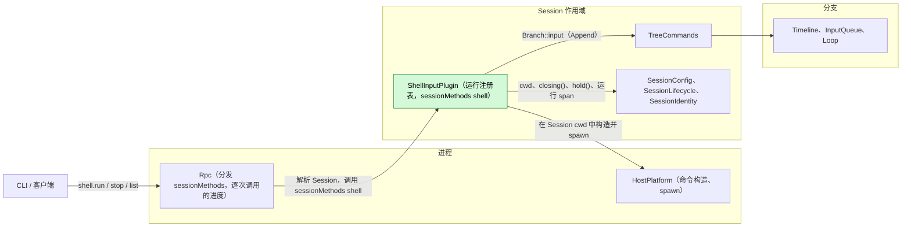
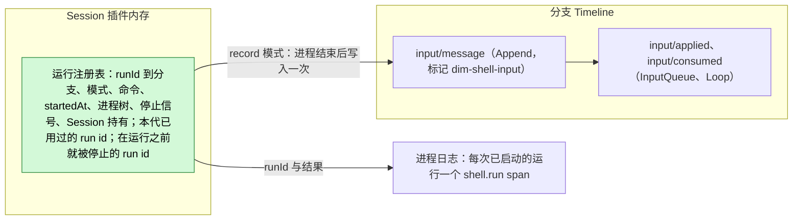
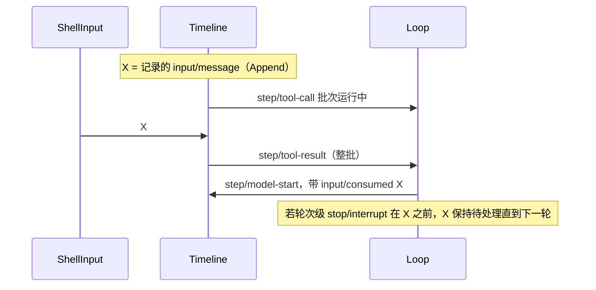

# ShellInput

状态：Implemented（[能力页](../../../architecture/rust-agent/plugins/ShellInput.md)）。总体设计：[overview §4](../overview.md#4-插件目录)。阶段：P1。语言：Rust。作用域：Session（[ADR 002](../../adr/002-plugin-scope.md)）。基于 C1（[#47](https://github.com/arcships/dim/issues/47)，含逐次调用的进度，[#125](https://github.com/arcships/dim/pull/125)）和 S7（[#52](https://github.com/arcships/dim/issues/52)）（[roadmap §3.3](../../../design/roadmap.md#33-插件开工顺序)）。

在 Session 的工作目录中执行用户输入的 `!command` 和 `!!command`。`!command` 的结果（命令及有界输出）作为 Append 输入写入，因此随下一次模型请求进入上下文；`!!command` 的输出只发给调用方客户端。ShellInput 是一个没有事件的 Session 插件。它通过 `sessionMethods` 服务（Session 作用域，key `shell`；[session-boundary](../contracts/session-boundary.md)）以普通 Session 方法提供 `shell.run`、`shell.stop` 和 `shell.list`；契约以语言中立形式给出，Rust 形式见[附录 G](#附录-g-rust-绑定)。每个 Session 最多同时运行一个命令。命令自行结束、收到 `shell.stop`，或在 Session 部分结束时（Session 关闭、ShellInput 或 Session 重载、App Server 关闭）结束。命令运行期间持有 Session，因此宿主的空闲卸载会等它结束（§3.2）。

## 1. 结构



| 部分 | 作用域 | 依赖 | 提供 |
| --- | --- | --- | --- |
| `ShellInputPlugin` | Session | `P:HostPlatform`（与 WorkspaceTools 的用法相同）、`S:SessionConfig`（`cwd`）、`S:TreeCommands`、`S:SessionLifecycle`、`S:SessionIdentity` | `sessionMethods` key `shell` |

依赖的契约：

- `sessionMethods` 的分发、错误与调用归属（C1，[session-boundary A.1](../contracts/session-boundary.md#a1-方法贡献)）。已合入的契约修改 [#120](https://github.com/arcships/dim/pull/120) 确定了共享方法类型的位置（dim-agent-capabilities 的 `methods` 模块），并规定 Rpc 对不在任何装配时记录的 Session 命名空间内的名称，在读取 params 或 `sessionId` 之前就回复 `unknown_method`。ShellInput 不依赖其中任何一项：它的绑定从 A.1 放置共享类型的位置取用它们，也不依赖 Rpc 报告分发错误的顺序。
- 逐次调用的进度（[session-boundary A.2](../contracts/session-boundary.md#a2-调用通道)）：C1 已在 [#83](https://github.com/arcships/dim/pull/83)（未合入）中实现为处理函数的 `Progress` 参数，并按该 PR 评审的要求改为尽力送达（[A.5](#a5-对其他插件的改动)）。
- 带边界校验的 `Branch::input`，以及 InputQueue 的 Append 模式：Append 输入立即应用，随下一次模型请求被消费，从不开启轮次。
- HostPlatform：`spawn(ProcessSpec)` 返回带 stdout、stderr、wait 和 terminate 的进程树（已实现）；命令构造器与 `exec` 的输出规则（S7，[A.5](#a5-对其他插件的改动)）。
- `SessionLifecycle::closing()`、插件代的取消及其 `ctx.effect` 卸载清理函数（[生命周期](../../../architecture/rust-agent/lifecycle.md)）。
- `SessionLifecycle::hold()`，运行时活动持有（[空闲 Session 卸载 §5.1](../appserver/idle-unload.md#51-活动持有)，R1）：只要有持有，`Session::unload_if_idle()` 就拒绝；Session 正在关闭或已决定空闲释放时，`hold()` 为 `None`。
- 标记使用的上下文块元素格式（[session-access A.2](../contracts/session-access.md#a2-来源输入约定)）。

本文定义的契约：`shell.*` 方法和来源标记 `dim-shell-input`（kind `command`）。

## 2. 数据与状态



运行注册表是插件代的内存，从不重建：Session 部分结束时，正在运行的命令被终止。它还记录本代已用过的 run id，因此重复的 `runId` 会被拒绝（`duplicate_run`），发出一次的命令绝不会运行两次；并记录 `shell.stop` 先于其运行到达的 run id，这样那次运行什么都不启动（A.4）。唯一持久的结果是记录运行的 `input/message`，随 Session 一起恢复。

事件：无。运行由用户而非轮次启动，因此轮次或分支中断不会结束它。`!command` 唯一与后续相关的结果是该输入；`!!command` 不影响任何后续内容。进程日志中每次已启动的运行一个 `shell.run` span，带 Session 与分支 id、`runId` 和结果（状态与退出），从不包含命令文本或输出（A11）。

## 3. 流程

### 3.1 `!command` 与 `!!command`

```text
CLI             Rpc                    ShellInput (Session)          HostPlatform       Branch
 |               |                            |                             |               |
 |-- shell.run ->|                            |                             |               |
 |               | authorize sessionId,       |                             |               |
 |               | acquire the Session (C1)   |                             |               |
 |               |-- sessionMethods shell --->|                             |               |
 |               |                            | check params, busy, runId,  |               |
 |               |                            | branch                      |               |
 |               |                            |-- build command (S7) ------>|               |
 |               |                            |-- spawn in Session cwd ---->|               |
 |               |                            |<-- stdout + stderr ---------|               |
 |<- progress ---|<- progress {text, skipped?}|                             |               |
 |               |                            |<-- exit --------------------|               |
 |               |                            |-- record mode only: input (Append) -------->|
 |               |                            |<-- committed sequence ----------------------|
 |<- reply ------|<-- {status, output, recorded?}                                           |
```

写入只发生一次，在进程结束且输出读完之后。分支上：

```text
input/message X (append) -> input/applied X {append} -> step/model-start ... input/consumed X
```

InputQueue 立即应用 X；Loop 在运行中轮次的下一次模型请求时消费它，分支空闲时则随下一轮的第一次请求消费。X 不开启轮次。`!!command`（模式 `private`）流程相同，只是不写入。

### 3.2 运行生命周期

```text
                     shell.run admitted (runId registered)
                                       |
                                       v
                                  +---------+
                                  | running |
                                  +---------+
                                       |
     +-----------------+---------------+----------------+---------------------+
     | exits on its    | shell.stop                     | read or wait        | Session closing,
     | own             |                                | error               | generation unload
     v                 v                                v                     v
 completed          stopped                          failed              interrupted
 (exit code         (tree terminated)                (tree terminated)   (tree terminated)
  or signal)
     |                 |                                |                     |
     +-----------------+--------------------------------+                     |
                       |                                                      |
                       v                                                      v
     record mode: one Append input (partial output             nothing written; the call
     for stopped and failed, A5); the reply carries            replies operation_interrupted
     the sequence or the write error
```

- 一次运行准入两次：构造命令之前一次，`spawn` 时再一次（A.4 准入）。在第二次准入之前什么都还没启动：在它之前被中断的调用什么都不启动，`runId` 保持未使用；先到达该 `runId` 的 `shell.stop` 让这次运行什么都不启动，回复 `stopped`。
- 轮次的 `stop/interrupt` 不会到达运行：CLI 的第一次 `Ctrl+C` 发送 `shell.stop`，第二次才落到轮次停止。
- 客户端分离或断开不会停止运行。它的进度被丢弃、回复被舍弃；记录模式的运行仍会写入（A10）。
- 若接纳该调用的 Rpc 装载被卸载（结构性重载），调用的取消令牌触发：调用按契约对 `report` 调用的要求回复 `operation_interrupted`，处理函数立即返回、不再等待命令，因此重载不会被命令拖住。运行像断开后一样在 ShellInput 这一代中继续（A10；A.4 两种取消）。
- 一次运行从第二次准入起持有 Session，直到它的任务在最后一个事实之后离开登记表：记录输入的追加已返回（`record`）、进程已退出（`private`），或进程树已被终止（A.4 持有）。在此期间 `Session::unload_if_idle()` 拒绝，因此宿主的空闲卸载（[空闲 Session 卸载 §5](../appserver/idle-unload.md#5-脱离工作)）不会结束运行，调用方已经离开的运行也一样；运行结束、其输入被分发之后，Session 才能卸载。Session 关闭、重载和 App Server 关闭不理会持有，按下文结束运行。
- 在 `SessionLifecycle::closing()` 或 ShellInput 代卸载时，运行任务终止进程树且不写任何内容，`ctx.effect` 卸载清理函数等待该任务。因此结构性操作之后的重载会结束运行，这是可接受的代价（ADR 002 D3）。App Server 关闭时以同样方式关闭每个 Session。崩溃不在设计范围内（D3）：不写任何内容，不重新运行，残留进程与 HostPlatform 对 `exec` 留下的情况相同。

## 4. 时序与冲突

### 4.1 结果与轮次



位置由输入的拥有方按序号决定；ShellInput 没有复核，因为它的写入不依赖任何 Timeline 事实。

| 场景 | 结果 |
| --- | --- |
| 一个运行进行中时同一 Session 的第二个 `!` | `shell_busy` |
| 运行被准入之前到达的 `shell.stop` | 运行什么都不启动，回复 `stopped`；不写任何内容 |
| 构造命令期间 Rpc 重载 | 什么都不启动；`runId` 保持未使用；`operation_interrupted` |
| 运行期间分支关闭 | 写入失败；返回输出并带 `recorded.error` |
| InputQueue 持有 X 时对其 `input/withdraw`（S1） | `input/deleted`；从未被应用或消费；不重新写入 |
| 运行期间 Session 关闭或重载 | 进程树终止；不写任何内容；调用方得到 `operation_interrupted`（A8） |
| 运行期间宿主的空闲卸载 | 运行持有 Session 期间被拒绝；运行继续，照常被记录 |
| exec shell 配置改变 | 正在运行的命令保留其 shell；下一次运行使用构造器读到的值 |

完整表格：附录 B。

## 5. 上下文映射

| 模式 | 模型看到的内容 | 形式与位置 |
| --- | --- | --- |
| `!command` | `<dim-shell-input kind="command" status="completed" exit="0" truncated="false">`，然后是 `$ <command>` 与有界输出，最后是 `</dim-shell-input>` | 一个无 key 的 raw 块（用户角色消息），位于输入的消费位置 |
| `!!command` | 无 | — |

没有工具声明、提示词来源或 key：每次运行都是一次性观察。压缩之后结果只通过摘要保留。子分支只在它于切点之前被消费时继承它。模型从不看到 `runId`、耗时或进程日志。

## 6. 接口（摘要）

| 接口 | 类型 | 用途 |
| --- | --- | --- |
| `shell.run` | `sessionMethods`（Session，key `shell`），带进度 | 运行命令（`record` 或 `private`），流式输出，返回结果 |
| `shell.stop` | 同上 | 按 `runId` 停止运行；幂等 |
| `shell.list` | 同上 | Session 中正在运行的运行 |
| 标记 `dim-shell-input` kind `command` | 输入约定 | 模型可见的记录结果 |
| CLI `!` / `!!` | 客户端 | 把前缀映射到 `shell.run` 模式 |

## 7. 安全

`!` 和 `!!` 以服务用户身份执行任意命令，无需 Approval：Approval 与 Permission 只管 agent 决策的动作，而这些命令是用户的（[ADR 003](../../adr/003-approval-scope.md) D1）。`!` 也不拒绝后台 `&`，而 `exec` 在 POSIX shell 中拒绝它：那是 agent 工具的策略，用来把 agent 的后台工作引向 BackgroundExec，而 `!` 命令由用户输入（D1）。它留在后台的进程以服务用户身份运行，在运行、Session 和 App Server 结束后继续存在，Dim 中没有任何部件跟踪它们（A.2）。`shell.*` 是普通 Session 方法：任何被提供 Session 方法的连接，都可以对它能寻址的任何 Session 调用它们。目前这只是本地受保护连接；有了 RemoteGateway（P3）后还包括已配对设备（决定 E3，[overview §6.2](../overview.md#62-约束) 第 10 条），因此配对设备就是授予在宿主上执行命令的能力。Session 方法没有级别；只有管理方法不提供给已配对设备（[session-boundary](../contracts/session-boundary.md)）。HostPlatform 的进程隔离在实现后适用（Q4）；Permission 预设从不放宽它。对于 `!`，命令文本和输出会写入 Timeline 并重放给模型；用户应避免打印机密。环境与 `exec` 一样是服务的环境，从不使用客户端的环境。进程日志不包含命令文本或输出（A11）。

## 8. 规则检查

规则：[principles §1 与 §4](../../../architecture/rust-agent/principles.md)，[ADR 002](../../adr/002-plugin-scope.md) D1–D5。

| 规则 | 本文如何符合 |
| --- | --- |
| §4.1 改别的模块拥有的状态时写指令事件 | ShellInput 不改其他模块的状态；它在 Timeline 上的唯一效果是一条由 InputQueue 与 Loop 处理的普通 Append 输入。 |
| §4.2 交接后不能撤回 | 记录的输入只写一次，从不重写；撤回它是 InputQueue 的指令（S1）。 |
| §4.3 只用 before 回调在写入前干预 | 不适用：ShellInput 不注册 before 回调。入口处 Rpc 只校验参数形状和 `sessionId` 授权；ShellInput 校验自己的参数并自行做功能检查（忙碌、run id、分支、shell）。 |
| §4.4 核心机制不带业务含义 | Rpc、InputQueue 与 Loop 不为 ShellInput 增加处理：Rpc 按命名空间找到它，标记是普通 raw 块。 |
| §4.5 决定前读完整个批次 | 不适用：ShellInput 不读任何 Timeline 事件，它唯一的事件（`input/message`）不需要同批次的其他事实。 |
| §4.6 模型上下文只含交接后被读取的事件 | 输出只在 InputQueue 应用、Loop 消费该输入后进入模型；`!!` 的输出和进度从不进入。 |
| §4.7 插件之间只通过公开事件和服务交互 | ShellInput 经 `S:TreeCommands` 使用 `Branch::input`，并使用 `SessionConfig`、`SessionLifecycle`、`SessionIdentity`、HostPlatform 与 `sessionMethods` 契约。 |
| §4.8 基础设施默认不变 | 基础设施不变，不向运行时或 rutis 提需求（§9）。需要 Rpc（逐次调用的进度，在 C1 中）和 HostPlatform（命令构造器，S7）做的改动列在 A.5；Agents 活动句柄由空闲卸载提出的运行时活动持有取代（A.5）。 |
| §4.9 只有后续决定要用的事实进入 Timeline | 只有 `!` 的记录结果进入，作为模型会读取的输入。进度是一次调用的回复数据，不是 Session 状态，因此既不进 Timeline，也不走 Session 广播通知；运行记录进入进程日志。 |
| §1 Capability 与 App Server 边界 | ShellInput 是 dim-agent-capabilities 中自成模块的 Session Capability；Rpc 只分派 `sessionMethods`。 |
| ADR 002 D1 作用域跟随状态所有者 | 运行是 Session 工作目录中的 Session 工作，因此插件是 Session 作用域。 |
| ADR 002 D2 不设接线模块 | Rpc 经 Session 的 `sessionMethods` 按命名空间找到 `shell.*`；没有模块指名 ShellInput。 |
| ADR 002 D3 依赖跟随作用域 | ShellInput 依赖 Session 服务和进程级 HostPlatform；没有核心部件依赖它。没有装配 ShellInput 的进程对 `shell.*` 回复 `unknown_method`；装配了它的进程在某个 Session 的 ShellInput 部件未激活时回复 `service_reloading`。重载会结束正在运行的命令，可接受。 |
| ADR 002 D4 结构性配置与业务配置分离 | ShellInput 没有配置；exec shell 是 HostPlatform 的业务配置（S7）。 |
| ADR 002 D5 合同语言中立 | 方法、进度数据与记录的输入以中立形式给出；附录 G 是 Rust 绑定。 |

## 9. 向机制所有者提出的需求

不向运行时或 rutis 提需求。ShellInput 需要 Rpc 和 HostPlatform 做的改动见 [A.5](#a5-对其他插件的改动) 与 [overview 附录 B](../overview.md#附录-b-现有插件的补充)。

## 附录 A. 接口细节

### A.1 方法

服务 `sessionMethods`，Session 作用域，key `shell`。`describe()` 为每个方法返回一个 `MethodDecl`，均为 `interruption: report`、`notifications: []`、`reply: direct`；`shell.run` 为 `mutating: true`、`progress: true`；`shell.stop` 为 `mutating: true`；`shell.list` 为 `mutating: false`。错误为 `MethodError` 数据（附录 C）。

| 方法 | 参数 | 结果 |
| --- | --- | --- |
| `shell.run` | `{sessionId, branchId?: "main", runId, command, mode: "record" \| "private"}` | 进程结束后：`{runId, status: "completed" \| "stopped" \| "failed", exitCode?, signal?, reason?, output, truncated, durationMs, recorded?}`。`recorded`（模式 `record`）：写入时为 `{sequence}`，写入被拒绝时为 `{error: {appError, message}}`（只有门面失败本身没有应用错误码时才省略 `appError`）；因为 stop 先到、什么都没运行时不出现。进度项：`{text, skipped?}` |
| `shell.stop` | `{sessionId, runId}` | 运行结束后为 `{stopped: true}`；没有该 `runId` 的运行中运行时为 `{stopped: false}`。对本代尚未使用的 `runId` 的 stop 会被记住：之后带该 `runId` 的 `shell.run` 什么都不启动，回复 `stopped`（A.4） |
| `shell.list` | `{sessionId}` | `{runs: [{runId, branchId, mode, command, startedAt}]}` |

| 字段 | 规则 |
| --- | --- |
| `runId` | 由客户端生成，因此 `shell.stop` 可以在 `run` 回复之前、甚至在运行被准入之前发送；`[A-Za-z0-9-]{1,64}`（UUID 符合），`shell.run` 和 `shell.stop` 都按此校验。本代已用过的 `runId` 返回 `duplicate_run`。客户端从不自行重试 `shell.run`，因为命令不是幂等的（A9） |
| `command` | 非空，最多 64 KiB |
| `sessionId`、`branchId` | Rpc 读取 `sessionId` 以授权并解析 Session。`branchId` 指定接收记录输入的分支，在启动时检查 |
| `exitCode`、`signal`、`reason` | 进程以退出码退出时为 `exitCode`，被信号结束时为 `signal`（信号名），`failed` 时带 `reason` |
| 进度 | 尽力送达的实时视图（A7），只发给调用方连接，每 100 ms 至多一项。`text` 是自上一项以来解码（A.2）的输出，按 `exec` 的方式去除控制字符，只保留最后 64 KiB（UTF-8 字节，在字符边界处截断）；`skipped` 是 `text` 之前被略去的字节数，没有略去时省略。Rpc 在背压时可以丢弃进度项而不关闭连接，回复仍会送达（C1，[#83](https://github.com/arcships/dim/pull/83)）；`skipped` 只统计 ShellInput 自己略去的部分。客户端不能依赖收到每一项；结果是回复，它和记录的输入一样有自己的上限（A.2） |
| 被丢弃的调用 | 客户端离开不会停止运行（A10） |

无论命令输出多快，64 KiB 的上限都让每一项远低于 Rpc 单帧 16 MiB 的上限：

```text
output decoded in one 100 ms window (a fast command: 9 MiB)
|<------------------------------- 9 MiB --------------------------------->|
|<------------------ left out ------------------------------>|<- 64 KiB ->|
                                                                  text
item: {text: the last 64 KiB, skipped: 9371648}
reply and recorded input: the last 2000 lines within 50 KiB, from all output
```

### A.2 执行

| 项 | 规则 |
| --- | --- |
| 宿主 | `P:HostPlatform`，即 WorkspaceTools 所用的那一个 |
| 命令 | S7 构造器为 Session `cwd` 中的 `command` 返回的 `ProcessSpec`：shell、参数、强制环境变量和运行时 `PATH` 前缀与 `exec` 的构造完全相同（A2） |
| 进程 | 每次运行一个新进程（A3）；stdin 为 null，交互式程序看到 EOF |
| 环境 | 服务的环境，加上 `exec` 的强制变量；从不使用客户端的环境 |
| 超时 | 无；运行自行结束、收到 `shell.stop`，或随 Session 部分结束 |
| 输出 | stdout 和 stderr 按到达顺序合并。根进程退出后，在 `exec` 的宽限期内读取已就绪的输出，然后停止读取并关闭管道，因此保持管道打开的后代进程不会拖住运行 |
| 解码 | 每个管道有自己的增量解码器，即 `exec` 的解码器（H3）：一次读取末尾被截断的字符字节留到下一次读取再解码，只有管道结束时仍不完整的字节才变成 `<0xNN>`。进度、回复和输入都由解码后的文本构成，因此进度项的边界不会拆开字符 |
| 后代进程 | 与 `exec` 相同，只是不拒绝 `&`（§7）：根进程自行退出时运行结束，它留在后台的进程继续运行，不再归 ShellInput 管；根进程仍在运行时，终止（stop、Session 部分结束）会结束整棵进程树。见下文 |
| 上限 | 回复和模型可见输出遵循 `exec` 的规则：无效字节解码为 `<0xNN>`，去除控制字符，50 KiB 以内的最后 2000 行；上限截掉内容时 `truncated` 为真（A6） |

**后台进程（`!cmd &`）。** 命令留下的进程会怎样：

```text
!cmd &        the shell starts cmd in the background and exits at once

shell   o--x  run completes: output read up to the exit and during the grace is
              replied and recorded; the tree is released
cmd     o---------------------------------------------------------> keeps running
           ^  pipes closed: a later write to stdout or stderr fails
              (POSIX: the default SIGPIPE ends cmd)
              not in shell.list; shell.stop, Session close or reload,
              unload and App Server shutdown do not reach cmd

!cmd & other  the shell is still running

shell   o-------------x  shell.stop or the end of the Session part terminates the tree
cmd     o-------------x  same process group (POSIX) or job (Windows): ended
setsid  o--------------------------------------> own session (POSIX): not reached
```

- shell 退出时运行结束。回复和记录的输入只包含退出前及宽限期内读到的输出；之后的输出不会被捕获。
- 根进程自行退出并被回收时，HostPlatform 保留它的后代进程，与 `exec` 相同（`ProcessTree`）。之后 ShellInput 不再持有任何东西：这些进程不会让 Session 处于忙碌状态，`shell.list` 不显示它们，`shell.stop` 够不到它们，Session 关闭、ShellInput 或 Session 重载、卸载以及 App Server 关闭都不会结束它们。用户用另一条命令停止它们，例如 `!kill <pid>`。
- 它们的 stdout 和 stderr 是这次运行的管道，停止读取后即被关闭。之后的写入会失败；在 POSIX 上，默认的 `SIGPIPE` 会结束该进程。长期运行的命令需要重定向输出：`!npm run dev > dev.log 2>&1 &`。
- shell 仍在运行时，`shell.stop` 和 Session 部分结束会终止整棵进程树，后台子进程也在内：POSIX 上向进程组先发 `SIGTERM` 再发 `SIGKILL`；Windows 上终止 job。`nohup` 只忽略 `SIGHUP`，仍在进程组内。在 POSIX 上，自己开启新会话或进程组的进程（`setsid`、自行脱离的守护进程）会离开进程组，不会被终止；Windows 上 job 不允许脱离。

### A.3 记录的输入

通过 `Branch::input` 在 `branchId` 上写入一个输入：

| 字段 | 值 |
| --- | --- |
| `blocks` | 一个上下文块元素格式的 raw 块：元素 `dim-shell-input`，属性 `kind="command"`、`status`、`exit`（退出码或信号名，两者都未知时省略）和 `truncated`；正文为 `$ <command>`、换行和有界输出，按上下文块文本转义 |
| `user` | 无 |
| `mode` | `append` |
| `submissionId` | 无（A9） |

### A.4 机制

| 步骤 | 机制 |
| --- | --- |
| 启动 | 解析参数（`invalid_params`）；准入（见下）；通过 `S:TreeCommands` 解析分支；构造 `ProcessSpec`（S7；`shell_unavailable`），直到调用的取消令牌触发为止；然后在登记表的锁内一步完成：再次准入、取得 Session 持有、`spawn`（`spawn_failed`）、连同持有登记运行，并在本代的任务跟踪器中启动它的任务，而不是在调用中运行。`runId` 在其进程启动后、或被先到的 stop 结束后才算用过，被拒绝的启动不占用它 |
| 准入 | 依次拒绝：调用已被中断（`operation_interrupted`）、本代正在卸载（`service_reloading`）、Session 正在关闭（`session_closed`）、已有登记的运行（`shell_busy`）、`runId` 已用过（`duplicate_run`）。第二次准入随后取走为该 `runId` 记住的 stop：什么都不启动，回复 `{runId, status: "stopped", output: "", truncated: false, durationMs: 0}`，不记录，也没有 span。否则它取得 Session 持有：Session 正在关闭或已决定空闲释放时为 `None`，此时以 `session_closed` 拒绝运行，`runId` 保持未使用 |
| 持有 | 每次运行一个 `SessionLifecycle::hold()`，保存在它的登记项中。任务把运行移出登记表时释放它：在运行的最后一个事实之后（下文的写入、`private` 的退出或终止），并在 `shell.stop` 或回复看到运行结束之前。持有期间 `Session::unload_if_idle()` 拒绝；Session 关闭不理会它（空闲卸载 §5.1） |
| 运行 | 任务持有进程树。它读取两个管道，发送有上限的进度（A.1），保留有界尾部，并等待退出、`shell.stop`、`SessionLifecycle::closing()` 或本代的取消 |
| 调用 | `shell.run` 的处理函数等待运行的结果或调用的取消令牌，先到者为准。令牌触发时它立即返回，运行不受影响（见下文两种取消） |
| 停止 | `terminate` 进程树，然后状态 `stopped`，带已读到的输出。既找不到该 `runId` 的运行中运行、它也没被用过时，stop 在本代被记住，留给那次运行的第二次准入 |
| 写入（`record`） | 进程结束且输出读完后写入一次，除非 Session 部分正在结束：`Branch::input` 在边界校验并追加。已提交的序号即 `recorded.sequence`；被拒绝时为 `recorded.error`。从不重试；命令从不重新运行。是否写入在“正在结束”的检查处决定，检查之后到写入之前没有 await：被 Session 部分结束的运行从不写入；检查之后才开始关闭的 Session 会像收到关闭前发来的任何输入一样收到它，分支自己的关闭开始后则拒绝它（`recorded.error`） |
| 消费 | InputQueue `input/applied {mode: append}`；Loop 随下一次模型请求写 `input/consumed` |
| Session 部分结束 | 终止进程树，不写任何内容，回复 `operation_interrupted`；`ctx.effect` 卸载清理函数等待运行任务 |

**两种取消。** 它们结束的东西不同：

| 取消 | 何时触发 | 效果 |
| --- | --- | --- |
| 调用的取消令牌 | 接纳该调用的 Rpc 装载卸载（Rpc 重载）；本提供方这一代卸载时也会触发 | 处理函数不再等待，立即返回；C1 的调用准入已回复 `operation_interrupted`。在第二次准入之前，什么都不启动，`runId` 保持未使用，处理函数也不再等待命令构造。在它之后，运行不受影响：Rpc 重载之后它继续在 ShellInput 这一代中运行，记录模式的运行结束后照常写入，与断开后相同（A10）。回复之后发送的进度被丢弃 |
| `ctx.cancelled()` 或 `SessionLifecycle::closing()` | 本 ShellInput 代卸载，或 Session 开始关闭 | 运行任务终止进程树，不写任何内容 |

令牌触发后，处理函数不能再等待命令。C1 对被中断的 `report` 调用先回复 `operation_interrupted`，再等待处理函数结束，而正在卸载的 Rpc 装载会等它接纳的每个调用都了结，所以等待 `!npm run dev` 的处理函数会让 Rpc 重载一直卡到命令结束。令牌也不能结束运行，因为 Rpc 重载同样会触发它；本代卸载时，由本代自己的取消结束运行。

```text
1. Rpc reload: the call's token fires

   Rpc load   o-- unloading --x  its calls settle at once: the reload completes
   call       o-- handler ----x  replies operation_interrupted, stops waiting
   run task   o---------------------------------------------------x  exits on its own:
                 still owned by ShellInput's generation                recorded as usual (A10)

2. ShellInput unload or Session closing: ctx.cancelled() or SessionLifecycle::closing()

   run task   o-- running ----x  terminates the process tree, writes nothing
   call       o-- handler ----x  replies operation_interrupted
                                 the generation's disposer waits for the run task
```

**准入。** 命令构造器可能要等待（HostPlatform 的 shell 锁和 shell 解析），所以处理函数构造 `ProcessSpec` 只到调用的取消令牌触发为止。算数的是第二次准入：它在登记表的锁内读取调用的取消令牌、本代的取消、Session 阶段、登记表和记住的 stop，并与 Session 持有、`spawn` 和登记在同一步完成：

```text
shell.run    admit --- build the ProcessSpec (may wait) --- [registry lock: admit, hold, spawn, register] --- run task
                          ^                                     ^
call token   fires here: the build is abandoned, the    fires after the lock: the run stays with the
             call returns; nothing starts, the runId     generation and is recorded when it ends (A10)
             stays unused
shell.stop   reaches the runId before the lock: remembered; the second admission consumes it, nothing
             starts and the run replies stopped
```

`spawn` 持有登记表的 std 互斥锁，因此 `shell.list` 从不显示尚未启动的运行，`shell.stop` 也不会错过已启动的运行；卸载清理函数在同一把锁内关闭任务跟踪器，因此跟踪器关闭后不会再有运行启动。持锁期间没有 await：并发的 `shell.list` 或 `shell.stop` 最多等一次 fork 和 exec。构造命令期间开始关闭的 Session 在第二次准入时被拒绝（`session_closed`），不会启动一个马上就会被 `closing()` 终止的命令。

### A.5 对其他插件的改动

**Rpc：Session 方法的逐次调用进度**（[overview B.2](../overview.md#b2-app-server-进程插件) Rpc 行，`callChannel`）。`shell.run` 在命令运行期间流式发送输出（A7）。session-boundary A.2 已定义做法：方法声明 `progress`，提供方在所服务的调用上发送进度数据，Rpc 以 `management.progress {id, method, data}` 发给调用方连接，排在回复之前，断开后丢弃。按 [#125](https://github.com/arcships/dim/pull/125) 的决定，C1（[#47](https://github.com/arcships/dim/issues/47)）包含它，[#83](https://github.com/arcships/dim/pull/83) 把它实现为处理函数的 `Progress` 参数，ShellInput 是第一个使用者。#83 的评审要求进度尽力送达：背压时 Rpc 丢弃进度而不关闭连接，回复仍会送达。单条进度仍须放得进 Rpc 的 16 MiB 单帧，ShellInput 的 64 KiB 上限保证这一点（A.1）。只需要 `progress`，不需要 `notify`、`closed` 或 `takeFinalReply`。已否决：Session 广播通知（C6 把进程级状态的已提交变更发给 Session 的每个客户端，而命令输出是一次调用的回复数据）；`shell.output` 之类的轮询方法（在契约之外多一条路径，并增加延迟）；只在退出时输出。

**HostPlatform：命令构造器与输出规则**（S7，[#52](https://github.com/arcships/dim/issues/52)；[overview B.1](../overview.md#b1-session-与分支-capability) HostPlatform 行）。ShellInput 不自己构造 argv，也不复制 `exec` 的任何规则。它需要 S7 提供：

| # | 需要 | 原因 |
| --- | --- | --- |
| H1 | 一个由 `exec` 和 ShellInput 共用的公开构造器，把命令文本和工作目录变成 `exec` 现在 spawn 的 `ProcessSpec`：exec shell 的可执行文件、各 shell 的参数、强制环境变量、POSIX shell 的运行时 `PATH` 前缀（含 Git Bash 路径映射），以及拒绝 shell 无法使用的工作目录（网络共享上的 Command Prompt）。`exec` 工具自己的策略留在 `exec`：拒绝后台 `&`、拒绝重度搜索、超时和 `cwd` 参数 | `!` 按 `exec` 的方式运行命令 |
| H2 | 拒绝以数据返回，带代码和原因：`EXEC_SHELL_UNAVAILABLE`、`EXEC_SHELL_CONFIG_INVALID` 以及构造器的其他拒绝 | ShellInput 以该原因报告 `shell_unavailable` |
| H3 | `exec` 的输出规则与构造器一起公开：单个管道的增量解码器（一次读取末尾不完整的字符等下一次读取；无效字节解码为 `<0xNN>`）、去除控制字符、50 KiB 以内的最后 2000 行，以及根进程退出后的读取宽限期 | 客户端和模型看到的文本与 `exec` 产出的相同 |

H1 到 H3 阻塞 ShellInput。S7 的另一半，即每次 spawn 时读取 exec shell 配置（ADR 002"现有插件"），不阻塞它：ShellInput 每次运行都调用构造器，因此总是使用构造器返回的 shell。S7 导出了解码器、`sanitize`、`truncate_preview` 和读取宽限。其余辅助函数由 ShellInput 的实现在 `workspace_tools::exec` 中公开，不改行为，也不复制：`tail_bytes` 和 `signal_name` 原样公开，`capture_preview` 改为作用于预览缓冲区的函数，`pump` 改为写入 `OutputSink`，`exec` 的输出（含文件转存）也实现它。

**Rpc 与 Session 门面：C1**（[#47](https://github.com/arcships/dim/issues/47)、[#83](https://github.com/arcships/dim/pull/83)）。除已合入的契约和 #83 的尽力送达进度外没有需求：`sessionMethods` 中的 key `shell`、经 Session 分发（恢复已卸载的 Session）、装配未登记 `shell` 时 `unknown_method`（同一装配的每个 Session 都列出该装配登记的每个命名空间）、已登记但该 Session 的提供方未激活时 `service_reloading`，以及带 `report` 中断的调用归属（session-boundary A.1）。按 #83 的实现，接纳调用的 Rpc 装载卸载时调用的取消令牌触发，Rpc 卸载会等到调用了结；ShellInput 的处理函数在该令牌触发时返回（A.4 两种取消）。

**Agents：无。** 本节原先向 Agents 请求的 Session 活动句柄（避免调用方断开后，空闲卸载结束 `!` 运行）已随 S3 放弃（[#57](https://github.com/arcships/dim/issues/57)）。[空闲 Session 卸载](../appserver/idle-unload.md)（[#126](https://github.com/arcships/dim/issues/126)）以运行时活动持有回答了这个问题（其 §5 与 §11.1 的 R1），每个脱离工作的所有者都取得它：ShellInput 每次运行持有一个（A.4 持有；其 §11.2 的 R3），因此运行在途时宿主的空闲卸载被拒绝，永远不会结束运行。

## 附录 B. 完整冲突表

`X` = 记录的 `input/message`（Append），`I` = 轮次 `stop/interrupt`。

| 场景 | 序号顺序 | 结果 | 决策归属 |
| --- | --- | --- | --- |
| 结果在运行中轮次的下一次请求之前 | X < `step/model-start` | 随该请求被消费 | Loop |
| 工具批次运行期间被应用的结果 | `input/applied` X < `step/tool-result` | 在批次结果之后的下一次请求时被消费 | Loop |
| 批次结果之后才被应用的结果 | `step/tool-result` < `input/applied` X | 在应用之后 Loop 开始的第一次请求时被消费，因为 Loop 在分发批次结果时就决定了下一次请求：即下一个批次结果之后的请求，或下一轮的第一次请求 | InputQueue、Loop |
| 空闲时的结果 | X，无轮次 | 待处理；在下一个 Queue 或 Steer 输入开启轮次时被消费；从不开启轮次 | InputQueue、Loop |
| X 之前的轮次中断 | I < X | 运行不受影响；X 待处理直到下一轮 | Loop |
| X 已应用，然后在消费前中断 | X < I | 待处理；由下一轮消费 | Loop |
| X 已消费，然后中断 | 已消费 < I | 保持在其消费位置 | Loop |
| 被持有时对 X 的 `input/withdraw`（S1） | X < withdraw < `input/deleted` | 从未被应用或消费；不重新写入 | InputQueue |
| 应用之后对 X 的 `input/withdraw`（S1） | `input/applied` < withdraw | 无效果（`notHeld`）；X 正常被消费 | InputQueue |
| 运行期间分支级中断或分支关闭 | 关闭 < X | 运行继续；写入失败；`recorded.error` | 运行时门面；ShellInput |
| `!cmd &`：shell 退出，留下后台进程 | — | 运行以已读到的输出完成；该进程继续运行，不在 `shell.list` 和 `shell.stop` 的范围内；之后向已关闭管道的写入失败（A.2） | ShellInput、HostPlatform |
| `!cmd &` 运行之后 Session 关闭、重载或 App Server 关闭 | — | 后台进程不受影响，继续运行（A.2） | HostPlatform |
| 运行期间 Session 关闭 | — | 在 `closing()` 时终止进程树；不写任何内容；`operation_interrupted`（A8） | ShellInput |
| 运行期间 ShellInput 或 Session 重载 | — | 进程树终止；不写任何内容；`operation_interrupted`（D3） | ShellInput |
| 运行期间宿主的空闲卸载，无论调用方是否已离开 | — | 运行持有 Session 期间被拒绝；运行继续并被记录；运行结束后 Session 才能卸载（A.4 持有） | ShellInput、运行时 |
| 运行期间 Rpc 重载 | — | 处理函数立即返回，重载因此完成；调用回复 `operation_interrupted`；运行继续，像断开后一样被记录或丢弃（A10；A.4） | ShellInput |
| 运行期间 App Server 关闭 | — | Session 关闭：进程树终止，不写任何内容 | ShellInput |
| 运行期间崩溃 | — | 不写任何内容，从不重新运行；残留进程与 HostPlatform 对 `exec` 留下的情况相同（D3） | HostPlatform |
| 并发的 Steer 或 Queue 与 X | Timeline 顺序 | 各自按其模式应用 | InputQueue |
| 同一 Session 中的第二个运行 | — | `shell_busy` | ShellInput |
| X 与消费之间压缩 | X < 压缩 < 已消费 | 放在摘要之后的消费位置 | ContextPreparation |
| 消费之后压缩 | 已消费 < 压缩 | 只通过摘要保留 | ContextPreparation |
| 子分支在 X 与消费之间切出 | X < 切点 < 已消费 | 子分支不采纳 X | InputQueue（子分支） |
| 子分支在消费之后切出 | 已消费 < 切点 | 在前缀中继承 | 历史投影 |
| `!!` 运行 | — | 没有 Timeline 效果 | — |
| 提交之后回复丢失 | X 已提交 | X 保留；本代中用同一 `runId` 重试得到 `duplicate_run`；重启后客户端在分支历史中找到 X（A9） | 客户端 |
| 启动时 Session 已卸载 | — | Rpc 在分发前恢复它（C1） | Rpc、AgentIndex |
| 启动时 shell 不可用 | — | `shell_unavailable`；不启动任何内容 | ShellInput |
| 重复或迟到的 `stop` | — | `{stopped: false}` | ShellInput |
| 运行被准入之前的 `stop` | — | `{stopped: false}`；stop 被记住，运行什么都不启动，回复 `stopped`；不写任何内容；`runId` 算作用过 | ShellInput |
| 构造命令期间 Rpc 重载或 ShellInput 卸载 | — | 处理函数立即返回，卸载不被卡住；`operation_interrupted`；什么都不启动；`runId` 保持未使用 | ShellInput |
| 构造命令期间 Session 开始关闭 | — | 第二次准入时回复 `session_closed`；什么都不启动 | ShellInput |
| 运行自行结束后 Session 紧接着开始关闭 | — | 像关闭前发来的任何输入一样写入；分支的关闭开始后被拒绝（`recorded.error`） | ShellInput、运行时门面 |
| 客户端分离或断开 | — | 运行继续，并被记录或丢弃；进度被丢弃（A10） | ShellInput |
| 客户端读取慢于进度到达 | — | Rpc 丢弃进度项；连接保持打开，回复照常到达（A.1） | Rpc |
| 运行中途 exec shell 改变 | — | 运行保留其 shell；下一次运行使用构造器读到的值 | HostPlatform |

## 附录 C. 错误与恢复

ShellInput 自己的错误（除注明外为 `-32000`）：

| 错误（`appError`） | 条件 |
| --- | --- |
| `invalid_params`（`-32602`） | 参数形状错误；命令为空或超过 64 KiB；`runId` 不符合 `[A-Za-z0-9-]{1,64}`；未知的 `mode` |
| `shell_busy` | Session 中另一个运行正在进行 |
| `duplicate_run` | `runId` 已在本代中使用 |
| `shell_unavailable` | HostPlatform 拒绝构造命令（H2）：`EXEC_SHELL_CONFIG_INVALID`、`EXEC_SHELL_UNAVAILABLE`、`cwd_not_found`、`EXEC_SHELL_CWD_UNSUPPORTED` 或 `EXEC_SHELL_PATH_MAPPING_FAILED`；消息中带其代码和原因 |
| `spawn_failed` | 无法启动进程；消息中带原因 |
| `session_closed`、`session_invalid_input` | 启动时运行时门面拒绝（Session 或分支已关闭、未知分支），使用 `AgentError` 现有的 wire 映射；任一次准入时 Session 正在关闭，或第二次准入取不到 Session 持有，也回复 `session_closed` |

分发错误（进程未装配 ShellInput 时 `unknown_method`、缺少 `sessionId` 时 `-32602`、已装配但该 Session 的 ShellInput 部件未激活时 `service_reloading`）以及被中断的 `report` 调用的 `operation_interrupted` 属于契约（[session-boundary 附录 C](../contracts/session-boundary.md#附录-c-错误与恢复)）。ShellInput 不依赖 Rpc 检查它们的顺序。

| 情形 | 结果 |
| --- | --- |
| 非零退出或被信号结束 | `status: "completed"`，带 `exitCode` 或 `signal`；记录 |
| 启动后读取或等待出错，或终止失败 | `status: "failed"`，带 `reason`；记录已读到的输出（A5） |
| 写入被拒绝 | 返回输出；`recorded: {error}` |
| 命令中的后台 `&` | 不拒绝，不同于 `exec`：`exec` 在 POSIX shell 中以 `exec_invalid_request` 拒绝它（§7）；shell 退出时运行即完成（A.2） |
| Session 部分结束、重启 | 运行被终止；不写任何内容；从不重新运行 |

## 附录 D. 验收

1. 空闲时 `!echo hi`：一条带标记的 Append 输入；不开启轮次；下一个提示的第一次模型请求在提示之前包含它。
2. 带工具批次的轮次中执行 `!`，且在批次运行期间被应用：在同一轮中、随批次结果之后的第一次请求被消费。
3. `!!`：进度和结果到达调用方；Timeline 不变。
4. 轮次停止不会停止运行；`shell.stop` 终止进程树（不留进程），并以部分输出记录 `status="stopped"`。
5. 同一 Session 中的第二个 `shell.run` 返回 `shell_busy`；重复使用的 `runId` 返回 `duplicate_run`。
6. 一次写出 10 MiB 的命令：每个进度项的 `text` 至多 64 KiB，`skipped` 统计它之前被略去的字节；到达的进度项都先于回复，连接保持打开；回复和输入包含 50 KiB 以内的最后 2000 行，且 `truncated="true"`。
7. 运行期间分支关闭：返回输出并带 `recorded.error`。运行期间 Session 关闭：进程树终止，不写任何内容，`operation_interrupted`。运行的命令正在构造时 Session 开始关闭：第二次准入回复 `session_closed`，什么都不启动。
8. 客户端已断开的运行期间，宿主的空闲卸载：被拒绝；运行继续并被记录，之后 Session 卸载，恢复后保留该输入且没有运行。
9. 运行期间客户端断开：运行继续，其输入被记录。
10. `!` 命令运行期间 Rpc 重载：重载立即完成，调用回复 `operation_interrupted`；命令继续运行，结束时其输入被记录。
11. 没有装配 ShellInput 的进程对 `shell.run` 回复 `unknown_method`；装配了 ShellInput 时，该 Session 的 ShellInput 部件未激活期间 `shell.*` 回复 `service_reloading`，例如运行期间只重载 ShellInput 时，进程树终止，不写任何内容。
12. 运行的命令正在构造时 Rpc 重载：重载立即完成，调用回复 `operation_interrupted`，什么都不启动，`runId` 保持未使用。
13. 运行在 `spawn` 时再次准入：先到达该 `runId` 的 `shell.stop` 让它什么都不启动、回复 `stopped`；其间已启动的另一次运行让它回复 `shell_busy`，其间用掉了它的 `runId` 则回复 `duplicate_run`。

第 7 条的最后一种情形以及第 12、13 条通过 `testing` feature 的钩子（`shell_input::testing::hold_start`）让命令构造停住，因为 HostPlatform 的命令构造无法从外部暂停。

## 附录 E. 假设

| # | 假设 | 依据 | 若被否决的影响 |
| --- | --- | --- | --- |
| A1 | 方法 `shell.run/stop/list` 带 `mode` | [总体设计 §4](../overview.md#4-插件目录) 插件目录；`mode` 是判断 | 方法集合改变 |
| A2 | 命令的构造与 `exec` 完全相同 | 判断；S7 范围 | ShellInput 自行构造 argv |
| A3 | 每次运行都是一个新进程 | 判断 | 每 Session 一个 shell 需要生命周期和状态 |
| A4 | 每个 Session 一个运行中的命令 | 维护者决定 | 并发运行，输入按完成顺序 |
| A5 | 被停止或失败的 `!` 运行记录部分输出 | 判断 | 只记录完成的运行 |
| A6 | `exec` 的输出规则与上限（2000 行，50 KiB） | 现有 `exec` 常量 | 单独的规则 |
| A7 | 输出经尽力送达的逐次调用进度流式发送，每 100 ms 至多一项，每项文本至多 64 KiB | [session-boundary A.2](../contracts/session-boundary.md#a2-调用通道)；C1（#47、#125、#83）；频率和上限是判断，上限远低于 Rpc 的 16 MiB 单帧 | 只在退出时随回复输出 |
| A8 | 运行是 Session 工作：Session 开始关闭或 ShellInput 代卸载时结束 | ADR 002 D1、D3；`SessionLifecycle::closing()`（[生命周期 §3](../../../architecture/rust-agent/lifecycle.md#3-初始化与失败回滚)） | 运行需要一个进程级拥有者 |
| A9 | 没有提交标识：客户端从不重试 `shell.run`，`duplicate_run` 覆盖一代，重启后由分支历史判断 X 是否已写入 | `session.input_lookup` 只接受 UUID；[#32](https://github.com/arcships/dim/issues/32) 计划把 `submission_id` 移出 `input/message` | 需要查找能接受的 `submissionId` |
| A10 | 客户端断开或 Rpc 重载不会停止运行 | [生命周期 §5](../../../architecture/rust-agent/lifecycle.md#5-stop-与-close)（连接断开保留 Session 工作）；调用的令牌只结束调用（A.4） | 断开会停止运行 |
| A11 | `shell.run` span 只携带 Session 与分支 id、`runId` 和结果 | 判断：进程日志会被分享用于排查（[ADR 005](../../../adr/005-observability.md)），且 `!!` 的输出只属于调用方 | span 中包含命令和输出 |

## 附录 F. 决定与推迟

| # | 问题 | 结论 |
| --- | --- | --- |
| Q1 | 结束条件：早先的总体设计只列出 stop 和守护进程退出 | 已决定。总体设计不再规定结束条件，由本文规定：运行自行结束、收到 `shell.stop`，或随 Session 部分结束（A8） |
| Q2 | 资源节点 | 推迟到 P3：P3 在每次调用时按 `SessionConfig.resourceNode` 查找节点服务（[overview §6.3](../overview.md#63-多节点)）。届时对离线节点的调用以 `node_unavailable` 失败而 ShellInput 保持加载，链接断开时由该节点自己的 HostPlatform 结束其进程（记录模式的运行随后以 `failed` 写入部分输出）。P1 和 P2 的 Session 使用控制节点，它不会离线，因此 P1 的实现只依赖 `P:HostPlatform`。早先的各行依赖 [#5](https://github.com/arcships/dim/issues/5)，它已撤回 |
| Q3 | 已配对设备 | 推迟到 RemoteGateway（P3）。Rpc 把 `shell.*` 提供给每个被提供 Session 方法的连接（E3）；ShellInput 不读取连接，因此无需改动 |
| Q4 | OS 隔离 | 推迟到 HostPlatform 隔离 spike（[#76](https://github.com/arcships/dim/issues/76)）。`spawn` 应用 HostPlatform 已有的隔离；ShellInput 无需改动 |
| Q5 | 空闲卸载 | 由[空闲 Session 卸载](../appserver/idle-unload.md) §5 与 §11 决定（#126）：每次运行都取得一个运行时活动持有，因此空闲卸载会等它结束，永远不会结束运行（A.4 持有、A.5） |

## 附录 G. Rust 绑定

ShellInput 用 Rust 实现，为 dim-agent-capabilities 的 `shell_input` 模块（[shell_input.rs](../../../../crates/dim-agent-capabilities/src/shell_input.rs)）；`defaults::install_local_execution` 用 `shell_input::install` 安装它，与 HostPlatform 的其他调用方并列。

| 中立契约 | Rust 绑定 |
| --- | --- |
| 插件 | `TypedPlugin` 与 `Capability`；`Deps = (Arc<HostPlatform>, InSession<SessionConfig>, InSession<TreeCommands>, InSession<SessionLifecycle>, InSession<SessionIdentity>)`，key 按工厂的 `SessionScope` 限定 |
| `sessionMethods` key `shell` | `dim_agent_capabilities::methods` 的 `SessionMethods::provide(ctx, &scope, "shell", declarations, handler)`（C1，[#83](https://github.com/arcships/dim/pull/83)），在 `apply` 中于 ShellInput 自己的 effect 之后调用，因此它的卸载 effect 先运行。`declarations` 为 `MethodDecl { progress: true, ..MethodDecl::new("shell.run", true, Interruption::Report) }`、`MethodDecl::new("shell.stop", true, Interruption::Report)` 和 `MethodDecl::new("shell.list", false, Interruption::Report)`。装配用 `AgentBuilder::session_methods("shell")` 登记命名空间 |
| 处理函数 | 一个 `Handler`，以方法名、参数、调用的 `CancellationToken`（A.4 两种取消）和它的 `Progress` 调用，返回 `Result<Value, RpcError>` 的 future。自己的错误用 `RpcError::app(-32000, "shell_busy", ..)` 等，`invalid_params` 用 `RpcError::invalid`；运行时门面的错误用 `?` 转换（`From<AgentError> for RpcError`） |
| 进度 | 处理函数的 `Progress` 参数：`progress.send(json!({"text": text}))`，有略去的字节时加上 `"skipped"`。运行任务持有它的克隆；回复之后的发送被丢弃 |
| 命令构造 | `HostPlatform::build_process_spec(command, cwd).await` 返回 `(ProcessSpec, ExecShellRuntime)` 或 `ProcessSpecError { code, reason }`；内部读取当前 shell。处理函数用 `select!` 让它与调用的取消令牌竞争 |
| 进程 | `HostPlatform::spawn(ProcessSpec)` 返回带 `stdout`、`stderr`、`wait` 和 `terminate` 的 `ProcessTree` |
| 运行任务 | ShellInput 自己的 `TaskTracker`，与 `SessionMethods` 跟踪的调用分开；每个任务持有自己的 `ProcessTree`，观察 `ctx.cancelled()` 和 `SessionLifecycle::closing()`；`ctx.effect` 登记等待该跟踪器的卸载清理函数。`spawn` 之前在登记表的锁内读取调用的取消令牌、本代的取消令牌和 Session 阶段，卸载清理函数在同一把锁内关闭跟踪器。`SessionLifecycle::hold()` 返回的 `SessionHold` 也在那里取得，保存在运行的登记项中，任务在运行的最后一个事实之后清除该登记项 |
| 记录的输入（A.3） | `TreeCommands::get(branch_id)?.input(..)` |
| 进程日志 | `tracing` span `shell.run`，带 `session_id`、`branch_id` 与 `run_id`，运行结束时记录 `outcome` |

```rust
// shell.run before the spawn: the build ends when the call's token fires.
let (spec, _) = tokio::select! {
    biased;
    _ = token.cancelled() => return Err(RpcError::interrupted()),
    built = platform.build_process_spec(&command, &cwd) => built.map_err(unavailable)?,
};
// Once the run task has started in ShellInput's tracker: the call waits for
// the run's reply and stops waiting when its token fires.
tokio::select! {
    // operation_interrupted when the Session part ended the run
    reply = run_reply => reply,
    _ = token.cancelled() => Err(RpcError::interrupted()),
}
```

```rust
use dim_agent_capabilities::context_block::{element, raw, text};

let marker = element(
    "dim-shell-input",
    &[("kind", "command"), ("status", status), ("exit", exit), ("truncated", truncated)],
    &text(&format!("$ {command}\n{bounded_output}")),
);
branch.input(InputMessageData {
    blocks: vec![raw(marker, None)],
    mode: Some(InputMode::Append),
    ..InputMessageData::default()
})?;
```
