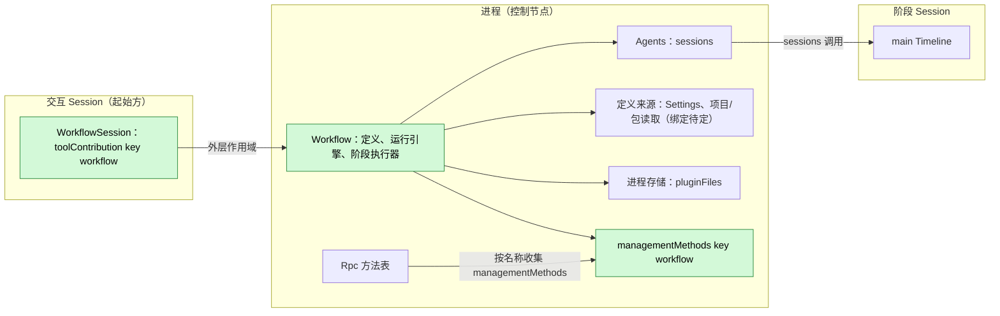
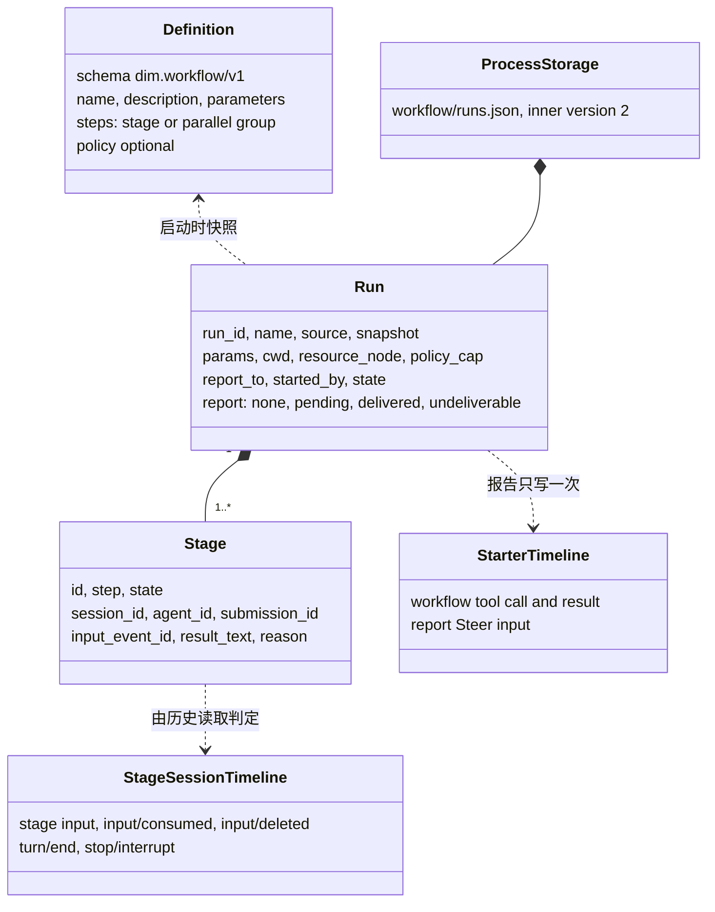
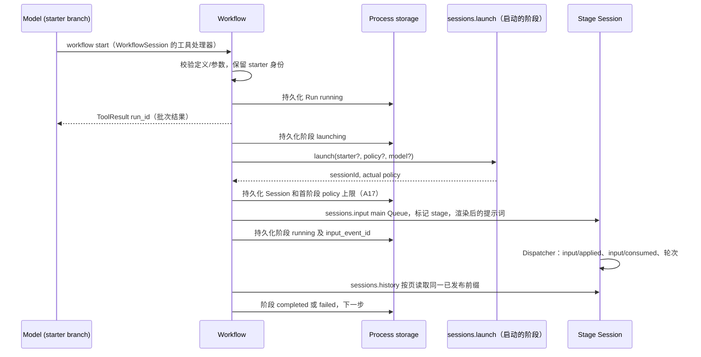
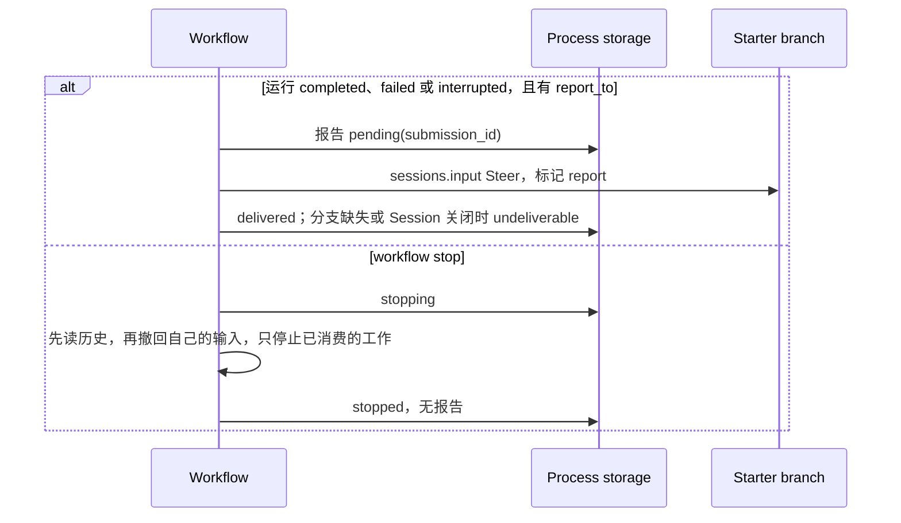
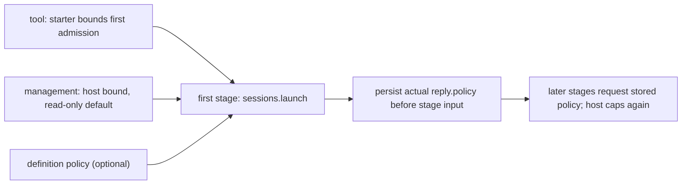
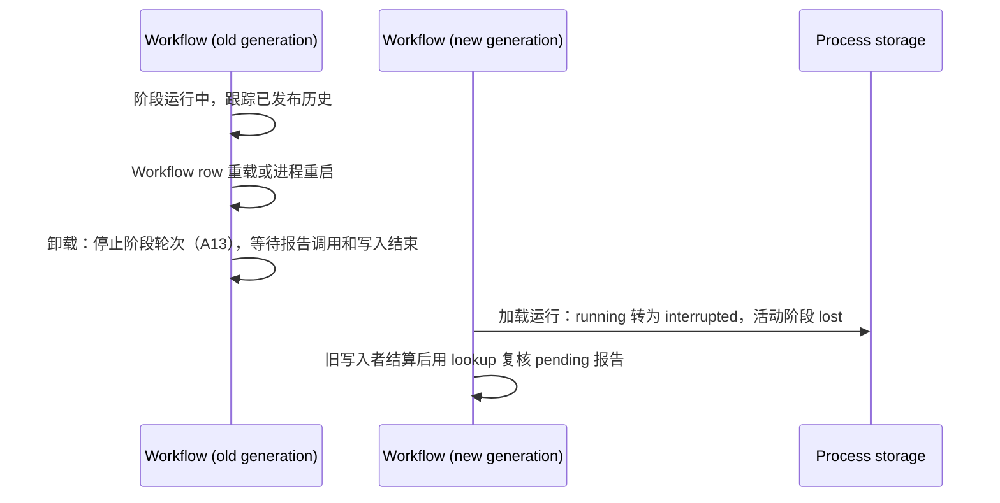

# Workflow

状态：草案。总体设计：[overview §4](../overview.md#4-插件目录)；作用域：[ADR 002](../../adr/002-plugin-scope.md)（进程 + Session）。阶段：P2。语言：优先 TypeScript（[overview 附录 C](../overview.md#附录-c-实现语言)）。

**交付边界。** Workflow 供设计评审，尚未实现。C4 工具、S2 sessions、Settings owner 读写/事件、pluginFiles 带版本文本 API 已存在，[公开装配](../../../design/process-typescript.md#52-public-pluginfiles-binding-proposed)尚未安装。进程/包绑定及 §1.1、附录 F 的业务条件须在 Ready 前解决，不提新的 core 或 rutis 能力。

> **离线资源节点。** 关于资源节点离线的各行描述的是 P3 多节点行为。#5 已撤回（rutis 是外部依赖，链接断开时会撤掉导入的服务），这些行在 P3 按总览 §6.3 重新设计：节点服务在每次调用时按 `resourceNode` 查找。P1/P2 中每个 Session 都使用控制节点。

Workflow 拥有工作流定义和运行。一次运行推进一个固定的步骤列表；每个阶段在通过 Agents 启动的一个新非交互 Session 中运行。进程部分拥有运行，并通过进程服务 `sessions`（[session-access](../contracts/session-access.md)）访问启动的 Session，方式与 Collaboration 相同。用户保存的定义存于 Workflow 的 Settings 来源 `workflow`，项目定义仍是项目文件，由 Workflow 经 FileStorage 读取，运行记录存于 `pluginFiles`。Session 部分以 `toolContribution` 在每个 Session 中声明 `workflow` 工具，只有交互 Session 可以使用它；运维方使用 `workflow.*` 管理方法，即一个 `managementMethods` 条目。所有契约都是语言中立的命名服务（[ADR 002 D5](../../adr/002-plugin-scope.md)）；Rust 形式见[附录 G](#附录-g-rust-绑定)。运行结束时，其结果以 Steer 输入向起始分支报告一次。Workflow 不写自己的 Timeline 事件。

## 1. 结构



运行跨 Session，属于进程；工具属于 Session（[ADR 002](../../adr/002-plugin-scope.md) D1/D2）。进程声明既有 sessions、settings、pluginFiles、workflowFiles。Agents 稳定目录提供 sessions，每次查找当前 index，index 重载使调用返回 reloading，不重载 Workflow 或 Session（[S2 D1](../../../design/appserver/sessions-service.md#3-decisions)、[#35](https://github.com/arcships/dim/issues/35)）。Agents 已解析阶段/profile/默认模型，无须 Workflow 再依赖 Provider。Session 工具按已确认的绑定声明 workflowRuns 依赖（§1.1）；未声明 ctx.use 不是通用原生可选查找。C3 隔离核心与可选 row。定义是使用时读取的业务数据，不引发结构重载。

| 部分 | 作用域 | 依赖 | 提供 |
| --- | --- | --- | --- |
| Workflow | 进程（控制节点） | 既有 sessions/settings/pluginFiles/workflowFiles | 运行引擎，拟定 workflowRuns 与管理命名空间 workflow |
| WorkflowSession | 启用时安装的 Session 部分 | C4 工具、创建配置；声明 workflowRuns 依赖（§1.1） | toolContribution:workflow；interactive === false 时拒绝 |

**既有合同：** [C4 工具](../../../design/session-typescript.md)、[S2 sessions](../appserver/sessions-service.md)、[Settings](../appserver/settings-service.md)、[方法准入](../contracts/session-boundary.md)、[pluginFiles](../../../../crates/dim-app-server/README.md#trusted-plugin-storage)。**本插件拟定合同：** dim.workflow/v1、toolContribution:workflow、workflowRuns.call、管理命名空间 workflow、Settings 来源 workflow、阶段/报告标记文本与运行记录。项目/包文件访问已由 #265 交付，具体包绑定见 §1.3，不假定 PluginContents 服务存在。

### 1.1 现有绑定与实施条件

[进程装配与管理方法绑定](../../../design/process-typescript.md)支持显式进程行。
宿主启动与重启只以必需基础设施判断就绪，可选进程行保留自身 Pending/失败状态。
功能依赖绑定见 §1.1；定义来源和原生写入结算仍由 Workflow 明确；首阶段权限已按 A17 确定。
共享声明加载仍有限制：模块顶层加载卡住会使宿主启动超时；进程模块不在顶层执行业务 I/O。

[已确认的功能依赖绑定](../../../design/process-typescript.md#51-p6p7-access-through-declared-feature-dependencies)
在可选 Session 工具模块声明 `definePlugin.inject: ["workflowRuns"]`。owner 结构重载后，其工具被撤下，
下一代 Active 后以新版本重新提供（A.5，#241），并遵守其中的进程依赖稳定边界和退役调用拒绝规则。
不需要重载 Session。#35 访问选择已确定，
来源读取与原生写入结算条件仍独立保留。

| 入口 | 当前实现与约束 |
| --- | --- |
| 工具 / 进程包 | C4 支持普通 Session 工具行；ToolRegistry 在其 row Active 时提供，并跟随之后的激活与退役（A.5，#241）。ServerConfig.session_typescript.process_rows 在同一运行时装载进程 owner。Session 工具在 definePlugin.inject 声明 workflowRuns（§1.1）；具体包仍未实现。 |
| 管理 | 进程行声明 managementMethods:workflow，在原行内绑定原生按调用准入及 report/drain；Workflow 仍须实现具体方法。 |
| 定义 / Settings | Settings owner 读写/CAS/事件与生成的 workflowFiles 已交付。来源、文件授权、包身份沿用已接受原生接入合同，§1.3 指定包内位置；A.1 语义和完整业务 schema 仍归 Workflow。不直接访问文件系统。 |
| 存储 | pluginFiles scope/文本 API 已存在，但当前 serve 只为 managed 插件注册提供者；[公开绑定提案](../../../design/process-typescript.md#52-public-pluginfiles-binding-proposed)交付后，公开进程行才能进行报告恢复验收。内部 v2、拒绝 v1 并保留原字节、延后迁移仍遵循 A.4。 |
| Sessions | 使用既有 {ok:true,value} / {ok:false,error:{code,message,retryable}}；launch 返回 {sessionId,policy}，input 返回 {inputId,sequence}；lookup 查已提交输入，不去重写入。 |
| 权限 | S2 在真正准入阶段时收窄权限，§3.3 按已确认 A17 复用返回的 policy 约束后续阶段，不增加权限查询服务，不把创建配置当作实时 Permission。 |
| 生命周期 | S2 每次调用的租约结束不等于关闭 Session。反复创建阶段 Session 发布前仍须 [#126](https://github.com/arcships/dim/issues/126)；确认保留期所有权后使用既有 sessions.delete。 |

A17 已确认：在首阶段准入时捕获上限；工具启动与首准入之间的 Permission 变更会影响首 launch 上限。此项确认不代替附录 F 的其他 Ready 条件。

### 1.2 影响面

不改运行时、门面、loader、事件格式或 rutis。新业务归 Workflow 包，Settings、ToolRegistry、运维方消费来源/工具/管理命名空间，workflowRuns 连接本功能两个真实作用域。不增加注册表、就绪服务、上下文路径或 App Server 业务模块。

### 1.3 具体包行

可选包位于 `runtime/plugins/workflow`，包名 `@dimcode/workflow`；根模块拥有运行，
`./session` 提供 Session 工具。完整 `process.json` 与 `session.json` 分别放入现有
`SessionTypeScriptConfig.process_rows` 与 `rows`。这些是待实现目标，目前不能安装；
不包含默认 CLI 安装或 PluginManager 实现。

| row 字段 | 进程行 | Session 行 |
| --- | --- | --- |
| `id` | `workflow` | `workflow-session` |
| `name` | `@dimcode/workflow` | `@dimcode/workflow/session` |
| `config` | `{packages:[{id,root}, ...]}`；空列表表示未安装包定义 | `{}` |
| `inject` | `sessions`、`settings`、`pluginFiles`、`workflowFiles` | `workflowRuns` |
| `provides` | `workflowRuns: {call:"async"}`；`managementMethods:workflow: {describe:"async",call:"async"}` | `toolContribution:workflow: {declaration:"sync",execute:"async"}` |
| `settings` | 唯一用户来源 workflow、userFile:"workflow.json"、无 projectFile、userOnly:["/projectEnabled"]，包含来源合同的定义、启用状态与 A11 并发字段 | 无 |

模块与包行声明相同依赖和方法种类，共用现有运行时。workflowFiles 属于已经注入的 Settings
同一 generation，不增加独立重载来源或 Provider/index 依赖。进程原行直接提供业务和管理服务，
不增加适配器、就绪服务或 Session 接线插件。定义、启用状态、并发限制、运行状态属于业务数据。

config.packages 使用[已交付文件合同](../../../design/p6-p7-bindings.md#3-workflow-definition-files)
的受信任安装声明：包 id 唯一，规范目录已在宿主 FileStorage roots 中授权。
原生工厂把权限固定在原行，Workflow 仅以包 id 作为文件选择器，不用 Node 文件系统访问路径，
不从模型参数取得目录/id 来扩大授权。

用户定义走 Settings owner 读写/CAS；项目与包分别用 workflowFiles 的
{project:canonicalCwd} 与 {package:packageId}。四个生成方法直接返回值或抛出
WorkflowFilesError，不改变 Settings/S2 信封。固定路径、项目启用、包名称冲突和优先级沿用文件合同。
Settings 已认证的数据直接使用；项目/包字节的 UTF-8/YAML 在 Workflow 外部边界只解析校验一次。
S10 包装仅用于运行存储。

工具从宿主 ToolCall 元数据构造 A.2 caller，拒绝 config.interactive === false，
不把 Scheduler 的成员角色限制加给 Workflow。退役 handler 使用已确认功能绑定规定的
不可用、不可重试 content。进程只描述 A.3 五个字面方法：list/status 为非修改 report，
save/start/stop 为修改 drain，全部 progress:false，使用既有 MethodReply。
工具把可操作 id 和诊断放入 ToolResult.content。

A17 仍以首个实际 launch 回复捕获权限，不增加 sessionPermissions 依赖。
报告恢复同时需要 [#267](https://github.com/arcships/dim/pull/267) 原生输入生命周期，以及
§3.4/附录 D 的真实持久尝试和宿主重启验收；绑定测试本身不证明业务恢复边界。

## 2. 数据与状态



定义在每次调用时从其来源读取（A1）；运行存于进程存储，并在每次状态转换时、在其所守护的副作用之前持久化。阶段进度由每个阶段 Session 中的已有事实推导；只复制有界的结果文本。不从 Timeline 重建任何内容；Workflow 不拥有 `StateCell`，Session 部分不持有状态。

## 3. 流程

### 3.1 从工具启动并运行一个阶段



处理器持久化运行后立即返回；阶段推进在进程部分的任务跟踪器上运行。只有读完阶段 Session 的固定已发布前缀后才判定完成（§3.2）。

### 3.2 报告与停止



所有者显式停止不唤醒起始方（[event-driven flows §3](../../../architecture/rust-agent/event-driven-flows.md)）。报告所有权、结算与恢复遵循 §3.4。delivered 表示输入已发布，不表示模型已消费；之后撤回该输入不会触发再次报告。

每个阶段有一个自持历史跟踪任务，使用已保存的输入回执。提交后读取一次，此后每秒读取，不保留原生 idle 等待。首次 history {after} 回复固定已发布截止点 H，后续分页保持 through: H。读完整个前缀再决定，并把最后序号作为下次游标。匹配本阶段 inputId，保留已发布终态，不把其他轮次结束当成本阶段完成。待处理审批不阻止历史读取。

停止时先读完整个已发布前缀并保留已有终态。本输入已应用、随后中断，且该前缀没有匹配的消费时，按 A.6 将阶段结算为 stopped，不再调用 stop。否则只撤回本阶段尚未消费的输入；deleted 使其停止；notHeld 只表示这次撤回没有删除输入，输入可能已删除或已消费。重读历史并应用同样的规则：匹配删除或消费前已中断则结算，其他未消费输入继续等待。仅在观察到消费且没有后续结束事实时调用 sessions.stop。本地 stopped 终态不会收回已应用输入。每个已准入变更调用由任务持有至结算，丢弃 JS Promise 不等于原生取消。

sessions.stop 作用于轮次，以分支寻址，不接受预期轮次 id，也不取消分支中的脱离工作。观察到的轮次可能在调用生效前结束，另一轮次可能开始。每秒历史轮询、可能中断后续轮次及保留已应用输入，是已接受的首版限制，不增加原子指定轮次、锁、协议或 core 需求。阶段跟踪不结算报告写入（§3.4）。

### 3.3 阶段的 policy



运行不放宽权限（E2）。**已确认准入流程（A17）：** 首阶段经既有 sessions.launch 传入工具调用的 {sessionId,branchId} starter 和定义可选 policy；管理启动不带 starter，S2 使用宿主上限和现有只读默认。Agents 解析实时上限并返回有效 policy，在任何阶段输入前持久化为 Run.policy_cap；此字段仅在首个启动回复尚未确认时缺失。后续阶段显式传入已存 policy、不带 starter，由 Agents 再按当前宿主默认上限收窄；起始方关闭不会放宽权限或妨碍已拥有工作继续。首次 policy 确认前禁止回退。

首步骤为并行组时，先取得并持久化定义中第一个阶段的 launch 回复，再准入同组其他阶段，仍遵守既有并发限制。定义的 policy 在定义边界转换一次为现有 PermissionPolicy 形状，由 S2 正常收窄，不另写权限比较实现。按已确认 A17 在首阶段准入时捕获上限，不增加权限查询方法、辅助 Session 或 core 能力。

### 3.4 报告所有权与恢复

既有运行任务负责终态结算及其报告（E15）。阶段跟踪任务向它提供结果，status 读取和保留期清理不发送报告。单个运行最多有一个在途报告操作，不同运行可独立推进，不增进程级报告队列或锁。

1. 在同一个 A.4 文件事务中保存运行终态、ended_at；completed、failed 或 interrupted 且有 report_to 时，同时保存 report: pending{submission_id, attempt_open:false}，只分配一次提交 id。显式 stopped 或没有目标的运行保持 report: none。终态结果和目标固定，每次重试都从该结果渲染同一份报告、使用同一个提交 id。终态结算之后的 stop 不清除 pending 报告。
2. 每次 sessions.input 前，先持久化 attempt_open:true 并等待替换完成，释放文件事务后再调用 input。等待实际 S2 回复；定时器、工具取消或卸载不能通过 Promise.race 放弃调用，也不能把丢弃 Promise 当作取消。等待 input 或 lookup 时不持有文件事务。
3. 按下表处理回复，在同一次替换中保存报告终态，或在写入已结算的实际回复后保存 pending 且 attempt_open:false。把 reloading 当作此类回复，依赖提议的 [S2 input 生命周期](../appserver/sessions-service.md#62-input)已实现且验证：当前 S2 可能在写入仍继续时先返回它，因此保持尝试开放。bridge 异常同样保持标记开放。持久化失败时按 A.4 停止新的运行副作用，清除标记失败则持久化的尝试仍为开放。
4. 恢复时每条 pending 报告都先 lookup，再决定是否发送。attempt_open:false 证明尝试尚未开始或实际回复已记录，unknown 才可执行第 2 步。attempt_open:true 时，lookup 可结算已发布报告，但 unknown 不允许重发；除非选定绑定证明旧原生写入者已结束，否则保持标记开放。新的 Node 实例或普通装载回调都不提供此证明。整个宿主进程重启仅在绑定能够识别该重启时才证明旧写入者已消失，不假定已有此观察能力。恢复 running/stopping 运行时按第 1 步原子保存 interrupted 及其新 pending 报告，不重新启动阶段。

回复规则使用现有 [S2 input](../appserver/sessions-service.md#62-input) 和 [lookup](../appserver/sessions-service.md#63-lookup)；lookup 是读取，不是去重写入：

| 回复 | 运行任务动作 |
| --- | --- |
| input 成功，或 lookup accepted | 持久化 delivered，不再提交。 |
| session_closed 或 branch_missing | 持久化 undeliverable{reason}，不改投其他目标。 |
| input rejected | 没有写入，持久化 undeliverable{reason:"rejected"}，记录非法报告错误，不再重试。 |
| lookup ambiguous | 至少一份报告已发布；持久化 delivered，记录重复报告违约，不再新增输入或改写历史。 |
| input publication_unknown | 持久化 pending 且 attempt_open:false，重试前先 lookup。 |
| input reloading | 仅在提议的 S2 生命周期已实现且验证后，持久化 pending 且 attempt_open:false，再 lookup。当前 S2 下保持 attempt_open:true，只 lookup，直到证明旧写入者已结束。 |
| lookup unknown | 只有已关闭的尝试可执行第 2 步。开放尝试保持 pending，lookup 本身不清除标记。 |
| lookup reloading | 保持 pending，通过 owner 既有每秒定时器重试 lookup，不并发执行。 |
| failed 或其他非终态错误 | 保持 pending，记录错误，停止本次装载内的自动投递。实际 input 回复关闭尝试，lookup 失败不关闭。下次装载按第 4 步先 lookup，不无条件重发。 |

正常清理先停止新运行准入和报告重试，等待已准入运行/报告调用及其记录写入结束，再关闭文件 scope。没有在途调用的 pending 记录可以留给下次装载。A13 的十秒阶段 stop 上限不限制报告结算：发布延迟可能使卸载等待。这是普通自持工作，不增加就绪或关闭协议。

bridge/runtime 失败不是 S2 回复，也不证明旧原生写入者已经停止。保留开放尝试、暴露基础设施失败；开放尝试一直 lookup unknown 时保持可见、保留记录，即使再次重载也不自动重发。Ready 前选定包绑定须证明正常清理，以及如何为开放尝试证明结算，包含宿主重启情形。缺乏此证据时，E15 仍是实施门槛；不提出新的 core/rutis 取消、宿主 epoch 或幂等能力。

## 4. 时序与冲突



Workflow 自身重载或重启使运行 interrupted，不重新启动（E15）。Agents index 重载不同：稳定 sessions 保留，Workflow 和阶段 Session 不重载，经既有 S2 调用复核不确定回复；不因回复丢失而重新提交已提交输入。

| 场景 | 序号顺序 | 结果 | 负责方 |
| --- | --- | --- | --- |
| 工具结果之后起始方轮次中断 | result < interrupt | 运行继续 | Workflow |
| 运行很快结束时工具批次尚未结算 | report < `step/tool-result` | Steer 在批次结果之后消费；模型先看到 `run_id` | Loop |
| `workflow.stop` 与阶段自身的 `turn/end` 竞争 | `turn/end` < `stop/interrupt` | 阶段 `completed` 并带结果；运行 `stopped` | 阶段 Session 顺序 |
| 阶段输入在被持有时被撤回（用户或 stop） | input < `input/withdraw` < `input/deleted` | 阶段 `stopped`；从未应用或消费 | InputQueue、Workflow |
| Workflow 重载或重启 | — | 运行 interrupted、活动阶段 lost，不重新启动；按确认的写入结算流程保持 E15 | Workflow |
| Agents index 重载 | — | Workflow/阶段 Session 继续；调用可返回 reloading，不确定写入用 lookup/历史 | Agents、Workflow |
| 阶段运行中起始方分支关闭 | close < report | 阶段继续；报告 `undeliverable` | Workflow |

完整表格：附录 B。

## 5. 上下文映射

| 模型看到的内容 | 形式 | 位置 |
| --- | --- | --- |
| `workflow` 声明 | 已采用配置中的工具声明（每个 Session；只在交互 Session 中可用） | 前缀包含该配置的请求 |
| 启动、状态、停止 | `ToolResult.content`（文本，含 `run_id`） | 其批次的工具结果位置 |
| 报告 | 一个 raw 块 `<dim-workflow kind="report" run="..." status="...">`；正文：各阶段状态、最后一步结果的有界预览（A16）、获取完整结果的方式（`status`） | Steer 输入的消费位置；无 key |
| 阶段任务（阶段 Session） | 标记 `<dim-workflow kind="stage" run="..." stage="...">`，随后是作为用户内容的渲染后提示词 | 启动的阶段 Session 的第一个输入 |

报告和阶段输入无 key，压缩后只经摘要保留，子分支只继承切点前已消费内容。非交互阶段仍声明 ask_user/workflow，但处理函数拒绝，防止嵌套。模型后续动作所需 run/Session id、状态、结果预览进入 ToolResult.content 或已采用报告输入；structuredContent 仅供持久化/UI，不自动把存储、日志或诊断注入上下文。

## 6. 接口（摘要）

| 接口 | 类型 | 用途 |
| --- | --- | --- |
| `workflow`（`list`、`start`、`status`、`stop`） | `toolContribution`（Session，key `workflow`），风险类别同 Collaboration 的 `agent` 工具 | 模型运行工作流 |
| `workflow.list/save/start/status/stop` | `managementMethods`（进程，key `workflow`） | 运维方管理定义和运行 |
| CLI 入口 | 方法绑定后的独立客户端工作 | 本文不声称已实现命令 |
| `sessions` | 依赖 | 阶段 Session：launch、input、history、lookup、stop、withdraw、delete |
| `dim.workflow/v1` | 此处定义 | 定义格式（附录 A） |

## 7. 安全

Workflow 无宿主本地批准（[overview §6.4](../overview.md#64-约定)）。工具启动属于 agent 动作，受 Approval/Permission 管理；管理启动及已启用定义由配置/操作者负责。项目定义默认禁用（[ADR 003 D3](../../adr/003-approval-scope.md#d3-启用是普通配置项目条目默认关闭)），文件不能自启用。用户来源按工作区/名称保存 userOnly 启用记录；已实现的受保护客户端 settings.update 可改，owner/工具不可改。打开仓库不自动运行；启用后文件编辑用于后续运行而不再次审批（D4）。发布前确认来源/schema 和真实项目读取绑定。阶段权限遵循已确认 A17，不把创建配置当实时权限。参数/结果经已采用输入进上下文，定义不带凭据。

## 8. 规则检查

规则：[principles §1 与 §4](../../../architecture/rust-agent/principles.md)，[ADR 002](../../adr/002-plugin-scope.md) D1–D5。

| 规则 | 本文如何符合 |
| --- | --- |
| §4.1 改别的模块拥有的状态时写指令事件 | 阶段 Session 只通过 `sessions` 改动（输入、`input/withdraw`、`stop/interrupt`）；结果由所有者写入。 |
| §4.2 交接后不能撤回 | 撤回只删除仍被持有的输入；notHeld 后读历史，本输入消费且无后续终态才可 stop（§3.2）。 |
| §4.3 只用 before 回调在写入前干预 | 不适用：Workflow 不加入口检查，也不注册 before 回调；定义校验是它自己的边界校验。 |
| §4.4 核心机制不带业务含义 | 运行时不为 Workflow 增加任何内容；Workflow 只使用通用的 `sessions` 操作。 |
| §4.5 决定前读完整个批次 | 读完首页固定的已发布前缀 H 再决定，后续分页保持同一截止点。S2 分页结束于批次边界（§3.2、A.6）。 |
| §4.6 模型上下文只含交接后被读取的事件 | 阶段任务和报告只作为已消费的输入到达模型；被撤回的输入被删除，模型看不到。 |
| §4.7 公开事件和服务 | 既有 sessions/Settings/pluginFiles/workflowFiles；Agents 解析模型/权限。不用私有 Permission/AgentIndex 租约。 |
| §4.8 向机制所有者提需求 | 无（§9）；用既有机制在 Ready 前解决绑定与业务流程，P3 节点另行设计。 |
| §4.9 只有后续决定要用的事实才进 Timeline | Workflow 不写 Timeline 事件；运行留在进程存储，只有模型要消费的阶段任务和报告作为输入进入 Timeline。 |
| §1 Capability 与 App Server 边界 | 进程插件拥有定义和运行，Session Capability 提供工具；通过 pluginFiles 存储，不设 App Server 业务模块。 |
| ADR 002 D1 作用域跟随状态所有者 | 运行跨越 Session（进程部分）；工具属于 Session（Session 部分）。 |
| ADR 002 D2 不设接线模块 | 现有 Rpc/ToolRegistry 消费业务方法/工具，不增接线插件、Provider 端口或注册表，不声称 TS 管理绑定已实现。 |
| ADR 002 D3 依赖跟随作用域 | 稳定 sessions 隔离 index 重载，C3 隔离核心和可选 row，可选工具行按 §1.1 的可用性约束声明 owner 依赖。 |
| ADR 002 D4 结构性配置与业务配置分离 | 定义和运行上限是使用时读取的业务数据；没有结构性变化。 |
| ADR 002 D5 合同语言中立 | `workflowRuns`、工具、方法和定义格式都是命名服务或数据；Rust 形式见附录 G。 |

## 9. 向机制所有者提出的需求

无。使用已交付 C3/C4、S2、Settings、pluginFiles。附录 F 记录未决绑定/业务顺序，不转化为 core/rutis 需求。报告一次不意味着增加幂等扩展、generation token 或注册表，P3 资源节点不属本次实施范围。

## 附录 A. 接口细节

### A.1 定义格式 `dim.workflow/v1`

YAML（A2）。用户定义是 Settings 来源 workflow 的条目（A3），项目定义保留在 `<workspace>/.dimcode/workflows/<name>.yaml` 的项目文件权威下（E11），包包含相同文档。Ready 前决定项目/包来源绑定（§1.1），不声称已有命名文件服务或 PluginContents，不把定义和来源权威静默改成 loader options 或第二份 manifest。

```yaml
schema: dim.workflow/v1
name: review-and-fix                 # [a-z0-9-]{1,64}; unique per source
description: Analyze, fix in parallel, summarize
policy: workspace_write              # optional; narrowing only
parameters:
  - { name: target, description: Path to review, required: true }
  - { name: style, default: concise }
steps:
  - stage: { id: analyze, prompt: "Analyze {{params.target}}." }
  - parallel:
      - { id: fix-a, agent: <agent id>, prompt: "Fix part A.\n{{stages.analyze.result}}" }
      - { id: fix-b, prompt: "Fix part B.\n{{stages.analyze.result}}" }
  - stage: { id: summarize, model: { providerId: p, modelId: m }, prompt: "Summarize: {{stages.fix-a.result}} {{stages.fix-b.result}}" }
```

| 字段 | 规则 |
| --- | --- |
| `steps` | 按顺序 1–32 步；一步是一个 `stage` 或一个含 2–8 个阶段的 `parallel` 组（A4） |
| `stage.id` | `[a-z0-9-]{1,32}`，在定义内唯一 |
| `parameters[].name` | `[a-z0-9-]{1,32}`，在定义内唯一 |
| `stage.agent` | 可选的 Agent id（原生或外部 profile）；省略时启动请求不带 `agent`，Agents 使用默认 profile |
| stage.model | 可选现有 ModelId {providerId,modelId}；省略则由 Agents 解析 profile/默认选择（A5） |
| `stage.prompt` | 渲染后 ≤ 32 KiB 的模板（A6）；占位符 `{{params.<name>}}`、`{{stages.<id>.result}}` |
| `policy` | `read_only` \| `workspace_write` \| `full_access`；受上限约束（3.3） |
| 引用 | `stages.<id>` 必须指向更早一步的阶段；只做纯替换（A7） |
| 参数 | 字符串；缺少必填项或名称未知 → `invalid_parameters`；其余由默认值填充 |

Settings 在边界按声明 schema 校验/填默认，Workflow 直接使用返回文档，不再重复格式检查。用户条目是名称到定义的映射；定义中的可选字段不声明 schema 默认值，因为 Settings 只沿声明的 `properties` 填默认，不遍历映射条目。缺失保留 A.1 对该字段的业务含义；参数 `default` 是显式值，不是 schema 默认值。[Settings §3.2](../appserver/settings-service.md#32-文档校验与默认值) 将 JSON Schema 之外的规则留给所有者在使用时处理。Workflow 负责阶段/参数身份唯一性和模板引用：引用的参数必须已声明，引用的阶段必须属于更早一步；同一并行组的其他阶段不属于更早一步。

完整 `workflow` 来源 schema 见[来源合同](../../../design/p6-p7-bindings.md#32-source-selection-and-authority)，包含 A11 的
`max_concurrent_runs` 与 `max_concurrent_stages`，默认均为 4。每次 start 读取两者，本次运行的阶段上限保持固定。
保存定义保留这两个字段及受保护的 `projectEnabled`。

用户来源的条目 key 或项目文件名 `<name>.yaml` 决定定义身份，文档自身的 `name` 必须与其一致。不一致属于 `invalid_definition` 问题，不视为重命名或别名。`workflow.save` 使用已校验文档的 `name` 作为目标条目 key 或文件名。已交付的原生接入合同以包 id 加文件名确定身份，要求文档名称一致并拒绝重名插件定义。

只有 `stage.prompt` 是模板文本，只扫描其中的 `{{` 开头。每个开头都必须以 `}}` 闭合，并组成 `{{params.<name>}}` 或 `{{stages.<id>.result}}`；未知 token（包括 `{{stage.analyze.result}}` 和带空白的 `{{ params.x }}`）或未闭合的开头都属于问题。没有对应开头的 `}}` 按原文保留，因此 `{"a":{"b":1}}` 这样的嵌套 JSON 不受影响。v1 不提供字面量 `{{` 转义，需要时通过参数值或其显式 `default` 传入。默认值和传入值是数据，不是模板；替入值不再扫描，也不递归替换。剔除已识别 token 后，字面量文本自身超过 A6 的 32 KiB UTF-8 上限，属于 save/list/start 时的定义问题。

| 边界 | Workflow 的动作 |
| --- | --- |
| `workflow.save` | 在外部定义请求边界按 A.1 解码，在用户来源 CAS 或项目文件写入前检查语义。非法定义返回 invalid_definition，不修改来源，也不启用项目定义。 |
| 通用客户端 `settings.update` | Settings 确认 schema/默认值和持久化，不确认 Workflow 可执行语义。结构合法但引用非法的条目可以保存；Workflow 不增加 Settings 回调，也不把写入回执当作运行准入。 |
| 定义列表 / start | 检查当前定义的语义；工具及管理列表按各自现有可见性规则显示问题，start 在保存运行或启动 Session 前拒绝选中的非法定义，保留来源条目供修正。来源读取失败是错误，不是空目录。 |
| 项目/包文本 | 在此外部数据边界解析、检查结构一次，再应用相同的 Workflow 语义规则。来源读取使用已交付的 workflowFiles，不直接访问文件系统。 |

启动时校验传入参数的名称/值一次，拒绝缺失必填项或未知参数；并按业务转换应用定义中的参数默认值。把接受的定义和参数保存到现有运行快照，后续来源编辑不改变它。在准入一步中的任何阶段前，用参数及已存的前序阶段结果渲染、检查该步的所有阶段长度；首步和后续步骤超限均按附录 C 结算，该步检查失败时不启动任何同组阶段或写入其输入。后续阶段直接使用快照，不再解析、填默认或规范化。Agent/model 可用性及有效权限由 Agents 在实际准入时解析，不在定义校验时增加目录查询。

### A.2 工具 `workflow`

toolContribution:workflow 不按交互性改变声明（#30），config.interactive === false 时拒绝（A8），省略表示 true。C4 交付创建配置，不是当前 Permission；同步 declaration 不做 I/O。execute(ToolCall,cancelled) 使用既有第二个按引用取消 Promise。已接受运行归进程 owner，清理及持久化前/后取消行为按该所有权处理，不从 JS Promise 推断原生调用已取消。ToolExecutor 拥有工具终态事实。

`workflowRuns`，进程作用域，无 key，在此定义：`call(RunRequest): async -> RunReply`，其中 `RunRequest = {action, name?, source?, params?, run_id?, caller: {sessionId, branchId, callId, cwd}}` 使用下列动作，`RunReply = {content: string, structured: JSON}`，或下列错误码中的 `{code}`。

| 动作 | 参数 | `ToolResult.content` |
| --- | --- | --- |
| `list` | — | 对调用方 cwd 可见的已启用定义：名称、来源、描述、参数；非法条目仍可见，标为非法并把前 10 个问题及问题总数写进 `content` |
| `start` | `name`、`source?`（先 `project`，再 `user`，再 `plugin`）、`params` | `{"run_id", "status": "running", "stages": [...]}`，并附一句说明结果会作为报告输入到达 |
| `status` | `run_id` | 状态、各阶段状态、Session id、有界的结果预览、最近的日志条目 |
| `stop` | `run_id` | 传播后的最终状态 |

收到 `invalid_definition` 时，工具把此错误码及通过 `list` 查看定义问题的指引写进 `ToolResult.content`。现有服务错误保持 `{code}`，诊断信息不只放在 `structuredContent`。

start 保存 report_to = {session_id,branch_id} 和调用方 cwd；首阶段准入按 §3.3/A17 捕获实际 policy，不假定已有独立实时权限查询。P3 前无 resource_node。错误为 definition_not_found（含未启用项目定义）、invalid_definition、invalid_parameters、run_not_found、limit_exceeded（A11）。

### A.3 管理方法

`managementMethods` key `workflow`：`describe(): async -> MethodDecl[]` 列出下列方法（`mutating` 如表所示）；`call(MethodCall): async -> MethodReply` 以 JSON 参数和结果分派它们。

| 方法 | 参数 | 结果 | `mutating` |
| --- | --- | --- | --- |
| `workflow.list` | `cwd` | 定义及来源、启用状态、问题 | 否 |
| `workflow.save` | `source: user\|project`、`cwd?`、`document` | A.1 语义检查通过后返回 `{name}`；`user`：Workflow 以类型化写入把条目写进 `workflow` 文档（按其 revision 做 CAS）；`project`：经 FileStorage 写入项目文件（文件权威）；保存不会启用项目定义 | 是 |
| `workflow.start` | name、source?、cwd、resource_node?（P3）、params、report_to? | run_id；首 launch 记录返回 policy（A17），管理启动使用现有宿主上限/只读默认 | 是 |
| `workflow.status` | `run_id?` | 一次运行或最近的运行 | 否 |
| `workflow.stop` | `run_id` | 运行的最终状态 | 是 |

选定绑定后使用既有准入：list/status 为 report，save/start/stop 为 drain，已接受变更在卸载前结算。Pending/重载 owner 返回 service_reloading，Failed/Unresolved 返回 service_unavailable，禁用/不存在返回 unknown_method，不声称 TS 管理投影已实现。

### A.4 运行记录

```text
Run { run_id, name, source: user|project|plugin, definition (snapshot),
      params, cwd, resource_node? (absent until P3), policy_cap? (absent until first confirmed launch reply, A17), report_to?: {session_id, branch_id},
      started_by: tool{session_id, branch_id, call_id} | management, created_at, ended_at? (terminal only),
      state: running | stopping | completed | failed | stopped | interrupted,
      stages: [Stage], log: [LogEntry] (bounded, A9),
      report: none | pending{submission_id, attempt_open: boolean} | delivered | undeliverable{reason} }
Stage { id, step, state: waiting | launching | running | completed | failed | stopped | skipped | lost,
        session_id?, agent_id?, submission_id?, input_event_id?, result_text?, reason? }
```

进程 owner 经自持 `pluginFiles` scope 在 `workflow/runs.json` 保存一个 JSON 文本 `{ "version": 2, "runs": [Run] }`。内部 v2 要求 pending 报告带 attempt_open 标记（§3.4）；v1、pending 报告缺失标记或其他版本均返回 invalid_data，保留原字节，不隐式转换成已关闭尝试。维护者已确认此兼容策略；迁移留待后续统一处理，读取或恢复时不执行迁移。Scheduler 独立的内部 v1 文档不变。

`created_at` 和终态的 `ended_at` 使用 UTC `YYYY-MM-DDTHH:mm:ss.sssZ`，固定三位小数，使时间顺序与字典序一致。宿主 S10 的 `{version:1,text}` 是独立的外层封装，仍由宿主负责。定义留在其已声明来源；运行中的定义快照是已接受的执行输入，不作为来源配置编辑。

文件缺失表示没有运行。只在此持久化边界解析、校验：损坏 JSON、缺失/未知版本、非法记录字段、重复 `run_id` 或单个运行内重复阶段身份，均失败并保留原字节。不自动重置、备份或迁移。此后直接使用类型化记录；不兼容的已提交格式必须采用新的内部版本并明确兼容策略。

使用现有 `scope.withLock` 的读/修改/`file.replace` 持久化每个必要转换，释放事务后才调用 `sessions`。启动、输入和报告都先记录意图，再发起副作用；保存回复后才继续推进。不增互斥锁、日志、存储或公开服务。读/替换失败即停止新的运行副作用并报告存储错误。卸载先停止准入，结算自持调用和记录写入，再关闭文件 scope；A13 不限制已接受写入的结算时间。

保留策略遵循 [S2 §8.7](../appserver/sessions-service.md#87-删除运行用的-session)：保留所有 running/stopping 运行、每条 pending 报告，以及其他终态中按 `ended_at` 最近的 100 条记录，同时间以 `run_id` 排序。日志最多 500 条（A9）。只有报告为 none/delivered/undeliverable 且所有自持阶段操作均已结算的运行才可移除。对于从 Workflow 自己成功 launch 回复中记录的 Session，先计算活动和保留运行的引用；没有引用时，先调用现有 sessions.delete，再移除过期运行的最后一条所有权记录。删除失败或不确定时保留记录并报告错误，供下一次保留期清理使用，不增清理队列。fork 和外部提供的 Session 身份不归 Workflow。报告或清理未结算时可暂时超过 100 条。没有持久化 launch 身份的 Session 仍适用附录 F 的已知限制。

启动恢复后、每次终态转换后及报告结算后执行保留期清理。失败清理仍留下过期记录时，经 owner 的定时器每分钟重试一次，即使没有活动运行。运行存储读取失败即跳过删除与裁剪，保留记录并报告错误。所有权引用来自运行存储；定义来源被删除或无法读取，不会使活动运行或 pending 报告过期。读取失败而跳过的清理也按同一分钟节奏重试。

### A.5 依赖的契约

| 契约 | 所有者 | 用途 |
| --- | --- | --- |
| sessions.launch {agent?,cwd,model?:{providerId,modelId},policy?,starter?:{sessionId,branchId}} → {sessionId,policy} | 既有 [S2](../appserver/sessions-service.md) | Agents 解析模型/权限，每个阶段非交互，Workflow 写首条输入 |
| 对自己的输入执行 `sessions.withdraw {sessionId, branchId, inputId}`；按 `submissionId` 执行 `sessions.lookup` | session-access（InputQueue） | 停止时撤回自己未消费的阶段输入；回复 `deleted` 或 `notHeld` |

### A.6 Timeline 与 Capability 机制

| 步骤 | 路径 |
| --- | --- |
| 启动 | 校验定义/参数，保留 starter 身份，持久化 Run running、首准入 pending 后返回 run_id；阶段推进归进程任务 owner，不直接写 Timeline；A17 已确认。 |
| 阶段启动 | 按 A.1 渲染并检查整步长度后才准入任何同组阶段，复核运行状态，持久化 launching，S2 launch 省略未设置 agent/model；首回复在输入前保存 sessionId 和 policy 上限，后续启动显式传入已存 policy；保存 `submissionId = workflow:<uuid>`。 |
| 阶段输入 | `sessions.input {sessionId,branchId:"main",mode:"queue",submissionId,rawBlocks:[{text:"<dim-workflow …>…</dim-workflow>"}],content:[{type:"text",text:prompt}]}` → `{inputId,sequence}`；Workflow 输入边界构建/转义标记，S2 接受 RawBlock {text,key?} 而非结构化 marker，先存 receipt 再继续。 |
| 消费 | 阶段 Session 的 InputQueue 和 Loop 在各自的 Dispatcher 上（`input/applied`、`input/consumed`），然后是轮次 |
| 完成 | 自持历史跟踪（§3.2），每次固定一个已发布截止点。本输入消费前：匹配的 input/deleted，或本输入 input/applied 后接 stop/interrupt → stopped，否则继续等待；消费后第一个 turn/end 决定 completed/failed/stopped，取该轮次最后的回复文本。 |
| 推进 | 持久化阶段结果；某一步的所有阶段都到达终态时，启动下一步或结束运行；失败的阶段会停止运行中的同组阶段并使运行失败（A4） |
| 报告 | §3.4：原子保存运行终态和 pending 报告，每次 Steer 输入前持久化开放尝试标记。一个运行任务持有结算；恢复时，unknown 的开放尝试没有写入者已结束的证明就不重试。 |
| 停止 | 持久化 stopping；等待中的阶段 skipped；按 §3.2 撤回本阶段输入，notHeld 后重读历史。保留已有终态；已应用、随后中断且本输入未消费 → stopped，不再 stop，输入仍已应用；其他未消费输入继续等待。消费后无结束事实才可调用按分支寻址、无预期轮次 id 的轮次范围 sessions.stop；运行 stopped，无报告。 |
| 重载、重启 | Agents index 重载不重载 Workflow。自身卸载先停新工作，停止自持阶段（A13），等待已准入调用/写入结束再关闭存储。恢复标为 interrupted/lost、不重新启动，再按 §3.4 复核 pending 报告。Ready 前须由包绑定验证此所有权。 |

## 附录 B. 完整冲突表

| 场景 | 序号顺序 | 结果 | 负责方 |
| --- | --- | --- | --- |
| 调用分派前起始方中断 | interrupt < `step/tool-call` | 未执行；无运行 | ToolExecutor |
| 处理器运行时起始方中断 | `step/tool-start` < interrupt | 已持久化的运行继续；持久化前取消 → 无运行 | Workflow |
| 工具结果之后起始方中断 | result < interrupt | 运行继续 | Workflow |
| 起始方分支级中断或分支关闭 | close < report | 运行继续；报告 `undeliverable` | Workflow |
| 运行结束时工具批次尚未结算 | report < `step/tool-result` | Steer 在批次结果之后消费 | Loop |
| 报告分支上并发 Steer/Queue | Timeline 顺序 | 按模式应用；报告是普通的 Steer | InputQueue |
| 起始方空闲时报告到达 | — | Steer 启动一个轮次 | InputQueue、Loop |
| 用户在报告输入被持有时撤回它 | report < `input/withdraw` < `input/deleted` | 报告计为 `delivered`；不重写 | InputQueue |
| 报告写入与消费之间发生压缩 | input < compaction < consumed | 放在摘要之后 | ContextPreparation |
| 报告写入与消费之间切出子分支 | input < cut < consumed | 子分支看不到它 | InputQueue（子分支） |
| 消费前用户停止阶段 Session | 自己的 `input/applied` < `stop/interrupt`，尚未消费自己的输入 | 阶段 `stopped`；已应用输入保留在该 Session 中 | Workflow |
| 阶段输入在被持有时被撤回 | input < `input/withdraw` < `input/deleted` | 阶段 `stopped` | InputQueue、Workflow |
| `workflow.stop` 与阶段的 `turn/end` 竞争 | `turn/end` < `stop/interrupt` | 阶段 `completed`；运行 `stopped` | 阶段 Session 顺序 |
| `workflow.stop` 与应用竞争 | `input/applied` < `input/withdraw` | `notHeld`；按 §3.2 重读历史，保留已发布结果再决定 stop | InputQueue、Workflow |
| `workflow.stop` 发生在其他删除之后 | `input/deleted` < `input/withdraw` | `notHeld`；匹配删除后结算，不等待不可能发生的消费 | InputQueue、Workflow |
| 两次 `workflow.stop` 或结束后 stop | — | 幂等 | Workflow |
| 重复 `start` | — | 两次运行（A15） | Workflow |
| Agents index 重载 | — | Workflow/阶段 Session 继续，S2 复核不确定回复，不中断全部运行 | Agents、Workflow |
| Workflow 在工具调用期间重载 | — | 提供者结算已接受工作，C3 保持核心继续；已发出的调用保持其代际，按 §1.1 返回退役错误；下一代的工具在其 Active 后提供 | Workflow、ToolExecutor |
| 阶段资源节点离线（P3） | — | 不属 P1/P2，按独立 P3 节点设计，不向 rutis 提需求 | Agents、阶段 Session |
| 轮次中阶段 Session 的 Capability 重载 | 轮次以 `Failed` 结束 | 阶段 `failed` | 阶段 Loop |
| 报告时起始方 Session 已卸载 | — | `sessions.input` 先恢复它，再写入 | Agents |
| 运行中进程重启 | — | `interrupted`/`lost`；已提交但未消费的阶段输入留在各自 Session 中 | Workflow |
| 报告写入不确定 | — | 结算旧写入者后 lookup 再重试；E15 依赖 owner 串行化，不只靠 lookup | Workflow |
| 启动后项目定义被编辑 | — | 运行保留其快照；之后的阶段使用该快照；已启用定义的之后运行直接使用修改后的文件，不再询问（ADR 003 D4） | Workflow |
| 客户端断开 | — | 无影响 | — |

## 附录 C. 错误与恢复

| 情况 | 结果 |
| --- | --- |
| 定义文件无效 | 连同问题一起列出；`start` → `invalid_definition` |
| 定义 policy 超过准入权限 | 现有 S2 收窄并记录返回 policy（已确认 A17），不增加查询或回退到更大权限 |
| `launch` 失败 | 阶段 `failed`；运行 `failed` |
| 阶段提示词渲染后超过 A6，包括首阶段 | 超限阶段为 `failed`，reason 为 `prompt_too_large`；其他未启动同组阶段为 `skipped`。不为该步的任何阶段 launch/写输入。运行失败并按 §3.4 报告。即使前序存储结果符合独立的 64 KiB 上限，此失败也属于预期行为；不静默截断替入内容。 |
| 阶段轮次 `Failed`/`Cancelled` | 阶段 `failed`/`stopped`；运行 `failed`（A4） |
| 等待期间 Session 关闭或分支缺失 | 阶段 `failed: session_closed` |
| 存储写入失败 | 运行任务在被守护的副作用之前停止；下次加载时结算为 `interrupted` |

错误为 A.2 工具错误，管理 wire 错误使用既有 data.appError。

## 附录 D. 验收

Ready 条件确认后，经真实工具/管理桥接和 Session 历史读取验证：

1. 顺序和并行步骤、结果替换。workflow.save 在来源字节/revision 改变前拒绝重复阶段/参数身份、未声明参数引用、前向引用、同一并行组引用、`{{stage.analyze.result}}` 等未知 token 和未闭合的 `{{` 开头。经真实客户端 settings.update 写入结构合法但语义非法的用户定义，包括条目 key 与文档 name 不一致；另读取文件名与文档 name 不一致的项目文件。管理列表显示问题；工具列表在 content 中列出已启用非法条目的来源身份、前 10 个问题和问题总数。start 返回 invalid_definition，不产生运行或阶段 Session；工具结果指引模型通过 list 查看诊断。包含 `{"a":{"b":1}}` 和独立 `}}` 的合法模板可通过 save/list/start，阶段渲染后两者保持原文。save/list/start 拒绝非法参数名、带空白的 token，以及字面量文本自身超过 A6 的定义。参数默认值中的字面量 `{{` 渲染后保持原文。合法 start 固定定义/参数快照。覆盖首阶段参数替换和后续阶段结果替换后超过 A6：持久化阶段 failed、reason 为 prompt_too_large、运行 failed，并照常报告；受影响并行步的所有阶段均不 launch/写输入，包括声明在超限阶段之前的合法同组阶段，首次 launch 前失败时 policy_cap 保持缺失。采用公开流程验证，不增加私有校验器的独立测试。
2. 工具启动返回 `run_id`；报告 Steer 结束一次 `wait`，并在批次结果之后到达。
3. 停止：等待中的阶段 skipped，持有输入删除（input/deleted），已应用、消费前中断的阶段无需再次 stop 或新输入即结算 stopped，已消费且运行中的工作按分支寻址停止轮次；运行 stopped，无报告。本地 stopped 终态不会收回已应用输入；重复停止幂等。
4. 与阶段 turn/end 竞争的停止保留已有完成结果。覆盖其他撤回已删除输入后返回 notHeld、消费前已中断，以及消费后审批让 idle 持续等待；都不等待不可能的消费或 idle 回复。保留 §3.2 与后续轮次的竞态，不声称有条件停止指定轮次的保证。
5. 起始方轮次中断不停止运行；起始方分支关闭 → `undeliverable`。
6. `.dimcode/workflows/` 中的项目定义：打开工作区后列为关闭，`start` 返回 `definition_not_found`；用户启用后（写入 `workflow` 来源中仅限用户的启用记录）无需任何批准即可启动；启动后编辑它不改变运行中的快照，下一次运行直接使用修改，不再询问。
7. Workflow 重载/重启：interrupted/lost，不重启，按已确认写入结算流程仅一份报告；Agents index 重载时运行/阶段保留，只复核受影响调用。
8. 权限：首个工具阶段在 WorkspaceWrite 下准入时，全部阶段最多 WorkspaceWrite；管理默认 ReadOnly，ReadOnly 拒绝工具。另按确认的 A17 时点验证启动与首准入之间的 Permission 变更。
9. 每个阶段（包括并行阶段）都在自己启动的非交互 Session 中运行；未声明 `agent` 的阶段使用 Agents 的默认 profile。
10. 非交互阶段 Session 声明了 `workflow` 工具，调用它返回错误结果。
11. A17：首 launch 返回后，在输入/同组启动前保存实际 policy；后续权限不超过它，起始方关闭或宿主策略变化亦然；首准入前启动方缺失则失败关闭。
12. 保留活动运行和 pending 报告；其他终态历史上限为 100 条。仅经 sessions.delete 删除没有引用的自持阶段 Session，之后才移除最后一条所有权记录。失败/不确定删除保留记录；Session 已删除但记录未移除时重启可复核。覆盖启动/终态/报告结算触发的清理，以及无活动运行时的重试。在存储边界检查固定精度时间戳与内部版本；非法原字节不变。#126 在发布前约束已加载空闲 Session。来源读取、owner CAS、项目默认禁用使用实际绑定，不绕过文件服务。
13. 经选定包绑定，在原生写入之前、发布等待期间分别挂起报告调用：定时器和正常卸载均不准入第二个写入者，也不提前关闭存储。尝试开放时使 Node 崩溃，保持旧原生写入挂起、重载部件，lookup 返回 unknown：不重发，再次重载也不重发。释放旧写入，lookup 结算为 delivered。覆盖标记开放后、input 尚未调用时崩溃，并在 unknown 开放尝试重试前证明绑定能确认结算/识别宿主重启。输入发布后、delivered 尚未保存时恢复，仍只有一个报告输入。内部 v1 或缺失标记原字节不变。rejected 转 undeliverable，ambiguous 转 delivered 并记录违约，failed 只在下次装载先 lookup 后恢复。检查起始方历史中的实际报告输入数量；显式停止和目标缺失按 §3.4。

## 附录 E. 假设

| # | 假设 | 依据 | 若被否决的影响 |
| --- | --- | --- | --- |
| A1 | 定义每次调用时读取，不缓存 | 判断（文件权威） | 带变更检测的缓存 |
| A2 | YAML，带 `schema: dim.workflow/v1` | 判断 | 其他语法 |
| A3 | 用户保存的定义是 Settings 来源 `workflow` 中的一个文档，把名称映射到定义；项目定义按工作区和名称的启用状态也存于该文档 | 用户决定（第二轮 R7）；[ADR 003](../../adr/003-approval-scope.md) D3 | 存为 dim home 下的文件 |
| A4 | 阶段或并行组（≤ 32 步，每组 ≤ 8）；快速失败 | 功能清单（“stages”）；限制为判断 | 每阶段的失败策略 |
| A5 | 模型优先级：阶段 > profile > Provider 的默认选择 | [Overview §4](../overview.md#4-插件目录)；优先级为判断 | 其他优先级 |
| A6 | 渲染后提示词 ≤ 32 KiB UTF-8；存储结果 ≤ 64 KiB。替入后超过提示词上限时，按预期使步骤/运行失败（附录 C），不截断 | 判断 | 其他上限 |
| A7 | 纯替换模板 | 判断 | 表达式需要沙箱 |
| A8 | 工具只在交互 Session 中可用；在其他 Session 中处理函数拒绝 | 防止嵌套 | 需要深度限制 |
| A9 | 日志 ≤ 500 条；最近 100 条终态运行，另保留活动运行、pending 报告和未结算清理记录（A.4） | 数量为判断；所有权/顺序遵循 S2 §8.7 | 其他保留策略 |
| A11 | workflow 文档的 max_concurrent_runs/max_concurrent_stages，均为 ≥ 1 整数、默认 4；按来源合同在每次 start 读取 | 判断 | 其他限制 |
| A13 | 卸载最多等待 10 s 以停止阶段 | 判断 | 其他上限 |
| A15 | `start` 不去重 | 判断 | 幂等键 |
| A16 | 报告预览 ≤ 4 KiB | 判断；`dim-agent-report` 先例 | 其他上限 |
| A17 | 首阶段准入时捕获实际 policy，后续阶段在当前宿主上限下显式请求已存 policy | 维护者已确认；复用现有 S2 launch 回复 | — |

已决定：每秒历史跟踪及现有停止/保留输入的边界（§3.2，维护者决定）、工具风险和阶段 policy 上限（E2）、`.dimcode/`（E11）、重启后报告一次（E15）、每个阶段都在启动的 Session 中运行（用户决定）、用户保存的定义存于 Settings 业务来源、运行记录存于 `pluginFiles`（用户决定）、内部 v2 运行记录及必需的 pending 尝试标记、拒绝 v1 并保留原字节，迁移后续统一处理（维护者决定）、没有宿主本地批准（用户决定）、撤回自己的输入、作用域（[ADR 002](../../adr/002-plugin-scope.md)）。

## 附录 F. 待对齐问题

| 问题 | 描述 |
| --- | --- |
| 公开运行存储 | 当前 serve 没有为普通公开进程行提供 pluginFiles；先完成 process-typescript §5.2 的既有提供者绑定和真实 Node 验收，再完成报告恢复 Ready 证据；不借用私有 managed 插件入口、不绕过文件服务。 |
| 由 Collaboration 成员运行阶段（可能的后续功能） | 未设计。阶段可以在起始方的某个 Collaboration 成员中运行，以便跨阶段复用该成员的上下文。这需要 Collaboration 接受从分支外发出的成员请求。目前每个阶段都在启动的 Session 中运行。 |
| 包绑定 | §1.3 指定进程/Session 行、来源归属、包安装选项和管理准入；包尚未实现。 |
| 定义来源 | #265 已交付文件授权，来源合同包含定义、受保护启用及两个 A11 并发字段。A.1/附录 D.1 仍须解析、选择、启用验收；须覆盖来源默认值、保存定义不改变并发字段、后续 start 采用修改后上限。 |
| 报告一次 / 清理 | [原生结算合同](../../../design/p6-p7-bindings.md#4-native-report-settlement)复用原行 effect 和已准入 S2 输入的归属，并要求真实 Node 崩溃/发布流程验收；#267 已合入实现和真实 Node/原生生命周期验收；业务包的持久尝试与宿主重启证据到位前，§3.4 的开放 unknown 尝试保持只查找，不增加宿主 epoch 或未经证明的重启推断。 |
| 原生空闲生命周期 | 反复创建阶段发布前须 #126；Workflow 不实现宿主卸载。 |

已知恢复限制：阶段 launch 可在调用方消失后完成，Session id 尚未保存。该阶段标为 lost、不重新启动，但无法按运行保留期跟踪/删除未识别的 Session。留给后续统一恢复设计，不因此增加注册表、幂等扩展或基础设施门槛。

## 附录 G. Rust 绑定

既有绑定不等于全部拟定 TS 入口已提供；Ready 前保留 §1.1 与附录 F 的条件。

| 中立 | Rust |
| --- | --- |
| `toolContribution` key `workflow` | 在 `WorkflowSession` 的 `provides` 中注册的 Session 级 `ToolContribution` |
| `managementMethods` key `workflow` | 由 Rpc 按调用查找，不是 Rpc 的依赖（[方法附录 F](../contracts/session-boundary.md#附录-f-rust-绑定)） |
| sessions | 公开命名 host 服务；原生请求模块、AgentIndex::acquire 为私有实现，不是外部 crate API |
| workflowRuns | 拟定业务进程服务；依赖绑定见 §1.1，具体包未实现 |
| 进程存储 | 既有 pluginFiles.open scope，立即登记 effect 清理；A.4 内部 v2 及拒绝 v1、保留原字节已确认，迁移后续统一处理 |
| 运行任务 | 在 `ctx.effect` 持有的 `TaskTracker` 上 spawn |
